# Complex Data: Intermediate

Picture a guest on Airbnb turning on a digital-detox filter: cabins that list no wifi. Two cabins qualify, but each has a blank amenity slot stored as NULL. The filter negates a contains check on wifi, every unknown answer drops out, and the guest gets an empty page. Fixing that means searching, cleaning and converting the arrays, maps and JSON behind each listing.


<br>

---

## Array Operations

An array column holds an ordered list in each row, so a single cell can carry every amenity a listing offers. The first 2 sections run on 5 listings whose arrays come from 3 amenity slots on the `listing_amenities` table. Hosts fill those slots by hand, which leaves listing 102 with wifi entered twice and listings 103 and 104 with an empty slot stored as NULL. Most examples build the array once, in a CTE named `listings`.

| listing_id | city | amenities |
| --- | --- | --- |
| 101 | Austin | [wifi, hot_tub, parking] |
| 102 | Denver | [parking, wifi, wifi] |
| 103 | Austin | [kitchen, NULL, parking] |
| 104 | Denver | [hot_tub, kitchen, NULL] |
| 105 | Austin | [wifi, kitchen, hot_tub] |


<br>

### Searching with contains

`contains(amenities, 'wifi')` asks whether a value appears anywhere in the array. A match returns true. A miss returns false only when every element is known: if the array holds a NULL, the blank slot might have been wifi, so the answer is NULL. That is three-valued logic applied to each element in turn. The animation runs the check over the raw slots, building the array inline.

https://github.com/user-attachments/assets/a6577e3d-9249-471f-b94f-71eea8d4e302

Listings 103 and 104 get NULL for `has_wifi`, and that NULL causes trouble once the question flips to listings without wifi. `NOT` applied to NULL is still NULL, and WHERE keeps only rows where the condition is true. The first tab returns zero rows even though 2 listings have no wifi entry. The second tab turns the unknown answer into false before negating, so a blank slot counts as no wifi.

Negates contains directly. Both listings without wifi hold a NULL slot, both conditions are NULL, and the result is empty.

|  |  |
| --- | --- |
|  | WITH listings AS ( |
|  | SELECT |
|  | listing_id, |
|  | ARRAY[amenity_1, amenity_2, amenity_3] AS amenities |
|  | FROM listing_amenities |
|  | ) |
|  |  |
|  | SELECT |
|  | listing_id, |
|  | amenities |
|  | FROM listings |
|  | WHERE NOT CONTAINS(amenities, 'wifi') |

Result

| listing_id | amenities |
| --- | --- |

0 rows


<br>

### Positions: array_position and element_at

`array_position(amenities, 'hot_tub')` returns the 1-based position of the first match and 0 on a miss, even when the array holds NULLs. To go the other way, from position to value, square brackets work until the position runs past the end: `amenities[4]` on a 3-element array stops the query with an error. `element_at(amenities, 4)` returns NULL there, and a negative position counts back from the end, so `element_at(amenities, -1)` reads the last slot.

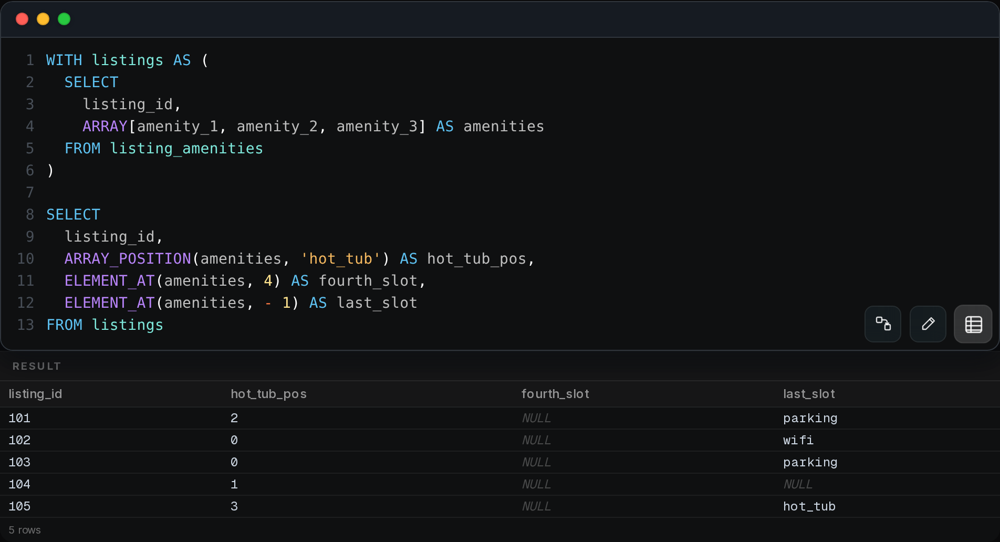

```sql
WITH listings AS (
  SELECT
    listing_id,
    ARRAY[amenity_1, amenity_2, amenity_3] AS amenities
  FROM listing_amenities
)

SELECT
  listing_id,
  ARRAY_POSITION(amenities, 'hot_tub') AS hot_tub_pos,
  ELEMENT_AT(amenities, 4) AS fourth_slot,
  ELEMENT_AT(amenities, - 1) AS last_slot
FROM listings
```


<br>

### Sorting with array_sort and reverse

`array_sort` orders the elements ascending and places every NULL at the end. The 1-argument form has no descending option, so descending order comes from `reverse(array_sort(...))`. Reverse flips the entire array, NULLs included, which moves them from the end to the front. Pair the sort with `element_at` and the NULL placement decides what the alphabetically last amenity turns out to be.

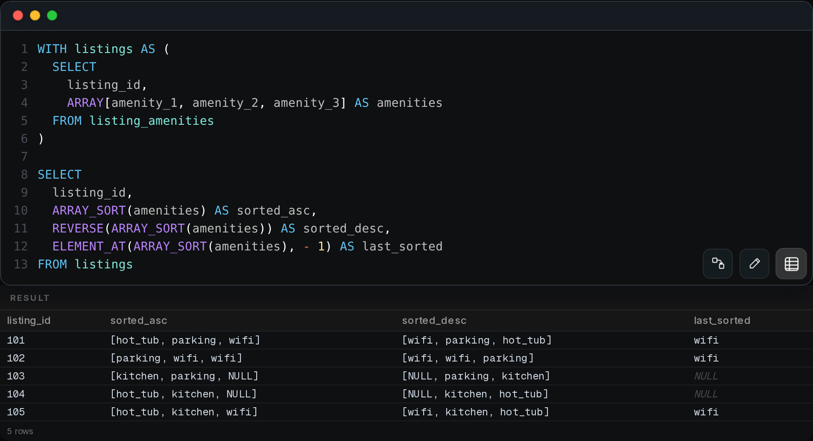

```sql
WITH listings AS (
  SELECT
    listing_id,
    ARRAY[amenity_1, amenity_2, amenity_3] AS amenities
  FROM listing_amenities
)

SELECT
  listing_id,
  ARRAY_SORT(amenities) AS sorted_asc,
  REVERSE(ARRAY_SORT(amenities)) AS sorted_desc,
  ELEMENT_AT(ARRAY_SORT(amenities), - 1) AS last_sorted
FROM listings
```

Listings 103 and 104 report NULL as `last_sorted`, because their blank slot sorted to the back. Removing NULLs before sorting, the job of the next section, makes the last element a real amenity.


<br>

### Modifying: append, remove, slice

No array function changes the stored column. Each one returns a new array for that row of the result. `amenities || 'smoke_alarm'` appends one element, and `||` between 2 arrays joins them end to end, as `concat(a, b)` does. `array_remove(amenities, 'wifi')` drops every element equal to wifi, so both copies on listing 102 go. `slice(amenities, 1, 2)` returns 2 elements starting at position 1.

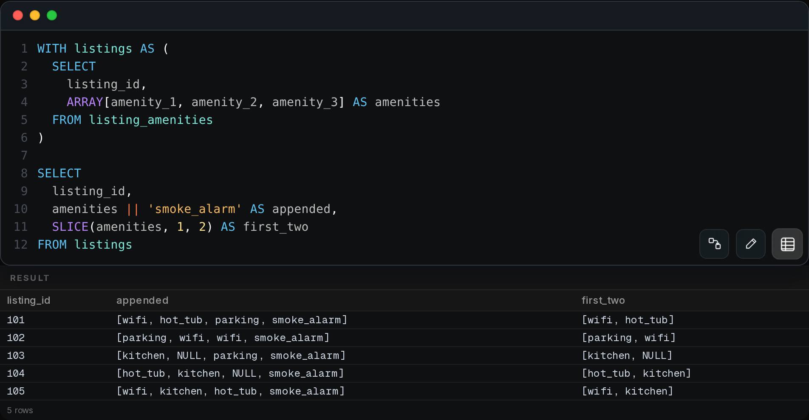

```sql
WITH listings AS (
  SELECT
    listing_id,
    ARRAY[amenity_1, amenity_2, amenity_3] AS amenities
  FROM listing_amenities
)

SELECT
  listing_id,
  amenities || 'smoke_alarm' AS appended,
  SLICE(amenities, 1, 2) AS first_two
FROM listings
```

Run on the 5 listings, `array_remove` leaves listing 102 with `[parking]` and keeps the NULL slots on 103 and 104. It drops only elements equal to wifi, and a NULL is not equal to wifi, so the blank slot stays in the result.

```sql
WITH listings AS (
  SELECT
    listing_id,
    ARRAY[amenity_1, amenity_2, amenity_3] AS amenities
  FROM listing_amenities
)

SELECT
  listing_id,
  amenities,
  ARRAY_REMOVE(amenities, 'wifi') AS no_wifi
FROM listings
```

| listing_id | amenities | no_wifi |
| --- | --- | --- |
| 101 | [wifi, hot_tub, parking] | [hot_tub, parking] |
| 102 | [parking, wifi, wifi] | [parking] |
| 103 | [kitchen, NULL, parking] | [kitchen, NULL, parking] |
| 104 | [hot_tub, kitchen, NULL] | [hot_tub, kitchen, NULL] |
| 105 | [wifi, kitchen, hot_tub] | [kitchen, hot_tub] |

> **TIP**
>
> The search value must match the array's element type. `contains(ARRAY[1, 2], '1')` fails with a type error because '1' is VARCHAR and the elements are INTEGER. Cast the search value, the same rule that applies to join keys of different types.

**Listing 106 has amenities [tv, NULL, wifi]. What does this query return for it?**

```sql
SELECT
  contains(amenities, 'pool') AS has_pool,
  array_position(amenities, 'wifi') AS wifi_pos
FROM listings
WHERE listing_id = 106
```

- **A.** false and 3, because pool appears nowhere in the array
- **B.** NULL and 3, because the NULL slot might be pool and still takes position 2
- **C.** NULL and 2, because the NULL slot is skipped when counting positions
- **D.** false and 2, because both functions ignore NULL elements entirely

<details>
<summary>Solution</summary>

**B.** NULL and 3, because the NULL slot might be pool and still takes position 2

A miss on an array with a NULL is unknown, and positions count every slot, so wifi sits at 3.

**Why the others are wrong**

- **A.** Position 3 is right, but contains cannot answer false while a NULL slot might hold pool.
- **C.** NULL is right for has_pool, but the NULL slot still occupies position 2, putting wifi at 3.
- **D.** Both parts are wrong: the NULL makes contains unknown, and it still counts as a position.

</details>


<br>

---

## Array Cleanup

Listing 102 counts 3 amenities but offers 2, and the NULL slots on 103 and 104 turn every search on those rows into NULL. Both defects trace back to collection: a host taps the same checkbox twice, and an unused slot is stored as NULL. Cleaning the list once means every function after it works on real, unique values. The examples here name the uncleaned column `raw_amenities`.


<br>

### array_distinct removes repeats

`array_distinct(raw_amenities)` keeps the first occurrence of each value and drops later copies, so the survivors stay in their original order. NULL counts as one more value: a single NULL survives, and an array holding 3 NULLs keeps 1. `cardinality` counts every element, NULLs included, which is why listing 103 still reports 3 after deduplication.

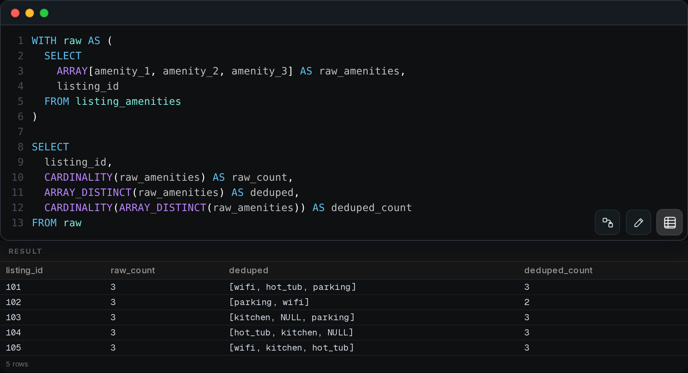

```sql
WITH raw AS (
  SELECT
    ARRAY[amenity_1, amenity_2, amenity_3] AS raw_amenities,
    listing_id
  FROM listing_amenities
)

SELECT
  listing_id,
  CARDINALITY(raw_amenities) AS raw_count,
  ARRAY_DISTINCT(raw_amenities) AS deduped,
  CARDINALITY(ARRAY_DISTINCT(raw_amenities)) AS deduped_count
FROM raw
```


<br>

### Removing NULLs: the call that backfires

The tempting call is `array_remove(raw_amenities, NULL)`, and it returns NULL for every row: `array_remove` hands back NULL whenever its second argument is NULL, before it looks at the array. Even with that rule lifted, it removes elements equal to the argument, and `NULL = NULL` is never true.

The call that works is `array_except(raw_amenities, ARRAY[CAST(NULL AS VARCHAR)])`. `array_except(x, y)` returns the elements of `x` that are absent from `y`, and as a set operation it lets a NULL in `x` match the NULL in `y`. The CAST gives the 1-element array the VARCHAR type the amenities have.

```sql
WITH raw AS (
  SELECT
    ARRAY[amenity_1, amenity_2, amenity_3] AS raw_amenities,
    listing_id
  FROM listing_amenities
)

SELECT
  listing_id,
  ARRAY_REMOVE(raw_amenities, NULL) AS removed,
  ARRAY_EXCEPT(raw_amenities, ARRAY[CAST(NULL AS VARCHAR)]) AS excepted
FROM raw
```

| listing_id | removed | excepted |
| --- | --- | --- |
| 101 | NULL | [wifi, hot_tub, parking] |
| 102 | NULL | [parking, wifi] |
| 103 | NULL | [kitchen, parking] |
| 104 | NULL | [hot_tub, kitchen] |
| 105 | NULL | [wifi, kitchen, hot_tub] |

Listing 102 in the `excepted` column reads `[parking, wifi]`. Set functions always return distinct elements, so `array_except` dropped the second wifi along with the NULLs. For amenities that is the goal, since a listing either has wifi or lacks it. For sequences where repeats carry information, such as the pages a guest viewed in order, the same call erases data; a later lesson covers filtering that keeps repeats.

| call on the raw array | listing 102 | listing 103 |
| --- | --- | --- |
| array_distinct(x) | [parking, wifi] | [kitchen, NULL, parking] |
| array_remove(x, NULL) | NULL | NULL |
| array_except(x, ARRAY[NULL]) | [parking, wifi] | [kitchen, parking] |

The set functions, all deduplicating

- array_union(x, y): every distinct element found in either array.
- array_intersect(x, y): the distinct elements present in both arrays.
- array_except(x, y): the distinct elements of x that y does not hold.


<br>

### Clean once, then search

With NULLs gone, `contains` sees every element and returns false on a miss. The CTE below cleans in one place, and the no-wifi filter, written here as a comparison with false, now returns listings 103 and 104 with no COALESCE.

```sql
WITH clean AS (
  SELECT
    ARRAY_EXCEPT(
      ARRAY[amenity_1, amenity_2, amenity_3],
      ARRAY[CAST(NULL AS VARCHAR)]
    ) AS amenities,
    listing_id
  FROM listing_amenities
)

SELECT
  listing_id,
  amenities
FROM clean
WHERE CONTAINS(amenities, 'wifi') = FALSE
```

| listing_id | amenities |
| --- | --- |
| 103 | [kitchen, parking] |
| 104 | [hot_tub, kitchen] |

The gap between raw and clean sizes doubles as a data-quality measure. Summed across listings, it counts the junk slots a cleanup step removed, a figure worth tracking as new hosts arrive.

```sql
WITH raw AS (
  SELECT
    ARRAY[amenity_1, amenity_2, amenity_3] AS raw_amenities,
    listing_id
  FROM listing_amenities
)

SELECT
  COUNT(*) AS listings,
  SUM(
    CARDINALITY(raw_amenities) - CARDINALITY(
      ARRAY_EXCEPT(raw_amenities, ARRAY[CAST(NULL AS VARCHAR)])
    )
  ) AS junk_slots
FROM raw
```

| listings | junk_slots |
| --- | --- |
| 5 | 3 |

The 3 junk slots are the second wifi on listing 102 and the NULL slots on 103 and 104. The raw arrays hold 15 elements and the cleaned ones 12, so 1 slot in 5 was junk. A jump in that ratio after a release points at the form that collects amenities.

| ✓ Do | ✗ Don't |
| --- | --- |
| • Clean arrays in one CTE and point every later step at the clean column<br><br>• Drop NULLs from set-like lists with array_except and a 1-element NULL array<br><br>• Compare cardinality before and after cleanup to measure how much changed | • Don't pass NULL to array_remove; it returns a NULL array<br><br>• Don't deduplicate sequences where repeats carry meaning, like page views<br><br>• Don't search arrays with contains while NULL slots remain in them |

**Listing 107's raw array is [pool, NULL, pool, NULL]. What do the 2 cleanup columns return for it?**

```sql
SELECT
  array_distinct(raw_amenities) AS deduped,
  array_except(raw_amenities, ARRAY[CAST(NULL AS VARCHAR)]) AS cleaned
FROM raw
WHERE listing_id = 107
```

- **A.** [pool] and [pool], because both functions drop NULL elements as they go
- **B.** [pool, NULL] and [pool, pool], because except keeps repeats and drops NULLs
- **C.** [pool, NULL] and [pool], because distinct keeps one NULL and except drops it
- **D.** NULL and NULL, because a NULL element makes both calls return a NULL array

<details>
<summary>Solution</summary>

**C.** [pool, NULL] and [pool], because distinct keeps one NULL and except drops it

array_distinct keeps the first copy of each value, NULL included. array_except removes the NULL and returns distinct elements.

**Why the others are wrong**

- **A.** cleaned is right, but array_distinct treats NULL as a value and keeps one copy of it.
- **B.** deduped is right, but array_except is a set function, so the second pool goes too.
- **D.** Only array_remove with a NULL argument returns NULL. Both of these calls read the elements and return arrays.

</details>


<br>

---

## Map Operations

A map stores key-value pairs in one cell. Each key appears once, and every value shares one type. Listing settings fit that shape: each host sets a check-in time, a pet policy and a guest limit. The examples build a `settings` map per listing from 3 columns of `listing_settings`, keeping every value as VARCHAR so times, words and numbers can live in the same map.

| listing_id | settings |
| --- | --- |
| 101 | {checkin=16:00, pets=yes, max_guests=4} |
| 102 | {checkin=15:00, pets=no, max_guests=10} |
| 103 | {checkin=14:00, pets=yes, max_guests=2} |

`element_at(settings, 'pets')` reads a value by key, the same function that read arrays by position. A key the map lacks returns NULL. The bracket form `settings['pets']` fails the query on a missing key, so it belongs only where every row is known to carry that key.


<br>

### Merging with map_concat

`map_concat(a, b)` combines 2 maps. A key found in only one map passes through; when both hold a key, the value from the later argument wins. That rule turns argument order into a policy. Put platform defaults first and host settings second, and hosts override the defaults. Reverse them, and the defaults overwrite what hosts chose, with no error to warn you.

```sql
WITH with_settings AS (
  SELECT
    listing_id,
    MAP(
      ARRAY['checkin', 'pets', 'max_guests'],
      ARRAY[checkin, pets, max_guests]
    ) AS settings,
    MAP(
      ARRAY['pets', 'quiet_hours', 'checkout'],
      ARRAY['no', '22:00', '11:00']
    ) AS defaults
  FROM listing_settings
)

SELECT
  listing_id,
  ELEMENT_AT(MAP_CONCAT(defaults, settings), 'pets') AS host_wins,
  ELEMENT_AT(MAP_CONCAT(settings, defaults), 'pets') AS default_wins,
  ELEMENT_AT(MAP_CONCAT(defaults, settings), 'quiet_hours') AS quiet_hours,
  CARDINALITY(MAP_CONCAT(defaults, settings)) AS rule_count
FROM with_settings
```

| listing_id | host_wins | default_wins | quiet_hours | rule_count |
| --- | --- | --- | --- | --- |
| 101 | yes | no | 22:00 | 5 |
| 102 | no | no | 22:00 | 5 |
| 103 | yes | no | 22:00 | 5 |

Listing 102's host chose no, so both orders agree on that row, and only 101 and 103 reveal which order ran. Quiet hours come from the defaults in either order, since no host set them. Each merged map holds 5 keys: the 3 host settings plus quiet_hours and checkout, with pets counted once.

> **TIP**
>
> A key paired with NULL in the later map still wins. If an override column is NULL and goes into the map anyway, the merge replaces a useful default with NULL. Check override values for NULL before building the map that goes second.


<br>

### Filtering rows and entries

Two kinds of filter apply to maps. A row filter keeps rows whose map holds some entry: `WHERE element_at(settings, 'pets') = 'yes'`. A row without a pets key gets NULL from `element_at`, the comparison is NULL, and the row drops out. An entry filter keeps chosen keys and discards the rest, and one way that needs no new function is to rebuild the map from the keys you want, reading each value with `element_at`.

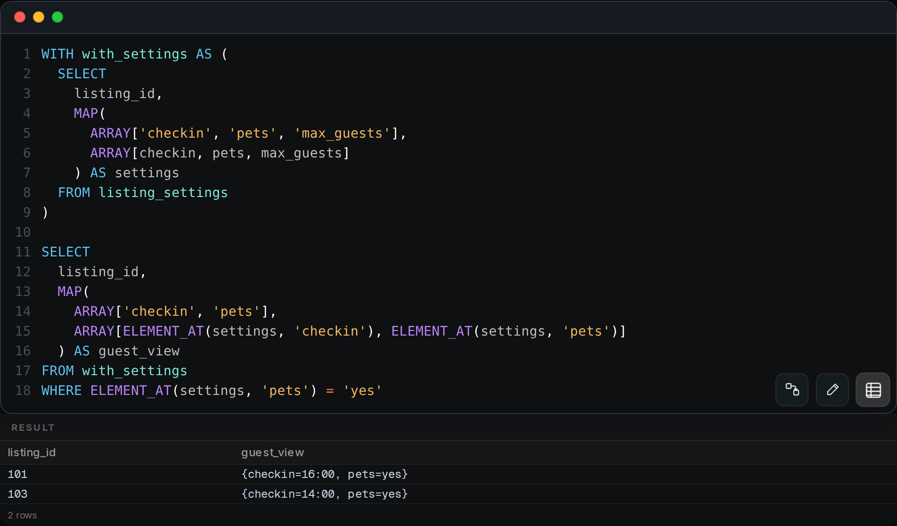

```sql
WITH with_settings AS (
  SELECT
    listing_id,
    MAP(
      ARRAY['checkin', 'pets', 'max_guests'],
      ARRAY[checkin, pets, max_guests]
    ) AS settings
  FROM listing_settings
)

SELECT
  listing_id,
  MAP(
    ARRAY['checkin', 'pets'],
    ARRAY[ELEMENT_AT(settings, 'checkin'), ELEMENT_AT(settings, 'pets')]
  ) AS guest_view
FROM with_settings
WHERE ELEMENT_AT(settings, 'pets') = 'yes'
```

The rebuilt map always carries both keys. If a listing had no checkin entry, its `guest_view` would still list the key, paired with NULL, which a consumer may read differently from an absent key. To test whether a key exists, search the key array: `contains(map_keys(settings), 'checkin')`.


<br>

### Transforming through keys and values

`map_keys(settings)` and `map_values(settings)` return the map's contents as 2 arrays in matching order, which opens up every array function from the first 2 sections. Entry order inside a map is not something to depend on, so wrap `map_keys` in `array_sort` before displaying or comparing key lists. A value pulled out by key can be cast to its real type, which lets guest limits sort as numbers.

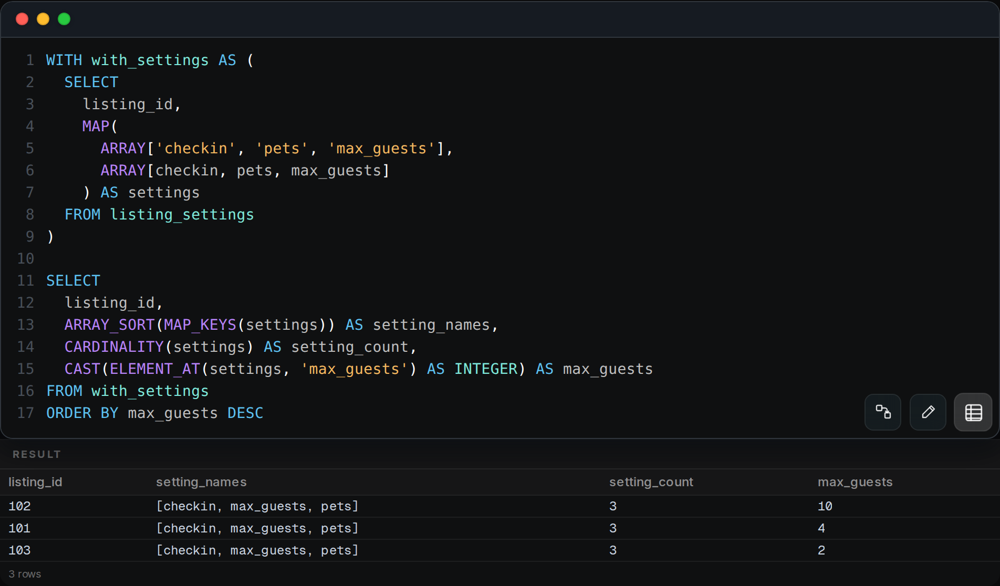

```sql
WITH with_settings AS (
  SELECT
    listing_id,
    MAP(
      ARRAY['checkin', 'pets', 'max_guests'],
      ARRAY[checkin, pets, max_guests]
    ) AS settings
  FROM listing_settings
)

SELECT
  listing_id,
  ARRAY_SORT(MAP_KEYS(settings)) AS setting_names,
  CARDINALITY(settings) AS setting_count,
  CAST(ELEMENT_AT(settings, 'max_guests') AS INTEGER) AS max_guests
FROM with_settings
ORDER BY max_guests DESC
```

| ✓ Arrays | ✗ Maps |
| --- | --- |
| • Read by position: element_at(arr, 2)<br><br>• Search values: contains(arr, v)<br><br>• Repeats allowed<br><br>• Order carries meaning | • Read by key: element_at(m, 'pets')<br><br>• Search keys: contains(map_keys(m), k)<br><br>• Each key once<br><br>• Entry order not guaranteed |

**Listing 103's settings map is {checkin=14:00, pets=yes, max_guests=2}. What do pets and n come back as?**

```sql
WITH with_settings AS (
  SELECT
    listing_id,
    MAP(ARRAY['checkin', 'pets', 'max_guests'], ARRAY[checkin, pets, max_guests]) AS settings
  FROM listing_settings
),
merged AS (
  SELECT
    listing_id,
    map_concat(settings, MAP(ARRAY['pets', 'checkout'], ARRAY['no', '11:00'])) AS rules
  FROM with_settings
)
SELECT
  element_at(rules, 'pets') AS pets,
  cardinality(rules) AS n
FROM merged
WHERE listing_id = 103
```

- **A.** yes and 4, because a host's own setting always takes priority
- **B.** no and 5, because each map contributes its own pets entry
- **C.** yes and 5, because maps keep the first value and count every entry
- **D.** no and 4, because the later map wins on pets and keeps the key once

<details>
<summary>Solution</summary>

**D.** no and 4, because the later map wins on pets and keeps the key once

The second map's no replaces yes, and the keys are checkin, pets, max_guests and checkout.

**Why the others are wrong**

- **A.** The count is right, but map_concat has no notion of host priority: the later map wins.
- **B.** The value is right, but a map holds each key once, so pets counts as 1 of 4 keys.
- **C.** Both are wrong: the later value wins, and the shared pets key appears once.

</details>


<br>

---

## JSON_EXTRACT_SCALAR()

The listing editor logs each save as a JSON document in a VARCHAR column named `payload`. `json_extract` pulls a fragment out by path and returns it as JSON, so a string comes back wrapped in its quotes and an object comes back whole. That suits a fragment headed for more JSON processing, and it gets in the way when you want a plain value to filter, group or join on.

`json_extract_scalar(payload, '$.address.city')` returns the value as VARCHAR with the quotes removed. It handles strings, numbers and booleans. A path that lands on an object or an array, a path that does not exist, and a JSON null all give SQL NULL.

json_extract returns JSON

| path | result |
| --- | --- |
| $.address.city | "Austin" |
| $.max_guests | 4 |
| $.superhost | true |
| $.address | {"city":"Austin","zip":"78701"} |
| $.pool | NULL |

json_extract_scalar returns VARCHAR

| path | result |
| --- | --- |
| $.address.city | Austin |
| $.max_guests | 4 |
| $.superhost | true |
| $.address | NULL |
| $.pool | NULL |

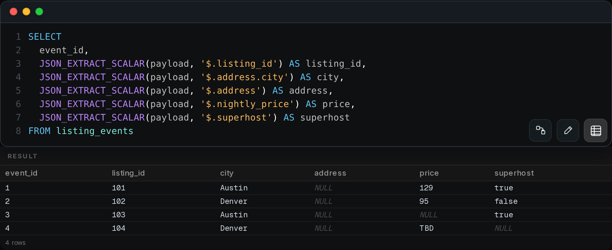

```sql
SELECT
  event_id,
  JSON_EXTRACT_SCALAR(payload, '$.listing_id') AS listing_id,
  JSON_EXTRACT_SCALAR(payload, '$.address.city') AS city,
  JSON_EXTRACT_SCALAR(payload, '$.address') AS address,
  JSON_EXTRACT_SCALAR(payload, '$.nightly_price') AS price,
  JSON_EXTRACT_SCALAR(payload, '$.superhost') AS superhost
FROM listing_events
```

Event 3's price is NULL because its JSON holds null, and event 4's superhost is NULL because the key is absent. The column cannot tell those 2 cases apart, and the next section shows how to list the keys each document carries. Event 4's price arrives as the text TBD, which matters as soon as the column is cast.


<br>

### Paths into nested fields and arrays

Path syntax in this lesson

- $.max_guests: a top-level key.
- $.address.city: a key inside a nested object, one dot per level.
- $.amenities[0]: the first element of a JSON array. Path indexes start at 0, while SQL array positions start at 1.
- $.amenities: a whole array, so json_extract_scalar returns NULL for it.

Applied to the 4 save events, those paths reach into the address object and pick amenities by index. Event 4 returns NULL twice, for 2 different reasons: its address carries no zip key, and its third amenity is a JSON null. Index 2 is the third element, so event 1 shows parking in that column.

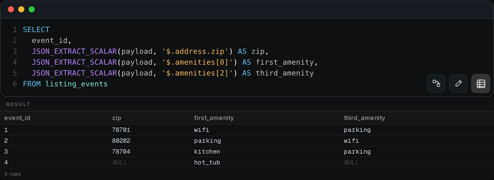

```sql
SELECT
  event_id,
  JSON_EXTRACT_SCALAR(payload, '$.address.zip') AS zip,
  JSON_EXTRACT_SCALAR(payload, '$.amenities[0]') AS first_amenity,
  JSON_EXTRACT_SCALAR(payload, '$.amenities[2]') AS third_amenity
FROM listing_events
```


<br>

### Every result is VARCHAR

Numbers come out as text, and text compares character by character. Sorting guest limits of 4, 10, 2 and 6 in descending order as text gives 6, 4, 2, 10, because the character 6 outranks the character 1. The first tab sorts the raw strings. The second casts to INTEGER inside the SELECT, so the sort sees numbers.

Sorts VARCHAR values: listing 102 with 10 guests lands last.

|  |  |
| --- | --- |
|  | SELECT |
|  | JSON_EXTRACT_SCALAR(payload, '$.listing_id') AS listing_id, |
|  | JSON_EXTRACT_SCALAR(payload, '$.max_guests') AS max_guests |
|  | FROM listing_events |
|  | ORDER BY max_guests DESC |

Result

| listing_id | max_guests |
| --- | --- |
| 104 | 6 |
| 101 | 4 |
| 103 | 2 |
| 102 | 10 |

4 rows

CAST stops the whole query when one value will not convert, and event 4's price is TBD. `TRY_CAST` returns NULL for that row and lets the others through. Wrapped around the extraction, it gives a column that aggregates cleanly, and `COUNT` over that column reports how many rows had a usable price.

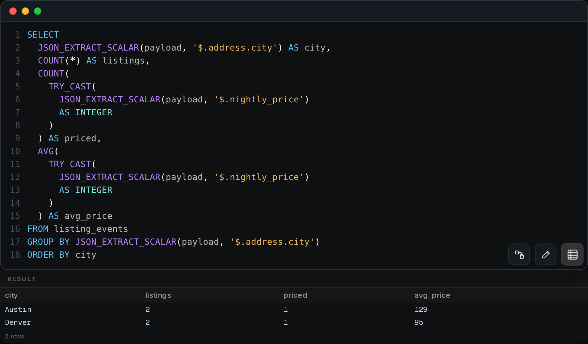

```sql
SELECT
  JSON_EXTRACT_SCALAR(payload, '$.address.city') AS city,
  COUNT(*) AS listings,
  COUNT(
    TRY_CAST(
      JSON_EXTRACT_SCALAR(payload, '$.nightly_price')
      AS INTEGER
    )
  ) AS priced,
  AVG(
    TRY_CAST(
      JSON_EXTRACT_SCALAR(payload, '$.nightly_price')
      AS INTEGER
    )
  ) AS avg_price
FROM listing_events
GROUP BY JSON_EXTRACT_SCALAR(payload, '$.address.city')
ORDER BY city
```

> **TIP**
>
> Booleans arrive as the strings 'true' and 'false'. Comparing to the string 'true' works in a WHERE clause, and CAST(... AS BOOLEAN) converts them to real BOOLEAN values for AND, OR and NOT logic.

> Choosing the extractor
>
> - `json_extract`: the value stays JSON, for another JSON function or a cast to ARRAY or MAP.
> - `json_extract_scalar`: a string, number or boolean as VARCHAR, ready to filter, group or join.
> - `CAST` or `TRY_CAST` around `json_extract_scalar`: whenever the value is a number or a boolean.

**Event 1's payload holds "amenities": ["wifi", "hot_tub", "parking"]. What does this query return for it?**

```sql
SELECT
  json_extract_scalar(payload, '$.amenities[1]') AS amenity
FROM listing_events
WHERE event_id = 1
```

- **A.** hot_tub, because path indexes start at 0 and the result is unquoted VARCHAR
- **B.** wifi, because indexes start at 1 here, as they do for element_at
- **C.** "hot_tub" in quotes, because the value comes out of a JSON array
- **D.** NULL, because json_extract_scalar returns NULL for any path into an array

<details>
<summary>Solution</summary>

**A.** hot_tub, because path indexes start at 0 and the result is unquoted VARCHAR

Index 1 in a JSON path is the second element, and a string comes back without its quotes.

**Why the others are wrong**

- **B.** Paths count from 0, so index 1 skips wifi. Only SQL array positions start at 1.
- **C.** The element is right, but quotes stay only with json_extract, which returns JSON.
- **D.** It returns NULL when the path ends on an array. This path ends on a string element.

</details>


<br>

---

## CAST JSON to Array/Map

`json_extract_scalar` returns NULL for `$.amenities` and `$.address`, which leaves the payload's arrays and objects out of reach. To search, sort or clean them with the functions from earlier sections, convert the JSON into native types: `CAST(json_value AS ARRAY(VARCHAR))` or `CAST(json_value AS MAP(VARCHAR, VARCHAR))`.

The cast needs a JSON-typed input. `json_extract(payload, '$.amenities')` supplies one, since it returns JSON. When a whole VARCHAR column is one JSON document, `json_parse(payload)` turns the text into JSON. Casting the VARCHAR straight to ARRAY fails, because a string has no conversion to an array; the text has to be parsed first.

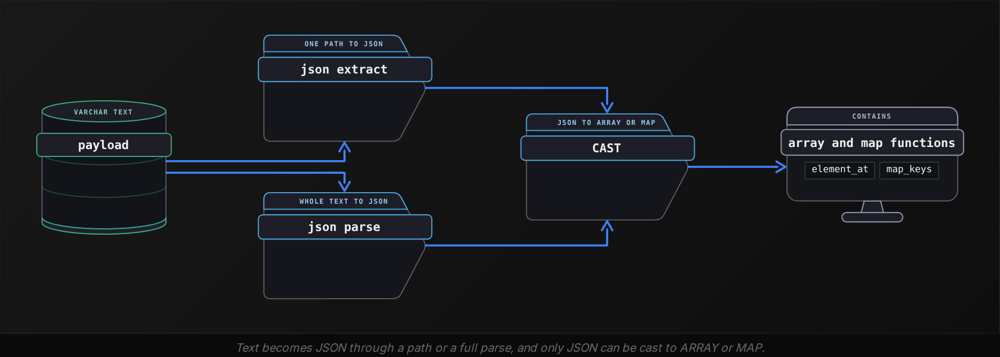


<br>

### JSON arrays into SQL arrays

Each JSON array element becomes one SQL element, and a JSON null element becomes a SQL NULL. Event 3's amenities arrive as `[kitchen, NULL, parking]`, the same blank slot the first 2 sections handled, and the same cleanup applies once the cast is done. The `has_hot_tub` column reads the uncleaned array on purpose: listing 103 gets NULL, and pointing `contains` at `clean` would give false.

```sql
WITH parsed AS (
  SELECT
    JSON_EXTRACT_SCALAR(payload, '$.listing_id') AS listing_id,
    CAST(
      JSON_EXTRACT(payload, '$.amenities')
      AS ARRAY(VARCHAR)
    ) AS amenities
  FROM listing_events
)

SELECT
  listing_id,
  amenities,
  ARRAY_EXCEPT(amenities, ARRAY[CAST(NULL AS VARCHAR)]) AS clean,
  CONTAINS(amenities, 'hot_tub') AS has_hot_tub
FROM parsed
```

| listing_id | amenities | clean | has_hot_tub |
| --- | --- | --- | --- |
| 101 | [wifi, hot_tub, parking] | [wifi, hot_tub, parking] | true |
| 102 | [parking, wifi, wifi] | [parking, wifi] | false |
| 103 | [kitchen, NULL, parking] | [kitchen, parking] | NULL |
| 104 | [hot_tub, kitchen, NULL] | [hot_tub, kitchen] | true |

**Event 7's payload holds "amenities": ["wifi", null, "wifi"]. What does this query return?**

```sql
SELECT
  cardinality(array_distinct(CAST(json_extract(payload, '$.amenities') AS ARRAY(VARCHAR)))) AS n
FROM listing_events
WHERE event_id = 7
```

- **A.** 1, because array_distinct drops the NULL along with the second wifi
- **B.** 3, because the cast keeps all 3 elements and cardinality counts them
- **C.** 2, because array_distinct keeps one wifi and one NULL, and both count
- **D.** NULL, because a JSON null element makes the whole cast fail

<details>
<summary>Solution</summary>

**C.** 2, because array_distinct keeps one wifi and one NULL, and both count

The cast gives [wifi, NULL, wifi], deduplication leaves [wifi, NULL], and cardinality counts NULLs.

**Why the others are wrong**

- **A.** The second wifi goes, but array_distinct keeps one NULL as a value of its own.
- **B.** The cast does keep 3 elements, but array_distinct runs before cardinality counts.
- **D.** A JSON null element becomes a SQL NULL element; the cast still succeeds.

</details>


<br>

### JSON objects into maps

An object casts to a map with its field names as keys. JSON object keys are always strings, so the key type is VARCHAR. The value type is yours to pick, and every value has to convert to it. All fields of `address` are strings, so `MAP(VARCHAR, VARCHAR)` fits, and `element_at` returns NULL for the zip that event 4 never sent.

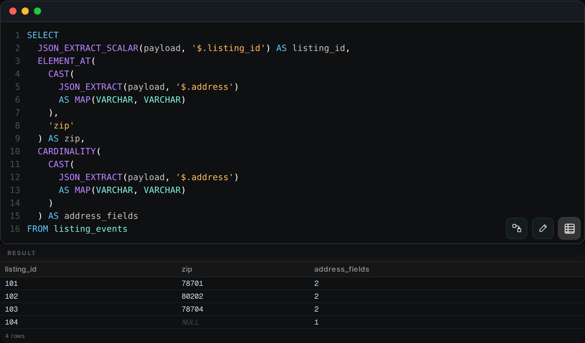

```sql
SELECT
  JSON_EXTRACT_SCALAR(payload, '$.listing_id') AS listing_id,
  ELEMENT_AT(
    CAST(
      JSON_EXTRACT(payload, '$.address')
      AS MAP(VARCHAR, VARCHAR)
    ),
    'zip'
  ) AS zip,
  CARDINALITY(
    CAST(
      JSON_EXTRACT(payload, '$.address')
      AS MAP(VARCHAR, VARCHAR)
    )
  ) AS address_fields
FROM listing_events
```


<br>

### Mixed values: MAP(VARCHAR, JSON)

The full payload mixes numbers, booleans, an object and an array, and no single SQL type holds them all. JSON does: casting to `MAP(VARCHAR, JSON)` keeps each value as a JSON fragment, so the cast succeeds on any object. `map_keys` of that map lists the fields each document carries. Event 4 has no superhost key, while event 3 carries a nightly_price key whose value is null.

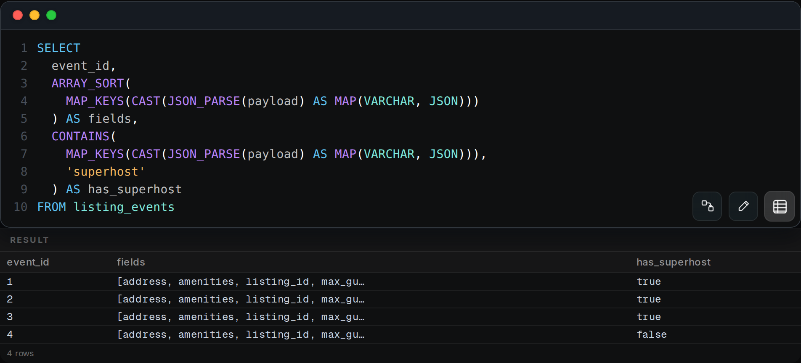

```sql
SELECT
  event_id,
  ARRAY_SORT(
    MAP_KEYS(CAST(JSON_PARSE(payload) AS MAP(VARCHAR, JSON)))
  ) AS fields,
  CONTAINS(
    MAP_KEYS(CAST(JSON_PARSE(payload) AS MAP(VARCHAR, JSON))),
    'superhost'
  ) AS has_superhost
FROM listing_events
```


<br>

### When a cast meets the wrong data

CAST converts all or nothing. If one element in one row cannot become the target type, the query stops with an error. `TRY_CAST` returns NULL for that row's entire value, never a partial array. The table shows what each input becomes as `ARRAY(INTEGER)`.

| JSON input | CAST AS ARRAY(INTEGER) | TRY_CAST AS ARRAY(INTEGER) |
| --- | --- | --- |
| [1, 2, 3] | [1, 2, 3] | [1, 2, 3] |
| [1, null, 3] | [1, NULL, 3] | [1, NULL, 3] |
| [1, "two", 3] | query fails | NULL |
| {"a": 1} | query fails | NULL |

Take the whole payload. `TRY_CAST(json_parse(payload) AS MAP(VARCHAR, INTEGER))` returns NULL on all 4 events: every event carries an address object and an amenities array, and neither converts to an integer, so each guest limit is lost with them. Cast to `MAP(VARCHAR, JSON)` instead and all 4 succeed, while `TRY_CAST(json_extract_scalar(payload, '$.max_guests') AS INTEGER)` still reads 6 for event 4.

> **TIP**
>
> Start with the loosest type the data allows. ARRAY(JSON) and MAP(VARCHAR, JSON) accept any values of the right outer shape, and each value can be extracted and cast on its own afterwards, so one bad field costs one NULL.


<br>

---

## Putting It All Together

Picture a search team at Airbnb building a nightly listings table from the editor's JSON save events, so that a guest's amenity filter matches the right homes and each listing page shows complete house rules.

- Paths read listing_id, city and max_guests with json_extract_scalar , and each is cast to its real type so guest limits filter and sort as numbers.
- CAST ( json_extract ( payload , '$.amenities' ) AS ARRAY ( VARCHAR ) ) turns the amenity list into an array, with JSON nulls arriving as NULL slots.
- array_except with a 1-element NULL array clears those slots and repeats once, so every wifi or hot tub filter gets a true or false from contains .
- The house-rules object casts to MAP ( VARCHAR , VARCHAR ) , and map_concat with platform defaults first fills in every rule a host never set.
- map_keys over MAP ( VARCHAR , JSON ) audits which fields each editor version sends before the other steps depend on them.


<br>

---

## Key Takeaways

- contains returns NULL when the value is missing and the array holds a NULL, so NOT contains drops those rows without any error.
- SQL array positions start at 1: array_position returns 0 on a miss, and element_at returns NULL past the end and counts back from a negative position.
- array_sort puts NULLs last and reverse moves them first, and every array function returns a new array while the column stays as stored.
- array_distinct keeps one NULL, array_remove ( x , NULL ) returns NULL, and array_except with a 1-element NULL array drops NULLs and repeats together.
- map_concat lets the later map win on a shared key, so the order of defaults and overrides is a decision about which survives.
- json_extract_scalar returns VARCHAR or NULL, so numbers are cast before sorting or summing, with TRY_CAST wherever text can appear.
- JSON arrays and objects become ARRAY and MAP through CAST from a JSON input, and MAP ( VARCHAR , JSON ) accepts any object.
