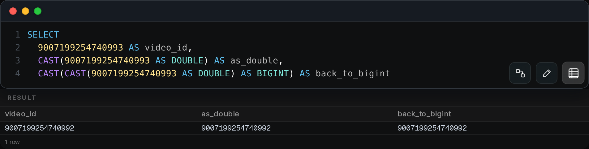
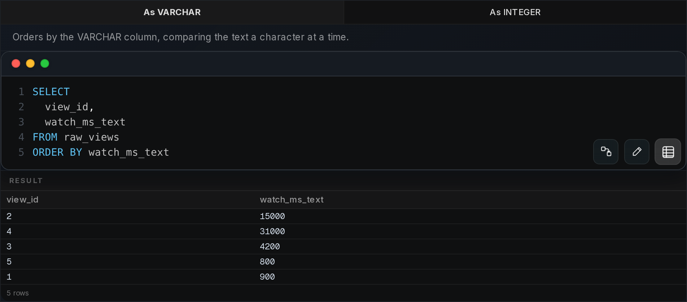
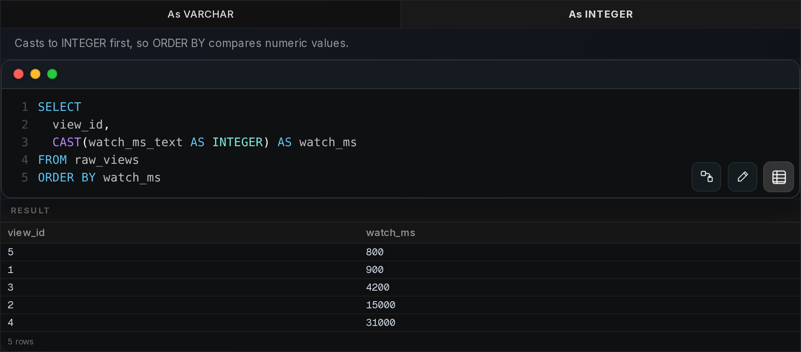
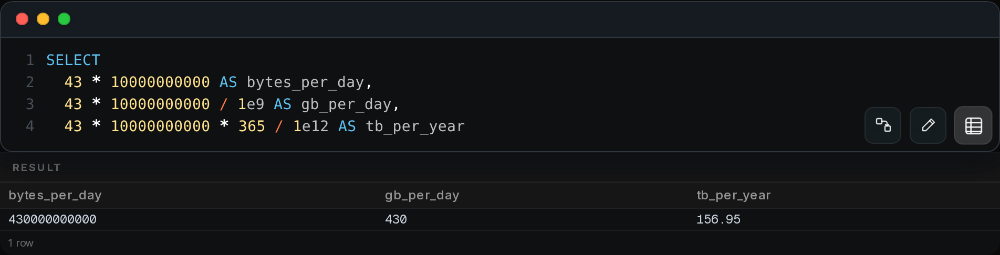
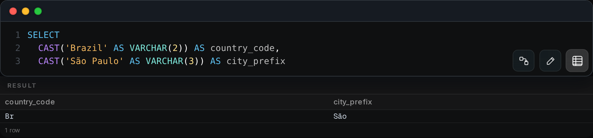
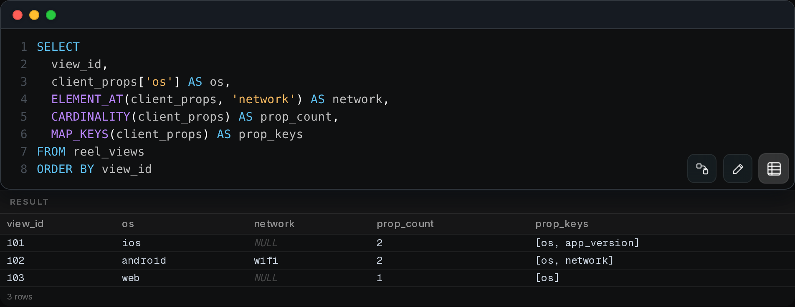
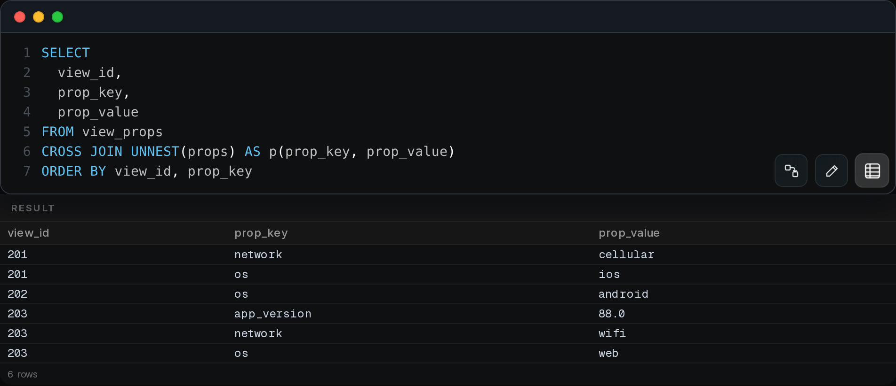
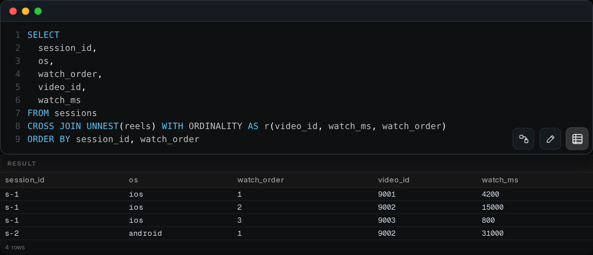
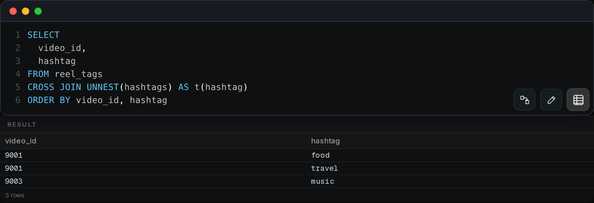
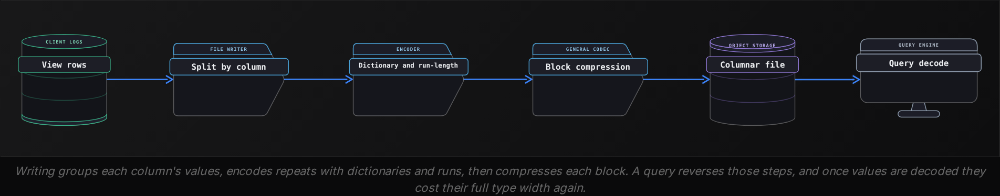

# Data Types: Advanced

In a Reels view-logging table at Meta, every column you add is multiplied by billions of rows. A teammate's draft schema stores watch time as VARCHAR, video IDs as DOUBLE, and every new client attribute as its own column. Your type choices decide whether that table costs gigabytes or terabytes, and whether next week's backfill finishes or dies on one malformed value.


<br>

---

## Type optimization at scale

A column's type fixes how many bytes each value occupies once the engine reads it, and that width is paid on every row. At 10 billion rows, 1 extra byte per row is 10 GB more that the engine scans and holds in memory on every query that touches the column, and that data also travels between machines. The table below lists the widths you are choosing between.

| Type | Bytes per value | What it holds |
| --- | --- | --- |
| TINYINT | 1 | Integers from -128 to 127 |
| SMALLINT | 2 | Integers from -32,768 to 32,767 |
| INTEGER | 4 | Integers up to about 2.1 billion either way |
| BIGINT | 8 | Integers up to about 9.2 quintillion either way |
| REAL | 4 | Floating point, about 7 significant digits |
| DOUBLE | 8 | Floating point, about 15 significant digits |
| DECIMAL(p,s), p up to 18 | 8 | Exact decimals |
| DECIMAL(p,s), p 19 to 38 | 16 | Exact decimals, wider |
| DATE | 4 | A calendar day |
| TIMESTAMP | 8 | A date and time to the millisecond |
| BOOLEAN | 1 | true or false |

*These are the widths the engine uses for each value in memory. Files on disk usually hold less, which the compression section covers.*


<br>

### Size each column to its worst case

Pick the narrowest type that holds the largest value the column could ever take, judged by what the value measures. watch_ms in the Reels view log is a single view's watch time in milliseconds. `SMALLINT` stops at 32,767, under 33 seconds, so the first long view breaks it. `INTEGER` reaches 2,147,483,647 ms, almost 25 days, far past any single view, so it fits with room to spare, while `BIGINT` would spend 4 more bytes per row on range no view will use. IDs are the exception: generators at this scale hand out 64-bit values, and a narrower column fails the first time an ID passes its ceiling, so IDs get `BIGINT`.

> Where narrowing goes wrong
>
> - Floating types for IDs: DOUBLE holds every integer exactly only up to 9,007,199,254,740,992, and REAL only up to 16,777,216.
> - Running totals in INTEGER: a single view's milliseconds fit, while a reel's lifetime watch time passes 2,147,483,647 soon after launch.
> - Numbers and dates as VARCHAR: values take more bytes and sort as text. Any query that does math on them needs a CAST first.


Here is the first of those traps on a realistic video ID. Predict the last column, then run it.



```sql
SELECT
  9007199254740993 AS video_id,
  CAST(9007199254740993 AS DOUBLE) AS as_double,
  CAST(CAST(9007199254740993 AS DOUBLE) AS BIGINT) AS back_to_bigint
```

A DOUBLE keeps 53 bits for its digits, so above 2 to the 53rd power it can only land on even numbers. The ID ending in 993 comes back ending in 992, and 2 different videos now share an ID: views of one get credited to the other, with no error anywhere.


<br>

### Text that holds numbers sorts as text

Raw logs often land with every field as text. Keeping `watch_ms` as VARCHAR costs more bytes than INTEGER and changes how values compare: text is compared character by character, so '15000' sorts ahead of '800' because '1' comes before '8'. Predict the order in each version before you run it.

**As VARCHAR**

Orders by the VARCHAR column, comparing the text a character at a time.



```sql
SELECT
  view_id,
  watch_ms_text
FROM raw_views
ORDER BY watch_ms_text
```

**As INTEGER**

Casts to INTEGER first, so ORDER BY compares numeric values.



```sql
SELECT
  view_id,
  CAST(watch_ms_text AS INTEGER) AS watch_ms
FROM raw_views
ORDER BY watch_ms
```

The VARCHAR version returns 15000, 31000, 4200, 800, 900, the order a word list would file them in. The INTEGER version returns 800, 900, 4200, 15000, 31000. The cast fixes the order, and the worst-case rule from earlier decides which integer type it targets. A single view's milliseconds stay under INTEGER's ceiling. A column that adds views together keeps growing, so its worst case is its largest future total.

**A video_stats table keeps a row per reel with lifetime_watch_ms, the total milliseconds all viewers have spent on that reel. Which type should the column use?**

- **A.** INTEGER, since 4 bytes per row halves the cost of BIGINT
- **B.** DOUBLE, since it reaches far larger totals in 8 bytes
- **C.** BIGINT, since a lifetime total can outgrow INTEGER's ceiling
- **D.** DECIMAL(38,0), since an exact decimal never overflows

<details>
<summary>Solution</summary>

**C.** BIGINT, since a lifetime total can outgrow INTEGER's ceiling

BIGINT reaches around 9.2 quintillion milliseconds, far beyond any reel's total, and stays exact. Sizing to the worst case means sizing to the column's growth.

**Why the others are wrong**

- **A.** INTEGER stops at 2,147,483,647 ms, almost 25 days of total watching, which a popular reel passes soon after launch. The column would overflow.
- **B.** DOUBLE costs the same 8 bytes as BIGINT and gains nothing here, and its arithmetic stays exact on integers only up to 2 to the 53rd power.
- **D.** DECIMAL(38,0) is exact but takes 16 bytes per value, twice BIGINT, for range no reel will use, and it does overflow past 38 digits.

</details>


<br>

---

## Storage calculations and VARCHAR

An estimate needs 2 numbers: how many rows, and how many bytes per row. Bytes per row is the sum of the fixed widths from the type table plus the average size of each VARCHAR. The product is the decoded size, the bytes a query works through after it reads the files. Compression makes files smaller, so treat the figure as a ceiling for storage and as the working size whenever a query scans or sorts the data. Rows sent between machines travel at that size too.


<br>

### Price one row of the Reels view log

| Column | Type | Bytes per value |
| --- | --- | --- |
| view_id | BIGINT | 8 |
| video_id | BIGINT | 8 |
| user_id | BIGINT | 8 |
| viewed_at | TIMESTAMP | 8 |
| watch_ms | INTEGER | 4 |
| is_autoplay | BOOLEAN | 1 |
| country | VARCHAR | 6 |
| Row total |  | 43 |

The `country` value is a 2-letter code: 2 bytes of text plus 4 bytes recording where the value ends. Variable-width data is commonly laid out with a 4-byte length or offset per value, so 4 bytes is a sound planning figure. Now scale it: suppose the table takes 10 billion rows a day, and run the arithmetic.



```sql
SELECT
  43 * 10000000000 AS bytes_per_day,
  43 * 10000000000 / 1e9 AS gb_per_day,
  43 * 10000000000 * 365 / 1e12 AS tb_per_year
```

> **TIP**
>
> A whole-number literal that fits in INTEGER is typed INTEGER. That makes `2000000000 * 43` an INTEGER product, which overflows and fails the query. Make a factor wider, as `10000000000` above already is, and the whole product is computed as BIGINT.

Narrow widths pay off because they multiply. Here is what the 4 bytes INTEGER saves over BIGINT on `watch_ms` come to at that daily volume.

- **40 GB** — saved per day by INTEGER watch_ms
- **14.6 TB** — saved per year by INTEGER watch_ms

What the decoded estimate leaves out

- Compression, which usually brings files well under the estimate
- Null markers, typically a bit or a byte per value
- Per-file metadata such as column statistics, small beside the data


<br>

### A VARCHAR is priced in bytes

VARCHAR text is stored as UTF-8, which spends 1 to 4 bytes per character: 1 for ASCII letters and digits, 2 for accented Latin letters such as a with a tilde, 3 for most Chinese and Japanese characters, 4 for emoji. A column's byte cost follows the characters it holds.

| Value | Characters | UTF-8 bytes |
| --- | --- | --- |
| US | 2 | 2 |
| Lisbon | 6 | 6 |
| São Paulo | 9 | 10 |
| 東京 | 2 | 6 |
| 🎬 | 1 | 4 |

To price a VARCHAR column, sample it, find the average bytes per value and add the 4-byte length. A `city` column averaging 9 ASCII characters costs roughly 13 bytes a value; the same length in a script needing 3 bytes per character costs about 31. Storing `country` as 'United States' rather than 'US' takes it from 6 bytes to 17.


<br>

### VARCHAR(n) caps length and truncates

A declared length reserves nothing: `VARCHAR(255)` holding 'US' costs what `VARCHAR` holding 'US' costs. The limit acts when text is converted. Casting longer text to a bounded VARCHAR keeps the first n characters and raises no error, so a limit set too low corrupts data quietly.



```sql
SELECT
  CAST('Brazil' AS VARCHAR(2)) AS country_code,
  CAST('São Paulo' AS VARCHAR(3)) AS city_prefix
```

Both results fit their limits. The limit counts characters, so 'São' keeps 3 characters while taking 4 bytes. A pipeline that casts incoming text to `VARCHAR(2)` would turn a source's 'Brazil' into 'Br', which matches none of the stored codes, without a single error.

**A device_model column is declared VARCHAR(255). Its values average 12 ASCII characters across 2 billion rows. Using this section's model, about how large is the decoded column?**

- **A.** About 24 GB: 12 bytes of text for each value
- **B.** About 32 GB: 12 bytes of text plus a 4-byte length
- **C.** About 80 GB: 3 bytes per character plus a 4-byte length
- **D.** About 518 GB: the 255 declared characters plus a length

<details>
<summary>Solution</summary>

**B.** About 32 GB: 12 bytes of text plus a 4-byte length

Each value costs its 12 UTF-8 bytes plus 4 for its length, 16 bytes in all, and 16 bytes times 2 billion rows is 32 GB.

**Why the others are wrong**

- **A.** This counts the text and leaves out the 4-byte length every value carries, which adds 8 GB at 2 billion rows.
- **C.** ASCII characters take 1 byte each in UTF-8. Three bytes applies to scripts such as Chinese or Japanese, which this column doesn't hold.
- **D.** The declared length reserves nothing. A VARCHAR stores the text it holds, so the 255 only caps how long a value may be.

</details>


<br>

---

## MAP data type for key-value pairs

Client attributes change faster than schemas. iOS sends `app_version` and Android adds `network`. Meanwhile a test build ships flags that nobody will read next month. A column per attribute means a schema change for each new key and rows that are NULL in most columns. A MAP column holds a set of key-value pairs on each row, so every row carries exactly the keys it has.

MAP(VARCHAR, VARCHAR) names a key type and a value type. All keys in a map share the first, all values share the second, and a key appears at most once per map. You build a map from 2 arrays whose positions pair up: MAP(ARRAY['os', 'network'], ARRAY['android', 'wifi']) holds os as android and network as wifi.


<br>

### Subscript or element_at

A key can be read 2 ways, and they part company on a missing key. The subscript `client_props['os']` fails the whole query when any row lacks the key. `element_at(client_props, 'network')` returns NULL for that row and carries on. Predict which views get a NULL `network`, then run it.



```sql
SELECT
  view_id,
  client_props['os'] AS os,
  ELEMENT_AT(client_props, 'network') AS network,
  CARDINALITY(client_props) AS prop_count,
  MAP_KEYS(client_props) AS prop_keys
FROM reel_views
ORDER BY view_id
```

Views 101 and 103 send no `network` key, so `element_at` returns NULL for them. Written as `client_props['network']`, the same query would fail on the first view lacking the key with a key-not-present error, which is why subscripts belong only on keys every row is guaranteed to carry, such as `os` here. `cardinality` counts the pairs in each map and `map_keys` lists their keys, a fast way to see which attributes each client sends.

**For a row whose client_props holds only the key os, what does buffer_ms come out as?**

```sql
SELECT
  CAST(element_at(client_props, 'buffer_ms') AS INTEGER) AS buffer_ms
FROM reel_views
```

- **A.** NULL: element_at returns NULL, and CAST passes NULL through
- **B.** An error: the key is missing, so the query stops at that row
- **C.** Zero: a missing number is cast to INTEGER's default of 0
- **D.** An error: CAST cannot turn a NULL into an INTEGER value

<details>
<summary>Solution</summary>

**A.** NULL: element_at returns NULL, and CAST passes NULL through

element_at gives NULL when the key is absent, and casting NULL to any type yields NULL, so the row survives with an empty value.

**Why the others are wrong**

- **B.** That is the subscript's behavior. element_at was built for absent keys and returns NULL rather than raising an error.
- **C.** SQL has no default zero for an absent value. Nothing turns the missing key into 0 unless you write that conversion yourself.
- **D.** CAST accepts NULL for every target type and returns NULL. The cast fails only on a present value that does not parse, such as '12.5'.

</details>


<br>

### The price of flexibility

| ✓ A MAP column | ✗ A column per attribute |
| --- | --- |
| • A new key needs no schema change<br><br>• Every row stores its key names, so app_version costs 11 bytes plus a length on each row<br><br>• Values share a single type: a number arrives as text and needs a CAST<br><br>• A misspelled key read with element_at returns NULL, with no error | • Each new attribute is a schema change<br><br>• The name lives in the schema, so rows hold values only<br><br>• Each column has its own type, checked when data is written<br><br>• A misspelled column fails the query at once |

The second row of that comparison is a cost you can price with the storage method: the key `app_version` costs 15 bytes on every row, 11 for the characters and 4 for the length, so at 10 billion rows a day it adds 150 GB of decoded key text daily, before any value is counted. Repeated keys compress well on disk, but every query that opens the map handles them again.

> **TIP**
>
> One common split gives typed columns to attributes like `os` and `app_version` that nearly every query reads, and leaves the long tail of rare or short-lived keys in a single MAP.


<br>

---

## Accessing nested data (UNNEST)

Nested types keep related values inside a single row, which is compact to store but awkward to query, since ORDER BY and CAST, like every other expression you know, operate on rows and columns. UNNEST converts the nested shape into the flat one. You have used it on a plain array; the same operator also expands maps and arrays of records, and each kind returns a different set of columns.


<br>

### A MAP unnests into key and value

Pass UNNEST a map and it returns a row for each key-value pair, as 2 columns you name in the alias. Each output row keeps its parent's columns, so `view_id` repeats for every pair. Predict how many rows view 203 produces before you run it.



```sql
SELECT
  view_id,
  prop_key,
  prop_value
FROM view_props
CROSS JOIN UNNEST(props) AS p(prop_key, prop_value)
ORDER BY view_id, prop_key
```


<br>

### ROW fields and arrays of records

A `ROW` bundles named fields of different types into a single value, much like a small record. Read a field with a dot: device.os. An `ARRAY` of rows is the common shape for a list of records, such as the reels watched in a session, and UNNEST spreads each record's fields into separate columns. Adding WITH ORDINALITY appends a further column holding each element's position, counted from 1.



```sql
SELECT
  session_id,
  os,
  watch_order,
  video_id,
  watch_ms
FROM sessions
CROSS JOIN UNNEST(reels) WITH ORDINALITY AS r(video_id, watch_ms, watch_order)
ORDER BY session_id, watch_order
```

Session s-1 becomes 3 rows, a row per reel, each carrying its session's `os`. The `watch_order` column preserves viewing order, which matters because SQL guarantees no row order without ORDER BY, and nothing else in the unnested rows records it.


<br>

### Predict the row count before trusting it

UNNEST yields a row for each element, so the output holds as many rows as all the arrays combined, with every parent column repeated on each. A session with 50 reels repeats its `session_id` and `device` 50 times, which adds up before a large unnest. A parent whose array is empty or NULL produces no rows at all, so it drops out of the result.



```sql
SELECT
  video_id,
  hashtag
FROM reel_tags
CROSS JOIN UNNEST(hashtags) AS t(hashtag)
ORDER BY video_id, hashtag
```

Video 9002 has an empty `hashtags` array, so it's absent from the output. When every parent row must appear, this pattern loses rows you need; an outer form that keeps them arrives with the outer join lessons.

> **TIP**
>
> `cardinality` works on arrays as well as maps, so `cardinality(reels)` read on the parent rows shows how many rows each parent will contribute to an UNNEST of `reels`, before you run it.

**How many rows does this query return?**

```sql
WITH sessions AS (
  SELECT
    's-7' AS session_id,
    ARRAY[11, 12, 13] AS video_ids
  UNION ALL
  SELECT
    's-8',
    CAST(ARRAY[] AS ARRAY(INTEGER))
  UNION ALL
  SELECT
    's-9',
    ARRAY[12, 14]
)
SELECT
  session_id,
  video_id
FROM sessions
CROSS JOIN UNNEST(video_ids) AS v(video_id)
```

- **A.** Three rows, a row for each session
- **B.** Six rows, including a NULL row for s-8
- **C.** Four rows, since the repeated video 12 is merged
- **D.** Five rows, a row for each element of every array

<details>
<summary>Solution</summary>

**D.** Five rows, a row for each element of every array

Session s-7 contributes 3 rows, s-8 none because its array is empty, and s-9 contributes 2, for 5 in total.

**Why the others are wrong**

- **A.** UNNEST emits a row per array element and never counts sessions. Session s-7 alone contributes 3 rows.
- **B.** An empty array produces no rows. Session s-8 drops out entirely and never appears with a NULL video_id.
- **C.** UNNEST never deduplicates. Video 12 appears once under s-7 and once under s-9.

</details>

The alias after UNNEST names every column it produces, so the number of names is fixed by what is being expanded: 1 for an array of plain values, 2 for a map's keys and values, 1 per field for an array of rows, and 1 more with `WITH ORDINALITY`. A name list that does not match the column count fails the query before any row is read.


<br>

---

## Compression and error handling

### The disk holds less than your estimate

Columnar files store each column's values together, and values within a column tend to repeat: the same countries, the same map keys, timestamps milliseconds apart. Encoders exploit that before a general-purpose compressor runs. Dictionary encoding writes each distinct value once and replaces every occurrence with a small integer code. Run-length encoding replaces a run of identical values with a single value and a count.

country as written

| row | country |
| --- | --- |
| 1 | US |
| 2 | US |
| 3 | BR |
| 4 | US |
| 5 | IN |
| 6 | BR |

dictionary

| code | country |
| --- | --- |
| 0 | US |
| 1 | BR |
| 2 | IN |

Against that dictionary, the 6 rows are stored as the codes 0, 0, 1, 0, 2, 1. Sort the rows by country before writing and the codes form 3 runs, one per country. US covers 3 rows and BR 2, leaving a single IN, so sort order is a storage decision too. Suppose a day of `reel_views` holds 200 distinct countries: a single byte holds 256 different codes, so every row's country shrinks to 1 byte.

- **60 GB** — country per day, decoded
- **10 GB** — country per day as dictionary codes



The decoded estimate still governs the work after the scan: sorting rows and sending them between machines handle each value at its type width. The 2 savings add up, since a narrow type shrinks the decoded size and a repetitive, well-sorted column shrinks the file.


<br>

### Values that do not fit their type

Type mismatches surface while a query runs: text that does not parse as a number, a value past INTEGER's ceiling, a map key that is absent, a division by zero. Each raises an error, and a single bad value among 10 billion rows fails the whole query. TRY_CAST, from the earlier type lessons, turns a failed conversion into NULL. Watch it parse raw text into 2 target types, and notice which rows each one loses.

https://github.com/user-attachments/assets/b11eaa33-ac36-43e4-a902-10279cda3260

Rows 3 and 4 fail both conversions. Row 5 is a valid number past INTEGER's ceiling, so only BIGINT keeps it. Nothing in a NULL says which of those happened, which is why the raw text stays in the result beside each parsed value.

#### TRY covers more than casts

TRY(expression) evaluates any expression and returns NULL when it raises one of these errors: a failed cast, a numeric overflow, a division by zero, or an invalid function argument such as a missing map key. Predict all 5 columns, then check your answer against the paragraph under the query.

```sql
SELECT
  TRY(CAST('4200' AS INTEGER)) AS good_cast,
  TRY(CAST('12.5' AS INTEGER)) AS bad_cast,
  TRY(CAST(2147483647 AS INTEGER) + 1) AS overflowed,
  TRY(10 / 0) AS divide_by_zero,
  TRY(client_props['network']) AS missing_key
FROM sample_view
```

Only the first column survives. TRY keeps the query alive and erases the evidence with it: an overflow caused by a type set too narrow looks identical to a value that was never sent, and a report built on top counts fewer views without a single error.

| ✓ Do | ✗ Don't |
| --- | --- |
| • Keep the raw text column beside every value you parse with TRY_CAST<br><br>• Widen the type when overflows recur, then remove the TRY around it<br><br>• Use element_at for optional map keys and subscripts for guaranteed ones<br><br>• Sort files on repetitive columns before writing so runs form | • Wrap expressions in TRY to make a failing query go quiet<br><br>• Read a NULL from TRY_CAST as proof that the source sent nothing<br><br>• Store numbers or dates as VARCHAR to dodge parse failures at load<br><br>• Assume compression removes the cost of a wide type at query time |

**A change meant to save space shipped this week. Since then the Reels dashboard shows no views longer than roughly 33 seconds, and no query has failed. Here is the new parse step. What happened?**

```sql
SELECT
  view_id,
  TRY_CAST(watch_ms_text AS SMALLINT) AS watch_ms
FROM raw_watch
```

- **A.** More malformed client text arrived, and TRY_CAST turned it into NULL
- **B.** view_id overflowed SMALLINT and was rounded down to its ceiling
- **C.** Every view over 32,767 ms overflowed SMALLINT, and TRY_CAST made it NULL
- **D.** TRY_CAST clamped long views to 32,767 ms, so they now look shorter

<details>
<summary>Solution</summary>

**C.** Every view over 32,767 ms overflowed SMALLINT, and TRY_CAST made it NULL

SMALLINT stops at 32,767, under 33 seconds. TRY_CAST returns NULL for each longer view rather than failing, so long views lose their watch time silently.

**Why the others are wrong**

- **A.** Malformed text would hit views of every length. The loss began with the code change and fell only on long views.
- **B.** view_id passes through untouched, and only watch_ms_text is converted. An integer cast never clamps an out-of-range value: it fits or fails.
- **D.** TRY_CAST never clamps an out-of-range value; it returns NULL. The long views lost their watch time entirely.

</details>

TRY_CAST covers a conversion alone, while TRY wraps any expression, so arithmetic that may overflow needs TRY. The target type decides which valid values survive. With SMALLINT every long view was lost; INTEGER would have kept them, as would BIGINT.


<br>

---

## Putting It All Together

Picture Meta's Reels team asking for a daily table of watch time per reel and client platform, fed by a raw log where watch time arrives as text and client attributes arrive as a MAP. A single pipeline has to size the table, parse the text, pull attributes out of the map and keep bad values in view.

- The type table sets watch_ms to INTEGER and the view and video IDs to BIGINT, and the storage estimate prices a day of rows before anything is written.
- The os key moves out of the MAP into a typed column because every report reads it, while short-lived experiment flags stay in the map.
- UNNEST spreads the remaining client attributes into key and value rows whenever someone needs to see which keys each client sends.
- TRY_CAST parses watch_ms_text into INTEGER with the raw text kept alongside, so a type set too narrow or a malformed client shows up as visible NULLs.
- Sorting the file by country and os lets dictionary and run-length encoding shrink the columns that repeat most, while the decoded widths still set the cost of sorting and moving rows.


<br>

---

## Key Takeaways

- Size each column to the largest value it could ever hold; at billions of rows every spare byte per row becomes gigabytes per day.
- Keep IDs in BIGINT: DOUBLE and REAL round large integers, so distinct IDs collapse into a single value.
- Estimate decoded size as rows times the sum of type widths, counting each VARCHAR as its UTF-8 bytes plus a 4-byte length.
- VARCHAR(n) reserves nothing, and a cast to it cuts longer text to n characters without an error.
- A MAP buys schema flexibility at the price of a single value type and key names repeated on every row; promote the keys queries depend on.
- UNNEST returns a row per element: maps give key and value columns, arrays of rows give a column per field, and empty arrays drop their parent.
- Dictionaries and runs shrink the files on disk. Once a query sorts or moves rows, each value is back at its full type width.
- TRY and TRY_CAST keep a query alive by turning errors into NULL; keep the raw value beside the result so failures stay visible.
