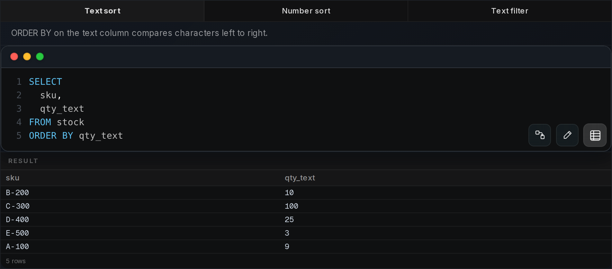
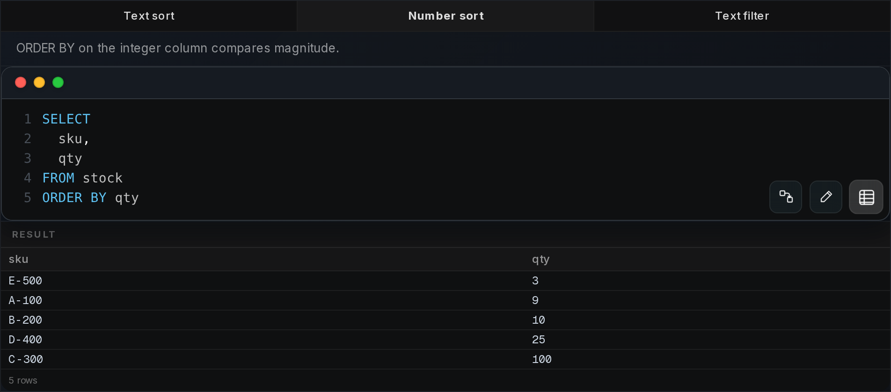
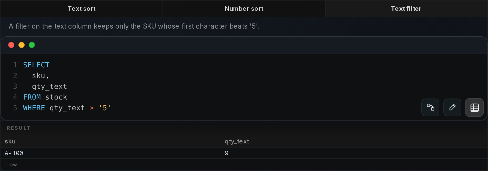
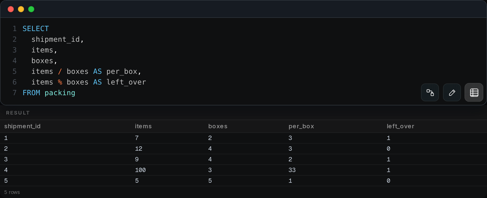
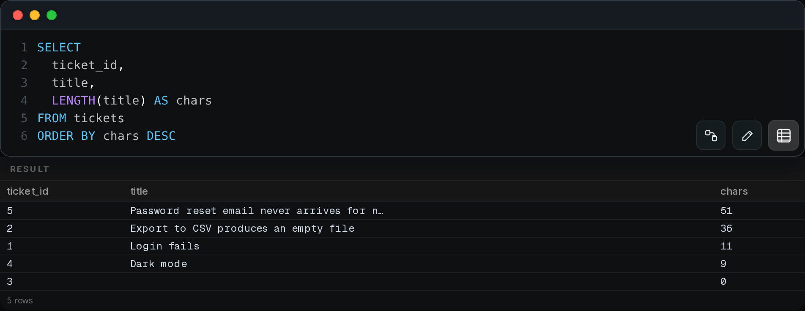
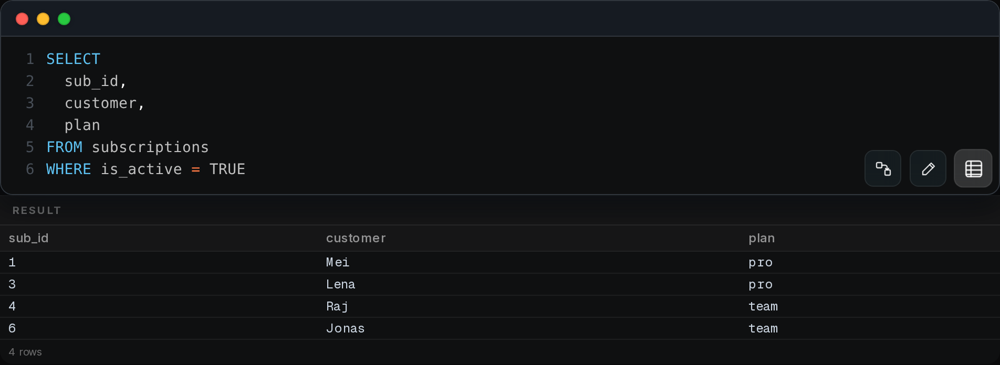
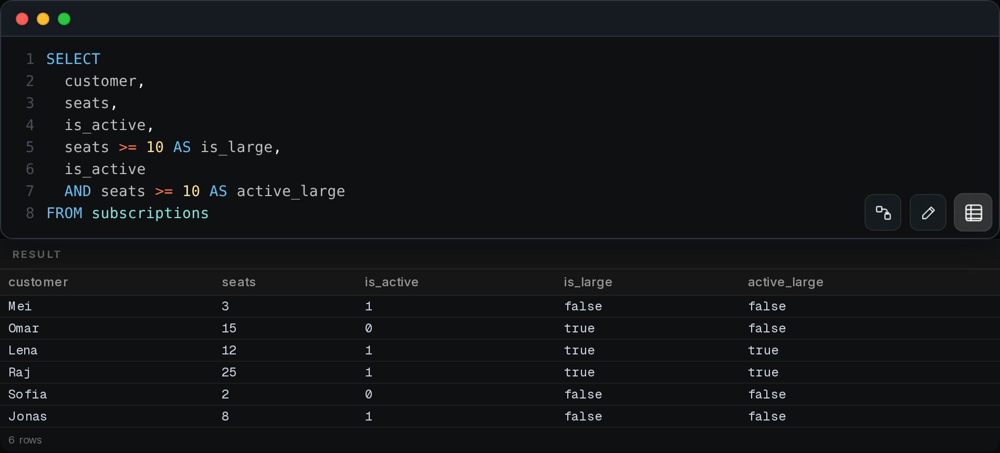
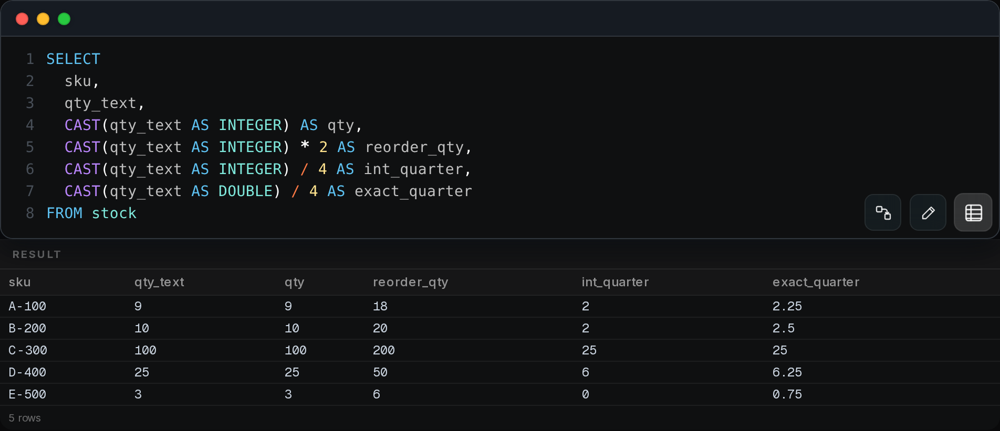

# Data Types: Beginner

A warehouse exported its stock counts to a spreadsheet, the loader read every column as text, and the Monday report listed 9 units ahead of 100. Nobody caught it for 2 weeks. The declared type was the whole cause: the database compared the characters '9' and '1' and did what it was told. INTEGER, VARCHAR and BOOLEAN cover most columns a pipeline loads, and CAST converts between them.


<br>

---

## Why data types matter

Every column carries a declared type, and that type is the database's contract about what the column holds: a whole number, a piece of text, a true/false flag, a date. The contract settles 3 things at once. How many bytes each value occupies on disk. Which operations the database will run on the value, since addition is defined for numbers and `LENGTH` for text. And how 2 values compare, which is what sorting, filtering and joining all come down to.


<br>

### A count that sorts in the wrong order

A warehouse system writes its stock levels to a CSV file, and the loader creates each column as text because CSV carries no type information. The `stock` table below keeps that export in `qty_text`, next to the same 5 counts stored as integers in `qty`. To a person reading them the values are identical: 9, 10, 100, 25 and 3. Run the 3 versions and compare how the database treats the 2 columns.

**Text sort**

ORDER BY on the text column compares characters left to right.



```sql
SELECT
  sku,
  qty_text
FROM stock
ORDER BY qty_text
```

**Number sort**

ORDER BY on the integer column compares magnitude.



```sql
SELECT
  sku,
  qty
FROM stock
ORDER BY qty
```

**Text filter**

A filter on the text column keeps only the SKU whose first character beats '5'.



```sql
SELECT
  sku,
  qty_text
FROM stock
WHERE qty_text > '5'
```

Sorting `qty_text` compares one character at a time, the way a dictionary orders words, so '10' lands before '9' because the character '1' is smaller than '9', and '100' sits between '10' and '25'. The filter is worse: `qty_text > '5'` returns a single row, and the SKU holding 100 units disappears from a report meant to list well-stocked items. The integer column sorts and filters by magnitude with no surprises, because the database knows the values are numbers.


<br>

### What a type buys the query

- Storage: an INTEGER occupies 4 bytes; the text '2147483647' occupies 10 plus a length header.
- Legal operations: the database adds numbers, measures text and negates booleans, and rejects the rest.
- Ordering: numbers sort by magnitude, text by character, so 100 sorts after 9 only as a number.
- Comparisons: a filter or join compares values of the same type directly, with no conversion per row.

SQL types fall into 4 families: numeric, character, boolean, and date and time. This lesson gives one section to each of the first 3, through `INTEGER`, `VARCHAR` and `BOOLEAN`, and dates and timestamps have a lesson of their own. Most other types met early on specialize one of these families: `BIGINT` is a wider integer, `TEXT` is a `VARCHAR` without a length ceiling, `DECIMAL` is a number that keeps its fractional digits exactly. A few, such as JSON, binary and UUID, stand outside all 4 and arrive in later lessons.


<br>

### Arithmetic on text

'100' + '50' looks like an addition, and the result depends entirely on which database runs it. PostgreSQL refuses to add 2 text values and raises operator does not exist: text + text. MySQL and SQLite convert both sides to numbers without a warning and return 150, which is the right answer today and the wrong answer the day a value like '12 units' arrives and converts to 12 or 0. A revenue column stored as text produces a SUM that either errors or returns a number nobody can trust.

> Where a wrong type shows up first
>
> - Sort order: a numeric column stored as text puts 9 above 10 in any ORDER BY.
> - Dropped rows: a range filter on text compares characters, so WHERE qty_text > '5' loses the 100s.
> - Totals: SUM over text either fails or quietly converts, and a single '12 units' value poisons the result.
> - Slow joins: a key stored as INTEGER on one side and text on the other is converted row by row and cannot use its index.
> - Storage: large numbers held as text take more bytes, 11 for '2147483647' against 4 for the INTEGER.

The cheapest moment to catch a mismatch is when the table is created, by reading the column list and asking what each value is. Found later, the same mismatch costs a backfill: every row rewritten with the right type, every downstream table that copied the column rebuilt, and every report that ran in between rechecked.

> **TIP**
>
> Before trusting a numeric column in an unfamiliar table, sort by it descending. If 9 appears above 10, the column is text.


<br>

---

## INTEGER for whole numbers

`INTEGER` stores whole numbers: 0, 42, -17, 2000000, and nothing with a fractional part. An integer literal is a bare number with no quotes. `42` is a value the database adds and compares by magnitude; `'42'` is a 2-character string, and the quotes are the entire difference between the 2. Integer arithmetic uses `+`, `-`, `*`, `/` and `%`, and an expression built from integers returns an integer, which is where the first surprise lives.


<br>

### Division keeps only the whole part

The `packing` table records how many items went into how many boxes. Dividing 7 items across 2 boxes gives 3 per box with 1 left over, because integer division discards the remainder and `%` returns it. PostgreSQL and SQLite both behave this way; MySQL returns 3.5 for the same expression. Run the query and read the row for shipment 1.



```sql
SELECT
  shipment_id,
  items,
  boxes,
  items / boxes AS per_box,
  items % boxes AS left_over
FROM packing
```

Shipment 4 shows the cost of forgetting this: 100 items in 3 boxes reports 33 per box, and a report that multiplies 33 back by 3 accounts for 99 items. The fix converts one side to a type that keeps fractions, which section 4 covers with `CAST`. The rule to carry until then: a division between 2 integers returns an integer, and the fraction is gone before the result reaches the screen.

Aggregates follow their own rules, and those rules differ by engine. `AVG(items)` over the 5 shipments is 26.6, and SQLite and PostgreSQL both return the fraction, because their `AVG` produces a fractional type even from integer input. SQL Server returns 26 for the same call, since its `AVG` of an `INTEGER` column is an `INTEGER`. A query that averages an integer column and has to give the same answer on every engine casts its input first, the pattern section 4 shows.


<br>

### INTEGER, BIGINT and the edge of the range

The integer types differ in how many bytes each value occupies, and the byte count fixes the largest value the column can hold.

| Type | Bytes | Range | Typical use |
| --- | --- | --- | --- |
| SMALLINT | 2 | -32,768 to 32,767 | ages, years, small counts |
| INTEGER | 4 | -2,147,483,648 to 2,147,483,647 | ids, quantities, ranks |
| BIGINT | 8 | about -9.2 to 9.2 quintillion | event ids, byte counts, cents |

An auto-incrementing `INTEGER` primary key reaches 2,147,483,647 after that many inserts, and the next insert fails with an out-of-range error rather than wrapping to a negative number. A table taking 2,000 inserts a second gets there in about 12 days. That failure has stopped production writes at companies whose event tables grew faster than their schema expected, and the repair, converting the key and every foreign key that references it to `BIGINT`, rewrites every row in every one of those tables. For an id column that will hold events, clicks or log lines, `BIGINT` costs 4 extra bytes per row and removes the question.

The ceiling applies to arithmetic as well as storage. In PostgreSQL, `SELECT 2000000000 + 2000000000` fails with `integer out of range`, because both literals are `INTEGER` and so is their sum. `SUM` over an `INTEGER` column sidesteps this by returning a `BIGINT`. SQLite stores every integer in up to 8 bytes, so the same expression returns 4000000000 there, which means a query tested on SQLite can still fail in production on PostgreSQL.

`INTEGER` remains the right choice for counts, quantities, ranks and most ids, because a 4-byte value packs twice as many values into each page the database reads, and into each index it keeps, as an 8-byte `BIGINT` does. Money is a common integer too: storing an amount as whole cents in a column such as `amount_cents`, which the practice database's `ledger_postings` table does, keeps every total exact. The `DECIMAL` type, which stores fractional amounts exactly, belongs to the next tier.


<br>

### Multiplying an integer column

The practice database's `order_items` table stores `quantity` as an integer and `unit_price` as a floating-point `REAL`. A line total multiplies the 2, and the result takes the wider type, since an integer combined with a fractional number is promoted to the fractional type before the arithmetic runs.

A `quantity` of 3 at a price of 19.99 returns 59.97, because the product of an integer and a `REAL` is a `REAL`. The promotion runs in one direction only: the database widens the integer to match the fractional side and never truncates the fractional value to fit the integer, so mixing the 2 types in a division is the way to keep the fractional part. A `REAL` result is approximate, though, stored in binary to about 15 significant digits, so a sum over millions of line totals can drift by fractions of a cent. That drift is why money that has to reconcile is better held as integer cents.


<br>

---

## STRING types (VARCHAR)

`VARCHAR` stores text: a name, an email address, a product title, a log line. Text differs from an integer in one structural way, which is that its values vary in length. Every `INTEGER` occupies 4 bytes; 'Hi' is 2 characters and 'Hello World' is 11, and a `VARCHAR` value stores the characters actually present plus a small header recording how many there are. The `n` in `VARCHAR(n)` is a ceiling, the longest value the column accepts, and a longer value is rejected or truncated depending on the database.


<br>

### Single quotes for text, double quotes for names

A string literal is written in single quotes: 'Alice'. Standard SQL reserves double quotes for something else, an identifier such as a table or column name, so in PostgreSQL "Alice" asks for a column called Alice and fails with column "Alice" does not exist. SQLite, and MySQL in its default mode, quietly accept "Alice" as the text Alice instead, so the mistake works until the query moves to a stricter engine, which is why the single-quote habit matters. An apostrophe inside a literal is written as 2 single quotes, 'O''Brien', which the database reads as 1 character.

```sql
SELECT
  'Alice' AS plain_text,
  'O''Brien' AS with_apostrophe,
  '42' AS looks_numeric
FROM customers
```


<br>

### VARCHAR, CHAR and TEXT

Three character types cover almost every text column, and the choice turns on whether the values share a fixed length.

| ✓ VARCHAR(n) | ✗ CHAR(n) |
| --- | --- |
| • Variable length, up to n characters<br><br>• Stores the characters present and a length header<br><br>• 'US' in VARCHAR(10) occupies 2 characters<br><br>• Names, emails, titles, anything whose length varies | • Fixed length, always exactly n characters<br><br>• Pads shorter values with trailing spaces<br><br>• 'US' in CHAR(10) is stored as 'US '<br><br>• Codes with one known length: country, currency, state |

`TEXT` is a `VARCHAR` with no declared ceiling, and the practice database stores every string column that way. PostgreSQL treats `VARCHAR` without a length and `TEXT` identically; MySQL and SQL Server cap `VARCHAR` and reserve `TEXT` for long documents. A declared length reads best as a validation rule: `VARCHAR(2)` on a country code column rejects 'USA' at insert time, before the bad value reaches a report.

What happens to an over-length value depends on the engine. PostgreSQL rejects 'USA' in a `VARCHAR(2)` column with `value too long for type character varying(2)`. MySQL in strict mode, its default since version 5.7, raises an error too, and with strict mode off it stores the first 2 characters, 'US', and records only a warning. SQLite ignores the declared length entirely and stores all 3 characters, so a length limit validates data only on engines that enforce it.

> **TIP**
>
> Digits do not make a number. A zip code 02134, a phone number and an order reference like 'ORD-00042' belong in VARCHAR: the leading zero has to survive, and nobody will ever add 2 of them.


<br>

### Measuring text with LENGTH

`LENGTH` returns how many characters a value holds, and it is the first string function most queries need: finding titles that overflow a UI, checking that a code has exactly 3 characters, spotting a blank value that is 0 characters long. The `tickets` table holds 5 support ticket titles of different lengths, one of them empty.



```sql
SELECT
  ticket_id,
  title,
  LENGTH(title) AS chars
FROM tickets
ORDER BY chars DESC
```

Ticket 3 is the row worth noticing: an empty string is a real value with length 0, and it is a different thing from a missing value. A filter `WHERE LENGTH(title) < 5` is the standard way to find titles that carry no information. `LENGTH` counts characters, and the number of bytes behind those characters can be larger.


Spaces count as characters too. A title loaded as 'Dark mode ' with a trailing space has a `LENGTH` of 10, one more than 'Dark mode', and in PostgreSQL and SQLite the 2 values compare as unequal, so 2 tickets that look identical in a report land in separate groups. `LENGTH` exposes the difference where the eye cannot: 2 values that print the same and measure differently differ in whitespace.

The quoting rule is the one that catches new readers most often, because 2 of the 3 wrong forms look reasonable until the database answers.

**Which form does standard SQL, and PostgreSQL, read as the text value Alice in a SELECT list?**

- **A.** "Alice"
- **B.** 'Alice'
- **C.** Alice
- **D.** 'Alice's'

<details>
<summary>Solution</summary>

**B.** 'Alice'

Single quotes mark a string literal, and every engine returns the 5-character text value.

**Why the others are wrong**

- **A.** Standard SQL reads double quotes as an identifier, so PostgreSQL looks for a column named Alice and fails. SQLite and default MySQL tolerate this form as text, which hides the mistake until the query moves to a stricter engine.
- **C.** A bare word is read as a column name on every engine, and the query fails because no such column exists.
- **D.** The apostrophe ends the literal after Alice, leaving s' dangling, so the query fails to parse. The apostrophe needs doubling: 'Alice''s'.

</details>


<br>

---

## BOOLEAN for true/false

`BOOLEAN` holds exactly 2 values, `TRUE` and `FALSE`, written as bare keywords without quotes. The type answers a yes/no question about the row: is this subscription active, has this invoice been paid, did the user click the ad. A boolean occupies 1 byte, and the database compares, filters and indexes it without any conversion. Where a system has no native `BOOLEAN`, SQLite among them, `TRUE` and `FALSE` are stored and displayed as 1 and 0, which is what the examples on this page print.


<br>

### Filtering on a flag

A boolean column is already a condition, so `WHERE is_active` and `WHERE is_active = TRUE` return the same rows, and `WHERE NOT is_active` returns the rest. The `subscriptions` table has 6 rows, 4 active and 2 cancelled. Run the query, then replace `= TRUE` with `= FALSE`, and then delete the comparison and put `NOT` in front of the column.



```sql
SELECT
  sub_id,
  customer,
  plan
FROM subscriptions
WHERE is_active = TRUE
```

Comparing a flag to a string, `WHERE is_active = 'true'`, behaves differently on every engine. PostgreSQL accepts 'true' as a boolean literal and returns the active rows. MySQL stores `BOOLEAN` as a 1-byte integer, converts 'true' to 0, and silently returns the inactive rows instead. SQLite compares the stored 1 against the text 'true' and matches nothing. Writing the bare keyword `TRUE`, or the bare column, gives one answer everywhere. A flag stored as text costs more again: it accepts 'true', 'True', 'TRUE', 'yes' and 'Y' as 5 different values, so a filter written for one of them misses every row written with the others. On the `BOOLEAN` column there is nothing to misspell.


<br>

### Comparisons produce booleans

A comparison is an expression whose result is a boolean. `seats >= 10` evaluates to TRUE or FALSE for each row, the same way `seats * 2` evaluates to a number, so it can be named in the `SELECT` list like any other column. The `subscriptions` table gains a `seats` column for this query; the 6 customers and their active flags are unchanged.



```sql
SELECT
  customer,
  seats,
  is_active,
  seats >= 10 AS is_large,
  is_active
  AND seats >= 10 AS active_large
FROM subscriptions
```

Omar's row is the one to read: 15 seats makes `is_large` 1, and the cancelled subscription makes `active_large` 0. A computed boolean can sit in the `SELECT` list as a derived flag, drive a `WHERE` clause, or be stored in a new column, and the same expression returns the same answer for each row in all 3 places.


<br>

### Flags disguised as other types

| Representation | Values | What goes wrong |
| --- | --- | --- |
| CHAR(1) | 'Y' / 'N' | 'y', 'n' and ' ' arrive from a form; every filter must spell and case-match the letter |
| VARCHAR(5) | 'true' / 'false' | 5 bytes per row, case variants, filters must spell the string |
| INTEGER | 0 / 1 | 2 and -1 are accepted; which direction means yes is documentation |
| BOOLEAN | TRUE / FALSE | nothing: the database enforces the 2 values |

- **4 GB** — VARCHAR(5) 'false' vs BOOLEAN, 1B rows

The integer form deserves attention because so much data arrives that way: the practice database stores `in_stock`, `clicked` and `cache_hit` as 0 and 1, which is how CSV exports and most analytics tools represent a flag. The integer version works until the day it does not: a 0/1 column accepts 2 and -1 without complaint, and a reader has to consult documentation to learn which direction means yes. `BOOLEAN` makes the 2 permitted values part of the schema, so a bad insert fails instead of becoming a third category in every report.

Naming carries the meaning. A column called `active` could hold a status string or a count of active days; `is_active` can only be a flag, and `has_paid`, `can_edit` and `was_notified` follow the same pattern. Name the column for the true case, so `WHERE is_active` reads as a sentence, and avoid negatives such as `is_not_deleted`, which forces `WHERE NOT is_not_deleted` on anyone looking for deleted rows.

*A BOOLEAN column can also hold NULL, a third state meaning unknown, and the intermediate lesson covers how NULL combines with TRUE and FALSE in a filter.*

A billing team is adding a column that records whether each invoice has been paid, and the choice of type decides how every later query on it reads.

**Which type should the paid flag on an invoices table use?**

- **A.** VARCHAR(5) holding 'true' or 'false'
- **B.** INTEGER holding 0 or 1
- **C.** BOOLEAN, named is_paid
- **D.** CHAR(1) holding 'Y' or 'N'

<details>
<summary>Solution</summary>

**C.** BOOLEAN, named is_paid

The database enforces exactly 2 values in 1 byte, and WHERE is_paid reads as a sentence with nothing to misspell.

**Why the others are wrong**

- **A.** The column accepts 'True', 'TRUE' and 'yes' as well, costs 5 bytes a row, and every filter has to spell the string.
- **B.** Common in exports, but the column also accepts 2 and -1, and the meaning of 1 lives in documentation rather than the schema.
- **D.** Lowercase and blank values slip in from forms, and the column needs a comparison in every WHERE clause where a boolean needs none.

</details>


<br>

---

## CAST for type conversion

`CAST(expression AS type)` converts a value from one type to another and returns the result in the new type, leaving the stored column untouched. It serves 2 situations: data that arrived in the wrong type, like the text `qty_text` column from section 0, and an operation that needs a type the column does not have, like dividing integers without losing the fraction. The `stock` table returns with its text quantities.



```sql
SELECT
  sku,
  qty_text,
  CAST(qty_text AS INTEGER) AS qty,
  CAST(qty_text AS INTEGER) * 2 AS reorder_qty,
  CAST(qty_text AS INTEGER) / 4 AS int_quarter,
  CAST(qty_text AS DOUBLE) / 4 AS exact_quarter
FROM stock
```

`qty` multiplies as a number, and the 2 quarter columns show what the target type does to arithmetic: a value cast to `INTEGER` divides with truncation, so 9 becomes 2, and the same value cast to `DOUBLE` keeps the fraction, 2.25. Casting one side of the division is enough, because the database widens the integer side to match the wider one.

| From | To | Expression | Result |
| --- | --- | --- | --- |
| text | INTEGER | CAST('42' AS INTEGER) | 42 |
| INTEGER | text | CAST(42 AS VARCHAR) | '42' |
| INTEGER | DOUBLE | CAST(7 AS DOUBLE) / 2 | 3.5 |
| INTEGER | BOOLEAN | CAST(1 AS BOOLEAN) | TRUE |
| text | INTEGER | CAST('abc' AS INTEGER) | error, or 0 in lenient engines |


<br>

### The number-to-text direction

Casting from a number to text is equally common, and its most useful case is a join between 2 systems that stored the same key as different types. The warehouse's `shipments` table keys each row by `order_ref`, an indexed `VARCHAR` holding values like '1042', while the orders system stores `order_id` as an `INTEGER`. Joining on `s.order_ref = CAST(o.order_id AS VARCHAR)` converts the integer side, so the database can still find each `order_ref` through its index. The reverse, `CAST(s.order_ref AS INTEGER) = o.order_id`, converts every stored reference before comparing, and the index on `order_ref` goes unused.

```sql
SELECT
  o.order_id,
  s.carrier
FROM orders AS o
JOIN shipments AS s
  ON s.order_ref = CAST(o.order_id AS VARCHAR)
```

Text equality is exact, character for character. If the warehouse writes references zero-padded, as '00001042', then `CAST(1042 AS VARCHAR)` produces '1042' and the join matches nothing, with no error to say why. Read a few stored values before writing the join. And once a number has become text it sorts as text, so sort by the numeric column rather than by its text cast, or 10 lands before 9 again.


<br>

### When CAST fails

`CAST('abc' AS INTEGER)` has no sensible answer, and strict databases such as PostgreSQL stop the whole query with `invalid input syntax for type integer`. One bad row out of 10 million is enough. Lenient engines return 0 or NULL and carry on, which is quieter and worse, because the bad value becomes a zero inside a sum. A cast of 3.9 to `INTEGER` splits the same way: 4 in PostgreSQL, which rounds, and 3 in SQLite, which truncates. `CAST` is the right call when the source is known to be clean, a column exported by a system that validated it. For external files, `TRY_CAST` returns NULL on the rows that cannot convert, and the intermediate lesson covers it.


<br>

### Watching the cast fix the sort

The sort from section 0 ends here. The animation computes the cast for each of the 5 rows, then orders the result by the new integer column.

https://github.com/user-attachments/assets/946999cd-1ac2-4d45-845e-7880c2e65957

Each `qty` cell is produced before `ORDER BY` runs, because the database evaluates the `SELECT` expressions and then sorts the rows it has, so sorting by the alias sorts by the integer. The 5 rows land as 3, 9, 10, 25, 100, the order a warehouse manager expected from the start.

| ✓ Do | ✗ Don't |
| --- | --- |
| • Declare the type by what the value is: a count is INTEGER, a code is VARCHAR, a flag is BOOLEAN.<br><br>• Cast one side of an integer division to DOUBLE when the fraction matters.<br><br>• Put the cast on the literal or the smaller side of a comparison, so the indexed column stays as stored.<br><br>• Use BIGINT for any id column that counts events, clicks or log lines.<br><br>• Sort an unfamiliar numeric column once to confirm it holds numbers. | • Store a quantity, amount or id as text because the source file arrived that way.<br><br>• Rely on '100' + '50' returning 150; the next database, or the next bad row, will not.<br><br>• Put a number with a leading zero, such as a zip code, in an INTEGER column.<br><br>• Spell a flag as 'true', 'Y' or 1 when BOOLEAN is available.<br><br>• Cast a column of untrusted text with CAST alone; one bad row stops the query. |


<br>

---

## Putting It All Together

An online retailer receives a nightly stock file from a 3PL warehouse. The file lands as CSV, so the loader created every column as text: sku, qty_on_hand, is_discontinued and last_count. The Monday replenishment report ranked 9-unit items as better stocked than 100-unit items, the discontinued filter matched only rows spelled 'true' and missed the ones spelled 'TRUE', and the sum of on-hand units came back as a number nobody could reconcile. The data team is rebuilding the landing table with real types and converting the history.

- Section 0 explains the symptom: ORDER BY on the text qty_on_hand compared characters, so '9' sorted above '100' and the ranking inverted.
- Section 1 sets the target type: qty_on_hand becomes INTEGER, and the per-location average is computed with one side cast to DOUBLE so integer division does not drop the fraction.
- Section 2 keeps sku as VARCHAR, because references like 'SKU-00042' carry a leading zero and are never added, and LENGTH(sku) = 9 validates each row on load.
- Section 3 replaces the 'true'/'TRUE' column with a BOOLEAN is_discontinued, so the filter becomes WHERE NOT is_discontinued and no spelling can escape it.
- Section 4 converts the history: the team selects CAST(qty_on_hand AS INTEGER) from the old text table into the new INTEGER column, and the one file with '12 units' in the quantity column is the reason the team reads up on TRY_CAST next.


<br>

---

## Key Takeaways

- A column's type sets its storage, its legal operations and its sort order, so a count stored as text sorts 9 above 10 and poisons any SUM.
- INTEGER holds whole numbers in 4 bytes up to about 2.1 billion; integer division truncates, and BIGINT is the id type for anything that counts events.
- VARCHAR stores text of varying length in single quotes; double quotes name columns, and digits with a leading zero are text.
- BOOLEAN holds TRUE or FALSE in 1 byte, filters as a bare condition, and replaces the 'Y', 'true' and 0/1 encodings that let bad values in.
- CAST(value AS type) converts explicitly; cast the small side of a comparison, cast one side of a division to DOUBLE, and expect strict databases to fail on bad text.
