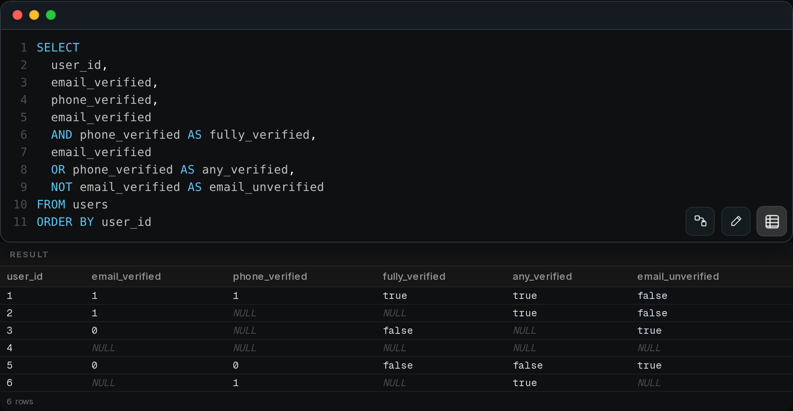
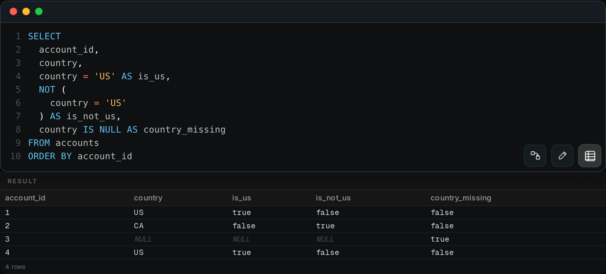
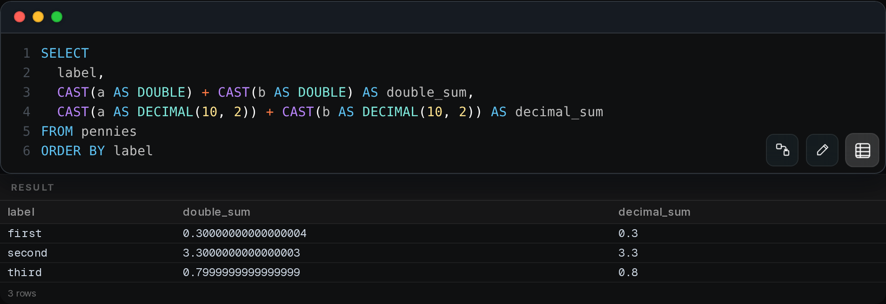
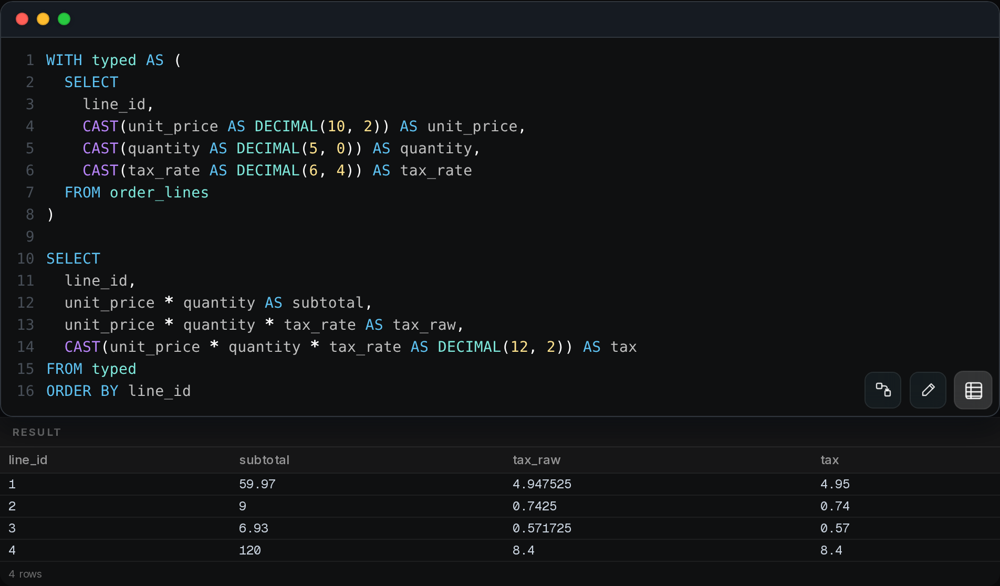
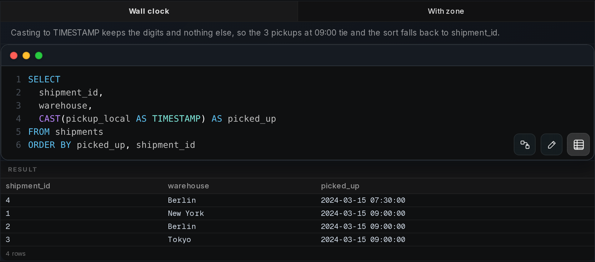
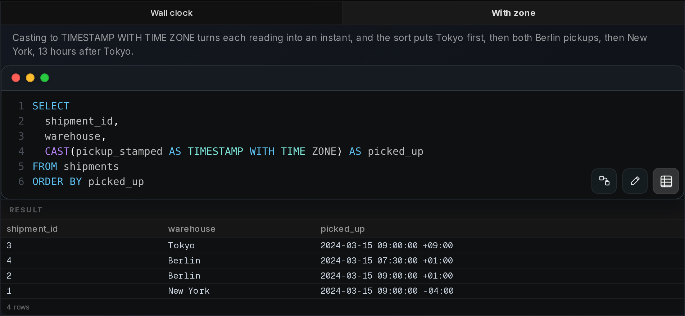
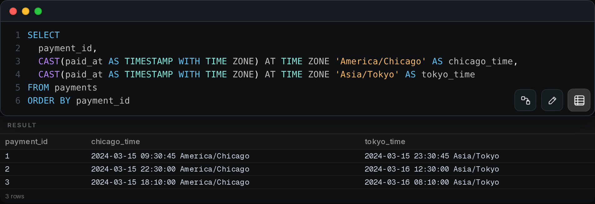
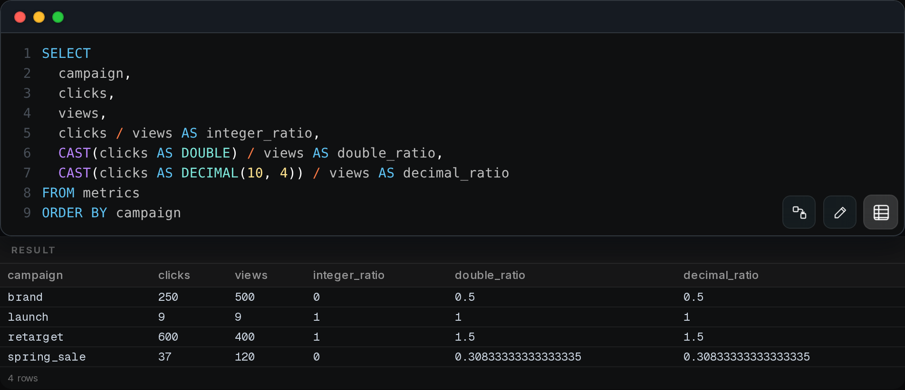
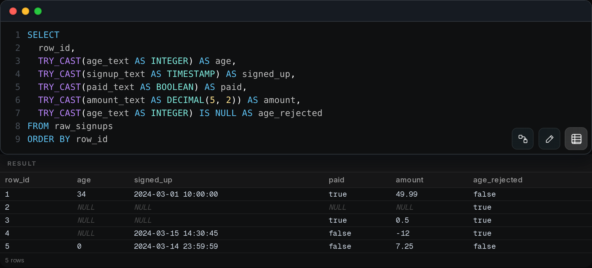

# Data Types: Intermediate

At Stripe, a Berlin merchant opens a support ticket on Monday morning: Friday's settlement is 3 cents short, and 2 late-night card payments show up under Saturday. One engineer traces the cents to amounts summed as DOUBLE, and the day shift to timestamps stored without a zone. Each fix is a data type decision, and the 5 sections ahead cover every one of them.


<br>

---

## BOOLEAN and NULL logic

A BOOLEAN column has 3 possible values. TRUE and FALSE are recorded answers. NULL means the system never recorded an answer. Take an `email_verified` flag on a users table. Rows written after the verification feature shipped carry TRUE or FALSE. Rows written before it carry NULL, because nobody asked the question back then. Reading that NULL as FALSE would flag long-time customers as unverified, and reading it as TRUE would skip a security check. The database does neither. It keeps the unknown unknown, and every operator that touches it follows rules that fit in a truth table.


<br>

### The truth table with a third value

| a | b | a AND b | a OR b |
| --- | --- | --- | --- |
| TRUE | TRUE | TRUE | TRUE |
| TRUE | FALSE | FALSE | TRUE |
| TRUE | NULL | NULL | TRUE |
| FALSE | TRUE | FALSE | TRUE |
| FALSE | FALSE | FALSE | FALSE |
| FALSE | NULL | FALSE | NULL |
| NULL | TRUE | NULL | TRUE |
| NULL | FALSE | FALSE | NULL |
| NULL | NULL | NULL | NULL |

Read AND as 'both sides must be TRUE'. When one side is FALSE the answer is settled no matter what the other side holds, so FALSE AND NULL is FALSE: whatever the unknown turns out to be, both sides cannot be TRUE. When one side is TRUE, the result depends entirely on the other side, so TRUE AND NULL stays NULL. OR works as the mirror image. TRUE OR NULL is TRUE because one TRUE is enough, and FALSE OR NULL is NULL because the unknown side decides. NOT swaps TRUE and FALSE and leaves NULL alone, since the opposite of an unknown answer is still an unknown answer.

| a | NOT a |
| --- | --- |
| TRUE | FALSE |
| FALSE | TRUE |
| NULL | NULL |

> Rules for NULL in AND, OR and the IS tests
>
> - FALSE AND anything is FALSE, and TRUE OR anything is TRUE: 1 known side can settle the answer on its own.
> - TRUE AND NULL and FALSE OR NULL stay NULL: the unknown side is the one that decides, and its value is not known.
> - IS NULL and IS NOT NULL always return TRUE or FALSE, so they are the way to ask about the unknown itself.


<br>

### Watching the rules run on real rows

The `users` table below has 6 rows. `email_verified` and `phone_verified` are its 2 flags, and across the rows they cover every combination of the 3 BOOLEAN values. The query computes 3 new BOOLEAN columns from them. Before you run it, predict the row for user 3, where email is FALSE and phone is NULL.



```sql
SELECT
  user_id,
  email_verified,
  phone_verified,
  email_verified
  AND phone_verified AS fully_verified,
  email_verified
  OR phone_verified AS any_verified,
  NOT email_verified AS email_unverified
FROM users
ORDER BY user_id
```

User 3 comes out FALSE, NULL, TRUE. The AND is FALSE because a FALSE email check settles it. The OR is NULL because the phone flag could still be the TRUE that rescues it. NOT FALSE is TRUE. User 4, with NULL in both flags, produces NULL in all 3 new columns: no operator can manufacture a known answer out of 2 unknown ones. User 2 shows the asymmetry inside a single row: TRUE AND NULL is NULL while TRUE OR NULL is TRUE.

**A row has a = NULL and b = FALSE. What does NOT (a AND b) return?**

- **A.** NULL, because a is NULL and NULL spreads through every operator it touches
- **B.** TRUE, because a AND b is FALSE once either side is FALSE, and NOT FALSE is TRUE
- **C.** FALSE, because the AND evaluates to TRUE when the unknown side is skipped
- **D.** An error, because NOT cannot be applied to an expression that might be NULL

<details>
<summary>Solution</summary>

**B.** TRUE, because a AND b is FALSE once either side is FALSE, and NOT FALSE is TRUE

The FALSE in b makes the AND FALSE whatever a holds, and NOT turns that FALSE into TRUE.

**Why the others are wrong**

- **A.** NULL spreads only when the known side cannot settle the answer. Here the FALSE in b settles the AND.
- **C.** No side is skipped. NULL AND FALSE is FALSE, and NOT of that is TRUE.
- **D.** NOT accepts NULL and returns NULL for it. No BOOLEAN operator raises an error on NULL.

</details>


<br>

### Comparisons produce BOOLEAN values

A comparison is an expression whose type is BOOLEAN. `country = 'US'` yields TRUE for a US row and FALSE for a Canadian one. When `country` is NULL the comparison yields NULL, because an unknown country might or might not be the US. That is why `country = NULL` never finds anything: comparing against an unknown returns unknown for every row, including the rows where the column really is NULL. The operator built for that question is `IS NULL`. It inspects the slot rather than the value, so it returns TRUE or FALSE and never NULL, and `IS NOT NULL` gives the opposite.



```sql
SELECT
  account_id,
  country,
  country = 'US' AS is_us,
  NOT (
    country = 'US'
  ) AS is_not_us,
  country IS NULL AS country_missing
FROM accounts
ORDER BY account_id
```

Account 3 returns NULL for both `is_us` and `is_not_us`, so a row can fail the US test and fail the non-US test at the same time. Only `country_missing` returns TRUE for it. Any time a report splits rows into 2 buckets with a comparison, a third bucket of NULL rows is sitting between them, and it stays invisible until a query tests for it by name.

> **TIP**
>
> When a BOOLEAN column is NULL, `NOT flag` is also NULL. To get a TRUE for every row where a flag is anything other than TRUE, combine 2 tests: `flag IS NULL OR NOT flag`, which returns TRUE for both the FALSE rows and the NULL rows.


<br>

---

## DECIMAL precision and scale

A DOUBLE stores a number as a binary fraction in 64 bits. Binary fractions represent a half or an eighth exactly, but nothing whose denominator has a factor of 5, so 0.1 is stored as the nearest value the format can reach, which begins 0.1000000000000000055511151231257827. The error sits far past the digits anyone looks at, which is how it stays hidden until a ledger that adds millions of such values comes out a few cents off. DECIMAL stores digits, the way a bank statement does, so 0.1 means 0.1.


<br>

### Precision and scale

DECIMAL takes 2 parameters. Precision is the total count of digits the value can hold, and scale is how many of those sit to the right of the decimal point. DECIMAL(10,2) holds up to 8 digits before the point and 2 after, so its largest value is 99999999.99. Scale is fixed: 5 stored in DECIMAL(10,2) is 5.00, and a value with more fractional digits is rounded to fit. Precision is a hard ceiling: 123456789.00 needs 9 digits before the point, and casting it to DECIMAL(10,2) fails with an error rather than silently dropping a digit.

| Type | Largest value | Fits |
| --- | --- | --- |
| DECIMAL(5,2) | 999.99 | a unit price in dollars |
| DECIMAL(10,2) | 99999999.99 | an invoice total |
| DECIMAL(15,6) | 999999999.999999 | an exchange rate |
| DECIMAL(20,0) | 20 nines | an id too wide for 64 bits |

- **38** — maximum DECIMAL precision
- **18** — largest precision kept in 8 bytes


<br>

### The sum that comes out wrong

The `pennies` table stores 3 pairs of amounts as text, the way a CSV loader would leave them. The query adds each pair twice, once after casting to DOUBLE and once after casting to DECIMAL(10,2). Predict the first row before running.



```sql
SELECT
  label,
  CAST(a AS DOUBLE) + CAST(b AS DOUBLE) AS double_sum,
  CAST(a AS DECIMAL(10, 2)) + CAST(b AS DECIMAL(10, 2)) AS decimal_sum
FROM pennies
ORDER BY label
```

The DOUBLE column shows 0.30000000000000004, 3.3000000000000003 and 0.7999999999999999. Each is the binary sum of 2 approximations, printed with every digit the format carries. The DECIMAL column shows 0.30, 3.30 and 0.80. Its type is DECIMAL(11,2): adding 2 values of the same scale keeps that scale and adds 1 digit of precision for a possible carry.


<br>

### What arithmetic does to the type

Every operation on DECIMAL values produces a DECIMAL whose precision and scale follow from the inputs. Multiplication adds both: DECIMAL(10,2) times DECIMAL(6,4) gives DECIMAL(16,6), because a 2-place number times a 4-place number can need 6 places to stay exact. An INTEGER in a DECIMAL expression is treated as a DECIMAL with scale 0. The engine never rounds during the chain, so the result holds every digit, and you decide where to round by casting the finished value to the scale the report needs. Casting to a smaller scale rounds half away from zero.

`order_lines` stores `unit_price` and `tax_rate` as text and `quantity` as a whole number. The CTE casts each column once, and the outer query builds the subtotal, the raw tax with its full 6 places, and the tax rounded to cents.



```sql
WITH typed AS (
  SELECT
    line_id,
    CAST(unit_price AS DECIMAL(10, 2)) AS unit_price,
    CAST(quantity AS DECIMAL(5, 0)) AS quantity,
    CAST(tax_rate AS DECIMAL(6, 4)) AS tax_rate
  FROM order_lines
)

SELECT
  line_id,
  unit_price * quantity AS subtotal,
  unit_price * quantity * tax_rate AS tax_raw,
  CAST(unit_price * quantity * tax_rate AS DECIMAL(12, 2)) AS tax
FROM typed
ORDER BY line_id
```

Line 1 shows the chain: 19.99 times 3 is 59.97 in DECIMAL(15,2), times 0.0825 is 4.947525 in DECIMAL(21,6), and the final cast rounds it to 4.95. Line 2 holds 0.742500 and rounds down to 0.74, since the dropped digits start with 2. Precision only grows along a chain, and the engine caps it at 38. Once a derived precision would pass 38, the result type is clamped there, and the query keeps running until it reaches a row whose value no longer fits, which raises an overflow error at that row. A query that passes on test data can fail on 1 large row in production. The repair is to cast an intermediate result back down to the scale it needs, and to do it at the point where the extra digits stop meaning anything.

**A column price is DECIMAL(6,3) and qty is DECIMAL(4,1). What is the type of price * qty?**

- **A.** DECIMAL(6,3), because the result takes the wider input's type
- **B.** DECIMAL(10,3), because precision adds and scale follows the wider input
- **C.** DECIMAL(24,3), because precision multiplies and scale follows the wider input
- **D.** DECIMAL(10,4), because multiplication adds both precisions and both scales

<details>
<summary>Solution</summary>

**D.** DECIMAL(10,4), because multiplication adds both precisions and both scales

Precision 6 + 4 = 10 and scale 3 + 1 = 4, so every digit of the exact product fits.

**Why the others are wrong**

- **A.** Multiplication does not pick an input's type. It derives a new one from both inputs.
- **B.** Precision adds, and so does scale: a 3-place number times a 1-place number can need 4 places.
- **C.** Precision adds rather than multiplies, and scale adds too. The result is DECIMAL(10,4).

</details>

| ✓ Use DECIMAL | ✗ Use DOUBLE |
| --- | --- |
| • Prices and tax rates<br><br>• Exchange rates and fees<br><br>• Anything summed or reconciled<br><br>• Values compared for equality | • Sensor readings and coordinates<br><br>• Statistical measures<br><br>• Ratios shown to 2 or 3 places<br><br>• Very large or very small magnitudes |


<br>

---

## TIMESTAMP vs TIMESTAMPTZ

A TIMESTAMP is a reading off a wall clock with the clock's location left out. `2024-03-15 09:00:00` says a clock showed 9 in the morning, and nothing about which clock. A warehouse in Tokyo and a warehouse in New Jersey both record `2024-03-15 09:00:00` for a morning pickup, and those 2 pickups are 13 hours apart. TIMESTAMP WITH TIME ZONE, which this section's title and many engineers shorten to TIMESTAMPTZ, keeps the clock's location with the reading: `2024-03-15 09:00:00 Asia/Tokyo`. With the zone attached, the value names one instant on the global timeline, and 2 such values can be ordered or subtracted no matter where they were recorded.

|  | TIMESTAMP | TIMESTAMP WITH TIME ZONE |
| --- | --- | --- |
| Literal | TIMESTAMP '2024-03-15 09:00:00' | TIMESTAMP '2024-03-15 09:00:00 Asia/Tokyo' |
| What it records | A clock reading | A clock reading plus the clock's zone |
| Names one instant | No | Yes |
| Good for | Store hours, birthdays, a 9am alarm | Logins, payments, pickups, deploys |


<br>

### Same digits, different instants

The `shipments` table records every pickup twice. `pickup_local` is what the warehouse clock showed. `pickup_stamped` is the same reading with the warehouse's zone appended. Both are stored as text, so each query casts the column it needs. The 2 versions below differ in which column they cast and sort by. Pick the order you expect from each before you read its result.

**Wall clock**

Casting to TIMESTAMP keeps the digits and nothing else, so the 3 pickups at 09:00 tie and the sort falls back to shipment_id.



```sql
SELECT
  shipment_id,
  warehouse,
  CAST(pickup_local AS TIMESTAMP) AS picked_up
FROM shipments
ORDER BY picked_up, shipment_id
```

**With zone**

Casting to TIMESTAMP WITH TIME ZONE turns each reading into an instant, and the sort puts Tokyo first, then both Berlin pickups, then New York, 13 hours after Tokyo.



```sql
SELECT
  shipment_id,
  warehouse,
  CAST(pickup_stamped AS TIMESTAMP WITH TIME ZONE) AS picked_up
FROM shipments
ORDER BY picked_up
```

With zones, shipment 4 drops from first to second: its 07:30 in Berlin is 06:30 UTC, and Tokyo's 09:00 is 00:00 UTC, which puts the Tokyo pickup 6 and a half hours earlier. Without zones the engine has no basis for that move, because the values it compares are the digits 07:30 and 09:00 and nothing more. Neither cast is wrong. The wall-clock version answers 'which pickups happened before the morning break', and the zoned version answers 'which pickup happened first'. The type you choose for a column states which of those questions it can answer.

| Zone | Offset from UTC on 2024-03-15 | Why |
| --- | --- | --- |
| America/Los_Angeles | -07:00 | daylight time since March 10 |
| America/Chicago | -05:00 | daylight time since March 10 |
| America/New_York | -04:00 | daylight time since March 10 |
| Europe/London | +00:00 | summer time starts March 31 |
| Europe/Berlin | +01:00 | summer time starts March 31 |
| Asia/Kolkata | +05:30 | no daylight time |
| Asia/Tokyo | +09:00 | no daylight time |
| Australia/Sydney | +11:00 | daylight time until April 7 |

*Every example in this lesson and the next section uses a date in March 2024, so the offsets above are the ones to use when predicting a result.*

**A table has 2 rows, 2024-03-15 20:00:00 Europe/London and 2024-03-15 15:00:00 America/New_York, both cast to TIMESTAMP WITH TIME ZONE. How do the 2 instants compare?**

- **A.** They are the same instant, because 20:00 in London is 15:00 in New York
- **B.** The New York row is earlier by 5 hours, the difference in the printed clock readings
- **C.** The New York row is earlier by 1 hour
- **D.** The London row is earlier by 1 hour

<details>
<summary>Solution</summary>

**C.** The New York row is earlier by 1 hour

London is on UTC, so 20:00 London is 20:00 UTC. New York is 4 hours behind, so 15:00 New York is 19:00 UTC, 1 hour earlier.

**Why the others are wrong**

- **A.** That holds when both zones are on standard time. On March 15 New York has moved to daylight time and London has not.
- **B.** The printed digits differ by 5 hours, but the instants differ by the digits minus the offset gap, which is 1 hour.
- **D.** The direction is reversed. 19:00 UTC comes before 20:00 UTC, and the New York row is the 19:00 one.

</details>


<br>

### What each type stores

In this engine a TIMESTAMP WITH TIME ZONE holds 2 things: the instant, as a count of milliseconds since 1970 in UTC, and a short key naming the zone. The zone is kept so the value can be printed back the way it was recorded, and so arithmetic on it can follow that zone's daylight rules. Some systems keep only the UTC instant and drop the zone on write, so their values read back in the session's zone, and the original zone survives only if a column of its own holds it. Casting a text value that ends in a zone name attaches both parts. Casting text with no zone produces a plain TIMESTAMP, and no zone is guessed. When a table is designed, an event that happened once, a login, a payment, a pickup, belongs in TIMESTAMP WITH TIME ZONE. A time that repeats on a local clock belongs in TIMESTAMP, with the zone in a separate column if it matters.


> When a plain TIMESTAMP is the right type
>
> - A store opens at 09:00 local time, whichever zone the store is in.
> - A birthday or anniversary that repeats on a calendar day.
> - A schedule exported as text where the zone is carried in another column.

**Shipment 1 is 2024-03-15 10:00:00 Asia/Tokyo, shipment 2 is 2024-03-15 02:00:00 Europe/Berlin and shipment 3 is 2024-03-14 20:00:00 America/New_York. Which row does this query return first?**

```sql
SELECT
  shipment_id,
  CAST(pickup_stamped AS TIMESTAMP WITH TIME ZONE) AS picked_up
FROM shipments
ORDER BY picked_up
```

- **A.** Shipment 3, because its 20:00 New York reading is 00:00 UTC, an hour before the others
- **B.** Shipment 2, because 02:00 is the smallest clock reading of the 3 rows
- **C.** Shipment 1, because Tokyo runs furthest ahead of UTC and its day starts first
- **D.** Shipment 3, because a March 14 reading sorts before any March 15 reading

<details>
<summary>Solution</summary>

**A.** Shipment 3, because its 20:00 New York reading is 00:00 UTC, an hour before the others

New York is 4 hours behind UTC. Tokyo's 10:00 and Berlin's 02:00 are both 01:00 UTC, so they tie behind it.

**Why the others are wrong**

- **B.** That sorts digits and ignores the zone. Berlin's 02:00 is 01:00 UTC, the same instant as Tokyo's 10:00.
- **C.** Tokyo's clock is ahead, but its 10:00 is 01:00 UTC, an hour after New York's 20:00.
- **D.** The row is right, the rule is not: 01:00 Tokyo on March 15 is 16:00 UTC on March 14, earlier than this pickup.

</details>


<br>

---

## Time zones and UTC handling

A system that runs in several regions collects clock readings from several zones, and a report that groups them by day needs every reading on 1 scale. The scale is UTC: the reference time with no daylight saving and no political changes, which every zone is defined as an offset from. The working rule is to convert to UTC on the way into storage, keep every stored event in UTC, and convert back to a local zone only at the moment a human reads the number.


<br>

### AT TIME ZONE changes the reading and keeps the instant

`AT TIME ZONE 'UTC'` takes a TIMESTAMP WITH TIME ZONE and returns the same instant expressed in the zone named, so the digits change and the point on the timeline stays where it was. The `logins` table below holds 4 readings from 4 zones as text. The animation casts each one and converts it to UTC; watch how the row with the latest clock reading on March 15, Sydney at 23:40, becomes the earliest instant of the 4.

https://github.com/user-attachments/assets/86bc2e2d-3c24-46bc-98a7-5942f13dcf86

Kolkata's offset is 5 hours and 30 minutes, so 18:15 becomes 12:45. Newfoundland and parts of Australia also use half-hour offsets, and Nepal runs 5 hours and 45 minutes ahead of UTC, which is 1 reason a conversion should always go through a zone name rather than hand arithmetic. The London reading, 01:05 on March 16, stays as it is because London sits on UTC until the last Sunday of March.


<br>

### Converting back for the reader

Stored in UTC, an event converts to any zone on demand, and the same `AT TIME ZONE` does the job in the other direction. The `payments` table keeps `paid_at` in UTC. The query shows each payment as the Chicago finance team and the Tokyo team would see it. Payment 2 is the one to watch: it moves to a different calendar day in Chicago.



```sql
SELECT
  payment_id,
  CAST(paid_at AS TIMESTAMP WITH TIME ZONE) AT TIME ZONE 'America/Chicago' AS chicago_time,
  CAST(paid_at AS TIMESTAMP WITH TIME ZONE) AT TIME ZONE 'Asia/Tokyo' AS tokyo_time
FROM payments
ORDER BY payment_id
```

Payment 2 happened at 03:30 UTC on March 16. In Chicago it is 22:30 on March 15, and in Tokyo it is 12:30 on March 16. A daily revenue report built in Chicago counts it on the 15th, one built in Tokyo counts it on the 16th, and both are right for their readers. The mistake is to store the Chicago reading and let the Tokyo team add hours to it, because then Chicago's daylight saving rules leak into Tokyo's numbers twice a year. Keep the UTC value and derive each view from it.

**A payment is stored as 2024-03-16 02:30:00 UTC. What does AT TIME ZONE 'America/Los_Angeles' return for it, given Los Angeles is 7 hours behind UTC on that date?**

- **A.** 2024-03-16 09:30:00 America/Los_Angeles
- **B.** 2024-03-16 02:30:00 America/Los_Angeles
- **C.** 2024-03-15 18:30:00 America/Los_Angeles
- **D.** 2024-03-15 19:30:00 America/Los_Angeles

<details>
<summary>Solution</summary>

**D.** 2024-03-15 19:30:00 America/Los_Angeles

Taking 7 hours off 02:30 crosses midnight and lands on 19:30 the previous evening, March 15.

**Why the others are wrong**

- **A.** That adds 7 hours. Los Angeles is behind UTC, so the hours come off, and the result lands on March 15.
- **B.** That relabels the zone and keeps the digits, which would name a different instant. AT TIME ZONE keeps the instant and changes the digits.
- **C.** That subtracts 8 hours, the standard-time offset. On March 16, 2024 Los Angeles is on daylight time, 7 hours behind.

</details>

> **TIP**
>
> A zone-tagged value prints with its zone name after the digits. When a column that should hold UTC comes back with no zone in the result, the zone was dropped upstream, and the fix belongs at the source cast rather than in a guess at read time.


<br>

### When the zone was never recorded

A plain TIMESTAMP cannot be converted on its own, because `AT TIME ZONE` needs to know which zone the reading came from before it can move it. The repair takes 2 steps: attach the zone the clock was in, then convert. `with_timezone` does the first step. You give it a TIMESTAMP and a zone name, and it returns a TIMESTAMP WITH TIME ZONE with the digits unchanged. Which zone to attach is a fact about the source system, found in its configuration or its documentation, and never in the data itself.

```sql
SELECT
  order_id,
  WITH_TIMEZONE(CAST(ordered_local AS TIMESTAMP), 'America/New_York') AT TIME ZONE 'UTC' AS ordered_utc
FROM legacy_orders
```

| ✓ Do | ✗ Don't |
| --- | --- |
| • Store event times as TIMESTAMP WITH TIME ZONE in UTC<br><br>• Convert to a local zone in the final SELECT, for display<br><br>• Name zones by region, such as Europe/Berlin<br><br>• Write down the source zone of every legacy feed | • Add or subtract fixed hours to shift a zone<br><br>• Store a local reading without its zone<br><br>• Use an offset such as +01:00 as if it were a zone<br><br>• Assume a column holds UTC from its name alone |


<br>

---

## TRY_CAST and implicit casts

Mixing 2 types in 1 expression forces the engine to pick a common type, and for numbers it does so without being asked. An INTEGER added to a DOUBLE becomes a DOUBLE first. An INTEGER multiplied by a DECIMAL is treated as a DECIMAL with scale 0, so the `CAST(quantity AS DECIMAL(5,0))` in the tax example could have been left out and the engine would have promoted the INTEGER the same way. These silent promotions are implicit casts. They run toward the type that can hold the wider range, and range is a different property from exactness: a BIGINT, the 64-bit whole-number type, loses its last digits above 2^53 when promoted to DOUBLE, and a DECIMAL mixed with a DOUBLE becomes a DOUBLE, so DECIMAL 0.1 plus DOUBLE 0.2 gives 0.30000000000000004. A single DOUBLE column in a money calculation turns the whole result into an approximation. The promotion that bites people most often is the one that never happens: 2 INTEGER values divided give an INTEGER, and the fractional part is discarded.



```sql
SELECT
  campaign,
  clicks,
  views,
  clicks / views AS integer_ratio,
  CAST(clicks AS DOUBLE) / views AS double_ratio,
  CAST(clicks AS DECIMAL(10, 4)) / views AS decimal_ratio
FROM metrics
ORDER BY campaign
```

Campaign `spring_sale` has 37 clicks and 120 views. The integer ratio is 0, because 37 divided by 120 is 0 with 37 left over, and INTEGER keeps the whole part. Once either side is DOUBLE the whole expression is DOUBLE and the result is 0.308333 with a tail of digits. The DECIMAL version rounds to the 4 places of its scale, 0.3083, so the type you cast to decides the digits a reader sees. Campaign `retarget` with 600 clicks over 400 views comes out 1, 1.5 and 1.5000: the integer version keeps the 1 and drops the half.


<br>

### Where implicit casts stop

Text never promotes. `'5' + 1` fails with a type error, because the engine will not guess whether the text holds a number, and the same error appears when a VARCHAR column meets an INTEGER in a comparison. That refusal protects you from a column of ids where most rows look numeric and 1 row holds `N/A`. You already know CAST. The other explicit tool, TRY_CAST, has the same syntax and 1 different behavior: when a value cannot become the target type, TRY_CAST returns NULL for that row and the query keeps running.


<br>

### TRY_CAST on a messy feed

`raw_signups` is a feed where every field arrived as text and some rows were typed by hand. Each column below is converted to the type it should have had. Rows 2 and 3 carry the damage; predict which of their cells come back NULL and why. The last column applies `IS NULL` to the converted age to flag a value that failed.



```sql
SELECT
  row_id,
  TRY_CAST(age_text AS INTEGER) AS age,
  TRY_CAST(signup_text AS TIMESTAMP) AS signed_up,
  TRY_CAST(paid_text AS BOOLEAN) AS paid,
  TRY_CAST(amount_text AS DECIMAL(5, 2)) AS amount,
  TRY_CAST(age_text AS INTEGER) IS NULL AS age_rejected
FROM raw_signups
ORDER BY row_id
```

Row 2 loses every conversion. `thirty` holds no digits, February 30 is a date that does not exist, `maybe` is not on the short list BOOLEAN accepts (the words true and false or their first letters in any case, plus 1 and 0), and 1200.00 needs 6 digits where DECIMAL(5,2) allows 5. Row 3 is subtler. `27.5` fails as an INTEGER because the conversion demands a whole number and refuses to round, and `03/15/2024` fails because the TIMESTAMP parser expects the date written year first with dashes between the parts. Its `1` does convert, to TRUE. Row 4 shows that an empty string becomes NULL as an INTEGER, while the same empty string as a VARCHAR is a real value that holds no characters.

**What does TRY_CAST('12.0' AS INTEGER) return?**

- **A.** 12, because the fractional part is zero and drops away
- **B.** NULL, because '12.0' does not parse as a whole number and TRY_CAST returns NULL on failure
- **C.** 12.0, because the engine widens INTEGER to DOUBLE to keep the value
- **D.** An error, because text can never be converted to INTEGER

<details>
<summary>Solution</summary>

**B.** NULL, because '12.0' does not parse as a whole number and TRY_CAST returns NULL on failure

The same value under CAST raises an error. TRY_CAST swallows it and hands back NULL for the row.

**Why the others are wrong**

- **A.** The text to INTEGER conversion parses whole numbers only. A decimal point in the text makes it fail, whatever follows the point.
- **C.** The target type is fixed by the expression. A conversion to INTEGER never returns a DOUBLE.
- **D.** Text converts to INTEGER when it holds a whole number, such as '12'. TRY_CAST never raises an error for a value that fails.

</details>


<br>

### The cost of not crashing

TRY_CAST trades a loud failure for a quiet NULL, and a quiet NULL can hide a broken feed for weeks. After the conversion, the NULLs from bad input are identical to the NULLs from values that were missing to begin with: row 2's age and a row whose age was never filled in look the same. Keep the original text column next to the converted one, so a NULL can be traced to the value that produced it. Then compute a rejected flag, as the last column does, so the share of failures can be watched over time and a jump in it sends someone to look at the source.

| ✓ CAST | ✗ TRY_CAST |
| --- | --- |
| • Fails the whole query on 1 bad value<br><br>• Right when the data is already clean<br><br>• Surfaces a broken upstream feed at once<br><br>• Syntax: CAST(x AS type) | • Returns NULL for the bad value and keeps going<br><br>• Right for raw feeds and hand-typed input<br><br>• Needs a rejected flag so failures stay visible<br><br>• Syntax: TRY_CAST(x AS type) |


<br>

---

## Putting It All Together

Shopify's finance team closes the books on a weekend flash sale that merchants ran across North America, Europe and Asia. Order amounts arrive from the payments feed as text, order times are stamped by each merchant's local clock, and a refund flag is NULL for every order placed before the refund feature launched.

- The amounts are converted with TRY_CAST to DECIMAL(12,2) so a handful of malformed rows become NULL rather than failing the close, and an IS NULL flag on the converted column counts how many rows need a human.
- Revenue per line multiplies a DECIMAL price by a DECIMAL quantity and keeps every digit until a single CAST rounds the total to cents, so the sum matches the processor's statement.
- Each order time is cast to TIMESTAMP WITH TIME ZONE from the merchant's zone name, converted to UTC for storage, and converted back with AT TIME ZONE to the finance team's zone when the report decides which day an order belongs to.
- The refund flag joins the rest through three-valued logic: refunded AND paid is FALSE for an order that was never paid, and NULL for an early order whose refund status was never recorded, which the report lists separately rather than silently treating as not refunded.


<br>

---

## Key Takeaways

- BOOLEAN has 3 values. FALSE AND NULL is FALSE and TRUE OR NULL is TRUE because 1 known side settles it; every other mix with NULL stays NULL.
- A comparison against NULL returns NULL. To get a definite answer about the unknown, test with IS NULL or IS NOT NULL.
- DECIMAL(p, s) stores exact digits, with p counting all of them and s counting those after the point. Multiplication adds both, and a final CAST rounds to the scale a report needs.
- TIMESTAMP is a clock reading with no location. TIMESTAMP WITH TIME ZONE names one instant and can be ordered across regions.
- Store events in UTC and convert with AT TIME ZONE at the point of display; attach the source zone with with_timezone before converting a legacy reading.
- Numeric types promote implicitly and text never does. TRY_CAST returns NULL for a value that cannot convert, so keep the raw column and flag the failures with IS NULL.
