# Dates: Advanced

Uber pays drivers for a week that runs from Monday 4:00 a.m. to the following Monday 3:59 a.m., in the driver's local time. A Chicago driver finishes a fare at 11:50 p.m. on Sunday, and the trip log stamps it 05:50 UTC Monday. Which statement does that fare land on? Converting the zone, snapping to the week, and printing the date the driver expects all decide it.


<br>

---

## Timezone Control

### An instant read on 2 wall clocks

A `TIMESTAMP WITH TIME ZONE` value is a point on the global timeline plus the zone it should be read in. `AT TIME ZONE` swaps that zone and keeps the point, so the clock digits change while the moment stays where it was. Every conversion question then has 2 parts: which instant, and whose wall clock reads it.

The `trips` table stores each end time as text that carries its zone, such as `2024-03-04 05:50:00 UTC`. A `CAST` to `TIMESTAMP WITH TIME ZONE` reads that text as an instant, `AT TIME ZONE 'America/Chicago'` reads the instant on a Chicago clock, and a `CAST` of the result to `DATE` keeps the Chicago calendar day.

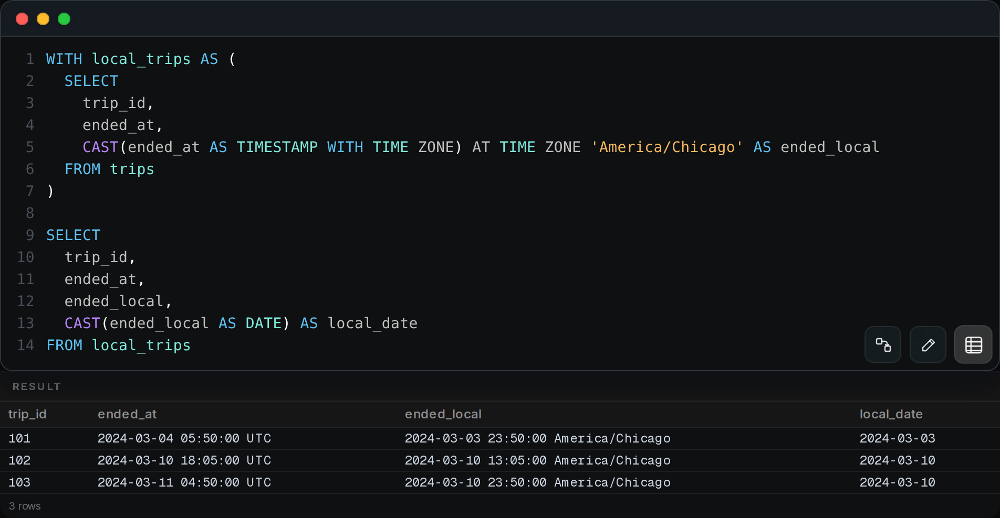

```sql
WITH local_trips AS (
  SELECT
    trip_id,
    ended_at,
    CAST(ended_at AS TIMESTAMP WITH TIME ZONE) AT TIME ZONE 'America/Chicago' AS ended_local
  FROM trips
)

SELECT
  trip_id,
  ended_at,
  ended_local,
  CAST(ended_local AS DATE) AS local_date
FROM local_trips
```

Trips 101 and 103 both end at 23:50 on a Sunday in Chicago, yet their UTC times of day differ by an hour: 05:50 and 04:50. Chicago ran 6 hours behind UTC before 2:00 a.m. local time on March 10, 2024. After that moment it ran 5 hours behind. Both rows also carry a UTC date 1 day later than their Chicago date, so a report grouped by UTC day books Sunday night's fares on Monday.


<br>

### Named zones follow daylight saving rules

A fixed offset such as `-06:00` applies the same shift all year. A named zone such as `America/Chicago` carries the region's rule history, so it moves from 6 to 5 hours behind UTC at the instant the clocks jumped. Both versions below read 07:30 and 08:30 UTC on March 10, 2024, half an hour before and after Chicago's jump.

**Named zone**

The named zone reads 01:30 before the jump and 03:30 after it: 1 hour of UTC time covers 2 hours of Chicago clock, because 02:00 to 03:00 never happened that night.

```sql
SELECT
  TIMESTAMP '2024-03-10 07:30:00 UTC' AT TIME ZONE 'America/Chicago' AS before_jump,
  TIMESTAMP '2024-03-10 08:30:00 UTC' AT TIME ZONE 'America/Chicago' AS after_jump
```

Result:

```
before_jump | after_jump
2024-03-10 01:30:00 America/Chicago | 2024-03-10 03:30:00 America/Chicago
```

**Fixed offset**

The offset reads 01:30 and 02:30, and 02:30 is a time no Chicago clock showed on March 10, 2024.

```sql
SELECT
  TIMESTAMP '2024-03-10 07:30:00 UTC' AT TIME ZONE '-06:00' AS before_jump,
  TIMESTAMP '2024-03-10 08:30:00 UTC' AT TIME ZONE '-06:00' AS after_jump
```

Result:

```
before_jump | after_jump
2024-03-10 01:30:00 -06:00 | 2024-03-10 02:30:00 -06:00
```

The jump in March has a mirror in November. On November 3, 2024, Chicago clocks reached 2:00 a.m. and fell back to 1:00 a.m., so every minute between 1:00 and 2:00 happened twice. Converting from UTC still gives a single answer per instant, as these 2 readings taken an hour apart show.

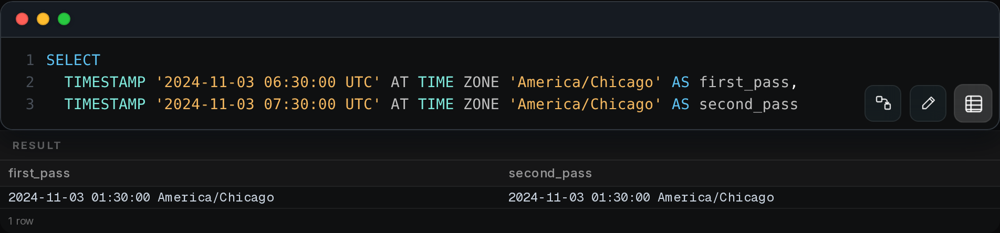

```sql
SELECT
  TIMESTAMP '2024-11-03 06:30:00 UTC' AT TIME ZONE 'America/Chicago' AS first_pass,
  TIMESTAMP '2024-11-03 07:30:00 UTC' AT TIME ZONE 'America/Chicago' AS second_pass
```

Both columns read 01:30, and they remain different instants, 1 hour apart. The reverse trip has no single answer: a wall-clock 01:30 on that night names 2 instants, so a pipeline that stores only local digits can no longer tell which of 2 fares came first. Keep the instant, and derive local time from it.

> **TIP**
>
> Store IANA zone names in dimension tables, never offsets. `America/Chicago` is one such name, and so are `Europe/London` and `Asia/Tokyo`. An offset captured in January is wrong in Chicago from March to November.


<br>

### A zone stored on every row

`AT TIME ZONE` accepts a zone name written as a literal, so it can't read the zone from a column. When each row carries its own zone, route the value through Unix time, which the intermediate lesson covered: `to_unixtime` turns the instant into seconds since 1970-01-01 UTC, and `from_unixtime(seconds, zone)` builds a `TIMESTAMP WITH TIME ZONE` read in the zone that row names. Seconds since the epoch belong to no zone, so the instant passes through unchanged.

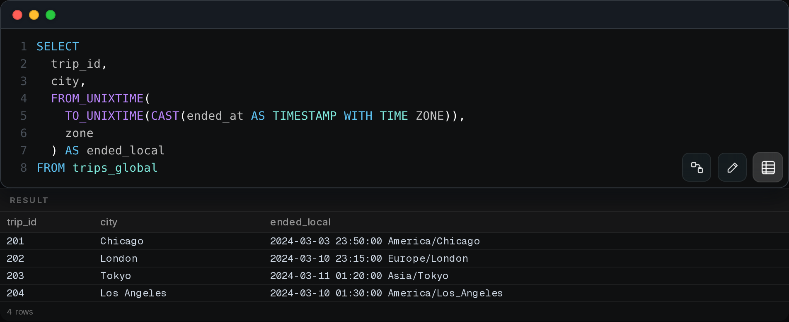

```sql
SELECT
  trip_id,
  city,
  FROM_UNIXTIME(
    TO_UNIXTIME(CAST(ended_at AS TIMESTAMP WITH TIME ZONE)),
    zone
  ) AS ended_local
FROM trips_global
```

Tokyo's trip ends on March 11 locally while its UTC stamp says March 10. The Los Angeles trip at 09:30 UTC reads 01:30, 30 minutes before that city's clocks jumped at 10:00 UTC. Each row resolves against its own zone's rules.

> Bare timestamps borrow the session zone
>
> A plain `TIMESTAMP` holds clock digits with no zone attached. Apply `AT TIME ZONE` to one and the database first reads those digits in the session's zone, a setting that never appears in the query text, so 2 people running the same query can get different rows. Put the zone in the data, the way `trips` carries its `UTC` suffix, before converting.

**A fare ends at 08:45 UTC on March 10, 2024. What does this query return?**

```sql
SELECT
  CAST(TIMESTAMP '2024-03-10 08:45:00 UTC' AT TIME ZONE 'America/Chicago' AS DATE) AS local_date,
  hour(TIMESTAMP '2024-03-10 08:45:00 UTC' AT TIME ZONE 'America/Chicago') AS local_hour
```

- **A.** 2024-03-10 and 3
- **B.** 2024-03-10 and 2
- **C.** 2024-03-09 and 3
- **D.** 2024-03-10 and 8

<details>
<summary>Solution</summary>

**A.** 2024-03-10 and 3

08:45 UTC falls 45 minutes after Chicago's 08:00 UTC switch to 5 hours behind, so the Chicago clock reads 03:45 on March 10.

**Why the others are wrong**

- **B.** Hour 2 applies the old 6-hour gap. That gap ended at 08:00 UTC, and 02:45 never appeared on a Chicago clock that night.
- **C.** The hour is right, but 03:45 comes after midnight on March 10, so the Chicago date is March 10.
- **D.** Hour 8 is the UTC hour. hour() reads the value in the zone it carries, which is Chicago after the conversion.

</details>


<br>

---

## DATE_TRUNC()

`date_trunc(unit, value)` keeps every field down to the named unit and resets the smaller ones to their minimum: day 1, hour 0, minute 0, second 0. The result has the input's type, so a truncated timestamp can still be sorted and compared, and interval arithmetic works on it. Every value inside the same unit lands on the same start point, which turns the truncated column into a grouping key.

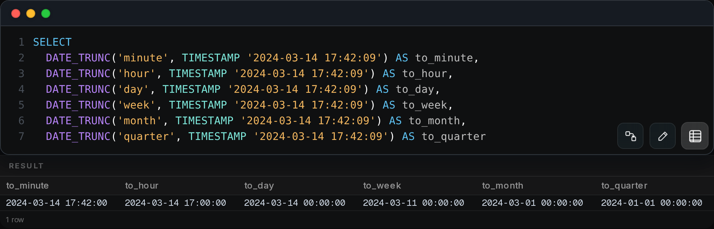

```sql
SELECT
  DATE_TRUNC('minute', TIMESTAMP '2024-03-14 17:42:09') AS to_minute,
  DATE_TRUNC('hour', TIMESTAMP '2024-03-14 17:42:09') AS to_hour,
  DATE_TRUNC('day', TIMESTAMP '2024-03-14 17:42:09') AS to_day,
  DATE_TRUNC('week', TIMESTAMP '2024-03-14 17:42:09') AS to_week,
  DATE_TRUNC('month', TIMESTAMP '2024-03-14 17:42:09') AS to_month,
  DATE_TRUNC('quarter', TIMESTAMP '2024-03-14 17:42:09') AS to_quarter
```

March 14, 2024 is a Thursday, and `'week'` snaps it back to Monday, March 11: `date_trunc` always starts weeks on Monday, the convention the ISO 8601 section covers in full. `'quarter'` lands on January 1 because March sits in the first quarter, and `'year'` would land there too.

*The units are 'second', 'minute', 'hour', 'day', 'week', 'month', 'quarter' and 'year'.*


<br>

### Truncation keeps the year; month() drops it

Grouping by `month(ordered_at)`, from the intermediate lesson, returns 3 for every March. That puts March 2023 and March 2024 in 1 group. `date_trunc('month', ordered_at)` returns a full timestamp such as `2024-03-01 00:00:00`, which still names its year and sorts across years in calendar order.

**month()**

Returns 1 row: month 3 with 4 orders, placed a year apart and counted together.

```sql
SELECT
  MONTH(ordered_at) AS order_month,
  COUNT(*) AS orders
FROM orders
GROUP BY MONTH(ordered_at)
ORDER BY order_month
```

Result:

```
order_month | orders
3 | 4
```

**date_trunc**

Returns 2 rows, 2023-03-01 and 2024-03-01, each with 2 orders.

```sql
SELECT
  DATE_TRUNC('month', ordered_at) AS order_month,
  COUNT(*) AS orders
FROM orders
GROUP BY DATE_TRUNC('month', ordered_at)
ORDER BY order_month
```

Result:

```
order_month | orders
2023-03-01 00:00:00 | 2
2024-03-01 00:00:00 | 2
```

The GROUP BY repeats the whole `date_trunc` expression because GROUP BY runs before the SELECT list names `order_month`. Change the unit string and the same query counts at another grain, such as week or quarter. Every key stays a timestamp, so later steps can filter on it or format it.


<br>

### Truncate on the local clock

On a `TIMESTAMP WITH TIME ZONE`, `date_trunc` cuts at the boundaries of the zone the value carries. Truncate a UTC value to `'day'` and days break at UTC midnight, which is 6:00 p.m. in Chicago during standard time, so an evening shift splits across 2 days. Convert with `AT TIME ZONE` before truncating, and days break at Chicago midnight.

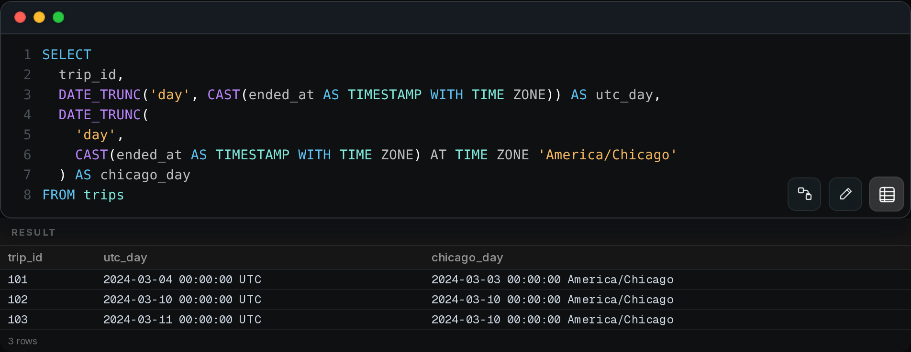

```sql
SELECT
  trip_id,
  DATE_TRUNC('day', CAST(ended_at AS TIMESTAMP WITH TIME ZONE)) AS utc_day,
  DATE_TRUNC(
    'day',
    CAST(ended_at AS TIMESTAMP WITH TIME ZONE) AT TIME ZONE 'America/Chicago'
  ) AS chicago_day
FROM trips
```

Trips 101 and 103 each move back 1 day once the cut reads Chicago's clock, because both ended at 23:50 local. Trip 102 ended at 1:05 p.m. in Chicago and keeps March 10 either way. A daily total grouped by `utc_day` would credit 2 Sunday-night fares to Monday.


<br>

### Weeks that open Monday at 4:00 a.m.

A pay week that runs Monday 4:00 a.m. to the next Monday 3:59 a.m. matches no unit. Shift every timestamp back 4 hours so the boundary lands on midnight, truncate to `'week'`, then add the 4 hours back. The `fares` table below holds Chicago wall-clock times as plain timestamps; with UTC data, convert before shifting. Here are 3 fares walked through by hand.

| Fare | Ends (local) | Minus 4 hours | Truncated to week | Plus 4 hours |
| --- | --- | --- | --- | --- |
| 2 | Mon 03-04 02:15 | Sun 03-03 22:15 | Mon 02-26 00:00 | Mon 02-26 04:00 |
| 3 | Mon 03-04 09:40 | Mon 03-04 05:40 | Mon 03-04 00:00 | Mon 03-04 04:00 |
| 6 | Mon 03-11 04:00 | Mon 03-11 00:00 | Mon 03-11 00:00 | Mon 03-11 04:00 |

https://github.com/user-attachments/assets/b6f419d9-1885-4583-a863-d1692bbd198d

Fare 2 ended on Monday, March 4, before 4:00 a.m., so it joins the week of February 26 with Sunday night's fare 1. Fare 5 at 03:59 on March 11 still counts toward the March 4 week, and fare 6, 1 minute later, opens the next one.

> Filter with ranges, not truncated columns
>
> - `WHERE date_trunc('month', ordered_at) = TIMESTAMP '2024-03-01 00:00:00'` computes the function on every row before comparing.
> - `WHERE ordered_at >= TIMESTAMP '2024-03-01 00:00:00' AND ordered_at < TIMESTAMP '2024-04-01 00:00:00'` returns the same rows.
> - The range compares the raw column, so the engine can check each file's stored min and max and skip files that can't match.
> - Close the range with `<`: `BETWEEN` includes its upper end and would pull in rows stamped exactly midnight on April 1.

**Using the 4-hour shift from the fares query, which pay week start does a fare that ends at 2024-03-18 03:30:00 get?**

- **A.** 2024-03-18 04:00:00
- **B.** 2024-03-11 00:00:00
- **C.** 2024-03-11 04:00:00
- **D.** 2024-03-18 00:00:00

<details>
<summary>Solution</summary>

**C.** 2024-03-11 04:00:00

Shifting back 4 hours gives Sunday 23:30 on March 17, which truncates to Monday, March 11. Adding the hours back gives 04:00.

**Why the others are wrong**

- **A.** This puts the fare in the week that opens on its own Monday, but that week opens at 04:00, half an hour after the fare.
- **B.** The week is right, but the 4 hours were never added back, so the start shows midnight.
- **D.** That is date_trunc('week', ...) with no shift at all: the midnight boundary ignores the 4:00 a.m. rule.

</details>


<br>

---

## Parsing and Formatting

Dates arrive as text, and each source picks its own layout: a CSV export writes them one way, a partner feed another. `date_parse(text, format)` reads text into a `TIMESTAMP` by matching it against a format string: each `%` specifier stands for one field, and every other character must appear in the text exactly as written.

| Specifier | Reads | Example |
| --- | --- | --- |
| %Y | 4-digit year | 2024 |
| %m | month 01-12 | 03 |
| %d | day 01-31 | 04 |
| %H | hour 00-23 | 23 |
| %h | hour 01-12 | 11 |
| %i | minutes 00-59 | 50 |
| %s | seconds 00-59 | 09 |
| %p | AM or PM | PM |

Minutes are `%i` because `%m` already means month. A format that writes `%m` in the minutes slot reads that slot as a second month field, and any minute value above 12 fails to parse.

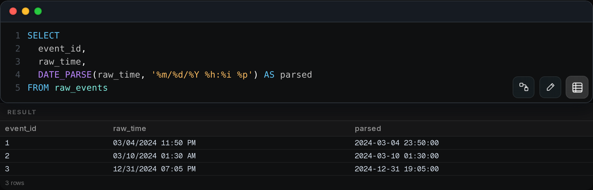

```sql
SELECT
  event_id,
  raw_time,
  DATE_PARSE(raw_time, '%m/%d/%Y %h:%i %p') AS parsed
FROM raw_events
```

`%h` with `%p` turns `11:50 PM` into 23:50 and `07:05 PM` into 19:05. The slashes and the colon outside the specifiers matched the text exactly, and so did the space between date and time.

Real feeds drift. Suppose a second upstream system starts writing `2024-03-10 01:30` into the same column. That text has hyphens where the format expects slashes, so `date_parse` raises an error at that row and the whole query fails, however many good rows came before it. `TRY` wraps any expression and turns an error inside it into NULL for that row, the way `TRY_CAST` handles a bad cast.

```sql
SELECT
  event_id,
  raw_time,
  TRY(DATE_PARSE(raw_time, '%m/%d/%Y %h:%i %p')) AS parsed
FROM raw_events
```

With that row added to `raw_events`, the 3 rows above parse as before and the new one returns NULL in `parsed`. Counting those NULLs after each load tells you how many rows the format missed, and a count that jumps from 0 to thousands overnight means a source changed its layout.


<br>

### The format string decides ambiguous dates

The text `03/04/2024` means March 4 to a US system and April 3 to most of Europe. Nothing in its 10 characters says which, so the format string records the decision, and only the source system's documentation can settle it.

**Month first**

Reads month then day and returns 2024-03-04.

```sql
SELECT
  DATE_PARSE('03/04/2024', '%m/%d/%Y') AS parsed
```

Result:

```
parsed
2024-03-04 00:00:00
```

**Day first**

Reads day then month and returns 2024-04-03, a month later, with no error raised.

```sql
SELECT
  DATE_PARSE('03/04/2024', '%d/%m/%Y') AS parsed
```

Result:

```
parsed
2024-04-03 00:00:00
```

> **TIP**
>
> A first field above 12 settles the order: `25/03/2024` parses only as day first. Before trusting a format on a new feed, scan a sample of the column for such values.


<br>

### Pattern letters: the second format language

`parse_datetime(text, pattern)` and `format_datetime(value, pattern)` use letter patterns in place of `%` codes, as in `yyyy-MM-dd HH:mm:ss`. Letter case carries meaning: `MM` is month and `mm` is minutes, so the pattern `yyyy-mm-dd` reads `2024-03-10` as minute 3 of January 10. `parse_datetime` returns a `TIMESTAMP WITH TIME ZONE`, and its `Z` letter reads a numeric offset such as `-0600` from the text.

```sql
SELECT
  PARSE_DATETIME('2024-03-10 01:30:00 -0600', 'yyyy-MM-dd HH:mm:ss Z') AS parsed,
  PARSE_DATETIME('2024-03-10 01:30:00 -0600', 'yyyy-MM-dd HH:mm:ss Z') AT TIME ZONE 'UTC' AS parsed_utc,
  FORMAT_DATETIME(TIMESTAMP '2024-03-10 07:30:00 UTC', 'yyyy/MM/dd/HH') AS path_part
```

The offset in the text becomes part of the value, so converting to UTC lands on 07:30. Writing runs the same machinery in reverse: `format_datetime` turns a timestamp into `2024/03/10/07`, an hour-level folder layout for raw files. Code that reads those folder names back needs the identical pattern, so define it once and use it in both directions.

The case slip in `yyyy-mm-dd` raises no error, so nothing in the load stops it. These 2 columns parse the same text and differ only in the case of the month letters.

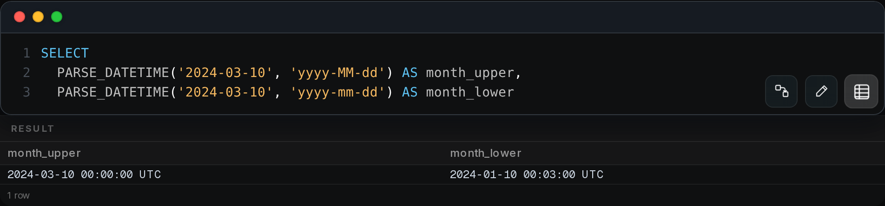

```sql
SELECT
  PARSE_DATETIME('2024-03-10', 'yyyy-MM-dd') AS month_upper,
  PARSE_DATETIME('2024-03-10', 'yyyy-mm-dd') AS month_lower
```

`month_lower` lands on January 10 at 00:03: the `mm` slot read `03` as minutes, and the month, never read, defaulted to January. Every row of a feed parsed this way counts as parsed, so a NULL check passes while the whole feed piles into January.

| ✓ Do | ✗ Don't |
| --- | --- |
| • Write the format string from a documented sample of the source, field by field<br><br>• Wrap parsing in TRY and alert when the NULL count rises after a load<br><br>• Keep the raw text column next to the parsed one so failures can be inspected | • Guess day-first or month-first from a handful of rows<br><br>• Mix % specifiers and pattern letters in one format string<br><br>• Write mm for months in a letter pattern; it means minutes |

**Which format string makes date_parse('2024-03-10 13:05:00', ...) return 2024-03-10 13:05:00?**

- **A.** '%Y-%m-%d %H:%m:%s'
- **B.** '%Y-%m-%d %h:%i:%s'
- **C.** 'yyyy-MM-dd HH:mm:ss'
- **D.** '%Y-%m-%d %H:%i:%s'

<details>
<summary>Solution</summary>

**D.** '%Y-%m-%d %H:%i:%s'

%H reads the 24-hour 13 and %i reads 05 as minutes, so every field matches the text.

**Why the others are wrong**

- **A.** The minutes slot uses %m, the month specifier, so the 05 is read as a month and the minutes stay unset.
- **B.** %h reads a 12-hour clock with values 01 to 12, and 13 is outside that range, so parsing fails.
- **C.** These are pattern letters for parse_datetime. date_parse treats them as literal characters and fails.

</details>


<br>

---

## ISO 8601 Functions

ISO 8601 is the international standard for writing dates and times as text. It puts the largest unit first in fixed-width fields and ends with an explicit offset. `2024-03-10T01:30:00-06:00` names its instant with no outside context, and values written in the same offset sort correctly as plain text, which is why many APIs and log formats use it.


<br>

### Reading timestamps without a format string

`from_iso8601_timestamp(text)` reads ISO 8601 timestamp text into a `TIMESTAMP WITH TIME ZONE` with no format string. It accepts the variations the standard allows within one column, so `Z` for UTC and a numeric offset can sit side by side, with or without fractional seconds. A `date_parse` format matches exactly one of those layouts.

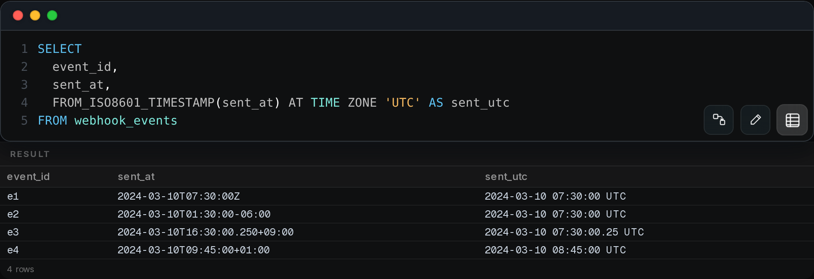

```sql
SELECT
  event_id,
  sent_at,
  FROM_ISO8601_TIMESTAMP(sent_at) AT TIME ZONE 'UTC' AS sent_utc
FROM webhook_events
```

Rows e1 and e2 look nothing alike as text, yet they name the same instant, and e3 lands 250 milliseconds later. Compared as strings, all 3 differ; compared after parsing, e1 equals e2.

Sorting the raw text puts e2 first and e3 last, because text compares the clock digits as written: `01:30`, `07:30`, `09:45`, `16:30`. On the UTC timeline e1 and e2 tie at 07:30, with e3 250 milliseconds behind them. Row e4 comes last at 08:45. `ORDER BY` on the text column reports the first order, and `MIN` and `MAX` do the same.


<br>

### Calendar, week and ordinal dates

`from_iso8601_date(text)` returns a `DATE` and reads 3 ISO spellings of a day: the calendar form `2024-12-30`, the week form `2025-W01-1` (week-year 2025, week 1, day 1 for Monday), and the ordinal form `2024-366`, the 366th day of 2024.

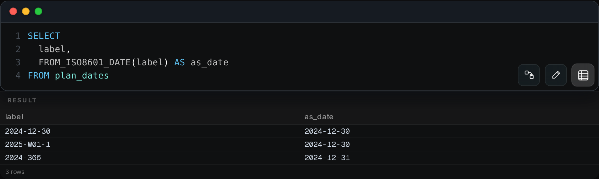

```sql
SELECT
  label,
  FROM_ISO8601_DATE(label) AS as_date
FROM plan_dates
```

The first 2 labels name the same Monday, and the week form files it under 2025. That filing rule is the one ISO week numbers follow.


<br>

### ISO weeks and the year they belong to

ISO weeks start on Monday, and week 1 of a year is the week that holds the year's first Thursday. The last days of December can therefore sit in week 1 of the next year, and the first days of January in week 52 or 53 of the previous one. `week(d)` returns the ISO week number, `year_of_week(d)` returns the ISO year that number belongs to, and `day_of_week(d)` returns 1 for Monday through 7 for Sunday.

The Thursday rule gives a way to compute the ISO year by hand. Every ISO week holds exactly 1 Thursday, and the week belongs to the year that Thursday falls in. `date_add('day', 4 - day_of_week(d), d)` moves any date to the Thursday of its week, 3 days forward from a Monday and 3 back from a Sunday, and `year()` of that Thursday is the value `year_of_week(d)` returns. The query below computes it that way so the rule is visible in every row.

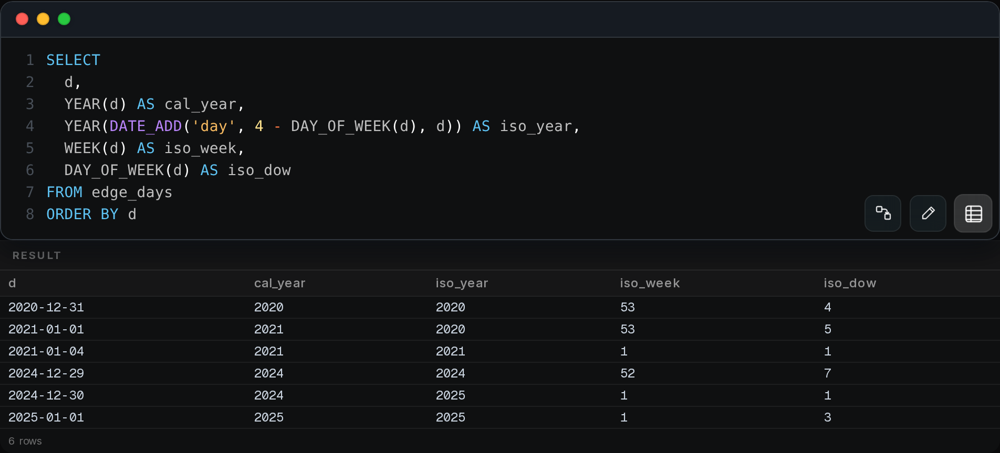

```sql
SELECT
  d,
  YEAR(d) AS cal_year,
  YEAR(DATE_ADD('day', 4 - DAY_OF_WEEK(d), d)) AS iso_year,
  WEEK(d) AS iso_week,
  DAY_OF_WEEK(d) AS iso_dow
FROM edge_days
ORDER BY d
```

On 2024-12-30, `cal_year` says 2024 while `iso_week` says 1. A weekly report grouped by `year(d), week(d)` files that Monday under week 1 of 2024, a week that ended almost a year earlier, and it splits Friday 2021-01-01 away from the Thursday before it. Grouping by `year_of_week(d), week(d)` keeps every week whole.

> **TIP**
>
> `date_trunc('week', d)` produces the same weekly groups as `year_of_week(d)` with `week(d)`, as a single date: the Monday that opens the ISO week.


<br>

### Writing ISO text

`to_iso8601(value)` writes the standard form back out. A `DATE` becomes `2024-03-10`, and a `TIMESTAMP WITH TIME ZONE` keeps its offset, with UTC written as `Z`. Use it whenever a timestamp leaves the database for another system, since the receiver needs no agreement beyond the standard to parse it.

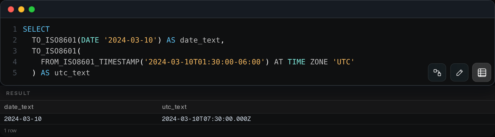

```sql
SELECT
  TO_ISO8601(DATE '2024-03-10') AS date_text,
  TO_ISO8601(
    FROM_ISO8601_TIMESTAMP('2024-03-10T01:30:00-06:00') AT TIME ZONE 'UTC'
  ) AS utc_text
```

| ✓ Do | ✗ Don't |
| --- | --- |
| • Send timestamps to other systems with to_iso8601, in UTC<br><br>• Parse ISO text with from_iso8601_timestamp and skip hand-written formats<br><br>• Group weekly data by year_of_week(d) and week(d) together | • Compare ISO strings that carry different offsets as text<br><br>• Pair week(d) with year(d) in a weekly report<br><br>• Strip the offset before parsing to make the text look uniform |

**What does this query return?**

```sql
SELECT
  date_format(TIMESTAMP '2024-03-04 16:05:00', '%l:%i %p') AS label
```

- **A.** 04:05 PM
- **B.** 16:05 PM
- **C.** 4:05 PM
- **D.** 4:5 PM

<details>
<summary>Solution</summary>

**C.** 4:05 PM

%l prints the 12-hour value without padding, %i prints minutes as 05, and %p adds PM.

**Why the others are wrong**

- **A.** That output comes from %h, which pads the 12-hour clock to 2 digits. %l drops the leading zero.
- **B.** %l reads the 12-hour clock, so 16 becomes 4. Printing 16 would need %k or %H.
- **D.** The hour is right, but %i always prints 2 digits for minutes, so 5 minutes appears as 05.

</details>


<br>

---

## DATE_FORMAT()

`date_format(value, format)` turns a timestamp into the text a person reads on a statement or a chart axis. It shares its `%` specifiers with `date_parse`; the table adds the name and unpadded-number specifiers that matter most on output, and shows each one for `2024-03-04 16:07:09`.

| Specifier | Shows | Output |
| --- | --- | --- |
| %W | weekday name | Monday |
| %a | short weekday | Mon |
| %M | month name | March |
| %b | short month | Mar |
| %e | day, no padding | 4 |
| %c | month, no padding | 3 |
| %y | 2-digit year | 24 |
| %l | 12-hour, no padding | 4 |
| %k | 24-hour, no padding | 16 |
| %j | day of year | 064 |
| %x-W%v | ISO year and week | 2024-W10 |


<br>

### Formatting a pay statement

The weekly totals built in the DATE_TRUNC section arrive with `week_start` as a Chicago wall-clock timestamp. Each statement line needs both ends of its week in the form drivers read: the Monday 4:00 a.m. opening, and the close 1 minute short of 7 days later.

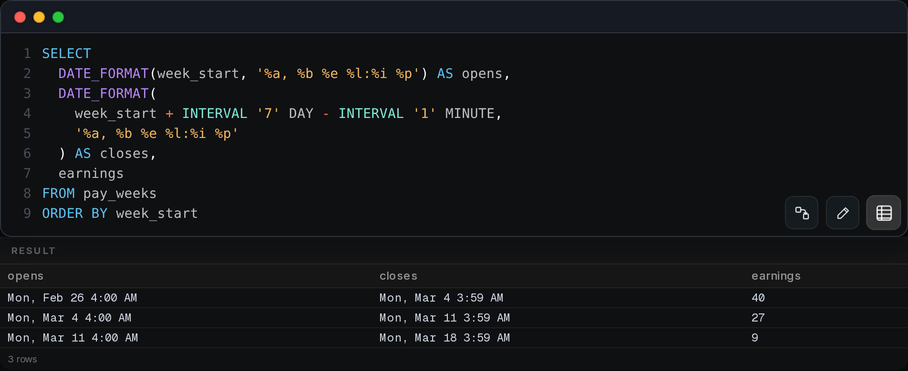

```sql
SELECT
  DATE_FORMAT(week_start, '%a, %b %e %l:%i %p') AS opens,
  DATE_FORMAT(
    week_start + INTERVAL '7' DAY - INTERVAL '1' MINUTE,
    '%a, %b %e %l:%i %p'
  ) AS closes,
  earnings
FROM pay_weeks
ORDER BY week_start
```

`%e` and `%l` drop leading zeros, so the text reads `Mar 4 3:59 AM`. With `%d` and `%h` it would print `Mar 04 03:59 AM`. The query still orders by the timestamp `week_start` and formats only inside the SELECT list.

**What does this query return?**

```sql
SELECT
  date_format(TIMESTAMP '2024-03-04 16:05:00', '%l:%i %p') AS label
```

- **A.** 04:05 PM
- **B.** 16:05 PM
- **C.** 4:05 PM
- **D.** 4:5 PM

<details>
<summary>Solution</summary>

**C.** 4:05 PM

%l prints the 12-hour value without padding, %i prints minutes as 05, and %p adds PM.

**Why the others are wrong**

- **A.** That output comes from %h, which pads the 12-hour clock to 2 digits. %l drops the leading zero.
- **B.** %l reads the 12-hour clock, so 16 becomes 4. Printing 16 would need %k or %H.
- **D.** The hour is right, but %i always prints 2 digits for minutes, so 5 minutes appears as 05.

</details>


<br>

### Sort by the value, show the text

A formatted date is a `VARCHAR`, and text sorts character by character. `Apr` comes before `Jan` because A precedes J, so ordering by the label scrambles the calendar. Both versions below show the same labels and differ only in the ORDER BY column.

**By label**

Alphabetical order: Apr, Feb, Jan, Mar, Nov.

```sql
SELECT
  DATE_FORMAT(month_start, '%b %Y') AS month_label,
  revenue
FROM monthly
ORDER BY month_label
```

Result:

```
month_label | revenue
Apr 2024 | 101
Feb 2024 | 95
Jan 2024 | 120
Mar 2024 | 143
Nov 2024 | 160
```

**By date**

Calendar order: Jan, Feb, Mar, Apr, Nov, because the sort reads the date.

```sql
SELECT
  DATE_FORMAT(month_start, '%b %Y') AS month_label,
  revenue
FROM monthly
ORDER BY month_start
```

Result:

```
month_label | revenue
Jan 2024 | 120
Feb 2024 | 95
Mar 2024 | 143
Apr 2024 | 101
Nov 2024 | 160
```

> **TIP**
>
> Keep dates typed through every CTE and format in the final SELECT. Once a date becomes a string you can't truncate it or convert it to another zone, and comparisons across months go wrong. The timestamp it came from has none of those problems.

> Layouts for common readers
>
> - Statements and receipts: `%a, %b %e %l:%i %p` gives `Mon, Mar 4 4:00 AM`.
> - Monthly chart axes: `%b %Y` gives `Mar 2024`.
> - Weekly report labels: `%x-W%v` gives `2024-W10`. That label matches `year_of_week` and `week`.
> - Day-first audiences: `%d/%m/%Y` gives `04/03/2024`.

The weekly label in that list depends on `%x`. `%Y` prints the calendar year and `%x` the year a week number belongs to, the value `year_of_week` returns, so the specifiers agree on most days and split only on the days around New Year that ISO files under a neighbouring year. Monday, December 30, 2024 is one such day.

| ✓ %Y-W%v on 2024-12-30 | ✗ %x-W%v on 2024-12-30 |
| --- | --- |
| • Prints 2024-W01<br><br>• Points at the week of January 1, 2024, almost a year earlier<br><br>• Puts the last Monday of 2024 at the top of a 2024 list | • Prints 2025-W01<br><br>• Points at the week that opens on this Monday<br><br>• Agrees with year_of_week and week for the same date |


<br>

### Format after converting the zone

`date_format` prints the clock digits of the value it receives. On a `TIMESTAMP WITH TIME ZONE` that means the digits in the zone it carries, so a UTC value formats as a UTC time. Apply `AT TIME ZONE` first and the label shows the reader's local time, as in this query on the `trips` table from the first section.

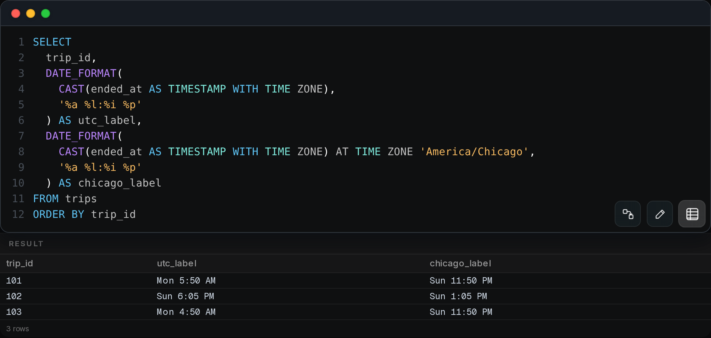

```sql
SELECT
  trip_id,
  DATE_FORMAT(
    CAST(ended_at AS TIMESTAMP WITH TIME ZONE),
    '%a %l:%i %p'
  ) AS utc_label,
  DATE_FORMAT(
    CAST(ended_at AS TIMESTAMP WITH TIME ZONE) AT TIME ZONE 'America/Chicago',
    '%a %l:%i %p'
  ) AS chicago_label
FROM trips
ORDER BY trip_id
```

Trip 101 shows `Mon 5:50 AM` in UTC and `Sun 11:50 PM` in Chicago. Only the second matches what the driver saw on the dashboard, and it decides which pay week the fare joins.


<br>

---

## Putting It All Together

A pipeline for the Uber weekly driver statement from the intro could work this way: trip end times arrive as ISO 8601 text, drivers work in many cities, and each statement must cover Monday 4:00 a.m. to Monday 3:59 a.m. on the driver's own clock.

- Parsing comes first: from_iso8601_timestamp turns each trip's text into an instant with its offset honored, and TRY flags malformed rows as NULLs.
- Zone control comes next: from_unixtime ( to_unixtime ( . . . ) , zone ) re-reads every instant in the driver's city, so the Chicago fare at Sunday 11:50 p.m. stays on Sunday.
- Truncation assigns the week. Truncating to 'week' after a 4-hour shift back, then adding the 4 hours again, puts a Monday 02:15 fare on the previous statement.
- Week labels follow ISO rules: % x - W % v labels the statement that opens Monday, December 30, 2024 as 2025 - W01 , matching year_of_week .
- Formatting comes last: date_format writes Mon , Mar 4 4 : 00 AM from the typed timestamp, and statements sort by week_start , never by the label.


<br>

---

## Key Takeaways

- AT TIME ZONE keeps the instant and changes the clock digits; a named IANA zone applies daylight saving, a fixed offset never does.
- For a zone stored on each row, convert through from_unixtime ( to_unixtime ( ts ) , zone ) .
- date_trunc resets the smaller fields and keeps the year; for boundaries like Monday 4:00 a.m., shift the value before truncating and shift it back afterward.
- date_parse uses % specifiers and parse_datetime uses case-sensitive letters; wrap parsing in TRY so failures show up as NULLs.
- from_iso8601_timestamp reads every ISO variation with no format string, and weekly groups need year_of_week alongside week .
- Format with date_format in the final SELECT, after converting the zone, and sort by the timestamp.
