# Dates: Beginner

An Airbnb guest checks in at 3 pm on March 15 and checks out at 11 am on March 18. The host's payout query reports 2 nights. The guest slept there 3. The difference comes down to a single choice: whether the stay is measured in timestamps or in dates. This lesson starts with the 2 types, then uses the clock functions and date arithmetic to get the number right.


<br>

---

## DATE vs TIMESTAMP data types

A DATE holds a calendar day and nothing smaller. A TIMESTAMP holds a calendar day plus a time of day, down to a fraction of a second. Printed side by side the 2 values look like cousins, which is how a column of the wrong type survives unnoticed for months. `2024-03-15` is a DATE. `2024-03-15 14:30:45` is a TIMESTAMP. The second answers a question the first cannot: at which moment?

| Type | Stores | Literal | Smallest step |
| --- | --- | --- | --- |
| DATE | year, month, day | DATE '2024-03-15' | 1 day |
| TIMESTAMP | year, month, day, hour, minute, second, fraction | TIMESTAMP '2024-03-15 14:30:45' | 1 millisecond |

Questions each type answers

- DATE: which stays begin this week, and how many nights lie between check-in and check-out
- TIMESTAMP: whether a payment landed before the cancellation, and how many minutes a host took to reply

A literal is the type name followed by the value in single quotes. The type name tells the engine to parse the quoted text as a day or a moment rather than keep it as text, so `DATE '2024-03-15'` compares as a day while `'2024-03-15'` on its own is a VARCHAR of 10 characters that compares letter by letter. Write the year first, then the month, then the day, each with its leading zero.


<br>

### Choosing between them

| ✓ Store as DATE | ✗ Store as TIMESTAMP |
| --- | --- |
| • Check-in and check-out days<br><br>• Birthdays and due dates<br><br>• The day a daily report covers<br><br>• Anything a person writes on a calendar | • The moment a payment was captured<br><br>• When a row was last updated<br><br>• Events such as clicks or messages<br><br>• Anything measured at a finer grain than a day |

The bookings table in the next example mixes both. `check_in` and `check_out` are DATE columns because a guest arrives on a day and the hour is between the guest and the host. `created_at` is a TIMESTAMP because the moment a booking was made feeds fraud checks and lead-time reports. Run it and compare the last 2 columns: casting a TIMESTAMP to DATE keeps the day and drops the clock.

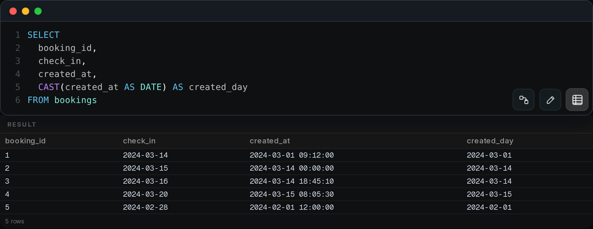

```sql
SELECT
  booking_id,
  check_in,
  created_at,
  CAST(created_at AS DATE) AS created_day
FROM bookings
```

| Expression | Result | What happened |
| --- | --- | --- |
| CAST(TIMESTAMP '2024-03-15 14:30:45' AS DATE) | 2024-03-15 | the clock was dropped |
| CAST(DATE '2024-03-15' AS TIMESTAMP) | 2024-03-15 00:00:00 | midnight was supplied |
| CAST('2024-03-15' AS DATE) | 2024-03-15 | text was parsed into a day |
| CAST(DATE '2024-03-15' AS VARCHAR) | 2024-03-15 | the day was printed as 10 characters |

Casting a DATE up to a TIMESTAMP has to invent a time of day, and the engine chooses midnight. That midnight sits behind the most common date mistake in production queries. When a TIMESTAMP column is compared to a DATE literal, the literal is widened to midnight of its day before the comparison runs, so `created_at = DATE '2024-03-14'` asks for bookings created at exactly 00:00:00.000 on March 14, and almost nothing is created at that instant.

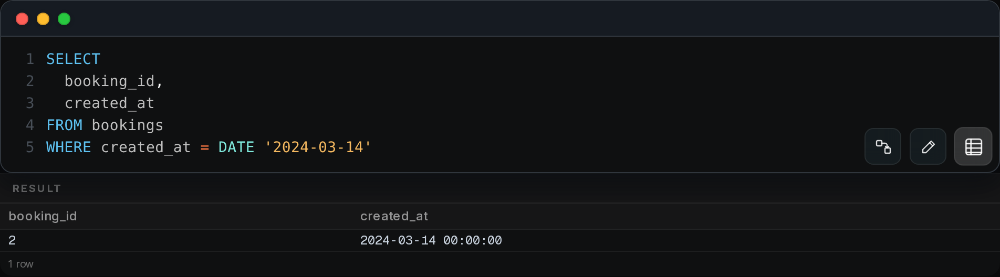

```sql
SELECT
  booking_id,
  created_at
FROM bookings
WHERE created_at = DATE '2024-03-14'
```

One row comes back, booking 2, which happens to carry a midnight stamp. Booking 3 was created at 18:45:10 the same day and fails the test, because 18:45:10 is later than 00:00:00. To ask about the whole day, bring the column down to the literal's type with a cast, so both sides are days. Play the animation and watch the comparison turn true for 2 rows and false for 3.

https://github.com/user-attachments/assets/9caa19bc-037f-4a58-af18-039af15390b3

> **TIP**
>
> Match the types before you compare. Cast the TIMESTAMP column to DATE when the question is about a day, and write a TIMESTAMP literal when the question is about a moment.

Both wrong choices cost something. A team that stores check-in as a TIMESTAMP pays 8 bytes a row where 4 would do and writes a cast into every day comparison. The column also accepts a clock reading. Once one source starts writing arrivals at 15:00 or 16:30, `check_in = DATE '2024-03-15'` silently drops exactly those rows while the midnight ones still match. A team that stores payment time as a DATE loses the hour for good and can never say which of 2 payments on the same day arrived first.


**Booking 2 has check_in 2024-03-15. What does this query return?**

```sql
SELECT
  CAST(check_in AS TIMESTAMP) AS check_in_ts
FROM bookings
WHERE booking_id = 2
```

- **A.** 2024-03-15 00:00:00, because a DATE has no time of day and the engine supplies midnight
- **B.** 2024-03-15 14:30:45, because the engine fills the gap with the current time of day
- **C.** An error, because a DATE holds no time and cannot be widened to a TIMESTAMP
- **D.** 2024-03-15 12:00:00, because the engine picks the middle of the day as the least biased time

<details>
<summary>Solution</summary>

**A.** 2024-03-15 00:00:00, because a DATE has no time of day and the engine supplies midnight

Widening a DATE adds a clock reading of 00:00:00, the same midnight that makes date literals match so few timestamp rows.

**Why the others are wrong**

- **B.** The clock is never consulted for a cast; the result depends only on the value being converted.
- **C.** The cast is allowed in both directions; going up supplies midnight, going down drops the clock.
- **D.** Midnight is the supplied time, which is why the cast lines up with the start of the day.

</details>


<br>

---

## CURRENT_DATE & CURRENT_TIME

Every report that says 'as of today' needs the engine's clock. `CURRENT_DATE` returns the current day as a DATE and `CURRENT_TIME` returns the current time of day. Both are written without parentheses: the SQL standard defines them as keywords that stand for a value, and `CURRENT_DATE()` with parentheses is a syntax error. Across this lesson the clock is frozen at March 15, 2024, 14:30:45, so `CURRENT_DATE` is 2024-03-15 and every result below stays the same whichever day you run it.


<br>

### Why a literal goes stale

A report written on March 15 with `WHERE check_in >= DATE '2024-03-15'` returns the right rows that day and the wrong rows every day after, because the literal never moves while the calendar does. Swapping the literal for `CURRENT_DATE` makes the same query correct on every run. Scheduled pipelines depend on this: the morning job that lists today's arrivals carries no date in its text, and the clock supplies one each time it starts.

| ✓ Hardcoded | ✗ Clock-driven |
| --- | --- |
| • WHERE check_in >= DATE '2024-03-15'<br><br>• Correct on March 15<br><br>• Off by 1 day on March 16, by 2 on March 17 | • WHERE check_in >= CURRENT_DATE<br><br>• Correct on every run<br><br>• Nothing to edit when the date changes |

`CURRENT_DATE` can also appear in the SELECT list, and so can a comparison against it, since `check_in > CURRENT_DATE` is a BOOLEAN expression like any other. Run the query and read the last column against the second.

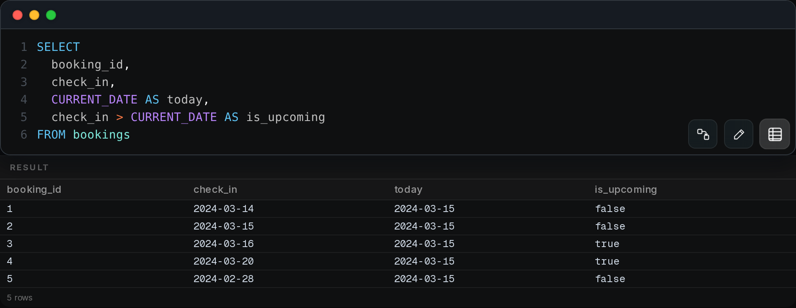

```sql
SELECT
  booking_id,
  check_in,
  CURRENT_DATE AS today,
  check_in > CURRENT_DATE AS is_upcoming
FROM bookings
```

Bookings 3 and 4 come back true: their stays begin after today. Booking 2 starts today and comes back false, because March 15 equals today rather than following it. Bookings 1 and 5 are already past. Swap `>` for `>=` and today's arrival joins the upcoming group; which of the 2 you want depends on whether the report runs before or after guests arrive. Today also has an end: booking 2 passes `>=` for any query started on March 15, and fails it for any query started on March 16, from midnight on.

The same comparison in a WHERE clause keeps only the rows that pass. The animation filters to stays that begin today or later and counts them per listing. Watch the 2 rows that fail fall away before the survivors fold into groups.

https://github.com/user-attachments/assets/52f4decc-f4d6-49e1-8a2f-8b4884f0e67d


<br>

### One reading per query

The engine reads the clock once, when the query starts, and uses that value in every row and every clause. A query that scans 400 million rows over 10 minutes sees the same `CURRENT_DATE` in its last row as in its first, even if midnight passes while it runs. The day a query sees is the day it began: a job that starts at 23:59:30 on March 15 is a March 15 job all the way to its final row.


<br>

### CURRENT_TIME

`CURRENT_TIME` returns the time of day with no date attached: here 14:30:45, followed by the zone it was read in. On its own it answers questions such as whether a support line is open right now. It cannot say which day it is, and most data work wants the day and the time together in one value. Run the query and see the 2 values side by side.

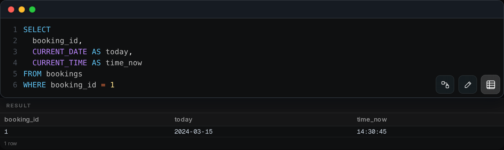

```sql
SELECT
  booking_id,
  CURRENT_DATE AS today,
  CURRENT_TIME AS time_now
FROM bookings
WHERE booking_id = 1
```

> The 3 clock values
>
> - CURRENT_DATE: the day, as a DATE, 2024-03-15
> - CURRENT_TIME: the time of day, 14:30:45, with its zone
> - CURRENT_TIMESTAMP: the day and the time together, next section

| ✓ Do | ✗ Don't |
| --- | --- |
| • Write CURRENT_DATE with no parentheses<br><br>• Compare CURRENT_DATE against DATE columns<br><br>• Cast a TIMESTAMP column to DATE before comparing it to today | • Hardcode today's date as a literal in a scheduled report<br><br>• Compare CURRENT_DATE to a TIMESTAMP column with =, which matches only midnight<br><br>• Reach for CURRENT_TIME when the report also needs the day |

**On 2024-03-15 this query returned bookings 3 and 4. It runs again, unchanged, on 2024-03-16. Which bookings come back?**

```sql
SELECT
  booking_id
FROM bookings
WHERE check_in > CURRENT_DATE
```

- **A.** Bookings 3 and 4, because the query text has not changed between the 2 runs
- **B.** Bookings 2, 3 and 4, because today moved forward and more stays now count as upcoming
- **C.** Booking 4 only, because booking 3 starts on March 16 and March 16 is not greater than March 16
- **D.** No bookings, because CURRENT_DATE now points to a day on which nobody checks in

<details>
<summary>Solution</summary>

**C.** Booking 4 only, because booking 3 starts on March 16 and March 16 is not greater than March 16

CURRENT_DATE is now 2024-03-16, so only check-ins strictly after that day pass, which leaves booking 4 on March 20.

**Why the others are wrong**

- **A.** The text is the same, and the clock value inside it is a day later, which changes what passes the filter.
- **B.** Moving today forward shrinks the set of future stays; booking 2 started on March 15 and is now in the past.
- **D.** The filter asks for check-ins after today, so a day with no arrivals of its own still lets later arrivals through.

</details>

Flip the operator and the filter looks backward. `check_in <= CURRENT_DATE` keeps every stay that has already begun, today's included: on March 15 that keeps booking 2, which starts today, along with bookings 1 and 5. Drop the equals sign and booking 2 falls out, because a stay starting today does not start before today. The keyword is the same in both filters and is written bare, since `CURRENT_DATE()` fails to parse.


<br>

---

## CURRENT_TIMESTAMP function

`CURRENT_TIMESTAMP` returns the date and the time of day in a single value: 2024-03-15 14:30:45.000 in this lesson, with the session's time zone attached. `NOW()`, parentheses included, is an alias for the same value. You will see both spellings in production code. Where `CURRENT_DATE` answers which day, `CURRENT_TIMESTAMP` answers which moment, which is what you need to stamp a row as it is written, to measure how long ago something happened, or to catch data that claims to come from the future.

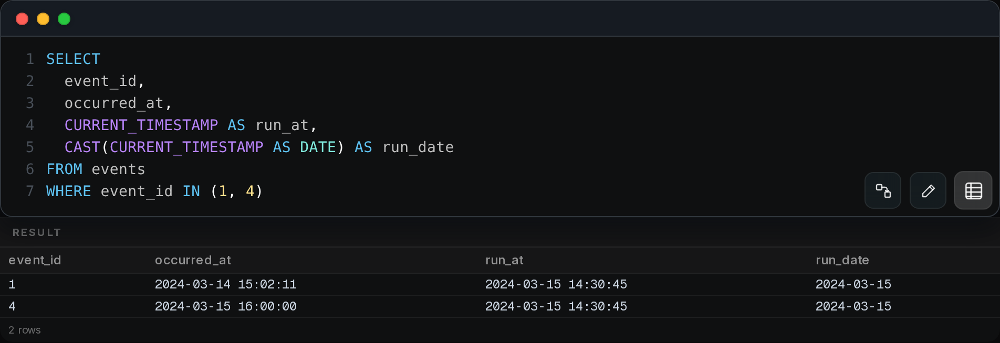

```sql
SELECT
  event_id,
  occurred_at,
  CURRENT_TIMESTAMP AS run_at,
  CAST(CURRENT_TIMESTAMP AS DATE) AS run_date
FROM events
WHERE event_id IN (1, 4)
```

`run_at` is identical in both rows because the clock is read once per query, exactly as with `CURRENT_DATE`. `run_date` casts the moment down to its day and lands on 2024-03-15, the value `CURRENT_DATE` would give; the cast is how you move from one to the other when a table stores moments and a report wants days.


<br>

### Catching events from the future

An event table should never hold a row stamped later than now. When one appears, a device clock was wrong, a zone was mishandled upstream, or a test record leaked into production. The check is a single comparison against `CURRENT_TIMESTAMP`. In the events table, 2 rows carry an `occurred_at` past 14:30:45 on March 15. Step through the animation to see each row tested against the clock.

https://github.com/user-attachments/assets/b00b02f5-6de8-4258-a518-67970ba611ef

Events 4 and 6 fail the sanity check. Event 3, stamped 14:29:59, passes by a single second, which shows how fine the test is: a TIMESTAMP comparison is decided at the millisecond, and a value one tick earlier than now belongs to the past.


<br>

### Today's events, by day

The question 'what happened today' is a day question asked of a moment column, so the column is cast to DATE and compared to `CURRENT_DATE`. Look at what this does with event 4: its timestamp is in the future, but its day is today, so it counts. A query that filters on the day and a query that filters on the moment can disagree about the same row, and each is right about what it asked.

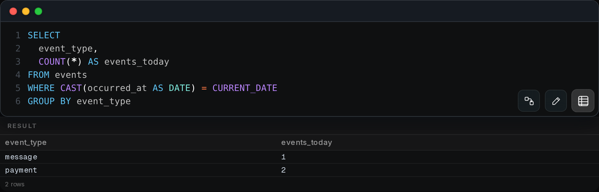

```sql
SELECT
  event_type,
  COUNT(*) AS events_today
FROM events
WHERE CAST(occurred_at AS DATE) = CURRENT_DATE
GROUP BY event_type
```

| Question | Compare against | Example |
| --- | --- | --- |
| Is this moment in the past | CURRENT_TIMESTAMP | occurred_at <= CURRENT_TIMESTAMP |
| Did this happen today | CURRENT_DATE | CAST(occurred_at AS DATE) = CURRENT_DATE |
| What time of day is it | CURRENT_TIME | rarely needed in reports |

- loaded_at columns that record the moment a pipeline wrote each row
- Freshness checks that compare the newest row's stamp to now
- Future-stamp sanity filters on event streams
- Run logs that store when each job started and finished

> **TIP**
>
> When a pipeline writes a row, store CURRENT_TIMESTAMP in a column such as loaded_at. That column later answers how stale the table is and which rows arrived in the latest run.

Compare `CURRENT_TIMESTAMP` only to TIMESTAMP columns. Against a DATE column such as `check_in`, `check_in = CURRENT_TIMESTAMP` widens the date to midnight and tests it against 14:30:45, which is never equal; `check_in > CURRENT_TIMESTAMP` does work, but it reads as though the author lost track of which type they held.

**A query selects CURRENT_TIMESTAMP next to every row of a 50 million row table and takes 6 minutes to finish. How does the value in the last row differ from the first?**

- **A.** The last row is about 6 minutes later, because each row reads the clock as it is produced
- **B.** The last row is later by 1 millisecond per row, because the engine advances the stamp to keep rows distinct
- **C.** The last row is NULL, because the clock is read only while the first row is produced
- **D.** They are identical, because the engine takes a single clock reading at the start and copies it to every row

<details>
<summary>Solution</summary>

**D.** They are identical, because the engine takes a single clock reading at the start and copies it to every row

One reading per query is what makes CURRENT_TIMESTAMP safe to compare against and to stamp rows with.

**Why the others are wrong**

- **A.** Rows do not read the clock; the engine reads it once and copies the value into every row.
- **B.** Nothing is advanced; a stamp that differed per row would make the same query report 50 million different moments.
- **C.** The value is held for the whole run and never becomes NULL.

</details>


<br>

---

## DATE_ADD()

`DATE_ADD` moves a date or a timestamp forward or back by a whole number of units. It takes 3 arguments in a fixed order: the unit as a quoted string, the amount as an integer, and the value to move. `DATE_ADD('day', 14, check_out)` is 14 days after check-out. A negative amount moves backward, so `DATE_ADD('day', -7, CURRENT_DATE)` is 2024-03-08, a week before today. The result keeps the type of the value you pass in: a DATE comes back a DATE and a TIMESTAMP comes back a TIMESTAMP, clock intact.

| Unit | Amount | Result from TIMESTAMP '2024-03-15 14:30:45' |
| --- | --- | --- |
| 'second' | 30 | 2024-03-15 14:31:15 |
| 'minute' | 90 | 2024-03-15 16:00:45 |
| 'hour' | 10 | 2024-03-16 00:30:45 |
| 'day' | 20 | 2024-04-04 14:30:45 |
| 'week' | 2 | 2024-03-29 14:30:45 |
| 'month' | 1 | 2024-04-15 14:30:45 |
| 'year' | -1 | 2023-03-15 14:30:45 |

A DATE carries no clock, so it accepts only units of a day or longer, up to year. Ask it for hours and the engine refuses, reporting that hour is not a valid DATE field. When a day-typed column needs hour arithmetic, cast it to TIMESTAMP first, and the clock begins at midnight.


<br>

### Deadlines from a date

Airbnb gives guests 14 days after checkout to write a review, so every booking's deadline is a single call on `check_out`. Play the animation: each date walks into the new column with 14 days added, and 3 of the 5 land in April though no row mentions April. The engine handles the month rollover, including the 31 days in March.

https://github.com/user-attachments/assets/e5ad86d4-26f2-42af-85ee-79e3c22db88a


<br>

### Windows that slide with the clock

The most common `DATE_ADD` in analytics never shows its result. It sits in a WHERE clause and defines a window that moves with the date: the last 7 days, the last 30 days, the last 24 hours. `DATE_ADD('day', -7, CURRENT_DATE)` evaluates to 2024-03-08, and `>=` against it keeps everything on or after that day. Because the cutoff is built from `CURRENT_DATE`, the same query run next week keeps next week's rows without an edit.

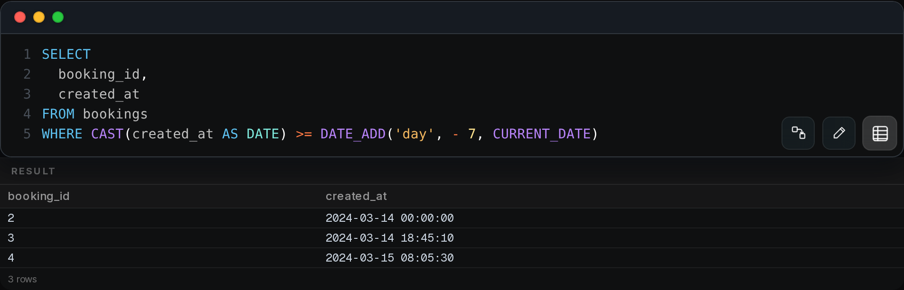

```sql
SELECT
  booking_id,
  created_at
FROM bookings
WHERE CAST(created_at AS DATE) >= DATE_ADD('day', - 7, CURRENT_DATE)
```

Of the 5 bookings, numbers 2 through 4 were created on or after March 8. Booking 1, created March 1, misses the cutoff by a week, and booking 5 by over a month. Two cutoffs that sound alike behave differently. `DATE_ADD('day', -1, CURRENT_DATE)` is 2024-03-14, so `>=` keeps all of yesterday and all of today, up to 2 full calendar days. `DATE_ADD('hour', -24, CURRENT_TIMESTAMP)` is 2024-03-14 14:30:45, the start of the 24 hours ending now. A row stamped yesterday at 09:00 passes the first and fails the second.

| ✓ Calendar window | ✗ Clock window |
| --- | --- |
| • DATE_ADD('day', -1, CURRENT_DATE)<br><br>• Cutoff: 2024-03-14<br><br>• Keeps all of yesterday and today | • DATE_ADD('hour', -24, CURRENT_TIMESTAMP)<br><br>• Cutoff: 2024-03-14 14:30:45<br><br>• Keeps the 24 hours ending now |


<br>

### Month ends

Adding months runs into a calendar fact: the target month may lack the day you started from. The engine keeps the result inside that month by clamping to its last day. January 31 plus 1 month is February 29 in 2024, and February 29 plus 1 year is February 28 in 2025. Predict all 4 rows of each column before you run the query.

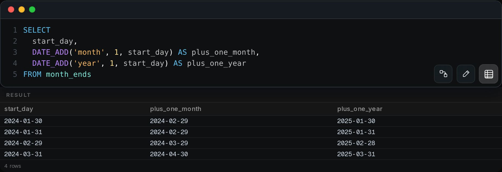

```sql
SELECT
  start_day,
  DATE_ADD('month', 1, start_day) AS plus_one_month,
  DATE_ADD('year', 1, start_day) AS plus_one_year
FROM month_ends
```

The clamp means month arithmetic can lose information. Adding 1 month to January 30 gives February 29, the same day January 31 reaches; subtract the month again and both return to January 29 instead of where they began. Billing systems that charge on 'the same day next month' decide this case on purpose, because the engine's answer for a January 31 signup is February 29 in one year and February 28 in the next.

**What does DATE_ADD('month', 1, DATE '2024-01-31') return?**

- **A.** 2024-03-02, because the extra days spill 2 days past the end of February
- **B.** 2024-02-29, because the result is clamped to the last day of February in a leap year
- **C.** 2024-02-31, because DATE_ADD keeps the day number and leaves validation to you
- **D.** 2024-03-01, because February has no 31st so the engine rolls to the next month

<details>
<summary>Solution</summary>

**B.** 2024-02-29, because the result is clamped to the last day of February in a leap year

February 2024 ends on the 29th, and the engine pulls the day back to that boundary rather than leaving the month.

**Why the others are wrong**

- **A.** Spilling into March would mean adding 31 days; a month unit moves the month number and then fixes the day.
- **C.** A DATE can only hold days that exist; February 31 is never produced.
- **D.** Rolling forward would change the month twice; the engine stays in February and clamps.

</details>

A 30-day window is written in days. `DATE_ADD('day', -30, CURRENT_DATE)` is 2024-02-14, exactly 30 days back. A month back looks similar and drifts: `DATE_ADD('month', -1, CURRENT_DATE)` is 2024-02-15, which spans 29 days this March, while from April 15 the same call reaches March 15, 31 days back. Use the day unit when a report promises a fixed count of days, and pair a DATE column with `CURRENT_DATE` so both sides of the comparison are days.


<br>

---

## DATE_DIFF()

`DATE_DIFF` measures the distance between 2 moments in the unit you name. After the unit come the start and then the end, and the answer is end minus start: positive when the end is later, negative when the arguments arrive swapped. `DATE_DIFF('day', DATE '2024-03-15', DATE '2024-03-18')` is 3. Reverse the 2 dates and it is -3. The result is always a whole number of units, so a span of 5 hours and 30 minutes reports as 5 when asked in hours and as 330 when asked in minutes; the half hour is dropped, never rounded up.

| Expression | Result |
| --- | --- |
| DATE_DIFF('day', DATE '2024-03-15', DATE '2024-03-18') | 3 |
| DATE_DIFF('day', DATE '2024-03-18', DATE '2024-03-15') | -3 |
| DATE_DIFF('day', DATE '2024-02-28', DATE '2024-03-02') | 3 |
| DATE_DIFF('hour', TIMESTAMP '2024-03-15 09:00:00', TIMESTAMP '2024-03-15 14:30:00') | 5 |
| DATE_DIFF('minute', TIMESTAMP '2024-03-15 09:00:00', TIMESTAMP '2024-03-15 14:30:00') | 330 |


<br>

### Nights, from dates

Home-stay nights are the day difference between check-in and check-out. A guest who arrives March 15 and leaves March 18 sleeps there 3 nights, and `DATE_DIFF('day', check_in, check_out)` returns 3. Counting the calendar days the guest touched would give 4, the wrong number to bill. The animation computes the column for every booking; booking 5 crosses from February into March and still comes out at 3, because 2024 gives February a 29th day.

https://github.com/user-attachments/assets/a19fd937-8a08-4a8e-9e06-708bef9a3f50


<br>

### Nights, from timestamps

Now the stays from the opening. Suppose a stays table records arrival and departure as TIMESTAMPs, with 15:00 check-in and 11:00 check-out as house rules. Taken straight on those TIMESTAMPs, a day difference can report a night short, which is how the payout query arrived at 2; whenever the question is nights, cast both ends to DATE. Leave them as TIMESTAMPs when the question is elapsed time, and ask for hours. Compare the last column of the 2 versions row by row.

**Nights**

Cast both ends to DATE first and the stays report 3, 1 and 7 nights, the calendar answer a host bills.

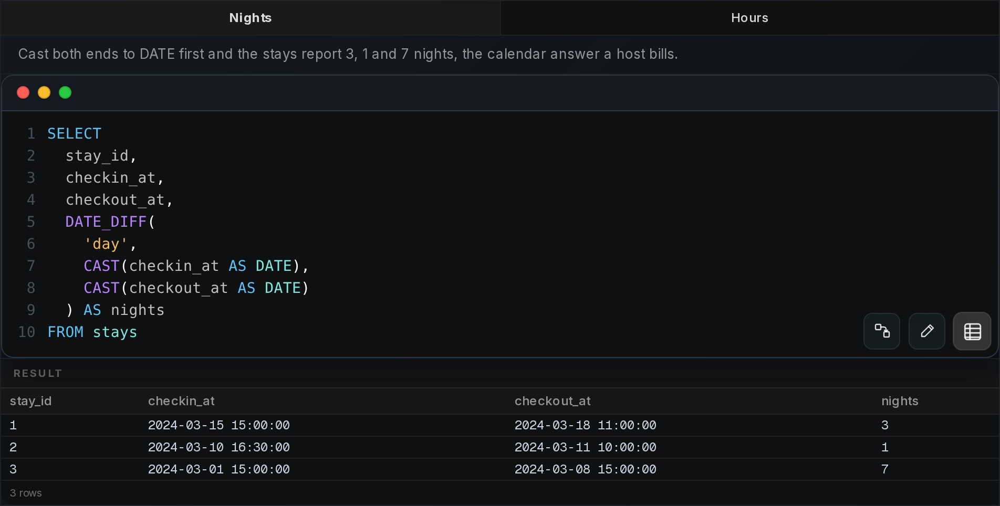

```sql
SELECT
  stay_id,
  checkin_at,
  checkout_at,
  DATE_DIFF(
    'day',
    CAST(checkin_at AS DATE),
    CAST(checkout_at AS DATE)
  ) AS nights
FROM stays
```

**Hours**

Leave the TIMESTAMPs as they are and ask for hours to get elapsed time: 68, 17 and 168, with the extra 30 minutes of stay 2 dropped.

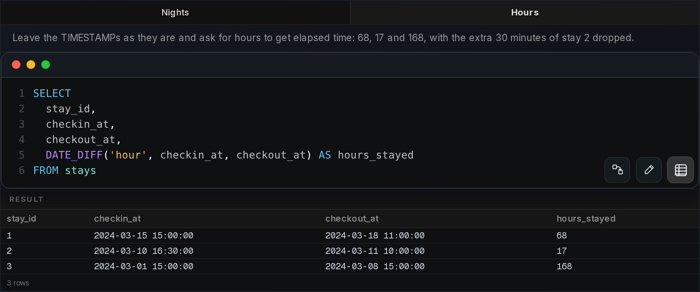

```sql
SELECT
  stay_id,
  checkin_at,
  checkout_at,
  DATE_DIFF('hour', checkin_at, checkout_at) AS hours_stayed
FROM stays
```

When the unit is day and the question is about calendar days, measure between DATEs. Measure between TIMESTAMPs when you want elapsed time at a finer grain than days, such as how long a host took to reply to a message.


<br>

### Lead time and totals

`DATE_DIFF` returns a number, so it works anywhere a number does. You can sum or average it, and filter on it in WHERE or carry it across a join. Booking lead time is the day gap between the moment a booking was created and the day the stay starts, a calendar question, so `created_at` is cast to DATE first. Predict the 3 rows before running: the nights booked per listing and the average lead in days.


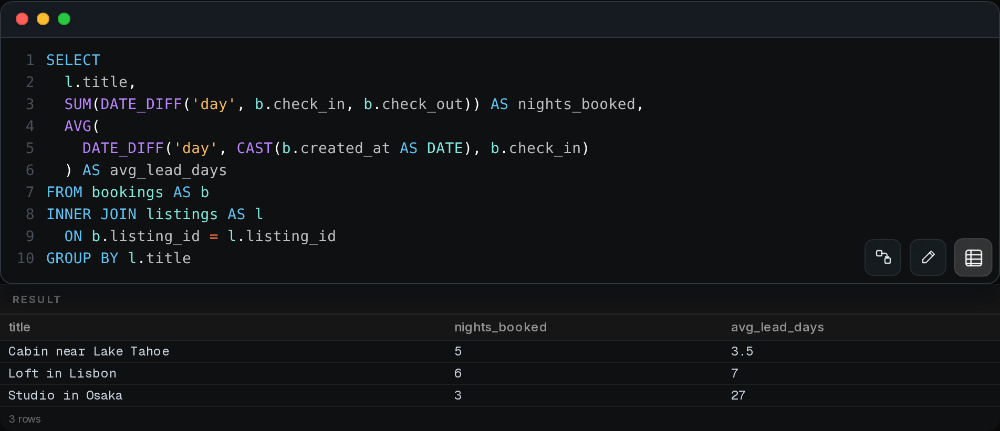

```sql
SELECT
  l.title,
  SUM(DATE_DIFF('day', b.check_in, b.check_out)) AS nights_booked,
  AVG(
    DATE_DIFF('day', CAST(b.created_at AS DATE), b.check_in)
  ) AS avg_lead_days
FROM bookings AS b
INNER JOIN listings AS l
  ON b.listing_id = l.listing_id
GROUP BY l.title
```

The Lisbon loft has 2 bookings of 3 nights each. One was made 13 days ahead and the other 1 day ahead, so its lead averages 7.0. The Tahoe cabin sums 4 and 1 nights, with leads of 2 and 5 days averaging 3.5. The Osaka studio's single booking was made 27 days out. A pricing team watches numbers like these: a listing whose average lead keeps shrinking is filling at the last minute.

> Argument order
>
> - DATE_DIFF(unit, start, end) returns end minus start
> - A negative result means the start came after the end, or the 2 arguments are swapped
> - Put the earlier moment as the second argument and the later as the third, and sums stay positive

**A guest message arrived at 2024-03-15 03:40:00 and the host replied at 2024-03-15 09:10:00. What does DATE_DIFF('hour', message_at, reply_at) return?**

- **A.** 6, because the engine rounds 5 hours and 30 minutes to the nearest whole hour
- **B.** 330, because hour differences are counted in minutes and scaled afterwards
- **C.** 5, because the span is 5 hours and 30 minutes and the result keeps only whole hours
- **D.** -5, because the later moment was given as the second argument

<details>
<summary>Solution</summary>

**C.** 5, because the span is 5 hours and 30 minutes and the result keeps only whole hours

End minus start is 5.5 hours, and DATE_DIFF returns the whole number of units that fit, which is 5.

**Why the others are wrong**

- **A.** Partial units are dropped, never rounded, so the 30 minutes do not push the result up.
- **B.** 330 is the answer to the minute question; the hour question reports whole hours.
- **D.** The earlier moment, the message, is the second argument, so the result is positive.

</details>

Averages carry the sign of every difference inside them. Over the 5 bookings, `DATE_DIFF('day', check_in, check_out)` returns one night count per booking: 3, 3, 4, 1, 3. Swap the 2 columns and each value turns negative, so the Lisbon loft averages -3.0 nights instead of 3.0 and the Tahoe cabin -2.5, a report no host could read. Keep the earlier date second and the later date third inside the aggregate, as the SUM above does.


<br>

---

## Putting It All Together

Airbnb's trust team wants a daily list of bookings made in the last 7 days whose stay starts within the next 3 days, showing the nights booked and the hours of notice the host received, so that last-minute stays can be reviewed before the guest arrives.

- Section 0 decides the columns: check_in is a DATE and created_at is a TIMESTAMP, so created_at is cast to DATE before any comparison about days.
- Section 1 supplies today: CURRENT_DATE anchors the 'next 3 days' window so the same query is correct every morning without an edit.
- Section 2 supplies the moment: CURRENT_TIMESTAMP stamps each flagged row when the job writes it and filters out bookings stamped in the future.
- Section 3 builds both windows: DATE_ADD('day', -7, CURRENT_DATE) for when the booking was made and DATE_ADD('day', 3, CURRENT_DATE) for when the stay begins.
- Section 4 measures: DATE_DIFF('day', check_in, check_out) gives the nights, and DATE_DIFF('hour', created_at, CAST(check_in AS TIMESTAMP)) gives the hours of notice before midnight on arrival day.


<br>

---

## Key Takeaways

- DATE stores a day and TIMESTAMP stores a day plus a time; pick by the question the column has to answer.
- Comparing a TIMESTAMP column to a DATE literal matches only midnight; cast the column to DATE to ask about a whole day.
- CURRENT_DATE and CURRENT_TIMESTAMP carry no parentheses, are read once per query, and keep scheduled reports from going stale.
- DATE_ADD(unit, amount, value) moves forward with a positive amount and back with a negative one, clamping to the end of short months.
- DATE_DIFF(unit, start, end) returns end minus start as a whole number of units; measure nights between DATEs and elapsed time between TIMESTAMPs.
