# Dates: Intermediate

At Airbnb, a guest checks in Friday at 11 PM and leaves Saturday at 10 AM. The stay lasted 11 hours, yet it is billed as 1 night, because the calendar crossed 1 midnight. In the analytics behind a stay like this, app taps are stored as milliseconds since 1970 and a host report totals stays by month, and each of those numbers answers a different date question.


<br>

---

## EXTRACT()

A TIMESTAMP such as 2024-03-15 14:30:45 is a single value holding 6 facts, from the year at the top down to the second. EXTRACT(field FROM value) returns the fact you name as a BIGINT, which turns the parts of a date into numbers you can filter and group by.

Here is that timestamp taken apart one field at a time, with `ts` standing for `TIMESTAMP '2024-03-15 14:30:45'`.

| Expression | Returns |
| --- | --- |
| EXTRACT(YEAR FROM ts) | 2024 |
| EXTRACT(MONTH FROM ts) | 3 |
| EXTRACT(DAY FROM ts) | 15 |
| EXTRACT(HOUR FROM ts) | 14 |
| EXTRACT(MINUTE FROM ts) | 30 |
| EXTRACT(SECOND FROM ts) | 45 |

Each part comes back as a plain number: month 3, with no leading zero and no name. That number sorts before 12 and takes part in arithmetic, while the string 'March' sorts after 'December' and adds to nothing. EXTRACT reads a `DATE` the same way for its calendar parts, so `EXTRACT(YEAR FROM DATE '2024-03-15')` is also 2024.


<br>

### Numbers versus slices of text

`SUBSTRING` can also pull a month out of a timestamp: cast it to text and take 2 characters starting at position 6. The 2 routes hand back different types, and only one of them goes into arithmetic without another cast.

| ✓ SUBSTRING(CAST(ts AS VARCHAR), 6, 2) | ✗ EXTRACT(MONTH FROM ts) |
| --- | --- |
| • Returns '03', a VARCHAR<br><br>• Depends on the text layout the cast produces<br><br>• Needs a CAST back to INTEGER before any arithmetic | • Returns 3, a BIGINT<br><br>• Reads the stored value, whatever its display<br><br>• Joins arithmetic and numeric comparison as it is |


<br>

### Watch EXTRACT run on rows

On a table, EXTRACT runs once per row. Each call reads that row's timestamp and fills 1 new column, so the result keeps every row it started with. Order 101 landed at 23:45:10 on December 31, 2023. Its parts read year 2023 and month 12, with under 15 minutes left in the year.

https://github.com/user-attachments/assets/399ccacf-8f79-4dd4-a3b6-66ecd13a36cb


<br>

### Filter on a part

A part is a number, so it works in `WHERE` like any other column. What a single part loses is the larger parts around it. `EXTRACT(MONTH FROM ordered_at) = 12` keeps December 2022 rows alongside December 2023 rows, since both read as month 12. Add the year when you mean a particular December.

**Month only**

Month 12 matches December of every year: 3 rows from 2 different years.

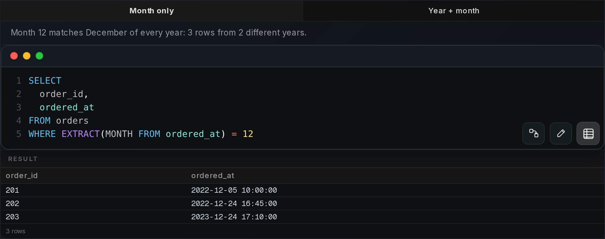

```sql
SELECT
  order_id,
  ordered_at
FROM orders
WHERE EXTRACT(MONTH FROM ordered_at) = 12
```

**Year + month**

Adding the year narrows the result to December 2023: 1 row.

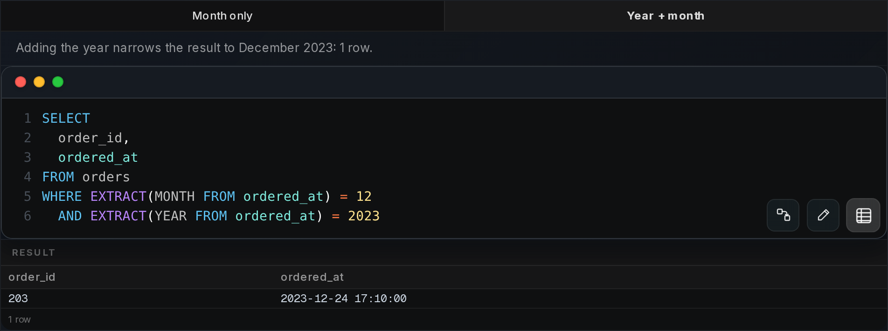

```sql
SELECT
  order_id,
  ordered_at
FROM orders
WHERE EXTRACT(MONTH FROM ordered_at) = 12
  AND EXTRACT(YEAR FROM ordered_at) = 2023
```

That loss is sometimes the point. A report comparing every Christmas Eve filters on month 12 and day 24 and leaves the year out on purpose.


<br>

### Parts inside expressions

A part is an expression like any other, so it can sit inside `CASE` or `BETWEEN` or go into plain arithmetic. Labelling each order with a meal slot takes a single `CASE` over `EXTRACT(HOUR FROM ordered_at)`.

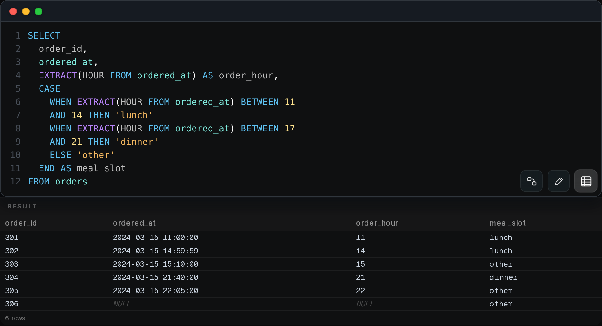

```sql
SELECT
  order_id,
  ordered_at,
  EXTRACT(HOUR FROM ordered_at) AS order_hour,
  CASE
    WHEN EXTRACT(HOUR FROM ordered_at) BETWEEN 11
    AND 14 THEN 'lunch'
    WHEN EXTRACT(HOUR FROM ordered_at) BETWEEN 17
    AND 21 THEN 'dinner'
    ELSE 'other'
  END AS meal_slot
FROM orders
```

> **TIP**
>
> Order 302, placed at 14:59:59, counts as lunch. `BETWEEN 11 AND 14` on the hour covers 11:00:00 through 14:59:59, since every moment from 14:00 to 14:59 has hour 14. A range on a part always includes the whole of its last unit.

Order 306 has no timestamp. EXTRACT of a NULL is NULL, so every `WHEN` test is unknown and the row falls through to 'other'. Put `WHEN ordered_at IS NULL THEN 'unknown'` first when missing times should stay visible.

*Each field also has a function of the same name: year(ordered_at) returns what EXTRACT(YEAR FROM ordered_at) returns. The next section lists every field in both forms.*

**The orders table holds rows from 2022 through 2024. Which rows does this query return?**

```sql
SELECT
  order_id,
  ordered_at
FROM orders
WHERE EXTRACT(MONTH FROM ordered_at) = 2
  AND EXTRACT(DAY FROM ordered_at) = 29
```

- **A.** February 29 orders from all 3 years, since the filter never names a year
- **B.** Only orders from February 29, 2024, the one leap day in those 3 years
- **C.** Orders from the last day of February in every year, the 28th or the 29th
- **D.** An error, because EXTRACT cannot pull a day out of a February timestamp

<details>
<summary>Solution</summary>

**B.** Only orders from February 29, 2024, the one leap day in those 3 years

Month 2 with day 29 exists only in leap years. Of the years in the table, only 2024 is one, so every match comes from that date.

**Why the others are wrong**

- **A.** The filter does ignore the year, but neither 2022 nor 2023 has a February 29, so no row from those years can match.
- **C.** EXTRACT returns the stored day number. A February 28 row reads 28, and 28 fails the test = 29.
- **D.** EXTRACT works on every valid timestamp. The query runs and returns only the leap-day rows.

</details>


<br>

---

## Date Part Constants

The keyword inside EXTRACT is a **date part constant**: a fixed name for a single component of a moment. There are 11 for calendar and clock positions, plus a few aliases and 2 more for a zone's offset. Every value in the table comes from the lesson's clock, 2024-03-15 14:30:45, which fell on a Friday.

| Constant | Function | Range | Value |
| --- | --- | --- | --- |
| YEAR | year() | the calendar year | 2024 |
| QUARTER | quarter() | 1 to 4 | 1 |
| MONTH | month() | 1 to 12 | 3 |
| WEEK | week() | ISO week, 1 to 53 | 11 |
| DAY | day() | 1 to 31 | 15 |
| DAY_OF_WEEK | day_of_week() | 1 Monday to 7 Sunday | 5 |
| DAY_OF_YEAR | day_of_year() | 1 to 366 | 75 |
| YEAR_OF_WEEK | year_of_week() | the year that owns the ISO week | 2024 |
| HOUR | hour() | 0 to 23 | 14 |
| MINUTE | minute() | 0 to 59 | 30 |
| SECOND | second() | 0 to 59 | 45 |

The second column is each constant's shorthand: `day_of_week(ordered_at)` and `EXTRACT(DAY_OF_WEEK FROM ordered_at)` return the same number, and choosing between them is a matter of style. EXTRACT also accepts 4 aliases. `DAY_OF_MONTH` means `DAY` and `DOW` means `DAY_OF_WEEK`, while `DOY` stands in for `DAY_OF_YEAR` and `YOW` for `YEAR_OF_WEEK`.

Here are 4 of them on 2 moments: the lesson's Friday afternoon and the last second of 2023. Check each value against the table above.

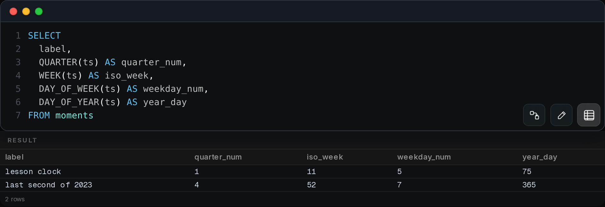

```sql
SELECT
  label,
  QUARTER(ts) AS quarter_num,
  WEEK(ts) AS iso_week,
  DAY_OF_WEEK(ts) AS weekday_num,
  DAY_OF_YEAR(ts) AS year_day
FROM moments
```

The last second of 2023 fell on a Sunday, so it reads 7. And 2023 was no leap year, so day 365 was its last.

`DAY_OF_YEAR` drives year-to-date comparisons: keep rows where `day_of_year(ordered_at) <= day_of_year(CURRENT_DATE)` and every year is cut at the same point. On the lesson's date that point is day 75, which is March 15 in 2024 but March 16 in 2023, because February 29 pushes every later day of a leap year forward by 1.


<br>

### Day of week starts on Monday

`DAY_OF_WEEK` follows ISO 8601: Monday is 1 and Sunday is 7. Spreadsheets and many programming languages number Sunday as 0 or 1 instead, so a weekend filter copied from one of them keeps the wrong days and raises no error. Here, weekend means `day_of_week(x) IN (6, 7)`.

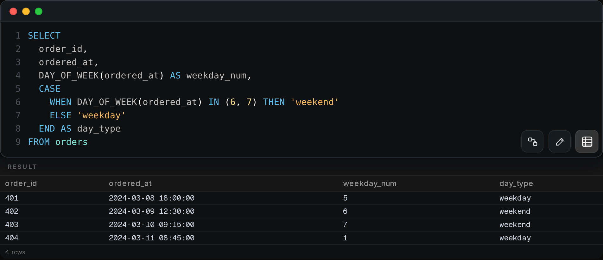

```sql
SELECT
  order_id,
  ordered_at,
  DAY_OF_WEEK(ordered_at) AS weekday_num,
  CASE
    WHEN DAY_OF_WEEK(ordered_at) IN (6, 7) THEN 'weekend'
    ELSE 'weekday'
  END AS day_type
FROM orders
```


<br>

### 2 vocabularies for parts

Date parts appear again in date_add and date_diff, spelled another way. There the unit is a quoted lowercase string, 'month', while EXTRACT takes a bare keyword, MONTH. The 2 lists overlap without matching, because they answer different questions: a constant names a position on the calendar, and a unit names a length of time.

| ✓ EXTRACT constants: positions | ✗ date_add and date_diff units: lengths |
| --- | --- |
| • A bare keyword: EXTRACT(MONTH FROM ts)<br><br>• Includes cycle positions: DAY_OF_WEEK, DAY_OF_YEAR, YEAR_OF_WEEK<br><br>• Answers: where in the calendar does this moment sit?<br><br>• Has no millisecond constant, so use millisecond(ts) | • A quoted string: date_add('month', 1, ts)<br><br>• Runs from 'millisecond' to 'year', with 'week' and 'quarter' between<br><br>• Answers: how far forward, or how far apart?<br><br>• Has no 'day_of_week', because a position has no length |

*Swap the 2 styles, a quoted unit inside EXTRACT or a bare keyword inside date_add, and the query fails before reading a row.*

The 2 kinds often meet in a single expression. `date_add('day', 1 - day_of_week(d), d)` reads a position with a function and moves by a length with a unit, landing on the Monday of the week that holds `d`. The last section of this lesson puts that pattern to work.


<br>

### Parts follow the value's zone

On a `TIMESTAMP WITH TIME ZONE`, every constant reads the wall clock of the value's own zone. The 2 values below are the same instant written in 2 zones, and they report different hours. `TIMEZONE_HOUR` and `TIMEZONE_MINUTE` return the zone's offset from UTC.

| Value | hour() | timezone_hour() |
| --- | --- | --- |
| TIMESTAMP '2024-03-15 14:30:45 UTC' | 14 | 0 |
| TIMESTAMP '2024-03-15 10:30:45 America/New_York' | 10 | -4 |

**A report should count only orders placed on a Saturday or a Sunday. Which filter does that?**

- **A.** WHERE day_of_week(ordered_at) IN (0, 6)
- **B.** WHERE day_of_week(ordered_at) IN (1, 7)
- **C.** WHERE EXTRACT('dow' FROM ordered_at) IN (6, 7)
- **D.** WHERE day_of_week(ordered_at) IN (6, 7)

<details>
<summary>Solution</summary>

**D.** WHERE day_of_week(ordered_at) IN (6, 7)

ISO numbering puts Saturday at 6 and Sunday at 7, so this list keeps exactly the weekend and nothing else.

**Why the others are wrong**

- **A.** Saturday is 6 here, so Saturdays match. Sunday is 7 and 0 never appears, so every Sunday order is dropped.
- **B.** Sunday is 7, so Sundays match. But 1 is Monday in ISO numbering, so Mondays are counted and Saturdays are lost.
- **C.** The numbers are right, but EXTRACT takes a bare keyword. A quoted 'dow' fails before any row is read.

</details>


<br>

---

## Boundaries Crossed vs Time Passed

A user signs up at 2024-01-31 23:00:00 and places a first order at 2024-02-01 01:00:00. Between those moments 2 hours passed, and over the same span the calendar crossed 1 midnight and 1 month boundary. Each count is correct for its own question, and a report has to choose which question it is asking.

| User 1's 2 hours | Days | Months |
| --- | --- | --- |
| Complete units of time passed | 0 | 0 |
| Calendar boundaries crossed | 1 | 1 |


<br>

### What date_diff counts

date_diff(unit, start, end) measures time passed. It counts how many complete units fit between the 2 values and drops whatever is left over. On timestamps a day means 24 full hours, so 23:00 one evening to 01:00 the next morning is 0 days. A DATE has no time of day, so between 2 dates each whole day passed is also 1 midnight crossed. Cast both sides to DATE and the same call counts calendar days.

*Swap the 2 arguments and the sign flips. date_diff counts from its second argument to its third, so an end earlier than its start returns a negative number.*

**Days passed**

Counts complete 24-hour days. User 1 waited 2 hours, so the answer is 0.

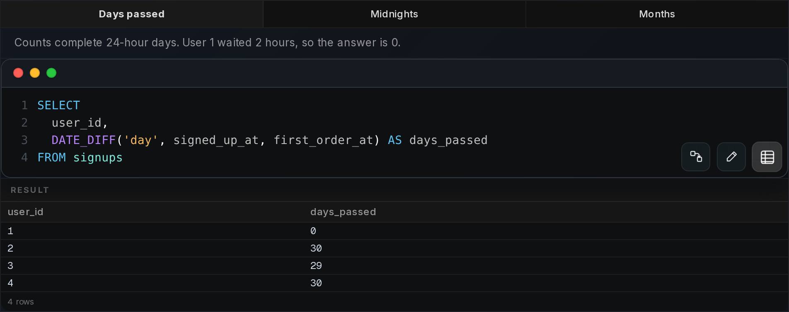

```sql
SELECT
  user_id,
  DATE_DIFF('day', signed_up_at, first_order_at) AS days_passed
FROM signups
```

**Midnights**

Casting to DATE first counts calendar days. User 1 now reads 1, the midnight between January 31 and February 1.

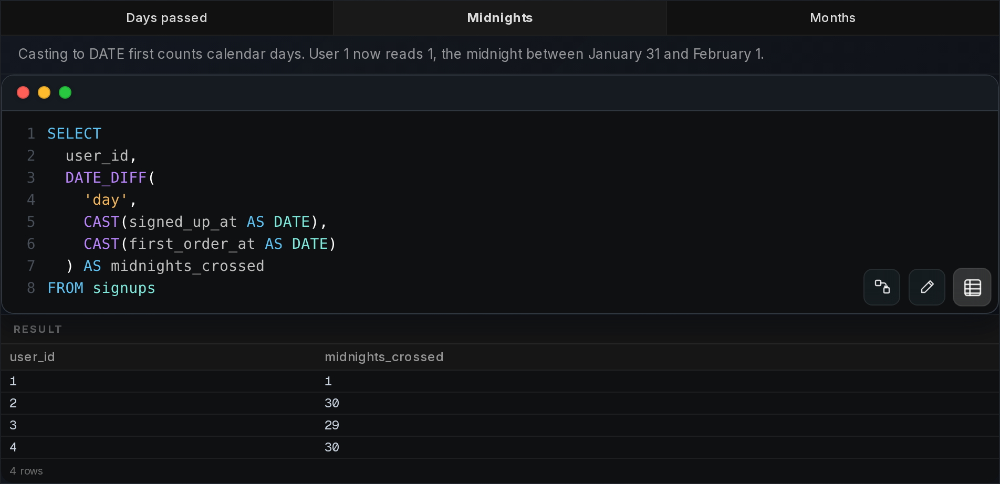

```sql
SELECT
  user_id,
  DATE_DIFF(
    'day',
    CAST(signed_up_at AS DATE),
    CAST(first_order_at AS DATE)
  ) AS midnights_crossed
FROM signups
```

**Months**

Complete months passed beside month boundaries crossed. Users 1 and 2 crossed into February without completing a month.

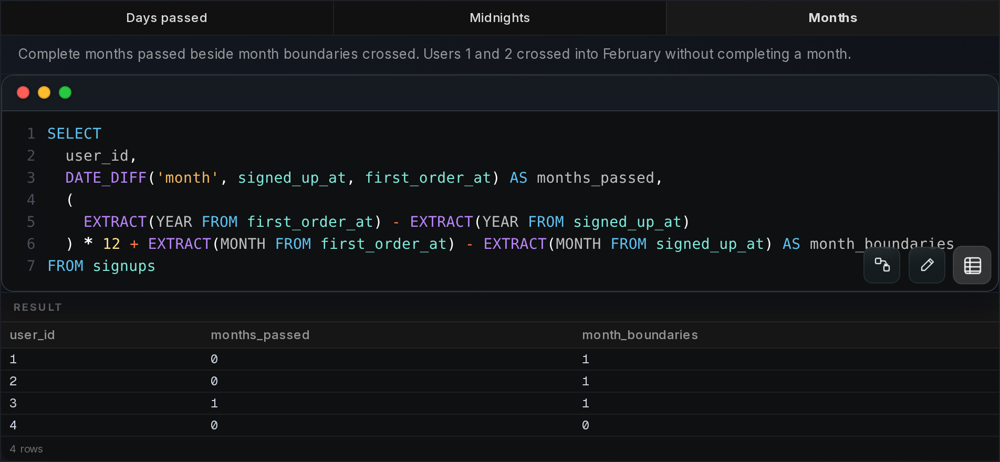

```sql
SELECT
  user_id,
  DATE_DIFF('month', signed_up_at, first_order_at) AS months_passed,
  (
    EXTRACT(YEAR FROM first_order_at) - EXTRACT(YEAR FROM signed_up_at)
  ) * 12 + EXTRACT(MONTH FROM first_order_at) - EXTRACT(MONTH FROM signed_up_at) AS month_boundaries
FROM signups
```

*User 3 shows another rule of date_diff. January 31 to February 29 counts as 1 complete month, because a start on day 31 completes its month on the last day of a shorter month.*


<br>

### Counting month and year boundaries

For months, `date_diff` offers no boundary count, so build one with EXTRACT. Turn each value into a running month number with `year * 12 + month` and subtract one from the other. January 2024 becomes 24289 and February 2024 becomes 24290, so any 2 moments in those months differ by exactly 1. The day and hour don't matter. Years need less: the difference of the 2 years counts year boundaries crossed.

The split shows up at every size. From 10:59 to 11:01, `date_diff('hour', ...)` returns 0 while the clock moved into a new hour, and from December 31 to January 1, `date_diff('year', ...)` returns 0 while the calendar moved into a new year.


<br>

### Pick the question first

| ✓ Time passed: date_diff on timestamps | ✗ Boundaries crossed: DATE casts or part arithmetic |
| --- | --- |
| • A delivery that took 3 hours or more<br><br>• A subscription that has run 6 complete months<br><br>• A session shorter than 30 minutes<br><br>• A refund window of 14 full days | • Days since last login, as the user's calendar shows it<br><br>• Cohort month index: joined January, active February is month 1<br><br>• Nights between a rental's check-in and checkout<br><br>• Orders this calendar year against last calendar year |

Retention reports show what the wrong choice costs. For a January cohort, month 1 is supposed to mean February. With `date_diff('month', ...)`, a user who joined on January 20 and came back on February 10 lands in month 0 beside the people active in January, and month 1 shows fewer returning users than really returned.

Age goes the other way. Someone born on March 16, 1990 is still 33 on March 15, 2024, because age counts complete years passed. Counting year boundaries would make them 34 a day early, as customer 2 shows.

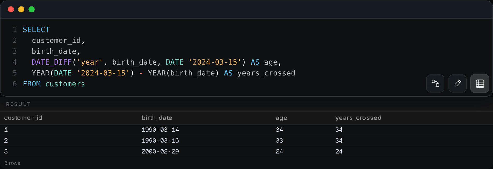

```sql
SELECT
  customer_id,
  birth_date,
  DATE_DIFF('year', birth_date, DATE '2024-03-15') AS age,
  YEAR(DATE '2024-03-15') - YEAR(birth_date) AS years_crossed
FROM customers
```

> **TIP**
>
> A zoned timestamp crosses midnight on its own zone's clock. Convert to the zone the business reports in before casting to `DATE`, or a 9 PM order in New York lands on the next UTC day.

**One row has placed_at = 2024-03-14 22:00:00 and delivered_at = 2024-03-16 06:00:00. What are a and b?**

```sql
SELECT
  date_diff('day', placed_at, delivered_at) AS a,
  date_diff('day', CAST(placed_at AS DATE), CAST(delivered_at AS DATE)) AS b
FROM deliveries
```

- **A.** a = 2, b = 2
- **B.** a = 1, b = 1
- **C.** a = 1, b = 2
- **D.** a = 1.33, b = 2

<details>
<summary>Solution</summary>

**C.** a = 1, b = 2

From 22:00 on the 14th to 06:00 on the 16th is 32 hours, 1 complete day. As dates, the span crosses the midnights that start the 15th and the 16th.

**Why the others are wrong**

- **A.** b is right, since the dates are March 14 and March 16. But a counts complete 24-hour days, and 32 hours hold only 1.
- **B.** a is right, since 32 hours hold 1 complete day. But b compares dates, and March 14 to March 16 crosses 2 midnights.
- **D.** b is right, but date_diff returns a BIGINT and drops the remainder, so a partial day never appears as a fraction.

</details>


<br>

---

## Unix Time Conversion

**Unix time**, also called epoch time, stores a moment as a single number: the seconds since 1970-01-01 00:00:00 UTC. The lesson's clock, 2024-03-15 14:30:45 UTC, is 1710513045. The number has no zone, so it names the same instant in Tokyo and in Lisbon, which is why event logs and APIs use it so often.

- **10 digits** — epoch seconds for 2024 moments
- **13 digits** — epoch milliseconds for 2024 moments

Count the digits before converting anything. Seconds and milliseconds for the same moment differ by a factor of 1,000, and both begin with 17 for any moment between November 2023 and January 2027, so the leading digits say nothing about the unit.


<br>

### From epoch to timestamp

from_unixtime(seconds, zone) turns an epoch number into a TIMESTAMP WITH TIME ZONE, displayed on the clock of the zone you pass. A milliseconds column is divided by 1000 first. Cast it to DOUBLE before dividing, because BIGINT / BIGINT is integer division and throws the milliseconds away.

**Divided**

Milliseconds become seconds with the fraction kept, so event 2 shows its 250 milliseconds.

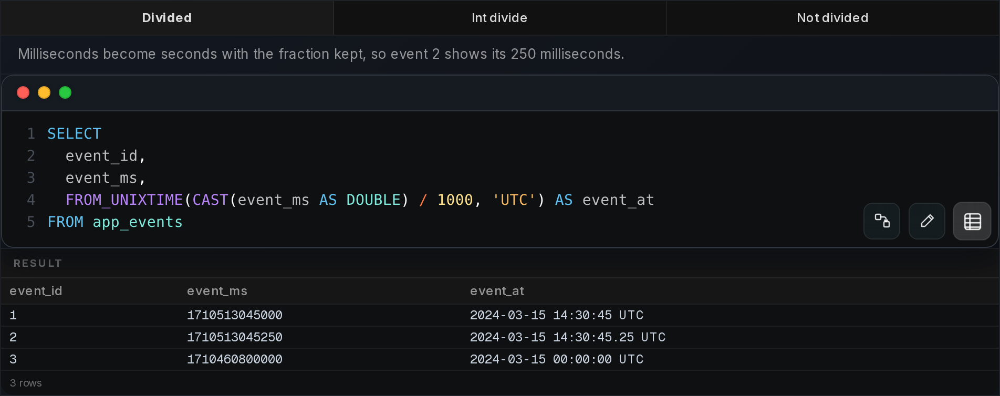

```sql
SELECT
  event_id,
  event_ms,
  FROM_UNIXTIME(CAST(event_ms AS DOUBLE) / 1000, 'UTC') AS event_at
FROM app_events
```

**Int divide**

BIGINT division truncates before the conversion, so event 2 loses its 250 milliseconds.

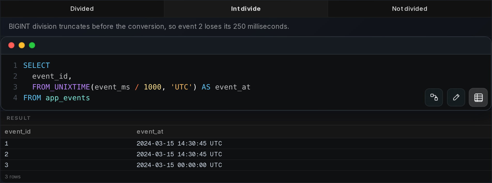

```sql
SELECT
  event_id,
  FROM_UNIXTIME(event_ms / 1000, 'UTC') AS event_at
FROM app_events
```

**Not divided**

Read as seconds, a milliseconds value lands beyond the year 50,000.

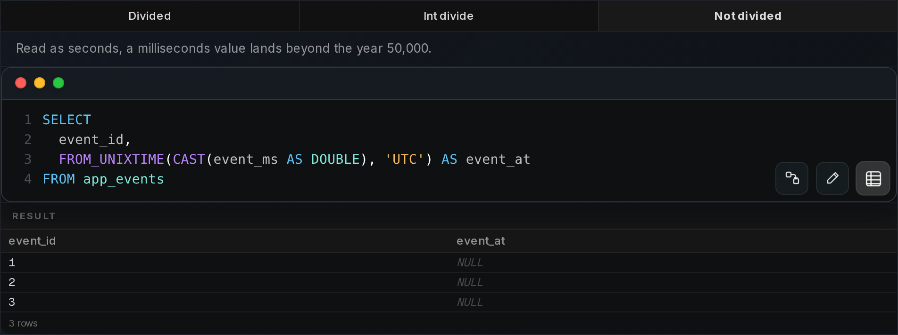

```sql
SELECT
  event_id,
  FROM_UNIXTIME(CAST(event_ms AS DOUBLE), 'UTC') AS event_at
FROM app_events
```

> Questions to ask of an epoch column
>
> - Seconds or milliseconds? Count the digits on a recent value.
> - Whole or fractional? A DOUBLE column may already hold milliseconds after the decimal point.
> - Which zone will people read it in? The number has none, so the conversion has to name one.

**A column clicked_at_ms holds 1710513045250. Which expression returns the click as a timestamp with its milliseconds intact?**

- **A.** from_unixtime(CAST(clicked_at_ms AS DOUBLE) / 1000, 'UTC')
- **B.** from_unixtime(clicked_at_ms / 1000, 'UTC')
- **C.** from_unixtime(CAST(clicked_at_ms AS DOUBLE), 'UTC')
- **D.** to_unixtime(CAST(clicked_at_ms AS DOUBLE) / 1000)

<details>
<summary>Solution</summary>

**A.** from_unixtime(CAST(clicked_at_ms AS DOUBLE) / 1000, 'UTC')

Casting to DOUBLE before dividing keeps the .250, and dividing by 1000 gives the seconds from_unixtime expects: 14:30:45.250 UTC.

**Why the others are wrong**

- **B.** Dividing by 1000 is right, but BIGINT by BIGINT is integer division, so the result stops at 14:30:45 and the 250 milliseconds are gone.
- **C.** The DOUBLE keeps the fraction, but without the division the value is read as seconds and lands more than 50,000 years from now.
- **D.** to_unixtime turns a timestamp into epoch seconds. The input here is already a number, so the function points the wrong way.

</details>


<br>

### From timestamp to epoch

`to_unixtime(ts)` goes the other way and returns a `DOUBLE` of seconds, fractions included. Multiply by 1000 and cast to `BIGINT` to match a milliseconds column. The cast rounds to the nearest whole number, which is exact for a timestamp stored to the millisecond.

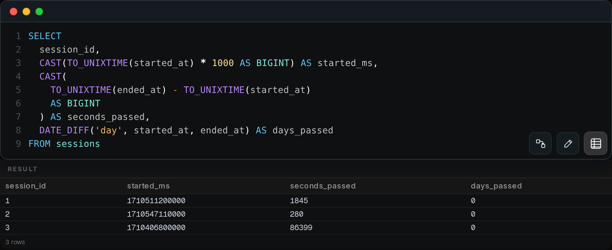

```sql
SELECT
  session_id,
  CAST(TO_UNIXTIME(started_at) * 1000 AS BIGINT) AS started_ms,
  CAST(
    TO_UNIXTIME(ended_at) - TO_UNIXTIME(started_at)
    AS BIGINT
  ) AS seconds_passed,
  DATE_DIFF('day', started_at, ended_at) AS days_passed
FROM sessions
```

Subtracting 2 epoch values always gives time passed. Session 2 crossed midnight and still reads 280 seconds. Session 3 ran 86399 seconds, 1 short of a full day, so `date_diff` reports 0 days for it.

#### Dates count from 1970 too

Some file formats store a `DATE` as whole days since `1970-01-01`. `date_add('day', 19797, DATE '1970-01-01')` turns day 19797 back into `2024-03-15`, and `date_diff('day', DATE '1970-01-01', d)` gives the day number of any date `d`.


<br>

### One instant, many wall clocks

The zone argument changes only how the instant is displayed and which parts EXTRACT reads from it. `from_unixtime(1710513045, 'UTC')` shows 14:30:45 and `from_unixtime(1710513045, 'America/New_York')` shows 10:30:45 the same morning, so `hour()` returns 14 for one and 10 for the other. Group a day's events by hour in the zone your users live in, or the morning rush lands at the wrong hours.

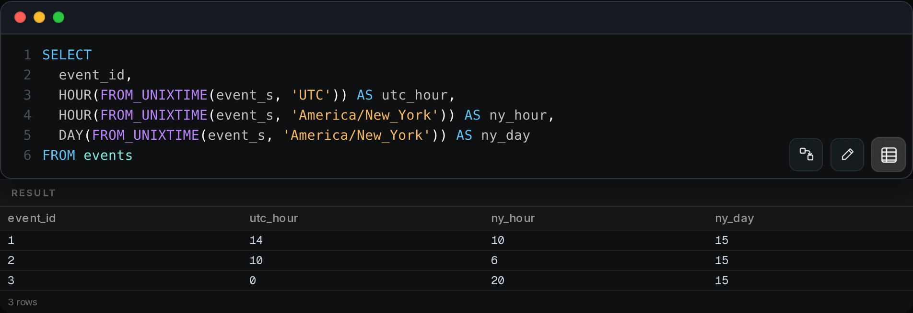

```sql
SELECT
  event_id,
  HOUR(FROM_UNIXTIME(event_s, 'UTC')) AS utc_hour,
  HOUR(FROM_UNIXTIME(event_s, 'America/New_York')) AS ny_hour,
  DAY(FROM_UNIXTIME(event_s, 'America/New_York')) AS ny_day
FROM events
```

Event 3 is midnight on March 16 in UTC and 8 PM on March 15 in New York, so even its day depends on the zone you convert into.


<br>

---

## Grouping by Time Parts

A monthly revenue report is a GROUP BY on date parts. The grouping has to include every larger part as well: month alone puts March 2023 and March 2024 in one group, so group on year and month together.

**Month only**

Two Marches fold into 1 row: 5 orders and 200 of revenue from 2 different years.

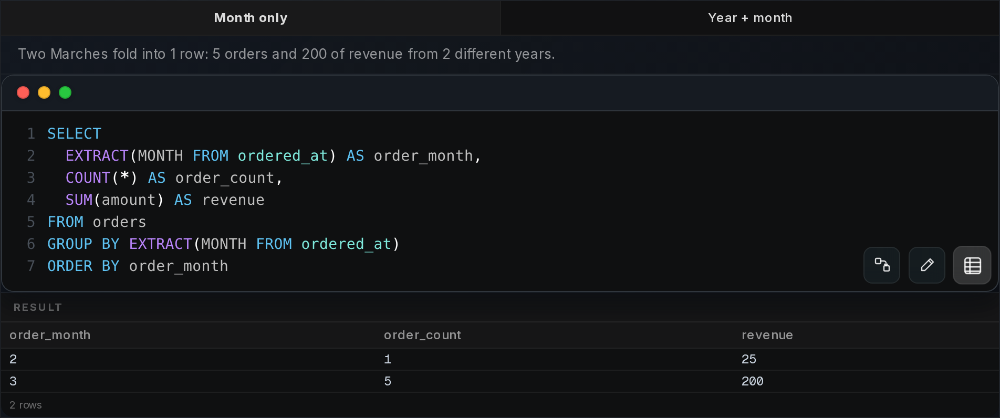

```sql
SELECT
  EXTRACT(MONTH FROM ordered_at) AS order_month,
  COUNT(*) AS order_count,
  SUM(amount) AS revenue
FROM orders
GROUP BY EXTRACT(MONTH FROM ordered_at)
ORDER BY order_month
```

**Year + month**

With the year in the key, March 2023 shows 2 orders and 100, and March 2024 shows 3 orders and 100.

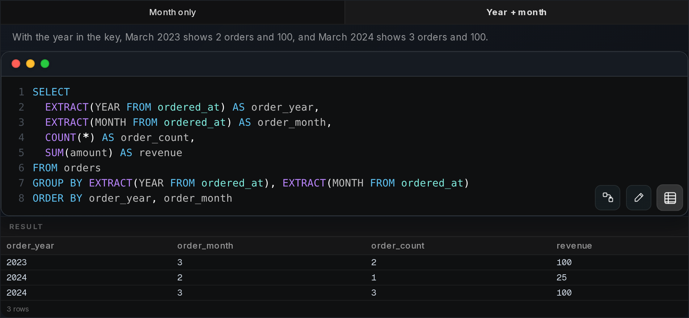

```sql
SELECT
  EXTRACT(YEAR FROM ordered_at) AS order_year,
  EXTRACT(MONTH FROM ordered_at) AS order_month,
  COUNT(*) AS order_count,
  SUM(amount) AS revenue
FROM orders
GROUP BY EXTRACT(YEAR FROM ordered_at), EXTRACT(MONTH FROM ordered_at)
ORDER BY order_year, order_month
```


<br>

### Watch the groups fold

Quarters work the same way through `quarter()`. In the animation, 4 orders from 2024 fold into 2 groups keyed on year and quarter. `COUNT` and `SUM` then run once per group.

https://github.com/user-attachments/assets/c47ce5c4-c9e8-4250-bb15-be4843d79de5

`quarter()` knows only calendar quarters. A fiscal year that starts in February needs its own mapping: `quarter(date_add('month', -1, ordered_at))` shifts every date back 1 month before reading the quarter, so February to April becomes quarter 1.


<br>

### Weeks belong to their own year

Weekly reports group on the ISO week, `week()`. An ISO week runs Monday to Sunday. Week 1 is the week holding the year's first Thursday, so the last days of December can sit in week 1 of the next year. Pair `week()` with `year_of_week()`, the year that owns the week, and never with `year()`.

| Date | Weekday | year() | week() | year_of_week() |
| --- | --- | --- | --- | --- |
| 2024-12-29 | Sunday | 2024 | 52 | 2024 |
| 2024-12-30 | Monday | 2024 | 1 | 2025 |
| 2024-12-31 | Tuesday | 2024 | 1 | 2025 |
| 2025-01-01 | Wednesday | 2025 | 1 | 2025 |

With `year()` and `week()` as the key, the last 2 days of 2024 read as 2024 week 1. January 1 to 7, 2024 read the same way, so 2 weeks 12 months apart merge into 1 row.

**An orders table spans 2023 and 2024. Which GROUP BY gives 1 row per ISO week, with no week merged across years?**

- **A.** GROUP BY year(ordered_at), week(ordered_at)
- **B.** GROUP BY year_of_week(ordered_at), week(ordered_at)
- **C.** GROUP BY week(ordered_at)
- **D.** GROUP BY year_of_week(ordered_at), day_of_week(ordered_at)

<details>
<summary>Solution</summary>

**B.** GROUP BY year_of_week(ordered_at), week(ordered_at)

year_of_week() names the year that owns each ISO week, so every year-and-week pair matches exactly 1 Monday-to-Sunday week.

**Why the others are wrong**

- **A.** year() and the ISO week disagree at New Year, so late-December days in week 1 join the January week 1 of their calendar year.
- **C.** Week numbers repeat every year, so week 11 of 2023 and week 11 of 2024 fold into a single row.
- **D.** The year is the right one, but day_of_week() makes 7 groups per year, one per weekday, rather than weeks.

</details>


<br>

### One date column that sorts and charts

Grouping on 2 number columns per period leaves output that is clumsy to sort and to chart, and a single date groups better. date_add('day', 1 - day(d), d) moves a date back to the 1st of its month, and date_add('day', 1 - day_of_week(d), d) moves it back to its Monday. Grouped on that date, each row is labelled with a real period start that sorts and charts as a date. The CTE casts each timestamp to DATE once so the grouping expression stays short.

**Week start**

Each date moves back to its Monday, so 3 orders from February 26 to March 3 share the week of February 26.

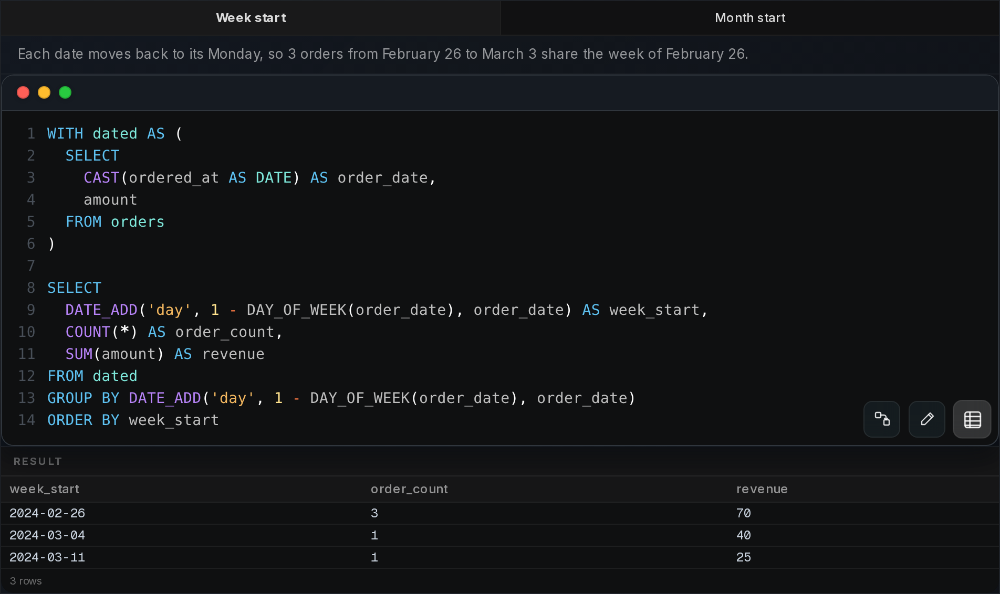

```sql
WITH dated AS (
  SELECT
    CAST(ordered_at AS DATE) AS order_date,
    amount
  FROM orders
)

SELECT
  DATE_ADD('day', 1 - DAY_OF_WEEK(order_date), order_date) AS week_start,
  COUNT(*) AS order_count,
  SUM(amount) AS revenue
FROM dated
GROUP BY DATE_ADD('day', 1 - DAY_OF_WEEK(order_date), order_date)
ORDER BY week_start
```

**Month start**

Each date moves back to the 1st, so the 4 March orders share March 1 and the February order stands alone.

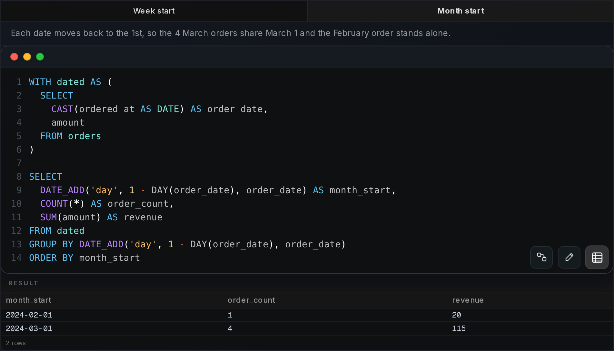

```sql
WITH dated AS (
  SELECT
    CAST(ordered_at AS DATE) AS order_date,
    amount
  FROM orders
)

SELECT
  DATE_ADD('day', 1 - DAY(order_date), order_date) AS month_start,
  COUNT(*) AS order_count,
  SUM(amount) AS revenue
FROM dated
GROUP BY DATE_ADD('day', 1 - DAY(order_date), order_date)
ORDER BY month_start
```

The week of February 26 holds orders from both February and March, which is why weekly and monthly totals never line up row for row.

> What a time GROUP BY leaves out
>
> - A period with no rows produces no row, so a chart drawn from the output skips the gap without marking it.
> - The current period is partial. On March 15 the March total holds half a month and reads as a drop.
> - Rows with a NULL timestamp form 1 extra group keyed NULL, which sorts last by default.

| ✓ Do | ✗ Don't |
| --- | --- |
| • Group on year and month together, or on a rebuilt month-start date<br><br>• Pair week() with year_of_week()<br><br>• Convert to the reporting zone before taking parts<br><br>• Order the output by the same parts you group on | • Group on month() alone when the data spans more than 1 year<br><br>• Pair week() with year(), which splits weeks at New Year<br><br>• Read a missing month as a month of zero revenue<br><br>• Compare a partial current month with complete ones |


<br>

---

## Putting It All Together

Picture an analyst at Airbnb building a monthly report of nights booked per city. The app sends check-in and checkout events as epoch milliseconds, each city sets the zone its guests live by, and the report has to match what hosts see on their own calendars.

- Each event converts with from_unixtime(CAST(event_ms AS DOUBLE) / 1000, zone) using the listing's zone, so an 11 PM check-in stays on its local date.
- Nights are boundaries crossed: date_diff('day', ...) on both values cast to DATE, so an 11-hour stay across midnight counts as 1 night.
- The report month comes from year() and month() of the local check-in, grouped together so March 2023 and March 2024 stay apart.
- Friday and Saturday nights are day_of_week() values 5 and 6, on the numbering that starts at 1 for Monday.
- On March 15 the March row covers half a month, so the report labels it partial instead of comparing it with full months.


<br>

---

## Key Takeaways

- EXTRACT(field FROM ts) and its shorthand functions return a single part of a moment as a BIGINT, and that part forgets the larger parts around it.
- Day of week runs from 1 for Monday to 7 for Sunday, and an ISO week belongs to year_of_week(), which can differ from year().
- EXTRACT takes bare position keywords such as MONTH. The functions date_add and date_diff take quoted length units such as 'month' instead.
- date_diff counts complete units of time passed. A DATE cast counts midnights, and year \* 12 + month arithmetic counts month boundaries.
- Epoch time is seconds since 1970-01-01 UTC with no zone. Check for milliseconds and divide as DOUBLE. When converting, name the zone.
- A time GROUP BY needs every larger part in its key, or a rebuilt period-start date, and it shows no row for an empty period.
