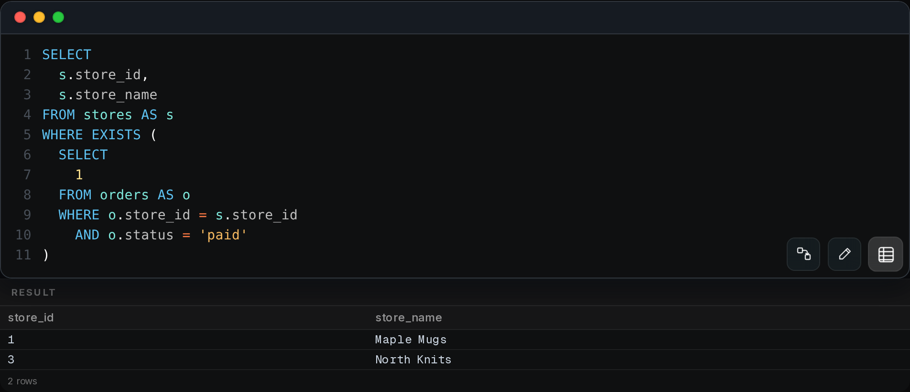
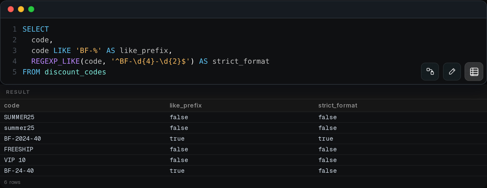
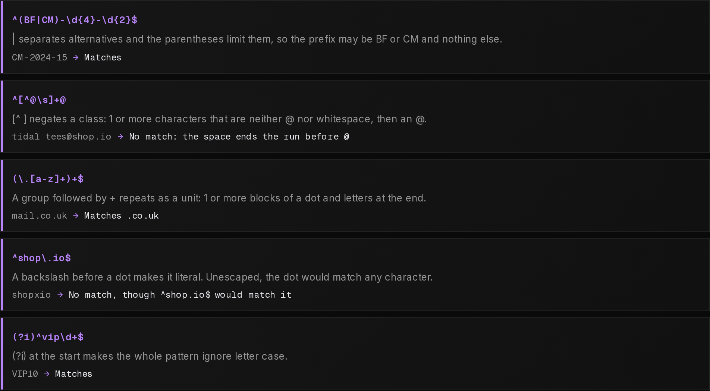
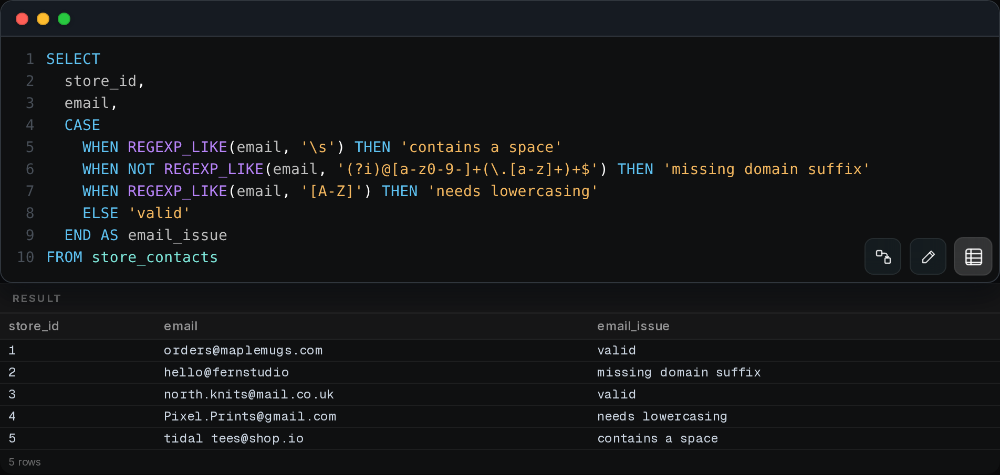
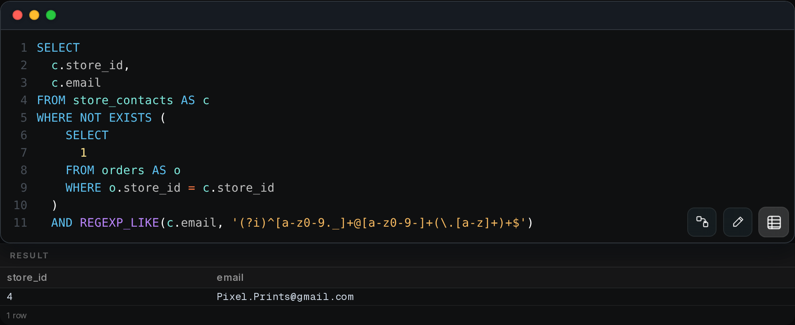

# Filtering: Advanced

A growth analyst at Shopify gets a request the week before Black Friday: marketing wants a nudge email sent to every store that has never made a sale. The first query, a NOT IN against the orders table, returns 0 stores, so nobody gets the email, and a single NULL is the cause. The existence checks and text patterns in this lesson decide who lands on lists like that one.


<br>

---

## Correlated subqueries (EXISTS)

`EXISTS` takes a subquery and asks a single yes-or-no question about it: does this subquery return at least 1 row? The answer is TRUE as soon as a row turns up and FALSE when none do. It never reads the values in those rows, so putting SELECT 1 inside it gives the same result as SELECT \* or SELECT order_id. Writing SELECT 1 is the convention because it tells the next reader that only existence matters.

The form you will reach for most is correlated: the subquery mentions a column from the outer query, so it's asked again for every outer row with that row's values filled in. For store 1 it reads as orders whose store_id is 1, and for store 2 as orders whose store_id is 2. Each outer row gets its own answer, and that answer decides whether the row stays. This section and the next 2 use the 5 stores and 5 orders below.

stores

| store_id | store_name |
| --- | --- |
| 1 | Maple Mugs |
| 2 | Fern Studio |
| 3 | North Knits |
| 4 | Pixel Prints |
| 5 | Tidal Tees |

orders

| order_id | store_id | status |
| --- | --- | --- |
| 101 | 1 | paid |
| 102 | 1 | refunded |
| 103 | 3 | paid |
| 104 | 5 | refunded |
| 105 | NULL | paid |


<br>

### One existence check per store

Press play to watch the check run once per store. For Maple Mugs the subquery finds orders 101 and 102, yet Maple Mugs lands in the result a single time. EXISTS keeps or drops the outer row and adds nothing to it, so a store with 40 matching orders still produces 1 row.

https://github.com/user-attachments/assets/e83d4e3a-74ae-4c1b-a21a-0aa85a251963

Maple Mugs and North Knits survive, and so does Tidal Tees. Order 105 carries a NULL store_id, and o.store_id = s.store_id is never TRUE when one side is NULL, so that order matches no store and changes nothing here. Keep order 105 in mind: in the NOT IN section later in this lesson, the same row empties an entire result.


<br>

### Narrow what counts as a match

Every condition you add to the subquery's WHERE narrows what counts as a related row. Adding AND o.status = 'paid' turns the question into: does this store have a paid order? Tidal Tees drops out, because its only order, 104, was refunded. Maple Mugs stays: order 102 was refunded, but order 101 is paid, and 1 paid row is enough.



```sql
SELECT
  s.store_id,
  s.store_name
FROM stores AS s
WHERE EXISTS (
  SELECT
    1
  FROM orders AS o
  WHERE o.store_id = s.store_id
    AND o.status = 'paid'
)
```

The link can also combine several columns and comparisons. On a schema with launch dates, o.store_id = s.store_id AND o.created_at >= s.launched_at asks whether a store took an order after it launched. IN compares the outer column to the subquery's output by equality only, so a >= has to sit inside the subquery's own WHERE. EXISTS keeps both the equality and the >= in one WHERE that reads both tables.

> How to read any EXISTS filter
>
> - Take 1 row from the outer table.
> - Fill its values into the columns the subquery borrows from it.
> - Run the subquery and stop at the first row it returns.
> - Keep the outer row if a row came back. Drop it if none did.

> **TIP**
>
> The per-row walk describes the result, and the engine is free to plan it differently. Optimizers usually rewrite a correlated EXISTS into one pass that matches all outer rows against the subquery's table together, so it scales like a set operation instead of running a separate lookup per row.


<br>

### EXISTS next to IN

| ✓ EXISTS (correlated subquery) | ✗ IN (subquery) |
| --- | --- |
| • The link lives inside the subquery's WHERE<br><br>• Can test several columns and conditions at once<br><br>• Reads no values, only whether a row came back<br><br>• Its NOT form stays correct when NULLs appear | • The subquery returns 1 column of values<br><br>• Compares a single outer column against that list<br><br>• Reads every value the subquery returns<br><br>• Its NOT form breaks when the list holds a NULL |

**A teammate deletes the store link from the subquery. Which stores does this query return?**

```sql
SELECT
  s.store_name
FROM stores s
WHERE EXISTS (
  SELECT 1
  FROM orders o
  WHERE o.status = 'paid'
)
```

- **A.** Maple Mugs and North Knits only
- **B.** Maple Mugs, North Knits and Tidal Tees
- **C.** All 5 stores, Fern Studio and Pixel Prints included
- **D.** None, because EXISTS needs a correlated column

<details>
<summary>Solution</summary>

**C.** All 5 stores, Fern Studio and Pixel Prints included

The subquery never mentions s, so every store gets the same question: is there a paid order anywhere? Order 101 alone answers yes, and 103 and 105 are paid as well, so EXISTS is TRUE for every row.

**Why the others are wrong**

- **A.** Those are the stores with a paid order of their own, the result before the link was deleted. Without o.store_id = s.store_id, nothing ties the subquery to a particular store.
- **B.** That is the set of stores with any order at all. This subquery ignores which store is being tested, so it returns the same rows for every store.
- **D.** An uncorrelated subquery inside EXISTS is valid SQL. It runs and returns a TRUE that applies to every store, which is why this bug stays quiet.

</details>


<br>

---

## NOT EXISTS for missing rows

`NOT EXISTS` flips the answer: it is TRUE when the subquery returns 0 rows for the current outer row. That makes it the standard tool for orphan hunting, finding rows on one side with no partner on the other. Stores with no orders, users who never logged in, invoices with no payment and products nobody reviewed all share this query shape.


<br>

### Watch a missing partner keep a row

The animation runs this shape on a support question: which customers have no open ticket? Acme and Initech each have an open ticket, so their subqueries return a row and NOT EXISTS is FALSE. Globex has only a closed ticket, which the status condition inside the subquery filters out, so its subquery comes back empty. Umbrella has no tickets at all. Globex and Umbrella stay.

https://github.com/user-attachments/assets/0cf0753d-51b1-4951-95bb-8eefb5d981d2


<br>

### Where the condition sits changes the question

The status check belongs inside the subquery. There it redefines which partner rows count, so a store whose only order was refunded has no paid partner and stays. A condition in the outer WHERE filters the stores themselves, and stores has no status column to test. Each of the 3 tabs below asks a different question of the same 2 tables, which this section aliases as st and od.

Stores with no order of any kind. Fern Studio and Pixel Prints come back.

|  |  |
| --- | --- |
|  | SELECT |
|  | st.store_id, |
|  | st.store_name |
|  | FROM stores AS st |
|  | WHERE NOT EXISTS ( |
|  | SELECT |
|  | 1 |
|  | FROM orders AS od |
|  | WHERE od.store_id = st.store_id |
|  | ) |

Result

| store_id | store_name |
| --- | --- |
| 2 | Fern Studio |
| 4 | Pixel Prints |

2 rows

The third tab shows why these filters compose well: each EXISTS or NOT EXISTS is an independent yes-or-no check on the same outer row, so you combine them with AND and OR, grouped by parentheses, the way you would any other condition. Maple Mugs fails there because refunded order 102 makes its NOT EXISTS FALSE.


<br>

### NOT EXISTS next to EXCEPT

You already know a set-based way to find missing ids: SELECT store_id FROM stores EXCEPT SELECT store_id FROM orders returns 2 and 4. It answers the same question, with 3 differences that matter in practice.

| ✓ NOT EXISTS | ✗ EXCEPT |
| --- | --- |
| • Returns whole outer rows, every column intact<br><br>• Keeps duplicate outer rows as they are<br><br>• The partner test can add any extra condition, such as a status or a date range | • Returns only the columns both queries select<br><br>• Removes duplicates from what it returns<br><br>• Compares entire rows for equality and nothing else |

To get store names out of EXCEPT you would feed its ids back into another query. NOT EXISTS returns the store rows directly, which is why it is the default for orphan checks in pipelines, such as these:

- Orders whose store_id points at no store: a broken foreign key
- Customers with a signup row but no profile row: a half-finished pipeline run
- Shipments with no matching order: rows loaded out of sequence
- Rows in yesterday's snapshot missing from today's: silent deletions

**A typo compares the order to itself. Which stores does this return?**

```sql
SELECT
  st.store_name
FROM stores st
WHERE NOT EXISTS (
  SELECT 1
  FROM orders od
  WHERE od.store_id = od.store_id
)
```

- **A.** No stores, because every subquery finds rows
- **B.** Fern Studio and Pixel Prints, as before
- **C.** All 5 stores, since the link is gone
- **D.** Tidal Tees only, since its order was refunded

<details>
<summary>Solution</summary>

**A.** No stores, because every subquery finds rows

od.store_id = od.store_id is TRUE for orders 101 to 104 whatever store is being checked, so every store's subquery returns 4 rows and NOT EXISTS is FALSE each time. Order 105 drops out because NULL = NULL is not TRUE, which changes nothing.

**Why the others are wrong**

- **B.** That's the result with the correct link. This condition never mentions st, so every store receives the same nonempty subquery.
- **C.** With no link to st, every store does get the same answer, but that answer is FALSE: the subquery returns orders 101 to 104 each time, and NOT EXISTS drops every row.
- **D.** Status plays no part here. The subquery has no status condition and no link to the store, so Tidal Tees is treated like every other store.

</details>


<br>

---

## NOT IN vs NULL gotchas

Back to the Black Friday email. The natural first draft asks for stores whose id isn't IN the list of order store ids, and it returns 0 rows even though Fern Studio and Pixel Prints have never sold anything. The cause is order 105 and its NULL store_id.


<br>

### What NOT IN expands to

x NOT IN (a, b, c) is shorthand for x <> a AND x <> b AND x <> c. The subquery here returns 1, 1, 3 and 5, plus a NULL from order 105, so for store 2 the filter becomes 2 <> 1 AND 2 <> 1 AND 2 <> 3 AND 2 <> 5 AND 2 <> NULL. Any comparison with NULL yields NULL, which means unknown. An AND that holds a NULL and no FALSE is NULL as a whole. WHERE keeps a row only when its condition is TRUE, so store 2 is dropped. The table runs the same check for all 5 stores.

| store_id | vs 1, 1, 3, 5 | vs NULL | NOT IN result | kept? |
| --- | --- | --- | --- | --- |
| 1 | FALSE (1 <> 1) | NULL | FALSE | no |
| 2 | all TRUE | NULL | NULL | no |
| 3 | FALSE (3 <> 3) | NULL | FALSE | no |
| 4 | all TRUE | NULL | NULL | no |
| 5 | FALSE (5 <> 5) | NULL | FALSE | no |

Stores that have orders come out FALSE, which is the intended answer. Stores without orders come out NULL, which WHERE treats the same as FALSE. Every row loses, and the query raises no error.


<br>

### NOT IN against an allowlist with a NULL

The animation shows a security version. An allowlist meant to exempt user 2 picked up a NULL from a bad load. User 1 appears nowhere in the allowlist, and neither do users 3 and 4, yet none of them comes back, because each one's comparison against the NULL is unknown.

https://github.com/user-attachments/assets/7de8c965-f723-4eee-a12f-bdf24d04453b


<br>

### NOT EXISTS ignores the NULL order

For store 2, the NOT EXISTS subquery tests each order in turn: 1 = 2 is FALSE, 1 = 2 is FALSE, 3 = 2 is FALSE, 5 = 2 is FALSE and NULL = 2 is NULL. The inner WHERE also keeps only TRUE rows, so the subquery returns nothing and `NOT EXISTS` is TRUE. An unknown comparison can never make a subquery nonempty, so the NULL order has no effect. `IN` is safe for the opposite reason: it expands to comparisons joined by OR, and once a value matches, the OR is TRUE whatever else the list holds.

Returns 0 rows: the NULL store_id makes every non-matching comparison unknown.

|  |  |
| --- | --- |
|  | SELECT |
|  | store_id, |
|  | store_name |
|  | FROM stores |
|  | WHERE store_id NOT IN ( |
|  | SELECT |
|  | store_id |
|  | FROM orders |
|  | ) |

Result

| store_id | store_name |
| --- | --- |

0 rows

> NULL sources that break exclusion filters
>
> - A subquery column that allows NULL, such as an optional foreign key
> - A literal list: `status NOT IN ('refunded', NULL)` returns 0 rows on any table
> - A NULL on the outer side: `NULL NOT IN (1, 2)` is NULL, so that row drops even against a clean list
> - A column that is clean today and gains NULLs after a schema change next month

| ✓ Do | ✗ Don't |
| --- | --- |
| • Write exclusions as NOT EXISTS with the link inside the subquery<br><br>• Use NOT IN only with a literal list you typed and can read<br><br>• Treat a 0-row exclusion result as a bug until you prove otherwise<br><br>• Expect NOT EXISTS to keep outer rows whose own key is NULL | • Run NOT IN against a subquery on a column that allows NULL<br><br>• Put NULL in a literal NOT IN list to mean no value<br><br>• Trust a NOT IN that passed testing: tomorrow's load may add a NULL<br><br>• Read a missing error as proof that the filter worked |

**Which stores does this query return?**

```sql
SELECT
  store_name
FROM stores
WHERE store_id NOT IN (2, 4, NULL)
```

- **A.** Maple Mugs, North Knits and Tidal Tees
- **B.** Fern Studio and Pixel Prints only
- **C.** An error, since NULL cannot sit in a number list
- **D.** No stores, since every condition is FALSE or NULL

<details>
<summary>Solution</summary>

**D.** No stores, since every condition is FALSE or NULL

Stores 2 and 4 get FALSE from their matching value. The other 3 come out as 2 TRUEs and a NULL, which combine to NULL. No row reaches TRUE, so none is kept.

**Why the others are wrong**

- **A.** That would be the result without the NULL. Each of these stores is TRUE against 2 and 4, but its comparison against NULL is unknown, so the whole AND is unknown.
- **B.** Stores 2 and 4 match a list value, so their NOT IN is FALSE. They are the 2 rows this filter was always going to drop.
- **C.** The list is valid: NULL fits in a list of any type. The query runs and returns a result, which makes the mistake hard to spot.

</details>


<br>

---

## REGEXP_LIKE patterns

`LIKE` knows 2 wildcards, % for any run of characters and _ for exactly 1, and its pattern must cover the whole string. That handles prefix and suffix checks. It cannot ask for exactly 4 digits, and it has no way to express a letter-or-digit choice or 1 or more of something. Regular expressions can, and REGEXP_LIKE(text, pattern) returns TRUE when the pattern matches the text.

*In this lesson's SQL a backslash inside a string literal reaches the regex engine as typed, so '\d' arrives as \d and means a digit.*

One difference catches people coming from LIKE: REGEXP_LIKE matches anywhere in the string. REGEXP_LIKE('SUMMER25', '25') is TRUE because 25 appears somewhere inside it. To demand that a pattern covers the whole value, anchor it with ^ for the start and $ for the end.


<br>

### The building blocks

| Piece | What it matches | Example |
| --- | --- | --- |
| BF | Those characters, in that order | BF matches inside BF-24-40 |
| . | Any 1 character | V.P matches VIP |
| [0-9] or \d | 1 digit | \d\d matches 25 in SUMMER25 |
| [A-Z] | 1 uppercase letter in the range A to Z | [A-Z] fails on summer25 |
| \s | 1 whitespace character | \s matches the space in VIP 10 |
| + | 1 or more of the piece before it | \d+ matches 2024 |
| \* | 0 or more of the piece before it | BF-\d\* matches BF- with or without digits |
| ? | 0 or 1 of the piece before it | VIP ?10 matches VIP 10 and VIP10 |
| {n} and {n,m} | Exactly n, or n to m, of the piece before it | \d{4} matches 2024 |
| ^ and $ | Start and end of the value | ^BF matches BF only at the start |

Merchants type discount codes into a free-text field, so the 6 codes below follow no single format. The animation tests each against ^[A-Z]+\d+$: uppercase letters followed by digits, at least 1 of each, with nothing else in the string.

https://github.com/user-attachments/assets/77b90d45-dbba-4ebe-8825-67fa6517d8ae

Only SUMMER25 passes. summer25 fails at its first character, because [A-Z] covers uppercase only. FREESHIP has letters but no digit, and \d+ needs at least 1. VIP 10 has a space between its letters and digits that no part of the pattern allows, and both BF codes stop at their dashes.


<br>

### Anchors decide what a pass means

Black Friday codes should look like BF-2024-40: the letters BF and a 4-digit year, then a 2-digit discount, with a dash between each part. The query below runs 2 rules side by side. LIKE 'BF-%' checks only the prefix, so it lets the 2-digit year in BF-24-40 through. The anchored pattern checks every character from start to end.



```sql
SELECT
  code,
  code LIKE 'BF-%' AS like_prefix,
  REGEXP_LIKE(code, '^BF-\d{4}-\d{2}$') AS strict_format
FROM discount_codes
```

Leave out the $ and the rule weakens without changing any of these rows: ^BF-\d{4}-\d{2} also accepts BF-2024-405, because the first 2 digits after the second dash satisfy \d{2} and nothing checks what follows. An unanchored pattern only checks that a matching piece exists somewhere in the value.

> **TIP**
>
> Start every validation pattern with ^ and end it with $. A rule meant to describe a whole value that leaves out an anchor will pass values carrying extra characters before or after the part you checked.

| ✓ LIKE | ✗ REGEXP_LIKE |
| --- | --- |
| • Must match the whole value<br><br>• 2 wildcards: % and _<br><br>• Can't count repetitions or name a set of characters<br><br>• Fine for fixed prefixes such as 'BF-%' | • Matches anywhere unless anchored<br><br>• Supports character classes and quantifiers, plus anchors and alternatives<br><br>• Counts characters exactly with {n}<br><br>• Built for format rules such as ^BF-\d{4}-\d{2}$ |

**Which discount codes does this filter keep?**

```sql
SELECT
  code
FROM discount_codes
WHERE REGEXP_LIKE(code, '[A-Z]{4}')
```

- **A.** FREESHIP only, the code made of letters
- **B.** SUMMER25 and FREESHIP, which hold 4 capitals in a row
- **C.** SUMMER25, FREESHIP and VIP 10, all with capitals
- **D.** No codes, since none is exactly 4 letters long

<details>
<summary>Solution</summary>

**B.** SUMMER25 and FREESHIP, which hold 4 capitals in a row

The unanchored pattern looks for 4 consecutive uppercase letters anywhere. SUMMER25 has SUMM and FREESHIP has FREE. VIP has only 3, each BF code has 2, and summer25 is lowercase.

**Why the others are wrong**

- **A.** Without ^ and $, the pattern doesn't have to cover the whole code. It needs 4 uppercase letters in a row somewhere, which SUMMER25 also has.
- **C.** VIP 10 has only 3 uppercase letters before its space. {4} demands 4 characters from [A-Z] in an unbroken run.
- **D.** {4} counts characters inside the match, and the match can sit inside a longer value. An exact length needs ^ and $ around the pattern.

</details>


<br>

---

## Regex operators and patterns

So far each value has been tested against a single pattern. A validation rule in a pipeline needs 4 more tools: alternatives and repeating groups, plus a way to take characters literally and a way to control letter case. Each card below pairs one of them with an input it accepts or rejects.



- `^(BF|CM)-\d{4}-\d{2}$`: | separates alternatives and the parentheses limit them, so the prefix may be BF or CM and nothing else. Example: `CM-2024-15` -> `Matches`
- `^[^@\s]+@`: [^ ] negates a class: 1 or more characters that are neither @ nor whitespace, then an @. Example: `tidal tees@shop.io` -> `No match: the space ends the run before @`
- `(\.[a-z]+)+$`: A group followed by + repeats as a unit: 1 or more blocks of a dot and letters at the end. Example: `mail.co.uk` -> `Matches .co.uk`
- `^shop\.io$`: A backslash before a dot makes it literal. Unescaped, the dot would match any character. Example: `shopxio` -> `No match, though ^shop.io$ would match it`
- `(?i)^vip\d+$`: (?i) at the start makes the whole pattern ignore letter case. Example: `VIP10` -> `Matches`


<br>

### From one pattern to a rule set

A large pattern for an email address tells you that a value failed and nothing about why. Splitting the check into small rules inside a CASE expression gives every failing row a reason someone can act on. CASE tests its WHEN branches in order, so the first rule that fires names the problem.

The data is 1 contact email for each of the same 5 stores, the addresses the Black Friday email would go to.



```sql
SELECT
  store_id,
  email,
  CASE
    WHEN REGEXP_LIKE(email, '\s') THEN 'contains a space'
    WHEN NOT REGEXP_LIKE(email, '(?i)@[a-z0-9-]+(\.[a-z]+)+$') THEN 'missing domain suffix'
    WHEN REGEXP_LIKE(email, '[A-Z]') THEN 'needs lowercasing'
    ELSE 'valid'
  END AS email_issue
FROM store_contacts
```

tidal tees@shop.io stops at the first WHEN. hello@fernstudio has no dot after its @, so the group (\.[a-z]+)+ has nothing to repeat. Pixel.Prints@gmail.com passes the domain rule because that rule carries (?i). The uppercase rule lacks it, so the address trips there. That label marks cleanup work rather than a delivery failure: the address still receives mail, and the row goes to a normalization step. Stores 1 and 3 fall through to ELSE.

> Rules a pipeline can reuse
>
> - One rule per failure reason, each a single REGEXP_LIKE
> - The most severe rule first, since CASE stops at the first TRUE
> - Anchors on every rule that describes a whole value
> - An explicit (?i) wherever case shouldn't matter, so the choice is visible
> - The rules saved as a view, a stored query that every downstream query selects from like a table


<br>

### Capstone: who gets the Black Friday email

Now the whole lesson in a single query. Marketing wants stores that have never sold anything and have an address that will deliver. That is a NOT EXISTS against orders, joined by AND to an anchored pattern. The pattern accepts uppercase, since domain names ignore case and most mail providers also ignore it in the part before the @.



```sql
SELECT
  c.store_id,
  c.email
FROM store_contacts AS c
WHERE NOT EXISTS (
    SELECT
      1
    FROM orders AS o
    WHERE o.store_id = c.store_id
  )
  AND REGEXP_LIKE(c.email, '(?i)^[a-z0-9._]+@[a-z0-9-]+(\.[a-z]+)+$')
```

Stores 2 and 4 pass the NOT EXISTS. hello@fernstudio fails the pattern, so only Pixel Prints gets the email. Inside a character class, . is literal wherever it sits and needs no backslash, which is why [a-z0-9._] accepts the dot in Pixel.Prints. A - between 2 characters forms a range, as in a-z, so it is literal only as the first or last character of the class, which is why [a-z0-9-] puts it last.

> **TIP**
>
> When a rule rejects a value you expected to pass, test it alone with a query that has no FROM, such as `SELECT REGEXP_LIKE('Pixel.Prints@gmail.com', '[A-Z]')`. Remove pieces of the pattern one at a time until the result flips: the last piece removed is the one refusing the value.

**Remove (?i) from the capstone's pattern and change nothing else. What does the query return?**

```sql
SELECT
  c.store_id,
  c.email
FROM store_contacts c
WHERE NOT EXISTS (
  SELECT 1
  FROM orders o
  WHERE o.store_id = c.store_id
)
  AND REGEXP_LIKE(c.email, '^[a-z0-9._]+@[a-z0-9-]+(\.[a-z]+)+$')
```

- **A.** Store 4 still, because gmail.com is lowercase
- **B.** Stores 2 and 4, because NOT EXISTS is unchanged
- **C.** No rows, because the P in Pixel now fails
- **D.** An error, because the email column holds capitals

<details>
<summary>Solution</summary>

**C.** No rows, because the P in Pixel now fails

Without (?i), [a-z0-9._] accepts lowercase only, so Pixel.Prints@gmail.com fails at its first character. Store 2 already failed, so no row is left, and nothing warns you.

**Why the others are wrong**

- **A.** The pattern starts with ^ and covers the part before the @ too. Without (?i), [a-z0-9._] rejects the P in Pixel, so the whole match fails.
- **B.** NOT EXISTS still passes stores 2 and 4, but AND also needs the pattern. hello@fernstudio fails it either way, and Pixel.Prints now fails too.
- **D.** REGEXP_LIKE accepts any text and returns FALSE when the pattern does not match. Capital letters change the answer, never whether the query runs.

</details>


<br>

---

## Putting It All Together

A marketplace's lifecycle team builds a weekly win-back list: sellers with no order in the last 90 days, no open dispute, and a contact email that will deliver. The list feeds the email tool directly, so an empty list or a wrong one costs revenue before anyone notices.

- A NOT EXISTS against orders, with the 90-day window inside the subquery, finds the dormant sellers and ignores orders whose seller_id is NULL.
- A second NOT EXISTS against disputes, with the open status inside its own subquery, removes sellers in a live conflict.
- Writing either exclusion as NOT IN would empty the list the first time a guest checkout lands with a NULL seller_id.
- A CASE of anchored REGEXP_LIKE rules, with (?i) where case shouldn't matter, labels each bad email so it goes to a fix-up queue instead of vanishing.


<br>

---

## Key Takeaways

- EXISTS asks whether a correlated subquery returns at least 1 row, and it keeps each outer row at most once.
- Conditions inside the subquery define which partner rows count; conditions in the outer WHERE filter the outer rows.
- NOT EXISTS finds rows with no partner, and an unknown comparison inside it can never produce a false match.
- NOT IN expands to <> comparisons joined by AND, so 1 NULL in the list turns every would-be survivor into NULL and the result into 0 rows.
- REGEXP_LIKE matches anywhere in the value unless ^ and $ pin the pattern to the whole value.
- Split validation into small ordered rules inside a CASE so every failing row carries a reason.
