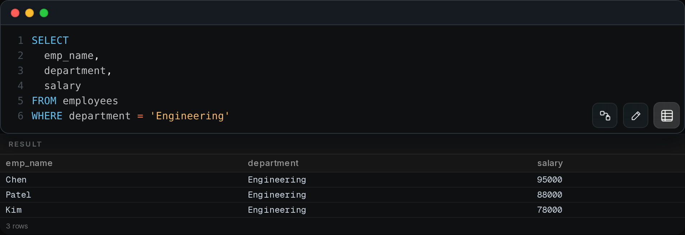
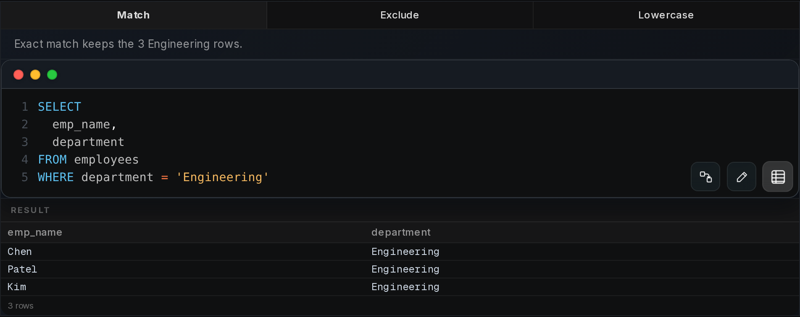
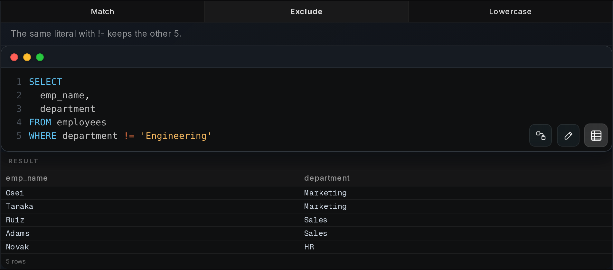
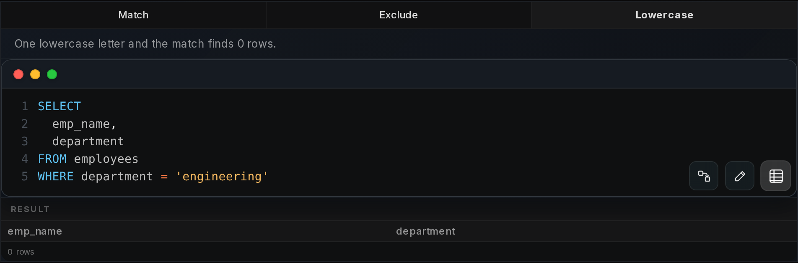
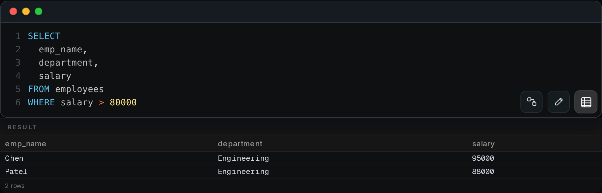
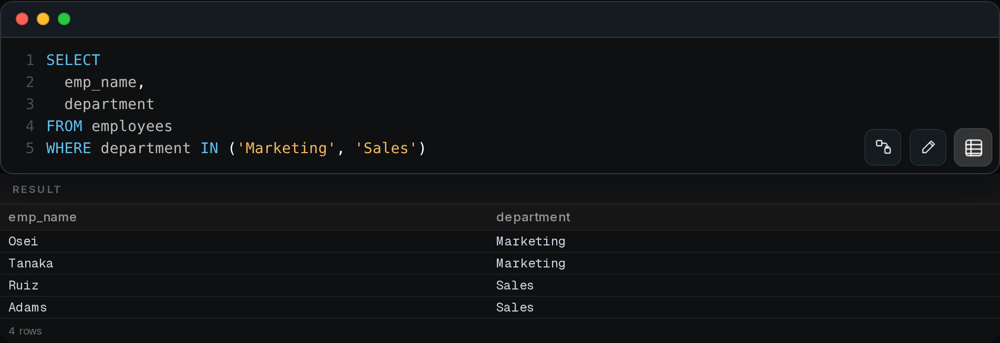
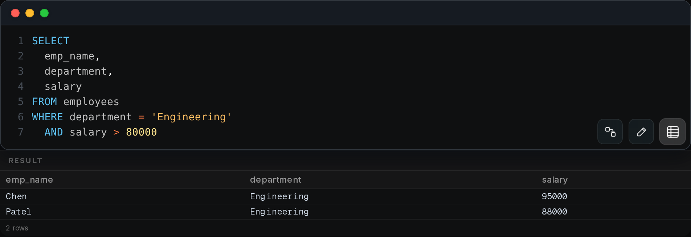

# Filtering: Beginner

Rachel runs HR for a company with 8 people on payroll. Her quarterly headcount report lists 3. Nobody resigned, IT confirms all 8 records still sit in the database, and she has an incident memo half drafted for the board. The 5 missing employees were never gone: one line in the query kept them out of sight.


<br>

---

## WHERE clause for filtering rows

Tom wrote the headcount query 6 weeks ago, when the request was a roster of the Engineering team. It has 3 clauses. The first names the columns to show, the second names the table to read, and the third decides who appears. Watch it run over all 8 employees, row by row.

https://github.com/user-attachments/assets/053548b9-bff1-48fa-a52a-4828788cd75c

The database reads the query in a different order from the one it is written in. `FROM employees` runs first and loads every row, all 8 of them. Then `WHERE` takes the rows one at a time and asks a single question of each: does the value in `department` equal the text `'Engineering'`? Chen and Patel answer yes and continue, and so does Kim. Osei, Tanaka, Ruiz, Adams and Novak go no further. Only then does `SELECT` choose the 3 columns to print, so 8 rows go in and 3 come out, each 3 columns wide.


<br>

### A condition is a question with a yes or no answer

Everything after the word `WHERE` is one condition: here the column `department`, compared by the operator `=` against the value `'Engineering'`. The database evaluates the condition once per row and gets back true or false. True forwards the row to the result; false drops it. The condition never looks at 2 rows at once and never remembers a previous row, which is what makes it predictable: the fate of Osei's row depends on Osei's department and nothing else.


<br>

### SELECT picks columns, WHERE picks rows

A result set has a width and a height. `SELECT` sets the width: list 2 columns and the result is 2 columns wide, but no choice of columns ever changes how many rows come back. `WHERE` sets the height: it is the only clause in this query that can turn 8 rows into 3. Tom's report has 3 columns because `SELECT` named 3, and 3 rows because `WHERE` let 3 through. The 2 numbers match by coincidence, and that coincidence sent Rachel looking for a lost-data incident.

| ✓ SELECT | ✗ WHERE |
| --- | --- |
| • Chooses which columns appear<br><br>• Listing fewer columns narrows the result sideways<br><br>• Never changes the number of rows<br><br>• SELECT \* prints every column of every row that survives | • Chooses which rows appear<br><br>• A tighter condition narrows the result downward<br><br>• Never changes which columns appear<br><br>• Leaving it out keeps every row the table holds |

The condition is a test, and the test never writes anything. `WHERE` reads each row, decides whether it passes, and either forwards it to the result or leaves it out of the result. The table on disk holds the same 8 rows whether the query has run or not. IT was right that every record exists, and the report was right that 3 rows match `'Engineering'`. Both facts hold at once. The 5 people Rachel could not find were sitting in the table the entire time, failing a test nobody told her about.



```sql
SELECT
  emp_name,
  department,
  salary
FROM employees
WHERE department = 'Engineering'
```

Run it as written and the 3 Engineering rows come back. Delete the whole `WHERE` line and run again: all 8 appear, because the clause is optional and a query without one returns the table in full. Then put the line back with `'Sales'` in place of `'Engineering'` and the result is Ruiz and Adams. Only one value changed between those runs, and a different 2 people passed the test.

**Rachel's report shows 3 of 8 employees, IT confirms the table holds all 8, and nobody has left the company. What explains the gap?**

- **A.** 5 records were deleted and later restored, so IT's check happened after the damage was undone.
- **B.** SELECT listed 3 columns, which capped the result at 3 rows.
- **C.** WHERE department = 'Engineering' tested all 8 rows and forwarded the 3 that matched.
- **D.** FROM employees loaded only the Engineering rows because the table is sorted by department.

<details>
<summary>Solution</summary>

**C.** WHERE department = 'Engineering' tested all 8 rows and forwarded the 3 that matched.

The 5 rows outside Engineering failed the test and stayed out of the result, while the table itself kept all 8.

**Why the others are wrong**

- **A.** The table still holds all 8 rows. The query reads the table and never writes to it, so the row count is the same before and after the report ran.
- **B.** SELECT sets the width of the result and never its height. Listing 3 columns prints 3 columns for however many rows WHERE lets through.
- **D.** FROM loads every row of the table regardless of how it is stored. Narrowing to Engineering is the work of the WHERE clause that runs after it.

</details>

> **TIP**
>
> A query with no `WHERE` returns every row the table holds. On the 8-row `employees` table that is a convenience. On a 40-million-row `events` table all 40 million travel to the client and fill its memory. The database may still read every row to test it; the condition decides how many come back, so write it before the column list.


<br>

---

## Equals and not equals (=, !=)

`=` is the operator Tom's query used, and it is stricter than the word equals suggests. The database takes the value stored in the column and the literal written in the query and compares them character for character. `'Engineering'` matches `'Engineering'` and nothing else. `'engineering'`, with a lowercase e, fails: `E` is not the same character as `e`. `'Engineering '` with a trailing space fails, because the stored value has 11 characters and the literal has 12. A match means every character identical in every position, with no character missing and none extra.

PostgreSQL compares text by that strict rule, as do SQLite and Oracle, and the examples on this page follow it. What decides it is the column's collation, the setting that says how 2 strings compare. MySQL and SQL Server ship with case-insensitive collations by default, so on those engines `department = 'engineering'` finds all 3 Engineering rows. SQL Server, like MySQL's older PAD SPACE collations, also ignores trailing spaces in `=`. A literal written exactly as the column stores it matches on every engine, which makes that the only spelling worth relying on.

The quotes tell the database what kind of value it is reading. Text goes in single quotes, so `'Sales'` is the 5-character word. A number goes bare, so `salary = 80000` compares the stored number 80000 to the literal 80000, and `employee_id = 6` picks Ruiz by key. In standard SQL, double quotes name an identifier such as a column. PostgreSQL follows that rule, as do Oracle and SQL Server, so there `department = "Sales"` asks whether `department` equals a column called Sales, which does not exist, and the query fails before it reads a row. MySQL in its default mode reads double quotes as text, and SQLite falls back to text when no such column exists, so there the same query returns Ruiz and Adams without any error. Single quotes are the only spelling that means text on every engine.

| Value kind | Written in SQL | Example condition |
| --- | --- | --- |
| Text | Single quotes | department = 'HR' |
| Whole number | Bare digits | employee_id = 6 |
| Decimal | Bare digits with a point | salary = 72000.50 |
| Date stored as text | Single quotes, year first | hire_date = '2023-01-30' |


<br>

### Everyone except

Rachel's second request was the reverse of the first: everyone outside Engineering. `!=` reads as does not equal, and `<>` is the same operator in an older spelling. Both are accepted in every major database, and a team usually settles on one so that queries read consistently. The test is the mirror image of `=`: the row passes when the stored value and the literal differ in any character. Here it runs over the same 8 rows.

https://github.com/user-attachments/assets/a1bf8786-7f62-4e1c-8307-c557cc5e4f64

This time 5 rows pass, and they are the exact 5 that failed the first query: Osei, Tanaka, Ruiz, Adams and Novak. `= 'Engineering'` and `!= 'Engineering'` split the table in 2 with nothing left over, 3 rows on one side and 5 on the other. That clean split holds as long as every row has a department. A row with NULL in `department` fails both tests and lands in neither result; the advanced tier of this track, in its section on `NOT IN` and NULL, explains why a missing value refuses to be compared.

**Match**

Exact match keeps the 3 Engineering rows.



```sql
SELECT
  emp_name,
  department
FROM employees
WHERE department = 'Engineering'
```

**Exclude**

The same literal with != keeps the other 5.



```sql
SELECT
  emp_name,
  department
FROM employees
WHERE department != 'Engineering'
```

**Lowercase**

One lowercase letter and the match finds 0 rows.



```sql
SELECT
  emp_name,
  department
FROM employees
WHERE department = 'engineering'
```

The third version is the mistake that costs the most time in practice, because the query runs without complaint and returns an empty result. The syntax is valid. The literal `'engineering'` matches none of the 8 stored values, so the result is correct and useless at the same time. When a text filter returns 0 rows unexpectedly, the first thing to check is the spelling and casing of the literal against the values the column really holds, which a quick `SELECT department FROM employees` with no filter will show.

The same strictness applies to numbers, in a quieter way. `salary = 80000` keeps Ruiz and nobody else, because an exact salary is a rare thing to share. `salary != 80000` keeps the other 7. Equality on a numeric column is useful for keys and codes, where values are meant to repeat, and rarely useful for amounts, where the next section's operators do the work.

*Under a case-sensitive collation != is just as strict: department != 'sales' with a lowercase s keeps all 8 rows, including the 2 in Sales, because no stored value equals that literal. On MySQL or SQL Server defaults the same query keeps 6.*


<br>

---

## Comparison operators (<, >)

Equality answers whether a value is one specific value. Most questions about numbers ask something else: who earns more than 80000, say, or which orders came in under 10 dollars. A pod that has restarted more than 5 times is the same kind of question. Those are threshold questions. `<` and `>` handle them, along with `<=` and `>=`, and each compares the stored value to the literal and passes the row when the value sits on the named side of the line.

| Operator | Reads as | Ruiz at 80000, tested against 80000 |
| --- | --- | --- |
| > | greater than | fails |
| >= | greater than or equal to | passes |
| < | less than | fails |
| <= | less than or equal to | passes |

Rachel's compensation review starts at the lower end of the pay scale: everyone earning under 75000. The condition is `salary < 75000`, and the run below tests it against all 8 rows, comparing each stored salary to the literal as a number.

https://github.com/user-attachments/assets/79cc70a0-5476-4180-894b-4f688bd755d9

4 rows pass: Osei at 72000 and Novak at 70000, plus Tanaka at 64000 and Adams at 59000. The 3 Engineering salaries and Ruiz's 80000 sit above the line and fail. The comparison is numeric, so 95000 is correctly judged larger than 75000. If `salary` were stored as text, the database would compare strings character by character, and `'95000'` would sort after `'100000'` because `'9'` comes after `'1'`. The column's type decides which kind of comparison runs, which is one reason amounts are stored as numbers rather than text.

The failure is worth seeing on real values, because it returns rows rather than an error. Suppose a loaded file landed `salary` in a text column and the filter became `salary > '80000'`, the literal quoted to match. Text comparison stops at the first character that differs, so most values are judged by their leading digit against the `8` of `'80000'`.

| Stored text | As text vs '80000' | As a number vs 80000 |
| --- | --- | --- |
| '95000' | passes, 9 beats 8 | passes |
| '105000' | fails, 1 loses to 8 | passes |
| '9000' | passes, 9 beats 8 | fails |
| '80000' | fails, equal | fails |

2 of the 4 rows get the wrong answer: the 105000 earner vanishes and the 9000 earner appears. In a result of thousands of rows neither mistake stands out, which is why the fix belongs in the table's design, a numeric column, rather than in a habit of eyeballing results. Where the column cannot change yet, a `CAST` of `salary` to a number inside the condition makes the comparison numeric again.


<br>

### The row on the line

Every threshold has a boundary, and whether the boundary row passes is the whole difference between `>` and `>=`. Ruiz earns exactly 80000. Ask for `salary > 80000` and the result is Chen and Patel, 2 rows. Ask for `salary >= 80000` and Ruiz joins them, 3 rows. Neither answer is wrong; they answer 2 different questions, and the question comes from the person who asked. A request phrased as more than 80000 wants `>`. One phrased as 80000 and up, or at least 80000, wants `>=`. When a request is ambiguous, asking which side of the line the exact value belongs on takes 10 seconds and prevents a wrong report.

> Translating a request into an operator
>
> - more than, over, above, exceeds: `>`
> - at least, no less than, X or more, X and up: `>=`
> - less than, under, below, fewer than: `<`
> - at most, no more than, X or fewer, up to: `<=`



```sql
SELECT
  emp_name,
  department,
  salary
FROM employees
WHERE salary > 80000
```

Change `>` to `>=` and watch Ruiz appear. Then try `salary <= 80000`: the other 6 rows come back. `>` and `<=` are complements, so every row with a salary passes exactly one of them. Pairing a condition with its complement is a quick check that a threshold sits where it was meant to, since the 2 row counts have to add up to the table's 8.


<br>

### Dates and text have an order too

The same 4 operators work on any column with a natural order. `hire_date` is stored as text in the form `YYYY-MM-DD`, and that form was chosen because it sorts correctly as text: year first, then month, then day, each zero padded. `'2022-11-01'` and `'2022-01-01'` agree through `'2022-'`, and the first character that differs, `'1'` against `'0'` in the month, puts November after January. `hire_date > '2022-01-01'` returns Kim and Tanaka along with Adams, the 3 people hired after the start of 2022. Names compare alphabetically, so `emp_name < 'M'` keeps the 3 names that sort earliest, from Adams through Chen to Kim. Fencing a value between 2 thresholds at once has an operator of its own, `BETWEEN`, which the next tier of this track covers.


<br>

---

## IN and NOT IN for list matching

The next request from Rachel covered 2 departments at once: everyone in Marketing or Sales. `=` compares a column to 1 value, so it cannot express a request about 2. Writing `department = 'Marketing', 'Sales'` is a syntax error, and writing 2 separate conditions needs a connector that the intermediate tier teaches. `IN` is the operator built for this job: a column on the left, a parenthesised list on the right, and the row passes when the stored value matches any entry in the list.


<br>

### One column, many values

https://github.com/user-attachments/assets/6fae1f2d-741b-4d8f-9e16-8c1b9866d017

Each row's `department` is checked against the list one entry at a time, with the same exact-match rule `=` uses: character for character, case included. Osei and Tanaka hit `'Marketing'`. Ruiz and Adams hit `'Sales'`, which makes 4 rows that pass. The 3 Engineering rows and Novak in HR match neither entry and fail. One hit anywhere in the list is enough, and the database stops checking a row the moment it finds a match.


<br>

### The complement

`NOT IN` flips the test: the row passes when its value matches none of the entries. `department NOT IN ('Marketing', 'Sales')` returns the 4 rows the first query dropped, the 3 Engineering rows plus Novak. As with `=` and `!=`, the 2 forms split the table between them, 4 rows each here. The list can hold numbers as well as text, written bare: `employee_id IN (1, 4, 8)` picks Chen and Osei directly by key, along with Novak, which is the usual way to pull a handful of specific records when their ids are already known.

department IN ('Marketing', 'Sales')

department NOT IN ('Marketing', 'Sales')



```sql
SELECT
  emp_name,
  department
FROM employees
WHERE department IN ('Marketing', 'Sales')
```

Add `'HR'` to the list and Novak appears, 5 rows. Replace `IN` with `NOT IN` and the result flips to the Engineering team alone. Shrink the list to the single entry `IN ('Sales')` and the result is Ruiz and Adams, identical to `department = 'Sales'`: a list of 1 behaves exactly like `=`, which is why `IN` is a safe choice from the start when the list of accepted values is likely to grow.

> Rules of the list
>
> - Every entry is compared to the same column, the one on the left of IN.
> - Text entries each take their own single quotes; numbers go bare.
> - Entries are separated by commas inside one pair of parentheses.
> - A duplicate entry changes nothing: the row still passes once.
> - Order inside the list changes nothing either; the test is membership, not position.


<br>

### A misspelled entry fails quietly

Every entry in the list is its own exact match, so an entry with a typo matches nothing, and the database cannot tell a misspelling from a value that has no rows yet. A list meant to cover Marketing and Sales plus the newly created Finance team, written as `department IN ('Marketing', 'sales', 'Finance')`, runs without an error and returns 2 rows.

| List entry | Rows it matches | Why |
| --- | --- | --- |
| 'Marketing' | 2 | Osei and Tanaka store exactly this |
| 'sales' | 0 | the stored value is 'Sales', and case counts here |
| 'Finance' | 0 | no employee has this department yet |

Finance matching 0 rows is correct, since the team has no hires yet. `'sales'` matching 0 rows is a bug that drops Ruiz and Adams, and the result looks the same in both cases. The check for a hand-written list is to compare the departments that came back against the entries that went in: 3 entries and 1 department returned means 2 entries matched nothing, and reading the column's stored values with no filter shows which of them is a typo.

*NOT IN behaves in a surprising way when the list itself contains a NULL, returning no rows at all. That trap has a section of its own in the advanced tier of this track; the lists in this lesson are written by hand and contain no NULL.*


<br>

---

## AND for combining conditions

Rachel's last request narrows on 2 columns at once: Engineering employees earning more than 80000. Both halves, `department = 'Engineering'` and `salary > 80000`, are conditions this lesson has already built. `AND` joins them into 1 test, and a row passes the joined test only when it passes both halves. Watch the 2 tests run against all 8 rows.

https://github.com/user-attachments/assets/7bc1e984-1ed8-4255-bde1-15b2f7eb9aae

2 rows survive. Kim is in Engineering but earns 78000, so the row passes the first test but is dropped at the second. Ruiz earns 80000, which already fails `> 80000`, and works in Sales, so both tests fail. Chen and Patel pass both. The table below traces every row through the 2 tests; the only rows that reach the result are the ones with a pass in both middle columns.

| Employee | department = 'Engineering' | salary > 80000 | Kept |
| --- | --- | --- | --- |
| Chen | pass | pass | yes |
| Patel | pass | pass | yes |
| Kim | pass | fail | no |
| Osei | fail | fail | no |
| Tanaka | fail | fail | no |
| Ruiz | fail | fail | no |
| Adams | fail | fail | no |
| Novak | fail | fail | no |

Adding a condition with `AND` can only shrink the result or leave its size unchanged. 3 conditions pass fewer rows than 2, or the same rows; they never pass more. Append `AND hire_date > '2020-01-01'` and Chen, hired in 2019, drops out, leaving Patel alone. The order the conditions are written in makes no difference to which rows come back: `salary > 80000 AND department = 'Engineering'` returns the same 2 rows. Order is for the reader: leading with the condition that names what the report is about, here the department, puts the query's subject on its first line.

**Before running it, how many rows does WHERE department = 'Engineering' AND salary > 90000 AND hire_date > '2020-01-01' return from the 8-row employees table?**

- **A.** Two rows: Chen and Patel
- **B.** One row: Chen
- **C.** No rows
- **D.** One row: Patel

<details>
<summary>Solution</summary>

**C.** No rows

Chen fails on hire date. Patel and Kim fail on salary, and the other 5 fail on department. Every row fails at least 1 condition, so the result is empty, which is a valid answer rather than an error.

**Why the others are wrong**

- **A.** Patel earns 88000 and fails salary > 90000, so at most Chen could remain.
- **B.** Chen passes the department and salary tests but was hired on 2019-04-02 and fails the hire-date test.
- **D.** Patel passes the department and hire-date tests but earns 88000, below the 90000 line.

</details>


<br>

### Each condition stands on its own

The most common mistake with `AND` comes from writing it the way the sentence is spoken. Salary over 80000 and under 95000 becomes `salary > 80000 AND < 95000`, and the database rejects it, because the text after `AND` has to be a complete condition, and a complete condition starts with its own column. The correct form repeats the column: `salary > 80000 AND salary < 95000`, which returns Patel at 88000. The same rule allows any mix of operators on either side: `department IN ('Marketing', 'Sales') AND salary >= 70000` pairs a list test with a threshold and returns Osei and Ruiz.



```sql
SELECT
  emp_name,
  department,
  salary
FROM employees
WHERE department = 'Engineering'
  AND salary > 80000
```

Make each of these edits to the original query, restoring it between them. Change the second condition to `salary > 60000` and Kim rejoins, 3 rows. Replace the first with `department != 'Engineering'` and the result is empty, because the only person outside Engineering near the line is Ruiz, who earns exactly 80000 and fails `>`. Remove the `AND` line and the query is back to the first section's 3 rows. Each edit shows the same property: a condition added through `AND` moves the row count in 1 direction, downward.

| ✓ Do | ✗ Don't |
| --- | --- |
| • Write the WHERE condition before the column list, so a query on a big table never runs without one<br><br>• Check a text literal's spelling and case against real stored values when a filter returns 0 rows<br><br>• Decide whether the boundary row belongs in the result before choosing > or >=<br><br>• Reach for IN as soon as a column is compared against 2 or more values<br><br>• Repeat the column name in every condition joined by AND | • Treat a row count smaller than expected as lost data before reading the WHERE clause<br><br>• Wrap a text value in double quotes; most databases read that as a column name<br><br>• Compare a numeric threshold against a column that stores its numbers as text<br><br>• Write salary > 80000 AND < 95000; the second half needs its own column<br><br>• Assume reordering AND conditions changes which rows come back |


<br>

---

## Putting It All Together

A support team lead at a SaaS company asks for the tickets that need attention today: tickets from customers on the Enterprise or Business plans, with a priority of high or urgent, opened before this morning, still open and not yet assigned to an agent. The tickets table holds 1.4 million rows going back 4 years, with status stored as 'new', 'open' or 'closed' and assignment in its own assignee_state column, and the lead wants the list in a spreadsheet by 9am.

- Without a WHERE clause the query would return all 1.4 million tickets and the spreadsheet export would fail, so the condition is written before anything else.
- The plan and priority requirements are both list tests, plan IN ('Enterprise', 'Business') and priority IN ('high', 'urgent'), which stay readable as either list grows.
- Opened before this morning is a threshold on a text date, opened_at < '2026-10-13'. The lead confirms a ticket opened at exactly midnight counts as today's and stays off the list, which is what < does with the boundary.
- Still open is an exclusion, status != 'closed', which drops 4 years of resolved history; not yet assigned is assignee_state = 'unassigned'. A look at the stored values first confirms both literals' spelling and case.
- All 5 conditions join with AND, each a complete test on its own column, and the result is the small set of rows that pass every one of them.


<br>

---

## Key Takeaways

- FROM loads every row, WHERE tests each one against a condition, and SELECT then picks the columns; WHERE sets the height of a result and SELECT its width.
- = and != compare text character for character under a strict collation and numbers by value, so a literal is written exactly as stored, in single quotes.
- <, >, <= and >= answer threshold questions, and the boundary row is the only difference between > and >=.
- IN tests a column against a list of values with the same exact-match rule as =, and NOT IN keeps the rows that match none of them.
- AND joins complete conditions, each with its own column, and every condition added can only shrink the result.
