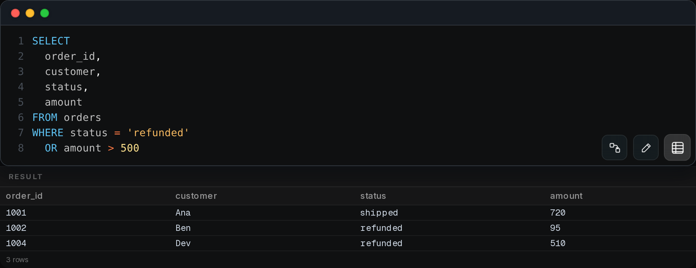
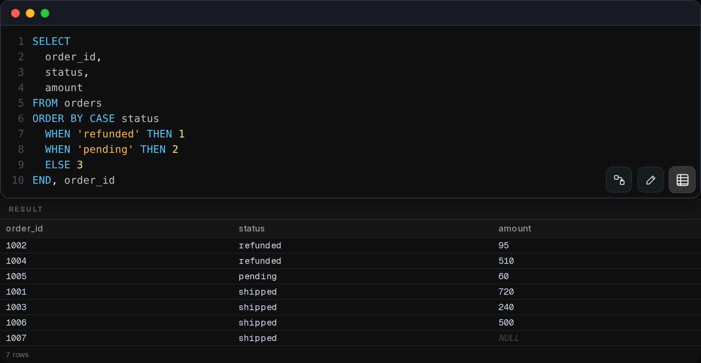
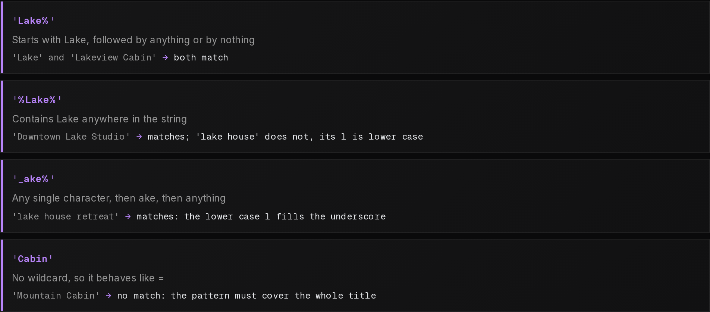
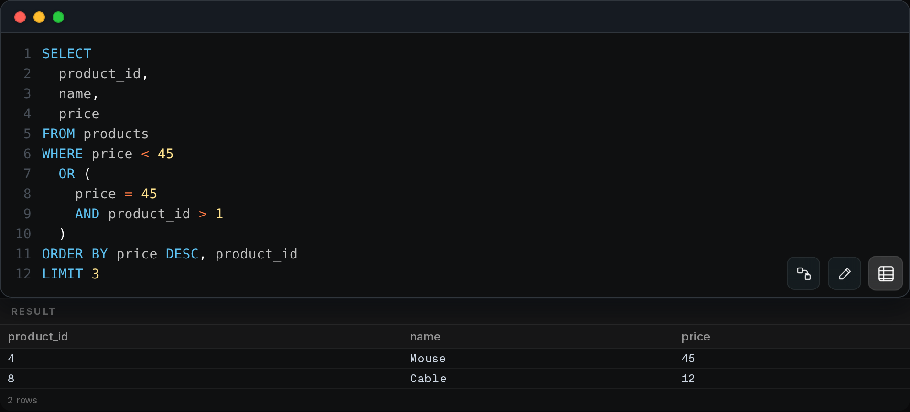

# Filtering: Intermediate

An Airbnb host-support agent types 'cabin' into the listing search, sets a nightly price of 80 to 150 dollars, and asks for pet-friendly or waterfront places. The page shows 20 listings. Behind it sits one WHERE clause mixing OR, LIKE and BETWEEN, plus a LIMIT that cuts the page. Drop the parentheses around the OR and every waterfront listing on the site appears, cabin or not, at any price.


<br>

---

## OR and CASE expressions

### OR widens the filter

AND keeps a row only when every condition is true. OR keeps a row when at least one condition is true, so adding an OR condition can only grow the result and never shrink it. For each row the engine evaluates every condition to TRUE, FALSE or NULL, combines those values with the table below, and keeps the row when the final value is TRUE.

| left | right | left OR right |
| --- | --- | --- |
| TRUE | TRUE | TRUE |
| TRUE | FALSE | TRUE |
| TRUE | NULL | TRUE |
| FALSE | FALSE | FALSE |
| FALSE | NULL | NULL |
| NULL | NULL | NULL |

A TRUE on either side settles the question, which is why TRUE OR NULL is TRUE. FALSE OR NULL stays NULL, and WHERE drops a row whose combined value is NULL as readily as one whose value is FALSE. The orders table below has 7 rows, one of them with a NULL amount, and the query keeps refunded orders plus anything over 500.



```sql
SELECT
  order_id,
  customer,
  status,
  amount
FROM orders
WHERE status = 'refunded'
  OR amount > 500
```

Three rows survive. Order 1001 passes on amount alone, 1002 passes on status, and 1004 passes on both, which still counts once. Order 1006 sits at exactly 500, and 500 > 500 is FALSE, so it drops. Order 1007 carries a NULL amount: the first condition returns FALSE, the second returns NULL, and FALSE OR NULL is NULL, so the row is gone without any warning.

When every branch of an OR compares the same column with =, IN says the same thing in fewer characters: status IN ('refunded', 'pending') is status = 'refunded' OR status = 'pending' with the repetition removed. OR earns its place when the branches test different columns, like status and amount above, or use different operators.


<br>

### CASE picks a value per row

A CASE expression walks a list of WHEN conditions from top to bottom and returns the THEN value of the first one that is TRUE. When none is TRUE it returns the ELSE value, and when there is no ELSE it returns NULL. CASE is an expression, so it can stand anywhere a column or literal can: in the SELECT list, in ORDER BY, and inside WHERE. The animation labels each order with a priority tier.

https://github.com/user-attachments/assets/80be8559-9ae5-4828-a6cb-35f10e822919

Order 1004 has an amount of exactly 500. The first branch tests amount >= 500, which is TRUE, so the row receives 'high' and the second branch is never evaluated for it. Order 1003 at 240 fails the first test, passes amount >= 100, and receives 'medium'. Orders 1002 and 1005 fail both tests and fall through to the ELSE.

Branch order carries the logic. Every amount that satisfies amount >= 500 also satisfies amount >= 100, so with the 'medium' branch written first, 720 and 500 would both be labelled 'medium' and 'high' would never appear. Write the narrowest condition first, or make each condition exclusive with explicit bounds such as amount >= 100 AND amount < 500, which then work in any order.


<br>

### Two shapes of CASE

The form above is the searched CASE: each WHEN holds a full condition. The simple CASE names one expression once, CASE status WHEN 'refunded' THEN 1, and tests it against each WHEN value with =. The simple form reads cleanly for a fixed list of labels but cannot express a range, and since NULL = NULL is never TRUE, it can never match a NULL. The query below uses it to sort orders by how urgently they need a look.



```sql
SELECT
  order_id,
  status,
  amount
FROM orders
ORDER BY CASE status
  WHEN 'refunded' THEN 1
  WHEN 'pending' THEN 2
  ELSE 3
END, order_id
```

Refunded orders surface first, then the pending one, then the rest, with order_id breaking ties inside each group. Plain ORDER BY status would sort alphabetically as pending, refunded, shipped, putting the orders that need a refund check in the middle of the list. CASE in ORDER BY gives you any sort you can describe with conditions.

**This CASE labels each order by amount. Which label does order 1004, with an amount of 500, receive?**

```sql
CASE
  WHEN amount >= 100 THEN 'medium'
  WHEN amount >= 500 THEN 'high'
  ELSE 'low'
END
```

- **A.** 'high', because 500 satisfies the condition written for it
- **B.** 'medium', because the first TRUE branch wins
- **C.** 'low', because 500 falls on a boundary
- **D.** NULL, because the branches overlap

<details>
<summary>Solution</summary>

**B.** 'medium', because the first TRUE branch wins

500 >= 100 is TRUE, so CASE returns 'medium' and stops. With these 2 branches in this order, 'high' can never be returned for any row.

**Why the others are wrong**

- **A.** The 'high' branch is written second, and CASE stops at the first TRUE branch. 500 >= 100 is TRUE, so the second branch is never reached.
- **C.** The ELSE only fires when every WHEN is FALSE or NULL. 500 >= 100 is TRUE, so a WHEN branch fires before the ELSE is considered.
- **D.** Overlapping branches are allowed. CASE resolves overlap by order, returning the first match, and only produces NULL when no branch matches and there is no ELSE.

</details>

> **TIP**
>
> Give every CASE an ELSE. Without one, rows that match no WHEN come back as NULL, and that NULL then fails any WHERE or comparison it later meets, with no error message to point at.


<br>

---

## Operator precedence

A WHERE clause with 3 conditions and both connectors has 2 possible readings, and the engine picks one by a fixed rule rather than by the order you typed them. A product team asks for active US users plus anyone who has spent more than 1000 regardless of location. The first attempt writes the conditions in that order.

https://github.com/user-attachments/assets/6074b96b-033d-438f-abc7-bf48a0e095b6

Four rows pass. Users 42 and 89 are active US users, and users 156 and 203 pass on spending alone although they live in Canada and the UK and are inactive. The engine read the clause as (country = 'US' AND status = 'active') OR total_spent > 1000. That happens to be what the product team asked for. An analyst who meant US users who are either active or big spenders gets the same 4 rows and no hint that 2 of them are wrong.


<br>

### The binding order

Comparisons evaluate first: =, !=, <, >, IN, LIKE and BETWEEN each turn into TRUE, FALSE or NULL for the row. NOT applies next, to the single result right after it. AND joins its neighbours after that, and OR joins last. Because AND binds before OR, a chain mixing both splits at every OR, and the AND groups between the ORs are the pieces being chosen among.

| evaluated | operators | example |
| --- | --- | --- |
| 1st | =, !=, <, >, <=, >=, IN, LIKE, BETWEEN | total_spent > 1000 |
| 2nd | NOT | NOT status = 'active' |
| 3rd | AND | a AND b OR c reads as (a AND b) OR c |
| 4th | OR | a OR b AND c reads as a OR (b AND c) |

Parentheses override the rule: whatever sits inside them resolves before anything outside. The 3 tabs below run the same conditions with no parentheses, with parentheses around the OR, and with parentheses that spell out the default reading.

No parentheses, so AND groups first and OR joins the group to the spending test.

|  |  |
| --- | --- |
|  | SELECT |
|  | user_id, |
|  | country, |
|  | status, |
|  | total_spent |
|  | FROM users |
|  | WHERE country = 'US' |
|  | AND status = 'active' |
|  | OR total_spent > 1000 |

Result

| user_id | country | status | total_spent |
| --- | --- | --- | --- |
| user_42 | US | active | 500 |
| user_89 | US | active | 750 |
| user_156 | CA | inactive | 1200 |
| user_203 | UK | inactive | 1500 |

4 rows

The grouped version returns 2 rows, users 42 and 89, since now every kept row must be from the US. The third tab returns the same 4 rows as the first, and that is its value: parentheses that match the default reading change nothing in the result and spare the next reader from recalling the rule. A reviewer scanning the first tab has to know the rule to know what it returns; a reviewer scanning the third does not.


<br>

### NOT binds tight

NOT status = 'active' AND country = 'US' negates only status = 'active', so it keeps US users whose status is anything else. To negate the whole conjunction, wrap it: NOT (status = 'active' AND country = 'US') keeps every row that fails at least one of the 2 tests, including users 156, 203 and 310 from the table above. A NULL status always drops out of the first form, because NOT NULL is NULL. The wrapped form decides by country: for a non-US row, NULL AND FALSE is FALSE and NOT FALSE is TRUE, so the row survives; for a US row, NULL AND TRUE is NULL, NOT NULL is NULL, and the row drops.

**Against the 5-row users table above, how many rows does this query return?**

```sql
SELECT
  user_id
FROM users
WHERE status = 'inactive'
  OR country = 'US' AND total_spent > 600
```

- **A.** 1 row: only user_89 is both from the US and over 600
- **B.** 3 rows: the 3 inactive users, since the AND fails for all of them
- **C.** 5 rows: every user, because OR with any TRUE keeps the row
- **D.** 4 rows: the 3 inactive users plus user_89

<details>
<summary>Solution</summary>

**D.** 4 rows: the 3 inactive users plus user_89

The engine reads status = 'inactive' OR (country = 'US' AND total_spent > 600). Users 156, 203 and 310 pass the first test; user_89 passes the group; user_42 passes neither.

**Why the others are wrong**

- **A.** That reading needs the AND to also cover status = 'inactive', but AND only joins country = 'US' with total_spent > 600. The inactive users pass through the OR on their own.
- **B.** The 3 inactive users do pass, but user_89 also passes: US and 750 > 600 makes the AND group TRUE, and TRUE OR FALSE is TRUE.
- **C.** user_42 is active, from the US, and spent 500. Both the inactive test and the AND group are FALSE for that row, so it drops.

</details>

| ✓ Do | ✗ Don't |
| --- | --- |
| • Add parentheses whenever one WHERE mixes AND with OR<br><br>• Put each condition on its own line, indented under its connector<br><br>• Read a clause back as AND groups joined by OR before trusting it<br><br>• Test a mixed clause on a small table where you can count the expected rows | • Rely on top to bottom reading to decide how conditions group<br><br>• Negate a group with a bare NOT in front of its first condition only<br><br>• Trust a query that returns the right count once; check which rows it returned |

> **TIP**
>
> When explaining what a WHERE clause does begins with 'well, AND binds before OR', the clause needs parentheses, whatever the engine already knows.


<br>

---

## LIKE for pattern matching

Equality asks whether a string is exactly one value. LIKE asks whether a string fits a pattern, where 2 wildcard characters stand in for text you do not know. The percent sign matches any run of characters, including a run of none, and the underscore matches exactly 1 character. Every other character in the pattern must match itself, the pattern must account for the whole string, and letter case counts.



- `'Lake%'`: Starts with Lake, followed by anything or by nothing Example: `'Lake' and 'Lakeview Cabin'` -> `both match`
- `'%Lake%'`: Contains Lake anywhere in the string Example: `'Downtown Lake Studio'` -> `matches; 'lake house' does not, its l is lower case`
- `'_ake%'`: Any single character, then ake, then anything Example: `'lake house retreat'` -> `matches: the lower case l fills the underscore`
- `'Cabin'`: No wildcard, so it behaves like = Example: `'Mountain Cabin'` -> `no match: the pattern must cover the whole title`

The listings table below holds 6 titles. The 3 tabs search it with a prefix pattern, a contains pattern, and a pattern whose first character is a wildcard.

Titles that begin with Lake, with anything or nothing after it.

|  |  |
| --- | --- |
|  | SELECT |
|  | listing_id, |
|  | title, |
|  | city |
|  | FROM listings |
|  | WHERE title LIKE 'Lake%' |

Result

| listing_id | title | city |
| --- | --- | --- |
| 1 | Lakeview Cabin | Tahoe |
| 2 | Lakeside Loft | Austin |
| 6 | Lake | Geneva |

3 rows

The prefix pattern returns 3 rows, and listing 6 is one of them: the title 'Lake' leaves nothing after the prefix, and % matches nothing without complaint. The contains pattern adds listing 3, where Lake sits mid-title, for 4 rows. The third pattern also returns 4 rows but swaps listing 3 for listing 4, because the underscore accepts the lower case l that the capital L in the other 2 patterns rejected. The underscore accepts the D in 'Downtown Lake Studio' too, but the next 3 characters are own where the pattern requires ake, and the Lake later in the title does not help, because the pattern has no leading %.

**Against the 6-row listings table above, how many rows does WHERE title LIKE 'Lake_%' return?**

- **A.** 2 rows: Lakeview Cabin and Lakeside Loft
- **B.** 3 rows: Lakeview Cabin, Lakeside Loft and Lake
- **C.** 4 rows: every title containing Lake or lake
- **D.** 1 row: Lakeview Cabin, the longest match

<details>
<summary>Solution</summary>

**A.** 2 rows: Lakeview Cabin and Lakeside Loft

The underscore demands at least 1 character after Lake, so the bare title 'Lake' fails. 'Downtown Lake Studio' and 'lake house retreat' fail on the first character.

**Why the others are wrong**

- **B.** 'Lake' has nothing after the prefix, and the underscore requires exactly 1 character there. Only % is willing to match nothing.
- **C.** The pattern has no leading %, so the title must start with a capital L followed by ake. 'Downtown Lake Studio' and 'lake house retreat' both fail that.
- **D.** LIKE has no notion of a best match. Every title that fits the pattern is returned, and 'Lakeside Loft' fits it as well as 'Lakeview Cabin' does.

</details>


<br>

### Matching a literal wildcard

A discount label such as '50% off' contains a percent sign that should match itself. Name an escape character with ESCAPE and put it before the wildcard: label LIKE '50\%%' ESCAPE '\' reads the first % as a literal percent sign and the second as a wildcard, so it matches labels starting with 50%. The same trick covers underscores in codes like 'SKU_'.


<br>

### What LIKE costs

A pattern with a fixed prefix lets an engine reading sorted data skip whole blocks whose values fall outside that prefix's range. A pattern that starts with %, such as '%Lake%', gives no prefix to skip by, so every row's title is read and compared. On a table of 200 million listings that is 200 million string comparisons for one search box. Pair a leading wildcard with other conditions, such as a city, so the engine filters by those first and runs the pattern on far fewer rows.

NOT LIKE keeps the rows that fail the pattern. A NULL title fits neither LIKE nor NOT LIKE, since comparing NULL to a pattern yields NULL, so the row disappears from both result sets. A table where 3 titles are NULL and 10 match the pattern returns 10 for LIKE and the remaining non-NULL titles for NOT LIKE, with the 3 NULL rows in neither.

> **TIP**
>
> Write the fixed part of a search pattern first whenever the data allows. A search for 'order number starting with 2024' is a prefix pattern that skips data; 'anything containing 2024' reads every row.


<br>

---

## LIMIT and OFFSET for pagination

LIMIT cuts the result to its first n rows. OFFSET skips the first m rows before the cut begins. Together they carve a sorted result into pages: page 1 is OFFSET 0 LIMIT 20, page 2 is OFFSET 20 LIMIT 20, and page k is OFFSET (k - 1) \* 20 LIMIT 20. In the query text OFFSET follows ORDER BY and comes before LIMIT. The products table below has 8 rows, paged 3 at a time.

Skip nothing and keep the first 3 rows of the sorted result.

|  |  |
| --- | --- |
|  | SELECT |
|  | product_id, |
|  | name, |
|  | price |
|  | FROM products |
|  | ORDER BY price DESC, product_id |
|  | LIMIT 3 |
|  | OFFSET 0 |

Result

| product_id | name | price |
| --- | --- | --- |
| 2 | Monitor | 310 |
| 7 | Chair | 310 |
| 5 | Headset | 120 |

3 rows

| page | OFFSET | LIMIT | product_id returned |
| --- | --- | --- | --- |
| 1 | 0 | 3 | 2, 7, 5 |
| 2 | 3 | 3 | 3, 6, 1 |
| 3 | 6 | 3 | 4, 8 |
| 4 | 9 | 3 | none |

Page 3 returns 2 rows because only 8 exist: OFFSET 6 skips 6, LIMIT 3 asks for 3, and the table has 2 left. A page shorter than the page size tells the caller it has reached the end, and page 4 confirms it with no rows at all.

**The products table is sorted by price DESC, then product_id. Which rows does OFFSET 2 LIMIT 2 return?**

- **A.** Monitor and Chair, the 2 most expensive products
- **B.** Chair and Headset, starting from the second row
- **C.** Headset and Keyboard, the third and fourth rows
- **D.** Keyboard and Webcam, the 2 rows priced at 90

<details>
<summary>Solution</summary>

**C.** Headset and Keyboard, the third and fourth rows

The sort runs Monitor, Chair, Headset, Keyboard, Webcam, Desk Lamp, Mouse, Cable. Skipping 2 and keeping 2 yields Headset and Keyboard.

**Why the others are wrong**

- **A.** Those are the first 2 rows of the sort, which OFFSET 2 skips. The page starts at the third row.
- **B.** OFFSET 2 skips 2 rows, so the first kept row is the third one, Headset. Chair is the second row and is skipped.
- **D.** That would be OFFSET 3 LIMIT 2. Headset at 120 sits in the third position and is the first row kept after skipping 2.

</details>


<br>

### ORDER BY is the contract

Without ORDER BY the engine may return rows in any order, and the order can change between 2 runs of the same query. Page 1 and page 2 might then both contain Monitor while Chair appears on neither. The sort also has to be total: Monitor and Chair share the price 310, and Keyboard and Webcam share 90, so ORDER BY price DESC alone leaves the engine to break ties however it likes, and a tie can straddle a page boundary. Adding product_id as the final sort key gives every row a fixed position, so each product appears on exactly one page.


<br>

### What OFFSET costs

OFFSET walks past rows rather than jumping over them. To produce page 5,001 of 20 rows, the engine sorts the whole table, passes the first 100,000 rows one by one, then keeps 20. Every page pays for the full sort plus the skipped rows, so later pages run slower than earlier ones, and a crawler requesting page 50,000 keeps the engine sorting rows that no one will see.

- **100,020** — rows produced for page 5,001
- **5,000** — pages passed before the first kept row


<br>

### Keyset pagination

Instead of counting rows to skip, remember the last row of the current page and ask for rows that sort after it. Page 2 ended on Desk Lamp, price 45, product_id 1. The next page is every row with a lower price, or the same price and a higher product_id. That filter mixes OR and AND, so it needs the parentheses from the last section.



```sql
SELECT
  product_id,
  name,
  price
FROM products
WHERE price < 45
  OR (
    price = 45
    AND product_id > 1
  )
ORDER BY price DESC, product_id
LIMIT 3
```

The result matches page 3 exactly: Mouse, then Cable. The difference is the work done. The WHERE removed 6 rows before the sort, and on sorted storage the engine lands on price 45 directly instead of reading and discarding everything above it. The trade is that keyset pages come in sequence: there is no way to ask for page 40 without first learning where page 39 ended.

| ✓ OFFSET paging | ✗ Keyset paging |
| --- | --- |
| • Jump to any page number directly<br><br>• Cost grows with the page number: sorts and skips every earlier row<br><br>• Rows inserted between 2 requests shift the later pages<br><br>• Fits a numbered page bar in a UI | • Reach pages in sequence from the last seen row<br><br>• Cost stays flat: the filter lands on the next row<br><br>• Rows inserted earlier in the sort do not shift the next page<br><br>• Fits a Next button or an infinite scroll |


<br>

---

## BETWEEN for range filtering

BETWEEN low AND high keeps a row when the value is at least low and at most high. It is the same test as value >= low AND value <= high written as a single operator, and both ends are included. The order of the bounds matters: total BETWEEN 1500 AND 500 asks for a number at least 1500 and at most 500, no number satisfies that, and the result is empty rather than an error. The animation applies 2 ranges to a set of orders.

https://github.com/user-attachments/assets/25efeadf-abea-4d2e-9b9f-19cf9feb9dbc

Two of the 5 orders survive. Order 1 sits well inside both ranges. Order 4 lands on 2024-03-31 with a total of 1500, the upper bound of each range, and passes because BETWEEN includes its endpoints. Order 2's total of 300 is under 500, order 3 falls in April, and order 5 belongs to the previous year. The order_date column holds text in year-month-day form, and text in that form compares in calendar order, which is why a range of string literals works here.

**The products table from the last section has prices 12, 45, 45, 90, 90, 120, 310 and 310. How many rows does WHERE price BETWEEN 45 AND 90 return?**

- **A.** 2, the rows priced at exactly 45
- **B.** 5, the rows priced from 45 up to 120
- **C.** 0, because the bounds should be written high to low
- **D.** 4, the 2 rows at 45 and the 2 rows at 90

<details>
<summary>Solution</summary>

**D.** 4, the 2 rows at 45 and the 2 rows at 90

Both endpoints are included: 45 >= 45 and 90 <= 90 are TRUE, so Desk Lamp, Mouse, Keyboard and Webcam all pass.

**Why the others are wrong**

- **A.** BETWEEN keeps every value from 45 up to 90 inclusive, so the 2 rows priced at 90 pass as well as the 2 at 45.
- **B.** 120 is above the upper bound of 90, so Headset fails the test and only 4 rows remain.
- **C.** BETWEEN takes the low bound first and the high bound second. 45 AND 90 is the correct order and matches rows.

</details>


<br>

### The last day problem

A timestamp column carries a time of day, and the bound TIMESTAMP '2024-03-31 00:00:00' is the first instant of March 31, not the last. A BETWEEN that ends there keeps events at exactly midnight and drops everything else that day. The events table below stores occurred_at as text from an event log, so each query casts it to TIMESTAMP before comparing.

Both bounds included, with the upper bound at midnight on the last day of the quarter.

|  |  |
| --- | --- |
|  | SELECT |
|  | event_id, |
|  | occurred_at |
|  | FROM events |
|  | WHERE CAST(occurred_at AS TIMESTAMP) BETWEEN TIMESTAMP '2024-01-01 00:00:00' |
|  | AND TIMESTAMP '2024-03-31 00:00:00' |

Result

| event_id | occurred_at |
| --- | --- |
| 1 | 2024-01-01 00:00:00 |
| 2 | 2024-02-14 09:15:00 |
| 3 | 2024-03-31 00:00:00 |

3 rows

The BETWEEN version returns 3 events and loses event 4, which happened at 18:20 on March 31, inside the quarter by any sensible definition. The half-open version returns 4. Its lower bound is included and its upper bound is excluded, set to the first instant of the next period, so every moment of March 31 passes. Event 5 at midnight on April 1 falls out of both, which is right, since it opens the next quarter. Writing the upper bound as 23:59:59 instead rescues whole seconds but still drops an event stamped 23:59:59.500.

> Choosing a range shape
>
> - Whole numbers and dates without a time: BETWEEN reads well and both ends are meant
> - Timestamps: lower bound with >=, upper bound with < at the start of the next period
> - Text: a longer string sorts after its own prefix, so 'Mango' sits beyond 'M'
> - Reversed bounds return 0 rows and no error, so check that low <= high


<br>

### BETWEEN on text

Text ranges compare character by character. name BETWEEN 'A' AND 'M' keeps 'Apple' and 'Lemon' but drops 'Mango', because 'Mango' shares its first character with 'M' and then has more characters, and a longer string sorts after its own prefix. To keep every name beginning with M, use the half-open shape again: name >= 'A' AND name < 'N' admits all of them and stops at the first N.

| name | BETWEEN 'A' AND 'M' | >= 'A' AND < 'N' |
| --- | --- | --- |
| Apple | TRUE | TRUE |
| Lemon | TRUE | TRUE |
| M | TRUE | TRUE |
| Mango | FALSE | TRUE |
| Nectarine | FALSE | FALSE |

The AND inside BETWEEN belongs to BETWEEN. In total BETWEEN 500 AND 1500 AND status = 'shipped' the engine reads the first AND as the range separator and the second as a connector, and BETWEEN resolves before that connector, the same as any comparison. NOT BETWEEN keeps the rows outside the range, and a NULL total matches neither form, since NULL compared to either bound is NULL.


<br>

---

## Putting It All Together

A Shopify merchant opens the orders list in the admin, filters to orders that are unfulfilled or flagged as high risk, searches customer names beginning with 'Mar', narrows to the current month, and pages through the matches 50 at a time while the store keeps taking new orders.

- Unfulfilled or high risk is an OR, and combining it with the name search and the month range forces parentheses around the OR, or the merchant sees every high risk order from every month.
- The name search is a prefix LIKE, 'Mar%', which an engine reading sorted names can satisfy without touching the rest of the alphabet; a contains search would read every order.
- The month range is a timestamp range, so it runs as >= the first of the month AND < the first of next month, and an order placed at 11pm on the last day still shows.
- A CASE in ORDER BY floats high risk orders above unfulfilled ones, which plain alphabetical sorting could never express.
- Paging 50 at a time with OFFSET works for a numbered page bar, but new orders arriving between clicks shift later pages, so a Next button keyed on the last seen order id and timestamp gives a stable walk.


<br>

---

## Key Takeaways

- OR keeps a row when any condition is TRUE, and FALSE OR NULL is NULL, so a NULL on one side still drops the row.
- CASE returns the THEN value of the first TRUE branch, so branch order decides the label; put the narrowest condition first and always add an ELSE.
- AND binds before OR, so a clause that mixes them groups at the ORs unless parentheses say otherwise. Write the parentheses even when they match the default.
- LIKE matches a whole string against a pattern: % for any run of characters, _ for exactly 1, case sensitive, and a leading % reads every row.
- OFFSET skips and LIMIT keeps, over a total ORDER BY. Later pages pay for every skipped row; keyset paging filters past the last seen row instead.
- BETWEEN includes both ends. On timestamps, use >= low AND < next period start so the last day's events survive.
