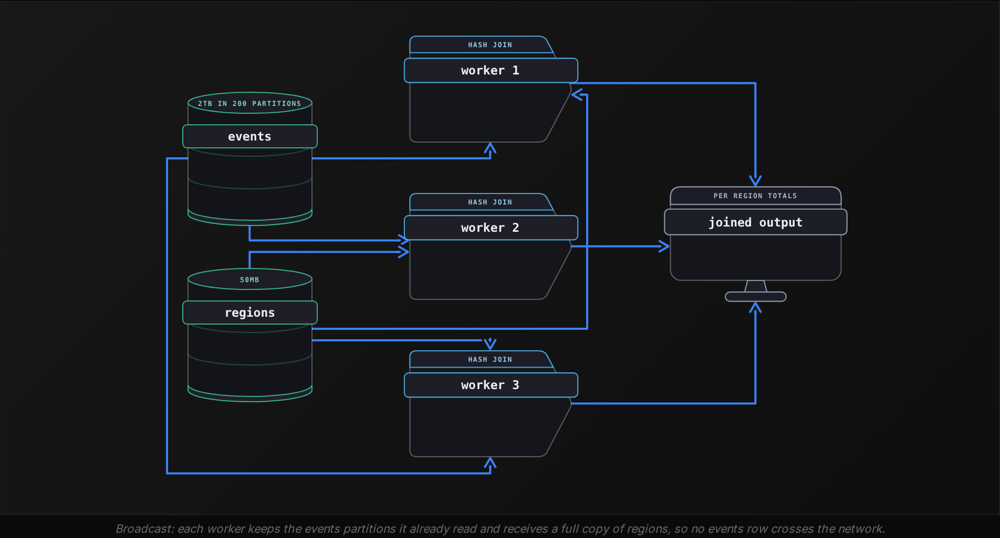
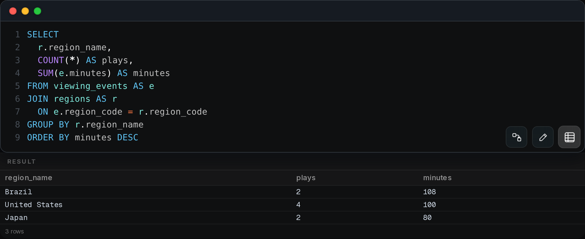
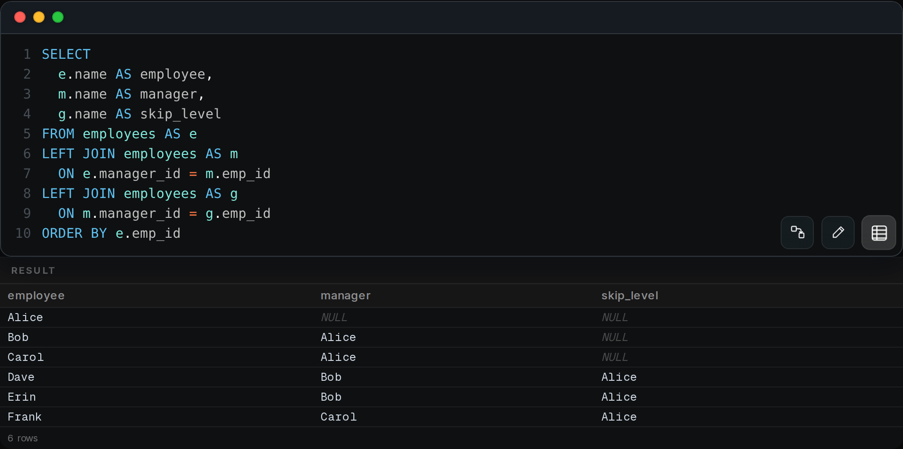
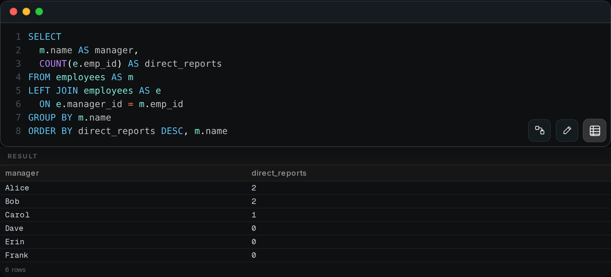
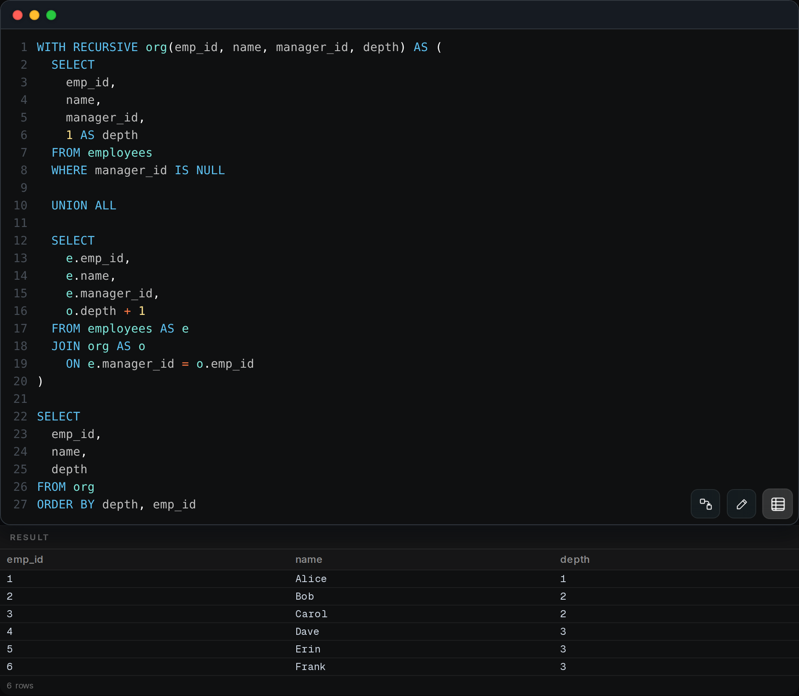
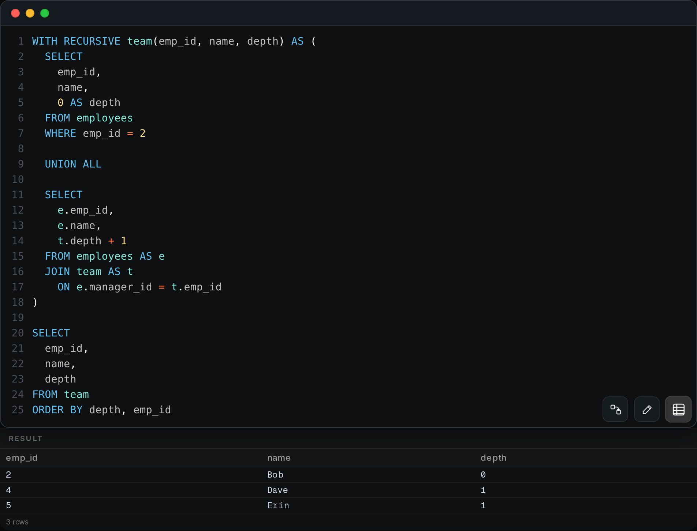
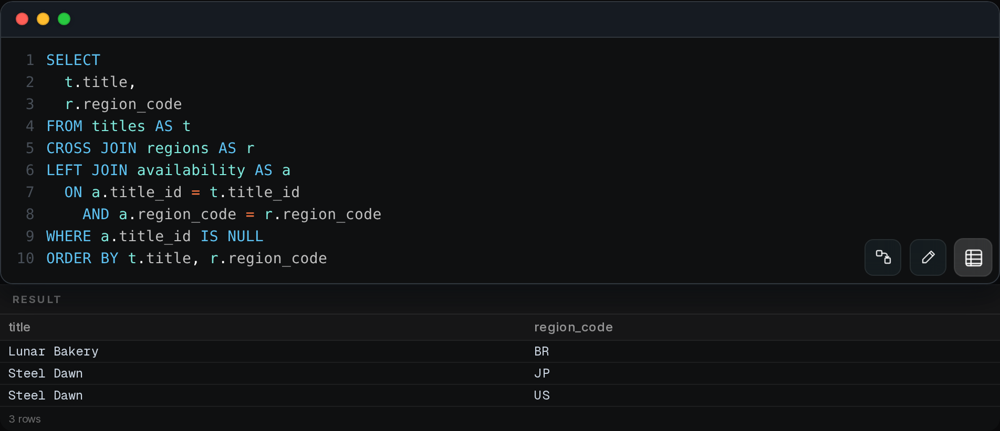
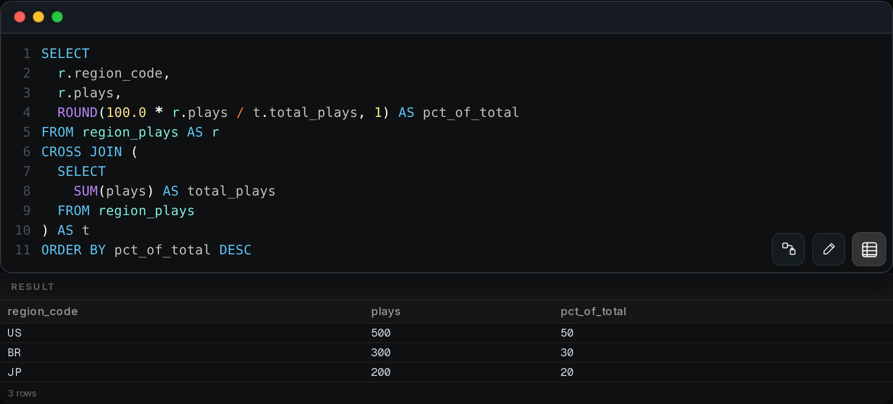
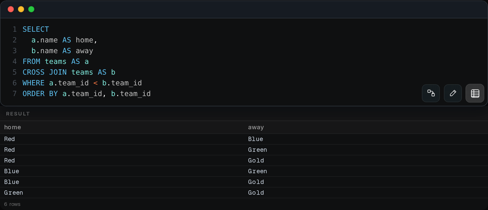

# Joins: Advanced

Netflix's viewing events table grows by billions of rows a day, and the regions table it joins to has fewer than 200. An analyst asks which titles sit under each genre in a nested catalog, which title and country pairs have no license, and why one join took 40 minutes. Each answer needs a join that does more than match one key to one key.


<br>

---

## Broadcast joins (distributed)

A single machine joins 2 tables by reading both from its own disk. A cluster holds each table in pieces spread across many workers, and a row from the events table can only be paired with a row from the regions table when both sit in the same worker's memory. Every distributed join starts with the same question: which rows have to move so that matching keys meet on one machine?


<br>

### Two ways to bring keys together

A partitioned join hashes the join key on both sides and sends each row to the worker that owns that hash value. Both tables cross the network, so a 2TB events table costs 2TB of network traffic before a single pair is compared. A broadcast join leaves the large table where it already sits and copies the entire small table to every worker. Each worker then joins its own slice of events against a full local copy of regions.

| ✓ Partitioned join | ✗ Broadcast join |
| --- | --- |
| • Both sides hashed on the join key and shuffled<br><br>• Network cost grows with the size of both tables<br><br>• Each worker holds one slice of each side<br><br>• Works when both tables are large<br><br>• A hot key sends all of its rows to one worker | • The large side never moves<br><br>• The small side is copied once per worker<br><br>• Each worker holds the entire small side<br><br>• Needs one side that fits in memory<br><br>• The large side keeps its even spread |

Put numbers on it. The events table is 2TB, the regions table is 50MB, and the cluster has 100 workers. A partitioned join shuffles both tables, so the network carries all of events plus all of regions. A broadcast join sends the 50MB regions table to each of the 100 workers and moves nothing else.

- **2.05TB** — on the network, partitioned join
- **5GB** — on the network, broadcast join




<br>

### The query does not change

The SQL is identical under both strategies. The planner chooses from table statistics. It broadcasts whichever side its statistics show is small enough to fit in each worker's memory, as long as the join type allows it: in a LEFT JOIN only the right side, the one not preserved, can be broadcast. Otherwise it partitions. Most engines expose a session setting or a hint to force one choice when statistics are stale. Run the join below. With 8 event rows and 3 region rows, regions is the side to broadcast, and the result is the same under either plan.



```sql
SELECT
  r.region_name,
  COUNT(*) AS plays,
  SUM(e.minutes) AS minutes
FROM viewing_events AS e
JOIN regions AS r
  ON e.region_code = r.region_code
GROUP BY r.region_name
ORDER BY minutes DESC
```

Three groups come back: Brazil with 108 minutes from 2 plays, the United States with 100 minutes from 4 plays, and Japan with 80 minutes from 2 plays. On a cluster each worker computes partial counts and sums for its own slice of events, and a final step adds the partials per region.


<br>

### Where broadcast breaks

The small side has to be small on every worker at once. A 40GB accounts table broadcast to 100 workers puts 40GB into each worker's memory, 4TB of copies in total, and a worker with 8GB of memory fails the query. The second trap is a table that was small when the query was written: a lookup table that grew from 10,000 rows to 50 million turns a fast broadcast into an out of memory error months later. Statistics kept current are what let the planner notice the change.

> Skew: the case for broadcast
>
> In a partitioned join, every events row with region_code 'US' lands on the one worker that owns the hash of 'US'. If 40% of all events come from the US, that worker gets 40 times a fair 1% share. The other 99 finish their slices quickly and then wait on it, so the query takes as long as its slowest worker. A broadcast join never hashes the large side, so the US rows stay spread across all 100 workers.

> **TIP**
>
> Put the table you expect to be broadcast on the right side of the JOIN. Engines that build the in memory hash table from the right side will build it from the small table, and a planner with fresh statistics reaches the same plan whatever the order.

**A query joins a 2TB events table to a 40GB accounts table on account_id. The cluster has 100 workers with 8GB of memory each. Which plan runs?**

- **A.** Broadcast accounts, because it is the smaller side and the large side never has to move
- **B.** Partition both sides on account_id, because neither table fits in a single worker's memory
- **C.** Broadcast events, because every worker already holds a copy of the accounts table
- **D.** Partition events only and leave accounts in place, because accounts is the smaller side

<details>
<summary>Solution</summary>

**B.** Partition both sides on account_id, because neither table fits in a single worker's memory

Each side is hashed on account_id and each worker receives one slice of events and the matching slice of accounts, about 20GB of events and 400MB of accounts per worker.

**Why the others are wrong**

- **A.** Each worker would need to hold all 40GB of accounts in 8GB of memory. The small side must fit on every worker, and 40GB does not.
- **C.** Nothing is copied ahead of time. Broadcasting the 2TB side would send 200TB across the network and fail on memory long before that finished.
- **D.** A partitioned join hashes both sides on the same key so each accounts row reaches the worker that owns its account_id. Leaving one side in place is what broadcast does, and it requires copying the other side everywhere.

</details>


<br>

---

## Inequality joins with BETWEEN

Every join so far has paired rows on equality: a key on the left equals a key on the right. The ON clause accepts any condition that returns true, false or NULL for a pair of rows, and a range condition pairs a row with the band its value falls inside. Tax rates by income, shipping prices by weight, surge multipliers by hour and discounts by order size are all bands with a lower bound and an upper bound, stored as rows.

https://github.com/user-attachments/assets/c253bad2-61b7-4f0d-b31e-acfb28a356e0

The cost_allocs table holds the tax bands: each row is a min_income, a max_income and the rate for that band. Play it and watch Alice's 75,000 meet all 3 bands. Against the first band the condition is false because 75,000 is above 40,000. Against the second it is true on both halves. Against the third it is false because 75,000 is below 85,000. One pair survives per employee, which is what a well built band table guarantees: the bands cover the whole range and never overlap, so each value lands in exactly 1 of them.


<br>

### BETWEEN closes both ends

x BETWEEN a AND b means x >= a AND x <= b, inclusive on both sides. That matters at the seams. If 2 bands touch at 40,000, so that one ends at 40,000 and the next starts at 40,000, an income of exactly 40,000 satisfies both, and that employee comes back twice. Switch between the 3 queries below to see the duplicate appear and then disappear.

Closed bands that end 1 below the next band's start, joined with BETWEEN.

|  |  |
| --- | --- |
|  | SELECT |
|  | e.name, |
|  | e.salary, |
|  | t.rate AS tax_rate |
|  | FROM employee_metrics AS e |
|  | JOIN tax_bands AS t |
|  | ON e.salary BETWEEN t.min_income |
|  | AND t.max_income |
|  | ORDER BY e.name |

Result

| name | salary | tax_rate |
| --- | --- | --- |
| Alice | 75000 | 22% |
| Bob | 35000 | 12% |
| Carol | 95000 | 32% |
| Dave | 40000 | 22% |

4 rows

The first tab returns 4 rows, 1 per employee, because the bands end at 39,999 and 84,999 and leave no value inside 2 bands at once. The second tab returns 5 rows: Dave's 40,000 matches the band ending at 40,000 and the band starting at 40,000, so he is taxed at 12% on one row and 22% on the next. The third tab returns 4 rows again without touching the data. A lower bound tested with >= and an upper bound tested with < make each band half open, and a value on a seam belongs to exactly 1 band. Half open bands also survive decimals: a closed band ending at 39,999 leaves a salary of 39,999.50 matching nothing, while a half open band ending below 40,000 catches it.

**A parcel weighs exactly 5.0 kg. The rate table has a band from 0 to 5 and a band from 5 to 10, and the join condition is weight BETWEEN min_kg AND max_kg. How many rows does this parcel produce?**

- **A.** 1 row, because the engine assigns a value on a seam to the lower band only
- **B.** 0 rows, because a value equal to a bound falls outside a BETWEEN range
- **C.** 2 rows, because BETWEEN includes both ends and 5.0 satisfies both bands
- **D.** 1 row, because the second band's lower bound is tested with > when 2 bands touch

<details>
<summary>Solution</summary>

**C.** 2 rows, because BETWEEN includes both ends and 5.0 satisfies both bands

The parcel pairs with the 0 to 5 band and with the 5 to 10 band, and the shipping cost is counted twice. Testing weight >= min_kg AND weight < max_kg puts 5.0 in exactly 1 band.

**Why the others are wrong**

- **A.** No engine picks a side for you. Both pairs are tested on their own, and both return true for 5.0.
- **B.** BETWEEN is inclusive at both ends, so 5.0 is inside a band that ends at 5 and inside a band that starts at 5.
- **D.** BETWEEN always tests the lower bound with >=, whatever the neighbouring band looks like. Only rewriting the condition with explicit operators changes that.

</details>


<br>

### What a range join costs

A hash join is fast because equality lets the engine put each key in a bucket and look up its partner in one step. A range condition has no single key to hash, so the engine falls back to comparing every left row against every right row. One million employees against 300 bands is 300,000,000 comparisons. The fix is to add an equality condition whenever one exists. If bands differ by country, join on country as well: the engine hashes on country, then tests the range only against each country's few bands.

```sql
SELECT
  e.name,
  e.salary,
  t.rate
FROM employees AS e
JOIN tax_bands AS t
  ON e.country = t.country
    AND e.salary >= t.min_income
    AND e.salary < t.max_income
```

| ON clause | Comparisons for 1M employees and 300 bands |
| --- | --- |
| Range only | 300,000,000 |
| Country equality, then range | 3,000,000 with 100 countries and 3 bands each |

> **TIP**
>
> Check a band table before joining to it: select the bands ordered by min_income and confirm each max equals the next min (half open) or sits 1 below it (closed). A gap drops rows silently and an overlap duplicates them silently, and neither raises an error.


<br>

---

## Self joins for hierarchical data

An employees table stores each person's manager as a manager_id that points back into the same table. Asking for each employee's manager's name is therefore a join between employees and employees. The database does not care that both sides are the same table: it treats each alias as an independent copy, and the row pairing model from the beginner lesson applies unchanged.

https://github.com/user-attachments/assets/7de65b9d-27db-453a-a7e9-50415f2cbe08

The alias e stands for the employee side and m for the manager side, and the ON clause reads: the employee's manager_id equals the manager's emp_id. Bob's manager_id of 1 finds Alice's emp_id of 1, and so does Carol's. Alice has a NULL manager_id, and NULL equals nothing, so her comparison with every m row is NULL rather than true. The LEFT JOIN keeps her with a NULL manager; an INNER JOIN would drop her, and the report would be missing the person at the top of the company.


<br>

### Climbing 2 levels

Each extra level is another alias and another join. The skip level manager is the manager's manager, so join m to a third copy g on m.manager_id = g.emp_id. The 6 person company below has Alice at the top, Bob and Carol reporting to her, Dave and Erin under Bob, and Frank under Carol.



```sql
SELECT
  e.name AS employee,
  m.name AS manager,
  g.name AS skip_level
FROM employees AS e
LEFT JOIN employees AS m
  ON e.manager_id = m.emp_id
LEFT JOIN employees AS g
  ON m.manager_id = g.emp_id
ORDER BY e.emp_id
```

Dave, Erin and Frank each show both levels: Dave's manager is Bob and his skip level is Alice. Bob and Carol show Alice as manager and NULL as skip level, because Alice's manager_id is NULL and the second LEFT JOIN finds nothing to pair it with. Alice shows NULL in both columns. Chaining aliases works for a known number of levels; a tree whose depth nobody has counted needs the recursive CTE in the next section.

**The 6 person employees table is joined to itself with JOIN instead of LEFT JOIN on e.manager_id = m.emp_id. How many rows does SELECT e.name, m.name return?**

- **A.** 5 rows, because Alice's NULL manager_id matches no emp_id and INNER JOIN drops her
- **B.** 6 rows, because every employee is on the left side and the left side is preserved
- **C.** 4 rows, because Alice is dropped along with the employees who report to Alice
- **D.** 6 rows, because NULL = 1 is treated as false and the pair is kept with a NULL manager

<details>
<summary>Solution</summary>

**A.** 5 rows, because Alice's NULL manager_id matches no emp_id and INNER JOIN drops her

NULL = 1 is NULL, not true, so Alice's pairs all fail and INNER JOIN keeps nothing for her. The other 5 employees each find their manager.

**Why the others are wrong**

- **B.** Only LEFT JOIN preserves the left side. INNER JOIN keeps a left row only when at least 1 pair passed the condition.
- **C.** Bob and Carol have manager_id 1, which equals Alice's emp_id, so their pairs pass. Only the row whose manager_id is NULL fails.
- **D.** A false or NULL comparison fails the ON clause either way, and INNER JOIN has no way to keep a row with no passing pair.

</details>


<br>

### Counting in the other direction

Flip the roles and the same join counts direct reports. Start from the manager copy, LEFT JOIN the employee copy on the same condition, and group by the manager. LEFT JOIN keeps managers with no reports, and COUNT of a column from the employee side counts only matched rows, so those managers show 0 instead of vanishing.



```sql
SELECT
  m.name AS manager,
  COUNT(e.emp_id) AS direct_reports
FROM employees AS m
LEFT JOIN employees AS e
  ON e.manager_id = m.emp_id
GROUP BY m.name
ORDER BY direct_reports DESC, m.name
```

Alice and Bob manage 2 people each, Carol manages 1, and the 3 individual contributors show 0 because their only pair carries NULLs on the e side. With COUNT(\*) in place of COUNT(e.emp_id), each of those 3 would show 1, because COUNT(\*) counts the NULL filled row itself.

> Alias discipline
>
> - Name aliases for their role, e for employee and m for manager, never t1 and t2
> - Qualify every column, because name and emp_id exist on both sides of the join
> - Decide which side the LEFT JOIN preserves before writing it: the top of the tree or the leaves

> **TIP**
>
> A self join reads the same table twice, and on a 100 million row table that is 2 full scans. The join itself is an equality on emp_id, so it hashes like any other join; the cost to watch is the double scan, which filtering both aliases down to the rows you need keeps small.


<br>

---

## Recursive CTEs for trees

A chain of self joins reaches as many levels as it has aliases: 2 aliases, 2 levels. A genre catalog nested 9 deep, or an org chart that runs 4 levels in one division and 11 in another, needs a query that keeps joining until there is nothing left to join. A recursive CTE does that. It names a result set, seeds it with starting rows, and keeps adding rows derived from the rows it already holds until a pass adds none.


<br>

### Anchor, step, stop

The CTE has 2 members joined by UNION ALL. The anchor runs once and returns the starting rows, here the employees with no manager. The recursive member joins the base table to the CTE by name, so it finds employees whose manager is already in the result. The engine runs the recursive member against the rows the previous pass produced, appends whatever comes back, then runs it again against only those new rows, and stops the first time a pass returns 0 rows.



```sql
WITH RECURSIVE org(emp_id, name, manager_id, depth) AS (
  SELECT
    emp_id,
    name,
    manager_id,
    1 AS depth
  FROM employees
  WHERE manager_id IS NULL

  UNION ALL

  SELECT
    e.emp_id,
    e.name,
    e.manager_id,
    o.depth + 1
  FROM employees AS e
  JOIN org AS o
    ON e.manager_id = o.emp_id
)

SELECT
  emp_id,
  name,
  depth
FROM org
ORDER BY depth, emp_id
```

| Pass | Rows added | depth |
| --- | --- | --- |
| Anchor | Alice | 1 |
| Pass 1 | Bob, Carol | 2 |
| Pass 2 | Dave, Erin, Frank | 3 |
| Pass 3 | none, recursion stops |  |

The depth column is carried by hand: the anchor sets it to 1 and the recursive member adds 1 to the depth of the row it joined through, so each pass is one level deeper. ORDER BY depth, emp_id lays the tree out top down: Alice at 1, Bob and Carol at 2, Dave, Erin and Frank at 3. The column list after the CTE name fixes the output columns, and both members must return the same number of columns with matching types.

**The anchor member of a recursive CTE is WHERE manager_id IS NULL, but a data fix set every manager_id to a real value, so no row has NULL. What does the CTE return?**

- **A.** Every employee, because the recursive member scans the whole base table on each pass
- **B.** An error, because UNION ALL requires both members to return at least 1 row
- **C.** The employees with managers, because the recursive member runs once against the base table
- **D.** 0 rows, because the recursive member only joins to rows the anchor already placed in the CTE

<details>
<summary>Solution</summary>

**D.** 0 rows, because the recursive member only joins to rows the anchor already placed in the CTE

The anchor seeds everything. An empty anchor gives the first pass nothing to join against, so the pass returns 0 rows and recursion stops at once.

**Why the others are wrong**

- **A.** The recursive member joins the base table to the CTE's existing rows. With no rows to join to, every pass returns nothing.
- **B.** UNION ALL accepts an empty side. The query runs and returns an empty result.
- **C.** The recursive member only produces rows whose manager is already in the CTE, and the CTE starts empty.

</details>


<br>

### Starting from the middle

Change the anchor and the same shape answers a different question. Anchoring on emp_id 2 returns Bob and everyone below him, however deep that subtree runs, with Bob himself at depth 0. A headcount per division, a total budget under one cost center, or every subgenre under Drama is this query with a different WHERE in the anchor and an aggregate over the result.



```sql
WITH RECURSIVE team(emp_id, name, depth) AS (
  SELECT
    emp_id,
    name,
    0 AS depth
  FROM employees
  WHERE emp_id = 2

  UNION ALL

  SELECT
    e.emp_id,
    e.name,
    t.depth + 1
  FROM employees AS e
  JOIN team AS t
    ON e.manager_id = t.emp_id
)

SELECT
  emp_id,
  name,
  depth
FROM team
ORDER BY depth, emp_id
```

Three rows come back: Bob at depth 0, then Dave and Erin at depth 1. Nobody reports to Dave or Erin, so the pass after them finds no rows and the recursion ends. Wrapping the final SELECT in COUNT(\*) turns the listing into a headcount of 3.


<br>

### When recursion does not stop

The recursive member stops when it adds nothing, and 2 things defeat that. A cycle in the data, where emp_id 7 reports to 8 and 8 reports to 7, hands each pass the same rows forever. A recursive member whose join condition is always true grows without bound. Engines guard against both with a maximum recursion depth, a setting that fails the query instead of running until memory is gone, and many ship with a low default that a deep tree will hit. A depth column with WHERE o.depth < 20 inside the recursive member is a guard you control, and it stops a cycle at a size you chose.

| ✓ Chained self joins | ✗ Recursive CTE |
| --- | --- |
| • Fixed number of levels, 1 alias each<br><br>• All levels for a node in one wide row<br><br>• Planned as one set of hash joins | • Any depth, discovered at run time<br><br>• One row per node with its depth<br><br>• One join per pass, planned pass by pass |

*A recursive CTE over a 12 level tree runs 12 passes, each one a join against the base table. The engine does not know the depth before it starts, so it cannot plan the whole traversal at once; with a known depth and a large table, a chain of self joins is often faster.*


<br>

---

## CROSS JOIN (Cartesian product)

A CROSS JOIN has no ON clause and pairs every row on the left with every row on the right. Two tables of 2 rows give 4 pairs; 12,000 titles and 190 regions give 2,280,000. Nothing is matched or filtered, so the product is the full set of combinations, which is what you want whenever the question is about combinations that should exist rather than rows that already do.

https://github.com/user-attachments/assets/27bb5103-77d7-468d-af60-29106b405936

Every category meets every device type. The result has 2 times 2 rows, and a third device would make it 6. Think of CROSS JOIN as drawing a grid with one table as the rows and the other as the columns, then listing every cell.


<br>

### The grid that finds the gaps

Netflix licenses titles per country. The availability table stores one row per title and region that is licensed, and the gaps, where a title has no license, have no row anywhere. No filter on availability can find a row that was never written. Build the full grid of titles and regions with CROSS JOIN, LEFT JOIN availability onto the grid, and keep the grid cells where the LEFT JOIN found nothing.



```sql
SELECT
  t.title,
  r.region_code
FROM titles AS t
CROSS JOIN regions AS r
LEFT JOIN availability AS a
  ON a.title_id = t.title_id
    AND a.region_code = r.region_code
WHERE a.title_id IS NULL
ORDER BY t.title, r.region_code
```

The grid has 9 cells for 3 titles and 3 regions. Six are licensed, and the WHERE keeps the 3 whose LEFT JOIN side is NULL: Lunar Bakery in Brazil, and Steel Dawn in both Japan and the United States. Every zero filling report works this way: a grid of days and stores, LEFT JOIN sales, and a day with no sales shows as a row whose sales columns are NULL, which `COALESCE(SUM(s.amount), 0)` or `COUNT(s.sale_id)` turns into 0.


<br>

### Attaching a total to every row

A subquery that returns exactly 1 row, such as a grand total, can be CROSS JOINed onto a many row table without multiplying anything, because n rows times 1 row is n rows. Each region's plays then sits beside the overall total on the same row, ready for a percentage.



```sql
SELECT
  r.region_code,
  r.plays,
  ROUND(100.0 * r.plays / t.total_plays, 1) AS pct_of_total
FROM region_plays AS r
CROSS JOIN (
  SELECT
    SUM(plays) AS total_plays
  FROM region_plays
) AS t
ORDER BY pct_of_total DESC
```

The inner query returns a single row holding 1,000, and the CROSS JOIN pastes that row onto all 3 regions. The United States has 50.0% of the plays, Brazil 30.0% and Japan 20.0%, and the 3 percentages add up to 100 because every region divided by the same total.


<br>

### Pairing a table with itself

A cross join of a table with itself gives every ordered pair, including each row with itself. For a round robin schedule, or a comparison of every team to every other team, keep each unordered pair once with a.team_id < b.team_id. Four teams give 16 ordered pairs: 4 are self pairs, and the remaining 12 are 6 pairs and their 6 mirror images.



```sql
SELECT
  a.name AS home,
  b.name AS away
FROM teams AS a
CROSS JOIN teams AS b
WHERE a.team_id < b.team_id
ORDER BY a.team_id, b.team_id
```

Six fixtures come back, Red against each of the other 3, Blue against Green and Gold, and Green against Gold. Using != instead of < would return 12, with every fixture listed twice.


<br>

### Accidental products

The same multiplication happens by mistake. An INNER JOIN whose ON condition is always true, such as ON 1 = 1, or a join on a key that holds the same value in every row, is a CROSS JOIN with extra steps. The symptom is a result many times larger than either input and a query that runs for an hour. Before any CROSS JOIN, multiply the row counts; before trusting any report that looks too big, check whether a join key was less unique than you assumed.

| ✓ Do | ✗ Don't |
| --- | --- |
| • Multiply the row counts before running a CROSS JOIN<br><br>• Cross join to a 1 row subquery to attach a total<br><br>• Pair CROSS JOIN with LEFT JOIN to find missing combinations<br><br>• Use a < b to keep each unordered pair once | • Cross join 2 large tables with no filter right after<br><br>• Write an ON that is always true and call it an INNER JOIN<br><br>• Reach for CROSS JOIN where an equality key exists<br><br>• Forget that 1,000 times 1,000 is 1,000,000 rows |

**A report CROSS JOINs 12,000 titles with 190 regions, LEFT JOINs the availability table, and filters to rows where availability is NULL. How many rows exist before the WHERE runs?**

- **A.** 12,190 rows, one per title plus one per region, before the filter removes licensed pairs
- **B.** 2,280,000 rows, one per title and region pair, because CROSS JOIN multiplies the row counts
- **C.** 12,000 rows, one per title, because the LEFT JOIN preserves the left side and regions are columns
- **D.** 190 rows, one per region, because the grid is grouped by region before the LEFT JOIN runs

<details>
<summary>Solution</summary>

**B.** 2,280,000 rows, one per title and region pair, because CROSS JOIN multiplies the row counts

The grid holds 12,000 times 190 cells, the LEFT JOIN attaches a license to the licensed ones, and the WHERE then keeps only the unlicensed cells.

**Why the others are wrong**

- **A.** CROSS JOIN multiplies, it does not add. Each title is paired with all 190 regions.
- **C.** Regions are rows in the grid, so each title appears 190 times. LEFT JOIN preserves all of those grid rows, which is why the count stays at 2,280,000.
- **D.** There is no GROUP BY in the query. Every title and region cell survives into the LEFT JOIN and the WHERE.

</details>


<br>

---

## Putting It All Together

Netflix's content team wants a weekly report of every title and country pair that lacks a license, rolled up to the top level genre of each title, with the licensing fee band the title's budget falls in and an estimate of the minutes that pair would earn: the title's average weekly minutes per country where it is already licensed. The viewing events side runs to billions of rows; the title, country, genre and fee band tables each hold fewer than 100,000.

- CROSS JOIN titles with countries builds the full grid of pairs, and a LEFT JOIN to the licenses table keeps the pairs that have no license row.
- The genre catalog nests 6 levels deep, so a recursive CTE anchored on the top level genres carries each subgenre, and each title under it, up to its root genre with a depth column.
- Fee bands are stored as min and max rows, and a half open range join on budget assigns each title to exactly 1 band with no duplicates at the seams.
- The billions of viewing events join to the titles table through a broadcast join: titles holds fewer than 100,000 rows, a few MB that fit in each worker's memory, so no event row crosses the network. Summing minutes per title and dividing by its licensed countries gives each title its estimate.
- The unlicensed grid can reach about 19 million rows, so it is the large side when it joins the per title estimates on title_id, and the estimate table of fewer than 100,000 rows is the one broadcast.
- A self join on the genre table would have reached 2 known levels; the recursive CTE handles the branches whose depth nobody has counted.


<br>

---

## Key Takeaways

- A broadcast join copies the small side to every worker and leaves the large side in place; a partitioned join hashes and shuffles both sides on the key.
- Broadcast only when the small side fits in each worker's memory, and keep statistics current so the planner notices when it stops fitting.
- A range join pairs a value with the band containing it; test the lower bound with >= and the upper with < so a value on a seam matches exactly 1 band.
- Range conditions cannot be hashed, so add an equality key to the ON clause whenever one exists.
- A self join treats each alias as an independent copy; LEFT JOIN keeps the top of the hierarchy, and each extra alias reaches 1 more level.
- A recursive CTE seeds with an anchor and repeats a join against its own output until a pass adds 0 rows, carrying depth as a column you maintain.
- CROSS JOIN builds every combination; pair it with LEFT JOIN to find missing rows, and multiply the row counts before running it.
