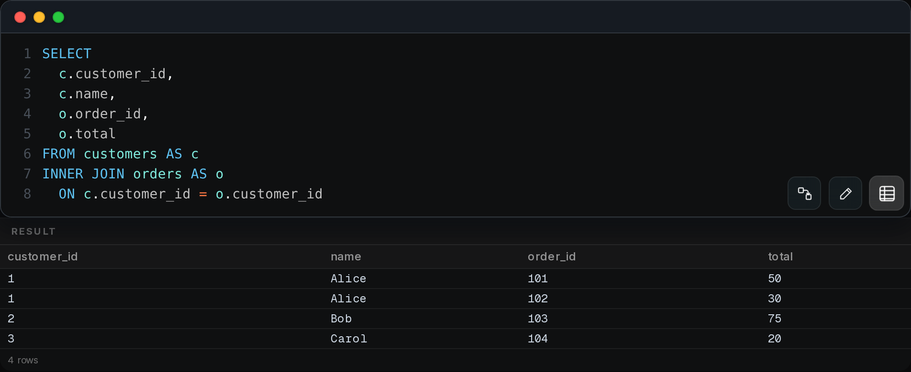
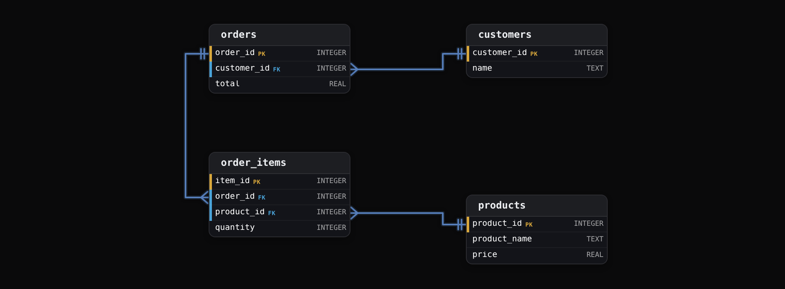
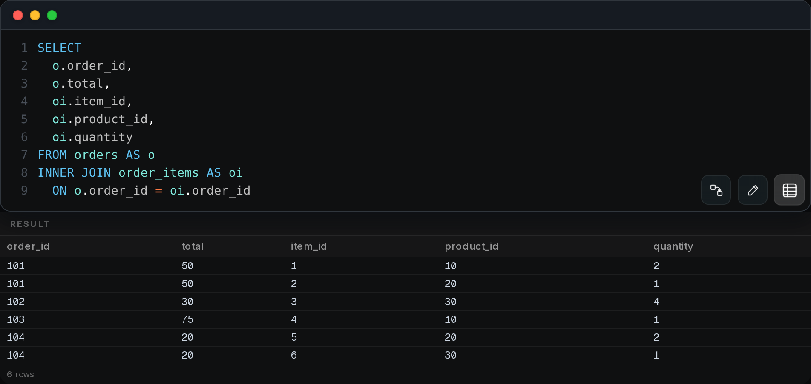

# Joins: Beginner

A customers table holds names and an orders table holds totals, and nothing in either row says how the 2 fit together. A join supplies the fit. One wrong assumption about it, which column pairs with which, or how many partners each row gets, turns a correct-looking report into one that is off by a factor of 3. The place to start is how the database pairs rows.


<br>

---

## The Row Pairing Model

A join takes 2 tables and builds a third from them, with 1 output row for every pair of input rows that satisfies a condition. The engine holds a row from the first table against a row from the second, evaluates the condition on that pair, and emits the combined row when the condition is true. It does this for every combination: a 4-row table against a 4-row table is 16 evaluations, and the result holds only the pairs that passed. Neither input table changes; the result is a new row set that exists for the duration of the query.


<br>

### 16 comparisons, 4 pairs

customers

orders

The condition is `customers.customer_id = orders.customer_id`. Alice's row meets order 101 and the condition is true; it meets order 103 and the condition is false, since 1 and 2 differ. Across the 16 combinations the condition is true 4 times: Alice with 101, Alice with 102, Bob with 103, Carol with 104. Alice contributes 2 output rows because 2 pairs involving her passed, and Dave contributes none because no order carries a 4. The result has 4 rows, which equals the number of orders and says nothing about the number of customers.

The animation plays the same evaluation over a slice of these tables: 2 customers against 3 orders, 6 comparisons, 3 pairs. Each result cell flies from the input row it came from, so the second Alice row is visibly the same customer row paired with a different order.

https://github.com/user-attachments/assets/a27b5321-19fd-4d50-9e3e-d149f3bef6ed

The output has its own grain: 1 result row represents 1 matched pair, so a customer with 2 orders appears twice while each order total appears once. When one side holds each key value once, the result takes the grain of the other side; section 3 covers what happens when both sides repeat a key. Reading a result without knowing what 1 row represents is how a per-customer figure ends up summed as if it were per-order.


<br>

### Run the full pairing

The query below runs the 16-comparison join over the 4 customers and 4 orders. Run it, then change the condition to `c.customer_id <> o.customer_id` and run it again: the engine evaluates the same 16 pairs and keeps the 12 where the new condition holds. The pairing engine accepts any condition, and the join key is a choice the query makes.



```sql
SELECT
  c.customer_id,
  c.name,
  o.order_id,
  o.total
FROM customers AS c
INNER JOIN orders AS o
  ON c.customer_id = o.customer_id
```

With the equality condition the result is 4 rows and Dave is absent; with the inequality it is 12 rows and Dave appears 4 times, paired with every order that was never his. Both runs performed the same 16 evaluations, and only the surviving pairs differ.


<br>

### The model that fails

A reader arriving from spreadsheets tends to carry a lookup model: for each order, fetch the 1 matching customer name, the way VLOOKUP returns a single value per row. That model predicts that joining 4 customers to 4 orders cannot produce more than 4 rows, and it is right here only because each order names exactly 1 customer. Point the lookup the other way, from each customer to their orders, and it has no answer for Alice, since a lookup returns 1 value and Alice has 2. The pairing model has no such gap: Alice meets 4 orders, 2 pairs pass, 2 rows come out.

**A customers table has 3 rows and an orders table has 5 rows. How many times does the engine evaluate the condition customers.customer_id = orders.customer_id when the 2 tables are joined?**

- **A.** 5 times, once per order
- **B.** 15 times, once per combination of rows
- **C.** 3 times, once per customer
- **D.** 8 times, 3 plus 5

<details>
<summary>Solution</summary>

**B.** 15 times, once per combination of rows

The engine tests 15 pairs, 3 customer rows against 5 order rows, and evaluates the condition on each one. How many pairs survive depends on the data; how many are tested does not.

**Why the others are wrong**

- **A.** A lookup model predicts this. The engine evaluates the condition on every combination of a customer row and an order row, which is more than 5.
- **C.** Each customer row is held against every order row, so 3 customers alone produce 15 tests, 5 each.
- **D.** Adding the row counts describes stacking the tables, which is what UNION does. A join multiplies them.

</details>

*The pairing model describes the result. An optimizer is free to reach that result with far fewer comparisons, usually by hashing one side's keys and probing with the other, and the rows that come out are the same either way.*


> **TIP**
>
> Before running a join, write down the row count it should return and what 1 output row represents. A result with a different count has paired more rows than the model predicted or dropped some, and either is worth finding before the numbers reach a report.


<br>

---

## Join keys and data types

The columns named in the `ON` clause are the join keys, and the pairing engine has no opinion about them: it evaluates whatever condition it is handed. Choosing the keys is a question about meaning. The key on each side has to hold the same kind of value, an identifier for the same entity, so that equality between 2 values means the 2 rows describe the same thing. `orders.customer_id` and `customers.customer_id` both hold customer identifiers, so a match between them means the order belongs to that customer.

A column name on its own is weak evidence. In the orders table, `order_id` identifies the order and `customer_id` identifies the customer who placed it; both are integers, both end in `_id`, and only one has anything to do with the customers table. A query that joins `orders.order_id` to `customers.customer_id` runs without error and returns a row wherever an order number happens to equal a customer number, which in the running example is never, and in a table of 50,000 orders and 40,000 customers is tens of thousands of times.

| Condition | Both integers | Same entity | Outcome |
| --- | --- | --- | --- |
| orders.customer_id = customers.customer_id | yes | yes, a customer | 4 rows, each a real order and its customer |
| orders.order_id = customers.customer_id | yes | no | 0 rows here; coincidental matches on larger tables |
| orders.customer_id = customers.name | no | no | type error, or 0 rows after implicit conversion |


<br>

### Data types on both sides

The 2 sides of an equality have to be comparable, and the case with no surprises is identical types: INTEGER against INTEGER, or TEXT against TEXT. When they differ, the engine has to convert one side before it compares, and engines split into 2 camps. Strict engines such as PostgreSQL and Trino refuse to compare an integer column with a text column and fail the query with a type error, which is the kinder behaviour because the mistake surfaces at once. Lenient engines such as MySQL convert implicitly, and the direction of the conversion decides the result. Converting the text side to a number turns `'007'` into 7 and finds the match, but turns `'A7'` into 0 or `NULL` and pairs it with nothing or with the wrong row. Converting the number side to text turns 7 into `'7'`, which does not equal `'007'`, so a row that should match drops out. Which direction the engine picks is a per-engine rule the query author never wrote down.

Implicit conversion also costs the plan. When the engine converts `orders.customer_code` from text to integer on every row, an index on that column is useless for the join, because the index stores the text and the comparison needs the number, so the converted side becomes a full scan. An explicit `CAST` on the side that is stored wrong makes the mismatch visible in the query and puts the conversion on the side the author chose rather than the one the engine picked.

The switcher below runs 3 formulations over the same tables. The orders table stores `customer_id` as an integer and also has a `customer_code` column inherited from an older system, which stores the same identifier as text. The first tab joins on the right integer key, the second on a plausible wrong key, and the third on the text key with an explicit cast.

Customer identifier to customer identifier, integer to integer. Four matched pairs.

|  |  |
| --- | --- |
|  | SELECT |
|  | c.name, |
|  | o.order_id, |
|  | o.total |
|  | FROM customers AS c |
|  | INNER JOIN orders AS o |
|  | ON c.customer_id = o.customer_id |

Result

| name | order_id | total |
| --- | --- | --- |
| Alice | 101 | 50 |
| Alice | 102 | 30 |
| Bob | 103 | 75 |
| Carol | 104 | 20 |

4 rows

The first and third tabs return the same 4 rows, because `CAST(o.customer_code AS INTEGER)` turns `'1'` into 1 and the comparison proceeds on integers. The second returns 0 rows: no order number between 101 and 104 equals a customer number between 1 and 4, and nothing in the engine knew the condition was meaningless. On production tables the same mistake returns a result set that looks reasonable and is random.

> Before writing the ON clause
>
> - Name the entity each key identifies, and confirm it is the same entity on both sides.
> - Check the stored type of each key column; identical types need no conversion.
> - Where the types differ, cast the mis-stored side explicitly so the mismatch is visible.
> - Expect the cast side to lose its index, and consider fixing the type at the source instead.
> - Qualify every key with its table alias so the condition reads as a statement about 2 entities.

> **TIP**
>
> When designing a schema, store an identifier in the same type in every table that carries it. One customer_id stored as BIGINT in 4 tables and VARCHAR in a fifth means every join to the fifth table pays a conversion forever.


<br>

---

## Primary and foreign keys

A primary key is the column, occasionally a set of columns, whose value identifies 1 row and no other in its table. A database that declares the key enforces 2 properties: no 2 rows share a value, and no row holds NULL there. In the running example `customer_id` is the primary key of customers and `order_id` the primary key of orders; a value such as 101 names exactly 1 order, which is what makes it safe to refer to that order from somewhere else.

A foreign key is a column in one table that holds values of another table's primary key. `orders.customer_id` is a foreign key to `customers.customer_id`: the value 1 in an order row is a reference to the customer row where 1 is the primary key. The foreign key is where the relationship between 2 tables is stored, and it carries none of the primary key's restrictions on its own side. The value 1 appears in 2 order rows because Alice placed 2 orders, and the column may hold NULL for an order with no customer attached unless a constraint forbids it.



A schema diagram reads as a map of join conditions. Each edge connects a foreign key to the primary key it references, and the join that follows the edge is `ON child.fk = parent.pk`: `orders.customer_id = customers.customer_id`, `order_items.order_id = orders.order_id`, `order_items.product_id = products.product_id`. The table at the primary key end has 1 row per entity; the table at the foreign key end can hold any number of rows per value. Most joins in a transactional schema follow an edge like these, and the rest mostly pair tables on shared attributes such as a date or a region code.


<br>

### Reading keys in an unfamiliar schema

- A column named id, or named for its own table like product_id in products, is that table's primary key.
- A column named for a different entity, such as customer_id in orders, is a foreign key to that entity's table.
- A column that is both, such as user_id in a table with 1 row per user, is a primary key that also references users.
- Declared constraints are proof; warehouses often omit them, so naming plus a uniqueness check stand in.
- Two foreign keys side by side, such as order_id and product_id in order_items, mark a bridge table.

The uniqueness check is 2 counts. When `COUNT(*)` and `COUNT(DISTINCT customer_id)` agree, every value appears once and the column can be the primary key side of a join; when they differ, the column repeats and the join will multiply rows. On the 4-row customers table both counts return 4.

```sql
SELECT
  COUNT(*) AS rows_total,
  COUNT(DISTINCT customer_id) AS distinct_ids
FROM customers
```

The practice database carries the same pattern. `order_items` holds `order_id`, which references `orders.order_id`, and `product_id`, which references `products.product_id`; each item row belongs to 1 order and names 1 product. Joining items to products follows the second edge, foreign key on the item side and primary key on the product side.

> **TIP**
>
> In most warehouses a declared foreign key is documentation rather than enforcement: Snowflake, BigQuery and Redshift accept the constraint and never check it. An order whose customer_id names a deleted customer produces no pair in an inner join and vanishes without a message, so the referential promise is yours to verify.


<br>

---

## Cardinality

Cardinality is the count of rows on each side that share a key value, and it fixes the size of the join result before the query runs. One-to-one means each value appears at most once on both sides, as with `users` and `user_profiles` where each user has 1 profile row. One-to-many means a value appears once on one side and any number of times on the other, as with customers and orders. Many-to-many means a value can repeat on both sides, and relational schemas store that shape through a third table rather than directly.

| Shape | Example | Result size |
| --- | --- | --- |
| One-to-one (1:1) | users to user_profiles | At most the smaller table's row count |
| One-to-many (1:N) | customers to orders | The many side's row count, for rows with a match |
| Many-to-many (N:N) | orders to products, through order_items | Up to the product of the 2 counts, per key value |


<br>

### One-to-many, watched

customers (the 3 with orders)

orders

Here 3 customers meet 4 orders. Alice's key value appears once among customers and twice among orders, so she contributes 2 pairs; Bob and Carol contribute 1 each. The animation computes the join and the result lands at 4 rows, the orders count, with the customers side stretched to fit.

https://github.com/user-attachments/assets/041df4a4-7644-467d-a99b-7967ef6df3f1


<br>

### The row count, worked out

The count has a formula. For each key value, multiply the number of rows carrying it on the left by the number carrying it on the right; the result's row count is the sum of those products. A value present on one side only contributes 0, which is how Dave, with no orders, drops out.

| customer_id | customers rows | orders rows | pairs |
| --- | --- | --- | --- |
| 1 (Alice) | 1 | 2 | 1 x 2 = 2 |
| 2 (Bob) | 1 | 1 | 1 x 1 = 1 |
| 3 (Carol) | 1 | 1 | 1 x 1 = 1 |
| 4 (Dave) | 1 | 0 | 1 x 0 = 0 |
| total | 4 | 4 | 4 |

When one side holds every value exactly once, the products collapse and the result count equals the count of matched rows on the other side. That collapse is the whole reason primary key uniqueness matters to a join. Put a second Alice row into customers, a duplicate from a botched load, and her term becomes 2 times 2: she now contributes 4 pairs, the result grows to 6 rows, and each of her order totals appears twice. Engineers call this fan-out, and it is the mechanism behind most inflated sums found in reports.


<br>

### Many-to-many through a bridge table

An order holds several products and a product appears in many orders, so neither table can carry the other's key without repeating rows. The schema from the previous section stores the relationship in `order_items`, 1 row per product per order, with `order_id` and `product_id` both foreign keys. Each join into the bridge is one-to-many: orders to order_items fans each order out into its items, and the query below shows what that does to a column that lives at the order grain.



```sql
SELECT
  o.order_id,
  o.total,
  oi.item_id,
  oi.product_id,
  oi.quantity
FROM orders AS o
INNER JOIN order_items AS oi
  ON o.order_id = oi.order_id
```

The query returns 6 rows from 4 orders: order 101 appears twice and 104 twice, because each holds 2 items. The `total` column is an order-level figure, and it now shows up once per item, so `SUM(o.total)` over this result returns 245 against a true order total of 175. Replace the select list with `SUM(o.total) AS inflated` and run it to see the figure; the fix, summing at the grain the figure belongs to, is a question of where the aggregate runs rather than of the join.

**A products table has 3 rows with unique product_id values. An order_items table has 7 rows, and every row's product_id matches one of the 3 products. How many rows does order_items INNER JOIN products on product_id return?**

- **A.** 3, one per product
- **B.** 7, one per item
- **C.** 21, the product of the row counts
- **D.** 10, 3 plus 7

<details>
<summary>Solution</summary>

**B.** 7, one per item

Each item row finds exactly 1 product, so each contributes 1 pair and 7 pairs come out. The 3 product rows are repeated to fit.

**Why the others are wrong**

- **A.** Products is the one side. The result takes the grain of the many side, which is items.
- **C.** That is the number of comparisons, and it equals the number of pairs only when every item matches every product, which a key join never does.
- **D.** Adding counts never describes a join. The result's size comes from matches per key value.

</details>

> **TIP**
>
> Before trusting any joined figure, run the join as a COUNT(\*) and compare it with the many side's row count. A result larger than the many side means a key repeated on the side that should be unique, and the inflation is in every number downstream.


<br>

---

## INNER JOIN

`INNER JOIN` is the keyword for the pairing model as the earlier sections used it: evaluate the condition on every pair, keep the pairs where it's true, drop everything else. A row on either side with no partner contributes nothing to the result. The word `INNER` is optional and `JOIN` alone means the same thing; the full form reads better beside the outer joins that keep unmatched rows, which the intermediate tier covers.

```sql
SELECT <columns>
FROM left_table
INNER JOIN right_table
  ON left_table.key = right_table.key
```

Over the 4 customers, Dave included, and the 4 orders, the join lands on 4 rows: Dave's row is tested against every order and passes none of the tests, so the result holds no trace of him. Nothing in the output records that a customer was dropped. An inner join always discards unmatched rows this quietly, so it's the wrong tool for a question like 'which customers have never ordered', a question the next tier answers with a different join.

https://github.com/user-attachments/assets/0e276280-ff35-48ac-bda7-93c20043dfed


<br>

### Qualified columns and aliases

Joined tables often share a column name: `customer_id` exists in both customers and orders. A select list that names `customer_id` alone fails with an ambiguity error, since the engine has no rule for choosing a side. Writing `customers.customer_id` resolves it, and an alias shortens that to `c.customer_id`. Aliases are declared in `FROM` and `JOIN` with `AS`, and once declared they are the only name the table has for the rest of the query.

```sql
SELECT
  c.customer_id,
  c.name,
  o.order_id,
  o.total
FROM customers AS c
INNER JOIN orders AS o
  ON c.customer_id = o.customer_id
```

Qualifying every column, including the ones that are unambiguous today, keeps the query valid when a column of the same name is added to the other table next year, and it tells the reader which table each value came from without opening the schema.


<br>

### NULL in a join key

`NULL = 1` is neither true nor false; under three-valued logic it is unknown, and a join keeps a pair only when the condition is true. So a row with `NULL` in its key fails every comparison, including a comparison against another `NULL`, because `NULL = NULL` is unknown as well. Suppose order 105 arrives with no customer attached. The animation below shows the engine test it against Alice and against Bob and discard both pairs: 2 result rows from 3 orders.

https://github.com/user-attachments/assets/88f7ad5d-97ff-4702-aa45-9a6f7d5be703

Nothing reports the drop; the only sign is a row count 1 lower than the orders table. The check is a `COUNT(*)` with `WHERE customer_id IS NULL` on each key column before the join, and a schema that declares the foreign key NOT NULL removes the case entirely.


<br>

### Where the join runs

The logical execution order from earlier lessons places `FROM` and its joins first, then `WHERE`, then `GROUP BY`, then `SELECT`. The join builds the full set of matched pairs, and `WHERE` filters that set, so a condition like `o.total > 40` sees combined rows that already carry both a name and a total.

The right key is `user_id` on both sides, the users primary key against the sessions foreign key, and the filter names the column the question asked about. The engine pairs first and filters second, so `s.pages_viewed` in the `WHERE` is a column of the paired row.

| ✓ Do | ✗ Don't |
| --- | --- |
| • Write INNER JOIN in full so the join type is visible beside the outer joins you will meet.<br><br>• Alias every table and qualify every column, including the ones that are unambiguous today.<br><br>• Join foreign key to primary key, and check the primary key side with COUNT against COUNT DISTINCT.<br><br>• Write down the expected row count before running, and compare it with the result.<br><br>• Check each join key for NULL before trusting the row count. | • Rely on implicit type conversion between an integer key and a text key.<br><br>• Assume one-to-one: most joins fan out, and the fan-out multiplies every figure from the one side.<br><br>• Sum a figure that belongs to the one side after joining to the many side.<br><br>• Use aliases that do not match the table, such as x, y or t1.<br><br>• Read a result without knowing what 1 row represents. |


<br>

---

## Putting It All Together

A finance analyst at an online retailer builds the monthly revenue-by-category report by joining order_items to products on product_id and summing quantity times price. The February figure for Kitchen comes in at twice January's, and the sales team insists nothing changed. A catalog reload in February had inserted a second row for every Kitchen product, all 12 of them, each with the same product_id as the original.

- Row pairing: each item row for those products met 2 product rows with the same id, so the condition passed twice and the item's revenue appeared in 2 result rows.
- Join keys: product_id was the right column and the right type on both sides, so no error fired; the key was correct and the data behind it was not.
- Primary and foreign keys: products was meant to be the primary key side, and COUNT(\*) against COUNT(DISTINCT product_id) would have shown 12 extra rows before the report ran.
- Cardinality: every Kitchen item's term became its item count times 2, so the Kitchen rows doubled and so did the sum; a COUNT(\*) on the join against the item count catches that before any sum.
- INNER JOIN: the fan-out produced no warning, and the fix is to remove the duplicate product rows, or to join to products reduced to 1 row per product_id before attaching the category.


<br>

---

## Key Takeaways

- A join evaluates its condition on every pair of rows and emits 1 result row per pair that passes; the input tables are untouched.
- Join keys identify the same entity on both sides and share a type; a wrong key or an implicit conversion fails without an error.
- Foreign key to primary key is the join condition a schema diagram draws, and the primary key side has to be unique.
- The result row count is the sum over key values of left count times right count, which collapses to the many side only when the other side is unique.
- INNER JOIN keeps matched pairs only: unmatched rows and NULL keys drop in silence, and WHERE filters the pairs after they form.
