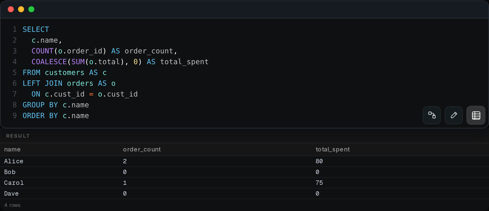
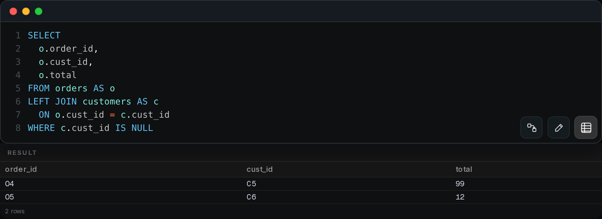
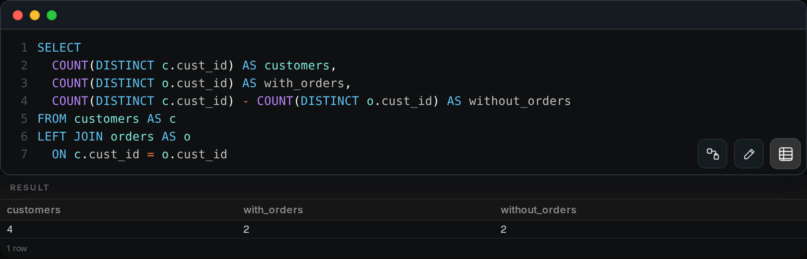
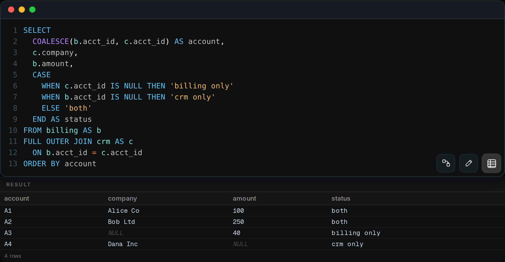

# Joins: Intermediate

Spotify's growth team wants a list of every account that signed up last week, next to the number of tracks each one has played. An analyst writes an INNER JOIN from signups to listening history, and the silent accounts, the ones who installed the app and never pressed play, vanish from the list entirely. Those are exactly the accounts the retention campaign exists to reach.


<br>

---

## LEFT JOIN

An INNER JOIN keeps a row only when the ON condition finds it a partner in the other table. A customer with no orders makes no pairs, so the customer disappears from the result, and nothing in the output records that they existed. A LEFT JOIN changes one rule: when a row from the left table finds no partner, the engine emits that row once anyway, with NULL in every column that comes from the right table.

The left table is the one written before the JOIN keyword. Choose it on purpose: it is the table whose rows you refuse to lose. In the query below, `customers` sits on the left, so all 4 customers come out whether or not `orders` holds anything for them.

https://github.com/user-attachments/assets/80b4bc55-3195-4721-9157-0730b303417f

Alice has 2 orders, so she appears twice, a row per pair, the same rows an INNER JOIN would produce. Carol appears once with her single order. Bob and Dave have no orders, so each appears once with NULL under `order_id` and `total`. The result holds 5 rows: 3 matched pairs plus 2 padded rows for the customers no order mentions.


<br>

### Predicting the row count

Each left row contributes either the number of partners it finds or, if it finds none, exactly 1 row. Add those up and you know the result size before running anything.

| Customer | Matching orders | Rows in result |
| --- | --- | --- |
| Alice | 2 | 2 |
| Bob | 0 | 1 |
| Carol | 1 | 1 |
| Dave | 0 | 1 |
| Total | 3 | 5 |

A LEFT JOIN never returns fewer rows than its left table, because every left row produces at least 1. It returns more rows than its left table only when some left row matches more than once, which is the one-to-many case from the cardinality lesson. So if an INNER JOIN and a LEFT JOIN on the same tables return the same count, every left row had at least 1 partner.

> Reach for LEFT JOIN when the question says 'every'
>
> - Every account, with its play count, including accounts that never played
> - Every product in the catalog, with last month's sales, including the ones that sold nothing
> - Every scheduled job, with its latest run, including jobs that have never run

**A regions table has 6 rows. In stores, 3 of those regions have exactly 1 store each, 1 region has 3 stores, and 2 regions have no store at all. How many rows does the query return?**

```sql
SELECT *
FROM regions r
LEFT JOIN stores s
  ON r.region_id = s.region_id
```

- **A.** 6 rows, one per region, because a LEFT JOIN keeps each left row exactly once
- **B.** 8 rows: 3 single matches, 3 rows for the region with 3 stores, and 2 padded rows
- **C.** 10 rows, one for every region and every store added together
- **D.** 4 rows, because only regions with at least 1 store produce pairs

<details>
<summary>Solution</summary>

**B.** 8 rows: 3 single matches, 3 rows for the region with 3 stores, and 2 padded rows

Each region contributes its match count, or 1 when it has no match: 3 + 3 + 2 = 8.

**Why the others are wrong**

- **A.** A LEFT JOIN keeps each left row at least once. The region with 3 stores pairs 3 times, so it contributes 3 rows, not 1.
- **C.** Rows are pairs, not a sum of both tables. There are 6 stores and 6 regions, but the result pairs them by key rather than listing them.
- **D.** That describes an INNER JOIN, and even then the count would be 6 pairs. The LEFT JOIN adds a padded row for each of the 2 storeless regions.

</details>


<br>

### Aggregating over the padded rows

The padded rows carry NULLs, and aggregates treat those NULLs the way they always do. `COUNT(o.order_id)` skips them, so Bob counts 0 orders. `COUNT(*)` counts rows, so it would report 1 for Bob, because his padded row is still a row. `SUM(o.total)` over nothing but NULLs returns NULL, and `COALESCE` turns that into 0 for a report that should read as money.



```sql
SELECT
  c.name,
  COUNT(o.order_id) AS order_count,
  COALESCE(SUM(o.total), 0) AS total_spent
FROM customers AS c
LEFT JOIN orders AS o
  ON c.cust_id = o.cust_id
GROUP BY c.name
ORDER BY c.name
```

Run it and read the 4 rows: Alice 2 orders and 80, Bob 0 and 0, Carol 1 and 75, Dave 0 and 0. Swap `COUNT(o.order_id)` for `COUNT(*)` and Bob and Dave each gain a phantom order, while their totals stay at 0 because `SUM` never counts rows, only values.

> **TIP**
>
> When a LEFT JOIN feeds a COUNT, count the right table's key column, never `*`. The padded row for an unmatched customer is still a row, and `COUNT(*)` will count it.


<br>

---

## Finding unmatched rows

The NULLs a LEFT JOIN writes into padded rows are a marker you can filter on. After the join, a NULL in a right-table column means either of 2 things: the row is padded, or the matching row really holds a NULL there. Pick a column that can never be NULL in the right table itself and only the first meaning remains. Then `WHERE that_column IS NULL` keeps exactly the left rows that found no partner. The pattern is called an anti-join: the join finds what matches, and the WHERE keeps the rest.

https://github.com/user-attachments/assets/356f26fc-cb78-4a62-80d7-b7c62995ffe2

Alice's 2 rows and Carol's 1 row carry an `order_id`, so the test is false and they go. Bob and Dave are padded, the test is true, and they stay. The result has 2 rows, 1 per customer with no orders. An unmatched customer always appears exactly once, because a left row with no partner is emitted once, never multiplied.


<br>

### Test a column that cannot be NULL

Whether the answer is right depends on which column you test with IS NULL. The right table's primary key is the safe choice, and the right table's join key column is equally safe, since a row that matched must hold a value there. A column that can be NULL in a real row breaks the pattern, as the 2 versions below show.

**Key column**

The test uses order_id, which every real order has, so NULL can only mean a padded row.

```sql
SELECT
  c.name
FROM customers AS c
LEFT JOIN orders AS o
  ON c.cust_id = o.cust_id
WHERE o.order_id IS NULL
```

Result:

```
name
Bob
```

**Total column**

The test uses total, which a real order can leave empty, so a match with a missing total looks like no match.

```sql
SELECT
  c.name
FROM customers AS c
LEFT JOIN orders AS o
  ON c.cust_id = o.cust_id
WHERE o.total IS NULL
```

Result:

```
name
Bob
Carol
```

Carol has an order whose `total` was never recorded. The first version reports Bob as the only customer without orders, which is true. The second version reports Bob and Carol, and Carol's order is real: her row is a match that happens to carry a NULL, and the test cannot tell it from a padded row.


<br>

### Orphans: the other direction

Swap the tables and the same pattern finds child rows that point at a parent that does not exist, which engineers call orphans. Orders whose `cust_id` names nobody appear after a customer deletion, a load that failed halfway, or a key typed by hand. A foreign key constraint would reject them at write time, but analytics tables rarely enforce one, so the check lives in a query.



```sql
SELECT
  o.order_id,
  o.cust_id,
  o.total
FROM orders AS o
LEFT JOIN customers AS c
  ON o.cust_id = c.cust_id
WHERE c.cust_id IS NULL
```

Orders O4 and O5 name customers C5 and C6, and no such customers exist, so those 2 rows come out and the other 3 do not. Any report that INNER JOINs orders to customers has been silently missing 111 in revenue, and no error ever said so.


<br>

### Counting both sides in one pass

For monitoring you usually want counts rather than lists. `COUNT(DISTINCT c.cust_id)` counts every customer, because every customer appears at least once after the LEFT JOIN. `COUNT(DISTINCT o.cust_id)` ignores the NULLs on padded rows, so it counts only the customers that matched, and the difference between the 2 is the unmatched count.



```sql
SELECT
  COUNT(DISTINCT c.cust_id) AS customers,
  COUNT(DISTINCT o.cust_id) AS with_orders,
  COUNT(DISTINCT c.cust_id) - COUNT(DISTINCT o.cust_id) AS without_orders
FROM customers AS c
LEFT JOIN orders AS o
  ON c.cust_id = o.cust_id
```

The query reports 4 customers, 2 with orders and 2 without, which agrees with the anti-join list above. DISTINCT matters on both counts: Alice has 2 orders, and without it she would be counted twice on the matched side.

> Questions an anti-join answers
>
> - Which customers signed up and never placed an order?
> - Which orders reference a customer we no longer have?
> - Which products have never appeared on an order line?
> - Which rows loaded into the source yesterday are missing from the warehouse today?

**Which WHERE clause, added to this query, returns the products that no order line has ever referenced?**

```sql
SELECT
  p.name
FROM products p
LEFT JOIN order_lines ol
  ON p.prod_id = ol.prod_id
```

- **A.** WHERE ol.prod_id IS NULL, because the right table's key is NULL only on padded rows
- **B.** WHERE ol.quantity IS NULL, because a padded row has no quantity to show
- **C.** WHERE p.prod_id IS NULL, because products without orders have no key to match
- **D.** WHERE ol.prod_id != p.prod_id, because an unmatched product disagrees with the key

<details>
<summary>Solution</summary>

**A.** WHERE ol.prod_id IS NULL, because the right table's key is NULL only on padded rows

Every real order line holds a prod_id, so a NULL there can only come from padding, which marks a product with no match.

**Why the others are wrong**

- **B.** Padded rows do have NULL quantity, but so might a real order line with an unrecorded quantity, and that product would be wrongly listed.
- **C.** The left table's key is never NULL; every product has a prod_id. This condition is false on every row and returns nothing.
- **D.** On matched rows the keys are equal, so the test is false. On padded rows ol.prod_id is NULL and the comparison is NULL, which WHERE also drops.

</details>


<br>

---

## WHERE vs ON clause filtering

The execution order you learned earlier explains everything in this section. FROM and JOIN run first: the ON condition decides which pairs get made and, under a LEFT JOIN, which left rows get padded instead. WHERE runs afterwards, over the finished joined rows, and keeps only the rows where its condition is true. A condition in ON shapes the pairing. A condition in WHERE removes rows from the result of the pairing.

Under an INNER JOIN the placement makes no difference to the rows you get. A pair that fails in ON is never created, and a pair that fails in WHERE is created and then removed, which comes to the same output. Under a LEFT JOIN the padded rows expose the difference, because they reach WHERE carrying NULLs.

https://github.com/user-attachments/assets/21182ad4-a5a5-4e2e-9b1d-f58f560a2a1b

Alice's order totals 75, Bob's totals 30, and Carol has no order at all. By the time WHERE runs, Carol's row holds NULL under `total`. The comparison `75 > 50` is true, `30 > 50` is false, and `NULL > 50` is NULL, and WHERE keeps only true. The result has 1 row: Alice, 75. The LEFT JOIN went to the trouble of preserving Carol and the WHERE threw her out, so the query behaves like an INNER JOIN with a longer spelling.

**This query returns 40 rows. The same query with INNER JOIN in place of LEFT JOIN and nothing else changed returns how many rows?**

```sql
SELECT
  c.name,
  o.total
FROM customers c
LEFT JOIN orders o
  ON c.cust_id = o.cust_id
WHERE o.status = 'shipped'
```

- **A.** More than 40, because an INNER JOIN produces every matching pair rather than 1 per customer
- **B.** Fewer than 40, because the INNER JOIN drops the customers who have no orders
- **C.** It depends on how many customers have no shipped orders
- **D.** Exactly 40, because the WHERE on o.status already removed every padded row

<details>
<summary>Solution</summary>

**D.** Exactly 40, because the WHERE on o.status already removed every padded row

A WHERE condition on a right-table column fails for every padded row, so the LEFT JOIN version and the INNER JOIN version return identical rows.

**Why the others are wrong**

- **A.** Both joins produce every matching pair. A LEFT JOIN adds padded rows on top of those pairs, never fewer pairs.
- **B.** The WHERE already dropped them: a padded row has NULL status, and NULL = 'shipped' is NULL, which WHERE removes.
- **C.** Those customers are absent from both versions, so their number cannot change the count.

</details>

https://github.com/user-attachments/assets/6d08c457-25a5-4991-ba2c-e03768c8d0dc

Move the same condition into ON and it becomes part of the pairing test. Alice's order passes `total > 50`, so she pairs with it. Bob's order fails, so Bob has no qualifying partner and gets a padded row. Carol has no order and gets a padded row too. The result has 3 rows, every customer present, with a total only where an order cleared the bar. That answers 'show every customer, and their large orders if they have any', which the WHERE version cannot produce.


<br>

### The rule, and the left-side surprise

For a condition about the right table: put it in ON to keep every left row, or in WHERE to drop the left rows that have no qualifying partner. For a condition about the left table, WHERE does what you expect and ON does something that surprises most people on first sight. A left-table condition in ON under a LEFT JOIN removes no left row. It only decides which left rows are allowed to find partners; the rest are still preserved, padded.

**Right: ON**

A right-table condition in ON: every customer stays, and only shipped orders may pair.

```sql
SELECT
  c.name,
  o.order_id,
  o.status
FROM customers AS c
LEFT JOIN orders AS o
  ON c.cust_id = o.cust_id
    AND o.status = 'shipped'
```

Result:

```
name | order_id | status
Alice | O1 | shipped
Bob | NULL | NULL
Carol | NULL | NULL
```

**Right: WHERE**

The same condition in WHERE: padded rows carry NULL status and are dropped.

```sql
SELECT
  c.name,
  o.order_id,
  o.status
FROM customers AS c
LEFT JOIN orders AS o
  ON c.cust_id = o.cust_id
WHERE o.status = 'shipped'
```

Result:

```
name | order_id | status
Alice | O1 | shipped
```

**Left: ON**

A left-table condition in ON: every customer stays, but only Alice is allowed partners.

```sql
SELECT
  c.name,
  o.order_id,
  o.status
FROM customers AS c
LEFT JOIN orders AS o
  ON c.cust_id = o.cust_id
    AND c.name = 'Alice'
```

Result:

```
name | order_id | status
Alice | O1 | shipped
Alice | O2 | cancelled
Bob | NULL | NULL
Carol | NULL | NULL
```

**Left: WHERE**

The same condition in WHERE: customers other than Alice are removed after the join.

```sql
SELECT
  c.name,
  o.order_id,
  o.status
FROM customers AS c
LEFT JOIN orders AS o
  ON c.cust_id = o.cust_id
WHERE c.name = 'Alice'
```

Result:

```
name | order_id | status
Alice | O1 | shipped
Alice | O2 | cancelled
```

Run all 4 versions. The right-table condition in ON keeps 3 customers, with an order only for Alice, and in WHERE it keeps Alice alone. The left-table condition in ON keeps all 3 customers and gives Bob and Carol nothing to pair with, 4 rows in total because Alice pairs twice. In WHERE it keeps only Alice's 2 rows.

| Condition is about | In ON | In WHERE |
| --- | --- | --- |
| The right table | Every left row stays; a partner must also pass the condition | Left rows without a passing partner are removed |
| The left table | Every left row stays; only rows passing the condition get partners | Left rows failing the condition are removed |

Sometimes the WHERE is what you want and the padded rows are what you want back. Add them explicitly: `WHERE o.total > 50 OR o.order_id IS NULL` keeps Alice and Carol while still dropping Bob, whose order exists but is too small. The ON version keeps Bob padded. The 2 queries answer different questions, so decide which question is being asked before choosing.


<br>

---

## RIGHT JOIN & FULL OUTER

A RIGHT JOIN preserves the table written after the JOIN keyword. Every right row comes out at least once, and a right row with no partner on the left is padded with NULL in every left-table column. It is the mirror of the first section, and the row count follows the mirror rule: never fewer rows than the right table.

https://github.com/user-attachments/assets/f5075a5a-918c-4b06-ae36-42433ae92f12

Alice and Carol each pair with 1 order. Order O3 names customer C5, who does not exist in `customers`, so it comes out with NULL under `name` and its own `order_id` and `total` intact. The result has 3 rows, the size of `orders`. A LEFT JOIN from `customers` would never show O3 at all.

Any RIGHT JOIN can be rewritten as a LEFT JOIN by swapping the 2 table references: `FROM orders o LEFT JOIN customers c` with the same ON returns the same rows. Most teams write only LEFT, so that the preserved table is always the first one named and a reader never has to flip the sentence in their head. You will still meet RIGHT JOIN in queries you inherit, and the translation is always that same swap.


<br>

### FULL OUTER JOIN preserves both sides

A FULL OUTER JOIN keeps every row from both tables. Matched rows appear as pairs. An unmatched left row is padded on the right, an unmatched right row is padded on the left, and no row from either table can go missing. Its row count is the matched pairs plus the left-only rows plus the right-only rows, so it is never smaller than the larger of the 2 tables.

https://github.com/user-attachments/assets/611fc18a-8468-47a1-a739-02d3078f2919

Alice and Carol match and appear once each with their email. Bob has an account and no session, so his session columns are NULL. User U4 has a session and no account, so the user columns are NULL. That makes 4 rows: 2 matched, 1 left-only, 1 right-only. Look at the join key on the padded rows: it is NULL on one side each time, so a query that wants a single key column must select `COALESCE(u.user_id, s.user_id)` rather than either side on its own.


<br>

### Reconciling 2 systems

The use that comes up most at work is checking 2 systems against each other: billing against the CRM, the warehouse against its source, yesterday's snapshot against today's. The FULL OUTER JOIN lines them up, and a CASE on which side is NULL labels every row as present in both, present only here, or present only there.



```sql
SELECT
  COALESCE(b.acct_id, c.acct_id) AS account,
  c.company,
  b.amount,
  CASE
    WHEN c.acct_id IS NULL THEN 'billing only'
    WHEN b.acct_id IS NULL THEN 'crm only'
    ELSE 'both'
  END AS status
FROM billing AS b
FULL OUTER JOIN crm AS c
  ON b.acct_id = c.acct_id
ORDER BY account
```

A1 and A2 land in both. A3 is billed with no CRM record, and A4 is a company the CRM knows that billing has never charged. The result has 4 rows, and the `status` column is the report: filter it to `'billing only'` and you have the list finance asked for. A NULL `c.acct_id` means no CRM row matched, and a NULL `b.acct_id` means no billing row matched. Each key is filled in every row of its own table, so at most 1 side is NULL and the 2 WHENs could come in either order.

| Join type | Always keeps | Smallest possible result |
| --- | --- | --- |
| INNER JOIN | Matched pairs only | 0 rows |
| LEFT JOIN | Every left row | Rows in the left table |
| RIGHT JOIN | Every right row | Rows in the right table |
| FULL OUTER JOIN | Every row of both tables | Rows in the larger table |

*A WHERE condition on either side collapses a FULL OUTER JOIN the same way it collapses a LEFT JOIN: WHERE b.amount > 0 drops every CRM-only row, because their amount is NULL.*

**Table a has 10 rows and table b has 8 rows. Each key appears at most once in each table, and 6 keys appear in both. How many rows does a FULL OUTER JOIN b on that key return?**

- **A.** 18 rows, one for every row of both tables added together
- **B.** 10 rows, one per row of the larger table, with padding for the rest
- **C.** 12 rows: 6 matched pairs, 4 padded from a and 2 padded from b
- **D.** 14 rows: 6 matched pairs plus the 8 rows of b padded on the left

<details>
<summary>Solution</summary>

**C.** 12 rows: 6 matched pairs, 4 padded from a and 2 padded from b

Matched pairs plus left-only rows plus right-only rows: 6 + (10 - 6) + (8 - 6) = 12.

**Why the others are wrong**

- **A.** The 6 matched keys appear once as pairs, not twice. Adding the tables counts them double.
- **B.** That is the count a LEFT JOIN from a would give. The FULL OUTER JOIN also keeps the 2 rows of b that match nothing in a.
- **D.** Of the 8 rows in b, 6 are the matched ones already counted as pairs. Only the 2 unmatched rows of b are padded.

</details>


<br>

---

## Multiple JOINs

A chain of joins is defined left to right: the result is the same as if the first join produced an intermediate result, that result became the left input of the second join, and so on down the chain. The engine may physically run inner joins in another order to save work, but it cannot change which rows an outer join preserves. Every ON condition can reference any column that has already arrived, so the third table can be joined on a column from the second, from the first, or from both.

https://github.com/user-attachments/assets/8fc6249f-f5aa-4bfe-b754-b6c6a92b1204

The `customers` to `orders` join runs first: Alice has 2 orders and Bob has 1, so the intermediate result has 3 rows. Then each of those rows is paired with its product by `prod_id`, giving Alice Widget, Alice Gadget and Bob Widget. Gizmo appears in no order, so it never lands, and a customer without orders would never land either, because both joins are INNER. Note that `SELECT *` carries 2 columns called `name`, one from each end of the chain, which is a reason to alias columns once a query joins more than 2 tables.


<br>

### Mixing LEFT and INNER

A LEFT JOIN early in the chain can be undone by an INNER JOIN later. The padded rows carry NULL in every column from the right table, and if a later ON condition uses one of those columns, it evaluates to NULL for the padded rows, which the INNER JOIN treats as no match. The row you preserved 1 join ago disappears without a warning.

**INNER last**

Bob survives the LEFT JOIN to orders, then meets an INNER JOIN on a column that is NULL for him.

```sql
SELECT
  c.name,
  p.product_name
FROM customers AS c
LEFT JOIN orders AS o
  ON c.cust_id = o.cust_id
INNER JOIN products AS p
  ON o.prod_id = p.prod_id
```

Result:

```
name | product_name
Alice | Widget
Alice | Gadget
```

**LEFT last**

Both joins preserve rows, so Bob arrives at the end with NULL for the product.

```sql
SELECT
  c.name,
  p.product_name
FROM customers AS c
LEFT JOIN orders AS o
  ON c.cust_id = o.cust_id
LEFT JOIN products AS p
  ON o.prod_id = p.prod_id
```

Result:

```
name | product_name
Alice | Widget
Alice | Gadget
Bob | NULL
```

In the first version Bob is preserved by the LEFT JOIN, arrives at the products join with `prod_id` NULL, matches nothing, and is dropped: 2 rows, both Alice. In the second version the products join is also a LEFT JOIN, so Bob comes through padded: 3 rows. Once a chain starts preserving rows, every later join that hangs off the preserved side's nullable columns must preserve them too, or the first LEFT JOIN was for nothing.


<br>

### Fan-out from 2 one-to-many joins

Fan-out happens even when every row matches. Join a parent to 2 child tables that each hold several rows per parent, and the children multiply each other. Alice has 2 orders and 2 support tickets, so joining both onto her row produces every order paired with every ticket:

| name | order_id | total | ticket_id |
| --- | --- | --- | --- |
| Alice | O1 | 50 | T1 |
| Alice | O1 | 50 | T2 |
| Alice | O2 | 30 | T1 |
| Alice | O2 | 30 | T2 |

Each order total now appears twice, once per ticket, so a SUM over the column counts it twice, and each ticket appears once per order. The fix is to aggregate each child table down to 1 row per parent before joining, which the CTEs from the query structure lesson make readable.

**Two joins**

Both children join at row level, and Alice's orders and tickets multiply into 4 rows before the SUM runs.

```sql
SELECT
  c.name,
  SUM(o.total) AS spent,
  COUNT(t.ticket_id) AS tickets
FROM customers AS c
LEFT JOIN orders AS o
  ON c.cust_id = o.cust_id
LEFT JOIN tickets AS t
  ON c.cust_id = t.cust_id
GROUP BY c.name
ORDER BY c.name
```

Result:

```
name | spent | tickets
Alice | 160 | 4
Bob | 20 | 0
```

**CTE first**

Each child is reduced to 1 row per customer in a CTE, so the final joins are one-to-one and nothing inflates.

```sql
WITH order_totals AS (
  SELECT
    cust_id,
    SUM(total) AS spent
  FROM orders
  GROUP BY cust_id
),
ticket_counts AS (
  SELECT
    cust_id,
    COUNT(*) AS tickets
  FROM tickets
  GROUP BY cust_id
)

SELECT
  c.name,
  COALESCE(ot.spent, 0) AS spent,
  COALESCE(tc.tickets, 0) AS tickets
FROM customers AS c
LEFT JOIN order_totals AS ot
  ON c.cust_id = ot.cust_id
LEFT JOIN ticket_counts AS tc
  ON c.cust_id = tc.cust_id
ORDER BY c.name
```

Result:

```
name | spent | tickets
Alice | 80 | 2
Bob | 20 | 0
```

The first version reports Alice spending 160 and holding 4 tickets, both double the truth. The second reports 80 and 2. Bob has 1 order and no tickets, so he is right in both versions, which is how fan-out hides: the inflated rows belong to the busy customers, and busy customers are the ones nobody checks by hand.

| ✓ Do | ✗ Don't |
| --- | --- |
| • Check the row count after each join against the table you meant to preserve<br><br>• Aggregate each one-to-many child to 1 row per parent before joining 2 of them<br><br>• Keep every join after a LEFT JOIN as LEFT when its ON depends on padded columns | • Sum a column from one child table while another child is joined at row level<br><br>• Trust a total that matches for quiet customers and was never checked for busy ones<br><br>• Switch a later join to INNER to remove duplicates; it removes the preserved rows instead |

**customers holds 1 row, Alice. She has 3 rows in orders with totals 10, 20 and 30, and 2 rows in refunds. A query LEFT JOINs both tables onto customers by cust_id and selects SUM(o.total) grouped by name. What does it return for Alice?**

- **A.** 120, because each of the 3 orders is paired with both refund rows, so every total is added twice
- **B.** 60, because SUM adds each order total once regardless of what else is joined
- **C.** 180, because 3 orders and 2 refunds make 6 rows and each adds the full 60
- **D.** NULL, because the refunds join pads columns and the NULLs spoil the SUM

<details>
<summary>Solution</summary>

**A.** 120, because each of the 3 orders is paired with both refund rows, so every total is added twice

Joining 3 orders and 2 refunds gives 6 rows, and the 3 totals each appear twice: (10 + 20 + 30) * 2 = 120.

**Why the others are wrong**

- **B.** SUM adds every row it sees, and the refunds join has turned 3 rows into 6. Only a CTE that totals orders first gives 60.
- **C.** There are 6 rows, but each carries 1 order's total, not the sum of all 3, so the inflation is 2 times rather than 3.
- **D.** Alice has refunds, so nothing is padded, and SUM ignores NULLs anyway. The problem here is multiplication, not NULL.

</details>


<br>

---

## Putting It All Together

Uber's finance team closes the month by reconciling the trips table against driver payouts and rider refunds. Every trip must stay visible whether or not it has been paid out, every payout must trace back to a trip, and a trip with 3 refund lines must not have its fare counted 3 times.

- Trips LEFT JOIN payouts keeps the unpaid trips on the report, and WHERE payout_id IS NULL lists exactly those trips for the payments team.
- Payouts LEFT JOIN trips WHERE trip_id IS NULL surfaces orphan payouts, money sent with no trip to justify it.
- A condition such as payouts over 100 belongs in ON, because in WHERE it would discard every unpaid trip and the reconciliation would lie.
- A FULL OUTER JOIN between the ledger export and the trips table labels every row as matched, ledger only or trips only in a single query.
- Refunds are a second one-to-many child of trips, so they are summed per trip in a CTE before joining, or every fare is multiplied by the refund count.


<br>

---

## Key Takeaways

- A LEFT JOIN emits every left row at least once; an unmatched row carries NULL in every right-table column, and the result is never smaller than the left table.
- To find unmatched rows, LEFT JOIN and test a right-table key column with IS NULL; a nullable column mislabels real matches as missing.
- ON decides the pairing and WHERE filters the finished rows, so a WHERE on a right-table column turns a LEFT JOIN back into an INNER JOIN.
- RIGHT JOIN is a LEFT JOIN with the tables swapped, and FULL OUTER JOIN keeps unmatched rows from both sides with the key NULL on one of them.
- Joins chain left to right: an INNER JOIN after a LEFT JOIN drops the padded rows, and 2 one-to-many joins multiply each other's rows.
