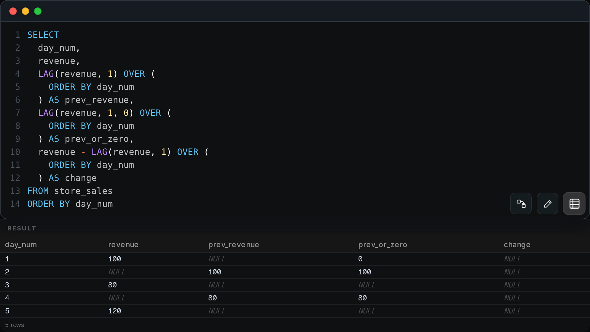
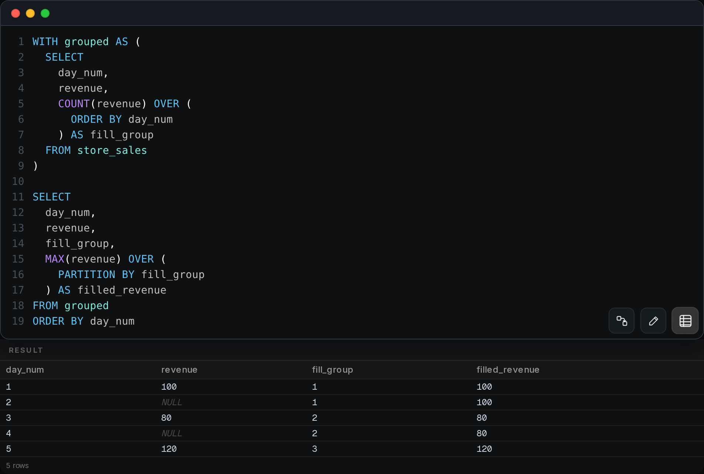
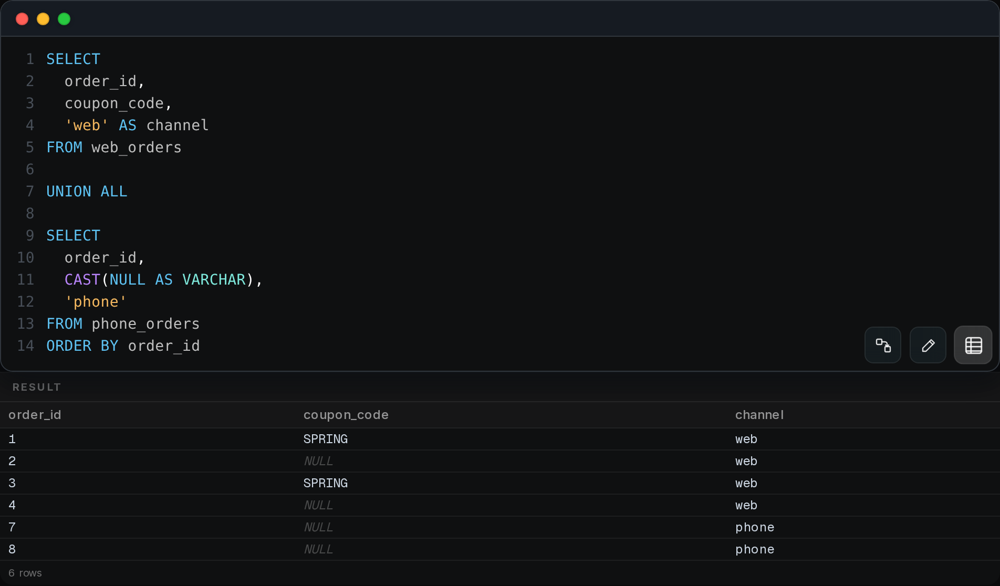
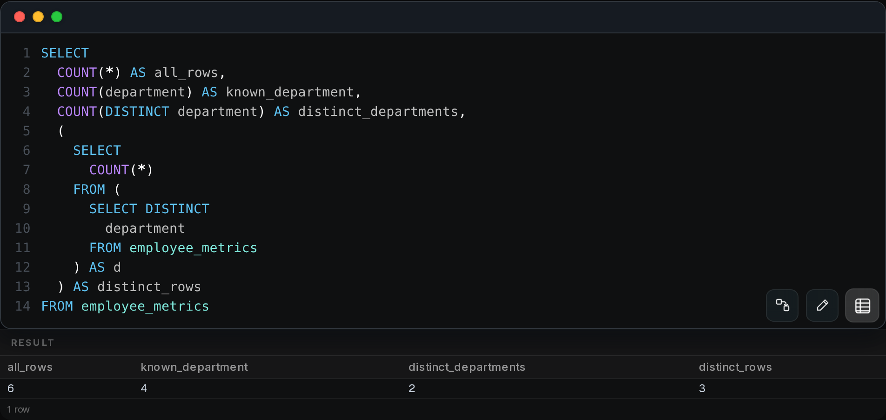
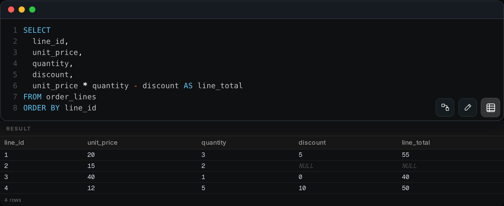

# NULL Values: Advanced

On a Monday at Spotify, an analyst asks which artists in the catalog have never appeared on an editorial playlist, so the team can pitch them. The query returns 0 rows, and the team nearly reports that every artist is covered. One playlist row holds a NULL artist_id, and that single NULL erased every answer. This lesson traces where NULLs hide and how they spread.


<br>

---

## NULLs in window functions

A window function computes a value for each row from a set of related rows. Every row stays in the output, where GROUP BY would fold them into one. Window functions get lessons of their own later in the track, and this section needs only 3 pieces of them. An `OVER (...)` clause after a function makes it a window function. `ORDER BY` inside `OVER` lines the rows up, and an aggregate such as `SUM` then covers every row from the first one through the current one. `PARTITION BY` inside `OVER` splits the rows into separate groups the way GROUP BY does, without collapsing them.

The table `store_sales` holds 5 days of revenue for a single store. The register feed failed on days 2 and 4, so those rows hold NULL: the store traded on those days, and nobody knows for how much. Play the query and watch each running value build up row by row.

https://github.com/user-attachments/assets/cb92c625-d83f-4b08-81f9-5f7735718b4c

The running total never turns NULL. On day 2 the frame holds 100 and a NULL, and `SUM` skips the NULL the way it does in a grouped query, so the total stays at 100, then sits flat again on day 4. A chart of `running_total` shows those flat stretches as 2 days with no sales, and nothing in the output marks them as unknown. `days_counted` is the column that tells the truth: `COUNT(revenue)` counts only known values, so any day where it fails to rise is a day with a gap.

*Had day 1 been NULL, its running total would be NULL too. A frame holding nothing but NULLs gives SUM no known input, and SUM with no known input returns NULL until the first real value arrives.*

**sensor_readings holds reading_hour 1 with reading NULL, reading_hour 2 with reading 5 and reading_hour 3 with reading 7. What does running_total hold for hours 1 and 2?**

```sql
SELECT
  reading_hour,
  reading,
  SUM(reading) OVER (ORDER BY reading_hour) AS running_total
FROM sensor_readings
```

- **A.** Hour 1 holds NULL and hour 2 holds 5: the first frame has no known value
- **B.** Hour 1 holds 0 and hour 2 holds 5: SUM counts the missing reading as 0
- **C.** Hour 1 holds NULL and hour 2 holds NULL: the NULL stays in every later frame
- **D.** Hour 1 holds 5 and hour 2 holds 12: the NULL row drops out of the output

<details>
<summary>Solution</summary>

**A.** Hour 1 holds NULL and hour 2 holds 5: the first frame has no known value

Right. Hour 1's frame holds a single value, and it's NULL, so SUM has nothing known to add and returns NULL. At hour 2 the frame gains 5, and SUM skips the NULL beside it.

**Why the others are wrong**

- **B.** SUM never converts NULL to 0. With no known input it returns NULL, which is why hour 1 looks different from a real reading of 0.
- **C.** The NULL does stay in every later frame, and SUM skips it there. A running total is NULL only while its frame holds nothing but NULLs.
- **D.** Window functions keep every row, hour 1 included. The NULL reading is skipped inside the SUM, and the hour 1 row still appears with its own total.

</details>


<br>

### LAG cannot tell a gap from the edge

`LAG(revenue)` returns the revenue from the row before the current one, in the order `OVER` sets. Its optional third argument is a default for a row that has nothing before it. Before running the query, predict `prev_or_zero` for day 1 and for day 3.



```sql
SELECT
  day_num,
  revenue,
  LAG(revenue, 1) OVER (
    ORDER BY day_num
  ) AS prev_revenue,
  LAG(revenue, 1, 0) OVER (
    ORDER BY day_num
  ) AS prev_or_zero,
  revenue - LAG(revenue, 1) OVER (
    ORDER BY day_num
  ) AS change
FROM store_sales
ORDER BY day_num
```

Day 1 gets 0: no row comes before it, so the default applies. Day 3 gets NULL: a row does come before it, and that row's revenue is NULL. The default fills a missing row and leaves a missing value alone. In `prev_revenue` both cases print the same NULL, so anyone reading the output can't tell which one they're looking at. The `change` column fares worse. All 5 of its values are NULL, because every subtraction has a NULL on one side, the edge row included. With 2 gaps in 5 days, not a single day-over-day change survives.


<br>

### Carrying the last known value forward

A common repair fills each gap with the most recent known value, so day 2 shows 100 and day 4 shows 80. It takes 2 window passes. The first labels rows with a running `COUNT(revenue)`, which rises only on rows holding a value, so each NULL row shares a label with the known row before it. The second takes `MAX(revenue)` over each label with `PARTITION BY`. Each partition holds a single known value, and MAX skips the NULLs beside it, so it hands that value to every row in the partition.



```sql
WITH grouped AS (
  SELECT
    day_num,
    revenue,
    COUNT(revenue) OVER (
      ORDER BY day_num
    ) AS fill_group
  FROM store_sales
)

SELECT
  day_num,
  revenue,
  fill_group,
  MAX(revenue) OVER (
    PARTITION BY fill_group
  ) AS filled_revenue
FROM grouped
ORDER BY day_num
```

`fill_group` reads 1, 1, 2, 2, 3, and each pair shares its known value. Swap `COUNT(revenue)` for `COUNT(*)` and every row gets a group of its own, so the NULL rows stay NULL. A series that opens with NULLs puts those rows in group 0, which holds no known value, so they stay NULL as well: forward fill has nothing to carry until the first value arrives. Whether carrying a value forward is honest depends on the data. A thermostat reading holds until the next reading, while yesterday's revenue says nothing about today's.

> **TIP**
>
> A NULL in an `ORDER BY` key needs a position too. Where NULLs land by default depends on the engine, and some put them first in a descending sort, so a revenue ranking can open with the unknown days. Write `NULLS FIRST` or `NULLS LAST` whenever the position matters. `PARTITION BY` on a nullable column sends every NULL key into a single shared partition.


<br>

---

## NULLs in UNION operations

Merging one kind of record from 2 systems usually means stacking 2 queries with UNION or UNION ALL. UNION ALL keeps every row. UNION also removes duplicate rows, and to find them it compares rows column by column under a rule that departs from `=` in one place: a NULL beside a NULL counts as a match. In a WHERE clause, `NULL = NULL` is NULL and the row is dropped. In a UNION, 2 rows that are both NULL in a column are duplicates there, and only 1 of them survives.

A shop takes orders on the web and in an app. Both systems record `coupon_code`, NULL when the customer used none. Each tab lists the coupon codes across both channels. Predict the row count before you open each one.

Keeps all 6 rows, including the 3 NULLs from orders placed without a coupon.

|  |  |
| --- | --- |
|  | SELECT |
|  | coupon_code |
|  | FROM web_orders |
|  |  |
|  | UNION ALL |
|  |  |
|  | SELECT |
|  | coupon_code |
|  | FROM app_orders |
|  | ORDER BY coupon_code |

Result

| coupon_code |
| --- |
| NULL |
| NULL |
| NULL |
| SPRING |
| SPRING |
| WELCOME |

6 rows

The UNION result has 1 NULL row standing in for 3 orders across 2 channels, and nothing in it says which. That's fine for a list of codes in use and wrong for anything that counts: counting coupon-free orders from that result gives 1. The third tab shows the usual repair, a column recording where each row came from. Rows from different channels now differ in that column, so UNION can merge NULLs only when they share a source.


<br>

### Padding a column a source never had

A third channel takes orders by phone and records no coupon at all, so `phone_orders` holds only `order_id`. Every branch of a UNION must return the same number of columns, which means the phone branch has to supply something in the coupon position. A bare `NULL` has no type of its own and borrows one from the other branches. Write `CAST(NULL AS VARCHAR)` instead. The type is then stated where the next reader can see it, and the query still has a type for the column when every branch pads it and no branch has a real column to lend.



```sql
SELECT
  order_id,
  coupon_code,
  'web' AS channel
FROM web_orders

UNION ALL

SELECT
  order_id,
  CAST(NULL AS VARCHAR),
  'phone'
FROM phone_orders
ORDER BY order_id
```

Orders 2 and 4 hold NULL because the customer used no coupon. Orders 7 and 8 hold NULL because the phone system never asks. The merged column now carries 2 meanings under a single marker, and any rate built on it blends them. Over these 6 rows the coupon rate comes out at 2 in 6, a third, while the web channel, the only one that records coupons, saw a coupon on 2 of its 4 orders. The `channel` column lets a later query keep the meanings apart by filtering to `channel = 'web'` before computing the rate.

> Columns match by position
>
> UNION pairs the first column of each branch, then the second, and so on. The output takes its column names from the first branch, and aliases in later branches are ignored. A padded NULL placed in the wrong slot shifts values into the wrong columns, and when the types agree the query runs without a single error.

*INTERSECT and EXCEPT compare rows under the same rule as UNION, with a NULL on each side counting as a match. The last section of this lesson depends on that.*

**Order 7 comes from phone_orders. After this query runs, what does its row hold in coupon_code and in channel?**

```sql
SELECT
  order_id,
  coupon_code,
  'web' AS channel
FROM web_orders
UNION ALL
SELECT
  order_id,
  'phone' AS channel,
  CAST(NULL AS VARCHAR) AS coupon_code
FROM phone_orders
```

- **A.** coupon_code holds NULL and channel holds 'phone', since the aliases line them up
- **B.** The query fails, because the second branch's aliases disagree with the first's
- **C.** The query fails, because 'phone' cannot be stored in the coupon_code column
- **D.** coupon_code holds 'phone' and channel holds NULL, since columns match by position

<details>
<summary>Solution</summary>

**D.** coupon_code holds 'phone' and channel holds NULL, since columns match by position

Right. The second expression in each branch fills the second output column, so 'phone' lands in coupon_code and the typed NULL lands in channel.

**Why the others are wrong**

- **A.** Aliases in later branches play no part in matching. UNION pairs columns by position, so whatever sits second in the phone branch lands in coupon_code.
- **B.** Mismatched aliases are legal. The output takes its names from the first branch and ignores the aliases written after it.
- **C.** Both columns are VARCHAR, so 'phone' fits in coupon_code without complaint. The query raises no error, which is why this mistake goes unnoticed.

</details>


<br>

---

## DISTINCT and NULL

`SELECT DISTINCT` keeps one row for each different combination of values, and it judges sameness the way UNION does when it removes duplicates. In `employee_metrics`, 2 of the 6 employees have no department recorded. Play the query and count the NULL rows that come out.

https://github.com/user-attachments/assets/b9d8c586-f8fc-414a-964f-c01ae5f42954

The query returns 3 rows: Sales, Eng and a single NULL, which stands for both Ben and Eve. Now count the departments with `COUNT(DISTINCT department)` and the answer is 2. Aggregates discard NULL inputs before doing anything else, and the DISTINCT inside COUNT follows the same order, so the NULL value that SELECT DISTINCT kept never reaches the count.



```sql
SELECT
  COUNT(*) AS all_rows,
  COUNT(department) AS known_department,
  COUNT(DISTINCT department) AS distinct_departments,
  (
    SELECT
      COUNT(*)
    FROM (
      SELECT DISTINCT
        department
      FROM employee_metrics
    ) AS d
  ) AS distinct_rows
FROM employee_metrics
```

The 4 numbers answer 4 different questions. A pipeline check that compares `distinct_rows` from one step with `distinct_departments` from another reports a mismatch of 1 whenever the column holds a NULL, though no row is wrong. Decide which question the check asks, then use the matching count on both sides. `GROUP BY department` follows the SELECT DISTINCT rule and returns a single group for Ben and Eve, with a NULL key and a count of 2.

With more than one column, DISTINCT compares whole rows. ('Sales', NULL) and ('Sales', NULL) are duplicates, while ('Sales', NULL) and ('Sales', 'Berlin') are kept apart, because a NULL differs from every known value.


<br>

### Defaults that merge groups

Replacing NULL with a label before deduplicating, as in `COALESCE(department, 'Unknown')`, makes the NULL group readable and lets COUNT(DISTINCT) include it. It also merges the NULL rows with any real value equal to the label. A source that already writes 'Unknown', or an empty string when the default is `''`, collapses into the same group, and the distinct count drops by 1 with no warning. Pick a label the data can't contain, or check for it first.

**staff has 4 rows whose departments are 'Sales', 'Unknown', NULL and NULL. What does this query return?**

```sql
SELECT
  COUNT(DISTINCT COALESCE(department, 'Unknown')) AS departments
FROM staff
```

- **A.** It returns 3: Sales, Unknown and the NULL rows each count once
- **B.** It returns 2: the NULLs become 'Unknown' and merge with the real one
- **C.** It returns 1: COUNT(DISTINCT) skips 'Unknown' along with the NULLs
- **D.** It returns 4: COALESCE runs per row, so every row stays separate

<details>
<summary>Solution</summary>

**B.** It returns 2: the NULLs become 'Unknown' and merge with the real one

Right. After COALESCE the values are Sales, Unknown, Unknown and Unknown. That leaves 2 different values, and the real 'Unknown' department has absorbed the missing ones.

**Why the others are wrong**

- **A.** COALESCE runs before the count, so no NULL is left by the time COUNT(DISTINCT) looks. The NULL rows have already become 'Unknown'.
- **C.** COUNT(DISTINCT) skips NULL and nothing else. 'Unknown' is an ordinary string and counts like any other value.
- **D.** COALESCE does run per row, and DISTINCT then compares its outputs. Of the 4 rows, 3 share the value 'Unknown', so they count once.

</details>


<br>

### Comparing values that may be NULL

SQL exposes the deduplication rule as an operator you can put in your own conditions. `a IS DISTINCT FROM b` is TRUE when the values differ, and it treats NULL as an ordinary value: a NULL against a known value is distinct, and a NULL against a NULL is not. It always returns TRUE or FALSE. `IS NOT DISTINCT FROM` is its negation.

| a | b | a <> b | a IS DISTINCT FROM b |
| --- | --- | --- | --- |
| 1 | 1 | FALSE | FALSE |
| 1 | 2 | TRUE | TRUE |
| 1 | NULL | NULL | TRUE |
| NULL | NULL | NULL | FALSE |

The difference matters most in change detection. `tier_changes` holds each customer's loyalty tier from yesterday's snapshot and from today's. Compare the 2 filters.

Keeps only rows where both tiers are known and different.

|  |  |
| --- | --- |
|  | SELECT |
|  | customer_id, |
|  | old_tier, |
|  | new_tier |
|  | FROM tier_changes |
|  | WHERE old_tier <> new_tier |
|  | ORDER BY customer_id |

Result

| customer_id | old_tier | new_tier |
| --- | --- | --- |
| 2 | Silver | Gold |

1 row

With `<>`, customer 3's first tier and customer 4's lost tier both evaluate to NULL and drop out, so a change feed built on it never reports a customer joining or leaving the program. `IS DISTINCT FROM` returns customers 2, 3 and 4 and still skips customer 5, whose tier was unknown on both days.


<br>

---

## NULL propagation

Almost every operator and function returns NULL when any of its inputs is NULL. `NULL + 5`, `NULL * 0`, `NULL > 3` and `ABS(NULL)` all come out NULL, because the engine cannot compute an answer from a value it does not have. Each operator follows that rule on its own, and the damage comes from chaining them. A derived column built from 4 inputs is NULL whenever any one of them is, and every column derived from it inherits the NULL, step after step down a pipeline.

`order_lines` holds the 4 lines of an order. Line 2 came through a checkout version that writes NULL instead of 0 when no discount applies. Trace line 2 through the expression before running the query.



```sql
SELECT
  line_id,
  unit_price,
  quantity,
  discount,
  unit_price * quantity - discount AS line_total
FROM order_lines
ORDER BY line_id
```

`unit_price * quantity` for line 2 is a known 30. Subtracting NULL turns it into NULL, and the 30 is gone from the row. One stage later, `SUM` skips that NULL like any other, so the order's revenue loses line 2 completely and the query raises no error. Each tab below sums the 4 lines a different way.

Sums the raw expression, and SUM skips line 2's NULL total.

|  |  |
| --- | --- |
|  | SELECT |
|  | SUM(unit_price \* quantity - discount) AS revenue |
|  | FROM order_lines |

Result

| revenue |
| --- |
| 145 |

1 row

- **145** — revenue with COALESCE on the total
- **175** — revenue with COALESCE on the discount

Wrapping the total repairs nothing. By the time COALESCE sees line 2, the subtraction has already thrown away the price and quantity, so COALESCE swaps NULL for 0, and 0 adds to the sum exactly what a skipped row adds. A repair has to sit where the NULL enters, on the input whose NULL has a known meaning. Here a missing discount means no discount, so 0 is correct. A NULL `quantity` would be different: nobody knows how many items shipped, and defaulting it to 0 would write a guess into the revenue.


<br>

### Where the spread stops

Some expressions absorb a NULL instead of passing it on. Knowing which ones lets you trace a NULL forward and name every output column it reaches. In the table, `x` is NULL.

| Expression | Result | Why |
| --- | --- | --- |
| `x + 1` | NULL | Arithmetic needs both values |
| `x > 0` | NULL | A comparison with an unknown side is unknown |
| `ABS(x)` | NULL | Most functions return NULL for NULL input |
| `x IS NULL` | TRUE | Tests for NULL, so returns TRUE or FALSE |
| `COALESCE(x, 0)` | 0 | Replaces NULL with the first known value |
| `FALSE AND x > 0` | FALSE | FALSE settles an AND by itself |
| `TRUE OR x > 0` | TRUE | TRUE settles an OR by itself |
| `CASE WHEN x > 0 THEN 'pos' ELSE 'other' END` | 'other' | An unknown condition takes the ELSE branch |
| `SUM(x)` across rows | Row skipped | Aggregates ignore NULL inputs |

The CASE row hides the NULL completely. A label such as `CASE WHEN discount > 0 THEN 'discounted' ELSE 'full price' END` files line 2 under full price. The NULL never appears in the output, so nothing downstream can tell that the label came from a guess. When a NULL input should stay visible, give it a branch of its own, `WHEN discount IS NULL THEN 'unknown'`, placed first.

> **TIP**
>
> Propagation is also a tool. `revenue / NULLIF(order_count, 0)` turns a zero divisor into NULL, so a day with no orders gives a NULL average instead of failing the query with a division error. The NULL then flows into every column built from it and marks each one as having no answer, which reports the day more truthfully than a 0 would.

**readings has a row where temp_c is NULL and alert_on is TRUE. What does status hold for that row?**

```sql
SELECT
  CASE
    WHEN alert_on AND temp_c > 40 THEN 'alarm'
    WHEN NOT (temp_c > 40) THEN 'normal'
    ELSE 'check sensor'
  END AS status
FROM readings
```

- **A.** 'alarm', because alert_on is TRUE and that settles the first condition
- **B.** 'normal', because temp_c > 40 is not TRUE, so its NOT must be TRUE
- **C.** 'check sensor', because both conditions are NULL and ELSE runs
- **D.** NULL, because the unknown temperature makes the whole CASE NULL

<details>
<summary>Solution</summary>

**C.** 'check sensor', because both conditions are NULL and ELSE runs

Right. The first condition is TRUE AND NULL, the second isn't applied to NULL, and both evaluate to NULL. CASE falls through to ELSE.

**Why the others are wrong**

- **A.** alert_on AND temp_c > 40 is TRUE AND NULL, which is NULL. Only FALSE settles an AND by itself, and CASE takes a branch only when its condition is TRUE.
- **B.** temp_c > 40 is NULL, and NOT applied to NULL is still NULL, so the second branch is skipped as well.
- **D.** CASE does not pass NULL through. It tests each condition in turn and uses ELSE when none is TRUE, so the row gets a string.

</details>


<br>

---

## Three-valued logic (NOT IN)

The filtering lessons showed the symptom: a `NOT IN` subquery that returns a single NULL makes the whole filter return 0 rows. This section takes the expression apart to see why, then looks at a second case that catches teams after they've fixed the first.

`x NOT IN (1, 3, NULL)` is shorthand for `x <> 1 AND x <> 3 AND x <> NULL`. The last comparison is NULL for every `x`, and an AND containing a NULL can come out FALSE or NULL but never TRUE. WHERE keeps only TRUE rows, so nothing survives. The trace runs that chain for 4 artist ids.

| artist_id | <> 1 | <> 3 | <> NULL | AND of all 3 |
| --- | --- | --- | --- | --- |
| 1 | FALSE | TRUE | NULL | FALSE |
| 2 | TRUE | TRUE | NULL | NULL |
| 3 | TRUE | FALSE | NULL | FALSE |
| 4 | TRUE | TRUE | NULL | NULL |

`IN` hides the same NULL. `x IN (1, 3, NULL)` expands to an OR chain, which is TRUE for ids 1 and 3 and NULL for ids 2 and 4. WHERE drops NULL just as it drops FALSE, so the IN filter returns the right rows and looks healthy. Putting NOT in front swaps TRUE with FALSE and leaves NULL where it was, which is how a correct IN query turns into an empty NOT IN query.


<br>

### Four ways to find artists on no playlist

`artists` lists 4 artists, and `playlist_tracks` records which artist appears on which playlist. One track row on playlist 11 lost its artist id. Each tab asks which artists appear on no playlist.

Compares each artist with a list that contains a NULL, so no row can be TRUE.

|  |  |
| --- | --- |
|  | SELECT |
|  | artist_id, |
|  | artist_name |
|  | FROM artists |
|  | WHERE artist_id NOT IN ( |
|  | SELECT |
|  | artist_id |
|  | FROM playlist_tracks |
|  | ) |
|  | ORDER BY artist_id |

Result

| artist_id | artist_name |
| --- | --- |

0 rows

The last 3 tabs agree here on Kite and Ravel, ids 2 and 4. They stop agreeing when the NULL sits on the left of the filter instead of inside the list.


<br>

### When the probe value is NULL

`streams` logs plays, and stream 102 arrived without an artist id. A data quality check looks for orphan streams, ones whose artist is missing from `artists`. That table has no NULL ids, so the list is clean. The probe is not: for stream 102, `NULL NOT IN (1, 2, 3, 4)` compares NULL with each id, every comparison is NULL, and the row is dropped. NOT EXISTS runs its subquery for stream 102, finds no artist row where `artist_id = NULL` holds, and keeps the stream. EXCEPT keeps a NULL row whenever the other side holds no NULL.

**streams holds (100, 1), (101, 7), (102, NULL) and (103, 2) as stream_id and artist_id, and artists holds ids 1 to 4. Which streams does this query return?**

```sql
SELECT
  stream_id
FROM streams
WHERE artist_id NOT IN (
  SELECT
    artist_id
  FROM artists
)
```

- **A.** Streams 101 and 102, because neither artist id appears in artists
- **B.** No streams at all, because a NULL artist id empties the whole result
- **C.** Only stream 102, because an unknown id cannot equal any listed id
- **D.** Only stream 101, because stream 102's comparisons are all NULL

<details>
<summary>Solution</summary>

**D.** Only stream 101, because stream 102's comparisons are all NULL

Right. Artist 7 differs from every listed id, so stream 101 returns. Stream 102's comparisons are all NULL and WHERE drops it, where NOT EXISTS would have kept it.

**Why the others are wrong**

- **A.** Stream 101 is returned and 102 is not. Its artist id is NULL, every <> comparison with it is NULL, and WHERE drops the row.
- **B.** The artists list holds no NULL, so the filter can still be TRUE. Only probe rows whose own value is NULL are lost.
- **C.** The unknown id does fail to match, yet each comparison comes out NULL instead of TRUE, so 102 is dropped. Stream 101's artist 7 differs from every listed id, so 101 is kept.

</details>

> Choosing an anti-filter
>
> - NOT EXISTS keeps probe rows with a NULL value and ignores NULLs in the other table. It's the safest default.
> - NOT IN with `IS NOT NULL` in the subquery handles NULLs in the list, but drops probe rows whose own value is NULL.
> - EXCEPT compares whole rows with NULL matching NULL, and returns each distinct row once.
> - Plain NOT IN on a nullable column stays correct only until the first NULL lands in that column.

Which behavior is right depends on the question. For orphan streams, 102 belongs in the result: a play nobody can attribute is the problem the check exists to find. Write down what a NULL probe value should mean for each anti-filter, then pick the form that does that.


<br>

---

## Putting It All Together

A music streaming service builds its weekly artist payout table in 4 steps. Play logs from the web and mobile clients are merged and deduplicated. Each play is priced from a per-market rate table whose feed misses some days. The payout is plays times rate, summed per artist. Before money moves, a check lists plays that belong to no known artist. This week the mobile client shipped a bug that wrote NULL artist ids for a day, and the web client has never sent a market column at all.

- The merge pads the web branch with CAST ( NULL AS VARCHAR ) for market and adds a client column, so a NULL market from the web reads as never collected.
- A DISTINCT list of artist ids keeps a single NULL row for the broken plays, while a COUNT(DISTINCT artist_id) reconciliation skips it, so the check has to state which question it asks.
- Forward fill over the rate table carries the last known rate across feed gaps, where the raw rate column would leave those days NULL.
- Plays times rate is NULL for every unpriced play, and SUM drops those plays from the payout without an error, so the repair belongs on the rate, before the multiplication.
- The orphan check uses NOT EXISTS against the artist table, so the NULL-artist plays surface for review instead of vanishing from both the paid list and the orphan list.


<br>

---

## Key Takeaways

- Window aggregates skip NULLs, so a running total goes flat across a gap, and a running COUNT(column) shows where the gaps are.
- LAG's default fills only a row with nothing before it. A NULL value in the previous row still comes back as NULL.
- UNION, DISTINCT, GROUP BY, INTERSECT and EXCEPT treat 2 NULLs as the same value, while = returns NULL for them.
- COUNT(DISTINCT col) skips the NULL value that SELECT DISTINCT keeps, so the 2 counts differ by 1 whenever a NULL exists.
- IS DISTINCT FROM compares nullable columns and always returns TRUE or FALSE, which makes it the operator for change detection.
- A NULL input turns every expression built on it into NULL until COALESCE, IS NULL, an aggregate or a settled AND or OR stops it. Repair it at the input.
- NOT IN returns nothing when its list holds a NULL, and drops probe rows whose own value is NULL. NOT EXISTS keeps those rows.
