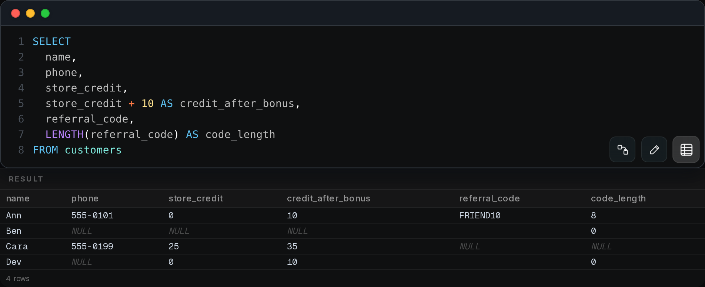
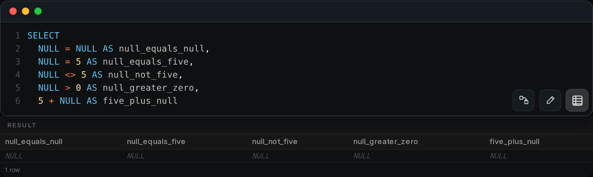
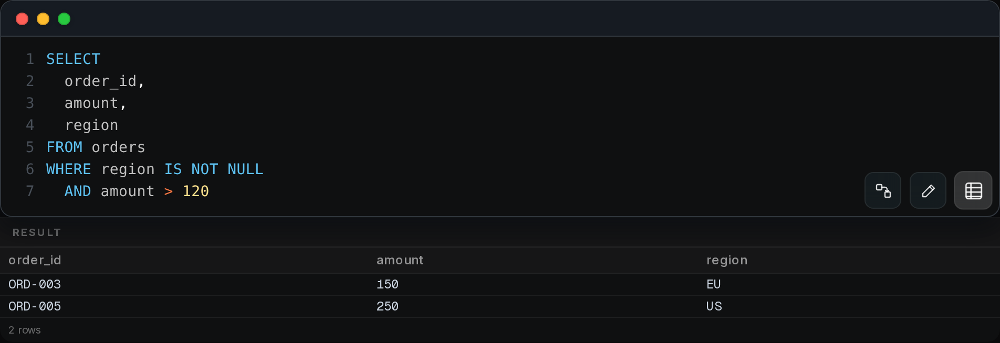
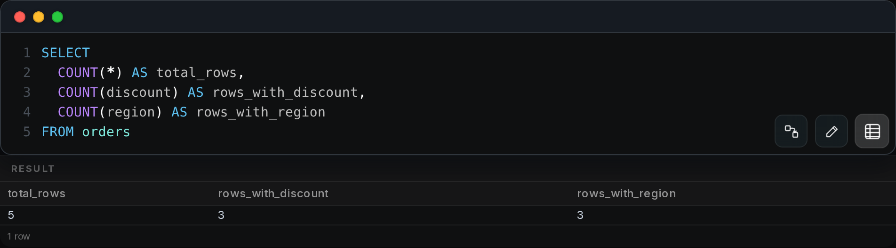
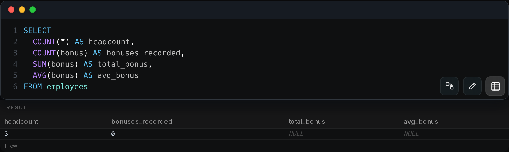

# NULL Values: Beginner

A quarterly discount report at an online retailer showed an average discount of 16.67 per order, and finance built its margin forecast on that figure. The real average across all orders was 10: 2 of every 5 orders carried no discount, and the database left them out of the division. The gap between those numbers is NULL, and this lesson follows it through every query it touches.


<br>

---

## NULL vs zero vs empty string

NULL marks a cell whose value the database does not have. A customer who skipped the phone field at checkout, a product with no discount price, the CEO's manager: in each case there is nothing true to store, and NULL records that there is nothing. Every other value in a column makes a claim about the world. NULL is the admission that no claim can be made, and a database that can say so holds more information than one forced to write something in every cell.


<br>

### Three things that look alike

Zero, the empty string and NULL all print as close to nothing on a screen, and people mix them up in schemas and in queries. Each one answers a different question, and a query written for one of them gives the wrong answer on the others.

| Value | What it says | Example |
| --- | --- | --- |
| NULL | The value is unknown or was never supplied | A customer skipped the age field |
| 0 | The quantity is known, and it is zero | An account whose balance is 0 dollars |
| '' (empty string) | A text value exists and has 0 characters | A nickname field submitted blank |

Take a survey question about annual income. A NULL means the respondent left the question unanswered. A 0 means they answered and reported no income. An empty string cannot be stored in a numeric column at all, and in a text column it usually means a form submitted a blank box, which is a known input and a different thing from a missing one. Three situations, 3 values, and the average income computed over the survey changes depending on which one the pipeline wrote.

> Which value to store
>
> - The person or system never supplied anything: NULL
> - A quantity was reported and it is zero: 0
> - A text field was submitted with nothing typed in it: '' or NULL, and the schema should say which
> - A value is unknown but the column is NOT NULL: the schema is wrong, and any placeholder will corrupt every aggregate over it


<br>

### The customers table

The running example is a small online outdoor-gear store with a `customers` table. Four customers have signed up. Ann and Cara gave phone numbers, Ben and Dev did not. The `store_credit` column holds a dollar amount: Ann and Dev have 0, Cara has 25, and Ben's row holds NULL because his account was migrated from an older system that never tracked credit. The `referral_code` column is text: Ann typed FRIEND10, Ben and Dev submitted the field blank, and Cara's signup predates the field entirely. The query below puts all 3 cases through arithmetic and a string function.



```sql
SELECT
  name,
  phone,
  store_credit,
  store_credit + 10 AS credit_after_bonus,
  referral_code,
  LENGTH(referral_code) AS code_length
FROM customers
```

The result separates the 3 cases on sight. Ann's and Dev's credit of 0 becomes 10 after the bonus. Ben's NULL credit stays NULL, because adding 10 to an unknown amount gives an unknown amount. Ben's and Dev's empty referral codes have a length of 0, a real number, while Cara's NULL code has a NULL length. A function handed NULL returns NULL, and a function handed an empty string returns a fact about an empty string.


<br>

### Why store a gap instead of a placeholder

A database that writes 0 where it means unknown has destroyed information that no later query can recover. If Ben's missing credit were stored as 0, the average store credit across the 4 customers would read 6.25 instead of the 8.33 computed over the 3 known values, and nothing could ever tell his 0 from Dev's. The same damage comes from 1900-01-01 as a birth date or -1 as an age: the column now holds a lie that every aggregate believes. NULL keeps the gap visible, so the query that reads the column decides what to do with it instead of inheriting someone else's guess.


**An order arrives through a partner channel whose feed has no phone field at all. Which value should the phone column hold for that order?**

- **A.** NULL
- **B.** An empty string
- **C.** 0
- **D.** The word 'none'

<details>
<summary>Solution</summary>

**A.** NULL

Nothing was ever supplied, so the column records the absence. Any query can later ask whether the phone is present, and counts of phone numbers stay accurate.

**Why the others are wrong**

- **B.** An empty string is a text value with 0 characters, which claims someone submitted a blank phone field. This feed has no such field, and counts of supplied phones would include this row.
- **C.** Zero is a known quantity, and a phone column holds text. Storing 0 invents a value the customer never gave.
- **D.** 'none' is a string like any other. Length checks, counts and comparisons would all treat it as a real phone number.

</details>

> **TIP**
>
> When a query over an optional column returns totals or averages that feel off, look at the column's NULLs first: the cells that hold nothing shape the result as much as the cells that hold something.


<br>

---

## Three-Valued Logic

Most programming languages evaluate a comparison to TRUE or FALSE. SQL has a third outcome, UNKNOWN, and every comparison that touches NULL produces it. The rule follows from what NULL means: if the database does not know Ben's store credit, it cannot say whether that credit equals 25, is greater than 0, or even equals another unknown credit. Every yes-or-no question about a missing value gets the only honest answer, which is neither.


<br>

### What a comparison with NULL returns



```sql
SELECT
  NULL = NULL AS null_equals_null,
  NULL = 5 AS null_equals_five,
  NULL <> 5 AS null_not_five,
  NULL > 0 AS null_greater_zero,
  5 + NULL AS five_plus_null
```

Every column comes back NULL, which is how a result grid displays UNKNOWN. `NULL = NULL` surprises people most. Two unknown values might be equal and might not, so the database declines to say either way. The arithmetic column shows the same rule outside comparisons: 5 plus an unknown amount is an unknown amount, and that NULL flows through any further expression built on top of it.


<br>

### WHERE keeps only TRUE

A `WHERE` clause lets a row through when its condition evaluates to TRUE. FALSE drops the row, and UNKNOWN drops it in exactly the same way. That second drop is silent: no error, no warning, the row is absent from the result and nothing says so. The store's `orders` table has 5 orders, and 2 of them, ORD-002 and ORD-004, have no region recorded because they came through a partner channel that does not send one. Three filters over that table show what the gaps do.

**= 'US'**

Orders whose region is US. Returns 2 rows, ORD-001 and ORD-005.

```sql
SELECT
  order_id,
  amount,
  region
FROM orders
WHERE region = 'US'
```

Result:

```
order_id | amount | region
ORD-001 | 100 | US
ORD-005 | 250 | US
```

**<> 'US'**

Orders whose region is anything other than US. Returns 1 row, ORD-003, the EU order. The 2 orders with no region do not count as other than US.

```sql
SELECT
  order_id,
  amount,
  region
FROM orders
WHERE region <> 'US'
```

Result:

```
order_id | amount | region
ORD-003 | 150 | EU
```

**both**

Orders that are US or are not US. Returns 3 rows. ORD-002 and ORD-004 fail both halves, because UNKNOWN OR UNKNOWN is UNKNOWN.

```sql
SELECT
  order_id,
  amount,
  region
FROM orders
WHERE region = 'US'
  OR region <> 'US'
```

Result:

```
order_id | amount | region
ORD-001 | 100 | US
ORD-003 | 150 | EU
ORD-005 | 250 | US
```

In a two-valued world, the third query would return every row: a value either equals US or it does not. SQL returns 3 of 5. The 2 orders without a region are excluded by `= 'US'`, excluded by `<> 'US'`, and excluded by the combination, because an UNKNOWN joined to an UNKNOWN with OR stays UNKNOWN. Those rows did not fail the test. They were never able to pass it.

The sharpest case is a filter written against NULL itself. A developer who wants the orders with no region reaches for `WHERE region = NULL`, and the comparison reads as if it should work. Watch what the database does with it on each of the 5 rows.

https://github.com/user-attachments/assets/c26d40ef-c587-46d3-bfc6-dcf18d1e537a

Every row, including the 2 whose region really is NULL, evaluates to UNKNOWN, and the result is empty. The query never errors, so an empty result gets read as 'no orders are missing a region', which is the opposite of the truth. The next section gives the operator that asks this question in a form the database can answer.


<br>

### Combining UNKNOWN with AND and OR

| Expression | Result | Why |
| --- | --- | --- |
| TRUE AND UNKNOWN | UNKNOWN | The outcome depends on the unknown half |
| FALSE AND UNKNOWN | FALSE | One FALSE settles an AND regardless |
| TRUE OR UNKNOWN | TRUE | One TRUE settles an OR regardless |
| FALSE OR UNKNOWN | UNKNOWN | The outcome depends on the unknown half |
| NOT UNKNOWN | UNKNOWN | The opposite of unknown is still unknown |

The table has 1 shape worth memorising: UNKNOWN disappears only when the other operand decides the answer by itself. `amount > 1000 AND region = 'US'` on ORD-004, amount 300 and region NULL, evaluates FALSE AND UNKNOWN, which is FALSE, and the row is dropped for a reason anyone can see. `amount > 100 AND region = 'US'` on the same row evaluates TRUE AND UNKNOWN, which is UNKNOWN, and the row is dropped for a reason nothing reports. Both queries lose ORD-004; only the second loses it to the gap.

**The orders table holds 5 rows: 2 with region US, 1 with EU and 2 with NULL. How many rows does WHERE region <> 'EU' return?**

- **A.** 4
- **B.** 2
- **C.** 3
- **D.** 5

<details>
<summary>Solution</summary>

**B.** 2

Only ORD-001 and ORD-005, the US rows, evaluate TRUE. The EU row is FALSE and the 2 NULL rows are UNKNOWN, and WHERE drops both kinds.

**Why the others are wrong**

- **A.** Four would be right if NULL counted as not EU. The 2 NULL rows produce UNKNOWN and are dropped.
- **C.** Three would require 1 of the NULL rows to pass. Both NULL rows evaluate identically, so either both pass or neither does, and neither does.
- **D.** Five would mean no row was filtered. The EU row is FALSE and fails the test outright.

</details>

> **TIP**
>
> Before writing any comparison in a `WHERE` clause, ask whether the column can hold NULL. If it can, decide what the query should do with those rows, because the default is to drop them without a trace.


<br>

---

## IS NULL and IS NOT NULL operators

`IS NULL` and `IS NOT NULL` are the 2 predicates built to test for NULL, and unlike `=` or `<>` they never return UNKNOWN. `phone IS NULL` returns TRUE when the cell is empty and FALSE when it holds anything at all; `phone IS NOT NULL` returns the reverse. Because the answer is always TRUE or FALSE, a `WHERE` clause built on them keeps or drops every row deliberately, with no silent third category.


<br>

### Finding the rows with a gap

The store wants to call every customer who has not given a phone number, so the support team can collect one. Of the 4 customers, Ben and Dev left the field empty. The query asks for them directly, naming the column and the condition on it.

Two rows return, Ben and Dev, and the `phone` column in both is NULL. Compare that with `WHERE phone = NULL`, which produces UNKNOWN on all 4 rows and returns nothing at all. The animation below plays the correct version row by row, so the difference in evaluation is visible.

https://github.com/user-attachments/assets/bbfd9930-7de9-4f32-8c10-f6745c6b601e

Ann's row evaluates `IS NULL` to FALSE and is dropped; Ben's evaluates TRUE and moves into the result; Cara is dropped and Dev kept. Four decisions, each TRUE or FALSE, none UNKNOWN. That determinism is the whole value of the operator, and it is why `IS NULL` is a hard rule for testing absence and not a stylistic preference.


<br>

### Keeping only the known values

`IS NOT NULL` does the opposite job, and it earns its place most often alongside other conditions. A report of large orders by region has no use for an order whose region is missing, however large the order is. Adding `region IS NOT NULL` states that choice inside the query, so the next person to read it knows the unknown rows were excluded on purpose.



```sql
SELECT
  order_id,
  amount,
  region
FROM orders
WHERE region IS NOT NULL
  AND amount > 120
```

ORD-003 and ORD-005 return. ORD-002 at 200 and ORD-004, the largest order at 300, are absent, and the `IS NOT NULL` clause is the reason. Without it, `amount > 120` alone evaluates TRUE on both rows, so they would have appeared with a blank region and the report would show an unlabelled bucket worth 500. Which outcome is right depends on the report, and the clause makes the decision visible either way.


<br>

### IS NULL on an expression

The predicate accepts any expression, not only a bare column. `store_credit + 10 IS NULL` is TRUE for Ben, because the sum of an unknown amount and 10 is unknown, and FALSE for the other 3 customers. That makes `IS NULL` the way to check whether a calculation lost a value somewhere along the way, which is how a data quality query finds the rows where a derived column would come out blank before anyone publishes it.


<br>

### The predicate that looks right and is wrong

| ✓ = NULL and <> NULL | ✗ IS NULL and IS NOT NULL |
| --- | --- |
| • Evaluate to UNKNOWN on every row, including the NULL ones<br><br>• Return 0 rows from a WHERE clause, with no error<br><br>• Read as a bug only after someone notices rows are missing | • Evaluate to TRUE or FALSE on every row<br><br>• Return exactly the rows with, or without, a value<br><br>• State the intent in a form the next reader recognises |

Operationally, `IS NULL` is a data quality tool before it is a filter. A query such as `WHERE shipping_address IS NULL AND status = 'pending'` lists the orders that cannot ship, and the same shape finds employees without a manager, products without a price, and events without a timestamp. The pattern is always the same: name the column, ask whether it is missing, and add whatever other conditions narrow the audience to the rows someone will act on.

> **TIP**
>
> Put the NULL test first in a compound `WHERE` so a reader finds the completeness rule at the top of the filter. The database may check the conditions in any order, but a row passes only when every one of them is TRUE.


<br>

---

## COUNT(\*) vs COUNT(column)

`COUNT` is 1 function with 2 behaviours, and the argument decides which one runs. `COUNT(*)` counts rows: every row in the group, whatever its cells hold. `COUNT(column)` counts the rows where that column holds a value, and a NULL cell adds nothing to the tally. On a table with no missing values the 2 numbers agree, which is why many engineers never notice the difference until a column with gaps makes them disagree in a report.


<br>

### The orders table with its gaps

| order_id | amount | discount | region |
| --- | --- | --- | --- |
| ORD-001 | 100 | 10 | US |
| ORD-002 | 200 | NULL | NULL |
| ORD-003 | 150 | 15 | EU |
| ORD-004 | 300 | NULL | NULL |
| ORD-005 | 250 | 25 | US |

Two of the 5 orders carry no discount, and the same 2 carry no region, because the partner channel that placed them sends neither field. Three counts over this table tell the completeness story in a single row of output.



```sql
SELECT
  COUNT(*) AS total_rows,
  COUNT(discount) AS rows_with_discount,
  COUNT(region) AS rows_with_region
FROM orders
```

The result is 5, 3 and 3. `COUNT(*)` never looks inside a row, so it reports the full 5. `COUNT(discount)` examines the discount cell on each row and skips the 2 that hold NULL, and `COUNT(region)` does the same on its own column. The animation plays the first 2 counts side by side as the rows arrive.

https://github.com/user-attachments/assets/2eef749d-6bea-4c0d-bce0-f1d7f10914bf

Each row ticks `total_rows` upward. Only ORD-001, ORD-003 and ORD-005 tick `rows_with_discount`, because ORD-002 and ORD-004 present a NULL discount to the function and it declines to count a value that does not exist. The 2 counters start together and finish 2 apart, and that gap is a measurement.

> What each form counts
>
> - COUNT(\*): every row in the group
> - COUNT(column): rows where the column holds a value
> - COUNT(DISTINCT column): distinct values, with NULL excluded
> - COUNT(1): every row, because the constant 1 is never NULL


<br>

### Completeness in one query

The difference between the 2 counts is the number of missing values, and putting both into 1 query turns a table scan into a data quality report. The shape below profiles a `users` table on 2 optional columns at once, and it extends to as many columns as the table has, in a single pass over the data.

```sql
SELECT
  COUNT(*) AS total_users,
  COUNT(email) AS with_email,
  COUNT(phone) AS with_phone,
  COUNT(*) - COUNT(email) AS missing_email,
  COUNT(*) - COUNT(phone) AS missing_phone
FROM users
```

The gap, `COUNT(*) - COUNT(email)`, is the number to report when a team asks how complete a dataset is, because it counts records someone may have to chase. `COUNT(DISTINCT email)` follows the same rule as `COUNT(email)` and ignores NULL, so a distinct count never includes a bucket for missing values, and a table with 3 distinct emails and 400 NULLs reports 3.


<br>

### COUNT(1) and other constants

`COUNT(1)` returns the same number as `COUNT(*)`, and the reason is the rule above, not a special case: the expression 1 is evaluated once per row, it is never NULL, so every row is counted. The same holds for `COUNT('x')` or `COUNT(0)`. A constant inside `COUNT` counts rows; only a column, or an expression that can produce NULL, counts values. Knowing that keeps a reader from assuming `COUNT(1)` skips anything.

**A users table has 1,000 rows. COUNT(email) returns 940. Which statement must be true?**

- **A.** 60 rows have a NULL email
- **B.** 60 rows have an empty string for email
- **C.** The table holds 940 distinct email addresses
- **D.** 60 users have no phone number

<details>
<summary>Solution</summary>

**A.** 60 rows have a NULL email

COUNT(email) skips only NULL cells, so the 60 uncounted rows hold NULL in that column.

**Why the others are wrong**

- **B.** An empty string is a value with 0 characters, and COUNT(email) counts it. Empty strings would sit inside the 940.
- **C.** COUNT(email) counts non-NULL cells, duplicates included. Distinctness needs COUNT(DISTINCT email).
- **D.** COUNT(email) says nothing about the phone column. Each column's gaps are measured by counting that column.

</details>

> **TIP**
>
> Pair `COUNT(*)` with `COUNT(column)` whenever a result will be reported as a count of something: the first says how many records exist and the second how many of them carry the thing being counted.


<br>

---

## Aggregates with NULLs

`SUM`, `AVG`, `MIN` and `MAX` follow the same rule as `COUNT(column)`: a NULL cell contributes nothing. They do not treat NULL as 0. They behave as though the row were absent from the calculation, and that distinction is where reports go wrong, because an average over the 3 known discounts and an average across all 5 orders are 2 different numbers, and the function only ever computes the first.


<br>

### SUM and AVG over the discount column

The total is 50, from 10 + 15 + 25, and the average is 16.67, from 50 divided by 3. The 3 in that division is `COUNT(discount)`, the number of rows that supplied a value. ORD-002 and ORD-004 appear in neither figure, and the result row gives no hint that 2 orders were left out.

https://github.com/user-attachments/assets/64920c0c-504e-4f28-a00f-90051b341ef7

Watching the sum accumulate shows the skip: 10 after ORD-001, nothing from ORD-002, 25 after ORD-003, nothing again from ORD-004, and 50 after ORD-005. The average divides by the number of values that arrived, and the 2 that never arrived are absent from the denominator as well as the numerator.


<br>

### Two averages, one question

The margin forecast from the intro failed on exactly this point. Finance asked for the average discount per order, meaning across every order placed. `AVG(discount)` answers a different question: the average discount among orders that had one. Both are legitimate figures, and the query has to be written for the one that was asked. The examples run both over the same 5 orders.

**AVG**

The average among orders that carry a discount. Divides 50 by 3 and returns 16.67.

```sql
SELECT
  AVG(discount) AS avg_discount
FROM orders
```

Result:

```
avg_discount
16.666666666666668
```

**SUM/COUNT(*)**

The average across every order, with missing discounts counted as 0. Divides 50 by 5 and returns 10.

```sql
SELECT
  1.0 * SUM(discount) / COUNT(*) AS avg_per_order
FROM orders
```

Result:

```
avg_per_order
10
```

**SUM/COUNT(x)**

The same as AVG, written out. Divides 50 by COUNT(discount), which is 3, and returns 16.67. This is what AVG does internally.

```sql
SELECT
  1.0 * SUM(discount) / COUNT(discount) AS avg_where_present
FROM orders
```

Result:

```
avg_where_present
16.666666666666668
```

The second form is the one the forecast needed, and it costs nothing extra: the sum is unchanged and the denominator switches to the row count. The choice between 16.67 and 10 is a business definition, so write the definition into the column name, `avg_discount_where_present` or `avg_discount_per_order`, and nobody downstream has to guess which question the number answers.


<br>

### MIN and MAX

`MIN(discount)` is 10 and `MAX(discount)` is 25, and both skip the NULL rows without ceremony. For extremes that behaviour is usually what the question wants: the smallest discount applied is 10, and no sensible reading would answer 'unknown'. The caveat is in the wording. `MIN(discount)` is the minimum among discounts that exist, which is a different figure from the least the store gave on any order, since 2 orders received no discount at all and a report that calls 10 the minimum has quietly redefined the population.


<br>

### When every value is missing

An aggregate over a column that holds only NULLs has no values to work with, and the functions diverge. `COUNT` returns 0, because counting nothing yields a number. `SUM`, `AVG`, `MIN` and `MAX` return NULL, because there is no sum, average or extreme of an empty set. The `employees` table below has a `bonus` column that nobody has filled in yet, and the 4 aggregates over it show the split.



```sql
SELECT
  COUNT(*) AS headcount,
  COUNT(bonus) AS bonuses_recorded,
  SUM(bonus) AS total_bonus,
  AVG(bonus) AS avg_bonus
FROM employees
```

The result is 3, 0, NULL, NULL. A downstream calculation that adds `total_bonus` to a salary total will itself turn NULL, through the same arithmetic rule from the first section, and a dashboard tile goes blank instead of showing 0. The intermediate lesson covers `COALESCE`, the function that substitutes a default where an aggregate comes back NULL. For now, a NULL total means no values were present, which is different information from a total of 0, and a report should carry that difference rather than paper over it.


<br>

### NULL as a GROUP BY key

`GROUP BY` treats NULL differently from a comparison: all rows with a NULL key land in 1 group together, as though NULL equalled NULL for the purpose of grouping. Grouping the orders by region produces 3 groups, US, EU and a NULL group holding ORD-002 and ORD-004, and the aggregates inside each group follow the same skipping rules as before.

```sql
SELECT
  region,
  COUNT(*) AS order_count,
  SUM(amount) AS total_amount,
  SUM(discount) AS total_discount
FROM orders
GROUP BY region
```

| region | order_count | total_amount | total_discount |
| --- | --- | --- | --- |
| US | 2 | 350 | 35 |
| EU | 1 | 150 | 15 |
| NULL | 2 | 500 | NULL |

The NULL group's `total_discount` is NULL, which is the all-missing case from the previous query appearing inside a group. A reader of that row learns that 2 orders worth 500 have no discount information at all, a fact the report should carry forward to whoever owns the partner channel.

| ✓ Do | ✗ Don't |
| --- | --- |
| • Store NULL where a value was never supplied, and let each query decide what to do with it<br><br>• Test for absence with IS NULL and IS NOT NULL, never with = or <><br><br>• Report COUNT(\*) alongside COUNT(column) so missing values are visible in every count<br><br>• Decide which denominator an average needs before choosing AVG or SUM / COUNT(\*)<br><br>• Expect NULL, and plan for it, from SUM and AVG over a column with no values | • Don't write 0, '', -1 or 'N/A' into a column to stand for unknown<br><br>• Don't assume rows missing from a WHERE result all evaluated FALSE<br><br>• Don't read an empty result from = NULL as proof that nothing is missing<br><br>• Don't present AVG(column) as an average per row when some rows hold NULL |


<br>

---

## Putting It All Together

A subscription software company's finance team asks for the average discount per customer for the quarter. The subscriptions table holds 12,000 rows, and 3,800 of them have a NULL discount_pct because those customers pay list price and the signup flow writes nothing for them. An analyst runs AVG(discount_pct), gets 18 percent, and finance models margin on it. The true average per customer is 12.3 percent.

- NULL vs zero decides the case before any query runs: a list-price customer has a discount of 0, a known fact, and the pipeline stored NULL, so the column says unknown where it means none.
- Three-valued logic explains why an earlier check, WHERE discount_pct < 10, returned nothing for those 3,800 customers and nobody noticed the rows were being dropped.
- IS NULL lists the 3,800 rows in 1 query so the team can confirm every one is a list-price customer before anyone backfills a 0.
- COUNT(\*) against COUNT(discount_pct) shows 12,000 against 8,200, and that pair is the first number to put in front of finance.
- AVG skips the NULL rows, so SUM(discount_pct) \* 1.0 / COUNT(\*) is the figure finance asked for, and naming the 2 columns differently keeps the 2 questions apart in the report.


<br>

---

## Key Takeaways

- NULL records that no value was supplied, which is a different fact from 0 or an empty string, and a placeholder written in its place destroys that fact.
- Any comparison touching NULL evaluates to UNKNOWN, and WHERE drops UNKNOWN rows exactly as it drops FALSE ones, with no error.
- IS NULL and IS NOT NULL test for NULL and always answer TRUE or FALSE, never UNKNOWN, so they are the way to find or exclude missing values.
- COUNT(\*) counts rows and COUNT(column) counts values; the difference between them is the number of missing values in that column.
- SUM, AVG, MIN and MAX skip NULL rows, so AVG divides by the values present, and an average per row needs SUM(column) / COUNT(\*).
