# NULL Values: Intermediate

An analyst at Uber pulls the average tip per ride for a review and gets 38 cents. Riders who closed the app before the tip screen were saved with a tip of 0, and a join to the driver table dropped every ride whose driver record failed to load. This lesson separates missing from zero, keeps rows through joins, and moves values into and out of NULL on purpose.


<br>

---

## Sentinel values and fake NULLs

### What a sentinel is

A sentinel is an ordinary value a system wrote in place of a missing one. The column was declared NOT NULL, a form refused to submit without the field, or a CSV export had no way to write NULL. The table now holds a number or a string that looks like data and means 'we never knew'.

Every aggregate from the last lesson treats a sentinel as real. NULL is skipped by COUNT(age), AVG(age) and MIN(age); a 0 is included by all 3. A column of fake zeros gives a lower average, a wrong minimum and a count that claims more knowledge than the table holds.

| Column | Sentinel seen in practice | How it got there |
| --- | --- | --- |
| age (INTEGER) | 0 or -1 | required form field, column declared NOT NULL |
| price (DECIMAL) | 0.00 or 9999.99 | placeholder until the pricing team filled it in |
| signup_date (TIMESTAMP) | 1900-01-01 or 1970-01-01 | default of the source system when no date was known |
| country (VARCHAR) | 'N/A', 'unknown', 'none', '' | dropdown default, or a required field typed around |
| middle_name (VARCHAR) | '' or the text 'NULL' | CSV export wrote the word NULL for a missing value |
| quantity (INTEGER) | -1 or 999999 | out-of-range code meaning 'not applicable' |


<br>

### The damage a fake zero does

The legacy_users table holds 5 users. A signup form that required the age field, and let people pass it with the default, wrote 0 for 2 of them. Run the average over every row, then again with the zeros filtered out.

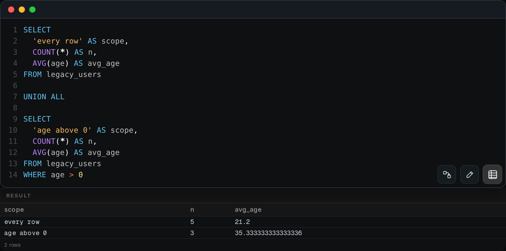

```sql
SELECT
  'every row' AS scope,
  COUNT(*) AS n,
  AVG(age) AS avg_age
FROM legacy_users

UNION ALL

SELECT
  'age above 0' AS scope,
  COUNT(*) AS n,
  AVG(age) AS avg_age
FROM legacy_users
WHERE age > 0
```

The first row says the average user is 21.2; the second says 35.3. AVG folded both zeros into (34 + 0 + 27 + 0 + 45) / 5, and the 14-year gap comes entirely from values that were never ages. COUNT(age) would report 5 ages known, when only 3 are.


<br>

### Profiling a column to find its sentinels

Sentinels are found by profiling: GROUP BY the column, count each group, and sort the biggest first. Real values spread across a range; a sentinel piles up in one group, often at a value the column could never hold. The shipments table records parcel weights from a warehouse scanner.

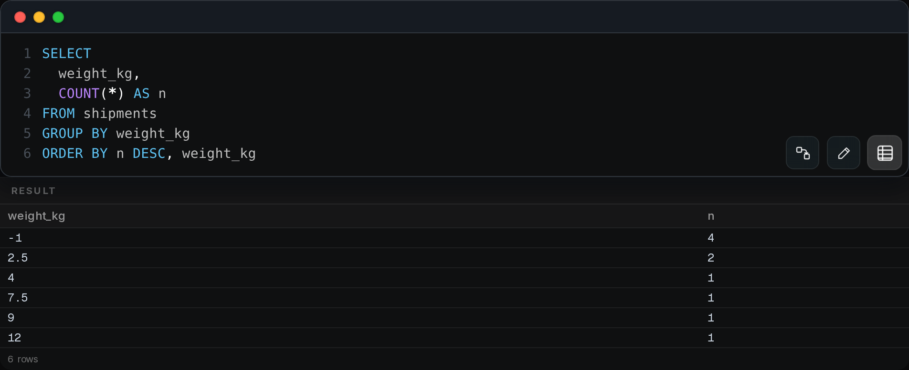

```sql
SELECT
  weight_kg,
  COUNT(*) AS n
FROM shipments
GROUP BY weight_kg
ORDER BY n DESC, weight_kg
```

Of the 10 shipments, 4 weigh -1 kilograms. No parcel has negative mass, and no real weight repeats more than twice, so -1 is a code for 'weight not captured'. AVG(weight_kg) over this table returns 3.35, while the 6 weighed parcels average 6.25.

**A profile of discount_pct across 50,000 orders returns these counts: 0 has 31,200 rows, 5 has 8,100, 10 has 7,900, 15 has 2,750 and 100 has 50. Which value most needs a second look before you average the column?**

- **A.** 100, because a discount of 100 percent is rare and a rare value is the signature of a code
- **B.** 0, because it holds far more rows than any other value and may mean 'no discount recorded' as well as 'no discount given'
- **C.** 15, because it breaks the run of values that double from 5 to 10 and looks like a typo
- **D.** 5, because the smallest nonzero value in a numeric column is where defaults usually land

<details>
<summary>Solution</summary>

**B.** 0, because it holds far more rows than any other value and may mean 'no discount recorded' as well as 'no discount given'

The 31,200 zeros swamp every other group. Some are genuine undiscounted orders and some may be the form's default, and the average cannot tell them apart.

**Why the others are wrong**

- **A.** Rarity alone is a weak signal: 50 full giveaways in 50,000 orders is plausible, and a sentinel usually piles up rather than hiding in a corner.
- **C.** A 15 percent discount is a normal tier, and its 2,750 rows fall below the more common tiers the way a real tier's count should.
- **D.** Defaults land at 0, -1 or an out-of-range code, and 5 has an ordinary share of the rows. It behaves like a real discount tier.

</details>


<br>

### Strings that pretend to be NULL

Text columns hide missing data behind placeholders: 'N/A', 'unknown', 'none', 'TBD', an empty string, or the 4-character word 'NULL' that a CSV export wrote when it met a real NULL. Every one of them is a value. carrier_code IS NULL is FALSE for each of them, and COUNT(carrier_code) counts each of them. The shipments table also carries a carrier code: 1 shipment has a true NULL there, and 3 others carry 'N/A'.

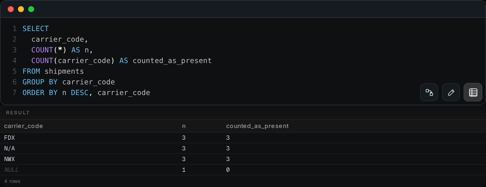

```sql
SELECT
  carrier_code,
  COUNT(*) AS n,
  COUNT(carrier_code) AS counted_as_present
FROM shipments
GROUP BY carrier_code
ORDER BY n DESC, carrier_code
```

The true NULL on S-10 behaves as the last lesson described: COUNT(\*) sees the row and COUNT(carrier_code) skips it, so its group reads 1 and 0. The 'N/A' group gets no such treatment: 'N/A' is a 3-character string, as present as 'NWX'. A report that counts 'shipments with a known carrier' as COUNT(carrier_code) says 9 when the correct answer is 6.

> Signs that a value is a sentinel
>
> - It cannot happen in the real world: a weight of -1, an age of 0, a price of 0.00 on a product that is for sale
> - It repeats far more than its neighbours in a GROUP BY count
> - It sits at the edge of its type or the calendar: 9999, -1, 1900-01-01, 1970-01-01
> - It reads like a placeholder: 'N/A', 'unknown', 'none', 'TBD', '' or the text 'NULL'
> - The source schema declares the column NOT NULL, so something had to be written when nothing was known


<br>

---

## NULLs in INNER and LEFT JOINs

### How a join pairs rows

A join reads 2 tables and pairs their rows. FROM orders o INNER JOIN customers c names the tables o and c for the rest of the query, and the ON clause gives the condition a pair has to satisfy. o.customer_id = c.customer_id is TRUE when both sides hold the same value, FALSE when they differ, and NULL when either side is NULL, because a comparison with NULL has no answer. The join keeps pairs whose condition is TRUE and nothing else. A NULL key therefore pairs with no row at all, including a NULL key on the other side: NULL = NULL is NULL, never TRUE.

An INNER JOIN returns the pairs and nothing more. A LEFT JOIN returns the pairs, then adds back every row of the left table that found no partner, with the right table's columns filled with NULL for those rows.

#### INNER JOIN drops the row

https://github.com/user-attachments/assets/ee1edc6d-da86-4cb6-bf02-9275e7b94948

The 4 orders meet 4 customers and 2 rows come out. ORD-1 and ORD-2 find Alice and Bob. The NULL customer_id on ORD-3 makes every comparison NULL, so it pairs with nobody, including the Guest customer whose key is also NULL. ORD-4 carries C-103, a key no customer owns, so every comparison is FALSE. The 2 result rows show no trace of either loss.

**The orders table has 100 rows; 10 have a NULL customer_id and each of the other 90 holds a key that appears exactly once in customers. The customers table has 50 rows, 1 of them with a NULL customer_id. How many rows does this query return?**

```sql
SELECT COUNT(*)
FROM orders o
INNER JOIN customers c
  ON o.customer_id = c.customer_id
```

- **A.** 100, because the 10 orders with a NULL key pair with the single customer whose key is also NULL
- **B.** 50, because an INNER JOIN returns 1 row for each row of the smaller table
- **C.** 90, because the 10 orders with a NULL key produce no pair and each of the other 90 matches exactly 1 customer
- **D.** 99, because 9 of the NULL orders fail and 1 of them pairs with the NULL customer

<details>
<summary>Solution</summary>

**C.** 90, because the 10 orders with a NULL key produce no pair and each of the other 90 matches exactly 1 customer

Each of the 90 keyed orders finds one customer, giving 90 pairs. The 10 NULL keys produce NULL on every comparison and disappear from the result.

**Why the others are wrong**

- **A.** NULL = NULL evaluates to NULL, never TRUE, so the NULL order keys and the NULL customer key never pair with each other.
- **B.** A join returns 1 row per matching pair, and the pairs here are decided by the 90 orders with a real key, so the customer count is irrelevant.
- **D.** There is no rule that lets a single NULL pair. Every comparison involving a NULL key evaluates to NULL, so all 10 drop, leaving 90.

</details>

#### LEFT JOIN keeps the row and marks the gap

https://github.com/user-attachments/assets/aa92f5bf-344d-4e34-a6ee-d161ed4dfee1

The 3 employees go in and 3 rows come out. E-101 pairs with Sales. The NULL dept_id on E-103 never pairs with the NULL key of the Unassigned department, and E-105 points at D-99, which no department owns. Both survive with dept_name NULL, so the gap shows up where the match would have been.


<br>

### Telling the 2 NULLs apart

The right side's NULL says 'no partner found'. Whether the left key was itself missing, or present and unmatched, is a question for the left table's own column, and a CASE expression can ask both questions at once.

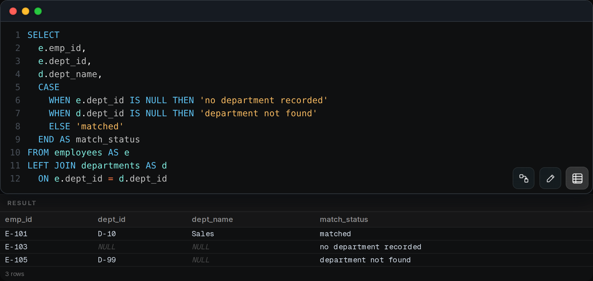

```sql
SELECT
  e.emp_id,
  e.dept_id,
  d.dept_name,
  CASE
    WHEN e.dept_id IS NULL THEN 'no department recorded'
    WHEN d.dept_id IS NULL THEN 'department not found'
    ELSE 'matched'
  END AS match_status
FROM employees AS e
LEFT JOIN departments AS d
  ON e.dept_id = d.dept_id
```

The CASE tests `d.dept_id`, the join key, in place of `d.dept_name`. A department row with a key but a NULL name would still be a match, and testing the name would label it unmatched. Test the key the ON clause compared, which every matched row carries.


<br>

### The filter that undoes a LEFT JOIN

A LEFT JOIN protects its rows only until WHERE runs. WHERE keeps rows whose condition is TRUE, and every comparison against a NULL the join filled in is NULL. Ask for every employee outside Sales, then add the branch that keeps the gaps.

**Filter only**

The comparison alone: every row whose dept_name is NULL evaluates to NULL and is discarded.

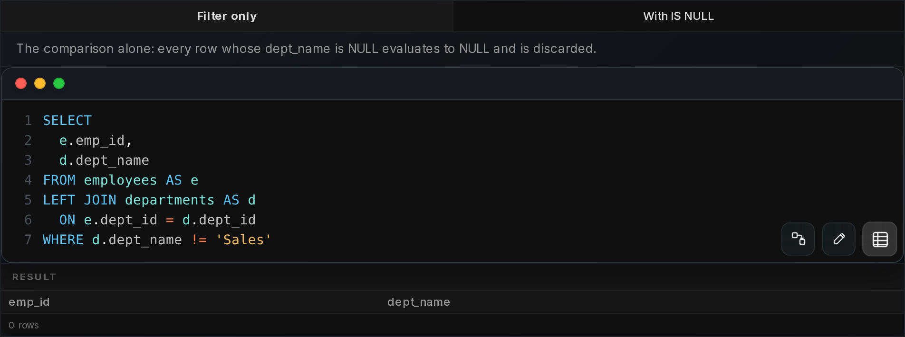

```sql
SELECT
  e.emp_id,
  d.dept_name
FROM employees AS e
LEFT JOIN departments AS d
  ON e.dept_id = d.dept_id
WHERE d.dept_name != 'Sales'
```

**With IS NULL**

An IS NULL branch keeps the employees the LEFT JOIN preserved, so the answer to 'outside Sales' is complete.

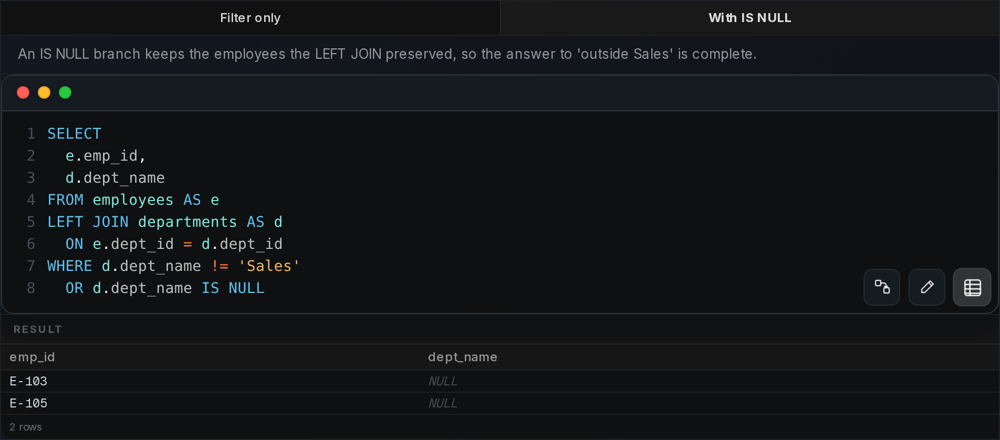

```sql
SELECT
  e.emp_id,
  d.dept_name
FROM employees AS e
LEFT JOIN departments AS d
  ON e.dept_id = d.dept_id
WHERE d.dept_name != 'Sales'
  OR d.dept_name IS NULL
```

The first version returns no rows. E-101 is in Sales and fails the test as it should. E-103 and E-105 have a NULL dept_name, so `NULL != 'Sales'` is NULL and WHERE discards them: the LEFT JOIN kept them and the next clause threw them out. The second version's `OR d.dept_name IS NULL` brings both back.


<br>

### Counting after a join

After a LEFT JOIN, COUNT(\*) counts every left row and COUNT of a right-side key counts only the matched ones. The difference is the number of rows an INNER JOIN would have erased without a trace.

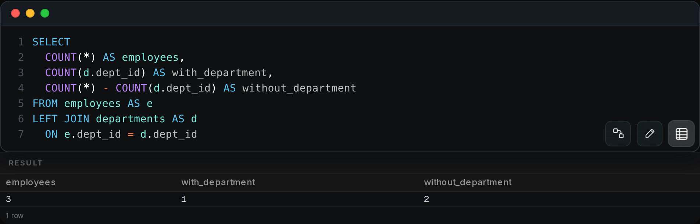

```sql
SELECT
  COUNT(*) AS employees,
  COUNT(d.dept_id) AS with_department,
  COUNT(*) - COUNT(d.dept_id) AS without_department
FROM employees AS e
LEFT JOIN departments AS d
  ON e.dept_id = d.dept_id
```

With INNER JOIN in place of LEFT JOIN the same query returns 1, 1 and 0. The 2 unmatched employees are counted nowhere, and nothing in the result shows they exist.


<br>

---

## COALESCE for defaults

### First non-NULL wins

COALESCE takes a list of expressions and returns the first one that is not NULL, reading left to right. If every argument is NULL, it returns NULL. It is a CASE expression in compact form: `COALESCE(a, b, c)` means `CASE WHEN a IS NOT NULL THEN a WHEN b IS NOT NULL THEN b ELSE c END`. The function skips NULL and only NULL; a 0 or an empty string is a value and is returned like any other.

| Expression | Returns | Why |
| --- | --- | --- |
| COALESCE(NULL, 7) | 7 | first argument is NULL, second is a value |
| COALESCE(3, 7) | 3 | first argument already has a value |
| COALESCE(NULL, NULL, 'x') | 'x' | third argument is the first non-NULL |
| COALESCE(NULL, NULL) | NULL | nothing to return |
| COALESCE(0, 7) | 0 | 0 is a value, only NULL is skipped |
| COALESCE('', 'x') | '' | an empty string is a value too |

https://github.com/user-attachments/assets/ca2d1650-9175-46d3-aa98-dda28cf92122

C-1 has a phone and the phone wins. C-2 has no phone, so the email comes through. C-3 has neither, and the literal 'Unknown' at the end guarantees that the contact column is never NULL. C-4 has both and still returns the phone: argument order is priority order, and COALESCE never looks past the first value it finds.


<br>

### The arguments must share a type

COALESCE returns one column, so every argument has to fit one type. `COALESCE(age, 'unknown')` fails, because INTEGER and VARCHAR cannot share a column; cast the column first and the default fits. Numeric types widen instead of failing: `COALESCE(quantity, 0.0)` with an INTEGER quantity returns a DECIMAL, because the literal `0.0` is a decimal.

```sql
SELECT
  user_id,
  COALESCE(CAST(age AS VARCHAR), 'unknown') AS age_label
FROM users
```


<br>

### COALESCE inside an aggregate changes the answer

SUM skips NULL, so `SUM(COALESCE(tip, 0))` gives the same total as `SUM(tip)` whenever at least one tip is present. When every tip in a group is NULL, SUM returns NULL and the COALESCE version returns 0: missing versus zero again. AVG and COUNT go further, since COALESCE turns a skipped row into a counted one. The rides table has 5 rides, 2 with no recorded tip.

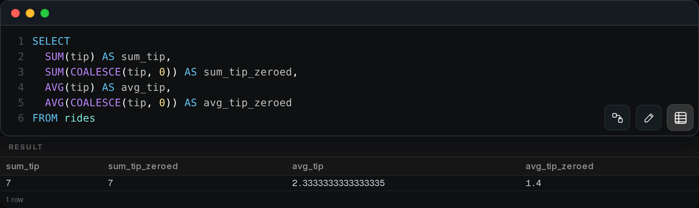

```sql
SELECT
  SUM(tip) AS sum_tip,
  SUM(COALESCE(tip, 0)) AS sum_tip_zeroed,
  AVG(tip) AS avg_tip,
  AVG(COALESCE(tip, 0)) AS avg_tip_zeroed
FROM rides
```

Both sums are 7.0, but the averages differ: 7 over the 3 tipped rides is 2.33, and 7 over all 5 rides is 1.40. The first is the average tip among riders who tipped; the second is the average tip per ride, counting an unrecorded tip as no tip. COALESCE records which one the report meant, and the reader of the number should know.

**The reviews table has 10 rows, 3 of them with a NULL rating, and the other 7 ratings add up to 28. What does AVG(COALESCE(rating, 0)) return?**

- **A.** 4.0, because COALESCE changes nothing that AVG was already ignoring
- **B.** NULL, because 3 ratings are missing and NULL spreads through the average
- **C.** 28, because COALESCE makes AVG behave like SUM over the whole table
- **D.** 2.8, because the 3 NULLs become zeros, the total stays 28 and the divisor grows to 10

<details>
<summary>Solution</summary>

**D.** 2.8, because the 3 NULLs become zeros, the total stays 28 and the divisor grows to 10

Zeros add nothing to the sum and add 3 rows to the count: 28 / 10 = 2.8. The average fell from 4.0 by counting rows that held no rating.

**Why the others are wrong**

- **A.** AVG(rating) is 28 / 7 = 4.0. COALESCE turns the 3 NULLs into zeros, which AVG counts, so the divisor changes.
- **B.** COALESCE removes every NULL before AVG sees it, and even without it AVG skips NULL and returns a value for the remaining 7.
- **C.** COALESCE changes the values AVG receives; it does not change what AVG does. The function still divides the total by the number of values.

</details>


<br>

### Labelling the NULL group

GROUP BY on a column that holds NULL creates a group whose key is NULL, and a report draws it as a blank cell that readers mistake for a formatting error. COALESCE in the SELECT list gives the group a name. Grouping by the raw column works, since an expression over a grouped column is allowed in SELECT. Grouping by the COALESCE expression, as below, differs in one case: if the label matches a real value, the 2 groups merge into one.

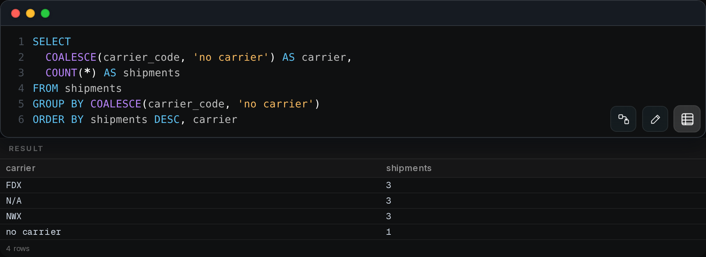

```sql
SELECT
  COALESCE(carrier_code, 'no carrier') AS carrier,
  COUNT(*) AS shipments
FROM shipments
GROUP BY COALESCE(carrier_code, 'no carrier')
ORDER BY shipments DESC, carrier
```

Shipment S-10 now sits in a group called 'no carrier'. The 3 'N/A' shipments keep a group of their own, because COALESCE touches NULL and nothing else. Turning 'N/A' into something COALESCE can see is the next section's job.


<br>

---

## NULLIF for sentinel values

### Turning a chosen value into NULL

NULLIF(a, b) compares a with b. When they are equal it returns NULL; otherwise it returns a unchanged. As a CASE it reads `CASE WHEN a = b THEN NULL ELSE a END`. It is the tool for the sentinels of the first section: name the code, and every row holding it becomes a true missing value that aggregates skip, COUNT(column) leaves out and IS NULL finds.

| Expression | Returns | Why |
| --- | --- | --- |
| NULLIF(0, 0) | NULL | the 2 arguments are equal |
| NULLIF(34, 0) | 34 | different, so the first argument comes back |
| NULLIF('N/A', 'N/A') | NULL | equal strings |
| NULLIF('n/a', 'N/A') | 'n/a' | string comparison is case sensitive |
| NULLIF(NULL, 0) | NULL | the first argument was already NULL |
| NULLIF(7, NULL) | 7 | 7 = NULL is NULL, never TRUE, so 7 comes back |

https://github.com/user-attachments/assets/5ee979e2-b822-430f-884d-b34ac6c1bcd8

Users 2 and 4 held the sentinel 0 and now hold NULL in clean_age; users 1, 3 and 5 pass through. The raw age column stays beside it, so each row records both what was stored and what was known.

**The accounts.status column holds, row by row: 'active', 'closed', NULL, 'Active'. What does this query return, row by row?**

```sql
SELECT NULLIF(status, 'active') AS status_flag
FROM accounts
```

- **A.** NULL, 'closed', NULL, 'Active'
- **B.** NULL, 'closed', NULL, NULL
- **C.** 'active', 'closed', NULL, 'Active'
- **D.** NULL, NULL, NULL, NULL

<details>
<summary>Solution</summary>

**A.** NULL, 'closed', NULL, 'Active'

'active' equals the named value and becomes NULL. 'closed' differs and passes through. NULL stays NULL. 'Active' differs by case, so it passes through unchanged.

**Why the others are wrong**

- **B.** This treats 'Active' as equal to 'active'. String comparison is case sensitive, so the capitalised value differs and is returned as it is.
- **C.** This reads NULLIF as a function that passes everything through. Its whole purpose is to return NULL for the row that equals the second argument.
- **D.** NULLIF blanks only the rows equal to 'active'. 'closed' and 'Active' both differ from it and come back as themselves.

</details>


<br>

### Repairing an average

Back to legacy_users, where the first section showed AVG(age) reporting 21.2 because of 2 fake zeros. NULLIF inside the aggregate repairs the number without filtering a single row out of the query.

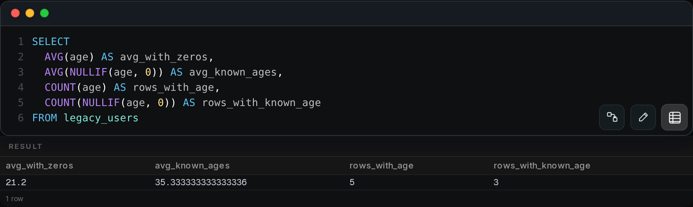

```sql
SELECT
  AVG(age) AS avg_with_zeros,
  AVG(NULLIF(age, 0)) AS avg_known_ages,
  COUNT(age) AS rows_with_age,
  COUNT(NULLIF(age, 0)) AS rows_with_known_age
FROM legacy_users
```

Same 5 rows, and NULLIF restores the figures the WHERE filter found, 35.3 and 3, while every row stays in play. `WHERE age > 0` would drop the 2 users entirely, with their cities, orders and signup dates; NULLIF blanks one field and keeps the rest of the row.


<br>

### The one-value limit

NULLIF names exactly 1 value. A column with 2 sentinels needs 2 nested calls, and a column with 3 or more reads better as a CASE with IN, which the filtering lessons already gave you. A range of impossible values, such as an age below 0 or above 120, also belongs in a CASE, since NULLIF compares for equality and nothing else.

```sql
SELECT
  user_id,
  NULLIF(NULLIF(country, 'N/A'), 'unknown') AS country_nested,
  CASE
    WHEN country IN ('N/A', 'unknown', '') THEN NULL
    ELSE country
  END AS country_case
FROM users
```

The nested form evaluates inside out: the inner NULLIF clears 'N/A', and the outer one receives either a country or a NULL and clears 'unknown'. A NULL reaching the outer call stays NULL, since NULL = 'unknown' is never TRUE.


<br>

### Division by zero

Dividing by 0 raises an error and stops the whole query. A column of counts holds 0 for every group with nothing to count, so a rate computed from it fails on the first empty group. NULLIF on the divisor turns the 0 into NULL, and anything divided by NULL is NULL, which is the right rate for a campaign nobody saw. The CAST to DOUBLE stops integer division from rounding 50 / 1000 down to 0.

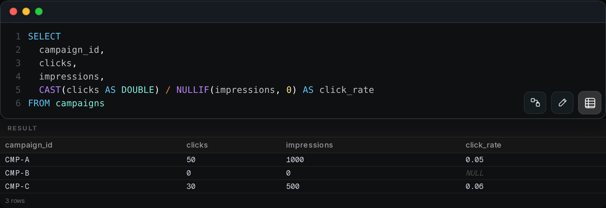

```sql
SELECT
  campaign_id,
  clicks,
  impressions,
  CAST(clicks AS DOUBLE) / NULLIF(impressions, 0) AS click_rate
FROM campaigns
```

CMP-A and CMP-C return 0.05 and 0.06. CMP-B returns NULL in place of an error, and the other 2 rows arrive intact. An AVG over click_rate skips CMP-B and reports 0.055, the average rate among campaigns that were shown.

> **TIP**
>
> Keep the raw column next to its NULLIF twin while you learn a dataset: 0 and NULL side by side show how many rows the sentinel touched, which is the first thing anyone asks about the clean numbers.


<br>

---

## COALESCE and NULLIF patterns

### Clean first, then default

The 2 functions nest. `COALESCE(NULLIF(description, ''), 'No description')` runs the inner call first: an empty string becomes NULL and a real description passes through. The outer call then fills every NULL, whether it arrived as NULL or came from NULLIF, with one default. The reverse nesting, `NULLIF(COALESCE(description, ''), '')`, turns NULL into '' and then '' into NULL, so both kinds of missing collapse into one NULL and nothing is filled.

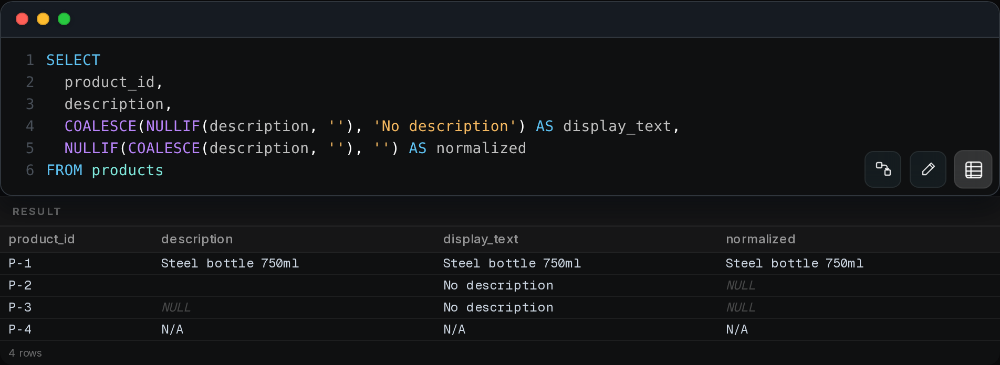

```sql
SELECT
  product_id,
  description,
  COALESCE(NULLIF(description, ''), 'No description') AS display_text,
  NULLIF(COALESCE(description, ''), '') AS normalized
FROM products
```

P-2 and P-3 arrive as '' and NULL and leave as 'No description' in display_text and as NULL in normalized. P-4 slips through both columns as 'N/A', because the query named '' as the only sentinel. A second NULLIF or a CASE with IN would catch it, once a profile has found it.

**The country column holds, row by row: 'US', 'N/A', NULL, ''. What does COALESCE(NULLIF(country, 'N/A'), 'Unknown') return, row by row?**

- **A.** 'US', 'Unknown', 'Unknown', 'Unknown'
- **B.** 'US', 'Unknown', 'Unknown', ''
- **C.** 'US', 'N/A', 'Unknown', ''
- **D.** 'US', NULL, NULL, ''

<details>
<summary>Solution</summary>

**B.** 'US', 'Unknown', 'Unknown', ''

'US' passes both calls. 'N/A' becomes NULL and is then filled with 'Unknown'. NULL is filled directly. '' matches neither 'N/A' nor NULL and survives as an empty string.

**Why the others are wrong**

- **A.** The empty string is a value. NULLIF only clears 'N/A', and COALESCE only fills NULL, so '' passes through both untouched.
- **C.** This skips the inner NULLIF. It turns 'N/A' into NULL before COALESCE sees the row, so the second row is filled with 'Unknown'.
- **D.** This skips the outer COALESCE, which fills every NULL that reaches it, including the one NULLIF produced from 'N/A'.

</details>


<br>

### A safe divisor with a default

The rate from the last section returned NULL for the campaign with no impressions. A dashboard sorting campaigns by rate wants a number in every row, so COALESCE wraps the division and supplies 0, which changes any AVG computed across campaigns.

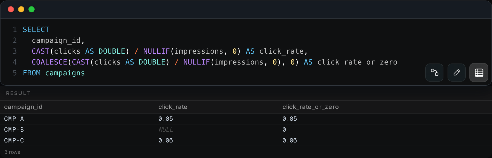

```sql
SELECT
  campaign_id,
  CAST(clicks AS DOUBLE) / NULLIF(impressions, 0) AS click_rate,
  COALESCE(CAST(clicks AS DOUBLE) / NULLIF(impressions, 0), 0) AS click_rate_or_zero
FROM campaigns
```

CMP-B reads NULL in one column and 0.0 in the other. An AVG over click_rate gives 0.055, the mean of the 2 campaigns that ran. An AVG over click_rate_or_zero gives 0.0367, because a campaign nobody saw now counts as a campaign nobody clicked. The 0 belongs in the column a sort or a display needs; the NULL belongs in the column an average will read.


<br>

### Label the unmatched side of a LEFT JOIN

A LEFT JOIN marks every unmatched row with NULL on the right side, and COALESCE on a right-side column turns that mark into a label. The label covers both gaps the second section separated, a missing key and a key with no matching row; keep that section's CASE when a report needs to tell them apart.

https://github.com/user-attachments/assets/433708b3-eae9-4322-ac2c-4099b0dc3159

E-101 keeps Sales. E-103, with no key, and E-105, pointing at a department that does not exist, both come out as Unassigned: the COALESCE runs after the join, sees NULL in dept_name for both and supplies the same text.


<br>

### One query over the shipments table

The shipments table from the first section carries 2 sentinels, -1 for an unweighed parcel and 'N/A' for an unknown carrier, plus 1 true NULL carrier. The query below converts both sentinels to NULL once in a CTE, then LEFT JOINs to carriers, labels the unmatched side with COALESCE and aggregates the cleaned column.

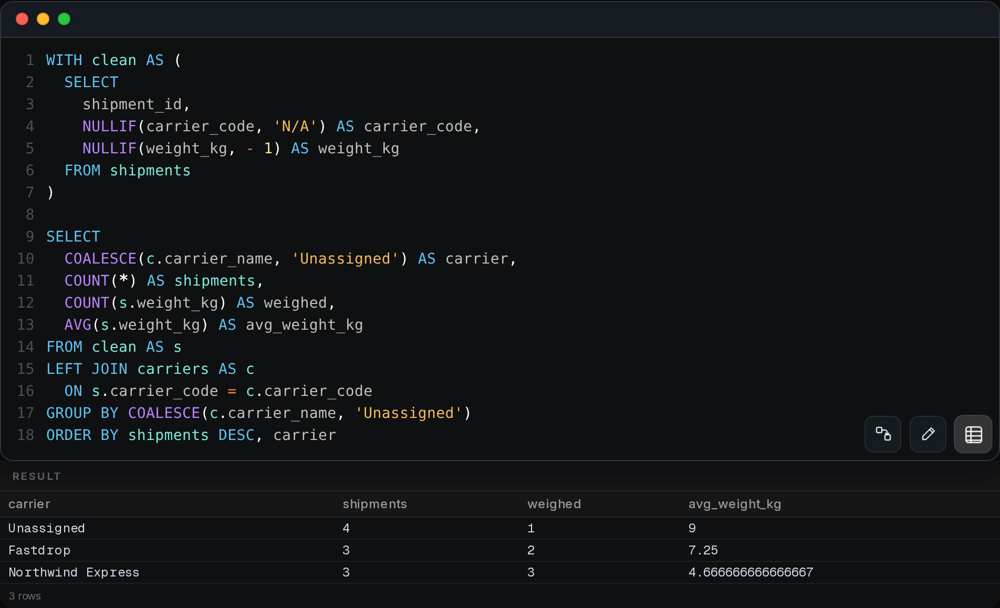

```sql
WITH clean AS (
  SELECT
    shipment_id,
    NULLIF(carrier_code, 'N/A') AS carrier_code,
    NULLIF(weight_kg, - 1) AS weight_kg
  FROM shipments
)

SELECT
  COALESCE(c.carrier_name, 'Unassigned') AS carrier,
  COUNT(*) AS shipments,
  COUNT(s.weight_kg) AS weighed,
  AVG(s.weight_kg) AS avg_weight_kg
FROM clean AS s
LEFT JOIN carriers AS c
  ON s.carrier_code = c.carrier_code
GROUP BY COALESCE(c.carrier_name, 'Unassigned')
ORDER BY shipments DESC, carrier
```

Unassigned holds 4 shipments: the 3 that said 'N/A' and S-10 with its true NULL, one group because the CTE made them the same value before the join. Only 1 of the 4 was weighed, at 9.0 kilograms. Fastdrop weighed 2 of its 3 parcels and averages 7.25; Northwind Express weighed all 3 for 4.67. With the raw -1 in the AVG, Fastdrop would read 4.5 and Unassigned 1.5. The weighed column beside shipments puts the missing data in the report itself.

| ✓ Do | ✗ Don't |
| --- | --- |
| • Convert sentinels to NULL in a CTE, then join and aggregate the clean columns<br><br>• Name the default for what it means: 'Unassigned', 'No description', 'no carrier'<br><br>• Report COUNT(\*) beside COUNT(clean_column) so the reader sees how much was missing<br><br>• Put NULLIF on any divisor that can hold 0, and decide separately whether the rate defaults | • COALESCE a measure to 0 before AVG unless the report means 'missing counts as zero'<br><br>• Filter a LEFT JOIN's right-side column in WHERE without an IS NULL branch<br><br>• Swap the nesting by habit: NULLIF(COALESCE(x, ''), '') blanks and fills nothing<br><br>• Replace an old sentinel with a new one such as -1; the next reader will have to find it |


<br>

---

## Putting It All Together

A food delivery company publishes a weekly restaurant report from a restaurant_weeks table, one row per restaurant per week with order_count, refund_count and prep_minutes, joined to the restaurants table for names and sorted by refund rate. A restaurant paused for the week still gets a row with order_count 0, prep_minutes is -1 when the kitchen confirmed no order that week, and rows for restaurants that left the platform have no match in restaurants.

- The -1 in prep_minutes is a sentinel: a GROUP BY prep_minutes with COUNT(\*) shows the spike, and NULLIF(prep_minutes, -1) in a CTE makes it a NULL that AVG skips while the row stays in every other total.
- Rows for restaurants that left the platform need a LEFT JOIN to restaurants so their orders still count toward volume; COUNT(\*) minus COUNT(r.restaurant_id) reports how many rows have no restaurant on file.
- COALESCE(r.name, 'Closed restaurant') labels the unmatched rows, and any WHERE on a restaurant column carries an OR r.name IS NULL branch so the label survives to the output.
- The refund rate divides refund_count by order_count, so NULLIF(order_count, 0) keeps the query running on a paused restaurant's week; COALESCE to 0 belongs only in the sort column, where every row needs a number, and stays out of the AVG across restaurants.


<br>

---

## Key Takeaways

- A sentinel is a real value standing in for a missing one, and every aggregate treats it as real; profile a column with GROUP BY and COUNT(\*) before you average it.
- A NULL key pairs with nothing in a join, including another NULL; INNER JOIN drops the row and LEFT JOIN keeps it with NULLs on the right side.
- A WHERE comparison on a LEFT JOIN's right-side column discards the NULL rows the join preserved; an IS NULL branch brings them back.
- COALESCE returns the first non-NULL argument; inside AVG and COUNT it changes the denominator, so defaulting a measure to 0 is a decision about what the number means.
- NULLIF(a, b) returns NULL when a equals b, turning one named sentinel into a true NULL that aggregates skip and that a divisor can safely hold.
- COALESCE(NULLIF(x, sentinel), default) cleans and fills in one expression; the reverse nesting collapses both kinds of missing into one NULL and fills nothing.
