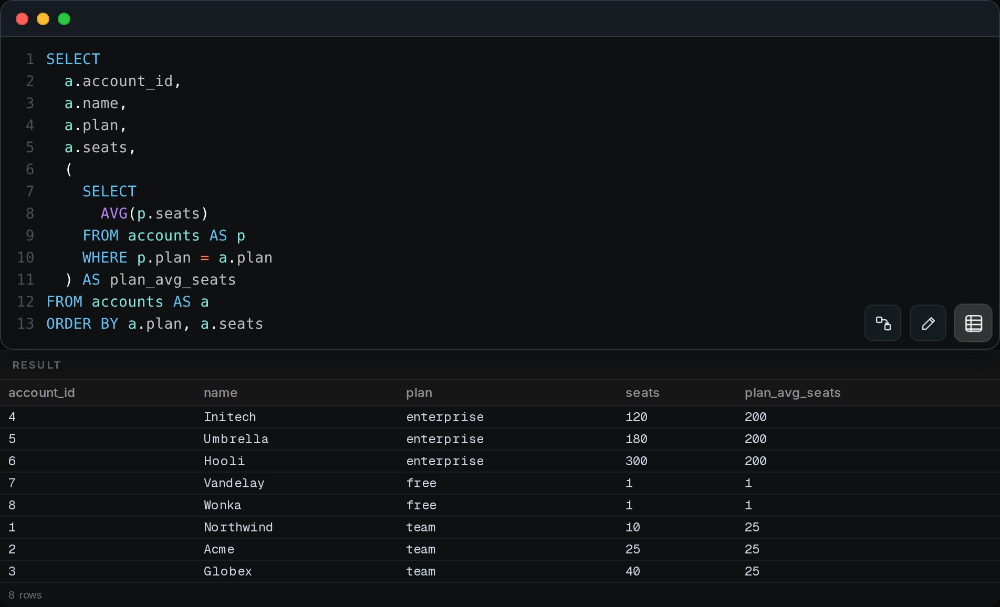
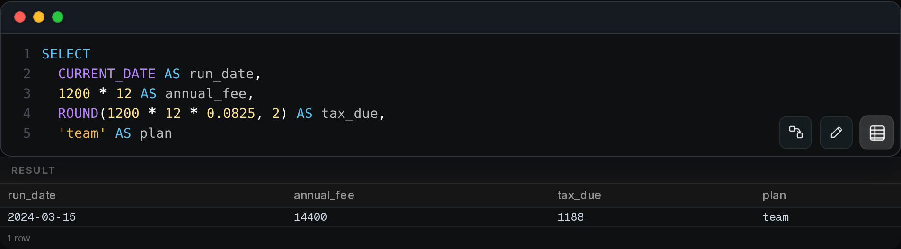
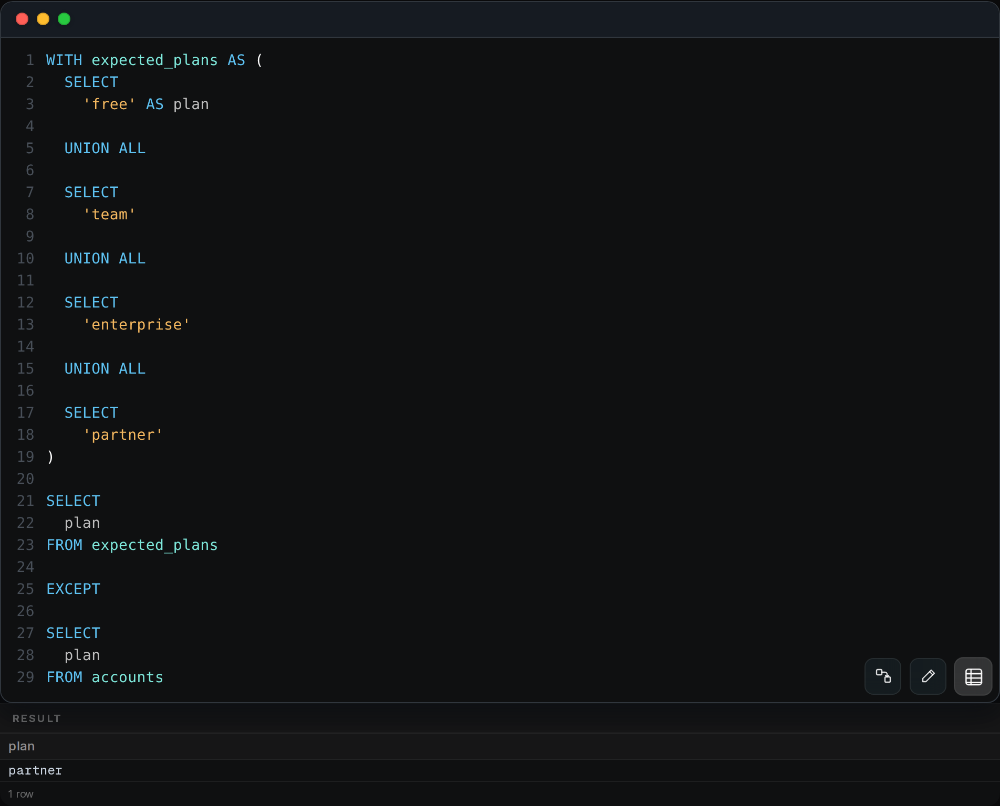

# Query Structure: Advanced

A billing team's warehouse holds 8 accounts, a signup funnel, a session log and a features column that stores a list in every cell. Which accounts are bigger than the rest of their plan? Which signups never confirmed? Which features does each account carry? Each of those has a short answer, and none of them is a plain join. This lesson covers 5 shapes of query that fill those gaps.


<br>

---

## Correlated subqueries

A correlated subquery is a subquery that references a column of the outer query anywhere in its body. The reference usually sits in its `WHERE`, though one in its select list, `HAVING` or `ON` correlates it just as much. The subqueries from the intermediate tier run once: the database computes the list or the scalar, then the outer query uses it. A correlated one cannot run on its own, because a reference such as `a.plan` has no value until the outer query is sitting on a particular row. So the database evaluates it once per outer row, with that row's values filled in. The outer row keeps its own detail while picking up a value computed from its group.


<br>

### Each account against its plan's average

The running example for this lesson is a SaaS billing team's `accounts` table: 8 accounts on 3 plans, each with a seat count. The question is which accounts are larger than the average account on their own plan. `GROUP BY plan` returns 3 rows, one per plan, and loses the accounts. The correlated subquery keeps all 8 rows and computes the plan average for each one.



```sql
SELECT
  a.account_id,
  a.name,
  a.plan,
  a.seats,
  (
    SELECT
      AVG(p.seats)
    FROM accounts AS p
    WHERE p.plan = a.plan
  ) AS plan_avg_seats
FROM accounts AS a
ORDER BY a.plan, a.seats
```

Read the result by plan. The 3 Team accounts average 25 seats, and Globex at 40 sits above it. The 3 Enterprise accounts average 200, and only Hooli at 300 clears that. Both Free accounts have 1 seat, so each equals its average and neither is above it. The subquery ran 8 times, once per account, and each run saw a different `a.plan`.


<br>

### Moving the comparison into WHERE

```sql
SELECT
  a.account_id,
  a.name,
  a.seats
FROM accounts AS a
WHERE a.seats > (
  SELECT
    AVG(p.seats)
  FROM accounts AS p
  WHERE p.plan = a.plan
)
```

Trace account 3. The outer scan reaches Globex, so `a.plan` is `team`. The inner query scans `accounts` as `p`, keeps the 3 Team rows, averages 10, 25 and 40 to 25, and hands 25 back. The comparison 40 > 25 holds and Globex is kept. On Wonka the inner query returns 1, the comparison 1 > 1 fails, and the row is dropped. Nothing in the result is a group: every row is still an account, with every column of that account available to the select list.


<br>

### What the per-row rerun costs

Executed literally, the pattern is a nested loop. With 8 accounts the inner query scans 8 rows on each of 8 passes, so the database touches 64 rows to answer a question about 8. The work grows with the square of the table: at a million accounts the literal plan visits the row count squared. SQL Server and Trino recognise this shape and decorrelate it. They rewrite the subquery as one `GROUP BY plan` joined back on `plan`, which computes each average once. PostgreSQL is narrower. It turns correlated `EXISTS` and `NOT EXISTS` into semi-joins and anti-joins, and keeps a correlated scalar aggregate like this one as a loop that runs once per outer row.

- **10^12** — row visits at 1M accounts, no rewrite

In PostgreSQL the plan-average query above shows exactly that loop: `EXPLAIN` prints a `SubPlan` under the scan of `accounts`, evaluated for each of the 8 rows. The remedy there is the hand-written form on the right of the comparison below. A CTE groups by `plan` and is joined back on `plan`, and it plans as a `HashAggregate` and a `Hash Join`. Engines that do decorrelate also have limits. A correlation on an inequality, a `LIMIT` inside the subquery, or a correlated subquery nested 2 levels deep can leave the optimizer with no equivalent join, and then the loop really runs. A correlated subquery that is slow on a large table is worth rewriting as a CTE, then comparing the 2 plans.

| ✓ Correlated subquery | ✗ CTE with GROUP BY, then JOIN |
| --- | --- |
| • Reads as the question: for each account, average its plan<br><br>• Keeps every outer row and every column of it<br><br>• Decorrelated into a join by SQL Server and Trino<br><br>• Runs as a per-row SubPlan in PostgreSQL, and wherever a rewrite fails | • Computes each plan's average once, in a named step<br><br>• Plan is predictable: one aggregate, one hash join<br><br>• Needs the join key and the aggregate written out<br><br>• Reuses the per-plan figures across several comparisons |


<br>

### The bug that removes the correlation

The most common mistake with this pattern leaves the query running and returning the wrong number on every row. Drop the aliases and write `WHERE plan = plan` inside the subquery, and the query still parses, still runs, and returns one number repeated 8 times.

**The subquery is rewritten without aliases as (SELECT AVG(seats) FROM accounts WHERE plan = plan). The query runs and returns 84.625 on every one of the 8 rows. Why?**

- **A.** Both sides of plan = plan resolve to the inner accounts table, so the condition holds for every row, the subquery is no longer correlated, and it averages all 8 accounts.
- **B.** AVG cannot be filtered inside a subquery, so the database ignores the WHERE clause and averages the whole table.
- **C.** The database evaluates the subquery once for the first row and caches 84.625 for the rest.
- **D.** A NULL plan on one account breaks the comparison for all rows.

<details>
<summary>Solution</summary>

**A.** Both sides of plan = plan resolve to the inner accounts table, so the condition holds for every row, the subquery is no longer correlated, and it averages all 8 accounts.

An unqualified column binds to the innermost table that has it. With no reference to the outer a, the subquery runs once over the whole table: 677 seats across 8 accounts is 84.625.

**Why the others are wrong**

- **B.** AVG respects any WHERE in its query. The clause ran; it kept every row because the comparison was always true.
- **C.** A single evaluation is what happens, but only because nothing in the subquery varies by outer row. The cache is correct behaviour for a query that stopped being correlated.
- **D.** No plan is NULL in this table, and a NULL would drop that one row from the inner average rather than change the result on the other rows.

</details>

The same per-row mechanism powers `EXISTS`, where the subquery returns no value and the outer row is kept or dropped on whether any inner row matched. `WHERE NOT EXISTS (SELECT 1 FROM invoices AS i WHERE i.account_id = a.account_id)` keeps the accounts that have never been invoiced, and the database stops scanning `invoices` at the first match for each account. `EXISTS` has a lesson of its own; what matters here is that the correlation is the same reference to `a`, and the same aliasing rule protects it.

> **TIP**
>
> Alias every table in a correlated subquery and qualify every column, even when the column names differ between the tables. The correlation is a reference to the outer alias, and an unqualified column resolves to the innermost table that has it.


<br>

---

## EXCEPT and EXCEPT ALL

`EXCEPT` takes 2 queries and returns the rows of the first that do not appear in the second. It belongs to the same family as `UNION`: both queries must produce the same number of columns with compatible types, the column names come from the first query, and the output is deduplicated unless `ALL` is added. Where `UNION` adds the second set, `EXCEPT` subtracts it, and the subtraction is directional. `A EXCEPT B` and `B EXCEPT A` answer different questions.


<br>

### Signups that never confirmed

The billing team's funnel logs every signup attempt in `all_signups` and every email confirmation in `confirmed_signups`. User 2 signed up twice, on March 2 and March 10, and confirmed once. Users 1 and 3 never confirmed, and user 4 confirmed a day after signing up. The switcher runs 3 formulations over those rows: plain `EXCEPT`, `EXCEPT ALL`, and the numbered-row rewrite that reproduces `EXCEPT ALL` on an engine without it.

Users with an unconfirmed signup, each listed once.

|  |  |
| --- | --- |
|  | SELECT |
|  | user_id |
|  | FROM all_signups |
|  |  |
|  | EXCEPT |
|  |  |
|  | SELECT |
|  | user_id |
|  | FROM confirmed_signups |
|  | ORDER BY user_id |

Result

| user_id |
| --- |
| 1 |
| 3 |

2 rows

The first tab returns users 1 and 3. User 2 does not appear, because `EXCEPT` removes every copy of a row that has any match on the right, and user 2 has one. The second tab swaps the sides and returns nothing: both confirmed users also signed up, so subtracting the signups leaves no row. The order of the sides decides the question. The third tab is the counted version. Written `EXCEPT ALL`, the operator subtracts occurrence counts, so 2 copies of user 2 on the left minus 1 on the right leaves 1: the March 10 attempt that nobody confirmed. PostgreSQL, Trino and DuckDB accept `EXCEPT ALL`. On an engine without it, the tab numbers each occurrence with `ROW_NUMBER` and subtracts the pairs. That second attempt becomes the row (2, 2), which has no partner on the right and survives, so the tab returns 1, 2 and 3.

https://github.com/user-attachments/assets/71f6ba72-cfdf-4062-998f-abfc5b8d744a

The animation plays the first tab. The 5 rows of `all_signups` come in, each is compared against the 2 confirmed rows, and rows 2 and 4 find a match and leave. Rows 1 and 3 remain, and the second copy of user 2 is removed as well, since the match is on the value, not on a particular row.

| user_id | copies in all_signups | copies in confirmed | EXCEPT | EXCEPT ALL |
| --- | --- | --- | --- | --- |
| 1 | 1 | 0 | kept | 1 copy |
| 2 | 2 | 1 | removed | 1 copy |
| 3 | 1 | 0 | kept | 1 copy |
| 4 | 1 | 1 | removed | 0 copies |

Set operators compare rows with `IS NOT DISTINCT FROM` semantics: 2 `NULL` values count as equal, so a `NULL` on the left is removed by a `NULL` on the right. That differs from `WHERE user_id = ...`, where `NULL` matches nothing. The difference is why `EXCEPT` is a safer reconciliation tool than `NOT IN`, which returns no rows at all when the right side contains a single `NULL`.


<br>

### Reconciliation, where EXCEPT earns its keep

Any question shaped as what is in A and missing from B is an `EXCEPT`. A cleaning step reads a raw table and writes a curated one, and `SELECT * FROM raw EXCEPT SELECT * FROM curated` lists the rows it dropped, compared column by column, with no join condition to write. A migration copies a table to a new system, and running the subtraction in both directions produces a full diff: rows lost and rows invented. A contract test compares the rows a job produced today against the rows it was expected to produce, and an empty result in both directions is a pass.

> Where EXCEPT stops
>
> - Only the first query's columns come out; nothing from the right side can be shown.
> - It compares 2 queries. Deduplicating one table is a job for DISTINCT or a window function.
> - It is directional: swapping the sides answers the opposite question.
> - Whole rows are compared, so a column present on one side only has to be projected away first.

Sometimes the answer needs columns of the left row beyond the ones being compared, or a filter on the right side that the left does not share. In that case the `NOT EXISTS` form from the previous section does the same subtraction on a key and keeps every column of the outer row. Pick by what the output needs: `EXCEPT` for a row-level diff with no join to write, `NOT EXISTS` for a subtraction on a key that returns the full left row.

The signup table counts attempts, so the query that lists unconfirmed attempts, including repeats, needs `EXCEPT ALL` and the sides in the right order.


<br>

---

## INTERSECT and INTERSECT ALL

`INTERSECT` returns the rows that both of its queries produce, deduplicated. It follows the same column rules as `UNION` and `EXCEPT`, and like them compares whole rows, with `NULL` equal to `NULL`. Among the 3 set operators it has the highest precedence in the SQL standard: `A UNION B INTERSECT C` means `A UNION (B INTERSECT C)` in PostgreSQL and Trino, so parentheses around any mixed chain are worth their 2 characters.


<br>

### Users who are both known and active

The `users` table holds 5 registered users. `user_sessions` holds 4 session rows for users 2, 2, 4 and 6, and `user_purchases` holds 5 purchase rows for users 2, 2, 2, 4 and 7. User 6 has sessions and no `users` row, and user 7 has purchases and no row either, which is the kind of orphan the previous section's `EXCEPT` would surface. The switcher asks 3 questions of those tables.

Registered users with at least one session.

|  |  |
| --- | --- |
|  | SELECT |
|  | user_id |
|  | FROM users |
|  |  |
|  | INTERSECT |
|  |  |
|  | SELECT |
|  | user_id |
|  | FROM user_sessions |
|  | ORDER BY user_id |

Result

| user_id |
| --- |
| 2 |
| 4 |

2 rows

The first tab returns 2 and 4, the registered users with at least one session. User 6 is dropped because the left side never produces it. The second tab returns 2 and 4 again: users with both sessions and purchases. The third tab returns 2, 2 and 4, the result `INTERSECT ALL` gives on engines that support it. Here it is rebuilt by numbering each user's rows on both sides and intersecting the numbered pairs. `INTERSECT ALL` keeps each row as many times as the smaller side holds it. User 2 appears 2 times in sessions and 3 times in purchases, so the pairs (2, 1) and (2, 2) match and (2, 3) has no partner. User 4 appears once on each side.

https://github.com/user-attachments/assets/e6ab98d9-a17d-4d84-b342-35b90ca0c2b5

The animation plays the first tab. Each of the 5 user rows is checked against the session rows; 2 and 4 find matches and move to the result, and the second session for user 2 adds nothing, since the result holds each value once.

| user_id | session rows | purchase rows | INTERSECT | INTERSECT ALL |
| --- | --- | --- | --- | --- |
| 2 | 2 | 3 | 1 copy | 2 copies |
| 4 | 1 | 1 | 1 copy | 1 copy |
| 6 | 1 | 0 | absent | absent |
| 7 | 0 | 1 | absent | absent |

**user_sessions holds user 2 on 2 rows and user_purchases holds user 2 on 3 rows. How many times does user 2 appear in SELECT user_id FROM user_sessions INTERSECT ALL SELECT user_id FROM user_purchases?**

- **A.** 2 times: INTERSECT ALL keeps each row up to the count on the side that has fewer copies.
- **B.** 3 times: the larger count wins, as it does with UNION ALL.
- **C.** 6 times: 2 copies pair with 3 copies, the way an inner join fans out.
- **D.** Once: INTERSECT ALL dedupes like INTERSECT, and ALL only changes performance.

<details>
<summary>Solution</summary>

**A.** 2 times: INTERSECT ALL keeps each row up to the count on the side that has fewer copies.

The smaller count is the number of pairs that can be matched one to one. Two session rows pair with 2 of the 3 purchase rows, and the third purchase has no partner.

**Why the others are wrong**

- **B.** UNION ALL adds the counts and would show 5 copies. INTERSECT ALL takes the minimum, which is 2.
- **C.** A join on user_id would produce 6 rows. INTERSECT ALL never multiplies; it matches rows one to one and stops when one side runs out.
- **D.** ALL changes the result. Plain INTERSECT returns 1 copy; INTERSECT ALL returns 2 here.

</details>


<br>

### INTERSECT against a join

An `INNER JOIN` on `user_id` with `DISTINCT` answers the same question and leaves 2 choices open that `INTERSECT` closes. The join compares only the columns in its `ON`, so `users.plan` and `user_sessions.session_date` can both come out; `INTERSECT` can only compare rows whose columns line up, which is why each tab projects to `user_id` first. The join also fans out: user 2 with 2 sessions and 3 purchases produces 6 joined rows before `DISTINCT`, while `INTERSECT` never multiplies. For a key-only overlap check, `INTERSECT` is the shorter and the safer query; for anything that needs columns from both sides, the join.

Funnel analysis is the usual home: viewers who also purchased, trial accounts that also opened a support ticket, keys present in both of 2 systems before a migration cutover. Chaining is allowed, so `sessions INTERSECT purchases INTERSECT tickets` finds the users present in all 3, a question that `EXCEPT` cannot express without nesting.


<br>

---

## UNNEST for arrays

An array column stores a list inside one cell. The `accounts` table carries a `features` column of type `ARRAY(VARCHAR)`, so Northwind's row holds `['sso', 'audit_log', 'sla']` in a single field. That shape is compact to store and awkward to query: `COUNT` cannot count inside a cell, and `GROUP BY` cannot group by an element. `UNNEST` turns an array into a table with one row per element, and joined to the row it came from, it repeats that row once per element. The grain of the result changes from one row per account to one row per account and feature.


<br>

### Three accounts become 6 rows

The 3 Team accounts from the first section carry these arrays: Northwind has 3 features, Acme has 1 and Globex has 2. The query below unnests them. The alias `f(feature)` names the derived table and its single column. `CROSS JOIN` is the join type because `UNNEST` here is a lateral source: it produces rows for the current outer row only, so there is no condition to write.

```sql
SELECT
  a.account_id,
  a.name,
  a.seats,
  f.feature
FROM accounts AS a
CROSS JOIN UNNEST(a.features) AS f(feature)
WHERE a.plan = 'team'
ORDER BY a.account_id, f.feature
```

| account_id | name | seats | feature |
| --- | --- | --- | --- |
| 1 | Northwind | 10 | audit_log |
| 1 | Northwind | 10 | sla |
| 1 | Northwind | 10 | sso |
| 2 | Acme | 25 | sso |
| 3 | Globex | 40 | audit_log |
| 3 | Globex | 40 | sla |

Six rows come out of 3. Northwind's seat count, 10, now appears on 3 rows, and Globex's 40 on 2. Every column of the account is copied onto each element's row. That keeps per-feature figures right, and it turns any total taken across features into a double count.


<br>

### Aggregating at the new grain

```sql
SELECT
  f.feature,
  COUNT(*) AS accounts,
  SUM(a.seats) AS seats_after_unnest
FROM accounts AS a
CROSS JOIN UNNEST(a.features) AS f(feature)
WHERE a.plan = 'team'
GROUP BY f.feature
ORDER BY f.feature
```

| feature | accounts | seats_after_unnest |
| --- | --- | --- |
| audit_log | 2 | 50 |
| sla | 2 | 50 |
| sso | 2 | 35 |

`COUNT(*)` per feature is correct: each row is one account holding one feature, so counting rows counts accounts per feature. The seat column tells a different story. Adding the 3 figures gives 135 seats, against a true total of 75, because Northwind's 10 seats were counted 3 times and Globex's 40 twice. Any aggregate of an account-level column has to happen before the unnest, or against `DISTINCT account_id` after it, or it inflates by the array length of each row. Per-feature seat totals are legitimate when the question is how many seats each feature covers, and wrong the moment they are summed.


<br>

### Position, empty arrays and NULL

```sql
SELECT
  a.account_id,
  f.feature,
  f.pos
FROM accounts AS a
LEFT JOIN UNNEST(a.features) WITH ORDINALITY AS f(feature, pos)
  ON TRUE
```

`WITH ORDINALITY` adds the element's 1-based position, so the first feature an account enabled, when the array is kept in enable order, is the row with `pos = 1`. An empty array produces zero rows, and so does a `NULL` array, which means `CROSS JOIN UNNEST` drops an account with no features the way an inner join drops an unmatched row. `LEFT JOIN UNNEST ... ON TRUE` keeps the account with a `NULL` feature, which matters whenever the report has to list every account.

The syntax varies by engine more than most of SQL does. Trino and PostgreSQL both accept `CROSS JOIN UNNEST(features) AS f(feature)` and `WITH ORDINALITY`; PostgreSQL also allows `unnest(features)` in the select list. BigQuery writes `CROSS JOIN UNNEST(features) AS feature`, with the alias naming the element directly, and Snowflake uses `LATERAL FLATTEN`. The behaviour is the same in all of them: one row per element, the outer row copied alongside.

> **TIP**
>
> Compute seat totals, revenue and any other parent-level figure in a CTE before the unnest, then join the per-element rows to it. The fan-out never touches a number that was already summed.


<br>

---

## SELECT Without FROM

A `SELECT` with no `FROM` evaluates its select list once and returns 1 row. There is no table to scan, so every column is a literal, an expression over literals, a function of the environment such as `CURRENT_DATE`, or a scalar subquery. PostgreSQL, Trino, BigQuery, SQL Server, DuckDB and current MySQL all accept it. Oracle before 23ai requires `FROM DUAL`, a one-row dummy table that exists for this purpose and nothing else.


<br>

### The one-row query



```sql
SELECT
  CURRENT_DATE AS run_date,
  1200 * 12 AS annual_fee,
  ROUND(1200 * 12 * 0.0825, 2) AS tax_due,
  'team' AS plan
```

The row carries today's date in the first column, then 14400, 1188.00 and `team`. This is the query that checks an expression before it goes into a 300-line report, that answers what day the scheduler thinks it is, and that confirms a connection is alive. `SELECT 1` is the liveness probe most connection pools send, for the same reason: it runs without touching a table or taking a lock.


<br>

### Rows from nowhere

Stacking `SELECT` statements with `UNION ALL` produces a table that exists only inside the query. Column names come from the first `SELECT`, and the later ones supply values in the same order. The query below declares the 4 plans the billing system is supposed to offer and subtracts the plans that accounts actually use, with the `EXCEPT` from earlier in the lesson.



```sql
WITH expected_plans AS (
  SELECT
    'free' AS plan

  UNION ALL

  SELECT
    'team'

  UNION ALL

  SELECT
    'enterprise'

  UNION ALL

  SELECT
    'partner'
)

SELECT
  plan
FROM expected_plans

EXCEPT

SELECT
  plan
FROM accounts
```

The result is `partner`, a plan nobody has bought. The same inline rows serve as test fixtures: a unit test for a transformation feeds it a 4-row CTE instead of loading a table, and the expected output is another inline set, compared with `EXCEPT` in both directions. The `VALUES` form, `SELECT * FROM (VALUES ('free', 0), ('team', 20)) AS t(plan, price)`, is shorter for the same job and is supported by PostgreSQL, Trino and SQL Server.


<br>

### Scalars and sequences

```sql
SELECT
  (
    SELECT
      COUNT(*)
    FROM accounts
  ) AS accounts,
  (
    SELECT
      COUNT(*)
    FROM all_signups
  ) AS signups,
  (
    SELECT
      MAX(seats)
    FROM accounts
  ) AS largest_account
```

A scalar subquery is a complete query folded into one cell, so a `FROM`-less `SELECT` can hold several of them and return one row of figures from several tables, with no join and no fan-out. The pattern shows up in monitoring dashboards and in the first line of a backfill script that records what the tables looked like before the run.

**A monitoring query must return exactly 1 row holding the row counts of accounts (8 rows), all_signups (5) and user_sessions (4). Which shape does that?**

- **A.** A FROM-less SELECT with 3 scalar subqueries, one COUNT(*) per table.
- **B.** SELECT COUNT(*) FROM accounts, all_signups, user_sessions
- **C.** Three SELECT COUNT(*) queries combined with UNION ALL.
- **D.** SELECT COUNT(*) FROM accounts JOIN all_signups ON TRUE

<details>
<summary>Solution</summary>

**A.** A FROM-less SELECT with 3 scalar subqueries, one COUNT(*) per table.

Each subquery returns one value, the outer select list is evaluated once, and the row reads 8, 5, 4 with each column named for its table.

**Why the others are wrong**

- **B.** The comma is a cross join. The count is 8 times 5 times 4, which is 160, and the query gets slower with the product of the 3 tables.
- **C.** That returns 3 rows, and unless each SELECT adds a label column, nothing says which count belongs to which table.
- **D.** An ON TRUE join is a cross join: 40 rows counted as one number, and the third table is missing.

</details>

```sql
SELECT
  d AS day
FROM UNNEST(SEQUENCE(DATE '2024-03-01', DATE '2024-03-07')) AS t(d)
```

Generating a date spine is the other side of the previous section: `SEQUENCE` builds an array of 7 dates and `UNNEST` turns it into 7 rows, with no calendar table in the database. A `LEFT JOIN` from that spine to daily revenue is how a report shows a zero for the day with no sales, which `GROUP BY` on the sales table alone would skip. PostgreSQL has `generate_series` for the same job and BigQuery has `GENERATE_DATE_ARRAY`, each feeding its own `UNNEST`.

| ✓ Do | ✗ Don't |
| --- | --- |
| • Alias the outer table and qualify every column inside a correlated subquery.<br><br>• Check the plan for a kept nested loop before shipping a correlated subquery on a large table.<br><br>• Run EXCEPT in both directions when reconciling 2 tables, so lost and invented rows both show.<br><br>• Aggregate account-level numbers before UNNEST, or on DISTINCT keys after it.<br><br>• Parenthesise any chain that mixes INTERSECT with UNION or EXCEPT. | • Don't reach for EXCEPT to deduplicate one table; that is a job for DISTINCT or a window.<br><br>• Don't sum a parent column across unnested rows; it multiplies by each row's array length.<br><br>• Don't use CROSS JOIN UNNEST when every account must appear; empty arrays vanish from the result.<br><br>• Don't assume INTERSECT ALL and EXCEPT ALL exist on every engine; the ROW_NUMBER rewrite is the fallback. |


<br>

---

## Putting It All Together

A billing team is migrating subscription data from a legacy MySQL system into a Trino warehouse 2 weeks before quarter-end close. Finance needs proof that nothing was lost, a list of accounts whose seat counts look wrong for their plan, and a per-feature adoption report built from an array column the legacy system stored as a comma-separated string.

- The migration check is EXCEPT run in both directions between the legacy copy and the warehouse table, projected to the columns both share, and an empty result each way is the sign-off.
- Accounts to review come from a correlated subquery comparing each account's seats against the average of its own plan, so the reviewer sees the account, not the plan.
- The feature report splits the legacy string into an array and unnests it, with COUNT(\*) per feature at the new grain and seat totals computed in a CTE before the expansion.
- The accounts that are both above their plan average and carry the sla feature come from INTERSECT over the 2 account_id lists, with no join to fan out.
- The 4 plans the warehouse is expected to hold are declared in a FROM-less UNION ALL and subtracted from the loaded plans, so a plan that never arrived shows up as a row.


<br>

---

## Key Takeaways

- A correlated subquery runs once per outer row, reading that row's values, so each row keeps its detail and gains a figure from its own group.
- EXCEPT subtracts the second query's rows from the first and dedupes; EXCEPT ALL subtracts occurrence counts, and both are directional.
- INTERSECT keeps rows both queries produce; INTERSECT ALL keeps each up to the smaller side's count, and it binds tighter than UNION and EXCEPT.
- UNNEST changes the grain to one row per element and copies the parent row onto each, so aggregate parent columns before expanding.
- A SELECT with no FROM returns one row of literals, functions and scalar subqueries, and stacked with UNION ALL it builds tables from nothing.
