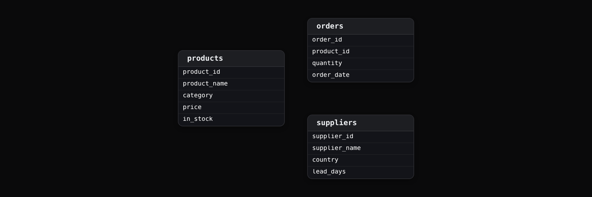
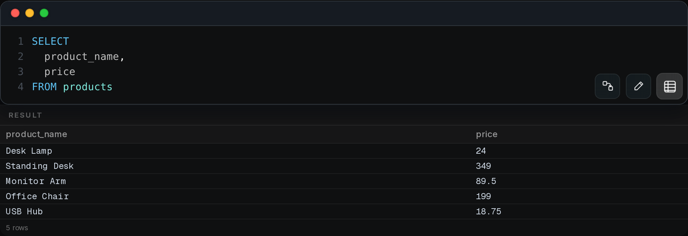
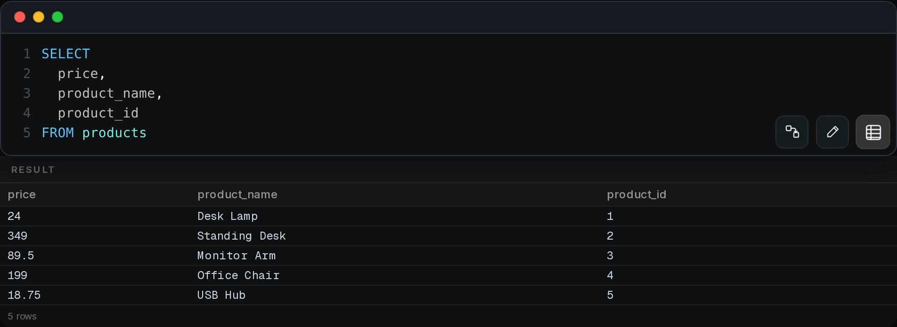
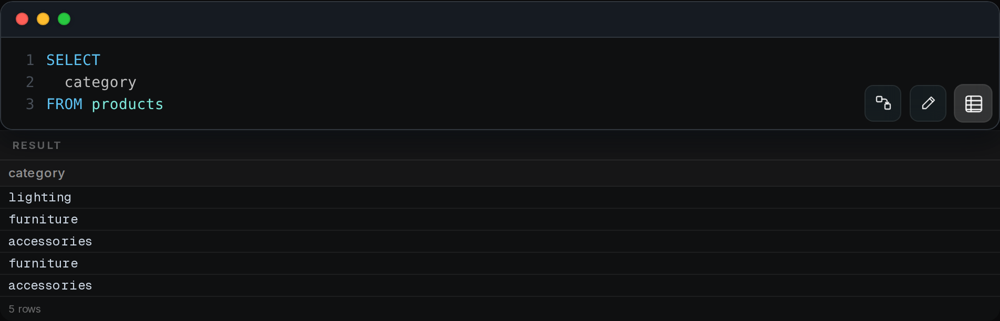
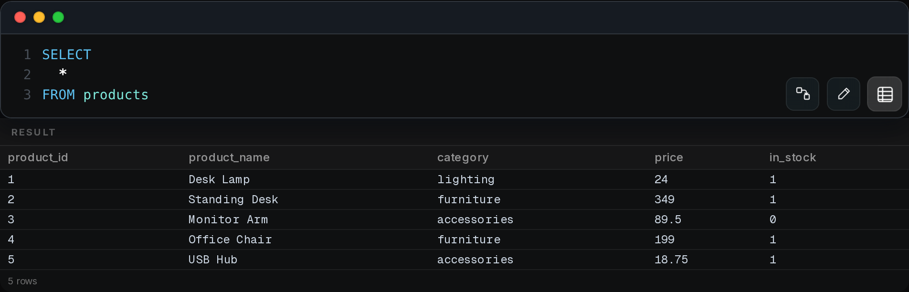
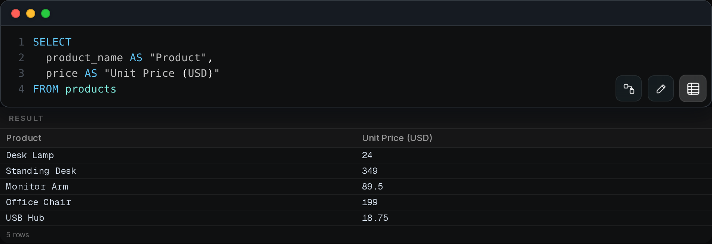
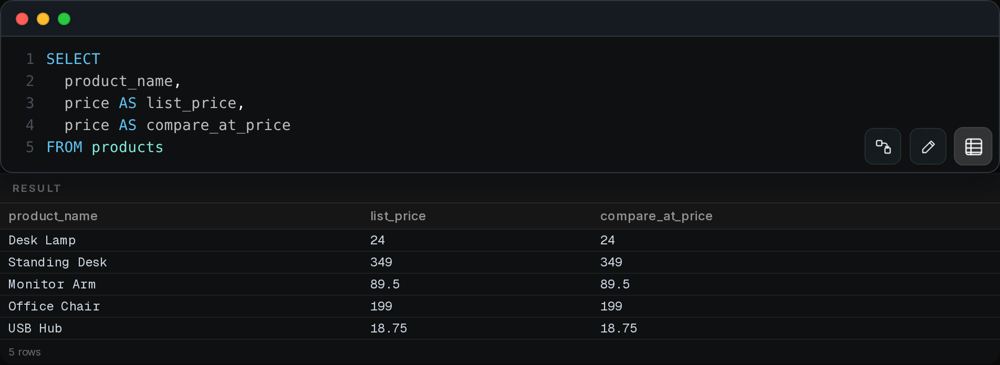
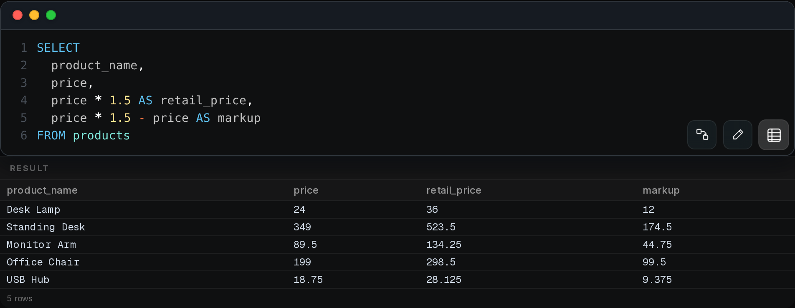
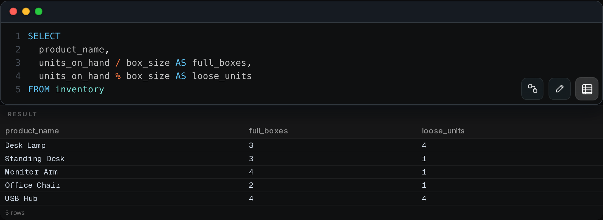

# Query Structure: Beginner

At Shopify, a merchant who sells desk lamps and office chairs asks support what each item will cost buyers once a 3 dollar handling fee is added. The analyst on the ticket opens a products table with dozens of columns. Picking the 2 columns that matter, adding the fee as a calculated column and labelling it Final Price turns that table into her answer in minutes.


<br>

---

## Tables, rows, and columns

A database keeps its data in tables. A table has a name, a fixed set of named columns, and any number of rows. Each column holds the same kind of value in every row: a price column holds prices, never a name in some rows and a date in others. Each row holds 1 record, such as one product in a products table, with a value under every column. The table below is the one this lesson reads again and again, so look at it closely before moving on.

| product_id | product_name | category | price | in_stock |
| --- | --- | --- | --- | --- |
| 1 | Desk Lamp | lighting | 24.0 | 1 |
| 2 | Standing Desk | furniture | 349.0 | 1 |
| 3 | Monitor Arm | accessories | 89.5 | 0 |
| 4 | Office Chair | furniture | 199.0 | 1 |
| 5 | USB Hub | accessories | 18.75 | 1 |

This table is named products. It has 5 columns and 5 rows, which makes 25 cells. Reading across the row where product_id is 3 gives everything the store knows about the Monitor Arm: its category is accessories, its price is 89.5, and in_stock is 0, the store's way of recording that it is sold out. Reading down the price column gives every product's price in 1 pass. A cell is the point where 1 row meets 1 column, and every query in this lesson is a way of choosing which columns to read from every row. Choosing which rows to read is the next topic in the track.


<br>

### Rows have no built-in order

The rows above run from product_id 1 to 5 because that is the order they were typed in, and the database makes no promise to keep them that way. A table is a collection of rows, and when a query reads it without asking for an order, the database may hand the rows over in any sequence, often the order they happen to sit in storage. A later lesson covers asking for a specific order. Until then, 2 results with the same rows in a different sequence count as the same result, and a query that returns the Office Chair first has done nothing wrong.


<br>

### Finding your way around several tables



A real database holds dozens or hundreds of tables, and the first job in any of them is to learn each table's name and its exact column names, because a query can only ask for columns that exist. The 3 cards above describe a small store. The column product_id appears in both products and orders: an orders row records which product was sold by carrying its product_id, and reading the 2 tables together is a later topic. The habit to build now is checking the card before typing anything. A column called product_name exists; a column called name does not, and that difference decides whether a query runs or stops with an error.

| ✓ A row | ✗ A column |
| --- | --- |
| • 1 record: 1 product, 1 order, 1 supplier<br><br>• Read across to see every fact about that record<br><br>• The count grows every time data is added<br><br>• Holds no fixed position in the table | • 1 attribute: price, category, country<br><br>• Read down to see 1 fact about every record<br><br>• The set is fixed when the table is designed<br><br>• Has a name and holds 1 kind of value |

> **TIP**
>
> The tables in this lesson, like most, name their columns in snake_case: lowercase words joined by the _ character, such as product_name. That is a convention teams follow, and the database does not enforce it. What the database does enforce is spelling: productname and product_name are 2 different names to it, and only the second exists in products.

**In the products table, what does the cell at the row where product_id is 5 and the column price hold?**

- **A.** USB Hub, because a row's name is repeated in every cell of that row
- **B.** 18.75, because a cell holds the value where that row meets that column
- **C.** 5, because the price column copies the value found in product_id
- **D.** The whole row, because a cell and a row describe the same thing

<details>
<summary>Solution</summary>

**B.** 18.75, because a cell holds the value where that row meets that column

Correct. The row with product_id 5 is the USB Hub, and under its price column sits 18.75.

**Why the others are wrong**

- **A.** A row has no name of its own. USB Hub is the value under product_name for that row, and the price column holds a different value.
- **C.** Columns hold their own values. product_id and price are separate columns, and 5 is the product_id, which says nothing about the price.
- **D.** A row is a set of 5 cells. A single cell is 1 of them, and the question names 1 column, so the answer is 1 value.

</details>


<br>

---

## SELECT and FROM basics

A query is a question written for the database, and the smallest useful one has 2 parts. `FROM` names the table to read. `SELECT` lists the columns to bring back, separated by commas. The database finds the table and walks every row, keeping from each one only the columns on the list. What comes back is a new table that lives for the length of the query: the same rows, only the chosen columns.



```sql
SELECT
  product_name,
  price
FROM products
```

Run it and 5 rows come back, 1 per product, each with 2 values: Desk Lamp beside 24.0, Standing Desk beside 349.0, and so on down to USB Hub beside 18.75. The query did not name product_id or category, so they were read off the table and left out before the result was assembled, and in_stock went the same way. The products table is the same afterward as before, because a `SELECT` reads the table and never edits it, however many times it runs.

| Step | Clause | What the database does |
| --- | --- | --- |
| 1 | FROM products | Opens the table: 5 rows, 5 columns |
| 2 | SELECT product_name, price | Keeps 2 columns from every row |
| 3 | Return | Hands back 5 rows of 2 columns |


<br>

### Read FROM before SELECT

You write `SELECT` first and `FROM` second, and the database works the other way around: it has to locate the table before it can know which columns exist. Read your own queries in the database's order. Start at `FROM` and picture the table with its column card. Then move up to `SELECT` and check that every name on the list belongs to that table. A name that does not, such as a misspelled `pirce`, stops the query with an error saying the column cannot be resolved, before a single row is returned.


<br>

### The SELECT list sets the column order



```sql
SELECT
  price,
  product_name,
  product_id
FROM products
```

The result's columns appear in the order the `SELECT` list gives them, so price comes first, even though product_id is the first column in the table. The table's own column order has no hold over the result. A column can also be listed twice, which returns it twice side by side; that reads as a mistake today and becomes useful in the last section of this lesson, where 1 copy is turned into a calculation and the other is kept as it is.


<br>

### Every row comes back, repeats included



```sql
SELECT
  category
FROM products
```

Naming 1 column still returns 5 rows: lighting, furniture, accessories, furniture, accessories. furniture appears twice because 2 products belong to it, and the database does not collapse repeats on its own. `SELECT` narrows the columns, never the rows; the result has as many rows as the table until the filtering lesson adds the tool that changes that. A count of rows in a result is therefore a count of rows in the table, which is a quick sanity check when a result looks too short or too long.

A comma separates every pair of columns, and the last column carries no comma before `FROM`; a stray comma there is a syntax error. The keywords `SELECT` and `FROM` can be typed in any mixture of upper and lower case, so select works exactly like SELECT. Upper case is the convention because it makes the skeleton of a long query visible at a glance: keywords stand out, column names stay quiet. A query may end with a semicolon; tools that run several statements in a row use it as a separator, and a single query runs the same with or without it.

> What every SELECT needs
>
> - A table name after FROM that exists in the database
> - At least 1 column name after SELECT, spelled as the table spells it
> - A comma between every 2 columns and none after the last
> - Keywords in any case, upper case by convention

**What does this query return when run against the products table?**

```sql
SELECT
  category,
  product_name
FROM products
```

- **A.** 5 rows with 2 columns, product_name first because it comes first in the table
- **B.** 5 rows with all 5 columns, because a query always returns the whole row
- **C.** 2 rows, 1 for category and 1 for product_name, each listing 5 values
- **D.** 5 rows with 2 columns, category first and product_name second

<details>
<summary>Solution</summary>

**D.** 5 rows with 2 columns, category first and product_name second

Correct. Every row of products comes back, and the SELECT list fixes both which columns appear and the order they appear in.

**Why the others are wrong**

- **A.** The table's column order is ignored. The SELECT list names category first, so category is the first result column.
- **B.** Only the columns on the SELECT list are kept. price is read and dropped, and so are product_id and in_stock.
- **C.** Rows come from the table and columns come from the SELECT list. Naming 2 columns returns 2 columns in each of the 5 rows.

</details>

Writing a query from a request follows the same steps every time. Turn each thing the request asks for into a column name from the table's card, spelled exactly as the card spells it. List those names after `SELECT` in the order the request wants them, with a comma between each pair and none after the last. Put the table's name after `FROM`. Then read the query back in the database's order: the table first, then each name on the list checked against that table's columns.


<br>

---

## Selecting all columns (\*)

An asterisk in place of the column list means every column of the table, in the order the table defines them. `SELECT * FROM products` returns all 5 columns and all 5 rows, the entire table. It is the quickest way to see what a table you have never opened holds, before you know a single column name, and the result doubles as the column card from the first section with real values filled in.



```sql
SELECT
  *
FROM products
```

product_id comes first and in_stock last because that is how the table was designed, and the star takes that order as given. Set this result beside the 2-column query from the last section: the same 5 rows, with 3 more values on each. The star changed nothing about which rows come back; it widened every row to the table's full width. Flip the table card beside the query to its rows and the result and the card match cell for cell.

**Star**

Every column of products, in the table's order, with no column names typed.

```sql
SELECT
  *
FROM products
```

Result:

```
product_id | product_name | category | price | in_stock
1 | Desk Lamp | lighting | 24 | 1
2 | Standing Desk | furniture | 349 | 1
3 | Monitor Arm | accessories | 89.5 | 0
4 | Office Chair | furniture | 199 | 1
5 | USB Hub | accessories | 18.75 | 1
```

**Named**

The 2 columns a price list needs, in the order the list wants them.

```sql
SELECT
  product_name,
  price
FROM products
```

Result:

```
product_name | price
Desk Lamp | 24
Standing Desk | 349
Monitor Arm | 89.5
Office Chair | 199
USB Hub | 18.75
```

**New table**

The star on a table you have never opened shows its columns and sample values in 1 move.

```sql
SELECT
  *
FROM suppliers
```

Result:

```
supplier_id | supplier_name | country | lead_days
1 | Brightline | Germany | 12
2 | Oakform | Canada | 30
3 | Portly | Taiwan | 9
```

The third version is the star doing its real job. Nobody told you that suppliers has a lead_days column, and after 1 run you know it exists and what kind of values it holds: the days each supplier takes to deliver, 12 in the first row and 30 and 9 in the next 2. The next query against suppliers can name lead_days with confidence. Run the star once to learn a table's shape, then write a named list for the queries that do the work.

Getting to know a new table in 3 moves

- Run SELECT \* on it once and read the column headers and a few values
- Decide which columns the question in front of you needs
- Rewrite the query with those columns named, and keep that version


<br>

### Where the star costs you

The star is right for exploring and wrong for anything that will run again tomorrow. A table with 80 columns returns 80 values per row whether 2 or 80 are wanted. On a large table the database reads every one of those columns from storage, and the query gets slower and uses more memory as the table gets wider. When someone adds a column to the table next month, every star query starts returning it. A spreadsheet built for a fixed set of columns breaks, and so does a program that expects one. A query that names product_name and price also tells the next reader what the question was, while a star tells them nothing about why the query exists.

**A report runs this query every morning and pastes the result into a spreadsheet laid out for 5 columns. Next week a weight_kg column is added to the products table. What does the report return after that?**

```sql
SELECT
  *
FROM products
```

- **A.** 6 columns per row, so the spreadsheet's columns no longer line up with the result
- **B.** 5 columns per row, because the star was fixed to those 5 when the report was written
- **C.** An error, because the table no longer matches the query that reads it
- **D.** 5 columns per row, with weight_kg taking the place of in_stock at the end

<details>
<summary>Solution</summary>

**A.** 6 columns per row, so the spreadsheet's columns no longer line up with the result

Correct. The star means every column the table has at the moment the query runs, and a new column widens the result without anyone changing the query.

**Why the others are wrong**

- **B.** The star is expanded fresh on every run. It carries no memory of which columns existed when the query was first written.
- **C.** Adding a column breaks no star query. The query runs and returns more than before, which is the quieter and more dangerous failure.
- **D.** No column is replaced. in_stock stays where it was and weight_kg is added after it, making 6.

</details>

| ✓ Do | ✗ Don't |
| --- | --- |
| • Use \* to look at a table for the first time<br><br>• Follow the star with a named list once you know which columns matter<br><br>• Name columns in any query that is saved or shared, and in every scheduled one | • Ship \* in a report or pipeline that runs on a schedule<br><br>• Assume the table's columns will stay the same forever<br><br>• Pull 80 columns to read 2 |

The star replaces the column list rather than 1 column on it. Writing SELECT \* gives every column once; adding named columns beside it, as in SELECT \*, price, returns price a second time and clutters the result. Keep the 2 styles apart: the star alone while exploring, a named list alone for the query you keep.

*A wide star result is also hard to read where you are likely to read it: 80 columns wrap into unreadable lines in a terminal or on a phone, while 3 named columns fit on 1 line.*


<br>

---

## AS aliases for columns

A result column takes its name from the table column it came from, and that name is often wrong for whoever reads the result. It may be too technical or too abbreviated, or the result may be headed for a tool that expects a different header. `AS` gives the result column a new name without touching the table. Write the column, then `AS`, then the name you want it to carry in the result.

https://github.com/user-attachments/assets/7d2309de-8446-4f31-89da-0f80cb6489a0

Play it and watch the headers change while the values stay put: product_name becomes item and price becomes unit_price, and the 5 rows underneath hold the same values the table does. The alias lives in the result only. The products table still has a column called product_name, and the next query to read it has to call it product_name again, because an alias from 1 query is gone the moment that query finishes.


<br>

### Names with spaces and capitals

An alias written as a bare word follows the same rules as a column name. It must start with a letter and may contain digits and the _ character after that. The database folds it to lower case, so `AS Unit_Price` comes back as unit_price. To give a result column a name with a space or a capital letter in it, wrap the alias in double quotes. The quotes make the name exactly what sits between them, spaces and capitals included, and any symbols as well, which is what a spreadsheet or a chart wants to display as a header.



```sql
SELECT
  product_name AS "Product",
  price AS "Unit Price (USD)"
FROM products
```

Single quotes mean something different: 'Product' is a piece of text, a value, while "Product" is a name. Writing price AS 'Unit Price' fails with a syntax error because the database expects a name after `AS` and finds a value instead. Double quotes go around names, and single quotes go around text.


<br>

### AS is optional, and still worth typing

The database accepts an alias with the keyword left out, so `price unit_price` means the same as `price AS unit_price`. The cost shows up when a comma goes missing: `SELECT product_name price FROM products` returns 1 column holding the product names under the header price, and raises no error at all, because the database read price as an alias for product_name. Typing `AS` every time makes the intent visible, and when a comma is lost the missing `AS` makes the mistake stand out on the page.


<br>

### The same column under 2 names



```sql
SELECT
  product_name,
  price AS list_price,
  price AS compare_at_price
FROM products
```

A column listed twice can carry a different alias each time, and the result then has 2 headers over identical values: list_price and compare_at_price both show 24.0 for the Desk Lamp. A storefront that wants a strike-through price next to the selling price can be fed this way before any discount exists. Aliases also carry meaning the raw name leaves out. A header of price says nothing about currency or quantity; unit_price_usd says both, and the person who opens the result next week will not have to ask.

| Table column | Alias | What the alias adds |
| --- | --- | --- |
| price | unit_price_usd | The quantity it refers to and the currency |
| in_stock | is_available | Reads as a yes or no answer |
| lead_days | delivery_days | The business meaning of the number |
| product_name | "Product" | A header fit for a spreadsheet |

> Alias rules
>
> - An alias renames a result column; the table's column keeps its name
> - A bare alias starts with a letter, may add digits and the _ character, and comes back in lower case
> - Double quotes around an alias keep spaces and capitals exactly as written
> - Single quotes make text, so they never go around an alias

**Which statement about this query is true?**

```sql
SELECT
  category AS dept,
  price
FROM products
```

- **A.** The products table's category column is renamed dept for every later query
- **B.** The result has 2 columns, dept and price, and the table still has a column called category
- **C.** The result has 3 columns, category, dept and price, since the alias adds a copy
- **D.** The query fails because price has no alias and every column needs 1 when any column has 1

<details>
<summary>Solution</summary>

**B.** The result has 2 columns, dept and price, and the table still has a column called category

Correct. dept is the result header for the category values, price keeps its own name, and the table is untouched.

**Why the others are wrong**

- **A.** An alias exists only in this query's result. The table is only read, so the next query must still write category.
- **C.** An alias renames the result column rather than adding one. The category values appear once, under dept.
- **D.** Each column decides on its own whether it carries an alias. Mixing aliased and plain columns in 1 list is the normal case.

</details>

Adding an alias to a working query follows the same path every time. Find the item on the `SELECT` list whose header needs to change, type `AS` after it, then the new header. Use a bare lowercase name, with words joined by _, when the header has no spaces, and double quotes when it has spaces or capitals. A header wrapped in single quotes is a piece of text, so it has no place after `AS`.


<br>

---

## Expressions in SELECT

An item on the `SELECT` list does not have to be a column. It can be an expression: a column combined with numbers and other columns using +, -, \* and /. The database evaluates the expression once per row, using that row's own values, and the results become a new column that exists only in the result. The table gains nothing and loses nothing; the query answers a question the table never stored.

https://github.com/user-attachments/assets/54010e7d-944b-4bda-90b2-23a605df5bf1

Each row's price has 5 taken from it: 24.0 becomes 19.0, 349.0 becomes 344.0, 89.5 becomes 84.5, 199.0 becomes 194.0 and 18.75 becomes 13.75. The alias matters here more than anywhere else. Without it the database has to invent a header for the computed column, and the one it invents, `_col1` for the second item on the list, tells the reader nothing about what the number means. Every computed column gets an `AS`, with a name that says what was computed.

| Operator | Meaning | On the Desk Lamp (price 24.0) | Result |
| --- | --- | --- | --- |
| + | add | price + 1 | 25.0 |
| - | subtract | price - 5 | 19.0 |
| \* | multiply | price \* 2 | 48.0 |
| / | divide | price / 4 | 6.0 |
| % | remainder after dividing | price % 5 | 4.0 |


<br>

### Columns combined with columns



```sql
SELECT
  product_name,
  price,
  price * 1.5 AS retail_price,
  price * 1.5 - price AS markup
FROM products
```

The query reads price in 2 expressions. retail_price multiplies it by 1.5, so the Office Chair at 199.0 shows 298.5. markup repeats that product and subtracts the original price, giving 99.5 on the same row. Each expression is computed on its own from the table's columns, which is why the multiplication is spelled out twice: markup cannot refer to retail_price by its alias, and `price * 1.5 AS retail_price, retail_price - price AS markup` stops with an error that retail_price cannot be resolved. The reason sits in the order the database works through a query, which a later lesson lays out.

> **TIP**
>
> An expression can read a column the result never shows. SELECT product_name, price \* 2 AS pair_price FROM products uses price for the arithmetic and leaves it out of the result, which keeps a report to the columns its reader asked for.


<br>

### Operator order and parentheses

Multiplication and division happen before addition and subtraction, as in arithmetic class. `price - 5 * 2` takes 10 from the price. `(price - 5) * 2` takes 5 and then doubles what is left. Parentheses cost nothing, and a reader should never have to recall precedence to know what a query computes, so wrap any expression that mixes operators even when the default order happens to be the one you want.

**For the Desk Lamp, where price is 24.0, what value does this expression produce?**

```sql
SELECT
  product_name,
  price - 5 * 2 AS adjusted
FROM products
```

- **A.** 38.0, because the subtraction runs first and the result is then doubled
- **B.** 19.0, because the database applies price - 5 and ignores the * 2
- **C.** 14.0, because 5 * 2 is computed first and 10 is then taken from 24.0
- **D.** 48.0, because the * 2 doubles the price and the - 5 is applied to nothing

<details>
<summary>Solution</summary>

**C.** 14.0, because 5 * 2 is computed first and 10 is then taken from 24.0

Correct. Multiplication precedes subtraction, so the expression is 24.0 - 10.

**Why the others are wrong**

- **A.** That is what (price - 5) * 2 computes. Without parentheses the multiplication goes first.
- **B.** No part of an expression is ignored. The * 2 applies to the 5, and the product is then subtracted.
- **D.** The * 2 binds to the 5 beside it, so the price loses 10.

</details>


<br>

### Whole numbers divide to whole numbers



```sql
SELECT
  product_name,
  units_on_hand / box_size AS full_boxes,
  units_on_hand % box_size AS loose_units
FROM inventory
```

This example reads a second small table, inventory, which holds stock counts for the same 5 products: product_name, units_on_hand for how many units sit in the warehouse, and box_size for how many units fit in 1 shipping box. Both count columns hold whole numbers, and dividing 2 whole numbers gives a whole number with the fraction dropped: 40 / 12 returns 3, with the .33 discarded. The % operator returns what that division left over, so 40 % 12 is 4, and the 2 results together describe 40 lamps as 3 full boxes plus 4 loose units. When the fraction is wanted, write 1 side with a decimal point: 40 / 12.0 returns 3.3, keeping as many decimal places as the 12.0 was written with, and 10.0 / 4 returns 2.5.

> Habits for computed columns
>
> - Give every expression an alias that names what it means, such as retail_price
> - Wrap mixed arithmetic in parentheses so the order is visible without thought
> - Put a decimal point in a divisor when the fraction matters
> - Spell an expression out again rather than reusing another item's alias


<br>

---

## Putting It All Together

A pricing analyst at an online furniture store is asked for a sheet to send to a reseller: each product's name, its current price, and the reseller price at 20 percent off, under headers that the reseller's spreadsheet already expects, Product, List Price and Partner Price.

- The first move is reading the products card to confirm the exact names product_name and price exist, and that nothing already stores a partner price (section 0).
- A quick SELECT \* FROM products shows the 5 columns and real values, after which the star is dropped in favour of a named list, since this sheet will be sent again every month (section 2).
- SELECT product_name, price FROM products pulls the 2 columns the sheet needs, in the order the sheet wants them, with every product row coming back (section 1).
- price \* 0.8 AS partner_price computes the discounted value on every row from the price column, spelled out in full and wrapped in a clear alias (section 4).
- product_name AS "Product", price AS "List Price" and the computed column AS "Partner Price" give the result the exact headers the reseller's spreadsheet is built around, without changing a single name in the table (section 3).


<br>

---

## Key Takeaways

- A table is a named grid: columns are fixed and each holds 1 kind of value, rows are records with no built-in order, and a cell is where 1 row meets 1 column.
- FROM names the table and SELECT names the columns; the database finds the table first, and the SELECT list decides which columns appear and in what order, while every row comes back.
- SELECT \* returns every column in the table's order, which is right for a first look and wrong for anything scheduled, because the result widens whenever a column is added.
- AS renames a result column and leaves the table alone; bare aliases fold to lower case, double quotes keep spaces and capitals, and single quotes make text rather than a name.
- An expression on the SELECT list is computed once per row from the table's columns; it needs an alias, parentheses settle its order, and 2 whole numbers divide to a whole number.
