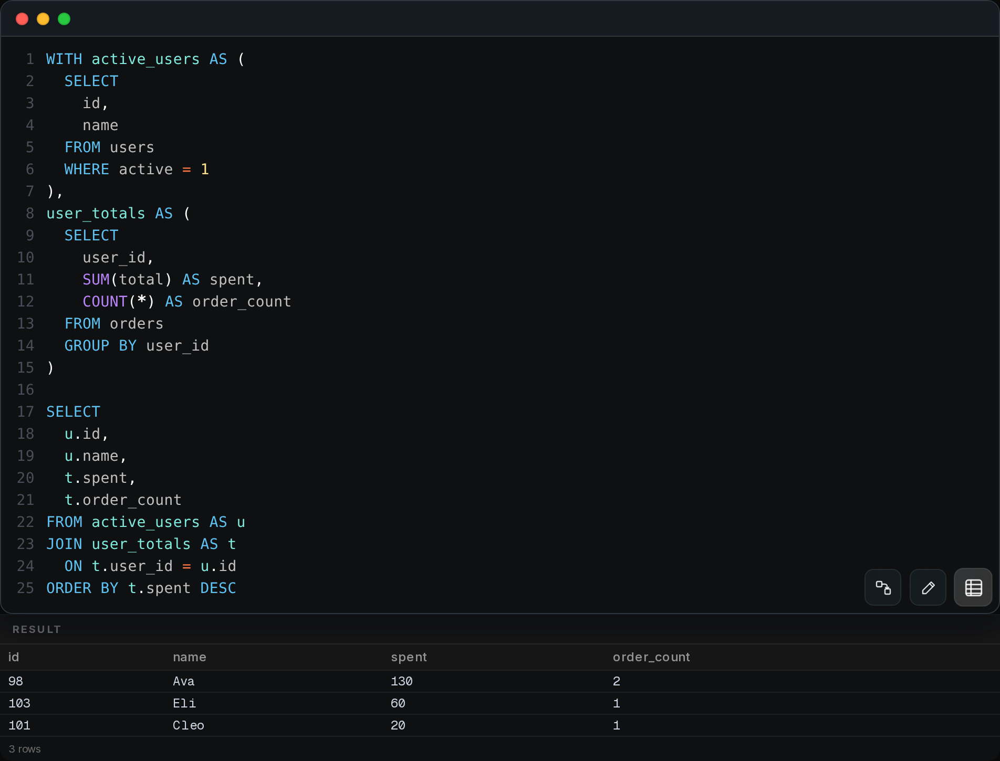
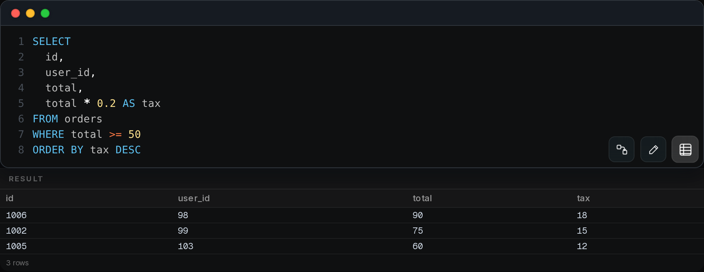
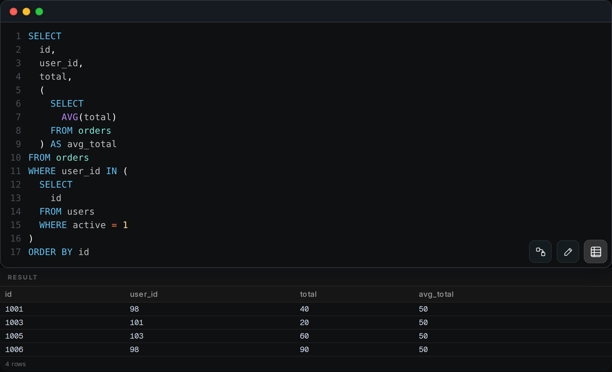

# Query Structure: Intermediate

A 180-line revenue query arrives in a pull request with parentheses nested 4 deep inside its FROM clause and a comment that reads 'do not touch'. Nobody on the team can say which rows it drops first, or why page 2 of its output repeats a row from page 1. This lesson covers how to write a query of any size so a reviewer can answer both of those questions.


<br>

---

## CTEs (WITH clause)

A common table expression, written with `WITH`, gives a result set a name at the top of a statement so every clause below can read it by that name. The database treats the name as a table that lives for one statement: defined before the main query starts, readable by it, gone when it finishes. A 300-line report that computes 6 intermediate results becomes 6 named steps and one short final `SELECT`, and any step can be checked on its own by selecting from its name.


<br>

### One CTE, one filter

The shape is `WITH name AS (query)` followed by the main query. Everything inside the parentheses is an ordinary `SELECT`, and everything after the closing parenthesis reads `name` as if it were a table in the schema. The animation below runs 2 filters in sequence over a 5-row `users` table: the CTE `active_set` keeps the rows where `active = 1`, and the outer query keeps the rows whose `id` is above 100.

https://github.com/user-attachments/assets/27725bb1-42e9-472f-836a-be4379e4467b

Watch the row counts. The CTE scans 5 users and keeps 3: Ava (98), Cleo (101) and Eli (103). The outer `WHERE id > 100` never sees the original table; it's applied to those 3 rows and keeps Cleo and Eli. Ben (99) and Dev (102) were already gone before the second filter ran, and that sequence, inner query complete before the outer query starts, is the whole mechanism.


<br>

### Chaining steps

Several CTEs can share one `WITH` with commas between them, and each can read any CTE declared above it. That turns a transformation with stages into a query with named stages. Below, `active_users` is the first stage, `user_totals` sums each user's orders (a `GROUP BY`, which has its own lesson), and the final `SELECT` joins the 2 on the user id. Run it, then replace the final `SELECT` with `SELECT * FROM user_totals` to inspect one stage alone.



```sql
WITH active_users AS (
  SELECT
    id,
    name
  FROM users
  WHERE active = 1
),
user_totals AS (
  SELECT
    user_id,
    SUM(total) AS spent,
    COUNT(*) AS order_count
  FROM orders
  GROUP BY user_id
)

SELECT
  u.id,
  u.name,
  t.spent,
  t.order_count
FROM active_users AS u
JOIN user_totals AS t
  ON t.user_id = u.id
ORDER BY t.spent DESC
```

The result holds 3 rows because only 3 users are active, and Ava leads with 130 across 2 orders. Ben spent 75 but is inactive, so `user_totals` computed his row and the join dropped it. That's the debugging pattern CTEs make possible: when a number looks wrong, select from the stage where it was born. The fault is in that stage or one it reads from, so check each upstream stage by selecting from it.


<br>

### Scope and reuse

A CTE exists only inside the statement that declares it; the next statement in the same session can't see it. Declaration order is binding: a CTE may read the ones above it and never the ones below. One name may be referenced as many times as the query needs, which is where CTEs beat a copied subquery. The query below reads `active_users` twice to compute 2 counts (the subqueries in its `SELECT` list are the subject of section 2), and a change to the definition of active reaches both.

```sql
WITH active_users AS (
  SELECT
    id
  FROM users
  WHERE active = 1
)

SELECT
  (
    SELECT
      COUNT(*)
    FROM active_users
  ) AS active_count,
  (
    SELECT
      COUNT(*)
    FROM orders
    WHERE user_id IN (
      SELECT
        id
      FROM active_users
    )
  ) AS active_orders
```

Whether the engine computes a twice-referenced CTE once or inlines it at each reference depends on the product. PostgreSQL 12 and later inline a CTE referenced once and materialize one referenced twice; `MATERIALIZED` and `NOT MATERIALIZED` override the default. BigQuery and Snowflake make their own choice per query. The rows are the same either way, so the writing rule stays: name a step once, read it wherever it's needed.


<br>

### Names carry the meaning

A CTE's name is the only documentation most readers will get, so it names what one row of it represents. Names like `active_users` and `monthly_revenue` say what a row is, and so does `late_shipments`. With `cte1` or `temp` the reader has to go back into the parentheses to find out, and the same goes for `data`.

| ✓ Names that teach | ✗ Names that hide |
| --- | --- |
| • active_users: 1 row per user whose account is active<br><br>• monthly_revenue: 1 row per month with its revenue<br><br>• late_shipments: 1 row per shipment past its promised date | • cte1: the reader opens the parentheses to find out<br><br>• temp: says the data is temporary, which every CTE is<br><br>• data: names nothing the query doesn't already have |

> **TIP**
>
> Any intermediate result that appears twice in a query belongs in a CTE. Keep 2 copies of a subquery and they drift apart on the day one of them is edited and the other is forgotten.


<br>

---

## Query Execution Order

SQL is written in one order and evaluated in another. The text reads `SELECT`, `FROM`, `WHERE`, `ORDER BY`, `LIMIT` from top to bottom; the engine evaluates `FROM` first and `SELECT` close to last. The CTE from the previous section already showed the gap: `active_set` was complete before the outer query read its first row, even though the outer `SELECT` sat below it on the page. Alias errors in a long query trace back to that gap, and so does a surprising `HAVING` or a filter sitting in the wrong clause.

| Step | Clause | What it works on |
| --- | --- | --- |
| 1 | WITH | Defines each CTE so later clauses can read it by name |
| 2 | FROM and JOIN | Builds the working row set from tables, CTEs and derived tables |
| 3 | WHERE | Drops individual rows before any grouping exists |
| 4 | GROUP BY | Folds the surviving rows into groups |
| 5 | HAVING | Drops whole groups, using aggregates |
| 6 | SELECT and DISTINCT | Computes expressions, creates aliases, removes duplicate output rows |
| 7 | ORDER BY | Sorts the finished rows; sees every alias |
| 8 | LIMIT and OFFSET | Keeps a slice of the sorted rows |

The order is a contract about results, not a description of the machine. An optimizer is free to push a `WHERE` predicate into an index scan, stop a sort early to satisfy a `LIMIT`, or flatten a CTE into the query that reads it, as long as the rows that come out match what the logical order would have produced. Reasoning about correctness uses the table above; reasoning about speed uses the query plan.


<br>

### What an alias can see

A column alias is created when `SELECT` evaluates its expression list, which is step 6. Any clause that runs earlier cannot reference it, because at that moment the alias does not exist. `WHERE` runs at step 3, so `SELECT total * 1.2 AS gross ... WHERE gross > 100` fails with an unknown-column error in PostgreSQL and MySQL, and in SQL Server and BigQuery as well. An alias that shares its name with a stored column fails more quietly: `WHERE` reads the stored column instead. `ORDER BY` runs at step 7 and can sort by `gross` without restating the arithmetic.

**Each query defines an alias tax. Which one runs without error in PostgreSQL and MySQL?**

- **A.** SELECT total * 0.2 AS tax FROM orders WHERE tax > 10
- **B.** SELECT total * 0.2 AS tax FROM orders ORDER BY tax DESC
- **C.** SELECT total * 0.2 AS tax, tax * 2 AS double_tax FROM orders

<details>
<summary>Solution</summary>

**B.** SELECT total * 0.2 AS tax FROM orders ORDER BY tax DESC

ORDER BY runs at step 7, after SELECT has computed tax, so the alias is a real column by then.

**Why the others are wrong**

- **A.** WHERE is step 3 and the alias is born at step 6, so the engine reports that column tax doesn't exist.
- **C.** Both expressions are evaluated in the same SELECT step, so one can't read a sibling's alias; the second needs total * 0.4 or a CTE.

</details>

The same rule decides where an aggregate may appear. `SUM(total)` is computed when groups are folded at step 4, so a filter on the sum belongs in `HAVING` at step 5, and `WHERE SUM(total) > 100` is rejected because there are no groups yet when `WHERE` runs. SQLite and DuckDB are among the engines that accept an alias in `WHERE`; they silently substitute its expression. The query still evaluates in the standard order; the engine has only saved the typing.



```sql
SELECT
  id,
  user_id,
  total,
  total * 0.2 AS tax
FROM orders
WHERE total >= 50
ORDER BY tax DESC
```

`WHERE total >= 50` ran before `tax` existed, so it filtered on the stored column and kept 3 of the 6 orders. `SELECT` then computed `tax` for those 3 rows only, and `ORDER BY tax DESC` sorted the finished rows: 18.0, 15.0, 12.0. Change `ORDER BY tax` to `ORDER BY total` and the order is identical, because tax is a fixed multiple of total; only one of those 2 spellings is available to `WHERE`.


<br>

### Reading a query in execution order

When a long query returns the wrong number of rows, read it in the order the engine does rather than the order on the page. Start at `FROM` and name the row set. Apply `WHERE` and count the rows that survive; once the groups are folded, look at what `SELECT` has to work with. The wrong count is found at the step where the row set changed size in a way the author did not expect. That step is rarely `SELECT`, which changes columns rather than rows. The exception is `DISTINCT`, which collapses identical output rows at step 6 and belongs on the checklist whenever a count comes back too small.

> What each clause can reference
>
> - WHERE: stored columns and expressions on them; no aliases, no aggregates
> - GROUP BY: stored columns and expressions; aliases only where an engine allows it as an extension
> - HAVING: aggregates and the grouped columns
> - SELECT: any column of the row set, plus aggregates (over the groups, or over the whole row set when there is no GROUP BY)
> - ORDER BY: every alias and aggregate that SELECT produced
> - LIMIT: a row count; it references no columns


<br>

---

## Subqueries for temp results

A subquery is a `SELECT` nested inside another statement, and it predates the `WITH` clause by 2 decades of SQL. It appears in 3 positions, and the position decides what shape its result must have. In a comparison it must return 1 value. In an `IN` list it returns 1 column of any length. In `FROM` it returns a whole table, which the outer query reads under an alias. All 3 run to completion before the clause that contains them uses the result, exactly as a CTE does.


<br>

### A scalar subquery returns one value

A parenthesised subquery that returns 1 row and 1 column can stand anywhere a single value can: compared in `WHERE`, or as a column in `SELECT`. The classic use is a comparison against an aggregate of the same table, which a plain `WHERE` can't write because the aggregate does not exist yet when `WHERE` runs. The subquery computes it in its own pass first.

```sql
SELECT
  id,
  user_id,
  total
FROM orders
WHERE total > (
  SELECT
    AVG(total)
  FROM orders
)
```

Across the 6 orders the average is 50.0, so the inner query returns that single number and the outer `WHERE` becomes `total > 50.0`, keeping orders 1002 (75), 1005 (60) and 1006 (90). If the inner query returned 2 rows, the comparison would be between 1 value and 2, and the engine raises an error rather than guessing which to use.


<br>

### An IN subquery returns a list

`IN (subquery)` tests a value against every row of a 1-column result. It's the inline form of the active-users filter from section 0: the inner query lists the ids of active users, and the outer `WHERE` keeps orders whose `user_id` appears in that list. The animation runs it over the same `users` and `orders` rows the CTE examples used.

https://github.com/user-attachments/assets/b44b66b5-8217-47e2-b45d-b77658f4dc7b

The inner query returns user ids 98, 101 and 103. Orders 1001 and 1003 match, as do 1005 and 1006, so 4 of the 6 survive. Order 1002 belongs to Ben (99, inactive) and 1004 to Dev (102, inactive), so both drop. `IN` is safe with NULLs in the list; its negation `NOT IN` returns no rows at all if the list holds even 1 NULL, a trap the three-valued logic lesson shows on rows.



```sql
SELECT
  id,
  user_id,
  total,
  (
    SELECT
      AVG(total)
    FROM orders
  ) AS avg_total
FROM orders
WHERE user_id IN (
  SELECT
    id
  FROM users
  WHERE active = 1
)
ORDER BY id
```

Both forms sit in one query here. The scalar subquery in the `SELECT` list is evaluated once and its value, 50.0, is repeated on all 4 output rows, while the `IN` subquery narrows the rows. Change the inner filter to `active = 0` and the result flips to the 2 orders from Ben and Dev, with `avg_total` unchanged, because the scalar subquery reads all 6 orders regardless of the outer filter.


<br>

### A derived table in FROM

A subquery in `FROM` is a table with no name, so SQL requires an alias for it. Everything an outer query can do to a real table it can do to the derived table: filter it, sort it, join it. This is how a filter on an aggregate was written before `HAVING` and `WITH` were common, and it still reads well for a single stage.

```sql
SELECT
  user_id,
  spent
FROM (
  SELECT
    user_id,
    SUM(total) AS spent
  FROM orders
  GROUP BY user_id
) AS t
WHERE spent > 50
ORDER BY spent DESC
```

| user_id | spent |
| --- | --- |
| 98 | 130.0 |
| 99 | 75.0 |
| 103 | 60.0 |

The inner query folds 6 orders into 5 per-user rows, the alias `t` names that 5-row set, and the outer `WHERE spent > 50` keeps 3 of them. The outer `WHERE` can reference `spent` because, to the outer query, `spent` is a stored column of `t`: it was computed in the inner query's own `SELECT` step, which finished before the outer `FROM` began.


<br>

### Subquery or CTE

The 2 forms always return identical rows, and their plans are often the same but not always. A subquery is planned inline with the query around it. A CTE may be materialized instead: PostgreSQL 12 and later do this for a CTE referenced twice, as section 0 described, and PostgreSQL before 12 materialized every CTE, so a filter in the outer query was never pushed into it. The choice is mostly about reading. One nested filter in `WHERE` reads better inline than as a 3-line block above the query; 2 stages, or 1 stage read twice, read better as CTEs. A subquery that references a column of the outer query is correlated, re-evaluated once per outer row, and belongs to the advanced tier of this track.

- In a comparison: returns exactly 1 value, or the engine errors
- In an IN list: returns 1 column, any number of rows
- In FROM: returns a table, and must carry an alias


<br>

---

## UNION and UNION ALL

`UNION` stacks the result of 1 query on top of another into a single result set. The 2 queries must return the same number of columns, which are matched by position. Each position must hold compatible types. PostgreSQL and SQL Server reject an `INTEGER` over a `TEXT`, but MySQL and SQLite coerce it silently and hide the mistake. An `INTEGER` over a `DECIMAL` is widened. The output takes its column names from the first query, so names in the second are ignored. What the operator does with a row that appears in both inputs is the choice between `UNION` and `UNION ALL`.


<br>

### UNION removes duplicates

Plain `UNION` is shorthand for `UNION DISTINCT`: after stacking, the engine removes any output row identical to another across every column. The animation stacks 3 customers on 3 suppliers, and Cara, id 3, is in both tables.

https://github.com/user-attachments/assets/58d9f12b-aee4-4a23-b242-b652b32b0fa0

The union takes 6 input rows and returns 5. Cara appeared once in each input and survives once, because the duplicate check compares whole rows and (3, Cara) matches (3, Cara). A supplier named Cara with id 6 would have survived alongside her, since the rows would differ in a column. The removal is also not limited to rows from different inputs: 2 identical rows inside `customers` alone would collapse to 1.


<br>

### UNION ALL keeps everything

`UNION ALL` stacks and stops. No row is compared with any other, so the output row count is the sum of the inputs.

https://github.com/user-attachments/assets/4715b2fa-0fe0-43b2-8adc-de12f2416bdf

All 6 rows come out, and Cara appears twice. The difference in cost is larger than the difference in rows suggests. To remove duplicates the engine sorts or hashes the full width of the result, so it has to see every row before it emits any; `UNION ALL` streams rows through as they arrive. On 2 inputs of 50 million rows each, the distinct pass is the most expensive step in the query, and it's paid even when the inputs share no rows at all.

**Orders are archived by year into orders_2023 and orders_2024. The 2 tables have identical columns, and every order id lives in exactly 1 of them. A report needs both years in one result. Which operator?**

- **A.** UNION ALL, because no row can appear in both tables, so a duplicate pass would remove nothing and cost a full sort
- **B.** UNION, because removing duplicates costs nothing when there are none
- **C.** UNION DISTINCT, because it also drops orders that were cancelled in both years
- **D.** An inner JOIN on order_id

<details>
<summary>Solution</summary>

**A.** UNION ALL, because no row can appear in both tables, so a duplicate pass would remove nothing and cost a full sort

The inputs are disjoint by construction. UNION ALL streams both tables through; UNION would hash or sort every row to find duplicates that can't exist.

**Why the others are wrong**

- **B.** The engine has to check every row to learn there are none. That sort or hash pass runs in full either way.
- **C.** Duplicate removal compares whole rows for equality and knows nothing about a status column; cancelled orders need a WHERE.
- **D.** A join places matching rows side by side; with no shared ids it returns 0 rows, and stacking is what the report needs.

</details>


<br>

### Tagging the source

Once rows are stacked, nothing in them records which query they came from. A literal in each `SELECT` list fixes that, and because columns match by position the literal must sit in the same slot in both queries.

```sql
SELECT
  id,
  name,
  'customer' AS party_type
FROM customers

UNION ALL

SELECT
  id,
  name,
  'supplier' AS party_type
FROM suppliers
ORDER BY id
```

The `ORDER BY` at the end sorts the stacked result and applies to the whole union, never to the second `SELECT` alone; a query that needs each input kept together sorts the final result by `party_type` first. `LIMIT` behaves the same way and caps the combined result.

> Rules every UNION obeys
>
> - Same number of columns in every SELECT, matched by position, never by name
> - Compatible types in each position, with narrower numerics widened; a mismatch is rejected by PostgreSQL and SQL Server but silently coerced by MySQL and SQLite
> - Column names come from the first SELECT; aliases in later ones are ignored
> - ORDER BY and LIMIT at the end apply to the stacked result as a whole
> - UNION compares whole rows when removing duplicates; UNION ALL compares nothing


<br>

---

## ORDER BY and LIMIT

A query without `ORDER BY` returns rows in whatever order the engine found cheapest, and that order isn't stable: it can change when someone adds an index or the plan is rewritten, and another replica may return a different one. `ORDER BY` makes the order part of the result. `LIMIT` keeps the first N rows of that order, and the pair answers every question of the form 'the top 5' or 'the 20 most recent', which is a large share of what a dashboard runs.


<br>

### Sorting by one column or several

`ORDER BY` takes a list of expressions, each with its own direction. `ASC` is the default and sorts smallest first, `DESC` largest first. With 2 columns the second decides the order only among rows that tie on the first: `ORDER BY country, total_spent DESC` keeps each country's customers together and ranks them by spend inside the country. Any expression works, including an alias from `SELECT`, which is available because sorting is step 7 and aliases are born at step 6.


<br>

### Top N

The animation sorts 6 customers by `total_spent` descending and keeps 3.

https://github.com/user-attachments/assets/622db2f0-90cb-4581-a733-c88b3a7d7c45

Eve (1500), Ben (1250) and Cara (980) come out, in that order. The engine does not need to finish sorting the other 3 to produce them: a `LIMIT` above a sort lets the planner keep only the 3 largest values seen so far in a bounded heap, which is why `ORDER BY ... LIMIT 10` over 100 million rows finishes in seconds while a bare `ORDER BY` spills the whole table to disk. The examples below run 3 formulations over the same rows.

**Top 3**

Sort by spend, keep the 3 largest

```sql
SELECT
  name,
  total_spent
FROM customers
ORDER BY total_spent DESC
LIMIT 3
```

Result:

```
name | total_spent
Eve | 1500
Ben | 1250
Cara | 980
```

**No ORDER BY**

Keep 3 rows with no order specified

```sql
SELECT
  name,
  total_spent
FROM customers
LIMIT 3
```

Result:

```
name | total_spent
Ann | 420
Ben | 1250
Cara | 980
```

**Page 2**

Skip the first page, then keep 3

```sql
SELECT
  name,
  total_spent
FROM customers
ORDER BY total_spent DESC
LIMIT 3
OFFSET 3
```

Result:

```
name | total_spent
Finn | 760
Ann | 420
Dev | 310
```

The second version drops the `ORDER BY`, and the 3 rows it returns are whichever 3 the engine read first, the stored order on a table this small. Eve, the top spender, is absent. On a production table the set changes from run to run, and a report built on it goes wrong silently, because 3 rows did come back. `LIMIT` without `ORDER BY` is a sample, never a ranking.


<br>

### Paging with OFFSET

The third version adds `OFFSET 3`: skip 3 rows of the sorted result, then take 3, so page 2 holds Finn (760), Ann (420) and Dev (310). Page k of size n is `LIMIT n OFFSET (k - 1) * n`. The engine still sorts and then discards the skipped rows, so page 1,000 at 50 rows a page is a 50,000-row sort and discard, and every later page costs more. Ties break the pages too: with 2 customers both at 760 and only `ORDER BY total_spent`, the engine may put either first on each run, so a customer can appear on page 2 and again on page 3, or on neither.

The fix for ties is a unique tiebreaker column, almost always the primary key: `ORDER BY total_spent DESC, id`. The fix for deep pages is keyset pagination, which remembers the last row of the previous page and asks for the rows after it, so the engine seeks to that row instead of sorting and discarding everything above it.

```sql
SELECT
  name,
  total_spent,
  id
FROM customers
WHERE total_spent < 760
  OR (
    total_spent = 760
    AND id > 6
  )
ORDER BY total_spent DESC, id
LIMIT 3
```

*NULL has no natural position in an ordering, and engines disagree: PostgreSQL sorts NULLs last ascending and first descending. MySQL and SQLite do the reverse. NULLS FIRST and NULLS LAST pin it where the engine supports them.*

| ✓ Do | ✗ Don't |
| --- | --- |
| • Name every CTE for what 1 of its rows represents<br><br>• Read a failing query in execution order, FROM first, SELECT last<br><br>• Default to UNION ALL and reach for UNION only when duplicates are wrong<br><br>• Pair every LIMIT with an ORDER BY that ends in a unique column<br><br>• Test a stage alone by selecting from its CTE name | • Reference a SELECT alias in WHERE or HAVING, or group by it<br><br>• Copy the same subquery into 2 places in 1 query<br><br>• Rely on column names to line up a UNION; position is all that matters<br><br>• Page deep into a result with OFFSET when a keyset condition would seek<br><br>• Treat LIMIT without ORDER BY as the top of anything |


<br>

---

## Putting It All Together

A payments team at a marketplace publishes a weekly 'top merchants by settled volume' page. Settled payments arrive from 2 processors in 2 tables with the same columns, the page shows only merchants above the platform-wide average, and the product manager pages through it 50 rows at a time.

- UNION ALL stacks the 2 processor tables; each transaction settles through exactly 1 processor, so UNION would sort 40 million rows to remove nothing.
- A CTE named settled_volume holds the per-merchant sum, so the threshold filter and the final ranking both read 1 definition of 'settled'.
- The threshold is a scalar subquery over the same CTE, applied to the summed rows because the sum doesn't exist when a plain WHERE on payments runs.
- ORDER BY volume DESC, merchant_id LIMIT 50 OFFSET 50 serves page 2 without a merchant repeating between pages, and keyset pagination takes over past page 20.


<br>

---

## Key Takeaways

- WITH names each stage of a query; a stage can be checked by selecting from its name and read as many times as the query needs.
- Clauses evaluate FROM, WHERE, GROUP BY, HAVING, SELECT, ORDER BY, LIMIT; an alias is visible only to the clauses after SELECT.
- Where a subquery sits decides whether it returns a whole table or something smaller, 1 column or 1 value; it finishes before the clause around it runs.
- UNION ALL stacks rows and streams them; UNION also sorts or hashes every row to drop duplicates, a cost paid even when there are none.
- LIMIT without ORDER BY is a sample; a ranking needs ORDER BY with a unique tiebreaker, and deep pages want keyset pagination.
