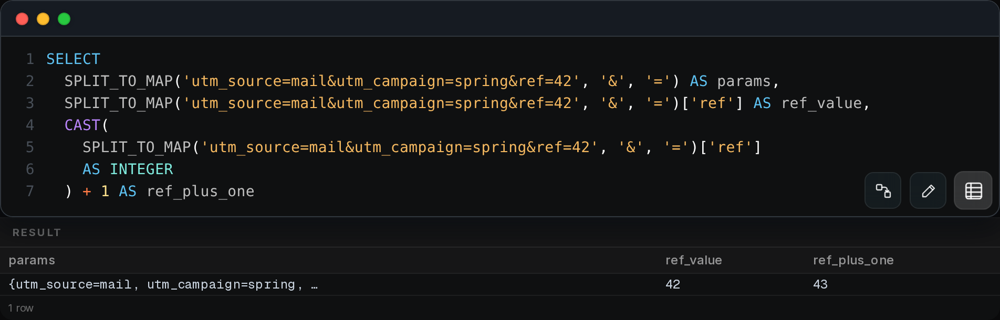
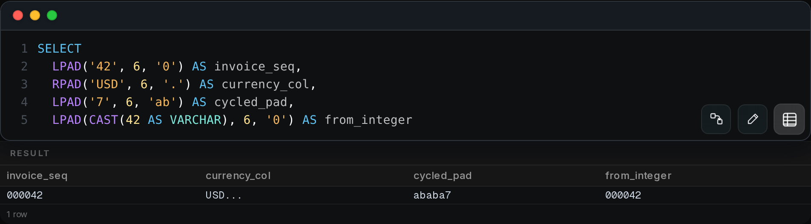
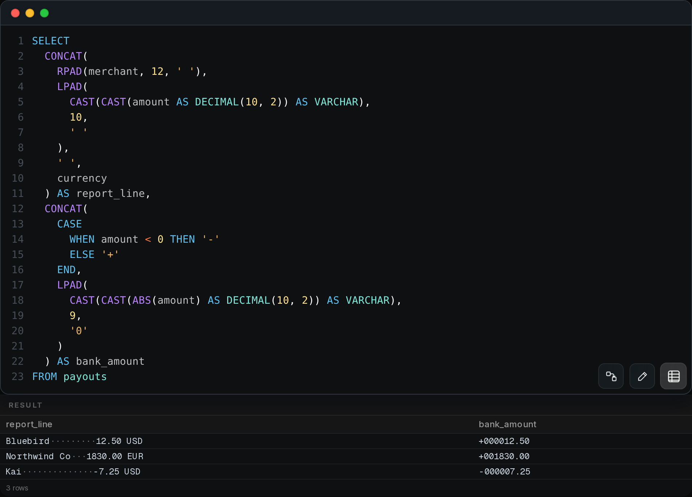
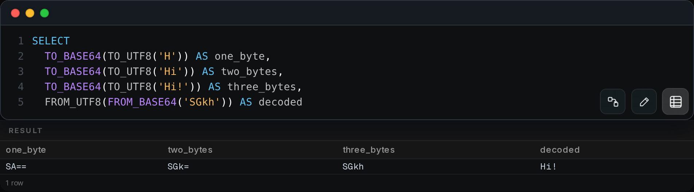
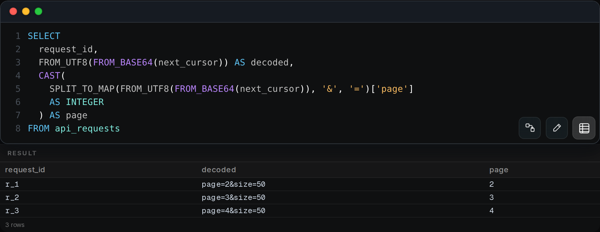
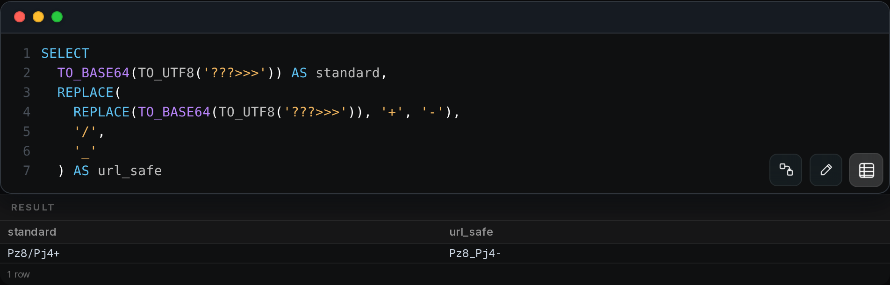
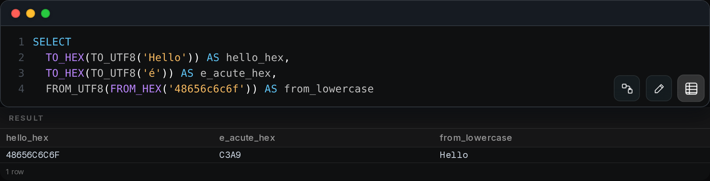
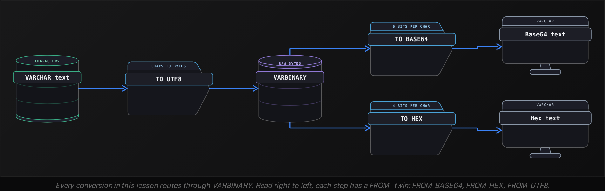
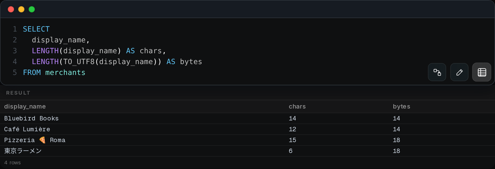
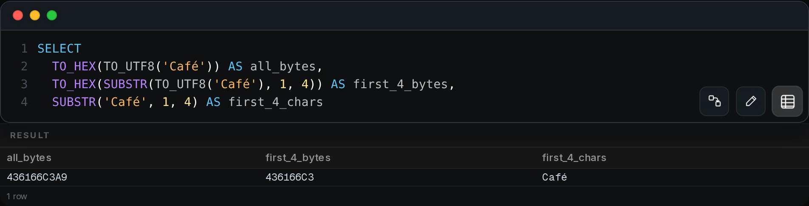

# String Functions: Advanced

Stripe signs every webhook it sends with a `Stripe-Signature` header shaped like `t=1492774577,v1=5257a869...`: a timestamp and a lowercase hex HMAC-SHA256 digest packed into one string. Say a merchant's endpoint starts rejecting deliveries, and your log table holds 2 million raw headers. To find the bad ones you have to split those pairs into columns and compare hex digests, which only works once you know which bytes your text really holds.


<br>

---

## SPLIT_TO_MAP()

Raw logs often pack many fields into a single string. A URL query string reads `utm_source=mail&utm_campaign=spring&ref=42`, a logfmt line reads `level=warn status=502`, and a signature header reads `t=1710513000,v1=9f86d081`. All 3 share the same layout: entries separated by a delimiter, and inside each entry a key and a value separated by a second delimiter. `SPLIT_TO_MAP(text, entry_delimiter, key_value_delimiter)` reads that layout and returns a `MAP(VARCHAR, VARCHAR)`, the key-value type from the data types track. In a map each key appears once and holds one value, and the subscript `m['key']` returns that value, so each field becomes a lookup by name.



```sql
SELECT
  SPLIT_TO_MAP('utm_source=mail&utm_campaign=spring&ref=42', '&', '=') AS params,
  SPLIT_TO_MAP('utm_source=mail&utm_campaign=spring&ref=42', '&', '=')['ref'] AS ref_value,
  CAST(
    SPLIT_TO_MAP('utm_source=mail&utm_campaign=spring&ref=42', '&', '=')['ref']
    AS INTEGER
  ) + 1 AS ref_plus_one
```

Order matters: the delimiter between entries comes second, and the delimiter between a key and its value comes third. Every value comes back as VARCHAR, so ref_value is the string '42', and arithmetic on it needs a `CAST` first, as ref_plus_one shows. Keys are case-sensitive: ['Ref'] and ['ref'] are different lookups.


<br>

### Parsing a header column row by row

A webhook log keeps each delivery's whole signature header in a single VARCHAR column. The query below keeps merchant `m_7`, then reads the `t` entry as the signing timestamp and the `v1` entry as the digest. The digests here are cut to 8 characters to fit the frame; real ones run 64.

https://github.com/user-attachments/assets/4929cb20-1832-439c-80db-c9a0bddc9396

Execution order puts WHERE ahead of SELECT, so `evt_103` is gone before any parsing happens. The query also calls SPLIT_TO_MAP twice per row, once per field. A CTE that parses once and names the map keeps every field a single subscript away:

```sql
WITH parsed AS (
  SELECT
    event_id,
    SPLIT_TO_MAP(sig_header, ',', '=') AS sig
  FROM webhook_log
)

SELECT
  event_id,
  sig['t'] AS signed_at,
  sig['v1'] AS v1_digest
FROM parsed
```


<br>

### Inputs that break the parse

SPLIT_TO_MAP is strict about layout. It returns NULL for a NULL input and accepts empty values, but any entry it cannot split into exactly 1 key and 1 value fails the entire query, every good row included. With `&` between entries and `=` inside them:

| Input | Result |
| --- | --- |
| 'a=1&b=2' | A map of 2 keys: a is '1', b is '2' |
| 'a=1&b=' | A map where b holds the empty string |
| 'a=1&' | A map of 1 key; the trailing & adds nothing |
| '' | An empty map with 0 keys |
| NULL | NULL |
| 'a=1&&b=2' | Error: the empty entry between && has no = |
| 'a=1&debug' | Error: the entry debug has no = |
| 'next=/pay?x=1' | Error: = appears twice in one entry |
| 'a=1&a=2' | Error: duplicate key a |

> **TIP**
>
> Reading a key the map lacks also raises an error: `sig['v2']` fails on a header with no `v2` entry. When a key appears on only some rows, guard the read with `CASE WHEN STRPOS(sig_header, 'v2=') > 0 THEN SPLIT_TO_MAP(sig_header, ',', '=')['v2'] END`, which returns NULL for the rest.

**What happens when this query runs?**

```sql
SELECT
  SPLIT_TO_MAP('plan=pro;seats=5;plan=team', ';', '=')['plan'] AS plan
```

- **A.** It returns 'pro', because the first entry for a key is kept
- **B.** It returns 'team', because a later entry overwrites an earlier one
- **C.** It fails with a duplicate key error, and no rows come back
- **D.** It returns NULL, because the key plan is ambiguous

<details>
<summary>Solution</summary>

**C.** It fails with a duplicate key error, and no rows come back

The key plan appears twice, so SPLIT_TO_MAP rejects the input and the whole query fails. A single repeated key in one row stops a job over millions of rows.

**Why the others are wrong**

- **A.** SPLIT_TO_MAP keeps no entry when a key repeats. It refuses to pick one and raises an error.
- **B.** Overwriting would silently lose 'pro'. The function raises a duplicate-key error instead of choosing a winner.
- **D.** NULL comes back only for a NULL input. A repeated key is an error, which is louder than NULL.

</details>

Spacing causes the quietest failures. Hand-written log lines often put a space after each `;`, and the split keeps that space as part of the next key. Run each tab against the same 2 lines:

Splitting on ';' leaves the following space at the front of every later key, so this read has to ask for ' status', space first.

|  |  |
| --- | --- |
|  | SELECT |
|  | line_id, |
|  | SPLIT_TO_MAP(line, ';', '=')[' status'] AS status |
|  | FROM app_log |

Result

| line_id | status |
| --- | --- |
| 1 | 502 |
| 2 | 200 |

2 rows

Whichever version the data calls for, the arguments keep their jobs: the text first, then the delimiter between entries, then the one between each key and its value. Swapping the last 2 on `'page=2&size=50'` makes it split on `=` instead. Ahead of `2&size` and `50` comes the entry `page`, which holds no `&`, so the query fails. Every value still comes back as VARCHAR, so a number read from the map needs a CAST before any arithmetic.


<br>

---

## CONCAT and LPAD() Formatting

Text leaving the warehouse often has to fit exact widths: invoice numbers with a fixed count of digits, bank files where each field starts at a known column, report lines that align. `LPAD(text, size, pad)` adds copies of `pad` on the left until the result is `size` characters long, and `RPAD` adds them on the right. With CONCAT joining the pieces, the pair builds any fixed layout.



```sql
SELECT
  LPAD('42', 6, '0') AS invoice_seq,
  RPAD('USD', 6, '.') AS currency_col,
  LPAD('7', 6, 'ab') AS cycled_pad,
  LPAD(CAST(42 AS VARCHAR), 6, '0') AS from_integer
```

Rules behind every result

- size is the final width in characters, so '42' padded to 6 gains 4 zeros.
- A multi-character pad repeats from its start and is cut where the width runs out, which is why cycled_pad reads 'ababa7'.
- The first argument must be VARCHAR. An integer needs CAST(seq AS VARCHAR), as from_integer shows; without it the call fails to resolve.
- An empty pad string or a negative size raises an error.


<br>

### Truncation keeps the left side

LPAD and RPAD both cut input that is already longer than `size` down to `size` characters, keeping the leftmost ones. A name loses its ending. A zero-padded ID loses its last digits, which is worse: 2 different sequence numbers can produce the same invoice number. The animation pads 5 sequence numbers to 6 digits and sorts by the result; watch the last 2 rows.

https://github.com/user-attachments/assets/8a5c0982-9251-4abd-a432-e5f5f1331c12

Sequences 1234567 and 1234568 both became `INV-123456`. The query finished cleanly, with no error or warning. Size the width for the largest value the column will ever hold, and add a check such as `WHERE LENGTH(CAST(seq AS VARCHAR)) > 6` to a data quality job so an overflow is caught before invoices go out.


<br>

### Padding makes text sort like numbers

Text compares character by character from the left, so `'9'` sorts after `'815'`: the first characters decide, and the character 9 comes after 8 whatever the lengths. Padding every value to the same width lines the digits up by place, and text order then matches numeric order. That matters wherever IDs are compared as text: file names, object storage keys, joins against a system that keeps IDs as strings.

Unpadded, sorted as text

| seq_text |
| --- |
| 1234567 |
| 1234568 |
| 42 |
| 815 |
| 9 |

Padded to 8, sorted as text

| seq_text |
| --- |
| 00000009 |
| 00000042 |
| 00000815 |
| 01234567 |
| 01234568 |


<br>

### Signs, decimals and report lines

LPAD treats a minus sign as another character, so `LPAD('-42', 6, '0')` returns `'000-42'`. Take the absolute value with `ABS` and pad its digits, then put the sign in front with CONCAT. For money, CAST to `DECIMAL(10, 2)` first so every amount shows 2 decimal places, then pad with spaces on the left so the decimal points line up down the column.



```sql
SELECT
  CONCAT(
    RPAD(merchant, 12, ' '),
    LPAD(
      CAST(CAST(amount AS DECIMAL(10, 2)) AS VARCHAR),
      10,
      ' '
    ),
    ' ',
    currency
  ) AS report_line,
  CONCAT(
    CASE
      WHEN amount < 0 THEN '-'
      ELSE '+'
    END,
    LPAD(
      CAST(CAST(ABS(amount) AS DECIMAL(10, 2)) AS VARCHAR),
      9,
      '0'
    )
  ) AS bank_amount
FROM payouts
```

In `report_line`, RPAD cut 'Northwind Coffee' to 'Northwind Co' to hold its 12-character slot, and space padding leaves the refund's minus sign beside its digits. In `bank_amount`, the CASE writes the sign first and LPAD fills the 9 places after it with zeros.

> NULL empties the whole line
>
> CONCAT returns NULL when any argument is NULL, and LPAD of NULL is NULL. A missing currency turns a report line into NULL, and an export that skips NULLs drops the line without a trace. Wrap nullable columns in COALESCE before padding them.

**A refund ledger stores a delta of -7. What does this return?**

```sql
SELECT
  LPAD(CAST(-7 AS VARCHAR), 4, '0') AS padded
```

- **A.** '00-7': the minus sign counts as 1 of the 4 characters
- **B.** '-007': LPAD keeps the minus sign in front of the zeros
- **C.** '0-7': the minus sign is left out of the width
- **D.** An error, because LPAD rejects negative numbers

<details>
<summary>Solution</summary>

**A.** '00-7': the minus sign counts as 1 of the 4 characters

CAST gives '-7', 2 characters. LPAD adds 2 zeros on the left, in front of the sign, because it sees characters and knows nothing about numbers.

**Why the others are wrong**

- **B.** That's the result a bank file wants, but LPAD only sees characters. Getting it takes ABS on the digits and CONCAT for the sign.
- **C.** Every character counts toward size, the sign included, so the result is 4 characters long.
- **D.** LPAD receives the VARCHAR '-7' and pads it like any other string. Only a negative size or an empty pad raises an error.

</details>

Keep formatting in the SELECT list and keep ordering on the data. `ORDER BY seq DESC` sorts the integers themselves, so it stays right however large the sequence grows. Ordering by the padded text works only while every value fits the width: once 1234567 and 1234568 both read `INV-123456`, the text alone cannot say which invoice came later.


<br>

---

## TO_BASE64() / FROM_BASE64()

Some data is raw bytes with no characters behind it: an image thumbnail, an encrypted token, the output of a hash function. SQL stores bytes in `VARBINARY`, a type holding a sequence of byte values from 0 to 255. Raw bytes cannot travel safely through JSON or CSV, and email and HTTP headers have the same problem, because all of them expect printable text and treat some byte values as control codes. Base64 is the standard fix: it rewrites any bytes using 64 printable characters, the letters `A` to `Z` and `a` to `z`, the digits `0` to `9`, plus `+` and `/`.

TO_BASE64(bytes) takes VARBINARY and returns the Base64 VARCHAR, and FROM_BASE64(text) reverses it. Text you want encoded has to become bytes first, which is the job of TO_UTF8, and decoded bytes become readable text again through FROM_UTF8. Take that pair on trust for now; the last section of this lesson explains what it does.


<br>

### How 3 bytes become 4 characters

Each Base64 character stands for 6 bits, a value from 0 to 63 that picks a character from the alphabet. The encoder reads its input in groups of 3 bytes, which is 24 bits, and writes 4 characters for each group. Take 'Hi': its bytes are 72 and 105, `01001000 01101001` in bits, 16 bits in all, split into groups of 6:

| 6-bit group | Value | Character |
| --- | --- | --- |
| 010010 | 18 | S |
| 000110 | 6 | G |
| 1001 + 00 fill | 36 | k |
| no bits left | none | = |

The group came up 8 bits short, so the encoder fills the third character with zero bits and writes `=` in place of the fourth. A 1-byte input ends in `==`, a 2-byte input in `=`, and a 3-byte input needs no padding:



```sql
SELECT
  TO_BASE64(TO_UTF8('H')) AS one_byte,
  TO_BASE64(TO_UTF8('Hi')) AS two_bytes,
  TO_BASE64(TO_UTF8('Hi!')) AS three_bytes,
  FROM_UTF8(FROM_BASE64('SGkh')) AS decoded
```

- **+33%** — Base64 size over the raw bytes


<br>

### Decoding a field someone else wrote

APIs often return a page cursor that looks like noise and turns out to be Base64 of plain parameters. Decoding the cursors in a request log tells you which page each call asked for, and since the decoded text is a key-value string, SPLIT_TO_MAP reads the page number out.



```sql
SELECT
  request_id,
  FROM_UTF8(FROM_BASE64(next_cursor)) AS decoded,
  CAST(
    SPLIT_TO_MAP(FROM_UTF8(FROM_BASE64(next_cursor)), '&', '=')['page']
    AS INTEGER
  ) AS page
FROM api_requests
```

> Base64 is readable by anyone
>
> - Decoding needs no key: a single FROM_BASE64 call turns the text back into the original bytes.
> - A Base64 column of tokens deserves the same access rules as the plain tokens, and the same goes for cookies and personal data.
> - Base64 is case-sensitive, with 'a' at 26 and 'A' at 0. Running LOWER or UPPER on a Base64 string corrupts it.

#### Where Base64 turns up in data you query

- Binary fields in JSON exports, since JSON has no byte type
- The 3 dot-separated parts of a JSON Web Token, in the URL-safe alphabet
- HTTP Basic auth headers: the word Basic, a space, then Base64 of user:password
- Data URIs that embed small images inside web pages and stylesheets


<br>

### The URL-safe alphabet

The characters `+` and `/` already mean something inside URLs and file paths, so the URL-safe variant of Base64 writes `-` and `_` in their places and keeps the other 62 characters. `TO_BASE64URL` and `FROM_BASE64URL` use that alphabet. The example builds the URL-safe form with 2 REPLACE calls so each swap is visible, and `TO_BASE64URL(TO_UTF8('???>>>'))` returns the same string in a single call. Text containing `-` or `_` came from the URL-safe encoder, and handing it to the standard decoder raises an error.



```sql
SELECT
  TO_BASE64(TO_UTF8('???>>>')) AS standard,
  REPLACE(
    REPLACE(TO_BASE64(TO_UTF8('???>>>')), '+', '-'),
    '/',
    '_'
  ) AS url_safe
```


**A hash function returns a 32-byte digest. How many characters does TO_BASE64 write for it?**

- **A.** It writes 32, one Base64 character per byte
- **B.** It writes 43, since 256 bits over 6 bits rounds up to 43
- **C.** It writes 64, 2 characters for every byte
- **D.** It writes 44: 10 full groups give 40, and 2 leftover bytes give 4

<details>
<summary>Solution</summary>

**D.** It writes 44: 10 full groups give 40, and 2 leftover bytes give 4

The first 30 bytes fill 10 groups of 3 and write 40 characters. The 2 leftover bytes become 3 characters plus 1 =, for 44 in all.

**Why the others are wrong**

- **A.** Each character carries 6 bits, fewer than a byte's 8, so the text has to be longer than the input.
- **B.** Those 43 characters would hold the bits, but Base64 writes whole 4-character groups and pads the last one with =.
- **C.** Doubling is what hex costs. Base64 packs bytes tighter, 4 characters per 3 bytes.

</details>

Decoding reads inside out. In `FROM_UTF8(FROM_BASE64('SGkh'))`, the inner FROM_BASE64 turns the 4 characters into 3 bytes, and FROM_UTF8 turns those bytes into the text 'Hi!'. Encoding runs the same 2 steps in reverse: TO_UTF8 makes the bytes, and TO_BASE64 wraps them as text. Nest a pair the other way round and the inner call receives VARCHAR where it expects VARBINARY, so the query fails to resolve.


<br>

---

## TO_HEX() / FROM_HEX()

Hex writes each byte as 2 characters from `0` to `9` and `A` to `F`, each character standing for 4 bits. It takes twice the space of the raw bytes, which is more than Base64 takes. In return every byte stays visible as its own pair, something Base64 cannot give. That's why hash digests and checksums are written in hex, the `v1` value in a signature header among them, and why engineers reach for it when they need to see what bytes a column really holds.

TO_HEX(bytes) returns a VARCHAR of hex digits, always uppercase. FROM_HEX(text) accepts upper or lower case and returns the VARBINARY those digits describe. It raises an error for an odd number of digits or any character outside 0-9 and A-F.



```sql
SELECT
  TO_HEX(TO_UTF8('Hello')) AS hello_hex,
  TO_HEX(TO_UTF8('é')) AS e_acute_hex,
  FROM_UTF8(FROM_HEX('48656c6c6f')) AS from_lowercase
```

Read `hello_hex` 2 digits at a time. The first digit of a pair counts 16s, the second counts 1s, and the letters A to F stand for 10 to 15, so `6C` is 6 times 16 plus 12, which is 108, the byte for 'l'.

| Hex pair | Byte value | Character |
| --- | --- | --- |
| 48 | 72 | H |
| 65 | 101 | e |
| 6C | 108 | l |
| 6C | 108 | l |
| 6F | 111 | o |

*é came back as 2 pairs, C3A9, because UTF-8 spends 2 bytes on it; the next section explains why.*


<br>

### Comparing digests when the case differs

A hash function such as `SHA256(bytes)` returns its digest as 32 bytes of VARBINARY. Raw bytes cannot sit safely in a header or a JSON field, as the Base64 section showed, and a text column has the same limit, so senders write those 32 bytes out as 64 hex characters, and that text is what you end up comparing against. Many senders write it in lowercase, while TO_HEX writes uppercase, and a plain string comparison fails on every row even when the bytes agree. In the switcher, `computed_hex` is your side's TO_HEX output for each event's SHA-256 digest, `sent_digest` is the partner's lowercase copy, and each tab checks them a different way.

Comparing the uppercase TO_HEX output with the lowercase text returns false for both rows, although the 2 digests describe identical bytes.

|  |  |
| --- | --- |
|  | SELECT |
|  | event_id, |
|  | LENGTH(sent_digest) AS hex_chars, |
|  | computed_hex = sent_digest AS digest_matches |
|  | FROM signatures |

Result

| event_id | hex_chars | digest_matches |
| --- | --- | --- |
| evt_101 | 64 | 0 |
| evt_102 | 64 | 0 |

2 rows

| ✓ Base64 | ✗ Hex |
| --- | --- |
| • Spends 4 characters per 3 bytes<br><br>• A 32-byte digest takes 44 characters<br><br>• Case-sensitive: 'a' and 'A' are different values<br><br>• Byte boundaries hidden inside 6-bit groups<br><br>• Found in tokens, JSON binary fields, attachments | • Spends 2 characters per byte<br><br>• A 32-byte digest takes 64 characters<br><br>• Either case on input; TO_HEX writes uppercase<br><br>• Each byte readable as its own pair<br><br>• Found in hashes, checksums, byte-level debugging |


<br>

### Hex that stands for a number

Some hex text encodes a number: a color such as `#1E90FF`, a hex ID, a memory address in an error log. FROM_HEX returns bytes, which is the wrong shape there. `FROM_BASE(text, 16)` reads the digits as a BIGINT, and `TO_BASE(number, 16)` writes a number back as lowercase hex. A color gives each channel 2 hex digits, red first, then green, then blue, so `SUBSTR`, the short spelling of SUBSTRING, slices each channel out first.

```sql
SELECT
  brand,
  hex_color,
  FROM_BASE(SUBSTR(hex_color, 2, 2), 16) AS red,
  FROM_BASE(SUBSTR(hex_color, 4, 2), 16) AS green,
  FROM_BASE(SUBSTR(hex_color, 6, 2), 16) AS blue,
  TO_BASE(FROM_BASE(SUBSTR(hex_color, 2, 2), 16), 16) AS red_back
FROM brand_colors
```

| brand | hex_color | red | green | blue | red_back |
| --- | --- | --- | --- | --- | --- |
| checkout_button | #1E90FF | 30 | 144 | 255 | 1e |
| warning_banner | #FF8800 | 255 | 136 | 0 | ff |
| muted_text | #808080 | 128 | 128 | 128 | 80 |

> **TIP**
>
> Same characters, different types: `FROM_HEX('FF')` is 1 byte of VARBINARY, and `FROM_BASE('FF', 16)` is the BIGINT 255. Ask whether the hex stands for bytes to decode or a quantity to compute with, then pick the function.

**A partner sends sent_digest as lowercase hex, and computed holds the matching SHA256 bytes as VARBINARY. Which condition is TRUE for a matching row?**

- **A.** TO_HEX(computed) = sent_digest, since both sides are now hex text
- **B.** FROM_HEX(sent_digest) = computed, since both sides are now bytes
- **C.** UPPER(sent_digest) = computed, since the case now matches TO_HEX
- **D.** FROM_BASE(sent_digest, 16) = computed, since both sides are numbers

<details>
<summary>Solution</summary>

**B.** FROM_HEX(sent_digest) = computed, since both sides are now bytes

FROM_HEX accepts lowercase and returns the same 32 bytes the hash produced. VARBINARY equality compares bytes, where case does not exist.

**Why the others are wrong**

- **A.** Both sides are hex text, but TO_HEX writes uppercase and string equality is case-sensitive, so this is false on every row.
- **C.** The case does match TO_HEX output, but the left side is VARCHAR and the right is VARBINARY, so the comparison fails on types.
- **D.** A string of 64 hex digits describes a 256-bit value, far past the largest BIGINT, so FROM_BASE fails; the right side is bytes anyway.

</details>

When hex stands for bytes that encode text, getting the text back takes 2 nested calls: FROM_HEX turns the digits into VARBINARY, and FROM_UTF8 reads those bytes as characters. `FROM_UTF8(FROM_HEX('436166C3A9'))` returns 'Café', 5 bytes and 4 characters, with `C3A9` as the é. FROM_BASE on the same 10 digits would return one large BIGINT, a number with no characters in it.


<br>

---

## TO_UTF8() / FROM_UTF8()

A `VARCHAR` holds characters. Anything written to disk or sent over a network is bytes. UTF-8 is the rule that maps each Unicode character to between 1 and 4 bytes, and every byte conversion in this lesson has passed through it: `TO_UTF8(text)` returns the UTF-8 bytes of a string as VARBINARY, and `FROM_UTF8(bytes)` reads them back. Usually the 2 sides agree. The places where they part ways are where pipelines break.



| Character | Code point | UTF-8 bytes (hex) | Byte count |
| --- | --- | --- | --- |
| A | U+0041 | 41 | 1 |
| é | U+00E9 | C3 A9 | 2 |
| € | U+20AC | E2 82 AC | 3 |
| 🍕 | U+1F355 | F0 9F 8D 95 | 4 |

The first byte announces the length. A byte from 00 to 7F is a whole character, which is why plain ASCII text has identical bytes in UTF-8. C2 to DF starts a 2-byte character, E0 to EF a 3-byte one, F0 to F4 a 4-byte one, and 80 to BF can only continue a character already started. A decoder uses those ranges to find boundaries, and to notice bytes that break the rules.


<br>

### LENGTH counts characters, TO_UTF8 exposes bytes

`LENGTH` on a VARCHAR counts characters. `LENGTH` on VARBINARY counts bytes, so `LENGTH(TO_UTF8(name))` is a string's size on the wire. For English names the 2 numbers match, which hides the difference until the data reaches a market with accents or another script.



```sql
SELECT
  display_name,
  LENGTH(display_name) AS chars,
  LENGTH(TO_UTF8(display_name)) AS bytes
FROM merchants
```

`VARCHAR(n)` limits characters, so all 4 names fit a `VARCHAR(16)` column here. A partner file format that caps the field at 16 bytes rejects 2 of them. Check exports against the receiver's unit: `WHERE LENGTH(TO_UTF8(display_name)) > 16` lists the rows that will bounce.

- **3x** — bytes per character in 東京ラーメン


<br>

### Cutting bytes through the middle of a character

Trimming to a byte cap with `SUBSTR` on VARBINARY counts bytes, and the cut can land inside a character. The query below shows 'Café' as bytes and cuts it at 4: the bytes `43 61 66 C3 A9` lose `A9`, which leaves `C3`, a lead byte whose partner is gone. Cutting the VARCHAR at 4 counts characters instead and keeps the é whole.



```sql
SELECT
  TO_HEX(TO_UTF8('Café')) AS all_bytes,
  TO_HEX(SUBSTR(TO_UTF8('Café'), 1, 4)) AS first_4_bytes,
  SUBSTR('Café', 1, 4) AS first_4_chars
```

Decoding those 4 bytes is where the damage shows. `FROM_UTF8` replaces any invalid sequence with U+FFFD, the replacement character drawn as �, so `FROM_UTF8(SUBSTR(TO_UTF8('Café'), 1, 4))` returns 'Caf�'. A second argument sets a different replacement, and an empty string drops the bad bytes: `FROM_UTF8(SUBSTR(TO_UTF8('Café'), 1, 4), '')` returns 'Caf'. To trim safely, cut the VARCHAR with SUBSTR and check its byte length afterwards.


<br>

### Bytes that were never UTF-8

Older systems often write Latin-1, where é is the single byte `E9`. To a UTF-8 reader, `E9` announces a 3-byte character, and nothing after it continues one, so the decode produces �. An import table holds each name's raw bytes as hex: row 1 is `436166C3A9`, row 2 is `436166E9` from a Latin-1 source, and row 3 is `4B6169`. Comparing a default decode with one that marks bad bytes as `?` flags the broken rows, because the 2 versions differ only where invalid bytes were replaced.

```sql
SELECT
  row_id,
  FROM_UTF8(FROM_HEX(name_hex)) AS name_default,
  FROM_UTF8(FROM_HEX(name_hex), '?') AS name_marked,
  FROM_UTF8(FROM_HEX(name_hex)) != FROM_UTF8(FROM_HEX(name_hex), '?') AS has_bad_bytes
FROM raw_imports
```

| row_id | name_default | name_marked | has_bad_bytes |
| --- | --- | --- | --- |
| 1 | Café | Café | false |
| 2 | Caf� | Caf? | true |
| 3 | Kai | Kai | false |

> Once replaced, the original byte is gone
>
> FROM_UTF8 writes � in place of bytes it cannot read, and that character carries no trace of what was there. Store the raw VARBINARY or hex from untrusted sources, decode in a view, and fix the encoding at the source so a re-run can recover every name.


**A price tag column holds '€5'. What does this return?**

```sql
SELECT
  LENGTH(TO_UTF8('€5')) AS tag_bytes
```

- **A.** It returns 2, 1 for each character in the string
- **B.** It returns 3, since € takes 2 bytes the way é does
- **C.** It returns 4: € takes 3 bytes and the digit 5 takes 1
- **D.** It returns 8, since UTF-8 gives every character 4 bytes

<details>
<summary>Solution</summary>

**C.** It returns 4: € takes 3 bytes and the digit 5 takes 1

The euro sign takes 3 bytes, E2 82 AC, while the ASCII digit 5 is the single byte 35. LENGTH on VARBINARY adds them to 4.

**Why the others are wrong**

- **A.** Counting characters is what LENGTH does on VARCHAR. TO_UTF8 turns the string into bytes first, so this counts bytes.
- **B.** é sits in the 2-byte range, but € is U+20AC and needs 3 bytes, E2 82 AC.
- **D.** The 4-byte form is the longest UTF-8 uses, for characters such as the pizza emoji. ASCII characters take 1 byte each.

</details>

Against a 16-byte cap, the 2 filters disagree on the merchants table. `LENGTH(display_name) > 16` returns no rows, since the longest name runs 15 characters. `LENGTH(TO_UTF8(display_name)) > 16` returns Pizzeria 🍕 Roma and 東京ラーメン at 18 bytes each, the 2 rows the partner would reject.


<br>

---

## Putting It All Together

Back to the Stripe webhook failures from the start. Stripe's documentation describes the check an endpoint runs: take the t value from the Stripe-Signature header, join it to the raw request body with a ., compute HMAC-SHA256 of that payload with the endpoint's signing secret, and compare the result with the header's v1 hex digest. Your log table holds each delivery's raw header and raw body, and the job is a query that redoes that check per row and says why each failure failed.

- SPLIT_TO_MAP ( sig_header , ',' , '=' ) pulls t and v1 into a map. Stripe documents that a header can carry more than one signature, and 2 entries under the same scheme name would stop the query on a duplicate key, so the parse needs a guard before it runs over every row.
- CONCAT ( sig [ 't' ] , '.' , body ) rebuilds the signed payload. A single reformatted space in the stored body changes its bytes, and the digest changes with them.
- TO_UTF8 turns payload and secret into the bytes HMAC_SHA256 reads. A body that lost an é to a Latin-1 hop decodes with a �, a byte difference the HMAC catches even when the rest of the text matches; TO_HEX ( TO_UTF8 ( body ) ) shows exactly which bytes moved.
- HMAC_SHA256 returns 32 bytes. LOWER ( TO_HEX ( . . . ) ) = sig [ 'v1' ] or FROM_HEX ( sig [ 'v1' ] ) = HMAC_SHA256 ( . . . ) compares like with like, while a bare TO_HEX comparison fails every row on case alone.
- If the log pipeline stored bodies as Base64 to keep each record on one line, FROM_BASE64 restores the exact bytes to sign, with no trip through text in between.
- The incident summary pads each endpoint's failure count with LPAD ( CAST ( failures AS VARCHAR ) , 6 , ' ' ) , so the counts line up in the alert the merchant's team reads.


<br>

---

## Key Takeaways

- SPLIT_TO_MAP ( text , entry_delim , kv_delim ) returns MAP ( VARCHAR , VARCHAR ) , and a duplicate key, an entry without exactly 1 key-value delimiter, or a subscript on a missing key fails the whole query.
- LPAD and RPAD set the final width and cut longer input to its leftmost characters, so size padded IDs for their largest value, pad a negative number's digits apart from its sign, and rely on equal widths to make text sort like numbers.
- VARBINARY holds bytes. TO_BASE64 and TO_HEX write them as text for the FROM_ functions to read back, while TO_UTF8 and FROM_UTF8 cross between characters and bytes.
- Base64 spends 4 characters per 3 bytes and is case-sensitive; hex spends 2 per byte and accepts either case, but TO_HEX writes uppercase, so compare digests as bytes or in the same case.
- LENGTH counts characters on VARCHAR and bytes on VARBINARY ; check LENGTH ( TO_UTF8 ( x ) ) against any byte cap, and read a � in decoded text as bytes that were never valid UTF-8.
