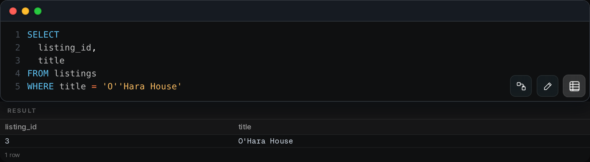
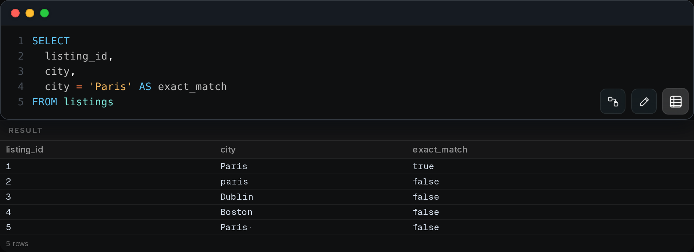
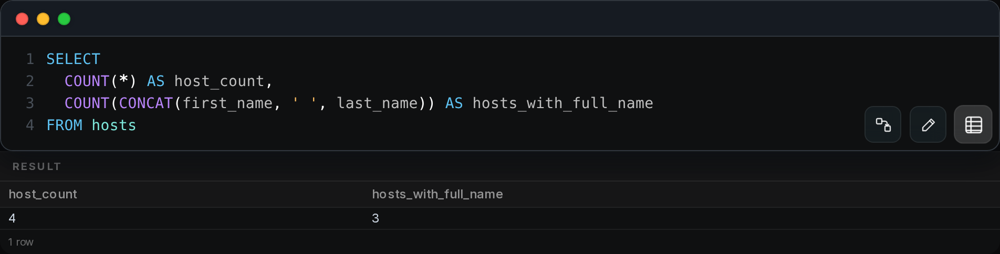
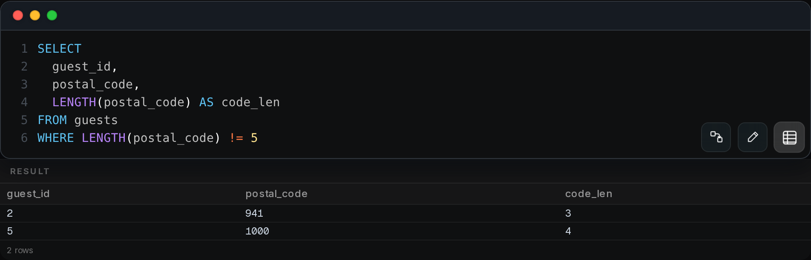
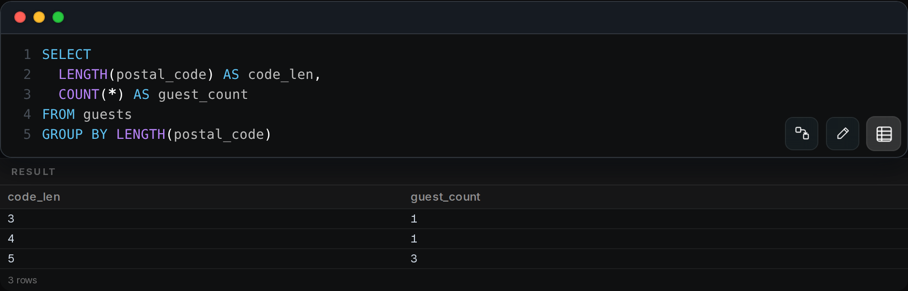
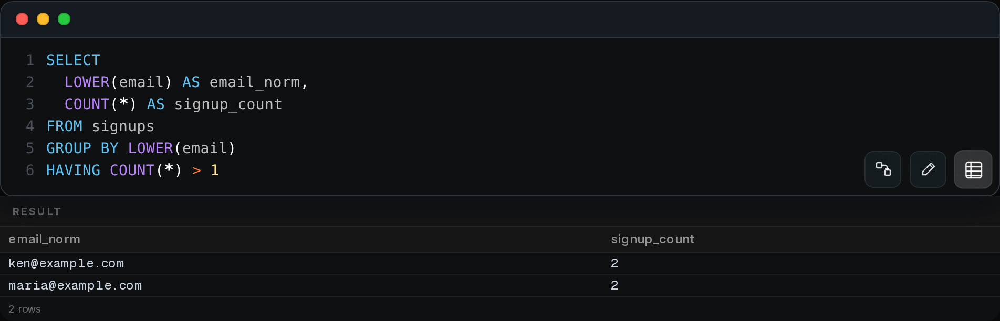
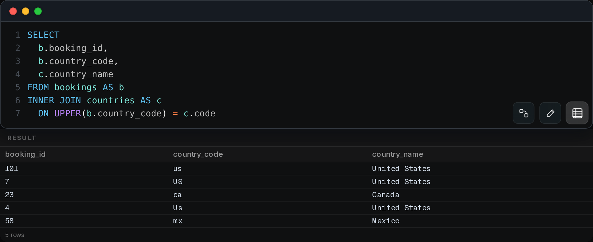
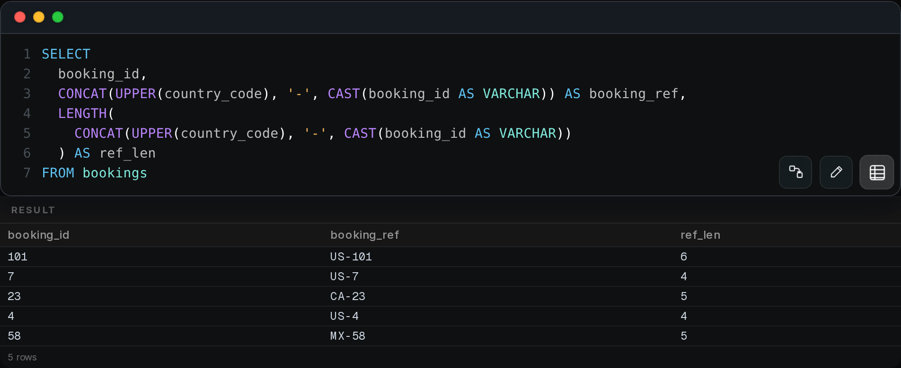
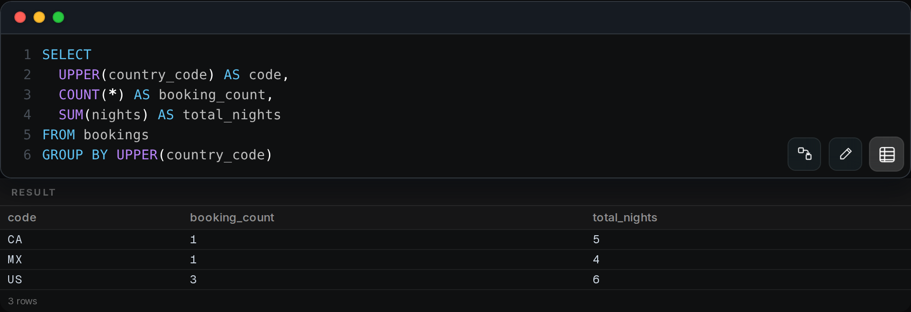

# String Functions: Beginner

Airbnb's support team gets a ticket: a host swears she has 3 listings, but her dashboard shows 1. The analyst finds 2 host accounts, Maria@Example.com and maria@example.com, each holding part of her listings. Same person, 2 spellings. Every string function in this lesson exists because text like that reaches the database exactly as someone typed it.


<br>

---

## String Data Type

### Text lives in VARCHAR columns

A VARCHAR column holds a sequence of characters: letters, digits, spaces and punctuation, in whatever order someone entered them. The database stores each character and attaches no meaning to it. A postal code of '75003' is 5 characters that happen to be digits, and the database compares it with other text the way it compares any string, character by character, without turning it into a number first.


<br>

### Single quotes mark a value, double quotes name a column

Text you type into a query goes inside single quotes: 'Paris'. Double quotes do a different job: they name a column or a table. "city" refers to the column called city, while 'city' is a 4-letter word. A query that wraps a value in double quotes asks for a column with that name, and when no such column exists the query fails before reading a single row.

```sql
SELECT
  listing_id,
  title,
  'Paris' AS literal_text,
  "city" AS column_value
FROM listings
```

| listing_id | title | literal_text | column_value |
| --- | --- | --- | --- |
| 1 | Sunny loft | Paris | Paris |
| 2 | Quiet studio | Paris | paris |
| 3 | O'Hara House | Paris | Dublin |
| 4 | Harbor view | Paris | Boston |
| 5 | Garden flat | Paris | Paris |


<br>

### An apostrophe inside the text

A title like O'Hara House contains an apostrophe, and an apostrophe is the character that ends a quoted value. Writing 'O'Hara House' closes the text after the O and leaves Hara House dangling as a syntax error. Doubling the apostrophe tells the database that the quote belongs to the text: 'O''Hara House' is read as 12 characters with 1 apostrophe in them. The doubling exists only in the query; the stored value and the result both show a single apostrophe.



```sql
SELECT
  listing_id,
  title
FROM listings
WHERE title = 'O''Hara House'
```


<br>

### Comparison is exact, character by character

The = operator on 2 strings returns true only when every character matches: same letters, same case, same spaces. 'Paris' and 'paris' differ at their first character, so they are 2 different values. 'Paris ' with a trailing space has 6 characters and 'Paris' has 5, so those differ as well. Exactness is why text typed by people causes so much work: a human reads paris and Paris as one city, and the database counts 2. The listings table below has 3 spellings of Paris, and a filter on the exact word keeps only 1 of them.

https://github.com/user-attachments/assets/6144fd73-829e-491d-bcf5-ad9fe1c4eb50

Listing 1 is the only survivor. Listing 2 fails on case, and listing 5 fails on a space nobody can see on screen. When a filter drops a row you expected to keep, the fastest diagnosis is to remove the WHERE clause and show the comparison itself as a BOOLEAN column, so every row reports true or false next to the value it holds.



```sql
SELECT
  listing_id,
  city,
  city = 'Paris' AS exact_match
FROM listings
```


<br>

### Digits stored as text are still text

A VARCHAR made of digits compares like text, from the first character onward. '10' < '9' is true: the comparison looks at '1' against '9', finds that '1' comes first, and never reaches the second character. Numbers that nobody adds or averages belong in VARCHAR anyway. A postal code '02110' stored as INTEGER becomes 2110, and the leading zero is gone for good. When a text column needs arithmetic, CAST it to a number; when a number needs to sit inside text, CAST it to VARCHAR. The table below shows both directions and what each comparison returns.

| expression | result | why |
| --- | --- | --- |
| '10' < '9' | true | '1' comes before '9', comparison stops there |
| 10 < 9 | false | numeric comparison of whole values |
| CAST('10' AS INTEGER) < 9 | false | the CAST makes it numeric |
| CAST('02110' AS INTEGER) | 2110 | the leading zero is lost |
| CAST(2110 AS VARCHAR) | '2110' | 4 characters of text |
| 'Paris' = 'paris' | false | P and p are different characters |

> **TIP**
>
> Store identifiers that only get compared, never calculated, as VARCHAR: postal codes, phone numbers, product codes. Leading zeros survive, and nobody accidentally sums a column of phone numbers.

**Each expression below compares 2 values. Which one returns true?**

- **A.** 'Paris' = 'paris', because the database ignores case when comparing text
- **B.** '10' < '9', because text compares one character at a time from the left
- **C.** 'Paris ' = 'Paris', because a trailing space is dropped before comparing
- **D.** CAST('10' AS INTEGER) < 9, because the CAST keeps the text ordering

<details>
<summary>Solution</summary>

**B.** '10' < '9', because text compares one character at a time from the left

The first characters are compared, '1' comes before '9', and the result is true without reading further.

**Why the others are wrong**

- **A.** Case matters. The first characters P and p are different, so the comparison is false.
- **C.** A trailing space is a character. The strings have 6 and 5 characters and are different values.
- **D.** After the CAST the comparison is numeric, and 10 < 9 is false.

</details>


<br>

### Quote the value, CAST the column

A value you compare against a VARCHAR column goes in single quotes: `WHERE postal_code = '02110'` keeps listing 4. Drop the quotes and the right side becomes the number 2110. A VARCHAR then meets an INTEGER, and the query stops with a type error. A text column you need as a number gets a CAST, and every row must then hold digits only: `CAST(postal_code AS INTEGER) > 75000` fails on listing 3, because its code 'D02' has no integer to become.

| filter | what happens on listings |
| --- | --- |
| postal_code = '02110' | keeps listing 4 |
| postal_code = 02110 | type error: VARCHAR compared with INTEGER |
| CAST(postal_code AS INTEGER) > 75000 | error on listing 3: 'D02' cannot become an INTEGER |
| CAST(bedrooms AS VARCHAR) = '1' | keeps listings 1 and 5 |


<br>

---

## CONCAT()

### CONCAT joins pieces of text in order

CONCAT takes 2 or more text arguments and returns 1 string made of them, in the order you listed them. It inserts nothing between the pieces: CONCAT('Maria', 'Lopez') returns 'MariaLopez'. A space is a piece of text like any other, so you pass it as its own argument, ' ', at the position where you want it to appear. The hosts table stores first and last names in separate columns, and a report wants one full name per host.

https://github.com/user-attachments/assets/c1a7ab74-8aeb-466b-99a8-33fd9d669120

Three hosts get a full name. Ken gets NULL, and the next heading explains why. The || operator does the same work 2 pieces at a time: first_name || ' ' || last_name reads left to right and produces an identical result. Choose whichever reads better in the query you are writing; the database treats them as one operation.


<br>

### One NULL argument makes the whole result NULL

Ken has no last name on file, so last_name is NULL. CONCAT('Ken', ' ', NULL) returns NULL. The partial string 'Ken ' is never produced, and the word NULL is never written into the text. CONCAT follows the rule most functions follow: when any input is NULL, the output is NULL, because a string built from an unknown piece is itself unknown. The consequence shows up in aggregates. COUNT(\*) counts Ken, COUNT of the full name skips him, and a report that lists full names shows a blank where Ken should be.



```sql
SELECT
  COUNT(*) AS host_count,
  COUNT(CONCAT(first_name, ' ', last_name)) AS hosts_with_full_name
FROM hosts
```

*Supplying a default for the missing piece, so Ken shows as 'Ken' rather than NULL, uses a function from a later lesson. For now, IS NULL on the result finds the rows that need attention.*


<br>

### Numbers must become text before CONCAT accepts them

Every argument to CONCAT must be VARCHAR. Pass an INTEGER column straight in and the query fails with a type error before it reads a row, because the database will not guess whether 12 should become '12' or something else. CAST(listing_count AS VARCHAR) turns 12 into the 2-character string '12', and CONCAT accepts it. The 3 versions below build a label 3 ways over the same hosts table; the third one needs the CAST because listing_count is a number.

**CONCAT**

CONCAT with 3 arguments: the first name, a space, the last name.

```sql
SELECT
  host_id,
  CONCAT(first_name, ' ', last_name) AS full_name
FROM hosts
```

Result:

```
host_id | full_name
1 | Maria Lopez
2 | NULL
3 | Amara Okafor
4 | Lin Zhao
```

**Pipes**

The || operator joining the same 3 pieces left to right, with the same result and the same NULL for Ken.

```sql
SELECT
  host_id,
  first_name || ' ' || last_name AS full_name
FROM hosts
```

Result:

```
host_id | full_name
1 | Maria Lopez
2 | NULL
3 | Amara Okafor
4 | Lin Zhao
```

**With CAST**

A sentence per host, where the integer listing_count becomes text through CAST before CONCAT sees it.

```sql
SELECT
  host_id,
  CONCAT(
    first_name,
    ' has ',
    CAST(listing_count AS VARCHAR),
    ' listings'
  ) AS summary
FROM hosts
```

Result:

```
host_id | summary
1 | Maria has 3 listings
2 | Ken has 1 listings
3 | Amara has 12 listings
4 | Lin has 0 listings
```

The third version shows 'Ken has 1 listings' with a plural that reads badly, and 'Lin has 0 listings' for a host with nothing published. Both strings are correct output: CONCAT assembles what it is given and applies no grammar. Deciding when to write 'listing' instead of 'listings' needs a conditional expression, which arrives in a later lesson.

> **TIP**
>
> A separator is an argument like any other. CONCAT(city, ', ', country) puts a comma and a space between the 2 columns, and CONCAT(first_name, ' ', last_name) puts a single space. Forget the separator argument and the pieces run together.

**What does CONCAT('Ken', ' ', NULL) return?**

- **A.** 'Ken ', the known pieces joined with the NULL skipped over
- **B.** 'Ken NULL', with the missing value written out as text
- **C.** An error, because CONCAT cannot accept a NULL argument
- **D.** NULL, because one unknown piece makes the whole string unknown

<details>
<summary>Solution</summary>

**D.** NULL, because one unknown piece makes the whole string unknown

When any argument is NULL, CONCAT returns NULL: the string cannot be known when one of its parts is unknown.

**Why the others are wrong**

- **A.** CONCAT never skips an argument. An unknown piece turns the whole result unknown.
- **B.** NULL is the absence of a value, so there is no text to write. The result holds no characters at all.
- **C.** The query runs without error. NULL is a valid input that produces a NULL output.

</details>


<br>

### Building a label piece by piece

A label that puts a first name in front of a number takes 3 arguments, and each one does a job. Leave out the separator and the name runs into the number. Leave out the CAST and the query fails before it reads a row. The table shows the 3 attempts on a single row, where `listing_count` is 12.

| expression | result on Amara's row |
| --- | --- |
| CONCAT(first_name, CAST(listing_count AS VARCHAR)) | 'Amara12' |
| CONCAT(first_name, ' ', listing_count) | type error: listing_count is an INTEGER |
| CONCAT(first_name, ' ', CAST(listing_count AS VARCHAR)) | 'Amara 12' |


<br>

---

## LENGTH()

### LENGTH counts the characters in a string

LENGTH(text) returns an INTEGER: the number of characters the string holds. Every character counts, including spaces and punctuation, so LENGTH('a b') is 3. LENGTH('') is 0, because the empty string exists and holds no characters. LENGTH(NULL) is NULL, because there is no string to measure. That split carries the empty string versus NULL distinction into measurement: an empty username has a size, a missing one has no size at all. The guests table has one of each.

https://github.com/user-attachments/assets/210ac8f4-c71b-4fff-9b4f-c56ff5cafa4b

Guest 3 typed nothing and gets 0. Nobody ever filled the field for guest 4, so that row gets NULL. Guest 5 typed a space between 2 letters and gets 3, because the space is a character. The reference table below adds a few values that come up constantly in real data.

| expression | result |
| --- | --- |
| LENGTH('sky_walker') | 10 |
| LENGTH('jo') | 2 |
| LENGTH('') | 0 |
| LENGTH(NULL) | NULL |
| LENGTH('a b') | 3 |
| LENGTH(' hi ') | 6 |
| LENGTH('café') | 4 |


<br>

### Characters, not bytes

LENGTH counts characters as a reader sees them. An accented letter or a character from another writing system counts as 1: LENGTH('café') is 4 and LENGTH('東京') is 2, even though those strings take more bytes of storage than 4 or 2 plain letters would. If a report says a title has 20 characters, a person counting on screen gets 20 as well, which is the behavior you want when checking a field against a form's character limit.


<br>

### LENGTH in WHERE finds malformed values

Because LENGTH returns a number, every comparison operator from the filtering lesson works on it: =, !=, <, >, IN. The signup form accepts only 5-digit postal codes, so LENGTH(postal_code) != 5 flags every row the form should have rejected. The guests table has 2 such rows, and the query shows the measured length next to each one so you can see by how much it misses.



```sql
SELECT
  guest_id,
  postal_code,
  LENGTH(postal_code) AS code_len
FROM guests
WHERE LENGTH(postal_code) != 5
```

Guest 2's code is missing 2 digits and guest 5's is missing 1. A filter like this is a data quality check you can run every morning: a result of 0 rows means the signup form is doing its job, and any row that appears names the exact record to fix.


<br>

### LENGTH with GROUP BY and aggregates

GROUP BY LENGTH(postal_code) puts every row into a bucket by how long its code is, and COUNT(\*) sizes each bucket. The same expression appears in the SELECT list and in GROUP BY, as any grouping expression must. The result tells you the shape of the column: in a clean table every row lands in the 5 bucket, and a wide spread of lengths means the form accepts anything.



```sql
SELECT
  LENGTH(postal_code) AS code_len,
  COUNT(*) AS guest_count
FROM guests
GROUP BY LENGTH(postal_code)
```

*The 3 result rows can arrive in any order. A query with GROUP BY makes no promise about the sequence of its groups.*

LENGTH also goes inside the aggregates you already have. AVG(LENGTH(title)) gives the typical size of a listing title, MAX(LENGTH(title)) finds the longest one, and MIN(LENGTH(title)) catches a title someone saved as a single letter. Each of these treats the length as any other number, so a NULL title drops out of the average the same way a NULL price would.

> LENGTH counts every character, spaces included
>
> - Spaces and punctuation count. LENGTH('a b') is 3 and LENGTH(' hi ') is 6.
> - The empty string has length 0 and NULL has length NULL, so a filter on LENGTH keeps or drops them differently.
> - The result is an INTEGER, so =, !=, <, > and IN all apply, and so do SUM, AVG, MIN and MAX.

**What does LENGTH('  hi  ') return, where the string has 2 spaces before hi and 2 spaces after it?**

- **A.** 6, because every space is a character and each one counts
- **B.** 2, because LENGTH counts only letters and digits in the string
- **C.** 4, because leading spaces are dropped but trailing ones are kept
- **D.** NULL, because padding spaces make the value malformed

<details>
<summary>Solution</summary>

**A.** 6, because every space is a character and each one counts

Two letters plus 4 spaces is 6 characters. LENGTH does not care which characters they are.

**Why the others are wrong**

- **B.** LENGTH counts every character. Spaces are characters and contribute to the total.
- **C.** No trimming happens. Both leading and trailing spaces are part of the value and are counted.
- **D.** The value is a normal 6-character string. Only a NULL input produces a NULL length.

</details>


<br>

### Filtering for values that are too short

`LENGTH(username) < 3` keeps every username with fewer than 3 characters. Walk it through the guests table and NULL decides one of the outcomes. Guest 2's 'jo' measures 2 and passes. Guest 3's empty string measures 0 and passes too, so an empty value counts as too short. Guest 4's username is NULL, its length is NULL, and `NULL < 3` is unknown, so WHERE drops the row. Guest 5's 'a b' measures 3, and `3 < 3` is false. A check for short values misses missing ones, and those need their own IS NULL check.

| guest_id | username | LENGTH(username) | LENGTH(username) < 3 |
| --- | --- | --- | --- |
| 1 | sky_walker | 10 | false |
| 2 | jo | 2 | true |
| 3 | '' | 0 | true |
| 4 | NULL | NULL | NULL |
| 5 | a b | 3 | false |


<br>

---

## LOWER()

### LOWER rewrites every letter as lowercase

LOWER(text) returns a copy of the string with each uppercase letter replaced by its lowercase form. Digits, spaces, punctuation and letters that were already lowercase pass through unchanged, so the result has the same length as the input. LOWER('Maria@Example.com') is 'maria@example.com'. LOWER(NULL) is NULL, as with every function in this lesson. The stored column stays as it was; the query works on a transformed copy that exists only in the result.

| expression | result |
| --- | --- |
| LOWER('Maria@Example.com') | 'maria@example.com' |
| LOWER('KEN') | 'ken' |
| LOWER('75003-B') | '75003-b' |
| LOWER('already lower') | 'already lower' |
| LOWER('') | '' |
| LOWER(NULL) | NULL |


<br>

### Normalize both sides before you compare

The signups table holds 5 rows. Two of them belong to Ken, who typed his address once in capitals and once with a capital K and a capital domain. WHERE email = 'ken@example.com' matches neither, because the first section showed that = checks every character's case. LOWER on the left side turns both of Ken's spellings into the same string, and the comparison against a lowercase literal then finds both rows.

https://github.com/user-attachments/assets/b4b38aaa-7da7-4d59-b8b7-591b5621e100

The literal on the right side is already lowercase, and that matters as much as the function on the left. If someone writes LOWER(email) = 'Ken@example.com' the comparison can never be true: the left side has no uppercase letters and the right side has one. When the right side is a column instead of a literal, wrap it too: LOWER(a.email) = LOWER(b.email) is the shape to use for a join key.


<br>

### Normalize before you group

GROUP BY looks at exact values, so GROUP BY email makes 5 groups out of 5 rows and reports that every address appears once. GROUP BY LOWER(email) folds the spellings together first and makes 3 groups, which is the count a person would give. The expression has to appear in GROUP BY and in the SELECT list in the same form, because the database groups on what GROUP BY names and then shows what SELECT asks for.

GROUP BY email

| email | signup_count |
| --- | --- |
| Maria@Example.com | 1 |
| maria@example.com | 1 |
| KEN@example.com | 1 |
| amara@mail.org | 1 |
| Ken@Example.COM | 1 |

GROUP BY LOWER(email)

| email_norm | signup_count |
| --- | --- |
| maria@example.com | 2 |
| ken@example.com | 2 |
| amara@mail.org | 1 |

Add HAVING COUNT(\*) > 1 and the query becomes a duplicate finder: it returns each normalized address that appears more than once and how many times. This is how the analyst in the intro finds the split: Maria@Example.com and maria@example.com fold into maria@example.com with a count of 2, and Ken's 2 spellings fold the same way.



```sql
SELECT
  LOWER(email) AS email_norm,
  COUNT(*) AS signup_count
FROM signups
GROUP BY LOWER(email)
HAVING COUNT(*) > 1
```


<br>

### A function inside an aggregate runs on every row

When a function sits inside an aggregate, it runs once per row and the aggregate sees only the results. Turn the nesting around and the order turns with it: the outer function runs once, on the single value the aggregate returns. On the 5 listing titles the 2 orders give different numbers, because `MAX(title)` picks the title that comes last in character order, and that title is the shortest one.

| expression | first step | result |
| --- | --- | --- |
| MAX(LENGTH(title)) | lengths 10, 12, 12, 11, 11 | 12 |
| LENGTH(MAX(title)) | MAX picks 'Sunny loft' | 10 |

**The signups table has 5 rows holding 3 distinct addresses once case is ignored. Which expression returns 3?**

- **A.** COUNT(DISTINCT email), since DISTINCT already merges the spellings
- **B.** COUNT(LOWER(email)), since LOWER merges the spellings before counting
- **C.** COUNT(DISTINCT LOWER(email)), since DISTINCT sees the lowercase copies
- **D.** LOWER(COUNT(DISTINCT email)), since LOWER applies to the final count

<details>
<summary>Solution</summary>

**C.** COUNT(DISTINCT LOWER(email)), since DISTINCT sees the lowercase copies

LOWER runs on each row first, DISTINCT then keeps 3 unique strings, and COUNT reports 3.

**Why the others are wrong**

- **A.** DISTINCT compares exact values. The 5 spellings are 5 distinct strings, so this returns 5.
- **B.** COUNT of a column counts non-NULL rows, and all 5 rows have an email, so this returns 5.
- **D.** COUNT returns a number, and LOWER accepts only text, so this fails with a type error.

</details>


<br>

---

## UPPER()

### UPPER is the mirror of LOWER

UPPER(text) turns every lowercase letter in the string into its capital and leaves digits, spaces and punctuation where they were. UPPER('us') is 'US', UPPER('75003-b') is '75003-B', and UPPER(NULL) is NULL. Every rule from the LOWER section holds with the direction reversed: apply it to both sides of a comparison, repeat the expression in GROUP BY, and keep the literal you compare against in the same case as the function produces.


<br>

### Codes are written in uppercase by convention

Country codes, currency codes, airport codes and stock tickers are published in capitals: US, EUR, JFK. Reference tables store them that way, and so does any list you write in an IN clause. Data that people type arrives in whatever case they used, so a bookings table may hold 'us', 'US' and 'Us' for the same country. UPPER on the column makes all 3 match the uppercase list, and the filter keeps every booking from the countries you asked for.

https://github.com/user-attachments/assets/d20e8cf0-d739-4559-b13f-90ab7358602d

Four bookings pass and the Mexican one does not. Without UPPER, only booking 7 would pass, because 'US' is the only spelling that matches the list character for character.


<br>

### Joining on a normalized key

The join lesson showed that a join pairs rows whose keys are equal, and equality on text is exact. A countries table stores its code in uppercase, so a join on the raw bookings column pairs 1 of the 3 US bookings and silently drops the other 2. Wrapping the bookings side in UPPER makes every pair that should match, match. The countries side needs no wrapping because its values are already uppercase, but wrapping both sides costs nothing and protects you when that assumption stops being true.



```sql
SELECT
  b.booking_id,
  b.country_code,
  c.country_name
FROM bookings AS b
INNER JOIN countries AS c
  ON UPPER(b.country_code) = c.code
```

| ✓ Reach for LOWER | ✗ Reach for UPPER |
| --- | --- |
| • Email addresses and usernames, which people read in lowercase<br><br>• Free text such as search terms and tags<br><br>• Any column where the stored convention is lowercase | • Country, currency and airport codes<br><br>• Product codes and ticket references<br><br>• Any column where the reference table stores uppercase |

| ✓ Do | ✗ Don't |
| --- | --- |
| • Apply the same function to both sides of a comparison or join key<br><br>• Write literals in the case the function produces: UPPER(code) = 'US'<br><br>• Repeat the full expression in GROUP BY, never the alias<br><br>• Pick one convention per column and use it in every query | • Compare UPPER(code) against a lowercase literal; it can never be true<br><br>• Expect UPPER or LOWER to remove spaces or punctuation<br><br>• Forget that UPPER(NULL) is NULL and will not match any code<br><br>• Mix UPPER in one query and LOWER in another for the same column |


<br>

### Capstone: a booking reference from 3 functions

Support wants a reference like US-101 for every booking: the uppercase country code, a hyphen, and the booking number. That takes UPPER for the code, CAST to turn the INTEGER id into text, and CONCAT to assemble the 3 pieces. The support form accepts references of at most 6 characters, so LENGTH runs alongside to check each one. Predict the 5 references and their lengths before you run it: the country part is always 2 characters and the hyphen is 1, so the length depends only on how many digits the id has. Then check whether any reference breaks the limit.



```sql
SELECT
  booking_id,
  CONCAT(UPPER(country_code), '-', CAST(booking_id AS VARCHAR)) AS booking_ref,
  LENGTH(
    CONCAT(UPPER(country_code), '-', CAST(booking_id AS VARCHAR))
  ) AS ref_len
FROM bookings
```


<br>

### Capstone: totals per normalized country

Finance wants nights booked per country. GROUP BY country_code would report US 3 times with 3, 2 and 1 nights, which reads as 3 countries. GROUP BY UPPER(country_code) folds the spellings and reports 1 row for the United States with 6 nights. The expression appears in the SELECT list and in GROUP BY in the same form, as it did with LOWER.



```sql
SELECT
  UPPER(country_code) AS code,
  COUNT(*) AS booking_count,
  SUM(nights) AS total_nights
FROM bookings
GROUP BY UPPER(country_code)
```

Three rows come back: US with 3 bookings and 6 nights, CA with 1 booking and 5 nights, MX with 1 booking and 4 nights. The nights still add up to 15, the total the raw table holds, because normalizing moved rows between groups without adding or losing any.


<br>

### Nested functions run from the inside out

Both capstones put one function inside another. The database evaluates the innermost call first and hands its result to the call around it. For booking 101 the `ref_len` column takes 4 steps: `UPPER('us')` gives 'US', `CAST(101 AS VARCHAR)` gives '101', CONCAT joins 'US', '-' and '101' into 'US-101', and LENGTH counts 6. The outermost function decides the type of the result, so `ref_len` holds INTEGERs while `booking_ref` holds text.

**What does LENGTH(CONCAT(UPPER('ab'), ' ', LOWER('CD'))) return?**

```sql
SELECT
  LENGTH(CONCAT(UPPER('ab'), ' ', LOWER('CD'))) AS result
```

- **A.** 4, because the space between the 2 pieces is not counted
- **B.** 5, because 'AB cd' holds 2 letters, a space and 2 more letters
- **C.** NULL, because UPPER and LOWER cannot be nested inside CONCAT
- **D.** 'AB cd', because CONCAT runs last and returns text

<details>
<summary>Solution</summary>

**B.** 5, because 'AB cd' holds 2 letters, a space and 2 more letters

UPPER gives 'AB', LOWER gives 'cd', CONCAT joins them around a space into 'AB cd', and LENGTH counts 5.

**Why the others are wrong**

- **A.** The space is a character in the result 'AB cd' and LENGTH counts it.
- **C.** Any expression that returns text can be an argument to CONCAT. Only a NULL input would produce NULL.
- **D.** LENGTH is the outermost function, so the query returns its INTEGER result, 5.

</details>

WHERE combines with the normalized grouping. Adding `WHERE UPPER(country_code) IN ('US', 'MX')` removes the Canadian booking before any group forms, and the query returns 2 rows: US with 6 nights and MX with 4. The list is written in capitals because UPPER produces capitals; a list of ('us', 'mx') would match no row at all.


<br>

---

## Putting It All Together

Back at Airbnb, the analyst takes the host's ticket and runs the duplicate finder: GROUP BY LOWER(email) with HAVING COUNT(\*) > 1 returns maria@example.com with 2 accounts, confirming the split. A LENGTH check on the same table turns up 4 addresses shorter than 6 characters that can never be real, which go to a cleanup list. The merge request to engineering needs one line per host, so CONCAT builds 'Merge host 4471 into host 2208' from the 2 ids after a CAST. Finally the host's payouts depend on country, and the bookings table stores 'us' where the payout-region table stores 'US', so the join key becomes UPPER(country_code) and all 3 of her listings land in the right region.

- The duplicate finder works because LOWER runs before GROUP BY, so the groups form on normalized text rather than on what each person typed.
- LENGTH turns a text problem into a numeric one, which lets the comparison operators and aggregates from earlier lessons do the filtering.
- CONCAT needs CAST because its arguments must be VARCHAR, and the first section showed that numbers and text are different types with CAST moving a value between them.
- UPPER on the join key applies the row pairing model from the joins lesson to text that would otherwise fail an exact match.


<br>

---

## Key Takeaways

- Text compares character by character: case and spaces make 'Paris', 'paris' and 'Paris ' 3 different values.
- Single quotes wrap a value, double quotes name a column, and a doubled apostrophe keeps a quote inside the text.
- CONCAT and || join pieces in order with nothing added between them; one NULL piece makes the result NULL, and numbers need CAST to VARCHAR first.
- LENGTH returns an INTEGER count of characters: spaces count, '' is 0, and NULL is NULL.
- LOWER and UPPER change only letters; apply the same function to both sides of a comparison, a join key or a GROUP BY expression.
