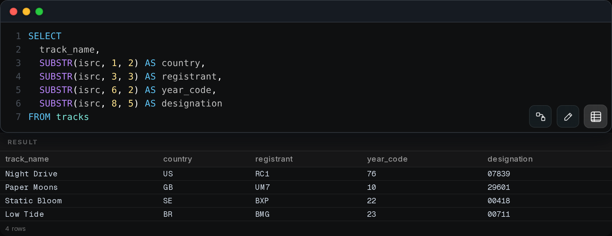
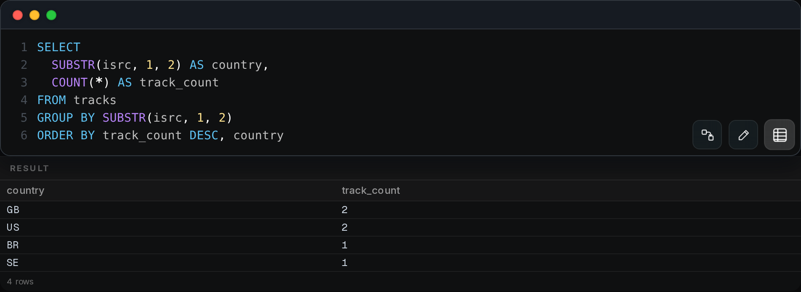
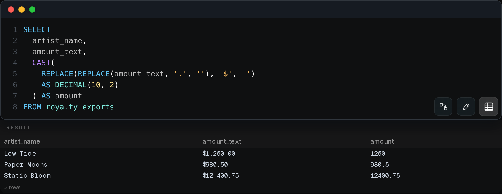
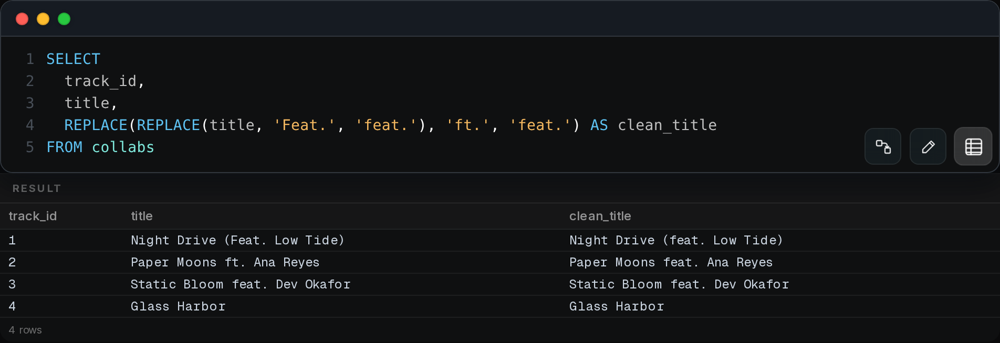
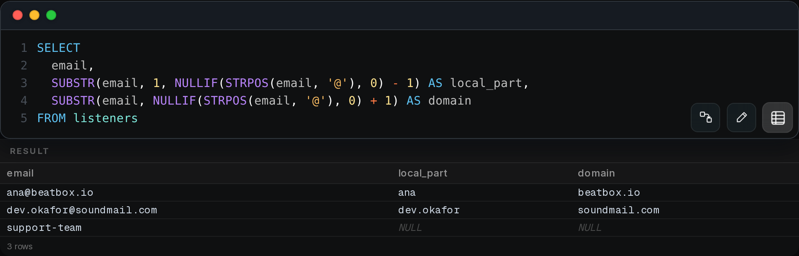
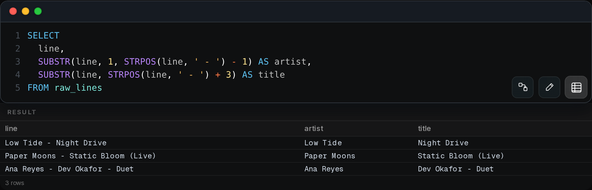
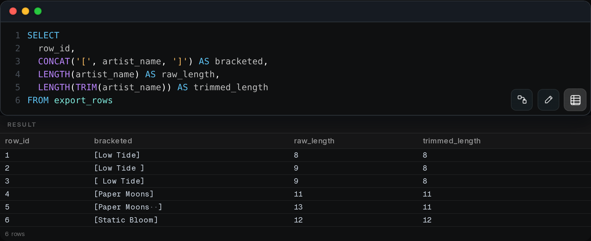
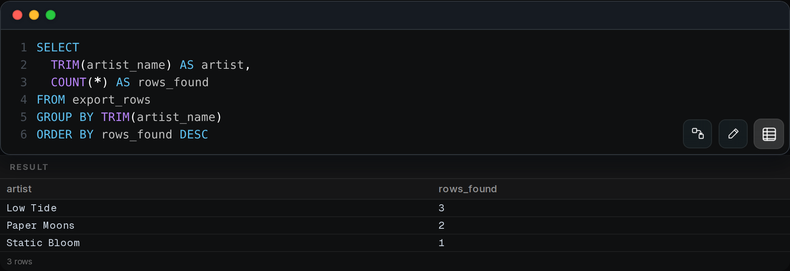

# String Functions: Intermediate

A label delivers its catalog to Spotify as one spreadsheet: ISRC codes with the country folded into the first 2 letters, release dates typed as text, royalty amounts written as $1,250.00, and artist names that end in a stray space. Before any track goes live or any royalty is paid, 5 string functions have to take that text apart correctly.


<br>

---

## SUBSTRING()

A string is a row of characters, and every character sits at a numbered position that starts from 1 at the left. SUBSTR reads a run of those positions and returns it as a new string. The function takes 3 arguments: the string to read, the position to start at, and how many characters to take. `SUBSTR('USRC17607839', 1, 2)` starts at position 1, takes 2 characters, and returns US. The original value is untouched; the result is a new string in its own column.

| Position | 1 | 2 | 3 | 4 | 5 | 6 | 7 | 8 | 9 | 10 | 11 | 12 |
| --- | --- | --- | --- | --- | --- | --- | --- | --- | --- | --- | --- | --- |
| Character | U | S | R | C | 1 | 7 | 6 | 0 | 7 | 8 | 3 | 9 |

An ISRC is the code that identifies one recording wherever it is sold or streamed. Its 12 characters hold 4 fields laid end to end with no separator between them: a 2-letter country code, a 3-character registrant code for the label, a 2-digit year of registration, and a 5-digit designation. Because nothing marks where one field stops and the next begins, position is the only way to read a field out, and the standard fixes those positions for every ISRC ever issued.

> The 4 ISRC fields by position
>
> - Country: SUBSTR(isrc, 1, 2) returns US
> - Registrant: SUBSTR(isrc, 3, 3) returns RC1
> - Year: SUBSTR(isrc, 6, 2) returns 76
> - Designation: SUBSTR(isrc, 8, 5) returns 07839

Run the query below on 4 tracks from the delivery. Every row uses the same 4 start positions, because the standard guarantees the layout; only the characters at those positions differ.



```sql
SELECT
  track_name,
  SUBSTR(isrc, 1, 2) AS country,
  SUBSTR(isrc, 3, 3) AS registrant,
  SUBSTR(isrc, 6, 2) AS year_code,
  SUBSTR(isrc, 8, 5) AS designation
FROM tracks
```

SUBSTRING is the same function under its full name, and SUBSTRING(isrc, 1, 2) returns exactly what SUBSTR(isrc, 1, 2) does. The third argument is optional: leave it out and SUBSTR returns everything from the start position to the end of the string, so SUBSTR(isrc, 8) is a second way to write the designation.

> **TIP**
>
> Read the 3 arguments as 'start here, take this many'. The third argument is a count of characters, never an end position: SUBSTR(s, 6, 2) takes 2 characters from position 6 and stops at position 7.

The delivery also carries release dates as text in the form 2019-11-29 rather than as a DATE. The year occupies positions 1 to 4, the hyphen sits at position 5, and the month occupies positions 6 and 7. Play the animation to watch each row's date give up its 2 pieces, and notice that the hyphen is skipped by choosing a start of 6, never by removing it.

https://github.com/user-attachments/assets/ae302ba0-3687-454f-aec6-24001a1cf53f

The day is the last 2 characters, so `SUBSTR(release_date, 9, 2)` or the shorter `SUBSTR(release_date, 9)` returns 29 for the first row. Once each part is its own column, a CAST turns the text into a number, and the month can be grouped, compared and sorted like any other integer.

> What SUBSTR returns at the edges
>
> - A length that runs past the end returns the rest of the string: SUBSTR('Low Tide', 5, 50) returns Tide
> - A start past the end returns an empty string: SUBSTR('Low Tide', 20, 2) returns ''
> - A start of 0 returns an empty string, because positions begin at 1
> - A NULL in any argument returns NULL, the same way CONCAT and LENGTH behave

**What does this expression return?**

```sql
SELECT
  STRPOS('dev.okafor@soundmail.com', '.') AS pos
```

- **A.** 21
- **B.** 4
- **C.** 0
- **D.** 2

<details>
<summary>Solution</summary>

**B.** 4

The first dot follows d, e and v, so it sits at position 4, and STRPOS returns the first occurrence.

**Why the others are wrong**

- **A.** That is the position of the second dot, in soundmail.com. STRPOS reports the first occurrence and stops looking.
- **C.** STRPOS returns 0 only when the search text appears nowhere in the string, and this address holds 2 dots.
- **D.** That would be the count of dots in the address. STRPOS returns a position, never a count.

</details>


<br>

### When the layout slips

Fixed positions are only as reliable as the layout behind them. A date typed by hand as 2019-1-29, with no leading zero on the month, is 9 characters long, and every field after the year moves 1 position to the left. The month call then returns 1- and the day call returns 9, and neither raises an error. A well-formed date is exactly 10 characters, with hyphens at positions 5 and 8, so `WHERE LENGTH(release_date) != 10` lists every row the fixed positions would misread before any of them reaches a report.

| release_date | LENGTH | SUBSTR(release_date, 6, 2) | SUBSTR(release_date, 9, 2) |
| --- | --- | --- | --- |
| 2019-11-29 | 10 | 11 | 29 |
| 2019-1-29 | 9 | 1- | 9 |


<br>

---

## Edge Extractions

The most common SUBSTR calls read from one end of a value: the first few characters or the last few. The start needs no arithmetic: a start of 1 and a count of n returns the first n characters, which is how the country code came out of the ISRC. The end is harder, because values differ in length and the position of the last character changes from row to row. A bank account number with 22 characters ends at position 22; one with 18 characters ends at 18. A fixed start of 19 returns the last 4 for the 22-character account and nothing for the 18-character one, whose last 4 begin at 15.

SUBSTR answers with a negative start, counted from the right end: -1 is the last character, -2 the one before it, and `SUBSTR(s, -n)` returns the last n characters whatever the length of s.

| Character | b | e | a | t | b | o | x | . | i | o |
| --- | --- | --- | --- | --- | --- | --- | --- | --- | --- | --- |
| From the start | 1 | 2 | 3 | 4 | 5 | 6 | 7 | 8 | 9 | 10 |
| From the end | -10 | -9 | -8 | -7 | -6 | -5 | -4 | -3 | -2 | -1 |

SUBSTR('beatbox.io', -2) returns io, the last 2 characters. SUBSTR('beatbox.io', -3, 1) starts 3 from the end and takes 1 character, which is the dot. The count still runs left to right from the start position, so a negative start with a length never reads backwards.


<br>

### 3 ways to take the last 4

A payout export lists each artist's bank account, and the report may show only the last 4 characters. The examples hold 3 versions of the same query. The first uses a negative start. The second computes the start from LENGTH: for a 22-character account, LENGTH minus 3 is 19, and positions 19 to 22 are the last 4. The third subtracts 4 instead of 3, the off-by-one that returns 5 characters; run it and count.

**Negative**

A negative start counts from the right end, so -4 lands on the fourth character from the end for every row regardless of its length.

```sql
SELECT
  artist_name,
  CONCAT('****', SUBSTR(bank_account, - 4)) AS masked_account
FROM payouts
```

Result:

```
artist_name | masked_account
Low Tide | ****3000
Paper Moons | ****6819
Static Bloom | ****4300
```

**LENGTH math**

LENGTH minus 3 is the position of the fourth character from the end, so this version returns the same 4 characters with more arithmetic.

```sql
SELECT
  artist_name,
  CONCAT(
    '****',
    SUBSTR(bank_account, LENGTH(bank_account) - 3)
  ) AS masked_account
FROM payouts
```

Result:

```
artist_name | masked_account
Low Tide | ****3000
Paper Moons | ****6819
Static Bloom | ****4300
```

**Off by one**

LENGTH minus 4 is the position of the fifth character from the end, so this version leaks one extra digit in every row.

```sql
SELECT
  artist_name,
  CONCAT(
    '****',
    SUBSTR(bank_account, LENGTH(bank_account) - 4)
  ) AS masked_account
FROM payouts
```

Result:

```
artist_name | masked_account
Low Tide | ****13000
Paper Moons | ****26819
Static Bloom | ****64300
```

When the count is larger than what remains, SUBSTR hands back whatever is left, so `SUBSTR('LT', 1, 3)` is LT. For display that is harmless. For validation it hides a fault: a currency code that should read EUR arrives as EU, passes through every SUBSTR in the query, and nothing marks it short. LENGTH is the check when the length matters, and `WHERE LENGTH(currency_code) != 3` lists the short codes before any SUBSTR runs on them.


<br>

### SUBSTR or LIKE

Filtering already has a tool for edges. `WHERE isrc LIKE 'US%'` keeps the rows whose ISRC starts with US, and it keeps the same rows as `WHERE SUBSTR(isrc, 1, 2) = 'US'`. The 2 differ in what they produce. LIKE answers yes or no per row; SUBSTR produces a value, and a value can be selected, grouped, joined and sorted.

| ✓ Reach for LIKE | ✗ Reach for SUBSTR |
| --- | --- |
| • The question is whether a row matches<br><br>• The pattern is in WHERE and nowhere else<br><br>• Wildcards in the middle of the pattern | • The piece itself becomes a column<br><br>• GROUP BY or JOIN on the piece<br><br>• The piece is a fixed count from an edge |

The query counts the delivery's tracks per country of registration. GROUP BY accepts the expression directly, and the alias in SELECT names the column the reader sees.



```sql
SELECT
  SUBSTR(isrc, 1, 2) AS country,
  COUNT(*) AS track_count
FROM tracks
GROUP BY SUBSTR(isrc, 1, 2)
ORDER BY track_count DESC, country
```

Edge extraction has a limit that shows up as soon as the count varies. Audio file names in the delivery end in .flac or .mp3. `SUBSTR(file_name, -4)` returns flac for the first and .mp3 for the second, because the extension's length differs. A fixed count from either edge cannot follow a separator that moves; STRPOS, 2 sections on, finds it.

**What does SUBSTR('night_drive.flac', -4) return?**

- **A.** flac
- **B.** .fla
- **C.** lac
- **D.** nigh

<details>
<summary>Solution</summary>

**A.** flac

A start of -4 is the fourth character from the end, the f, and with no length given SUBSTR takes the rest: f, l, a, c.

**Why the others are wrong**

- **B.** Taking 4 characters from the dot, as SUBSTR(s, -5, 4) would, gives that. Counting from the end, -1 is c, -2 is a, -3 is l, -4 is f.
- **C.** Those are the last 3 characters, from a start of -3. Negative positions count the last character as -1, so -4 reaches back 4.
- **D.** Those are the first 4 characters, from a start of 1 with a length of 4. A negative start counts from the right end.

</details>

Masking has 2 edges of its own. An account shorter than 4 characters has no fourth character from the end, and a negative start that reaches beyond the first character yields an empty string, so `CONCAT('****', SUBSTR('A12', -4))` prints only the 4 asterisks: nothing leaks, and nothing shows the value was short. A NULL account makes SUBSTR return NULL, and CONCAT with a NULL argument returns NULL, so the masked column is NULL for that artist, which tells the payout report the account is missing rather than showing a mask over nothing.


<br>

---

## REPLACE()

REPLACE takes a string, a search text and a replacement, and returns the string with every occurrence of the search text swapped for the replacement. Position plays no part: REPLACE scans the whole value from left to right and swaps each match it meets. `REPLACE('Night Drive (feat. Low Tide)', 'feat.', 'ft.')` returns Night Drive (ft. Low Tide). An empty replacement deletes the search text: `REPLACE(amount_text, ',', '')` removes every comma, and the string shrinks by 1 character per comma removed.


<br>

### Cleaning numbers that arrived as text

The royalty export writes money the way a spreadsheet displays it: $1,250.00. CAST rejects that text, because the dollar sign and the comma have no place in a number. The query strips them with 2 REPLACE calls. Nesting runs from the inside out: the inner call removes the commas, the outer call removes the dollar sign, and CAST receives 1250.00, which DECIMAL(10, 2) accepts. Run it and expand the rows; the amount column now sums.



```sql
SELECT
  artist_name,
  amount_text,
  CAST(
    REPLACE(REPLACE(amount_text, ',', ''), '$', '')
    AS DECIMAL(10, 2)
  ) AS amount
FROM royalty_exports
```

> **TIP**
>
> Read nested calls from the innermost parenthesis outward. The innermost REPLACE runs first on the raw value, and each enclosing call receives the result of the one inside it.


<br>

### 4 rules that decide the result

> How REPLACE matches
>
> - Every occurrence is replaced, from the first to the last: REPLACE('a,b,c', ',', ';') returns a;b;c
> - Matching is case-sensitive: REPLACE('The Beatles', 'the', '') leaves the value unchanged
> - Matches do not overlap: REPLACE('aaa', 'aa', 'b') returns ba, since the first 2 characters match and the third stands alone
> - A NULL in any argument returns NULL

Because REPLACE swaps every occurrence, it also swaps occurrences inside longer words. A genre column holds pop, Britpop and hip hop, and `REPLACE(genre, 'pop', 'Pop')` capitalises the first and turns the second into BritPop, because the 3 characters match inside the longer word. REPLACE has no idea of words; it sees characters. When a match must stand alone, compare the whole value with = or CASE instead of replacing inside it.


<br>

### Order matters when calls are nested

Nested calls run in sequence, and the second sees what the first produced. Swapping every hyphen for the _ character and every _ for a hyphen looks like 2 nested calls, and 2 calls give the wrong answer: the first turns every hyphen into _, and the second turns every _, including the ones the first call wrote, back into a hyphen. A third character that appears nowhere in the data holds the place while the swap happens.

| Expression | Result |
| --- | --- |
| REPLACE(REPLACE('a-b_c', '-', '_'), '_', '-') | a-b-c |
| REPLACE(REPLACE(REPLACE('a-b_c', '-', '#'), '_', '-'), '#', '_') | a_b-c |

Track titles in the delivery credit a guest 3 ways: Feat., ft. and feat. The query folds the first 2 forms into the third with 2 nested calls. Neither search text appears inside the other, so here the order does not change the result; checking that is still the first step before writing the second call.



```sql
SELECT
  track_id,
  title,
  REPLACE(REPLACE(title, 'Feat.', 'feat.'), 'ft.', 'feat.') AS clean_title
FROM collabs
```

The same chaining builds the URL slug for a track page, where a title becomes lowercase text joined by hyphens. In `REPLACE(LOWER(title), ' ', '-')` the LOWER call is innermost, so REPLACE receives a value that is already lowercase. The second row below shows the limit of that slug: the parentheses and the dot survive, because REPLACE changes only the text it is given. Each further character to remove needs one more call wrapped around the outside, and that call sees everything the inner calls wrote.

| title | REPLACE(LOWER(title), ' ', '-') |
| --- | --- |
| Glass Harbor | glass-harbor |
| Night Drive (Feat. Low Tide) | night-drive-(feat.-low-tide) |

**What does this expression return?**

```sql
SELECT
  STRPOS('dev.okafor@soundmail.com', '.') AS pos
```

- **A.** 21
- **B.** 4
- **C.** 0
- **D.** 2

<details>
<summary>Solution</summary>

**B.** 4

The first dot follows d, e and v, so it sits at position 4, and STRPOS returns the first occurrence.

**Why the others are wrong**

- **A.** That is the position of the second dot, in soundmail.com. STRPOS reports the first occurrence and stops looking.
- **C.** STRPOS returns 0 only when the search text appears nowhere in the string, and this address holds 2 dots.
- **D.** That would be the count of dots in the address. STRPOS returns a position, never a count.

</details>


<br>

### Same calls, different export

The 2 REPLACE calls in the royalty query fit one format: a dollar sign in front, commas between thousands, a dot before the cents. The second row below arrives with a currency word that neither call names, so the cleaned text still holds letters and TRY_CAST returns NULL. The third row is worse. A European export writes 1,250.00 as 1.250,00, the comma call deletes its decimal mark, and 1.25000 casts cleanly to 1.25: a royalty 1,000 times too small, with no step failing. Before trusting the cast, count the rows where TRY_CAST returns NULL, and check that every raw amount matches `LIKE '$%'`.

| amount_text | After both REPLACE calls | TRY_CAST AS DECIMAL(10, 2) |
| --- | --- | --- |
| $1,250.00 | 1250.00 | 1250.00 |
| USD 1,250.00 | USD 1250.00 | NULL |
| 1.250,00 | 1.25000 | 1.25 |


<br>

---

## STRPOS()

Every SUBSTR so far was given a position that was known before the query ran: a standard fixed it, or every value shared one layout. Email addresses break that. The @ sits at position 4 in ana@beatbox.io and at position 11 in dev.okafor@soundmail.com, so no fixed start separates the name from the domain. STRPOS finds the position. `STRPOS(string, search)` returns the position of the first occurrence of search, counted from 1, and returns 0 when search appears nowhere in the string.

| email | STRPOS(email, '@') |
| --- | --- |
| ana@beatbox.io | 4 |
| dev.okafor@soundmail.com | 11 |
| support-team | 0 |

A position is most useful as input to SUBSTR, and the 2 functions pair up in 2 patterns. Everything before the separator is `SUBSTR(email, 1, STRPOS(email, '@') - 1)`: start at 1 and take 1 character fewer than the separator's position. Everything after it is `SUBSTR(email, STRPOS(email, '@') + 1)`: start 1 past the separator and take the rest. Play the animation and follow the arithmetic row by row.

https://github.com/user-attachments/assets/3e26586c-7102-4f3f-8a32-04a60294040e

The third row shows the trap. support-team holds no @, STRPOS returns 0, and 0 + 1 is 1, so `SUBSTR(email, 1)` returns the entire value and the domain column reports support-team as a domain. No error is raised. The guard is NULLIF, which turns the 0 into NULL. NULL + 1 is NULL, SUBSTR with a NULL start is NULL, and a missing separator becomes a missing domain, which is the truthful answer.



```sql
SELECT
  email,
  SUBSTR(email, 1, NULLIF(STRPOS(email, '@'), 0) - 1) AS local_part,
  SUBSTR(email, NULLIF(STRPOS(email, '@'), 0) + 1) AS domain
FROM listeners
```

The local part gets the same guard. Without it, 0 minus 1 is -1, which SUBSTR treats as a request for no characters and answers with an empty string; with NULLIF the result is NULL, so a later COUNT(local_part) leaves the row out instead of counting an empty value as a name.


<br>

### STRPOS as a filter

`WHERE STRPOS(title, 'Remix') > 0` keeps the same rows as `WHERE title LIKE '%Remix%'`, and both are case-sensitive, so a title holding remix in lower case passes neither until LOWER wraps the column. LIKE reads better when presence is the whole question. STRPOS is the better choice when the query goes on to use where the match was, since the position feeds the SUBSTR that follows.


<br>

### A separator longer than one character

A playlist import arrives with a line per track in the form Artist - Title, with a 3-character separator of space, hyphen, space. STRPOS returns the position of the separator's first character, so the title starts 3 positions later and the artist ends 1 position earlier. The third line holds the separator twice; STRPOS reports the first, so the artist is Ana Reyes and everything after the first separator lands in the title.



```sql
SELECT
  line,
  SUBSTR(line, 1, STRPOS(line, ' - ') - 1) AS artist,
  SUBSTR(line, STRPOS(line, ' - ') + 3) AS title
FROM raw_lines
```

STRPOS finds the first occurrence and no other. A value that holds the separator more than once needs either a different approach or a written decision that the first occurrence is the one wanted, kept where the query lives so the next reader knows the third line was handled on purpose.

**What does this expression return?**

```sql
SELECT
  STRPOS('dev.okafor@soundmail.com', '.') AS pos
```

- **A.** 21
- **B.** 4
- **C.** 0
- **D.** 2

<details>
<summary>Solution</summary>

**B.** 4

The first dot follows d, e and v, so it sits at position 4, and STRPOS returns the first occurrence.

**Why the others are wrong**

- **A.** That is the position of the second dot, in soundmail.com. STRPOS reports the first occurrence and stops looking.
- **C.** STRPOS returns 0 only when the search text appears nowhere in the string, and this address holds 2 dots.
- **D.** That would be the count of dots in the address. STRPOS returns a position, never a count.

</details>

Domains also need a decision about case. Domain names ignore case, so ana@BeatBox.io and ana@beatbox.io belong to the same domain, yet the extracted BeatBox.io and beatbox.io compare as unequal and land in separate groups. The @ has no upper or lower form, so STRPOS finds it at position 4 in both, and wrapping the extracted domain in LOWER makes the 2 rows group as one. The NULLIF guard keeps working underneath: LOWER of a NULL is NULL, so the address with no @ forms a single NULL group instead of posing as a domain.


<br>

---

## TRIM()

A string that ends in a space is a different value from the same string without it. Low Tide followed by a space and Low Tide compare as unequal, land in separate GROUP BY groups, and refuse to join. The space is invisible in most output, which is why a report can list Low Tide twice, each row with a partial count, and nobody can see why. TRIM removes whitespace from both ends of a value and leaves the inside alone. LTRIM removes it from the left end only, and RTRIM from the right end only.

The royalty export was typed by hand, and some artist names picked up spaces at one end or both. LENGTH exposes them, and wrapping the value in brackets with CONCAT shows where they sit. Run the query and compare the 2 length columns: a row whose lengths differ carries whitespace at an edge, and the bracketed column shows which edge.



```sql
SELECT
  row_id,
  CONCAT('[', artist_name, ']') AS bracketed,
  LENGTH(artist_name) AS raw_length,
  LENGTH(TRIM(artist_name)) AS trimmed_length
FROM export_rows
```

Hidden whitespace does its damage in aggregation. Grouping the raw column splits one artist into 2 or 3 groups, each holding part of the count. Grouping the trimmed expression folds them back together. The alias in SELECT and the expression in GROUP BY must agree, so the same TRIM appears in both places.



```sql
SELECT
  TRIM(artist_name) AS artist,
  COUNT(*) AS rows_found
FROM export_rows
GROUP BY TRIM(artist_name)
ORDER BY rows_found DESC
```


<br>

### Joins fail on the space you cannot see

The artists table holds clean names, and the export's names carry stray spaces, so a join on the raw column pairs only the rows that happen to be clean. The examples hold both versions. The raw join leaves 2 artists with NULL amounts, which a LEFT JOIN reveals and an INNER JOIN would drop without a word. Trimming the export side inside ON restores every pair.

**Raw join**

Only Paper Moons matches, because its export name carries no extra space; the other 2 artists come back with NULL amounts.

```sql
SELECT
  a.artist_name,
  r.amount
FROM artists AS a
LEFT JOIN royalty_rows AS r
  ON a.artist_name = r.artist_name
ORDER BY a.artist_id
```

Result:

```
artist_name | amount
Low Tide | NULL
Paper Moons | 980.5
Static Bloom | NULL
```

**TRIM in ON**

TRIM on the export side makes every name equal to its clean counterpart, and all 3 artists receive their amount.

```sql
SELECT
  a.artist_name,
  r.amount
FROM artists AS a
LEFT JOIN royalty_rows AS r
  ON a.artist_name = TRIM(r.artist_name)
ORDER BY a.artist_id
```

Result:

```
artist_name | amount
Low Tide | 1250
Paper Moons | 980.5
Static Bloom | 12400.75
```


<br>

### What TRIM leaves behind

> 3 things TRIM does not touch
>
> - Spaces inside the value stay: TRIM('Low Tide') still holds 2 spaces between the words, and REPLACE('Low Tide', ' ', ' ') closes them
> - A character that only looks like a space survives: a non-breaking space pasted from a web page is a different character, and TRIM passes it through
> - A value made only of spaces becomes an empty string, which is a different value from NULL; TRIM(NULL) returns NULL

| ✓ Do | ✗ Don't |
| --- | --- |
| • Trim text columns once, at load time, so every downstream query sees clean values<br><br>• Compare LENGTH before and after TRIM to find rows that carry hidden whitespace<br><br>• Apply TRIM inside ON when joining to a source you do not control | • Assume a value that prints clean compares clean<br><br>• Use TRIM to fix spacing inside a value; that is the job of REPLACE<br><br>• Trim one side of a join and leave the other side raw |

**What does this expression return? The literal has 2 spaces before Low, 2 between the words, and 2 after Tide.**

```sql
SELECT
  LENGTH(TRIM('  Low  Tide  ')) AS len
```

- **A.** 8
- **B.** 13
- **C.** 9
- **D.** 7

<details>
<summary>Solution</summary>

**C.** 9

TRIM removes the 2 leading and 2 trailing spaces and keeps the 2 in the middle: Low is 3, the gap is 2, Tide is 4.

**Why the others are wrong**

- **A.** That assumes the 2 inner spaces collapse to 1. TRIM touches only the ends, so both inner spaces remain in the result.
- **B.** That's the length before trimming: 2 spaces, Low, 2 spaces, Tide, 2 spaces. TRIM removes the 4 at the ends.
- **D.** That counts only the letters. TRIM removes whitespace at the ends and keeps everything between the first and last non-space characters.

</details>

LTRIM and RTRIM are for values where only one edge should change, such as text whose leading spaces are deliberate indentation. Applied to the same raw value, each of the 3 leaves a different shape, shown here in brackets:

| Expression | Result |
| --- | --- |
| CONCAT('[', LTRIM(' Low Tide '), ']') | [Low Tide ] |
| CONCAT('[', RTRIM(' Low Tide '), ']') | [ Low Tide] |
| CONCAT('[', TRIM(' Low Tide '), ']') | [Low Tide] |

The GROUP BY on a trimmed expression that folded Low Tide back into one group works on any text column, label names included. Case is a separate fault that TRIM leaves alone: Beatbox Records and beatbox records stay 2 groups after trimming, and `LOWER(TRIM(label_name))` folds the stray edges and the case in one expression.


<br>

---

## Putting It All Together

A label's monthly delivery lands at Spotify as a spreadsheet of tracks and royalties, and the ingest query has to turn it into clean rows before any payout runs.

- SUBSTR cuts the country code and year out of each ISRC at the positions the standard fixes, and GROUP BY on the country column counts the delivery per territory.
- Release dates typed as text give up year, month and day to 3 SUBSTR calls, and the day comes from SUBSTR(release_date, 9) or SUBSTR(release_date, -2), since it is always the last 2 characters.
- The dollar sign and commas come out of each amount through 2 nested REPLACE calls, so CAST to DECIMAL(10, 2) succeeds and SUM pays the right total.
- STRPOS finds the separator in each contact email so the domain can be grouped, with NULLIF turning a missing @ into a NULL domain rather than a false one.
- TRIM inside the ON clause joins the export's hand-typed artist names to the clean artists table, so every artist receives an amount instead of a NULL.


<br>

---

## Key Takeaways

- SUBSTR(string, start, length) reads a run of characters from a 1-based position, and the third argument is a count rather than an end position.
- A negative start counts from the right end, so SUBSTR(s, -4) returns the last 4 characters of any value regardless of its length.
- REPLACE swaps every case-sensitive, non-overlapping occurrence of the search text, and nested calls run from the innermost outward, in sequence.
- STRPOS returns the 1-based position of the first occurrence and 0 when the text is absent; NULLIF turns that 0 into a NULL that stops SUBSTR from guessing.
- TRIM removes whitespace at the ends only, and a trailing space breaks equality, GROUP BY and JOIN until the column is trimmed.
