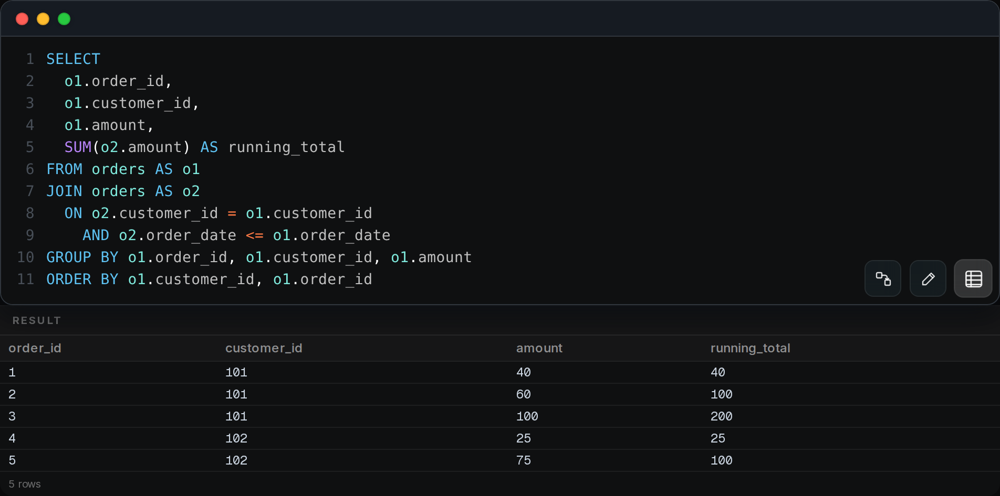
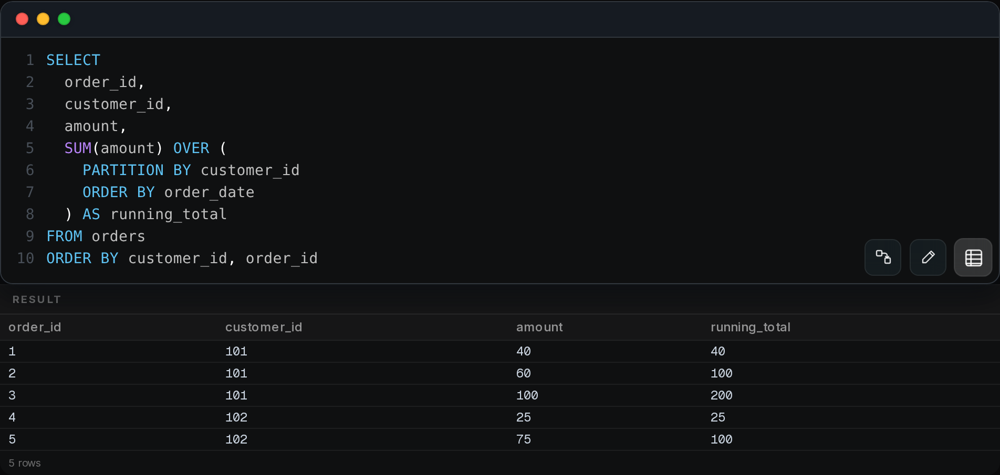
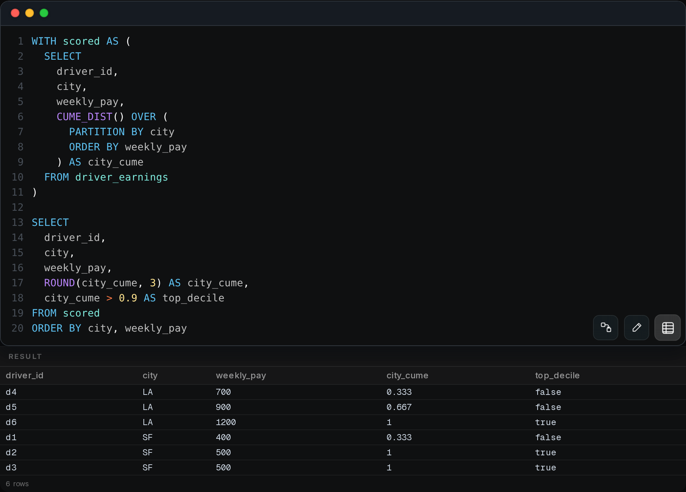
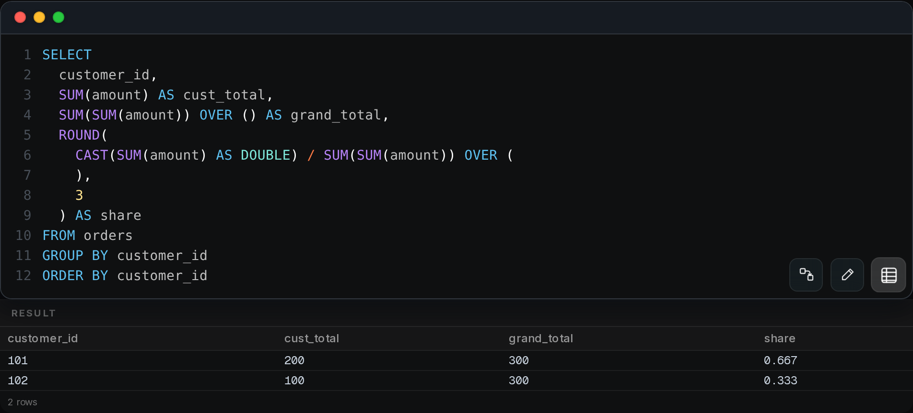
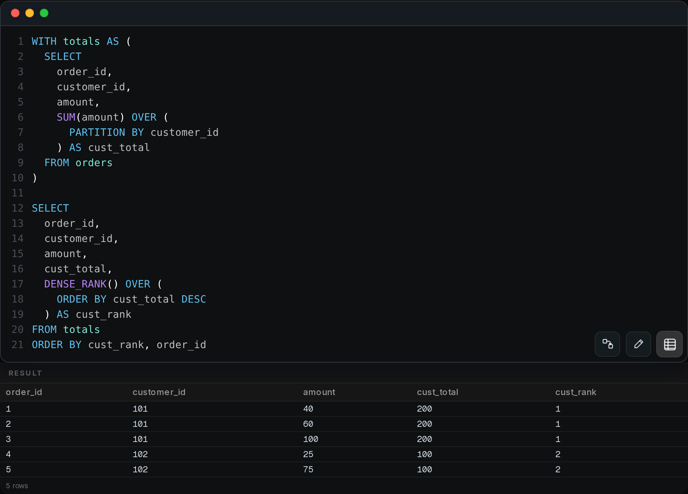
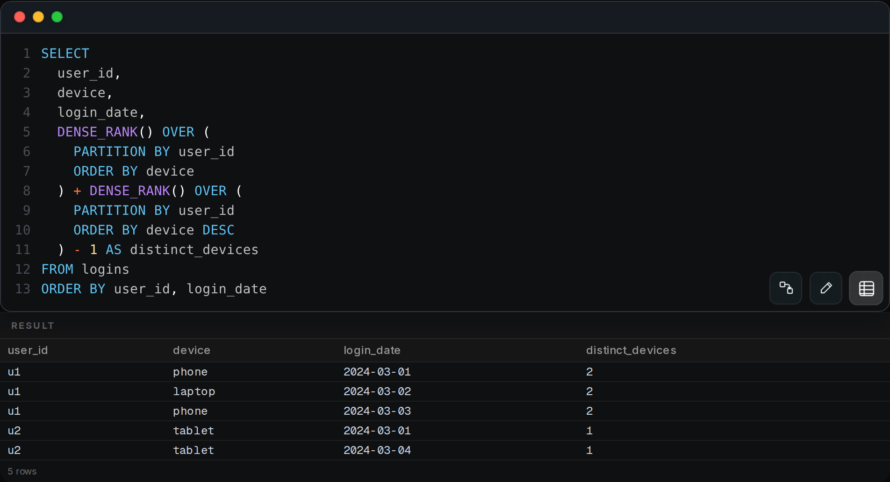
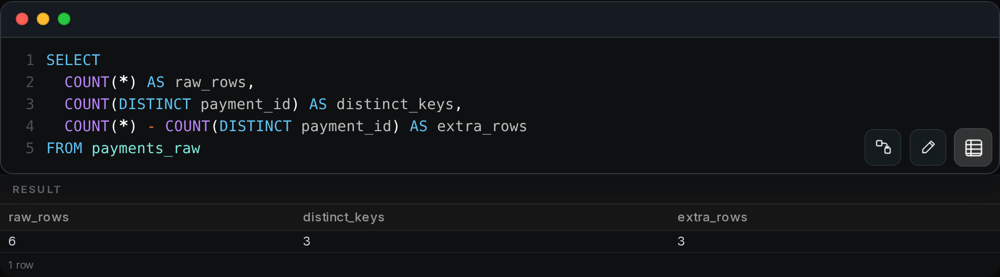
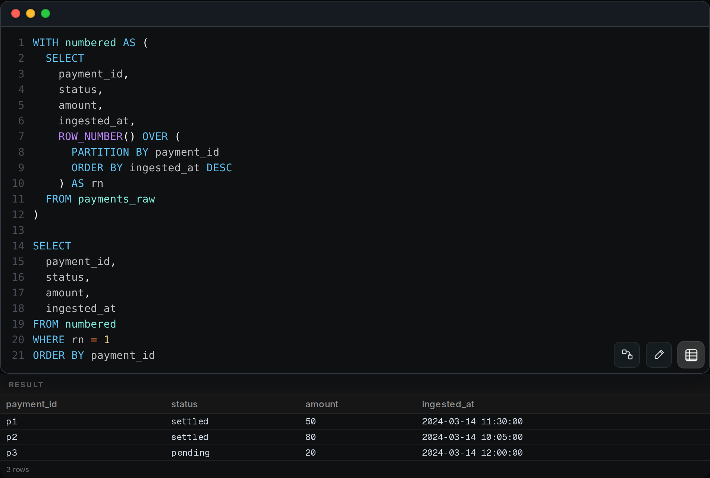

# Window Functions: Advanced

Uber's payments team ships a weekly driver statement: each driver's running earnings, where they fall against every other driver in their city, and a clean trip list with no retried event counted twice. Write the running earnings as a self-join of the trip table and a driver with 1,000 trips alone produces 500,500 pairs; written with windows, each driver's trips are read once.


<br>

---

## Windows vs Self-Joins

A self-join pairs each row of a table with other rows of the same table, and for years it was the only way to put a row next to its own neighbours: the previous order, every earlier order, the customer's total. Each of those questions compares a row with other rows that share a key, which is a window partition, and a window answers it without building a single pair.


<br>

### The same running total, 2 ways

Take 5 orders from 2 customers and compute a running total per customer by date. The inequality self-join matches every order o1 with every order o2 of the same customer dated on or before it, then GROUP BY folds the matches back to one row per order.



```sql
SELECT
  o1.order_id,
  o1.customer_id,
  o1.amount,
  SUM(o2.amount) AS running_total
FROM orders AS o1
JOIN orders AS o2
  ON o2.customer_id = o1.customer_id
    AND o2.order_date <= o1.order_date
GROUP BY o1.order_id, o1.customer_id, o1.amount
ORDER BY o1.customer_id, o1.order_id
```

Customer 101 has 3 orders, so the ON clause produces 1 + 2 + 3 = 6 pairs, and customer 102 produces 3 pairs from 2 orders. The join builds 9 intermediate rows from 5 input rows, then hashes them into 5 groups and sums each. For a customer with n orders the pair count is n(n + 1) / 2, which grows with the square of n, and a join that pairs every order with every other order of the same customer grows as n squared.

- **500,500** — join pairs for a 1,000-order customer
- **1 pass** — over those orders with a window

The window version reads each customer's rows once in date order, carries one running sum, and writes it next to each row. Run it beside the join's output: for customer 101 the sum folds forward from 40 to 100 to 200, one row at a time, and the play button steps through that fold.



```sql
SELECT
  order_id,
  customer_id,
  amount,
  SUM(amount) OVER (
    PARTITION BY customer_id
    ORDER BY order_date
  ) AS running_total
FROM orders
ORDER BY customer_id, order_id
```

Both queries return the same 5 rows. The work differs: the join shuffles both copies of the table on `customer_id`, materialises every pair, and aggregates; the window shuffles the table once on `customer_id`, sorts each partition by `order_date`, and adds as it streams. With thousands of orders per customer the join's intermediate rows run into the millions while the window's input stays the size of the table.

| ✓ Inequality self-join | ✗ Window over the partition |
| --- | --- |
| • Shuffles both sides on the join key<br><br>• Builds n(n + 1) / 2 pairs per key<br><br>• Needs a GROUP BY to fold the pairs back<br><br>• Intermediate size grows with n squared | • Shuffles the table once on the partition key<br><br>• Sorts n rows per key<br><br>• Emits one row per input row<br><br>• Intermediate size equals the input |


<br>

### Spotting a self-join that is a window in disguise

The tell is an ON clause that compares a table with itself on an equality key plus an ordering or an aggregate. The equality key becomes PARTITION BY, the comparison on a date or an amount becomes ORDER BY, and the aggregate or the row being picked becomes the window function.

| Self-join pattern | What it computes | Window replacement |
| --- | --- | --- |
| o2.order_date < o1.order_date, keep the latest o2 | the previous order | LAG(amount) OVER (PARTITION BY customer_id ORDER BY order_date) |
| o2.order_date <= o1.order_date, SUM(o2.amount) | running total | SUM(amount) OVER (PARTITION BY customer_id ORDER BY order_date) |
| join to a GROUP BY subquery on customer_id | share of customer total | amount \* 1.0 / SUM(amount) OVER (PARTITION BY customer_id) |
| LEFT JOIN on o2.amount > o1.amount, 1 + COUNT(o2.order_id) | rank within customer | RANK() OVER (PARTITION BY customer_id ORDER BY amount DESC) |

Not every self-join folds this way. A join that pairs rows on a condition with no fixed order, such as matching each refund to any earlier order of the same customer with an equal amount, has no window form: a window sees a row's position in one sorted partition, and 'any earlier order with an equal amount' is a search across the partition rather than a position in it. Those stay as joins, and the inequality join techniques from the joins track apply.

> **TIP**
>
> Before rewriting, run both versions on one partition and diff them. Ties are where they disagree: the default RANGE frame gives 2 orders on the same date the same running total, matching a <= join, while a ROWS frame gives them different totals in an order the data does not fix.

**Which of these self-joins has no window function equivalent?**

- **A.** Pair each order with all earlier orders of the same customer and sum their amounts.
- **B.** Pair each order with the single most recent earlier order of the same customer to read its amount.
- **C.** Pair each refund with any earlier order of the same customer whose amount equals the refund.
- **D.** Pair each order with every order of the same customer to divide its amount by their sum.

<details>
<summary>Solution</summary>

**C.** Pair each refund with any earlier order of the same customer whose amount equals the refund.

The match depends on an equality between 2 rows at any distance in the partition, which is a search rather than a position, so it stays a join.

**Why the others are wrong**

- **A.** That is a running total: SUM(amount) OVER (PARTITION BY customer_id ORDER BY order_date) adds each earlier row in order.
- **B.** That is the previous row by date, which LAG(amount) OVER (PARTITION BY customer_id ORDER BY order_date) returns without a join.
- **D.** That is share of total: amount divided by SUM(amount) OVER (PARTITION BY customer_id) covers the whole partition with no join.

</details>


<br>

---

## Windows and Partitioning

The engine runs a window function in 3 physical steps: it hashes every row by the PARTITION BY columns so rows sharing a key land on the same worker, sorts each partition by the ORDER BY columns, and streams the sorted rows through the function. The first step is a shuffle, the second a sort, and on a large table both cost more than the function itself, so a fast window query is one that runs those 2 steps as few times as possible over as few rows as possible.


<br>

### One sort can serve many windows

The planner groups window functions by their specification. Any 2 functions with the same PARTITION BY and ORDER BY share a single shuffle and sort, whatever their frames, because the frame is applied as rows stream past; a function with a different partition key or a different order needs a pass of its own. Count the distinct PARTITION BY and ORDER BY combinations in a query and you have counted its sorts.

**Two keys**

Partitioning by user_id and by country are different keys, so the table is shuffled and sorted twice.

```sql
SELECT
  session_id,
  user_id,
  country,
  duration_s,
  ROW_NUMBER() OVER (
    PARTITION BY user_id
    ORDER BY started_at
  ) AS session_seq,
  SUM(duration_s) OVER (
    PARTITION BY country
  ) AS country_total
FROM sessions
ORDER BY session_id
```

Result:

```
session_id | user_id | country | duration_s | session_seq | country_total
1 | u1 | US | 120 | 1 | 1065
2 | u1 | US | 300 | 2 | 1065
3 | u2 | US | 45 | 1 | 1065
4 | u2 | US | 600 | 2 | 1065
5 | u3 | DE | 90 | 1 | 470
6 | u3 | DE | 30 | 2 | 470
7 | u4 | DE | 200 | 1 | 470
8 | u4 | DE | 150 | 2 | 470
```

**One key**

Both windows share PARTITION BY user_id ORDER BY started_at, so one shuffle and one sort feed both functions.

```sql
SELECT
  session_id,
  user_id,
  country,
  duration_s,
  ROW_NUMBER() OVER (
    PARTITION BY user_id
    ORDER BY started_at
  ) AS session_seq,
  SUM(duration_s) OVER (
    PARTITION BY user_id
    ORDER BY started_at
  ) AS user_running_s
FROM sessions
ORDER BY session_id
```

Result:

```
session_id | user_id | country | duration_s | session_seq | user_running_s
1 | u1 | US | 120 | 1 | 120
2 | u1 | US | 300 | 2 | 420
3 | u2 | US | 45 | 1 | 45
4 | u2 | US | 600 | 2 | 645
5 | u3 | DE | 90 | 1 | 90
6 | u3 | DE | 30 | 2 | 120
7 | u4 | DE | 200 | 1 | 200
8 | u4 | DE | 150 | 2 | 350
```

**Filter first**

WHERE runs before the window, so only the 4 US rows are shuffled and sorted, and the sequence counts US sessions only.

```sql
SELECT
  session_id,
  user_id,
  country,
  duration_s,
  ROW_NUMBER() OVER (
    PARTITION BY user_id
    ORDER BY started_at
  ) AS session_seq
FROM sessions
WHERE country = 'US'
ORDER BY session_id
```

Result:

```
session_id | user_id | country | duration_s | session_seq
1 | u1 | US | 120 | 1
2 | u1 | US | 300 | 2
3 | u2 | US | 45 | 1
4 | u2 | US | 600 | 2
```

The first version pays twice: one hash of the table on `user_id`, a second on `country`. If the per-country figure can come from a GROUP BY, its few rows broadcast-join back to the sessions at a fraction of the cost of a second shuffle of the full table, and the window pass on `user_id` stays the only big one.


<br>

### Filter the input or filter the output

A WHERE clause before the window shrinks the rows that get shuffled and sorted, which is the cheapest optimisation there is, and it also changes what the window sees. A filter on the window's own output has to wait until the window has run, in an outer query or a following CTE, so the 2 placements cost differently and answer different questions.

WHERE duration_s > 100 before the window

| session_id | user_id | session_seq |
| --- | --- | --- |
| 1 | u1 | 1 |
| 2 | u1 | 2 |
| 4 | u2 | 1 |
| 7 | u4 | 1 |
| 8 | u4 | 2 |

WHERE duration_s > 100 after the window

| session_id | user_id | session_seq |
| --- | --- | --- |
| 1 | u1 | 1 |
| 2 | u1 | 2 |
| 4 | u2 | 2 |
| 7 | u4 | 1 |
| 8 | u4 | 2 |

Session 4 is u2's first long session on the left and u2's second session overall on the right, because the 45-second session 3 was removed before the numbering on the left and after it on the right. Both are correct answers to different questions, so choose the placement by the question and take the saving when it allows. A filter on a column that is constant within each partition, such as `country` for a window partitioned by `user_id`, removes whole partitions and changes no surviving value, so it always belongs before the window.


<br>

### Skewed and single partitions

Partitions are the unit of parallelism, so their sizes set the wall-clock time. If PARTITION BY country sends 60% of a billion rows to one worker, that worker sorts 600M rows while the others finish and wait. `OVER ()` with no partition and `OVER (ORDER BY ts)` with a global order put every row in 1 partition on 1 worker, turning a distributed sort into a single-machine one, and a global ROW_NUMBER over a billion rows is the most common way a window query runs out of memory.

> 3 fixes for a skewed window
>
> - Add a key: PARTITION BY country, DATE_TRUNC('day', ts) splits the big country into daily partitions, when the question can be answered per day.
> - Reduce first: a global top 100 is a per-partition top 100 in a CTE followed by a global rank over the few survivors.
> - Pre-aggregate: a share of grand total needs a window over one row per group, which a GROUP BY produces before the window runs.

> **TIP**
>
> A window with PARTITION BY and no ORDER BY still needs the shuffle and skips the sort: SUM(x) OVER (PARTITION BY k) is cheaper than SUM(x) OVER (PARTITION BY k ORDER BY d), so leave the ORDER BY out when the whole-partition total is what you want.

**How many shuffle-and-sort passes does this query need at minimum?**

```sql
SELECT
  user_id,
  country,
  ts,
  LAG(ts) OVER (PARTITION BY user_id ORDER BY ts) AS prev_ts,
  ROW_NUMBER() OVER (PARTITION BY user_id ORDER BY ts) AS seq,
  COUNT(*) OVER (PARTITION BY country) AS country_rows
FROM events
```

- **A.** Two: the first 2 windows share one specification, and the third needs its own partition key.
- **B.** Three: every window function sorts the table on its own, whatever its OVER clause says.
- **C.** One: all 3 windows read the same table, so one sort of the table serves them all.
- **D.** Two: LAG and COUNT share a pass because neither ranks rows, and ROW_NUMBER sorts alone.

<details>
<summary>Solution</summary>

**A.** Two: the first 2 windows share one specification, and the third needs its own partition key.

LAG and ROW_NUMBER both use PARTITION BY user_id ORDER BY ts, so they stream through one sorted pass; COUNT(*) OVER (PARTITION BY country) hashes the table on a different key.

**Why the others are wrong**

- **B.** The planner merges windows with the same PARTITION BY and ORDER BY, so identical specifications share one pass.
- **C.** A sort by user_id and ts does not group rows by country, so the third window needs a second shuffle on its own key.
- **D.** Passes are shared by matching OVER clauses, and LAG's clause matches ROW_NUMBER's, with COUNT on a different key.

</details>


<br>

---

## Cumulative Distribution

RANK says a driver is 5th; CUME_DIST says the driver earns at least as much as 83% of drivers. The second number is the one a statement or a dashboard shows, because it means the same thing in a city of 60 drivers and a city of 60,000. CUME_DIST and PERCENT_RANK both compute it, and they differ only in how they count the current row and its ties.


<br>

### The 2 formulas

N is the row count of the partition

- CUME_DIST() = (rows with a value at or below this row's value) / N. It runs from 1/N for the lowest row to 1 for the highest.
- PERCENT_RANK() = (RANK - 1) / (N - 1). It runs from 0 for the lowest row to 1 for the highest, and a partition of 1 row gets 0.

Both functions sort the partition by the ORDER BY columns and give tied rows the same value. CUME_DIST counts the whole tie group as being at or below, so ties take the largest fraction in their group; PERCENT_RANK is built on RANK, so ties take the smallest. Here are 6 drivers' weekly pay, with 2 tied at 500.

| driver_id | weekly_pay | RANK | rows at or below | CUME_DIST | PERCENT_RANK |
| --- | --- | --- | --- | --- | --- |
| d1 | 400 | 1 | 1 | 1/6 = 0.167 | 0/5 = 0.0 |
| d2 | 500 | 2 | 3 | 3/6 = 0.5 | 1/5 = 0.2 |
| d3 | 500 | 2 | 3 | 3/6 = 0.5 | 1/5 = 0.2 |
| d4 | 700 | 4 | 4 | 4/6 = 0.667 | 3/5 = 0.6 |
| d5 | 900 | 5 | 5 | 5/6 = 0.833 | 4/5 = 0.8 |
| d6 | 1200 | 6 | 6 | 6/6 = 1.0 | 5/5 = 1.0 |

https://github.com/user-attachments/assets/2402cd29-20dd-43e3-85a6-15046917a3e5

Read d5's row: 5 of 6 drivers earn 900 or less, so CUME_DIST is 0.833, and d5 outranks 4 of the other 5 drivers, so PERCENT_RANK is 0.8. The tied pair shows the split: CUME_DIST says half the drivers earn 500 or less, which includes both of them; PERCENT_RANK says each of them outranks 1 of the 5 others.


<br>

### From a fraction to a percentile question

'Top 10% of drivers in their city' is a comparison on CUME_DIST over a city partition, and like any window output it has to be filtered or flagged in an outer query. Ordering descending flips the meaning: `CUME_DIST() OVER (ORDER BY weekly_pay DESC)` is the fraction of drivers earning at least this much, so the top earner gets 1/N and the top decile is `cume_desc <= 0.1`.



```sql
WITH scored AS (
  SELECT
    driver_id,
    city,
    weekly_pay,
    CUME_DIST() OVER (
      PARTITION BY city
      ORDER BY weekly_pay
    ) AS city_cume
  FROM driver_earnings
)

SELECT
  driver_id,
  city,
  weekly_pay,
  ROUND(city_cume, 3) AS city_cume,
  city_cume > 0.9 AS top_decile
FROM scored
ORDER BY city, weekly_pay
```

In SF both d2 and d3 are flagged, because CUME_DIST gives a tie group its upper bound and the pair sits at 1.0 together. With 3 drivers a decile has no meaning; on a city of 4,000 drivers the same flag marks about 400 of them, plus whoever ties at the boundary.

| ✓ CUME_DIST and PERCENT_RANK | ✗ NTILE and APPROX_PERCENTILE |
| --- | --- |
| • A per-row position as a fraction of the partition<br><br>• Tied rows share one value<br><br>• Exact, computed from the sorted partition | • NTILE: a bucket number, and ties can split across 2 buckets<br><br>• APPROX_PERCENTILE: one value per group, the pay at the 90th percentile<br><br>• Use it to find a threshold, then compare rows to it |

Choose by the question. 'Where does this driver stand' is CUME_DIST. 'What pay marks the 90th percentile' is `APPROX_PERCENTILE(weekly_pay, 0.9)` over the group, a single number. 'Split drivers into 4 equal groups for an experiment' is `NTILE(4)`, which puts 2 tied drivers in different buckets when the split falls between them, something CUME_DIST never does.

**Table t holds the values 10, 20, 20, 20, 30, 40, 50, 60. What is cd for each row where v = 20?**

```sql
SELECT
  v,
  CUME_DIST() OVER (ORDER BY v) AS cd
FROM t
```

- **A.** 0.25, because the first 20 sits in position 2 of the 8 rows.
- **B.** 0.143, because the 20s rank second and (2 - 1) / (8 - 1) = 1/7.
- **C.** 0.375, because 3 rows hold the value 20 and 3 / 8 = 0.375.
- **D.** 0.5, because 4 of the 8 rows hold a value at or below 20.

<details>
<summary>Solution</summary>

**D.** 0.5, because 4 of the 8 rows hold a value at or below 20.

All 3 tied rows get 4 / 8 = 0.5, the upper bound of their tie group.

**Why the others are wrong**

- **A.** CUME_DIST counts the whole tie group as at or below, so the position of the first tied row is the wrong numerator.
- **B.** That is PERCENT_RANK's formula; CUME_DIST divides a count of rows by N, with no subtraction.
- **C.** The numerator counts rows at or below 20, which includes the 10, so it is 4 rather than 3.

</details>


<br>

---

## Workarounds & Engine Limits

Window functions are evaluated in the SELECT step, after FROM, WHERE, GROUP BY and HAVING and before ORDER BY and LIMIT. Most of the errors they throw follow from that position, and so do the workarounds: anything the engine refuses in one step can be computed in a CTE and consumed in the next.


<br>

### 4 rules and their workarounds

| What you wrote | Why the engine refuses it | Workaround |
| --- | --- | --- |
| WHERE ROW_NUMBER() OVER (...) = 1 | WHERE runs before the window exists | Window in a CTE, filter in the outer SELECT |
| LAG(SUM(x) OVER (...)) OVER (...) | A window cannot take another window as input | First window in a CTE, second window over the CTE's column |
| COUNT(DISTINCT device) OVER (PARTITION BY user_id) | DISTINCT inside a window function is not supported | Two DENSE_RANKs, or a GROUP BY joined back |
| GROUP BY ROW_NUMBER() OVER (...) | GROUP BY runs before the window | Window in a CTE, GROUP BY the CTE's column |


<br>

### Aggregates inside windows are allowed

One nesting the engine accepts is an aggregate inside a window after GROUP BY. `SUM(amount)` is the group's total, and `SUM(SUM(amount)) OVER ()` is the total across all groups, computed over the grouped rows rather than the raw table. That gives each group's share of the grand total in one query, and the window's single partition holds only as many rows as there are groups.



```sql
SELECT
  customer_id,
  SUM(amount) AS cust_total,
  SUM(SUM(amount)) OVER () AS grand_total,
  ROUND(
    CAST(SUM(amount) AS DOUBLE) / SUM(SUM(amount)) OVER (
    ),
    3
  ) AS share
FROM orders
GROUP BY customer_id
ORDER BY customer_id
```

Read the inner SUM as done by GROUP BY and the outer SUM as done by the window over the 2 grouped rows. The empty `OVER ()` that was a warning sign earlier, under skewed partitions, is harmless here: it covers 2 rows rather than 5, and on production data one row per customer rather than one per order.


<br>

### Layering windows with CTEs

Ranking customers by their windowed total needs 2 windows where the second orders by the first's output. The engine rejects `DENSE_RANK() OVER (ORDER BY SUM(amount) OVER (PARTITION BY customer_id))`, so the first window goes into a CTE and the second reads its column like any other.



```sql
WITH totals AS (
  SELECT
    order_id,
    customer_id,
    amount,
    SUM(amount) OVER (
      PARTITION BY customer_id
    ) AS cust_total
  FROM orders
)

SELECT
  order_id,
  customer_id,
  amount,
  cust_total,
  DENSE_RANK() OVER (
    ORDER BY cust_total DESC
  ) AS cust_rank
FROM totals
ORDER BY cust_rank, order_id
```

Each layer costs a sort of its own, one on `customer_id` and one on `cust_total`, which is the price of the second window and the reason to ask whether a GROUP BY would serve: ranking customers rather than orders needs only one row per customer, and `DENSE_RANK() OVER (ORDER BY SUM(amount) DESC)` after GROUP BY does it in a single query, because an aggregate inside a window is the nesting the engine allows.


<br>

### Distinct counts over a partition

`COUNT(DISTINCT device) OVER (PARTITION BY user_id)` throws an error, yet the question, how many different devices has this user logged in from, next to every login row, comes up constantly. DENSE_RANK answers it: ranked ascending by device, the last distinct device gets a rank equal to the distinct count; ranked descending, the first does. For any row, ascending rank plus descending rank minus 1 equals the number of distinct devices in the partition.



```sql
SELECT
  user_id,
  device,
  login_date,
  DENSE_RANK() OVER (
    PARTITION BY user_id
    ORDER BY device
  ) + DENSE_RANK() OVER (
    PARTITION BY user_id
    ORDER BY device DESC
  ) - 1 AS distinct_devices
FROM logins
ORDER BY user_id, login_date
```

For u1's laptop row the ascending rank is 1 and the descending rank is 2, so 1 + 2 - 1 = 2; for either phone row it is 2 + 1 - 1 = 2. The 2 windows share a partition key and differ in order, so the trick costs 2 sorts of the table. When that is too much, or when the partition has thousands of rows per key, a GROUP BY user_id with `COUNT(DISTINCT device)` produces one small row per user that joins back to the login rows.

*DENSE_RANK gives NULL a rank like any other value, so a NULL device adds 1 to the count. Filter NULLs out or COALESCE them before the window when they should not count.*

**Which of these queries runs without an error?**

- **A.** SELECT d, LAG(SUM(x) OVER (ORDER BY d)) OVER (ORDER BY d) FROM t
- **B.** SELECT c, SUM(SUM(x)) OVER () FROM t GROUP BY c
- **C.** SELECT c, x FROM t WHERE ROW_NUMBER() OVER (ORDER BY x) = 1
- **D.** SELECT c, COUNT(DISTINCT x) OVER (PARTITION BY c) FROM t

<details>
<summary>Solution</summary>

**B.** SELECT c, SUM(SUM(x)) OVER () FROM t GROUP BY c

The inner SUM is the GROUP BY aggregate and the outer SUM is a window over the grouped rows, a nesting the engine accepts.

**Why the others are wrong**

- **A.** A window cannot take another window's output as its argument; compute SUM OVER in a CTE and apply LAG to the CTE's column.
- **C.** WHERE runs before the window is computed, so the window has to move into a CTE and the filter into the outer query.
- **D.** DISTINCT inside a window function is not supported; use the 2 DENSE_RANK trick or a GROUP BY joined back.

</details>


<br>

---

## Deduplication

Production tables collect duplicates from the machinery that fills them: a pipeline run retried after a timeout writes its batch twice, a message queue delivers a payment event at least once rather than exactly once, a backfill overlaps the day the daily load already wrote. The rows are wrong in a way no single row reveals, so dedup is a question about groups of rows that share a key, which is a window's partition.


<br>

### Exact duplicates and key duplicates

| payment_id | status | amount | ingested_at |
| --- | --- | --- | --- |
| p1 | pending | 50 | 2024-03-14 10:00:00 |
| p1 | settled | 50 | 2024-03-14 11:30:00 |
| p2 | settled | 80 | 2024-03-14 10:05:00 |
| p3 | pending | 20 | 2024-03-14 12:00:00 |
| p2 | settled | 80 | 2024-03-14 10:05:00 |
| p3 | pending | 20 | 2024-03-14 12:00:00 |

The table received 6 rows for 3 payments. The last 2 rows copy the p2 and p3 rows column for column: exact duplicates, the mark of a retried batch. The 2 p1 rows share a key and differ in `status` and `ingested_at`: key duplicates, 2 versions of one fact. DISTINCT removes the first kind and leaves the second untouched, because to DISTINCT the 2 p1 rows are different rows.



```sql
SELECT
  COUNT(*) AS raw_rows,
  COUNT(DISTINCT payment_id) AS distinct_keys,
  COUNT(*) - COUNT(DISTINCT payment_id) AS extra_rows
FROM payments_raw
```

The gap between `COUNT(*)` and `COUNT(DISTINCT key)` is the number of rows dedup should remove, and it is the first number to compute, before and after, because a dedup that removes a different count has either missed copies or deleted real rows.


<br>

### ROW_NUMBER picks one row per key

Partition by the business key, order so the row you want to keep comes first, number the rows, keep number 1. Ordering by `ingested_at DESC` keeps the newest version, which turns p1 from pending into settled; for p2 and p3 the 2 copies tie and either one is the right answer, since they are identical.



```sql
WITH numbered AS (
  SELECT
    payment_id,
    status,
    amount,
    ingested_at,
    ROW_NUMBER() OVER (
      PARTITION BY payment_id
      ORDER BY ingested_at DESC
    ) AS rn
  FROM payments_raw
)

SELECT
  payment_id,
  status,
  amount,
  ingested_at
FROM numbered
WHERE rn = 1
ORDER BY payment_id
```

The query returns 3 rows, matching the distinct key count, and p1 carries its settled status. The `rn = 1` filter sits in the outer query for the reason the previous section gave: inside the CTE the numbering has not happened yet when its own WHERE would run.


<br>

### Ties decide whether the result is stable

When 2 copies of a key share the ordering value and differ elsewhere, ROW_NUMBER still hands out 1 and 2, in an order the engine does not promise to repeat. The same query can keep the pending row today and the settled row tomorrow, and a dashboard built on it moves without any data changing. The fix is an ORDER BY that cannot tie: add the source file name, a load sequence number, or a column that prefers the more complete row, such as `status = 'settled' DESC`. RANK is the wrong tool here because tied rows both get rank 1 and both survive the filter.

| ✓ Do | ✗ Don't |
| --- | --- |
| • Partition by the business key, never by the surrogate id the loader generated<br><br>• Order by a column that cannot tie, with a second key as the tie-breaker<br><br>• Compare COUNT(\*) minus COUNT(DISTINCT key) before and after the dedup<br><br>• Dedup at the table's grain: one row per payment, or per payment per status change | • Rely on DISTINCT when any column can differ between copies<br><br>• Use RANK or DENSE_RANK to pick one row, since ties keep more than one<br><br>• Leave the tie-break to the engine and expect the same row back tomorrow<br><br>• Dedup downstream in every consumer instead of once in the curated table |

**Payment p9 arrived twice with the same ingested_at, once with status pending and once with status settled. What does this query return for p9?**

```sql
WITH numbered AS (
  SELECT
    payment_id,
    status,
    ROW_NUMBER() OVER (PARTITION BY payment_id ORDER BY ingested_at DESC) AS rn
  FROM payments_raw
)
SELECT
  payment_id,
  status
FROM numbered
WHERE rn = 1
```

- **A.** Two rows, because tied rows share the top position and both get rn = 1.
- **B.** One row, always the settled copy, because settled sorts after pending.
- **C.** One row, and which status it carries can change from one run to the next.
- **D.** Zero rows, because the tie makes rn NULL for both copies.

<details>
<summary>Solution</summary>

**C.** One row, and which status it carries can change from one run to the next.

ROW_NUMBER breaks the tie in an order the engine does not promise to repeat, which is why the ORDER BY needs a tie-breaker column.

**Why the others are wrong**

- **A.** That describes RANK; ROW_NUMBER never repeats a number inside a partition, so one copy gets 1 and the other gets 2.
- **B.** The ORDER BY names only ingested_at, which ties, so status plays no part in the order.
- **D.** ROW_NUMBER always returns an integer; ties affect which row gets 1, never whether a number is assigned.

</details>

Dedup once, in the curated table, and let every consumer read clean rows. The alternative is 5 dashboards each carrying their own ROW_NUMBER with slightly different tie-breaks and slightly different totals, and a week of meetings to find out why.


<br>

---

## Putting It All Together

A ride-hailing marketplace closes its weekly driver payout. Trip events arrive from a queue that retries on timeout, so the raw table holds copies; the driver statement shows running earnings for the week and the driver's standing against others in the city; the finance dashboard shows each city's share of the global payout.

- Dedup runs first: ROW_NUMBER over trip_id ordered by received_at DESC with the event sequence number as tie-breaker, verified against COUNT(DISTINCT trip_id).
- Running earnings and the previous trip's fare share one specification, PARTITION BY driver_id ORDER BY trip_ts, so one shuffle and sort feed both.
- Standing in the city is CUME_DIST over PARTITION BY city ORDER BY weekly_pay, flagged in an outer query because WHERE cannot see the window's output.
- The city share of the global payout is SUM(SUM(pay)) OVER () after GROUP BY city, a window over a few hundred grouped rows rather than every trip.
- A self-join of trips to trips on driver_id with trip_ts <= would build n(n + 1) / 2 pairs per driver, pairs the window version never builds.


<br>

---

## Key Takeaways

- A self-join on an equality key plus an order or an aggregate is a window in disguise: the key becomes PARTITION BY, the comparison becomes ORDER BY, the aggregate becomes the function.
- Each distinct PARTITION BY and ORDER BY combination costs a shuffle and a sort; align them, filter inputs first, and watch for one giant partition.
- CUME_DIST gives a tie group its upper bound and PERCENT_RANK its lower bound; both turn a rank into a fraction that means the same at any partition size.
- Windows live in the SELECT step: anything needed earlier or built on another window goes through a CTE, and an aggregate nests inside a window after GROUP BY.
- Dedup is ROW_NUMBER over the business key with an ORDER BY that cannot tie, checked by COUNT(\*) minus COUNT(DISTINCT key) before and after.
