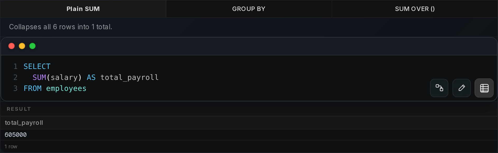
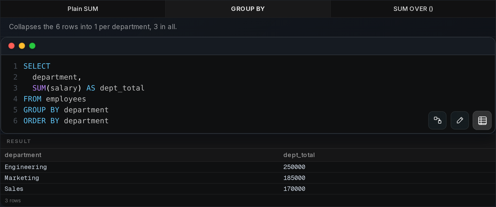
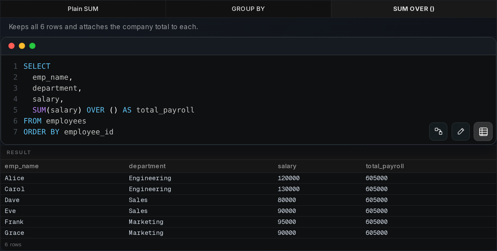
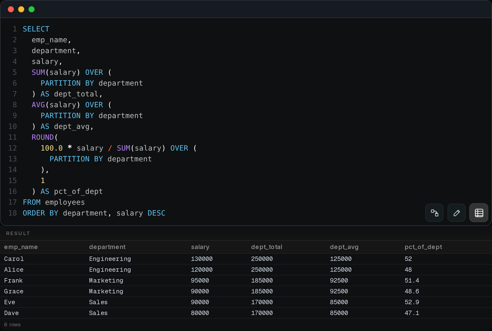
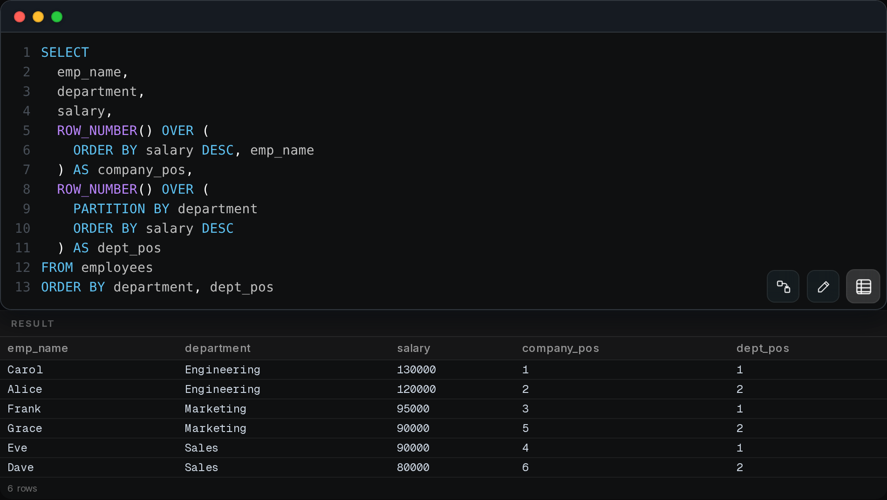
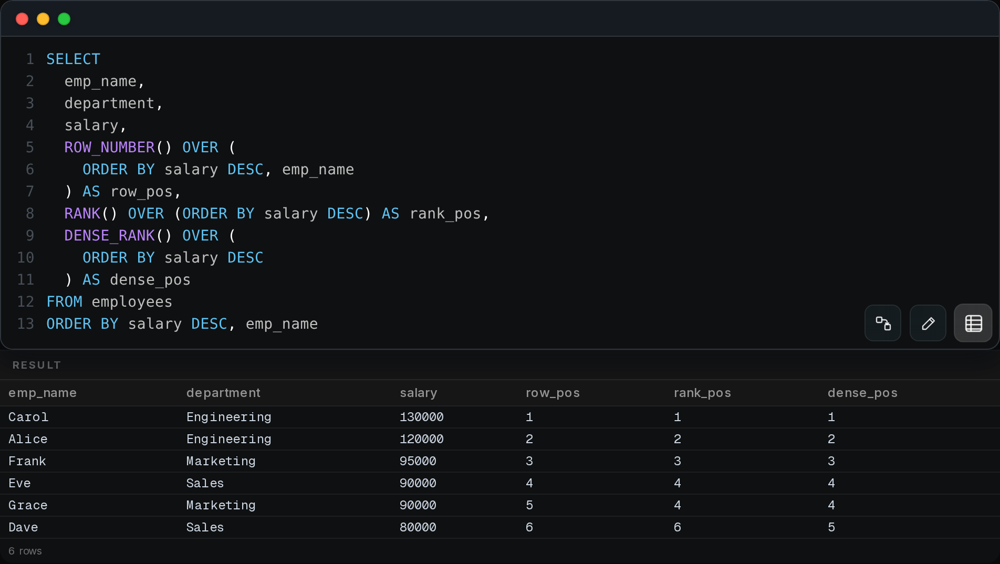
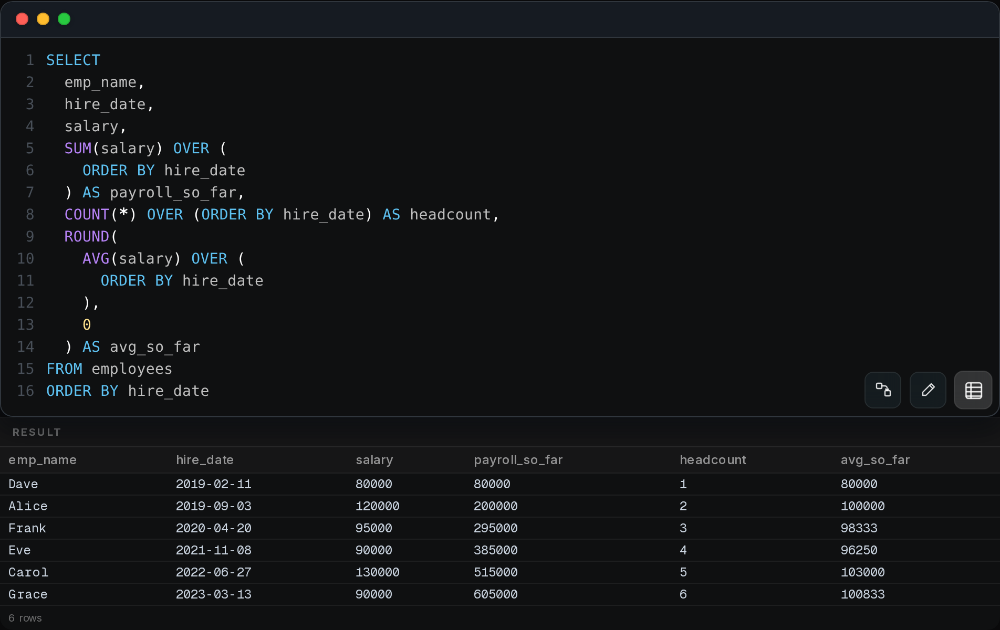

# Window Functions: Beginner

A payroll review asks for each person's salary beside their department's total. GROUP BY returns 3 rows and loses the 6 salaries; 2 queries stitched together in a spreadsheet get there slowly and break on the next hire. SQL:2003 added a single keyword for this gap, and the first section shows what it changes about SUM.


<br>

---

## What is a Window Function?

An aggregate function does 2 jobs at once: it computes a value over a set of rows, and it collapses that set into 1 output row. `SUM(salary)` with nothing else folds the whole table into a single row, and `SUM(salary)` with `GROUP BY department` folds it into 1 row per department. The `OVER` keyword separates the 2 jobs. `SUM(salary) OVER ()` computes the same total, and every input row survives into the output with that total attached as a new column. The set of rows the function reads is its window, which is where the name comes from, and any aggregate becomes a window function the moment `OVER` follows it.

The lesson follows 1 table through all 5 sections: `employees`, 6 people in 3 departments, each with a salary and a hire date. Total payroll is 605,000. The table is small enough to add up by hand on purpose, so every window result below can be predicted before the query runs.

| emp_name | department | salary | hire_date |
| --- | --- | --- | --- |
| Alice | Engineering | 120000 | 2019-09-03 |
| Carol | Engineering | 130000 | 2022-06-27 |
| Dave | Sales | 80000 | 2019-02-11 |
| Eve | Sales | 90000 | 2021-11-08 |
| Frank | Marketing | 95000 | 2020-04-20 |
| Grace | Marketing | 90000 | 2023-03-13 |

The table can answer 3 different questions with `SUM`, and the clause around it decides which one. Plain `SUM(salary)` answers how much the company pays in total and returns 1 row. `SUM(salary)` with `GROUP BY department` answers what each department costs and returns 3 rows. `SUM(salary) OVER ()` answers how each person's pay sits against the company total and returns 6 rows, one per employee, with 605,000 on every one of them. The 3 versions below show each one; the row count is the thing to watch.

**Plain SUM**

Collapses all 6 rows into 1 total.



```sql
SELECT
  SUM(salary) AS total_payroll
FROM employees
```

**GROUP BY**

Collapses the 6 rows into 1 per department, 3 in all.



```sql
SELECT
  department,
  SUM(salary) AS dept_total
FROM employees
GROUP BY department
ORDER BY department
```

**SUM OVER ()**

Keeps all 6 rows and attaches the company total to each.



```sql
SELECT
  emp_name,
  department,
  salary,
  SUM(salary) OVER () AS total_payroll
FROM employees
ORDER BY employee_id
```

The repeated 605,000 in the third version looks wrong to a spreadsheet eye, but it follows directly from how the window is defined. The window for an empty `OVER ()` is every row the query holds at that point, so `SUM` reads all 6 salaries once, arrives at 605,000, and the engine writes that value into the new column on all 6 rows. Each row's value is computed from the window that row belongs to, and no row borrows the figure from a neighbour. Once the total is on the row, ordinary arithmetic can use it: `100.0 * salary / SUM(salary) OVER ()` gives Carol 21.5 percent of payroll and Dave 13.2 percent, in the same `SELECT` list, with no second query.


<br>

### The window's place in clause order

A query runs its clauses in a fixed order, and window functions have a fixed place in it: after `FROM`, `WHERE`, `GROUP BY` and `HAVING` have produced their rows, and before the final `ORDER BY` and `LIMIT` arrange and trim them. The window therefore holds only the rows that survived `WHERE`: add `WHERE department = 'Sales'` and `SUM(salary) OVER ()` returns 170,000 on the 2 Sales rows, because the other 4 were gone before the window formed. A window function also cannot appear in `WHERE` or `HAVING`, because those clauses run before its value exists. Filtering on a window result needs an outer query, which section 2 shows with the top-earner-per-department pattern.

- FROM and joins assemble the rows
- WHERE drops rows that fail the condition
- GROUP BY and HAVING collapse and filter groups
- Window functions compute over whatever remains
- SELECT expressions, ORDER BY and LIMIT shape the output

**The orders table holds 1,200 rows across 4 regions, and exactly 900 of them have an amount above 100. How many rows does this query return? SELECT order_id, amount, SUM(amount) OVER () AS total FROM orders WHERE amount > 100**

- **A.** 1 row
- **B.** 4 rows
- **C.** 900 rows
- **D.** 1,200 rows

<details>
<summary>Solution</summary>

**C.** 900 rows

WHERE runs before the window is built, so 900 rows reach SUM OVER (), and each carries the total of those 900 amounts.

**Why the others are wrong**

- **A.** SUM without OVER collapses to 1 row. SUM with OVER () keeps every row that reaches it and adds a column.
- **B.** 4 rows would come from GROUP BY region. There is no GROUP BY here, and OVER never reduces the row count.
- **D.** WHERE removed 300 rows before the window function ran, and the window does not restore them.

</details>

The answer depends on where `OVER ()` runs. If it were a second pass over the whole table, the answer would be 1,200; it runs on the rows `WHERE` left behind, so the answer is 900. This window also needs no sort: 1 pass totals the rows the engine already holds.

| ✓ GROUP BY | ✗ OVER |
| --- | --- |
| • 1 output row per group<br><br>• Non-grouped columns must be aggregated<br><br>• Totals only; the detail rows are gone<br><br>• Result can be filtered with HAVING | • Every input row stays<br><br>• Any column can sit beside the result<br><br>• Detail and total on the same row<br><br>• Result filtered only from an outer query |

The choice between the 2 is the shape of the answer wanted. A report listing departments and their totals is a `GROUP BY`. A report listing people, each against a total, is a window function. The older route to the second report was a `GROUP BY` subquery of department totals joined back to `employees` on `department`, which costs a second scan of the table. MySQL added `OVER` in 8.0 and SQLite in 3.25, both in 2018, so every major engine now supports it.


<br>

---

## PARTITION BY Deep Dive

`OVER ()` builds 1 window from every row. `PARTITION BY` splits it into several, 1 per distinct value of the columns named, and the function runs separately inside each. `SUM(salary) OVER (PARTITION BY department)` reads the 2 Engineering rows and produces 250,000, the 2 Sales rows and produces 170,000, the 2 Marketing rows and produces 185,000, and every row receives the figure for its own partition. Row count stays at 6. The partition keys do the same work the keys in `GROUP BY` do, which is why a `GROUP BY department` query and a `PARTITION BY department` window always agree on the per-department figures; the difference is what happens to the rows afterwards.

Trace Alice. Her department is Engineering, so her window is the Engineering rows: Alice at 120,000 and Carol at 130,000. `SUM` over that window is 250,000, `AVG` is 125,000, and her share of the department is 120,000 divided by 250,000, which is 48 percent. Carol's window is the same 2 rows, so she receives the same 250,000 and 125,000, and a share of 52 percent. Dave in Sales never sees either of them; his window is Dave and Eve, totalling 170,000, and his share of it is 47.1 percent.



```sql
SELECT
  emp_name,
  department,
  salary,
  SUM(salary) OVER (
    PARTITION BY department
  ) AS dept_total,
  AVG(salary) OVER (
    PARTITION BY department
  ) AS dept_avg,
  ROUND(
    100.0 * salary / SUM(salary) OVER (
      PARTITION BY department
    ),
    1
  ) AS pct_of_dept
FROM employees
ORDER BY department, salary DESC
```

This `SELECT` holds 3 window functions, all over the same partition, and the engine builds the partition once and reuses it for each. `pct_of_dept` divides a column by a window result, which is allowed in the `SELECT` list and the final `ORDER BY`. A window value cannot appear in `WHERE`, `GROUP BY`, `HAVING` or a join condition, because all of them run before the window is computed. It also cannot be nested inside another aggregate.

The animation plays the `AVG` version clause by clause: 6 rows arrive from `FROM`, the engine sorts them into 3 partitions by department, computes 1 average inside each, and writes that average onto every row of the partition it came from.

https://github.com/user-attachments/assets/c851dfb3-1b6c-48aa-8417-fa244afd5882

Engineering averages 125,000, Sales 85,000, Marketing 92,500. Each figure appears once per row of its partition. That tells a window average from a `GROUP BY` average at a glance: the `GROUP BY` version is 3 rows with no names.


<br>

### Comparing a row to its own group

The everyday use of a partitioned aggregate is a gap from the group figure. `salary - AVG(salary) OVER (PARTITION BY department)` gives Alice minus 5,000 and Carol plus 5,000, Dave minus 5,000 and Eve plus 5,000, Frank plus 2,500 and Grace minus 2,500. It takes 1 expression and no self-join, and the answer lands on the row where the follow-up question, who is paid below their department's average, will be asked. The same shape gives a product's price against its category average, a server's latency against its region's, and a store's sales against its chain's.


<br>

### Partitioning on more than 1 column

`PARTITION BY` takes a list, and a window forms for each distinct combination. `PARTITION BY department, hire_year` on a larger payroll table makes 1 window per department per hiring cohort, so an employee is compared with the people hired into the same department in the same year. More columns mean smaller partitions, until every row is alone in a partition of 1 and the aggregate returns the row's own value. That is a useful diagnostic: a window total that equals the detail column on every row means the partition is too fine.

> **TIP**
>
> Rows whose partition column is NULL are kept and placed together in 1 partition of their own, the same way `GROUP BY` puts all NULL keys in 1 group. If 6 employees have no department, they get a `dept_total` that sums their 6 salaries.

> The limits of PARTITION BY
>
> - Draws boundaries between windows by column value
> - Leaves every row where it is; the row count never changes
> - Does not sort anything; order is ORDER BY's job, covered in section 2
> - Does not filter; a WHERE on the same column removes rows before the window forms


<br>

---

## ROW_NUMBER

PARTITION BY decides which rows share a window. ORDER BY inside OVER decides the order of rows within it, and a family of functions depends on that order entirely. ROW_NUMBER() is the first: it walks the window in the order given and hands out 1, 2, 3 and so on, never repeating a number and never skipping one. ROW_NUMBER() OVER (ORDER BY salary DESC) numbers the 6 employees from highest earner to lowest: Carol 1, Alice 2, Frank 3, Eve and Grace at 4 and 5 in some order, Dave 6. The function takes no argument because it reads nothing from the row; the position in the window is the whole output.

Add a partition and the numbering restarts at 1 inside each one. `ROW_NUMBER() OVER (PARTITION BY department ORDER BY salary DESC)` gives Carol 1 and Alice 2 in Engineering, Eve 1 and Dave 2 in Sales, Frank 1 and Grace 2 in Marketing. The partition is formed first, the order is applied within it, and the numbers are assigned last. That sequence (partition, then order, then compute) is the one to picture for every function in the rest of the lesson.



```sql
SELECT
  emp_name,
  department,
  salary,
  ROW_NUMBER() OVER (
    ORDER BY salary DESC, emp_name
  ) AS company_pos,
  ROW_NUMBER() OVER (
    PARTITION BY department
    ORDER BY salary DESC
  ) AS dept_pos
FROM employees
ORDER BY department, dept_pos
```

Both columns come from 1 query with no join, and they answer different questions. `company_pos` is a standing across the company, and `dept_pos` is a standing within a team. Change the `ORDER BY` inside the second `OVER` to `hire_date` and `dept_pos` becomes seniority within the department. The partition and the 6 rows stay as they were.

The animation shows the per-department numbering being assigned: rows sorted into partitions, each partition sorted by salary descending, and the counter starting over at 1 as each new partition opens.

https://github.com/user-attachments/assets/7737aa58-e6b2-4c8b-b58f-4f2a51cd088d


<br>

### Ties and the order that is not there

Eve and Grace both earn 90,000. `ORDER BY salary DESC` puts them next to each other and says nothing about which comes first, so `ROW_NUMBER` gives one of them 4 and the other 5 by whatever order the engine happened to read the rows in. The same query can return Eve 4 today and Grace 4 after the table is rewritten or the engine picks a different plan. The fix is a tiebreaker: `ORDER BY salary DESC, emp_name` makes the sequence fully determined, and `ORDER BY salary DESC, employee_id` does the same with an id that never changes. Omit `ORDER BY` altogether and `ROW_NUMBER` still runs, numbering rows in whatever order they arrived, which serves exactly 1 purpose: stamping a unique but meaningless id on rows that have none.


<br>

### The top earner in each department

The question `ROW_NUMBER` exists for is first-per-group: the highest-paid person in each department, the latest order per customer, the most recent reading per sensor. The window numbers the rows and a filter keeps the 1s. The filter cannot sit in the same query's `WHERE`, because `WHERE` runs before the number exists, so the numbering query becomes a derived table (a query placed in `FROM` and given a name) and the filter goes on the outer query.

```sql
SELECT
  emp_name,
  department,
  salary
FROM (
  SELECT
    emp_name,
    department,
    salary,
    ROW_NUMBER() OVER (
      PARTITION BY department
      ORDER BY salary DESC
    ) AS dept_pos
  FROM employees
) AS ranked
WHERE dept_pos = 1
```

Change `= 1` to `<= 2` and the query returns the top 2 per department, which is 6 rows here because every department has 2 people, and would be 2 rows per department on a department of 40. `GROUP BY department` with `MAX(salary)` finds the 3 numbers, and getting the names back requires a join from the 3 maxima to the detail rows; the window returns the names directly, and handles top 2, top 5 or top 10 by changing 1 constant.

A second everyday use is pagination. Number the rows with `ROW_NUMBER() OVER (ORDER BY hire_date, employee_id) AS row_pos` and filter the outer query on `row_pos BETWEEN 21 AND 40`, and the result is the second page of 20. The order includes a unique column, so page 2 contains the same rows on every request. `LIMIT` with `OFFSET` on a non-unique order does not guarantee that.


<br>

---

## RANK and DENSE_RANK

`ROW_NUMBER` forces a strict sequence onto rows that may not have one. Eve and Grace earn the same 90,000, and a report saying Eve is 4th and Grace is 5th asserts a difference the data does not contain. The ranking functions give tied rows the same number. There are 2, and they differ only in what happens to the number after a tie. `RANK` leaves a gap, `DENSE_RANK` does not.

| emp_name | salary | ROW_NUMBER | RANK | DENSE_RANK |
| --- | --- | --- | --- | --- |
| Carol | 130000 | 1 | 1 | 1 |
| Alice | 120000 | 2 | 2 | 2 |
| Frank | 95000 | 3 | 3 | 3 |
| Eve | 90000 | 4 | 4 | 4 |
| Grace | 90000 | 5 | 4 | 4 |
| Dave | 80000 | 6 | 6 | 5 |

`RANK` for a row is 1 plus the count of rows that sort strictly ahead of it. Eve and Grace have 3 people ahead, so both get 4; Dave has 5 people ahead, so he gets 6, and no row carries 5. The gap is deliberate: a rank of 6 says that 5 people out-earn Dave. `DENSE_RANK` for a row is the count of distinct values at or above its own, so Dave's 80,000 is the 5th distinct salary and he gets 5, which says that 4 pay levels sit above him. Both statements are true about the same table; they answer different questions.



```sql
SELECT
  emp_name,
  department,
  salary,
  ROW_NUMBER() OVER (
    ORDER BY salary DESC, emp_name
  ) AS row_pos,
  RANK() OVER (ORDER BY salary DESC) AS rank_pos,
  DENSE_RANK() OVER (
    ORDER BY salary DESC
  ) AS dense_pos
FROM employees
ORDER BY salary DESC, emp_name
```

Give Grace a raise to 95,000 in the table and rerun. She ties Frank at 3, Eve drops to a `RANK` of 5 and a `DENSE_RANK` of 4, and the row numbers shift by 1. The 3 columns disagree only around ties and agree exactly on a table with no duplicate salaries, which is why a wrong choice of ranking function hides until the first tie arrives in production.

The 2 animations run the same ranking over the same 6 rows. Watch where the counter lands after Eve and Grace: the first jumps to 6 for Dave, the second continues to 5.

https://github.com/user-attachments/assets/6e3953fa-c8cb-4c5a-b614-8ac65301935e

That was `RANK`, which counts rows ahead. `DENSE_RANK` counts distinct values instead, and Dave's row is the only one that changes.

https://github.com/user-attachments/assets/0b7e8133-740d-4498-a76a-8bc137a18509


<br>

### Ranking inside a partition

Both functions take `PARTITION BY` the way `ROW_NUMBER` does. Partitioned on `department` and still ordered by salary, the ranks restart at 1 in each department, and a tie inside 1 department leaves a gap there and nowhere else. Both functions also need an ordering to mean anything. Without one, every row in the window ties with every other, and all 6 employees are ranked 1.


<br>

### Picking the function from the question

The 3rd highest salary, as a pay level, is `DENSE_RANK() = 3`. If 2 people tie for 2nd, `RANK` jumps to 4 and no row carries 3. The top 3 places, with ties sharing a place, is `RANK() <= 3`, which is how a podium works. A fixed-length list of exactly 3 rows is `ROW_NUMBER() <= 3` with a tiebreaker column.

| Question | Function | Why |
| --- | --- | --- |
| Who earns the Nth distinct salary? | DENSE_RANK() = N | Counts distinct values, so N always exists |
| Who is in the top N places, ties included? | RANK() <= N | Shared places, and a gap keeps the podium honest |
| Give me exactly N rows | ROW_NUMBER() <= N | Unique positions, with a tiebreaker in ORDER BY |

**A query must return the employees who earn the 3rd highest salary in the company, and ties are possible at every level. Which outer-query filter is right?**

- **A.** WHERE row_pos = 3, with row_pos from ROW_NUMBER()
- **B.** WHERE rank_pos = 3, with rank_pos from RANK()
- **C.** WHERE dense_pos = 3, with dense_pos from DENSE_RANK()
- **D.** ORDER BY salary DESC LIMIT 1 OFFSET 2

<details>
<summary>Solution</summary>

**C.** WHERE dense_pos = 3, with dense_pos from DENSE_RANK()

DENSE_RANK counts distinct salary values, so 3 always names the 3rd distinct amount, and every employee on that amount comes back.

**Why the others are wrong**

- **A.** If 2 people tied at 120,000, one of them would be row 3, and the true 3rd distinct salary would be reported as 4th.
- **B.** A tie for 2nd makes the next RANK 4, so no row has rank 3 and the query returns nothing.
- **D.** OFFSET counts rows rather than distinct salaries, so a tie at the top shifts which salary lands in position 3, and only 1 row returns even when several share it.

</details>


<br>

---

## SUM/COUNT/AVG OVER

Sections 2 and 3 used `ORDER BY` inside `OVER` with functions that produce positions. Put it on an aggregate and the aggregate changes shape. `SUM(salary) OVER (ORDER BY hire_date)` no longer returns 1 total for the window; for each row it sums the rows that sort at or before that row, so the result grows as the order advances. That is a running total. The rule underneath is that an ordered window has a default frame, the rows from the start of the window up to the current one, and the Intermediate lesson covers changing it; this section uses the default throughout.

In hire order the payroll grew like this. Dave was hired first, in February 2019, and the payroll at that point was his 80,000. Alice joined in September 2019 and the running figure became 200,000. Frank brought it to 295,000 in April 2020, Eve to 385,000 in November 2021, Carol to 515,000 in June 2022 and Grace to 605,000 in March 2023. The last row's running total equals the `SUM(salary) OVER ()` from section 0, and that holds for every running total: it ends where the grand total is.

The animation sums the rows in hire order; the frame widens by 1 row at each step and the total is written onto the row that closed the frame.

https://github.com/user-attachments/assets/a4543b23-bc3b-4bc3-ab6d-ddfa97c6b5ce


<br>

### COUNT and AVG along the same order

The same `ORDER BY` turns `COUNT` into a running headcount and `AVG` into a running average. `COUNT(*) OVER (ORDER BY hire_date)` returns 1, 2, 3, 4, 5, 6: the headcount after each hire. `AVG(salary) OVER (ORDER BY hire_date)` returns 80,000, then 100,000, 98,333, 96,250, 103,000 and 100,833: the average pay of the workforce as it stood after each hire, and each value is the running total divided by the running count on the same row. All 3 use the identical frame, and all 3 come from 1 pass over the 6 rows.



```sql
SELECT
  emp_name,
  hire_date,
  salary,
  SUM(salary) OVER (
    ORDER BY hire_date
  ) AS payroll_so_far,
  COUNT(*) OVER (ORDER BY hire_date) AS headcount,
  ROUND(
    AVG(salary) OVER (
      ORDER BY hire_date
    ),
    0
  ) AS avg_so_far
FROM employees
ORDER BY hire_date
```

Swap `hire_date` for `salary` in all 3 windows and the running total becomes cumulative payroll from the lowest earner upward, the column behind a chart that asks what fraction of payroll the lowest-paid half of staff receives. The order column is the axis the running figure moves along, and a date is only the most common choice.


<br>

### Ties in the order column

The default frame is defined by value, and rows with equal order values are peers: each one's frame includes all of its peers. With 2 people hired on the same day, both rows show the running total after both hires, and the figure appears to jump by 2 salaries at once. That is right for a question about payroll on a given date and wrong for a question about payroll after each individual hire. A tiebreaker in the `ORDER BY` (`ORDER BY hire_date, employee_id`) makes every row its own step, the same remedy section 2 applied to `ROW_NUMBER`. Dates in the running example are all distinct, so the 6-row table never shows the effect; a production table with 400 hires in a year will.


<br>

### Running totals inside partitions

`PARTITION BY` and `ORDER BY` combine in 1 `OVER`. `SUM(salary) OVER (PARTITION BY department ORDER BY hire_date)` restarts the running total in each department: Sales goes 80,000 then 170,000, Engineering 120,000 then 250,000, Marketing 95,000 then 185,000. Each partition's last row carries the department total from section 1, and the order inside 1 partition has no effect on any other. This is the shape of month-to-date revenue per store, cumulative spend per customer and a running error count per service.

| ✓ Do | ✗ Don't |
| --- | --- |
| • Name the grain first: say what 1 row is before adding a window, because the row count will not change.<br><br>• End every ORDER BY inside OVER with a unique column when the result must be reproducible.<br><br>• Match the function to the question: ROW_NUMBER for fixed counts, RANK for places, DENSE_RANK for nth value.<br><br>• Filter on a window result from an outer query, never from the same query's WHERE. | • Do not self-join to put a group total beside a detail row; OVER (PARTITION BY) does it in 1 pass.<br><br>• Do not read repeated values in a window column as duplicates; each is computed for its own row's window.<br><br>• Do not expect ROW_NUMBER to be stable across ties without a tiebreaker column.<br><br>• Do not assume an ordered SUM steps 1 row at a time when the order column has ties. |


<br>

---

## Putting It All Together

A regional retail chain's Monday report lists every store's Sunday revenue beside its region's Sunday total and the store's share of it. It places stores within each region, with equal revenues sharing a place, flags the top 3 stores per region for the operations call, and shows each store's month-to-date revenue. An inner query reads the month's daily rows, 1 per store per day, and computes every window. An outer query keeps Sunday, so the report has 1 row per store that traded on Sunday.

- The region total beside each store is SUM(revenue) OVER (PARTITION BY region, sale_date). That is the section 1 shape on a 2-column partition, with the share as revenue divided by that total on the same row.
- The top 3 per region is ROW_NUMBER() OVER (PARTITION BY region, sale_date ORDER BY revenue DESC, store_id), filtered to 3 or less in the outer query. That is the section 2 pattern with a tiebreaker.
- The within-region placing uses RANK over the same partition, so 2 stores on equal revenue share a place and the next store is pushed down. Section 3's decision table calls this a podium.
- Month-to-date revenue is SUM(revenue) OVER (PARTITION BY store_id ORDER BY sale_date), section 4's running total restarting for each store. Each store has 1 row per day, so no 2 rows in a partition are peers.
- The Sunday filter sits in the outer query. In the inner query's WHERE it would remove the month's earlier days before any window formed, as section 0 laid out, and month-to-date would collapse to Sunday alone.


<br>

---

## Key Takeaways

- OVER turns an aggregate into a window function: the value is computed over a window and attached to every row, and the row count never changes.
- PARTITION BY splits the window by column value, so each row's figure comes from its own group, where GROUP BY would collapse the group to 1 row.
- ORDER BY inside OVER gives the window a sequence: ROW_NUMBER hands out unique positions and needs a unique tiebreaker to be stable.
- RANK and DENSE_RANK share numbers across ties; RANK leaves a gap after the tie and DENSE_RANK does not, and the question decides which is right.
- An aggregate with ORDER BY inside OVER becomes a running figure, growing row by row up to the current one, and its last row is the grand total.
