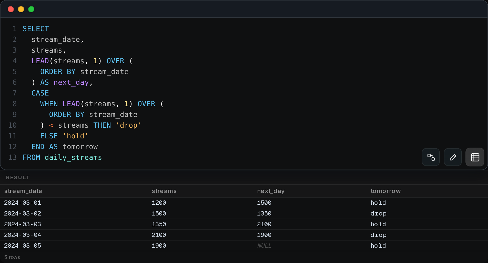
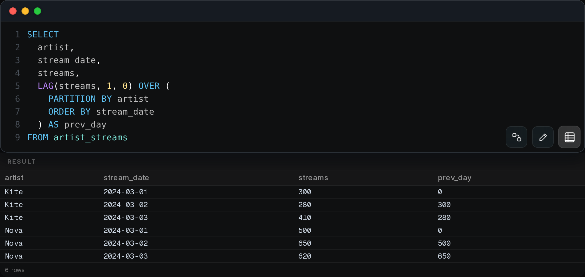
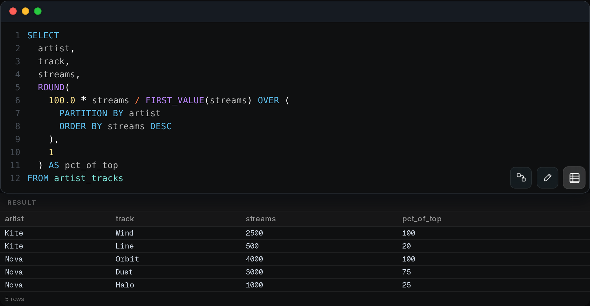
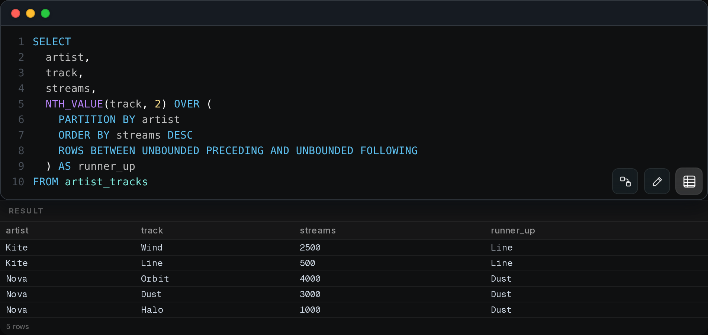
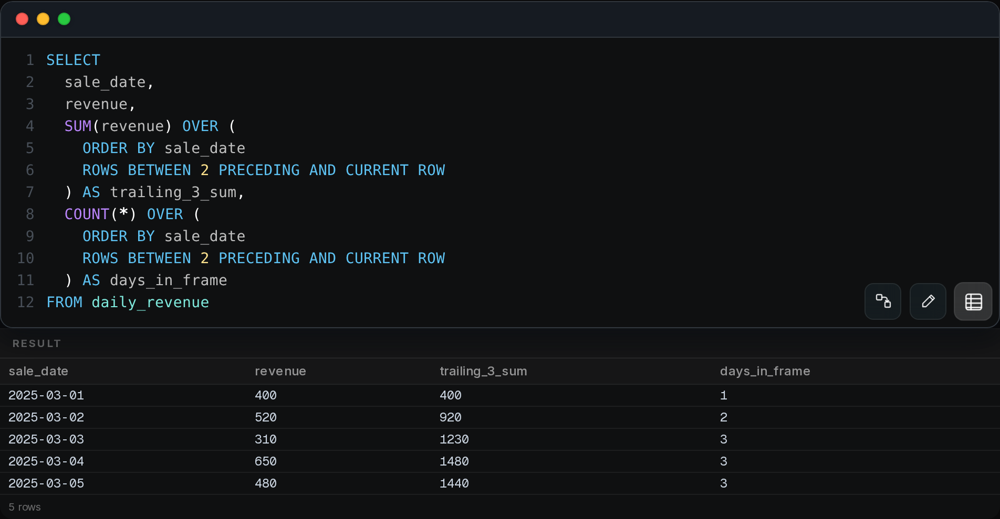
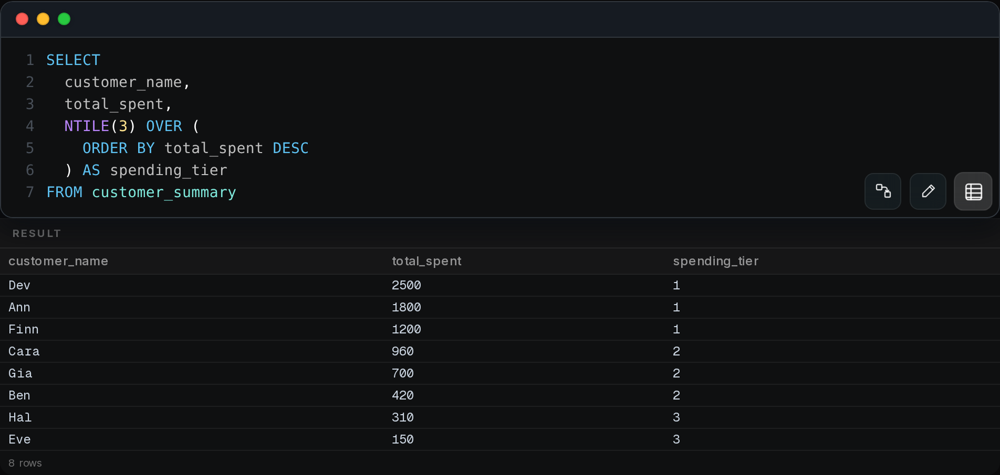
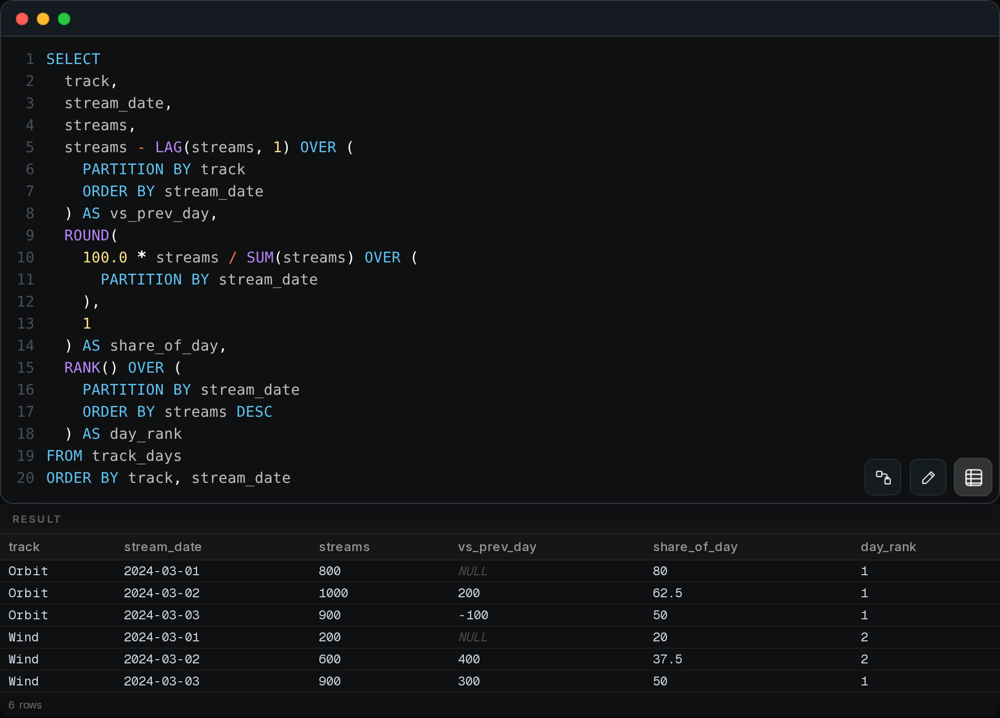

# Window Functions: Intermediate

At Spotify, the charts team watches a new single's daily streams the week it drops. Each morning the dashboard shows yesterday's number next to the day before, a 3-day average that smooths out the weekend spike, and which quarter of the artist's fans each listener falls into. Every one of those columns is a window reading rows around the current one, and this lesson builds all of them.


<br>

---

## LAG and LEAD

LAG reaches back a fixed number of rows inside a window and returns the value it finds there. The window's ORDER BY decides which row counts as previous: with ORDER BY stream_date, the previous row is the previous day. A row keeps every column it had, and LAG attaches one more column holding a neighbour's value, so a row can be compared to the row before it without a join.

https://github.com/user-attachments/assets/0d0307cf-b8c9-4261-9781-01f1021a77ac

The engine sorts the 5 rows by stream_date and walks them in that order. 2024-03-02 looks back 1 row and finds 1200, so prev_day is 1200 and day_change is 300. 2024-03-01 has no row before it, so prev_day is NULL, and 1200 minus NULL is NULL as well, because arithmetic with a NULL operand returns NULL. Every later row has a neighbour, so the remaining changes are -150, 750 and -200.


<br>

### LEAD looks the other way

LEAD has the same shape and reaches forward. LEAD(streams) on 2024-03-01 returns 1500, the next day's number, and the last row gets NULL because nothing follows it. A row that knows tomorrow's value can answer which days were followed by a drop, and the `CASE` below labels each one.



```sql
SELECT
  stream_date,
  streams,
  LEAD(streams, 1) OVER (
    ORDER BY stream_date
  ) AS next_day,
  CASE
    WHEN LEAD(streams, 1) OVER (
      ORDER BY stream_date
    ) < streams THEN 'drop'
    ELSE 'hold'
  END AS tomorrow
FROM daily_streams
```

2024-03-02 and 2024-03-04 are labelled drop, since 1350 is below 1500 and 1900 is below 2100. The last row is labelled hold even though no next day exists: its next_day is NULL, the comparison NULL < 1900 is neither true nor false, and a CASE with no true branch falls through to ELSE. Three-valued logic reaches into window results exactly as it reaches into WHERE.


<br>

### Offset and default

Both functions accept 2 optional arguments after the column. The second is the offset, how many rows to reach: LAG(streams, 7) returns the value from 7 rows back, the same weekday a week earlier when every day has a row. The third is a default returned when the reach lands outside the window: LAG(streams, 1, 0) turns the first row's NULL into 0, so the first day's change becomes 1200. Pick that default with care, because a change of 1200 on launch day and a missing comparison mean different things to the person reading the chart.

**On the 5-row daily_streams table, what does LEAD(streams, 2) OVER (ORDER BY stream_date) return for the 2024-03-03 row?**

- **A.** 2100, the value 1 row ahead on 2024-03-04
- **B.** 1500, the value 1 row back on 2024-03-02
- **C.** 1900, the value 2 rows ahead on 2024-03-05
- **D.** NULL, because the reach lands past the last row

<details>
<summary>Solution</summary>

**C.** 1900, the value 2 rows ahead on 2024-03-05

The row 2 places after 2024-03-03 is 2024-03-05, whose streams column holds 1900.

**Why the others are wrong**

- **A.** An offset of 2 reaches 2 rows forward, past 2024-03-04 to 2024-03-05.
- **B.** LEAD reaches forward in the window order, never back; a value from 1 row back is what LAG returns.
- **D.** Row 5 sits 2 rows ahead of row 3 and exists; NULL comes back only for rows 4 and 5, where the reach runs out of rows.

</details>


<br>

### Previous row within each artist

PARTITION BY resets the reach at every group boundary. With PARTITION BY artist, the first Nova row looks back and finds nothing, even though Kite's last row sits right before it in the table. Without the partition, ORDER BY stream_date interleaves the 2 artists by date, and a row's prev_day can come from the other artist, reporting a change that never happened. The query below uses the default argument, so the first day of each artist reads 0 instead of NULL.



```sql
SELECT
  artist,
  stream_date,
  streams,
  LAG(streams, 1, 0) OVER (
    PARTITION BY artist
    ORDER BY stream_date
  ) AS prev_day
FROM artist_streams
```

| artist | stream_date | streams | prev_day |
| --- | --- | --- | --- |
| Kite | 2024-03-01 | 300 | 0 |
| Kite | 2024-03-02 | 280 | 300 |
| Kite | 2024-03-03 | 410 | 280 |
| Nova | 2024-03-01 | 500 | 0 |
| Nova | 2024-03-02 | 650 | 500 |
| Nova | 2024-03-03 | 620 | 650 |

> Days since the previous event
>
> LAG on a date column, fed into DATE_DIFF, measures the gap between consecutive events for the same entity. Partition by user_id and order by login_date, and each login reports how many days passed since that user's previous one. A gap of 30 or more marks a user who lapsed and came back.

```sql
SELECT
  user_id,
  login_date,
  DATE_DIFF(
    'day',
    LAG(login_date, 1) OVER (
      PARTITION BY user_id
      ORDER BY login_date
    ),
    login_date
  ) AS days_since_last
FROM logins
```

> **TIP**
>
> LAG and LEAD always need an ORDER BY, because "the row before" means nothing in an unordered window. When the sort column has duplicates, add a tie-breaker such as an id to the ORDER BY, or 2 runs of the same query can hand the same row different neighbours.


<br>

---

## FIRST, LAST, NTH VALUE

FIRST_VALUE returns the value from the first row of the window, in the window's order. Where LAG reaches a fixed distance back, FIRST_VALUE reaches all the way to the start, so every row in a partition gets the same answer: the top of the list. Order the partition by streams descending and the first row is the artist's biggest track, which makes FIRST_VALUE the function for measuring every row against the leader.

https://github.com/user-attachments/assets/240dcd7e-9800-41c8-8e5b-3cfcb84f73d6

Orbit tops Nova's partition, so all 3 Nova rows, Dust and Halo included, read 4000 from it. Kite's 2 rows read 2500 from Wind. Dividing each row's streams by that column turns raw counts into a share of the leader, which is the number a label manager wants: Dust pulls 75 percent of what Orbit pulls, and Line pulls 20 percent of Wind.



```sql
SELECT
  artist,
  track,
  streams,
  ROUND(
    100.0 * streams / FIRST_VALUE(streams) OVER (
      PARTITION BY artist
      ORDER BY streams DESC
    ),
    1
  ) AS pct_of_top
FROM artist_tracks
```


<br>

### LAST_VALUE sees less than you expect

LAST_VALUE ought to hand every row the bottom of the partition. Run it with ORDER BY streams DESC and each row gets its own track back instead. The cause is how an ordered window is sized: once an OVER clause has an ORDER BY, the rows it covers run from the start of the partition up to the current row (and any rows tied with it, as the next section shows) and no further. That rule is why SUM over an ordered window produced a running total in the beginner lesson, and it means the last row LAST_VALUE can see is the current one. The 3 tabs below show the surprise and 2 ways out of it.

The ordered window ends at the current row, so LAST_VALUE hands every row its own track.

|  |  |
| --- | --- |
|  | SELECT |
|  | artist, |
|  | track, |
|  | streams, |
|  | LAST_VALUE(track) OVER ( |
|  | PARTITION BY artist |
|  | ORDER BY streams DESC |
|  | ) AS bottom_track |
|  | FROM artist_tracks |

Result

| artist | track | streams | bottom_track |
| --- | --- | --- | --- |
| Kite | Wind | 2500 | Wind |
| Kite | Line | 500 | Line |
| Nova | Orbit | 4000 | Orbit |
| Nova | Dust | 3000 | Dust |
| Nova | Halo | 1000 | Halo |

5 rows

The first tab returns Wind, Line, Orbit, Dust, Halo, one row's own track per row. The other 2 tabs both return Line for every Kite row and Halo for every Nova row. The second tab fixes the window's size, which is the subject of the next section; the third sidesteps the question by making the row you want the first one. Both are correct, and the third is shorter, so reach for it when a single reversed sort gets you there.


<br>

### NTH_VALUE picks a position

NTH_VALUE(track, 2) returns the value from the second row of the window. The same sizing rule applies: under an ordered window with no extra clause, the first row of a partition has not reached row 2 yet, so it gets NULL while every later row gets the runner-up. Stretching the window to the whole partition, as the **Full window** tab did, gives every row the same runner-up.



```sql
SELECT
  artist,
  track,
  streams,
  NTH_VALUE(track, 2) OVER (
    PARTITION BY artist
    ORDER BY streams DESC
    ROWS BETWEEN UNBOUNDED PRECEDING AND UNBOUNDED FOLLOWING
  ) AS runner_up
FROM artist_tracks
```

| artist | track | streams | runner_up |
| --- | --- | --- | --- |
| Kite | Wind | 2500 | Line |
| Kite | Line | 500 | Line |
| Nova | Orbit | 4000 | Dust |
| Nova | Dust | 3000 | Dust |
| Nova | Halo | 1000 | Dust |

Kite has 2 tracks, so its runner-up is Line on both rows. A partition with a single track would return NULL from NTH_VALUE(track, 2) on every row, because the second row does not exist. That NULL is informative: a COALESCE to the text 'none' turns it into a readable label in a report.

> **TIP**
>
> LAG and LEAD count rows across the partition and ignore the window's frame. The functions ending in _VALUE read only the rows inside the frame, so when one of them needs to see past the current row, write the frame out in full.

**On artist_tracks, what does FIRST_VALUE(track) OVER (PARTITION BY artist ORDER BY streams ASC) return for Nova's Orbit row?**

- **A.** Orbit, because the function reads the current row
- **B.** Halo, the Nova track with the fewest streams
- **C.** Dust, the second row of the ascending order
- **D.** NULL, since Orbit is the last row and the window stops there

<details>
<summary>Solution</summary>

**B.** Halo, the Nova track with the fewest streams

Ascending order puts Halo, at 1000 streams, first in Nova's partition and Orbit, at 4000, last, so FIRST_VALUE returns Halo for every Nova row, Orbit included.

**Why the others are wrong**

- **A.** FIRST_VALUE reads the first row of the window, and with an ascending order the first row of Nova is the one with the fewest streams.
- **C.** Dust sits second in the ascending order, which is the row NTH_VALUE(track, 2) would return, while FIRST_VALUE returns the first.
- **D.** Orbit is the last row, so its window covers the whole partition, and the first row of that window is Halo rather than NULL.

</details>


<br>

---

## Frame Specifications

A frame is the slice of a partition that an aggregate window function reads for one row. The clause starts with ROWS or RANGE to pick the unit, then gives a start and an end. Each bound is either CURRENT ROW or a distance in one direction, n PRECEDING or n FOLLOWING, with UNBOUNDED in place of n to reach the edge of the partition. ROWS BETWEEN 1 PRECEDING AND 1 FOLLOWING covers 3 rows, the current row plus 1 on each side. The frame slides along with the current row, so each row's average is taken over its own neighbours rather than over a fixed block.

| Boundary | What it points at | Typical use |
| --- | --- | --- |
| UNBOUNDED PRECEDING | the first row of the partition | start of a running total |
| 2 PRECEDING | 2 rows before the current row | start of a trailing 3-row window |
| CURRENT ROW | the row being computed | end of a running total |
| 1 FOLLOWING | 1 row after the current row | end of a centred 3-row window |
| UNBOUNDED FOLLOWING | the last row of the partition | end of a whole-partition window |

https://github.com/user-attachments/assets/69e75a3e-6c81-4b03-86b2-7037271a478f

The frame shrinks at the edges rather than failing. 2025-03-01 has no row before it, so its frame holds 2 rows and the average is 460, (400 + 520) / 2. 2025-03-03 sits in the middle, with 520 before it and 650 after, and its own 310 averages with them to 493.3. 2025-03-05 averages its own 480 with the 650 before it, giving 565. A 3-day average that covers 2 days at the ends is right for a chart and wrong for a report that promised 3 full days, and a COUNT(\*) over the same frame tells the reader how many days each figure covers.



```sql
SELECT
  sale_date,
  revenue,
  SUM(revenue) OVER (
    ORDER BY sale_date
    ROWS BETWEEN 2 PRECEDING AND CURRENT ROW
  ) AS trailing_3_sum,
  COUNT(*) OVER (
    ORDER BY sale_date
    ROWS BETWEEN 2 PRECEDING AND CURRENT ROW
  ) AS days_in_frame
FROM daily_revenue
```

This frame trails: it ends at the current row and reaches 2 rows back, so the sums run 400, 920, 1230, 1480, 1440. days_in_frame climbs from 1 to 3 over the first 3 days and stays at 3 after that. A trailing window is the shape of every rolling metric that must never peek at the future, which is the rule for anything feeding a forecast. Filtering to days_in_frame = 3 in an outer query drops the 2 partial days.


<br>

### ROWS counts rows, RANGE counts values

ROWS measures the frame in physical rows. RANGE measures it in values of the ORDER BY column: rows that share the same sort value are peers, and a RANGE frame ending at CURRENT ROW includes every peer of the current row, even the ones placed after it. The difference only shows when the sort column has duplicates, which real data has constantly: 2 orders on the same day, 2 tracks with the same stream count.

Each row gets its own running total, and the 2 day-2 orders receive different totals in an order the engine chooses.

|  |  |
| --- | --- |
|  | SELECT |
|  | order_day, |
|  | amount, |
|  | SUM(amount) OVER ( |
|  | ORDER BY order_day |
|  | ROWS BETWEEN UNBOUNDED PRECEDING AND CURRENT ROW |
|  | ) AS running_total |
|  | FROM orders |

Result

| order_day | amount | running_total |
| --- | --- | --- |
| 1 | 100 | 100 |
| 2 | 200 | 300 |
| 2 | 50 | 350 |
| 3 | 300 | 650 |

4 rows

Under ROWS, the 2 day-2 orders get different running totals. The one the engine sorts first reads 300 or 150, depending on which order that is, and the other reads 350, so a second run can swap them. Under RANGE both read 350, because both share the value 2 in order_day and each frame includes its peer. A running total by day should be identical for every order on that day, and RANGE delivers that. RANGE is also the default unit when OVER has an ORDER BY and no frame.

| ✓ OVER with no ORDER BY | ✗ OVER with ORDER BY, no frame written |
| --- | --- |
| • The frame is the whole partition<br><br>• SUM returns the partition total on every row<br><br>• FIRST_VALUE and LAST_VALUE see every row<br><br>• Row order inside the partition carries no meaning | • The frame is RANGE BETWEEN UNBOUNDED PRECEDING AND CURRENT ROW<br><br>• SUM returns a running total<br><br>• LAST_VALUE sees up to the current row and its peers<br><br>• Tied rows share one frame and one result |

| ✓ Do | ✗ Don't |
| --- | --- |
| • Write ROWS when the frame is a count of rows, such as the last 7 or the surrounding 3<br><br>• Pair a sliding average with a COUNT(\*) over the same frame so partial edges are visible<br><br>• Spell the frame out whenever the function must see rows after the current one | • Rely on ROWS with a tied ORDER BY column; the split between ties changes between runs<br><br>• Assume an ordered window covers the whole partition; it stops at the current row<br><br>• Write n PRECEDING with RANGE when you mean rows; RANGE measures the sort value |

**On the 5-row daily_revenue table, what does SUM(revenue) OVER (ORDER BY sale_date ROWS BETWEEN 1 FOLLOWING AND 2 FOLLOWING) return for 2025-03-01?**

- **A.** 920, the sum of the current row and the next
- **B.** 1230, the sum of the first 3 rows of the table
- **C.** 830, the sum of the 2 rows after the current one
- **D.** 960, the sum of the rows 2 and 3 places ahead

<details>
<summary>Solution</summary>

**C.** 830, the sum of the 2 rows after the current one

The frame holds 2025-03-02 and 2025-03-03, and 520 + 310 is 830; the current row sits outside its own frame.

**Why the others are wrong**

- **A.** The frame starts 1 row after the current one, so 400 from the current row is left out.
- **B.** A frame from 1 FOLLOWING to 2 FOLLOWING holds 2 rows and excludes the current row, so 3 rows is too many.
- **D.** 310 + 650 covers rows 2 and 3 places ahead, which is the frame 2 FOLLOWING to 3 FOLLOWING, not 1 to 2.

</details>


<br>

---

## NTILE and Bucketing

NTILE(n) sorts the partition, cuts it into n groups of as equal a size as the row count allows, and labels each row with its group number from 1 to n. The numbering starts at the top of the order, so NTILE(4) OVER (ORDER BY total_spent DESC) puts the biggest spenders in bucket 1. The function answers a question RANK cannot: a rank says a customer is 6th, a quartile says they are in the bottom quarter, and that statement holds whether the table has 8 customers or 8 million.

https://github.com/user-attachments/assets/dfc7dc48-163e-417c-84a1-44ea134c025e

The 8 rows split into 4 buckets of 2. The engine orders them Dev 2500, Ann 1800, Finn 1200, Cara 960, Gia 700, Ben 420, Hal 310, Eve 150, then deals the buckets out in pairs from the top, so Dev and Ann take bucket 1 and Hal and Eve take bucket 4. A bucket depends on position alone, never on the amount. Ben at 420 and Hal at 310 are only 110 apart but land in different quartiles, while Dev and Ann are 700 apart and share one.


<br>

### When the rows do not divide evenly

Splitting 8 rows into 3 buckets leaves 2 left over, and the rule is that the leftovers go to the lowest-numbered buckets, 1 row each. NTILE(3) therefore gives buckets 1 and 2 an extra row apiece, for 3 rows each, and leaves 2 rows for bucket 3. Bucket sizes never differ by more than 1 row, and the larger buckets always come first.



```sql
SELECT
  customer_name,
  total_spent,
  NTILE(3) OVER (
    ORDER BY total_spent DESC
  ) AS spending_tier
FROM customer_summary
```

| customer_name | total_spent | spending_tier |
| --- | --- | --- |
| Dev | 2500 | 1 |
| Ann | 1800 | 1 |
| Finn | 1200 | 1 |
| Cara | 960 | 2 |
| Gia | 700 | 2 |
| Ben | 420 | 2 |
| Hal | 310 | 3 |
| Eve | 150 | 3 |

NTILE never gives 2 rows the same bucket on account of a tie. If Ben and Hal both had 420, one would still take the last slot of bucket 2 and the other would drop to bucket 3, in an order the engine picks. Add a tie-breaker to the `ORDER BY`, such as customer_name, so the split comes out the same on every run.


| ✓ NTILE buckets | ✗ CASE on fixed thresholds |
| --- | --- |
| • Bucket sizes differ by at most 1 row<br><br>• The cutoffs move as the data changes<br><br>• A top bucket always exists, even when every customer is small<br><br>• Hard to explain as a figure: there's no fixed dollar line | • Bucket sizes vary with the data<br><br>• The cutoffs stay where the business set them<br><br>• A bucket can be empty when nobody crosses its line<br><br>• Easy to explain: spent over 1000 means tier 1 |


<br>

### Bucketing inside partitions

NTILE(4) OVER (PARTITION BY region ORDER BY total_spent DESC) deals the quartiles out within each region. A customer with 700 could be quartile 1 in a region of 4 small accounts and quartile 3 in a region of 40 large ones, which is the behaviour you want when each region's team is judged against its own customers. Drop the partition when the comparison is meant to be global.

> **TIP**
>
> Top 10 percent of anything is NTILE(10) with an outer filter of bucket = 1. Top 1 percent is NTILE(100) with the same filter. The number of rows in that bucket follows the table, so the query needs no edit as the table grows.

**A table has 10 rows. What bucket sizes does NTILE(4) OVER (ORDER BY score DESC) produce, from bucket 1 to bucket 4?**

- **A.** 3, 3, 2, 2, the 2 leftover rows going to the first buckets
- **B.** 2, 2, 3, 3, the 2 leftover rows going to the last buckets
- **C.** 4, 2, 2, 2, every leftover row landing in bucket 1
- **D.** 2, 2, 2, 2, with the 2 extra rows left unbucketed

<details>
<summary>Solution</summary>

**A.** 3, 3, 2, 2, the 2 leftover rows going to the first buckets

10 divided by 4 is 2 with 2 left over, and each leftover row goes to the lowest-numbered bucket that has not received one.

**Why the others are wrong**

- **B.** Leftover rows go to the first buckets, so the larger buckets come first in the numbering.
- **C.** Buckets never differ by more than 1 row, so the 2 leftovers spread across buckets 1 and 2 rather than both landing in 1.
- **D.** Every row receives a bucket number; the function stretches buckets to fit the row count rather than leaving rows out.

</details>


<br>

---

## Multiple Windows

Each OVER clause is a window of its own, and a query can hold as many as it needs, partitioned and sorted however each column requires. The engine computes them all over the same input rows, so one SELECT can report how a track moved against yesterday, what share of the day it took, and where it ranked that day, all without a join or a second read of the table. The 3 columns below come from 3 windows that disagree on nearly everything.



```sql
SELECT
  track,
  stream_date,
  streams,
  streams - LAG(streams, 1) OVER (
    PARTITION BY track
    ORDER BY stream_date
  ) AS vs_prev_day,
  ROUND(
    100.0 * streams / SUM(streams) OVER (
      PARTITION BY stream_date
    ),
    1
  ) AS share_of_day,
  RANK() OVER (
    PARTITION BY stream_date
    ORDER BY streams DESC
  ) AS day_rank
FROM track_days
ORDER BY track, stream_date
```

| track | stream_date | streams | vs_prev_day | share_of_day | day_rank |
| --- | --- | --- | --- | --- | --- |
| Orbit | 2024-03-01 | 800 | NULL | 80.0 | 1 |
| Orbit | 2024-03-02 | 1000 | 200 | 62.5 | 1 |
| Orbit | 2024-03-03 | 900 | -100 | 50.0 | 1 |
| Wind | 2024-03-01 | 200 | NULL | 20.0 | 2 |
| Wind | 2024-03-02 | 600 | 400 | 37.5 | 2 |
| Wind | 2024-03-03 | 900 | 300 | 50.0 | 1 |

vs_prev_day partitions by track and orders by date, so Orbit's 2024-03-02 row reads back to its own 800 and reports 200, while Wind's 2024-03-03 row reads 600 and reports 300. share_of_day partitions by date with no ORDER BY, so SUM covers the whole day: 1000 on 2024-03-01, 1600 on 2024-03-02, 1800 on 2024-03-03, and Orbit's 800 is 80.0 percent of the first. day_rank partitions by date and orders by streams DESC; on 2024-03-03 both tracks reach 900 and RANK gives both a 1. The engine computes all 3 from a single read of the 6 rows.

**Which OVER clause gives each track_days row its share of that day's total streams?**

- **A.** OVER (PARTITION BY track), the total of the track across all days
- **B.** OVER (PARTITION BY stream_date ORDER BY streams), a running total within the day
- **C.** OVER (PARTITION BY stream_date), the total of every track on that day
- **D.** OVER (), the total of every row in the table

<details>
<summary>Solution</summary>

**C.** OVER (PARTITION BY stream_date), the total of every track on that day

A partition by date with no ORDER BY covers the whole day, so SUM returns the day's total on every row of that day, and dividing by it gives the share.

**Why the others are wrong**

- **A.** Partitioning by track sums one track's 3 days, which measures a day's share of the track rather than the track's share of the day.
- **B.** Adding ORDER BY makes the frame stop at the current row, so the smaller track would be divided by its own streams alone and report 100 percent.
- **D.** An empty OVER covers the whole table, 4400 streams, so each row's share would be measured against 3 days rather than its own.

</details>


<br>

### Filtering on a window result

Window functions run in the SELECT step of the execution order, after WHERE has already chosen its rows, so a WHERE clause cannot mention day_rank: the column does not exist yet when WHERE runs. Wrap the windowed query in a CTE and filter its output in the outer query instead. The query below keeps the leader of each day, and because 2024-03-03 is a tie, that day returns 2 rows.

```sql
WITH ranked AS (
  SELECT
    track,
    stream_date,
    streams,
    RANK() OVER (
      PARTITION BY stream_date
      ORDER BY streams DESC
    ) AS day_rank,
    ROUND(
      100.0 * streams / SUM(streams) OVER (
        PARTITION BY stream_date
      ),
      1
    ) AS share_of_day
  FROM track_days
)

SELECT
  stream_date,
  track,
  share_of_day
FROM ranked
WHERE day_rank = 1
ORDER BY stream_date
```

> What several windows cost
>
> - Each distinct pair of PARTITION BY and ORDER BY needs its own sort of the rows
> - Windows that share a partition and order can be computed in the same sorted pass
> - A different frame on the same partition and order adds no sort
> - The 3-window query above sorts the rows by track and date, then sorts them again by date and streams

> **TIP**
>
> When 2 columns differ only by frame, such as a trailing 7-day sum and a trailing 28-day sum, keep their PARTITION BY and ORDER BY identical character for character. The shared sort is then reused, and the reader sees at once that the 2 figures describe the same ordering.


<br>

---

## Putting It All Together

Spotify's charts team ships a weekly report for a label: for each of the label's tracks and each day, streams against the previous day, a 3-day centred average, share of the label's streams that day, and which quartile of the label's catalogue the track sits in by total streams.

- The day-over-day column is LAG partitioned by track and ordered by date, with a NULL on each track's first day that the report shows as a blank rather than a 0.
- The centred average is AVG over ROWS BETWEEN 1 PRECEDING AND 1 FOLLOWING in the same partition, paired with a COUNT(\*) over that frame so the partial first and last days are marked.
- Share of the day is streams divided by SUM(streams) OVER (PARTITION BY stream_date), a window with no ORDER BY so the frame covers the whole day.
- The quartile is NTILE(4) over each track's total streams ordered DESC, computed in its own CTE and joined back so a track's tier appears on every one of its daily rows.
- The other 3 windows share one SELECT over every day of data, and the outer query keeps the current week, so the week's first day still finds the day before it for LAG and the centred average.


<br>

---

## Key Takeaways

- LAG and LEAD reach a fixed number of rows back or forward in the window's order. When the reach runs past the edge of the partition, they return NULL unless you supplied a default.
- FIRST_VALUE reads the top of the partition; LAST_VALUE and NTH_VALUE read only the frame, which under an ORDER BY stops at the current row unless you extend it.
- A frame names a unit and 2 boundaries; ROWS counts physical rows while RANGE treats tied sort values as peers, and the default with ORDER BY is RANGE up to the current row.
- NTILE(n) deals rows into n buckets by position, sends leftover rows to the first buckets, and can split tied rows across a bucket boundary, so add a tie-breaker to the ORDER BY.
- Several OVER clauses in one SELECT each define their own window; filter on a window's result from a CTE, since WHERE runs before the window is computed.
