# Learn Python: drop / keep / trim decisions (ticket #18, parent spec #10)

> **NEVER MERGE.** Temporary review PR (branch `review-python-learn-drops`). It exists so the owner can look at the pictures and decide; close it afterwards. If it were ever merged it would need a squash that removes this folder.

56 places from the HANDOFF section 7 lists (32 definite, 24 needs-a-skim). For each: the live page with the target block outlined in red, one block before and one after (2x, 1100px wide, taken from the live site, where exercise widgets show as rendered), the converted Markdown around it, and a **proposed default**. The proposals are only proposals: tick one box per place. Decisions are recorded by ticking the box and saying so on the PR; then the "drop" ones go into `tools/drops.json` and the "trim" ones are hand-edited.

How the numbers fit together: the Markdown is what `tools/lesson_to_md.py` produces for the lesson with the exercises left out (exercise widgets are not in it, multiple-choice blocks are). Drop prefixes come from that Markdown and were checked with the converter's own matcher; `drops.json` matches a block-start prefix against every block of the lesson, and removes the whole block.

## Index

| # | Lesson | Group | Place | Proposed |
| --- | --- | --- | --- | --- |
| [1](#place-1) | `python_foundations_beginner` | definite | Variables and Assignment: A name that was never bound | **trim** |
| [2](#place-2) | `python_foundations_beginner` | definite | Variables and Assignment: A name that was never bound | **trim** |
| [3](#place-3) | `python_foundations_beginner` | definite | Data Types: Converting between types | **drop** |
| [4](#place-4) | `python_foundations_beginner` | definite | Print Statements: f-strings | **drop** |
| [5](#place-5) | `python_foundations_beginner` | definite | Basic Operators: Precedence and augmented assignment | **drop** |
| [6](#place-6) | `python_foundations_intermediate` | definite | Indentation and Code Blocks: Practice | **drop** |
| [7](#place-7) | `python_foundations_intermediate` | definite | Importing Modules: Practice | **drop** |
| [8](#place-8) | `python_foundations_intermediate` | definite | Reading Input From the User: Practice | **drop** |
| [9](#place-9) | `python_foundations_intermediate` | definite | Reading a Traceback: Practice | **drop** |
| [10](#place-10) | `python_foundations_intermediate` | definite | Trying Code in the Interactive Shell: Capstone | **keep** |
| [11](#place-11) | `python_control_flow_intermediate` | definite | Branching on Types With isinstance: Capstone: a reading through every tool | **keep** |
| [12](#place-12) | `python_control_flow_intermediate` | definite | Branching on Types With isinstance: Capstone: a reading through every tool | **drop** |
| [13](#place-13) | `python_control_flow_intermediate` | definite | Branching on Types With isinstance: Capstone: a reading through every tool | **trim** |
| [14](#place-14) | `python_expressions_beginner` | definite | Operators and Readability: Capstone practice | **drop** |
| [15](#place-15) | `python_expressions_beginner` | definite | Operators and Readability: Capstone practice | **drop** |
| [16](#place-16) | `python_expressions_beginner` | definite | Operators and Readability: Capstone practice | **keep** |
| [17](#place-17) | `python_expressions_beginner` | skim | Mixing Types in One Expression: Let print do the joining | **keep** |
| [18](#place-18) | `python_expressions_beginner` | skim | Operators and Readability: Capstone practice | **keep** |
| [19](#place-19) | `python_expressions_advanced` | definite | Walrus Operator (:=): Capstone: one event, every operator | **drop** |
| [20](#place-20) | `python_expressions_advanced` | definite | Walrus Operator (:=): Capstone: one event, every operator | **drop** |
| [21](#place-21) | `python_expressions_advanced` | definite | Walrus Operator (:=): Capstone: one event, every operator | **trim** |
| [22](#place-22) | `python_dictionaries_intermediate` | definite | Iterating and Dictionary Views: Read or insert with setdefault | **drop** |
| [23](#place-23) | `python_dictionaries_intermediate` | definite | Merging Dictionaries: Why in-place merges leak | **drop** |
| [24](#place-24) | `python_dictionaries_intermediate` | definite | Copying Dictionaries: Copy at the boundary | **trim** |
| [25](#place-25) | `python_collections_intermediate` | definite | Using zip() for Combining: Capstone: a ranking step end to end | **drop** |
| [26](#place-26) | `python_collections_intermediate` | definite | Using zip() for Combining: Capstone: a ranking step end to end | **drop** |
| [27](#place-27) | `python_functional_beginner` | definite | Type Hints for Function Signatures: Capstone: One Pricing Pipeline | **drop** |
| [28](#place-28) | `python_functional_beginner` | definite | Type Hints for Function Signatures: Capstone: One Pricing Pipeline | **drop** |
| [29](#place-29) | `python_problem_solving_beginner` | definite | Testing Simple Cases: Capstone: one problem, all 5 habits | **trim** |
| [30](#place-30) | `python_data_structures_beginner` | definite | Which Collections Keep Their Order: Practice | **trim** |
| [31](#place-31) | `python_data_structures_beginner` | definite | Choosing the Right Type: Capstones | **drop** |
| [32](#place-32) | `python_data_structures_beginner` | definite | Choosing the Right Type: Capstones | **drop** |
| [33](#place-33) | `python_data_structures_beginner` | skim | Which Collections Can Change: Practice | **drop** |
| [34](#place-34) | `python_data_structures_beginner` | skim | Converting Between Collections: Practice | **drop** |
| [35](#place-35) | `python_data_structures_beginner` | skim | Which Collections Allow Duplicates: Practice | **drop** |
| [36](#place-36) | `python_data_structures_beginner` | skim | Choosing the Right Type: Capstones | **trim** |
| [37](#place-37) | `python_data_structures_intermediate` | definite | Combining Structures for One Task: Capstone: from raw events to clean rows | **drop** |
| [38](#place-38) | `python_sets_intermediate` | definite | Subset and Superset: Changing a set in place | **drop** |
| [39](#place-39) | `python_loops_beginner` | skim | Iterating with for Loops: Practice: counting letters | **keep** |
| [40](#place-40) | `python_loops_beginner` | skim | range() Function: Getting the stop right | **keep** |
| [41](#place-41) | `python_loops_beginner` | skim | Loops with while: Zero passes | **keep** |
| [42](#place-42) | `python_loops_beginner` | skim | Using break and continue: continue can skip the progress line in while | **keep** |
| [43](#place-43) | `python_loops_beginner` | skim | Loop Variable Scope: Reusing a name | **keep** |
| [44](#place-44) | `python_strings_advanced` | skim | Splitting Strings: When the piece count is wrong | **keep** |
| [45](#place-45) | `python_strings_advanced` | skim | Joining Strings: Newlines at the seams | **keep** |
| [46](#place-46) | `python_strings_advanced` | skim | Regular Expression Matching: Replacing matches | **keep** |
| [47](#place-47) | `python_strings_advanced` | skim | Advanced Formatting: Templates with str.format | **keep** |
| [48](#place-48) | `python_strings_advanced` | skim | String Encoding: Same text, different code points | **keep** |
| [49](#place-49) | `python_lists_advanced` | skim | In-Place vs Return Value: Capstone: a plan with undo | **keep** |
| [50](#place-50) | `python_lists_advanced` | skim | In-Place vs Return Value: Capstone: a plan with undo | **keep** |
| [51](#place-51) | `python_dictionaries_beginner` | skim | Creating Your First Dictionary: Practice | **keep** |
| [52](#place-52) | `python_dictionaries_beginner` | skim | Reading and Updating Values: Practice | **keep** |
| [53](#place-53) | `python_dictionaries_beginner` | skim | Removing Items: Practice | **keep** |
| [54](#place-54) | `python_dictionaries_beginner` | skim | Checking for Keys and Key Types: Practice | **keep** |
| [55](#place-55) | `python_problem_solving_advanced` | skim | Sort as Preprocessing: Capstone: the fullest gap | **drop** |
| [56](#place-56) | `python_problem_solving_advanced` | skim | Sort as Preprocessing: Capstone: the fullest gap | **drop** |

## Place 1

- Lesson slug: `python_foundations_beginner` (https://datadriven.io/learn/python_foundations_beginner)
- Group: DEFINITE | Section: Variables and Assignment | Sub-heading: A name that was never bound
- The sentence: `The program below computes a subtotal and stops on its last line.`
- Drop prefix (from the converted Markdown): n/a, the sentence is the tail of a longer paragraph: a prefix would drop the whole paragraph, so trim by hand

Converted Markdown (block before, target, block after):

> ### A name that was never bound
>
> **TARGET**
> The most common error in a new programmer's first week is a `NameError`: the code reads a name that no assignment has bound yet, because of a typo, a capital letter, or an assignment that sits below the line that uses it. Python reports the exact name it could not find, and the fix is to match the spelling of the name that was bound. The program below computes a subtotal and stops on its last line.
>
> The error names `Subtotal_cents`, with a capital S, and that spelling appears nowhere on the left of an `=`. Reading the name in the message and searching the file for it is the whole technique, and it works the same way when the missing name is a variable assigned further down the file than the line that reads it.

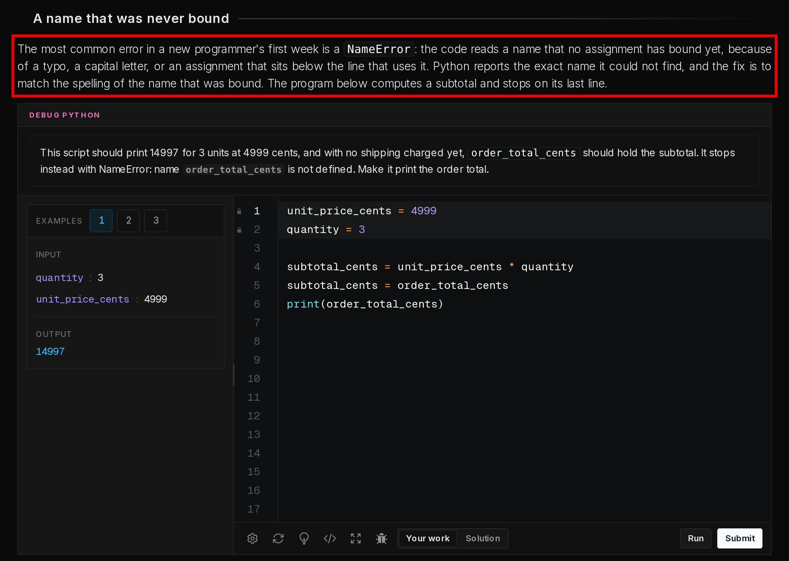

- Proposed default: **trim**. Last sentence of a long paragraph points at the removed debug exercise; the rest stands alone.
- Trim would cut: `The program below computes a subtotal and stops on its last line.`

- Decision (owner): [ ] drop   [ ] keep   [ ] trim

## Place 2

- Lesson slug: `python_foundations_beginner` (https://datadriven.io/learn/python_foundations_beginner)
- Group: DEFINITE | Section: Variables and Assignment | Sub-heading: A name that was never bound
- The sentence: `The error names `Subtotal_cents`, with a capital S, and that spelling appears nowhere on the left of an `=`.`
- Drop prefix (from the converted Markdown): `The error names Subtotal_cents` (would drop the whole block, so for a trim edit the Markdown by hand instead)

Converted Markdown (block before, target, block after):

> The most common error in a new programmer's first week is a `NameError`: the code reads a name that no assignment has bound yet, because of a typo, a capital letter, or an assignment that sits below the line that uses it. Python reports the exact name it could not find, and the fix is to match the spelling of the name that was bound. The program ...
>
> **TARGET**
> The error names `Subtotal_cents`, with a capital S, and that spelling appears nowhere on the left of an `=`. Reading the name in the message and searching the file for it is the whole technique, and it works the same way when the missing name is a variable assigned further down the file than the line that reads it.
>
> ## Data Types

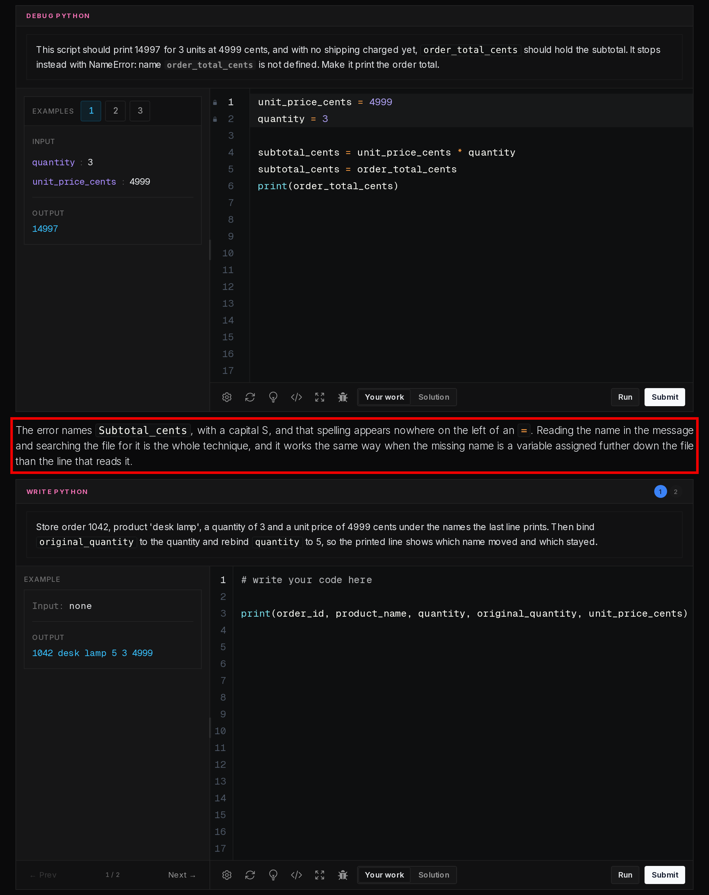

- Proposed default: **trim**. Opening sentence explains the error of the removed program; the technique in the rest still reads fine.
- Trim would cut: `The error names `Subtotal_cents`, with a capital S, and that spelling appears nowhere on the left of an `=`.`

- Decision (owner): [ ] drop   [ ] keep   [ ] trim

## Place 3

- Lesson slug: `python_foundations_beginner` (https://datadriven.io/learn/python_foundations_beginner)
- Group: DEFINITE | Section: Data Types | Sub-heading: Converting between types
- The sentence: `int for the quantity, because a count of items is whole and later code will use it to loop or to index.`
- Drop prefix (from the converted Markdown): `int for the quantity, because a count of items is whole and`

Converted Markdown (block before, target, block after):

> Conversion toward a narrower type loses information. `int(49.99)` is 49: the fractional part is discarded rather than rounded, and `int(-49.99)` is -49, truncating toward 0. `round()` is a separate operation: `round(48.5)` is 48 and `round(49.5)` is 50, because Python rounds a half to the even neighbour to avoid bias across many sums. `bool()` is ...
>
> **TARGET**
> `int` for the quantity, because a count of items is whole and later code will use it to loop or to index. `float` for the price, because the fractional cents matter. `float` on the quantity would still give the same line total but prints the count as `4.0`, and a label built from it would read as 4.0 units; `str` on either leaves text in place, and text multiplied by text is the `TypeError` from the top of the section.
>
> ### Why 0.1 plus 0.2 is not 0.3

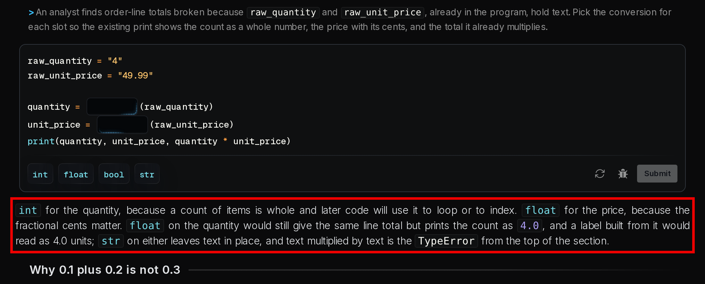

- Proposed default: **drop**. Answer walkthrough for the removed conversion exercise.

- Decision (owner): [ ] drop   [ ] keep   [ ] trim

## Place 4

- Lesson slug: `python_foundations_beginner` (https://datadriven.io/learn/python_foundations_beginner)
- Group: DEFINITE | Section: Print Statements | Sub-heading: f-strings
- The sentence: `sep is applied between arguments and end after the last one.`
- Drop prefix (from the converted Markdown): `sep is applied between arguments and end after the last`

Converted Markdown (block before, target, block after):

> The spec sits after the colon and reads in a fixed order: fill and alignment, then width, then the comma, then precision, then the type letter. `f"{amount:>12,.2f}"` right-aligns a number with thousands separators and 2 decimals in 12 characters, which is how a report column lines up. A spec that rounds for display changes nothing in the value: ...
>
> **TARGET**
> `sep` is applied between arguments and `end` after the last one. An empty `sep` glues the values together, so `user8814checkout` cannot be split apart again; the newline `end` is the default and leaves the subtotal on a line of its own. The pipe rarely appears in ids or event names, which is why exports use it as a delimiter, though a field that contains one still breaks the split.
>
> ### The = specifier for debugging

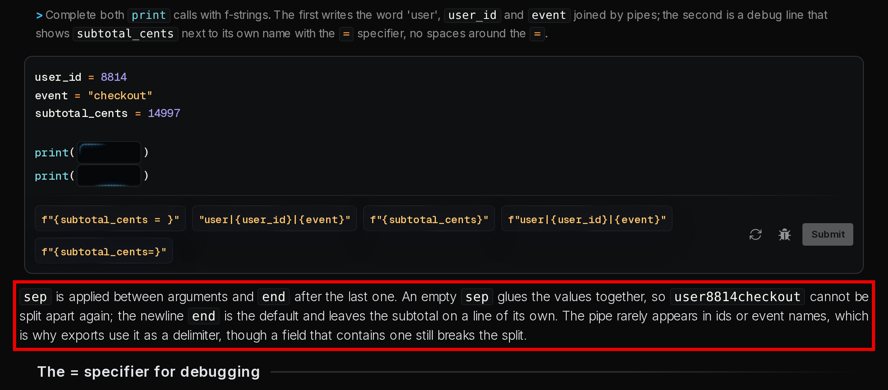

- Proposed default: **drop**. Answer walkthrough for the removed f-string/sep exercise.

- Decision (owner): [ ] drop   [ ] keep   [ ] trim

## Place 5

- Lesson slug: `python_foundations_beginner` (https://datadriven.io/learn/python_foundations_beginner)
- Group: DEFINITE | Section: Basic Operators | Sub-heading: Precedence and augmented assignment
- The sentence: `The broken line divides only discount_cents by 100, because / binds tighter than -, so the output is 14992.0, a cent total with 5 dollars subtracted from it.`
- Drop prefix (from the converted Markdown): `The broken line divides only discount_cents by 100, because`

Converted Markdown (block before, target, block after):

> | Level | Operators | Example |
> | --- | --- | --- |
> | Binds first | `\*\*` | `-2 \*\* 2` is -4 |
> | 2 | unary `-` | `-x \* 2` negates first |
> | 3 | `\*`, `/`, `//`, `%` | `3 + 4 \* 2` is 11 |
> | 4 | `+`, `-` | `10 - 2 - 3` is 5, left to right |
> | 5 | `==`, `!=`, `<`, `<=`, `>`, `>=` | `1 + 2 < 4` is True |
> | 6 | `not` | `not 3 > 4` is True |
> | 7 | ...
>
> **TARGET**
> The broken line divides only `discount_cents` by 100, because `/` binds tighter than `-`, so the output is 14992.0, a cent total with 5 dollars subtracted from it. Wrapping the subtraction in parentheses makes the whole cent amount divide, and the result is 144.97 dollars. A bug like this prints a plausible number every time it runs, which is why a total that is 100 times too large is worth a parenthesis check before anything else.
>
> ## Comments

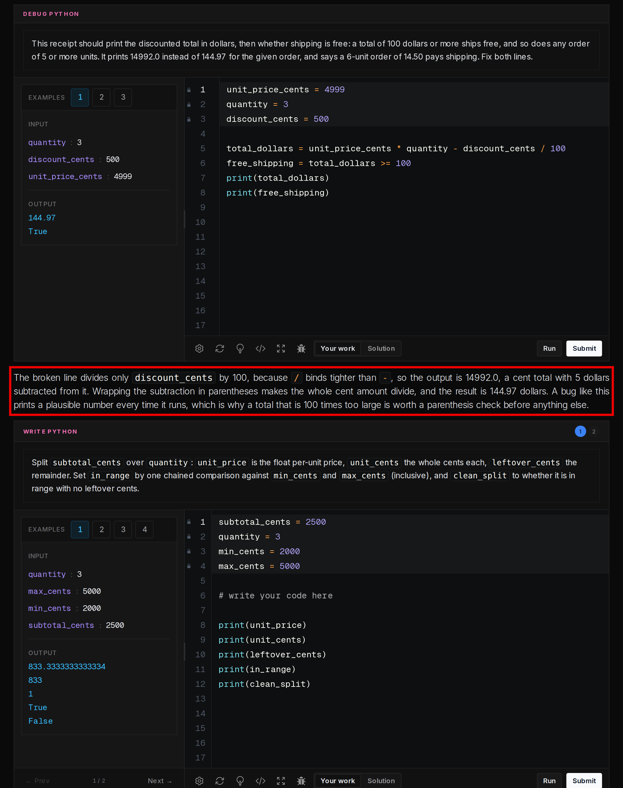

- Proposed default: **drop**. Answer walkthrough for the removed operator-precedence exercise.

- Decision (owner): [ ] drop   [ ] keep   [ ] trim

## Place 6

- Lesson slug: `python_foundations_intermediate` (https://datadriven.io/learn/python_foundations_intermediate)
- Group: DEFINITE | Section: Indentation and Code Blocks | Sub-heading: (none; the h3 "Practice" of this section)
- The sentence: `Practice`
- Drop prefix (from the converted Markdown): `Practice` **(matches 4 blocks in this lesson and drops.json drops them all: fine only if all 4 are drops)**

Converted Markdown (block before, target, block after):

> | ✓ Do | ✗ Don't |
> | --- | --- |
> | • Indent with 4 spaces per level, every time  • End every header line with a colon  • Set your editor to insert spaces when you press Tab  • Return to the margin to close a block | • Mix tabs and spaces in one file  • Indent a line that no header asked for  • Use 2 spaces in one ...
>
> **TARGET**
> ### Practice
>
> ## Importing Modules

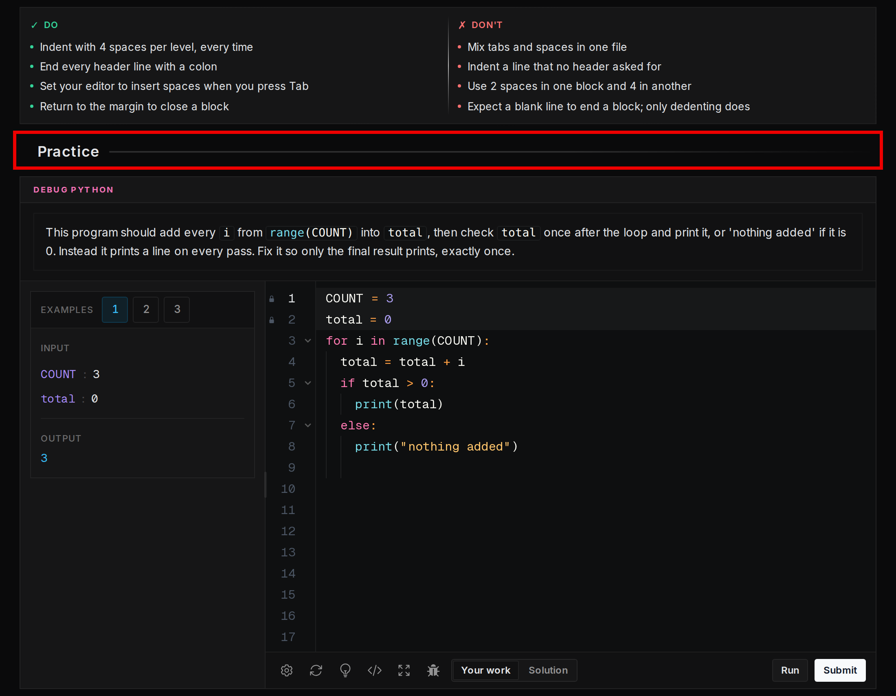

- Proposed default: **drop**. Empty heading: its exercise is removed and the next block is a new section.

- Decision (owner): [ ] drop   [ ] keep   [ ] trim

## Place 7

- Lesson slug: `python_foundations_intermediate` (https://datadriven.io/learn/python_foundations_intermediate)
- Group: DEFINITE | Section: Importing Modules | Sub-heading: (none; the h3 "Practice" of this section)
- The sentence: `Practice`
- Drop prefix (from the converted Markdown): `Practice` **(matches 4 blocks in this lesson and drops.json drops them all: fine only if all 4 are drops)**

Converted Markdown (block before, target, block after):

> Importing `pricing` runs every line of `pricing.py` once, top to bottom, which is how `TAX_RATE` gets its value and `with_tax` gets defined. A print at the top level of `pricing.py` would run at import time too, which surprises people the first time a bare import produces output. Keep a module's top level to constants and definitions, and the ...
>
> **TARGET**
> ### Practice
>
> ## Reading Input From the User

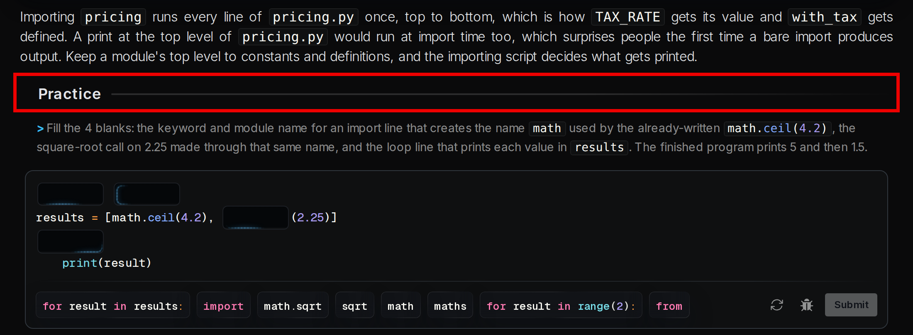

- Proposed default: **drop**. Empty heading: its exercise is removed and the next block is a new section.

- Decision (owner): [ ] drop   [ ] keep   [ ] trim

## Place 8

- Lesson slug: `python_foundations_intermediate` (https://datadriven.io/learn/python_foundations_intermediate)
- Group: DEFINITE | Section: Reading Input From the User | Sub-heading: (none; the h3 "Practice" of this section)
- The sentence: `Practice`
- Drop prefix (from the converted Markdown): `Practice` **(matches 4 blocks in this lesson and drops.json drops them all: fine only if all 4 are drops)**

Converted Markdown (block before, target, block after):

> > What input() guarantees
> >
> > - It always returns a str, for digits and for an empty line alike
> > - It drops the Enter keypress; the newline is never part of the value
> > - It keeps every other character typed, spaces included
> > - It blocks: nothing after it runs until the user presses Enter
>
> **TARGET**
> ### Practice
>
> ## Reading a Traceback

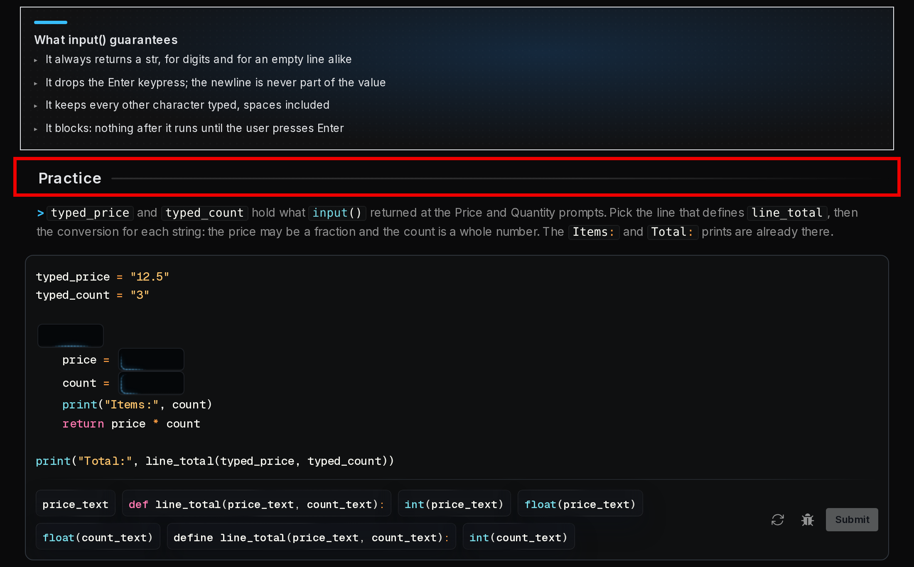

- Proposed default: **drop**. Empty heading: its exercise is removed and the next block is a new section.

- Decision (owner): [ ] drop   [ ] keep   [ ] trim

## Place 9

- Lesson slug: `python_foundations_intermediate` (https://datadriven.io/learn/python_foundations_intermediate)
- Group: DEFINITE | Section: Reading a Traceback | Sub-heading: (none; the h3 "Practice" of this section)
- The sentence: `Practice`
- Drop prefix (from the converted Markdown): `Practice` **(matches 4 blocks in this lesson and drops.json drops them all: fine only if all 4 are drops)**

Converted Markdown (block before, target, block after):

> A SyntaxError or IndentationError appears before the program runs a single line, because Python reads the whole file first and couldn't parse it. The report skips the Traceback header, shows the file and line, the offending source, a caret under the point where parsing gave up, and the error name. There's no frame to list, since nothing was ...
>
> **TARGET**
> ### Practice
>
> ## Trying Code in the Interactive Shell

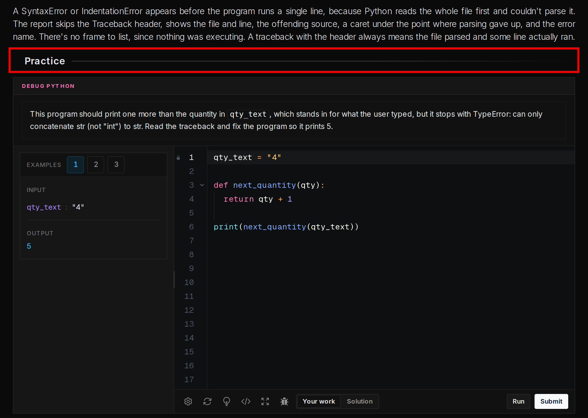

- Proposed default: **drop**. Empty heading: its exercise is removed and the next block is a new section.

- Decision (owner): [ ] drop   [ ] keep   [ ] trim

## Place 10

- Lesson slug: `python_foundations_intermediate` (https://datadriven.io/learn/python_foundations_intermediate)
- Group: DEFINITE | Section: Trying Code in the Interactive Shell | Sub-heading: Capstone
- The sentence: `The capstone pulls the 5 sections into one short script:`
- Drop prefix (from the converted Markdown): `The capstone pulls the 5 sections into one short script: an`

Converted Markdown (block before, target, block after):

> ### Capstone
>
> **TARGET**
> The capstone pulls the 5 sections into one short script: an import, an indented block, a value standing in for user input, and a bug that produces a traceback. Predict the traceback first, then decide the fix.
>
> **The variable typed stands in for what input() returned. Where does this script fail, and what fixes it?**

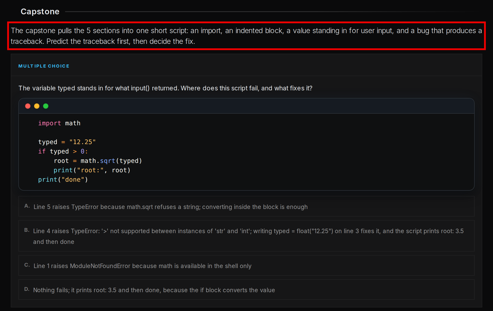

- Proposed default: **keep**. The multiple-choice question it introduces is kept in the Markdown, so the sentence still has something to point at.

- Decision (owner): [ ] drop   [ ] keep   [ ] trim

## Place 11

- Lesson slug: `python_control_flow_intermediate` (https://datadriven.io/learn/python_control_flow_intermediate)
- Group: DEFINITE | Section: Branching on Types With isinstance | Sub-heading: Capstone: a reading through every tool
- The sentence: `Capstone: a reading through every tool`
- Drop prefix (from the converted Markdown): `Capstone: a reading through every tool`

Converted Markdown (block before, target, block after):

> 

>
> **TARGET**
> ### Capstone: a reading through every tool
>
> These last 2 drills put the whole lesson into a single function. Guards leave early and a type check sits at the boundary. After that come a chained range and an inline label.

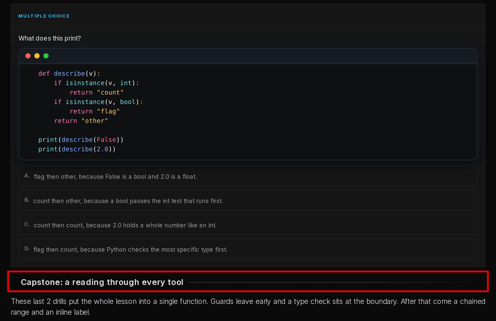

- Proposed default: **keep**. Heading still leads into the kept table that walks the second capstone; revisit if you drop 13.

- Decision (owner): [ ] drop   [ ] keep   [ ] trim

## Place 12

- Lesson slug: `python_control_flow_intermediate` (https://datadriven.io/learn/python_control_flow_intermediate)
- Group: DEFINITE | Section: Branching on Types With isinstance | Sub-heading: Capstone: a reading through every tool
- The sentence: `These last 2 drills put the whole lesson into a single function.`
- Drop prefix (from the converted Markdown): `These last 2 drills put the whole lesson into a single`

Converted Markdown (block before, target, block after):

> ### Capstone: a reading through every tool
>
> **TARGET**
> These last 2 drills put the whole lesson into a single function. Guards leave early and a type check sits at the boundary. After that come a chained range and an inline label.
>
> The second capstone hinges on a habit worth keeping for any type ladder: feed it one value of every shape it could receive and note which test fires first. Give bools their own rows, since they are the values that slip into an int branch, and include 0, a real quantity that must come back as 0 and never as a missing value. Here is that check run ...

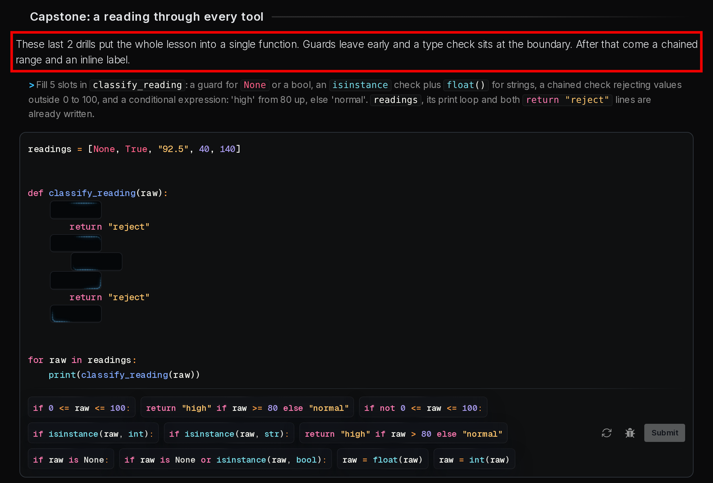

- Proposed default: **drop**. Introduces 2 drills that are removed.

- Decision (owner): [ ] drop   [ ] keep   [ ] trim

## Place 13

- Lesson slug: `python_control_flow_intermediate` (https://datadriven.io/learn/python_control_flow_intermediate)
- Group: DEFINITE | Section: Branching on Types With isinstance | Sub-heading: Capstone: a reading through every tool
- The sentence: `The second capstone hinges on a habit worth keeping for any type ladder: feed`
- Drop prefix (from the converted Markdown): `The second capstone hinges on a habit worth keeping for any` (would drop the whole block, so for a trim edit the Markdown by hand instead)

Converted Markdown (block before, target, block after):

> These last 2 drills put the whole lesson into a single function. Guards leave early and a type check sits at the boundary. After that come a chained range and an inline label.
>
> **TARGET**
> The second capstone hinges on a habit worth keeping for any type ladder: feed it one value of every shape it could receive and note which test fires first. Give bools their own rows, since they are the values that slip into an int branch, and include 0, a real quantity that must come back as 0 and never as a missing value. Here is that check run on `parse_qty` from the animation.
>
> | Input | First test that is True | parse_qty returns |
> | --- | --- | --- |
> | `None` | `raw is None` | `None` |
> | `False` | `isinstance(raw, bool)` | `None` |
> | `0` | `isinstance(raw, int)` | `0` |
> | `"7"` | `isinstance(raw, str)` | `7` |
> | `2.5` | none of them | `None` |

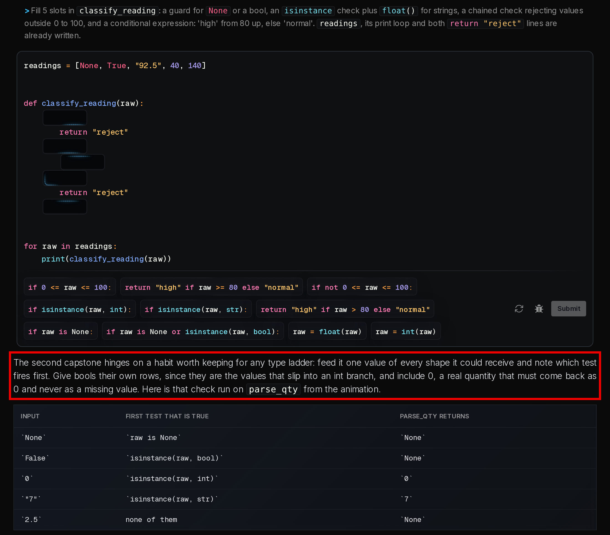

- Proposed default: **trim**. Opening clause points at the removed second capstone; the technique and the table after it are worth keeping.
- Trim would cut: `The second capstone hinges on a habit worth keeping for any type ladder: feed`

- Decision (owner): [ ] drop   [ ] keep   [ ] trim

## Place 14

- Lesson slug: `python_expressions_beginner` (https://datadriven.io/learn/python_expressions_beginner)
- Group: DEFINITE | Section: Operators and Readability | Sub-heading: Capstone practice
- The sentence: `Capstone practice`
- Drop prefix (from the converted Markdown): `Capstone practice`

Converted Markdown (block before, target, block after):

> 

>
> **TARGET**
> ### Capstone practice
>
> Each program below pulls on more than one section at once, so expect naming and the assignment-versus-comparison question to turn up in the same lines as type mixing and operator order.

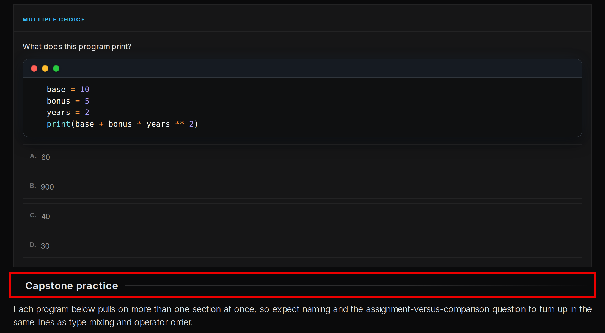

- Proposed default: **drop**. Heading of a section whose practice is removed.

- Decision (owner): [ ] drop   [ ] keep   [ ] trim

## Place 15

- Lesson slug: `python_expressions_beginner` (https://datadriven.io/learn/python_expressions_beginner)
- Group: DEFINITE | Section: Operators and Readability | Sub-heading: Capstone practice
- The sentence: `Each program below pulls on more than one section at once, so expect naming and the assignment-versus-comparison question to turn up in the same lines as type mixing and operator order.`
- Drop prefix (from the converted Markdown): `Each program below pulls on more than one section at once,`

Converted Markdown (block before, target, block after):

> ### Capstone practice
>
> **TARGET**
> Each program below pulls on more than one section at once, so expect naming and the assignment-versus-comparison question to turn up in the same lines as type mixing and operator order.
>
> A fixed fee plus a per-item cost needs no parentheses, because `*` runs before `+`: `5.0 + 4 * 1.5` multiplies to 6.0 first and sums to 11.0. Swap the 2 operators and `5.0 * 4 + 1.5` gives 21.5. Working the line through with real numbers shows whether each operator sits where it belongs.

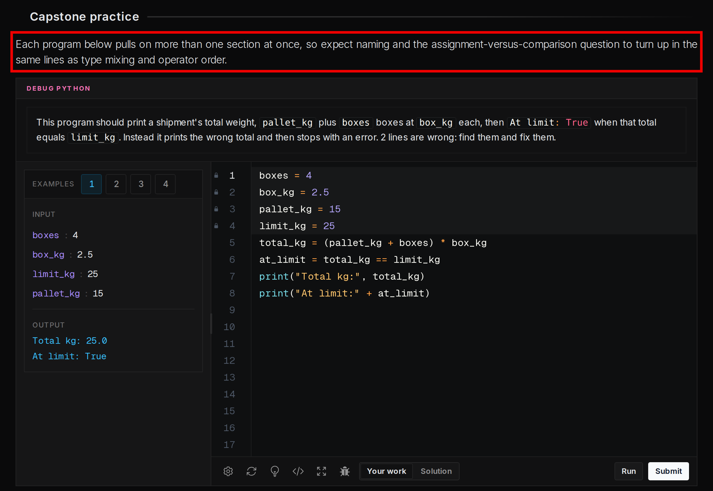

- Proposed default: **drop**. Introduces programs that are removed.

- Decision (owner): [ ] drop   [ ] keep   [ ] trim

## Place 16

- Lesson slug: `python_expressions_beginner` (https://datadriven.io/learn/python_expressions_beginner)
- Group: DEFINITE | Section: Operators and Readability | Sub-heading: Capstone practice
- The sentence: `A fixed fee plus a per-item cost needs no parentheses, because * runs before +:`
- Drop prefix (from the converted Markdown): `A fixed fee plus a per-item cost needs no parentheses,`

Converted Markdown (block before, target, block after):

> Each program below pulls on more than one section at once, so expect naming and the assignment-versus-comparison question to turn up in the same lines as type mixing and operator order.
>
> **TARGET**
> A fixed fee plus a per-item cost needs no parentheses, because `*` runs before `+`: `5.0 + 4 * 1.5` multiplies to 6.0 first and sums to 11.0. Swap the 2 operators and `5.0 * 4 + 1.5` gives 21.5. Working the line through with real numbers shows whether each operator sits where it belongs.
>
> String operators share the same precedence. In `"-" * 3 + "x"` the repetition runs first and produces `---`. The join then gives `---x`. Writing `"x" + "-" * 3` gives `x---` for the same reason: the `*` on the right finishes before the join begins.

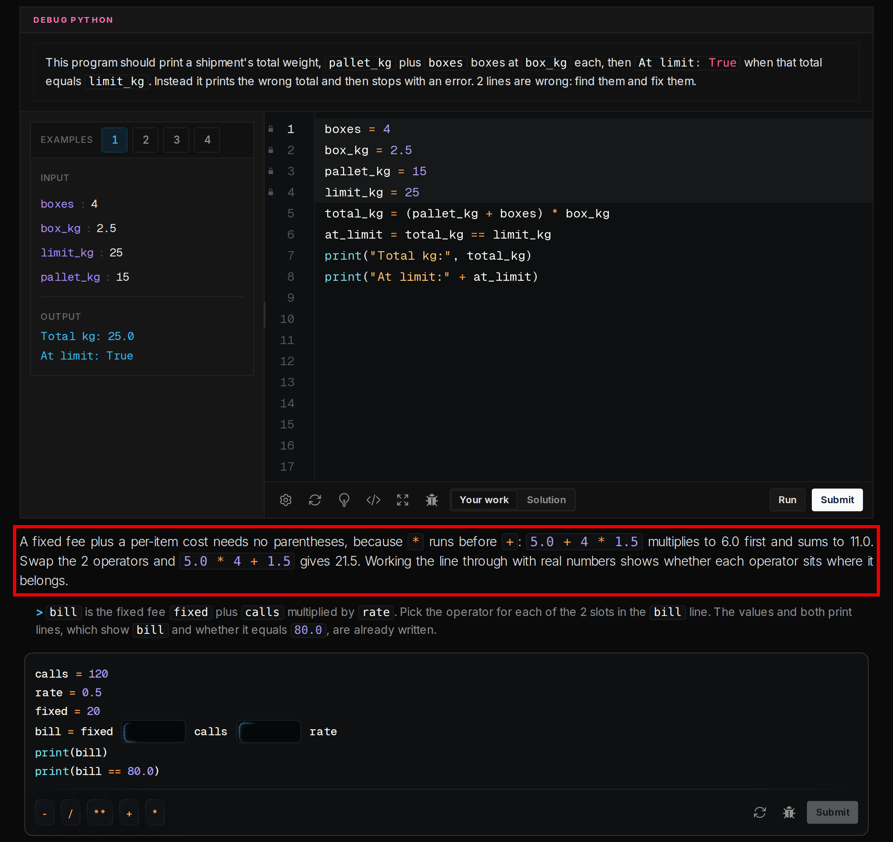

- Proposed default: **keep**. Self-contained precedence lesson with its own numbers, even though it follows a removed exercise.

- Decision (owner): [ ] drop   [ ] keep   [ ] trim

## Place 17

- Lesson slug: `python_expressions_beginner` (https://datadriven.io/learn/python_expressions_beginner)
- Group: SKIM | Section: Mixing Types in One Expression | Sub-heading: Let print do the joining
- The sentence: `Each operator needs the pair it accepts.`
- Drop prefix (from the converted Markdown): `Each operator needs the pair it accepts. A repeat count`

Converted Markdown (block before, target, block after):

> The second output line has 2 spaces between the colon and the 9: one from the label and one added by `print`. When a `+` line fails because one side is a number, replace it with a print call that passes the label and the value as separate arguments. Trim the label's trailing space in the same edit.
>
> **TARGET**
> Each operator needs the pair it accepts. A repeat count stands on the other side of `*` from the string: `"-" * 4` gives `----`, while `"-" * "4"` fails. The same `int` added to a `float` gives a `float`, so `4 + 0.5` is `4.5`.
>
> ## Operators and Readability

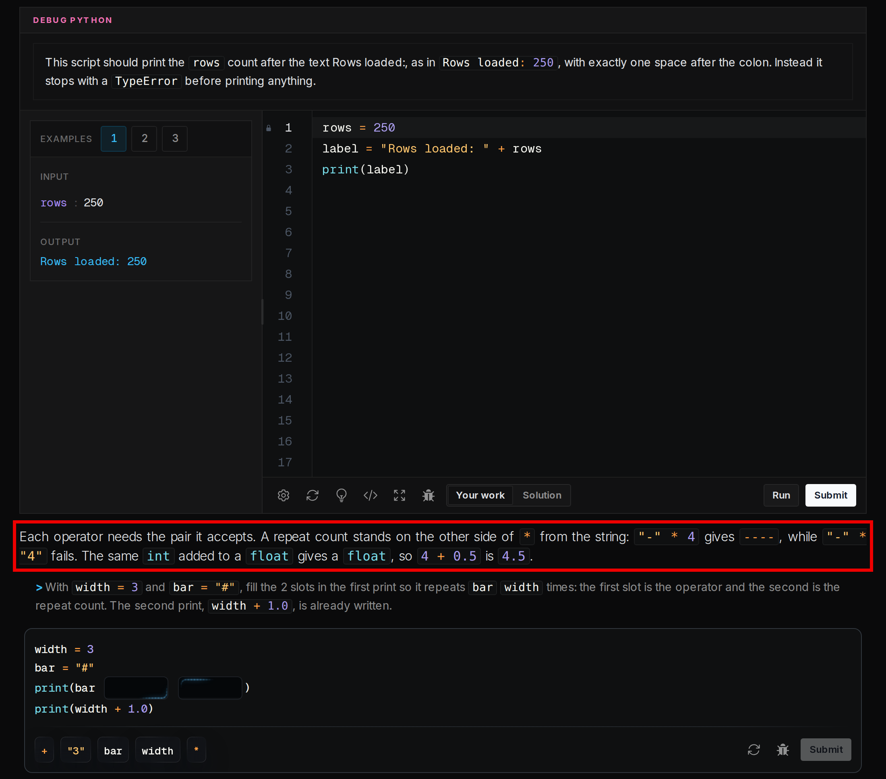

- Proposed default: **keep**. Self-contained rule with examples.

- Decision (owner): [ ] drop   [ ] keep   [ ] trim

## Place 18

- Lesson slug: `python_expressions_beginner` (https://datadriven.io/learn/python_expressions_beginner)
- Group: SKIM | Section: Operators and Readability | Sub-heading: Capstone practice
- The sentence: `String operators share the same precedence.`
- Drop prefix (from the converted Markdown): `String operators share the same precedence. In "-" * 3 +`

Converted Markdown (block before, target, block after):

> A fixed fee plus a per-item cost needs no parentheses, because `*` runs before `+`: `5.0 + 4 * 1.5` multiplies to 6.0 first and sums to 11.0. Swap the 2 operators and `5.0 * 4 + 1.5` gives 21.5. Working the line through with real numbers shows whether each operator sits where it belongs.
>
> **TARGET**
> String operators share the same precedence. In `"-" * 3 + "x"` the repetition runs first and produces `---`. The join then gives `---x`. Writing `"x" + "-" * 3` gives `x---` for the same reason: the `*` on the right finishes before the join begins.
>
> ## Putting It All Together

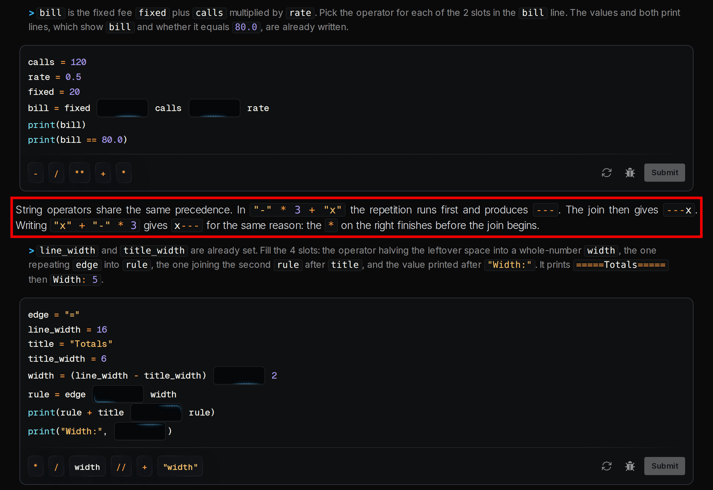

- Proposed default: **keep**. Self-contained precedence lesson with its own examples.

- Decision (owner): [ ] drop   [ ] keep   [ ] trim

## Place 19

- Lesson slug: `python_expressions_advanced` (https://datadriven.io/learn/python_expressions_advanced)
- Group: DEFINITE | Section: Walrus Operator (:=) | Sub-heading: Capstone: one event, every operator
- The sentence: `Capstone: one event, every operator`
- Drop prefix (from the converted Markdown): `Capstone: one event, every operator`

Converted Markdown (block before, target, block after):

> 

>
> **TARGET**
> ### Capstone: one event, every operator
>
> The last 2 problems put the whole lesson into a single pipeline step. It decodes a message event's ID and tests a permission bit before guarding a division; after that it reads present values and compares float results.

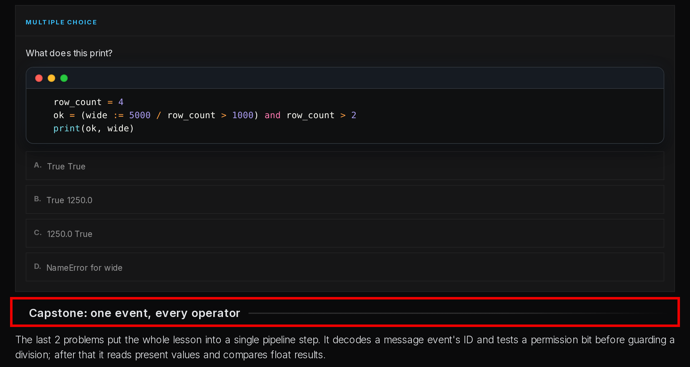

- Proposed default: **drop**. Heading of a capstone whose problems are removed.

- Decision (owner): [ ] drop   [ ] keep   [ ] trim

## Place 20

- Lesson slug: `python_expressions_advanced` (https://datadriven.io/learn/python_expressions_advanced)
- Group: DEFINITE | Section: Walrus Operator (:=) | Sub-heading: Capstone: one event, every operator
- The sentence: `The last 2 problems put the whole lesson into a single pipeline step.`
- Drop prefix (from the converted Markdown): `The last 2 problems put the whole lesson into a single`

Converted Markdown (block before, target, block after):

> ### Capstone: one event, every operator
>
> **TARGET**
> The last 2 problems put the whole lesson into a single pipeline step. It decodes a message event's ID and tests a permission bit before guarding a division; after that it reads present values and compares float results.
>
> A pipeline step like this one usually breaks through a small edit, and most such edits are one of 3 slips: a guard moved to the right of the division it protects, so the division runs first; a revoke written with |, which can only turn bits on, where & ~ was needed; and a float result checked with == after it took a different arithmetic path from ...

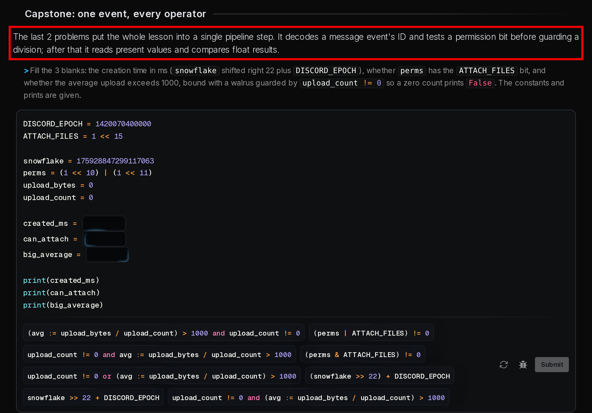

- Proposed default: **drop**. Introduces problems that are removed.

- Decision (owner): [ ] drop   [ ] keep   [ ] trim

## Place 21

- Lesson slug: `python_expressions_advanced` (https://datadriven.io/learn/python_expressions_advanced)
- Group: DEFINITE | Section: Walrus Operator (:=) | Sub-heading: Capstone: one event, every operator
- The sentence: `The next program contains one of each.`
- Drop prefix (from the converted Markdown): `A pipeline step like this one usually breaks through a` (would drop the whole block, so for a trim edit the Markdown by hand instead)

Converted Markdown (block before, target, block after):

> The last 2 problems put the whole lesson into a single pipeline step. It decodes a message event's ID and tests a permission bit before guarding a division; after that it reads present values and compares float results.
>
> **TARGET**
> A pipeline step like this one usually breaks through a small edit, and most such edits are one of 3 slips: a guard moved to the right of the division it protects, so the division runs first; a revoke written with |, which can only turn bits on, where & ~ was needed; and a float result checked with == after it took a different arithmetic path from its target. The next program contains one of each.
>
> ## Putting It All Together

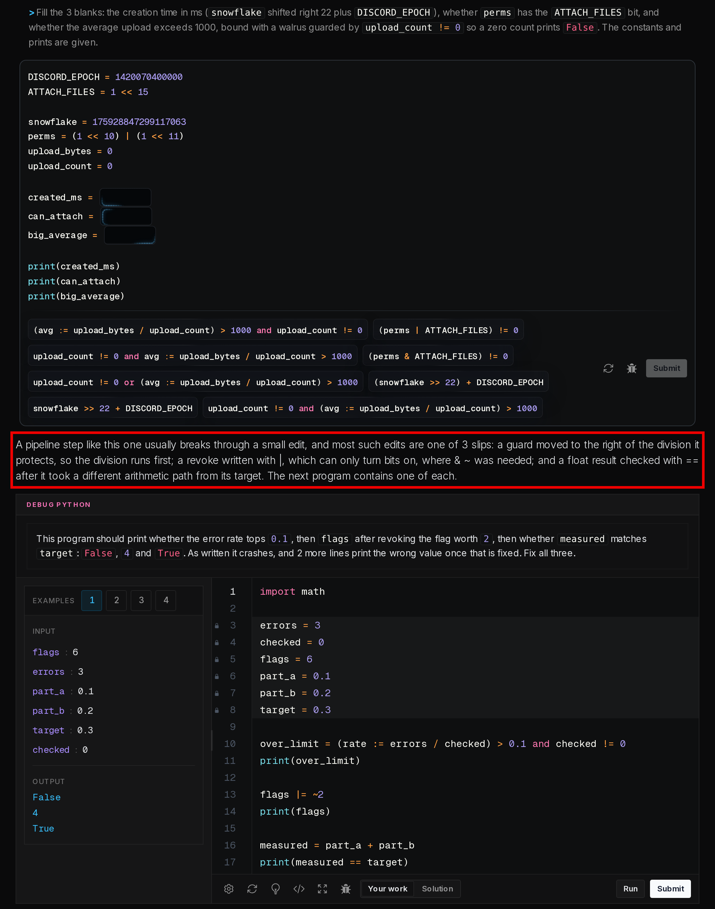

- Proposed default: **trim**. Last sentence points at the removed program; the 3 common slips above it are worth keeping.
- Trim would cut: `The next program contains one of each.`

- Decision (owner): [ ] drop   [ ] keep   [ ] trim

## Place 22

- Lesson slug: `python_dictionaries_intermediate` (https://datadriven.io/learn/python_dictionaries_intermediate)
- Group: DEFINITE | Section: Iterating and Dictionary Views | Sub-heading: Read or insert with setdefault
- The sentence: `Put the views to work.`
- Drop prefix (from the converted Markdown): `Put the views to work. The report below prints the largest`

Converted Markdown (block before, target, block after):

> Keeping the first value per key is one use. The other, returning a mutable object that the caller then fills, drives the grouping pattern in the nested-data section. The `default` argument is evaluated on every call, even when the key already exists, so `setdefault(key, load_lookup())` calls `load_lookup()` once per record whether it is needed.
>
> **TARGET**
> Put the views to work. The report below prints the largest payment, then every order id whose payment is above 10.
>
> ## Merging Dictionaries

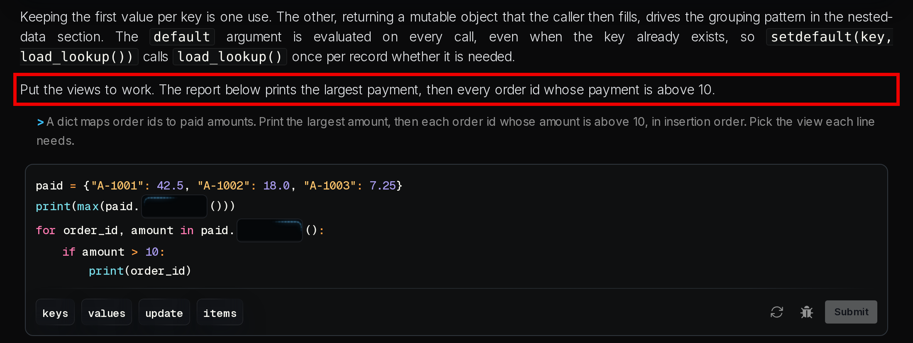

- Proposed default: **drop**. Describes the removed report exercise only.

- Decision (owner): [ ] drop   [ ] keep   [ ] trim

## Place 23

- Lesson slug: `python_dictionaries_intermediate` (https://datadriven.io/learn/python_dictionaries_intermediate)
- Group: DEFINITE | Section: Merging Dictionaries | Sub-heading: Why in-place merges leak
- The sentence: `The runner below should let each job's settings beat the defaults.`
- Drop prefix (from the converted Markdown): `The runner below should let each job's settings beat the`

Converted Markdown (block before, target, block after):

> `{**a, **b}` also accepts literal keys after the unpacks: `{**DEFAULTS, **env, "run_id": run_id}` stamps a value no earlier layer can override. `|` requires a dict on both sides and raises `TypeError` for a list of pairs, while `|=` and `update` accept any iterable of pairs.
>
> **TARGET**
> The runner below should let each job's settings beat the defaults. Run it: the job asked for 0 retries and a 120-second timeout, and the printed config disagrees.
>
> ### Merges are one level deep

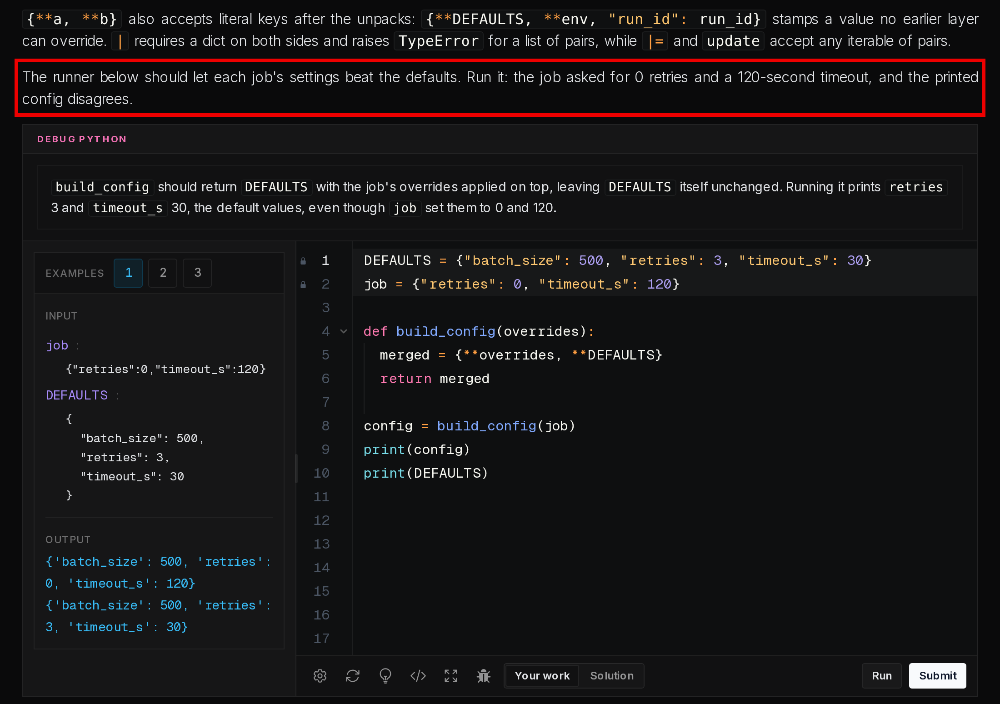

- Proposed default: **drop**. Describes the removed runner exercise only.

- Decision (owner): [ ] drop   [ ] keep   [ ] trim

## Place 24

- Lesson slug: `python_dictionaries_intermediate` (https://datadriven.io/learn/python_dictionaries_intermediate)
- Group: DEFINITE | Section: Copying Dictionaries | Sub-heading: Copy at the boundary
- The sentence: `The function below tags replayed events and was meant to leave its input alone.`
- Drop prefix (from the converted Markdown): `Functions are where shared state bites. A dict passed as an` (would drop the whole block, so for a trim edit the Markdown by hand instead)

Converted Markdown (block before, target, block after):

> ### Copy at the boundary
>
> **TARGET**
> Functions are where shared state bites. A dict passed as an argument is the caller's object, so a function that adds a field to it, or to anything nested inside it, edits the caller's data. A function that returns a modified record should copy each level it changes before changing it. The function below tags replayed events and was meant to leave its input alone.
>
> ## Dictionary Comprehensions

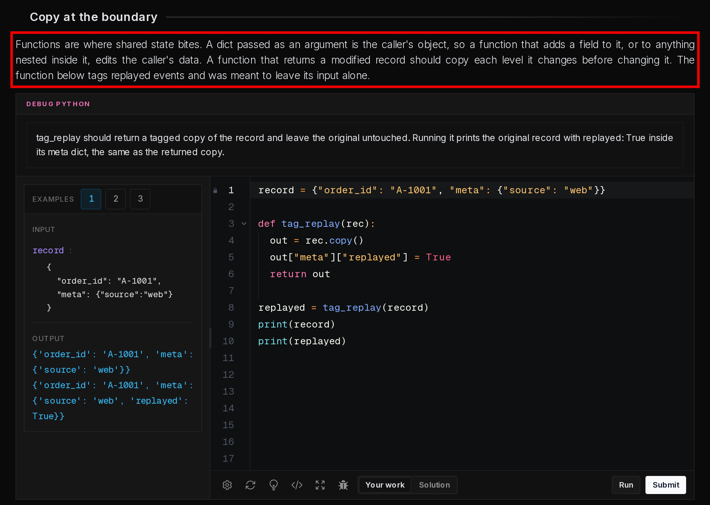

- Proposed default: **trim**. Last sentence points at the removed function exercise; the shared-state explanation stands alone.
- Trim would cut: `The function below tags replayed events and was meant to leave its input alone.`

- Decision (owner): [ ] drop   [ ] keep   [ ] trim

## Place 25

- Lesson slug: `python_collections_intermediate` (https://datadriven.io/learn/python_collections_intermediate)
- Group: DEFINITE | Section: Using zip() for Combining | Sub-heading: Capstone: a ranking step end to end
- The sentence: `Capstone: a ranking step end to end`
- Drop prefix (from the converted Markdown): `Capstone: a ranking step end to end`

Converted Markdown (block before, target, block after):

> 

>
> **TARGET**
> ### Capstone: a ranking step end to end
>
> The code quiz below puts all 5 ideas into one pipeline step, in the order a real job runs them: label the columns, convert the values, select the rows, rank the survivors. The debug drill after it returns to the tie rule from ranking on its own.

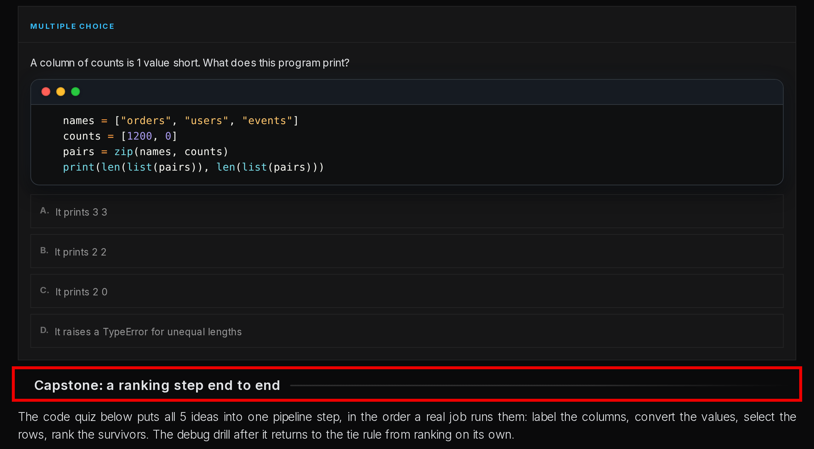

- Proposed default: **drop**. Heading of a capstone whose quiz and drill are removed.

- Decision (owner): [ ] drop   [ ] keep   [ ] trim

## Place 26

- Lesson slug: `python_collections_intermediate` (https://datadriven.io/learn/python_collections_intermediate)
- Group: DEFINITE | Section: Using zip() for Combining | Sub-heading: Capstone: a ranking step end to end
- The sentence: `The code quiz below puts all 5 ideas into one pipeline step, in the order a real job runs them:`
- Drop prefix (from the converted Markdown): `The code quiz below puts all 5 ideas into one pipeline`

Converted Markdown (block before, target, block after):

> ### Capstone: a ranking step end to end
>
> **TARGET**
> The code quiz below puts all 5 ideas into one pipeline step, in the order a real job runs them: label the columns, convert the values, select the rows, rank the survivors. The debug drill after it returns to the tie rule from ranking on its own.
>
> Ties deserve their own check because a wrong tie order raises nothing. Records built from parallel lists keep the order of those lists, so a track's position in the source decides which of 2 tied tracks takes first place under `reverse=True`. Flip the ties with `[::-1]` and the top of the report changes while every count stays the same.

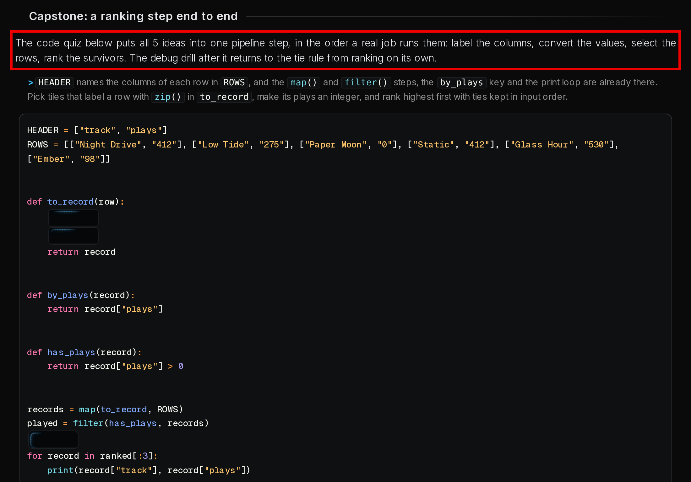

- Proposed default: **drop**. Introduces the removed code quiz and debug drill.

- Decision (owner): [ ] drop   [ ] keep   [ ] trim

## Place 27

- Lesson slug: `python_functional_beginner` (https://datadriven.io/learn/python_functional_beginner)
- Group: DEFINITE | Section: Type Hints for Function Signatures | Sub-heading: Capstone: One Pricing Pipeline
- The sentence: `Capstone: One Pricing Pipeline`
- Drop prefix (from the converted Markdown): `Capstone: One Pricing Pipeline`

Converted Markdown (block before, target, block after):

> The first signature is a complete call guide: a dict from method names to int rates, a method name, an amount in cents, and an int back, here 290. `-> None` on `show_fee` says the opposite thing: call it for the line it prints and do not keep its result. That is the same trap as `result = prices.append(8)`, now stated in the signature where a ...
>
> **TARGET**
> ### Capstone: One Pricing Pipeline
>
> The 2 drills below combine the sections: a pure higher-order function with hints that builds a new list, then a bug hunt in a function that rewrites what it was given.

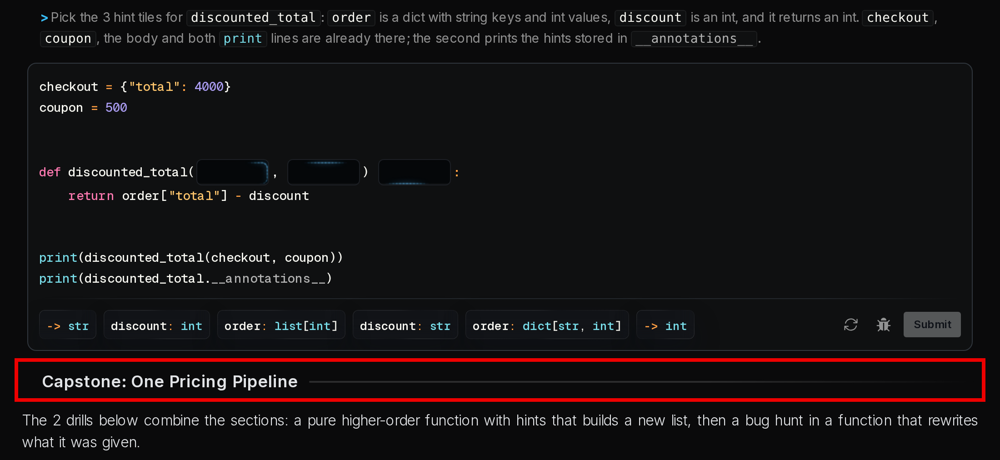

- Proposed default: **drop**. Heading of a capstone whose drills are removed.

- Decision (owner): [ ] drop   [ ] keep   [ ] trim

## Place 28

- Lesson slug: `python_functional_beginner` (https://datadriven.io/learn/python_functional_beginner)
- Group: DEFINITE | Section: Type Hints for Function Signatures | Sub-heading: Capstone: One Pricing Pipeline
- The sentence: `The 2 drills below combine the sections:`
- Drop prefix (from the converted Markdown): `The 2 drills below combine the sections: a pure`

Converted Markdown (block before, target, block after):

> ### Capstone: One Pricing Pipeline
>
> **TARGET**
> The 2 drills below combine the sections: a pure higher-order function with hints that builds a new list, then a bug hunt in a function that rewrites what it was given.
>
> #### Lists of Dicts Have 2 Layers

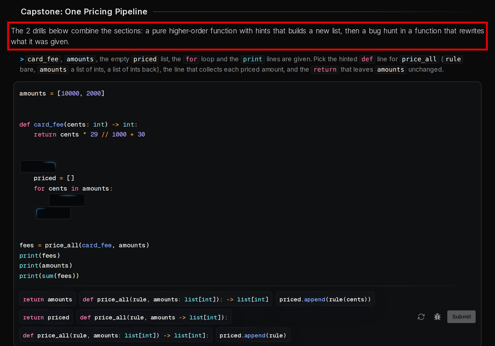

- Proposed default: **drop**. Introduces drills that are removed.

- Decision (owner): [ ] drop   [ ] keep   [ ] trim

## Place 29

- Lesson slug: `python_problem_solving_beginner` (https://datadriven.io/learn/python_problem_solving_beginner)
- Group: DEFINITE | Section: Testing Simple Cases | Sub-heading: Capstone: one problem, all 5 habits
- The sentence: `before the drill below hands you a version with a mistake in it`
- Drop prefix (from the converted Markdown): `A logistics team asks: given a list of parcel weights in` (would drop the whole block, so for a trim edit the Markdown by hand instead)

Converted Markdown (block before, target, block after):

> ### Capstone: one problem, all 5 habits
>
> **TARGET**
> A logistics team asks: given a list of parcel weights in kilograms, how many parcels are over the 20 kilogram limit? Walk it through every section of this lesson before the drill below hands you a version with a mistake in it:
>
> - Steps: start a counter at 0, look at each weight, add 1 when it is more than 20, report the counter.
> - Pairs: [] gives 0, [20] gives 0 because 20 is not over 20, [25, 8, 31] gives 2.
> - Pattern: 'how many' is a count, so the skeleton is count = 0 with an if inside the loop.
> - Trace [25, 8, 31] by hand: 25 adds 1, 8 adds nothing, 31 adds 1, and ...

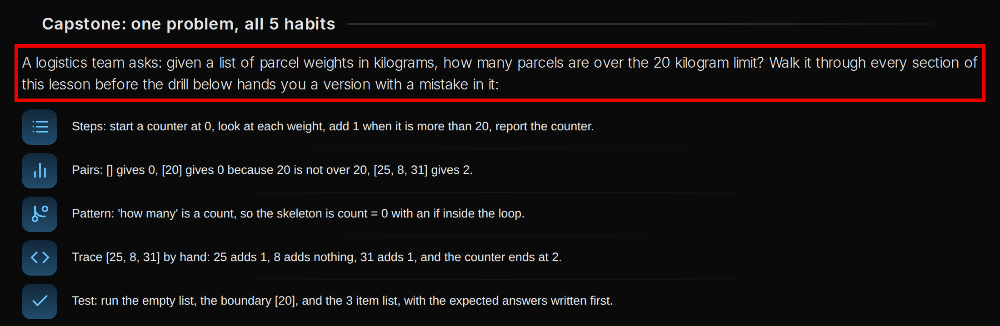

- Proposed default: **trim**. Trailing clause points at the removed drill; the walkthrough list after it is worth keeping.
- Trim would cut: `before the drill below hands you a version with a mistake in it`

- Decision (owner): [ ] drop   [ ] keep   [ ] trim

## Place 30

- Lesson slug: `python_data_structures_beginner` (https://datadriven.io/learn/python_data_structures_beginner)
- Group: DEFINITE | Section: Which Collections Keep Their Order | Sub-heading: Practice
- The sentence: `The drill below depends on how each collection starts and grows.`
- Drop prefix (from the converted Markdown): `The drill below depends on how each collection starts and` (would drop the whole block, so for a trim edit the Markdown by hand instead)

Converted Markdown (block before, target, block after):

> 

>
> **TARGET**
> The drill below depends on how each collection starts and grows. An empty list is `[]` and grows with `append`, which puts the item in the next free slot. An empty set is `set()`, since `{}` builds an empty dict, and it grows with `add`, which files the item by its value. A set has no `append` and a list has no `add`, so pairing a collection with the other one's method stops the program with an `AttributeError`.
>
> | Question | list | set |
> | --- | --- | --- |
> | Empty one is written | `[]` | `set()` |
> | Adds an item with | `append` | `add` |
> | A repeated value | takes a new slot | is ignored |
> | Reading slot 0 | returns the first item | raises TypeError |

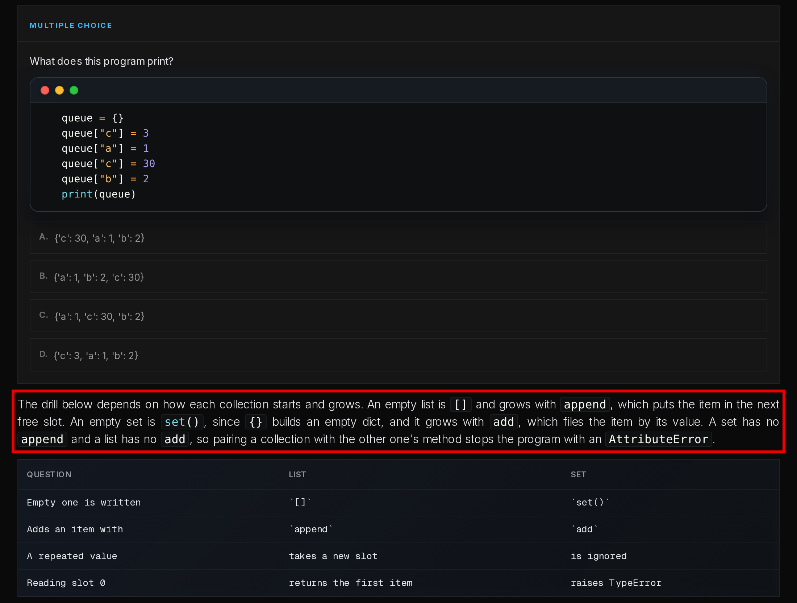

- Proposed default: **trim**. First sentence points at the removed drill; the rest feeds the kept table.
- Trim would cut: `The drill below depends on how each collection starts and grows.`

- Decision (owner): [ ] drop   [ ] keep   [ ] trim

## Place 31

- Lesson slug: `python_data_structures_beginner` (https://datadriven.io/learn/python_data_structures_beginner)
- Group: DEFINITE | Section: Choosing the Right Type | Sub-heading: Capstones
- The sentence: `The third capstone builds 2 collections from the same list of readings, and each answers a different count.`
- Drop prefix (from the converted Markdown): `The third capstone builds 2 collections from the same list`

Converted Markdown (block before, target, block after):

> 

>
> **TARGET**
> The third capstone builds 2 collections from the same list of readings, and each answers a different count. `len` of a set counts distinct values, while `len` of a tuple counts every reading, repeats included. `max` returns the same highest value from either one, because dropping repeats never removes the largest value, only extra copies of it.
>
> The last capstone depends on what square brackets mean on a dict built from pairs. `dict()` makes the first item of each pair a key, so a dict built from (name, quantity) pairs is read with a name. A position number between the brackets asks for a key that is that number, and when no such key exists the lookup stops with a `KeyError` naming the ...

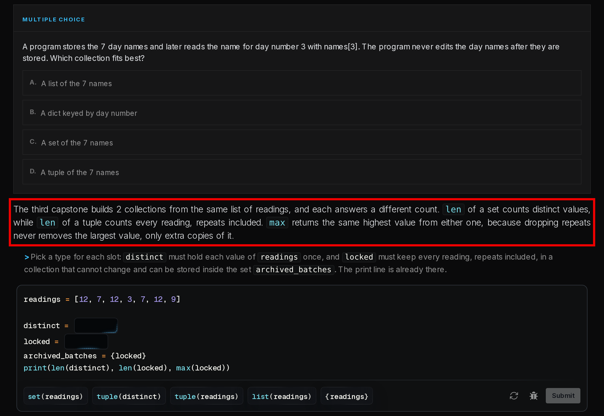

- Proposed default: **drop**. Answer walkthrough for the removed third capstone.

- Decision (owner): [ ] drop   [ ] keep   [ ] trim

## Place 32

- Lesson slug: `python_data_structures_beginner` (https://datadriven.io/learn/python_data_structures_beginner)
- Group: DEFINITE | Section: Choosing the Right Type | Sub-heading: Capstones
- The sentence: `The last capstone depends on what square brackets mean on a dict built from pairs.`
- Drop prefix (from the converted Markdown): `The last capstone depends on what square brackets mean on a`

Converted Markdown (block before, target, block after):

> The third capstone builds 2 collections from the same list of readings, and each answers a different count. `len` of a set counts distinct values, while `len` of a tuple counts every reading, repeats included. `max` returns the same highest value from either one, because dropping repeats never removes the largest value, only extra copies of it.
>
> **TARGET**
> The last capstone depends on what square brackets mean on a dict built from pairs. `dict()` makes the first item of each pair a key, so a dict built from (name, quantity) pairs is read with a name. A position number between the brackets asks for a key that is that number, and when no such key exists the lookup stops with a `KeyError` naming the missing key.
>
> ## Putting It All Together

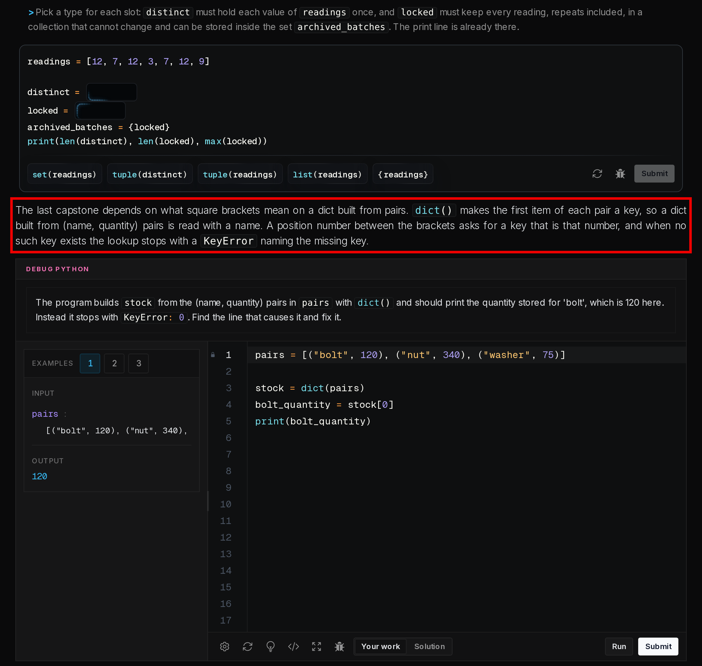

- Proposed default: **drop**. Answer walkthrough for the removed last capstone.

- Decision (owner): [ ] drop   [ ] keep   [ ] trim

## Place 33

- Lesson slug: `python_data_structures_beginner` (https://datadriven.io/learn/python_data_structures_beginner)
- Group: SKIM | Section: Which Collections Can Change | Sub-heading: Practice
- The sentence: `The first exercise is about what a function can do to a list it was handed.`
- Drop prefix (from the converted Markdown): `The first exercise is about what a function can do to a`

Converted Markdown (block before, target, block after):

> ### Practice
>
> **TARGET**
> The first exercise is about what a function can do to a list it was handed. The second hands you a tuple that someone treated like a list.
>
> **What does this program print?**

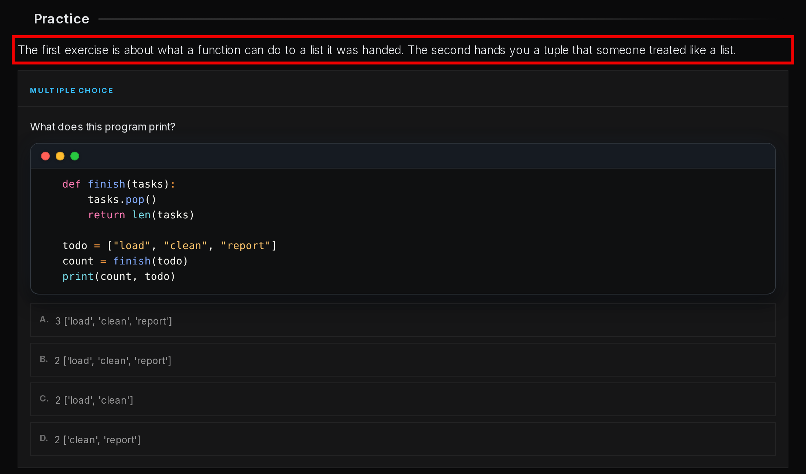

- Proposed default: **drop**. Describes 2 exercises; a multiple-choice follows but the sentence is about the pair.

- Decision (owner): [ ] drop   [ ] keep   [ ] trim

## Place 34

- Lesson slug: `python_data_structures_beginner` (https://datadriven.io/learn/python_data_structures_beginner)
- Group: SKIM | Section: Converting Between Collections | Sub-heading: Practice
- The sentence: `Both exercises hinge on what set() throws away and what list() can and can't restore.`
- Drop prefix (from the converted Markdown): `Both exercises hinge on what set`

Converted Markdown (block before, target, block after):

> ### Practice
>
> **TARGET**
> Both exercises hinge on what `set()` throws away and what `list()` can and can't restore.
>
> **What does this program print?**

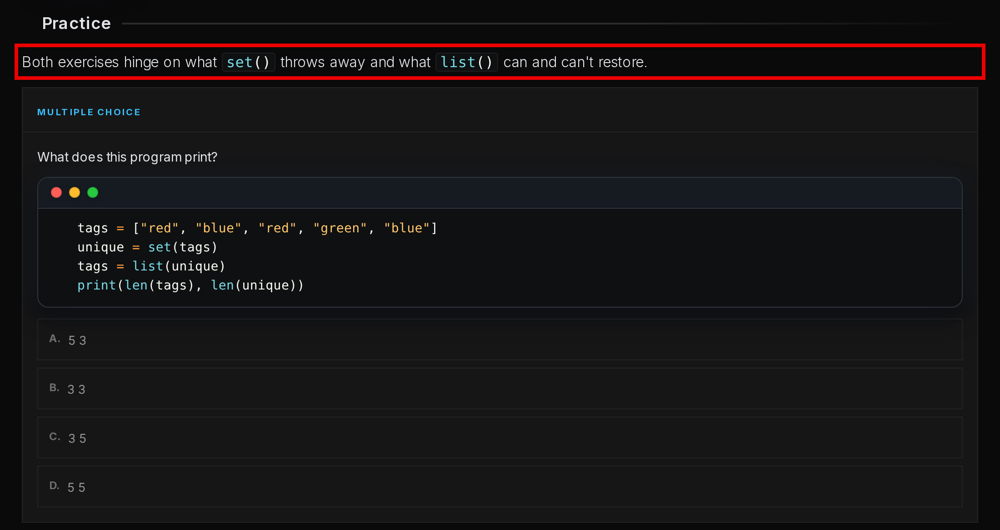

- Proposed default: **drop**. Describes 2 exercises; a multiple-choice follows but the sentence is about the pair.

- Decision (owner): [ ] drop   [ ] keep   [ ] trim

## Place 35

- Lesson slug: `python_data_structures_beginner` (https://datadriven.io/learn/python_data_structures_beginner)
- Group: SKIM | Section: Which Collections Allow Duplicates | Sub-heading: Practice
- The sentence: `The first exercise mixes a set literal and a dict literal with repeats.`
- Drop prefix (from the converted Markdown): `The first exercise mixes a set literal and a dict literal`

Converted Markdown (block before, target, block after):

> ### Practice
>
> **TARGET**
> The first exercise mixes a set literal and a dict literal with repeats. The second has you write the counting pattern.
>
> **What does this program print?**

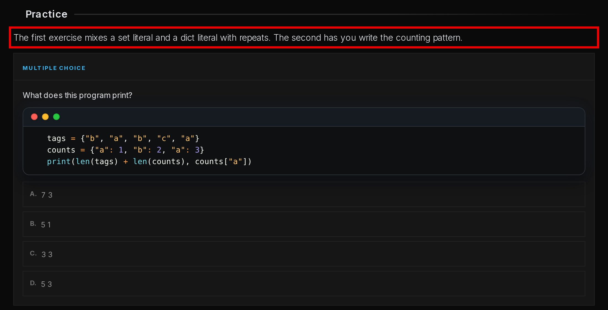

- Proposed default: **drop**. Describes 2 exercises; a multiple-choice follows but the sentence is about the pair.

- Decision (owner): [ ] drop   [ ] keep   [ ] trim

## Place 36

- Lesson slug: `python_data_structures_beginner` (https://datadriven.io/learn/python_data_structures_beginner)
- Group: SKIM | Section: Choosing the Right Type | Sub-heading: Capstones
- The sentence: `That capstone kept a set beside a list so each answered its own question. The next one hands you a need and no code.`
- Drop prefix (from the converted Markdown): `That capstone kept a set beside a list so each answered its` (would drop the whole block, so for a trim edit the Markdown by hand instead)

Converted Markdown (block before, target, block after):

> 

>
> **TARGET**
> That capstone kept a set beside a list so each answered its own question. The next one hands you a need and no code. Run the 4 questions on it in order, and when 2 types both satisfy every answer, prefer the one that refuses what the program never does: a type that blocks an unwanted edit turns a silent mistake into an error on the line that made it.
>
> **A program stores the 7 day names and later reads the name for day number 3 with names[3]. The program never edits the day names after they are stored. Which collection fits best?**

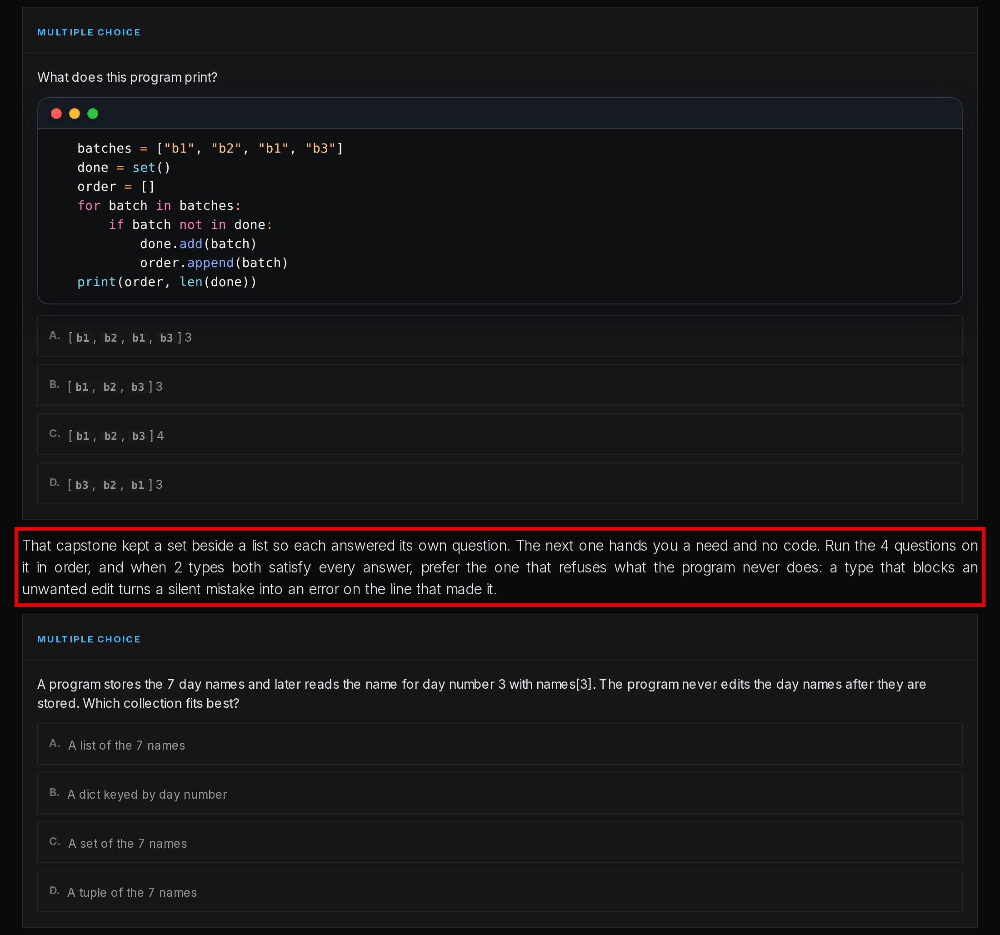

- Proposed default: **trim**. First 2 sentences point at the removed capstone and the next one; the 4-question advice is worth keeping.
- Trim would cut: `That capstone kept a set beside a list so each answered its own question. The next one hands you a need and no code.`

- Decision (owner): [ ] drop   [ ] keep   [ ] trim

## Place 37

- Lesson slug: `python_data_structures_intermediate` (https://datadriven.io/learn/python_data_structures_intermediate)
- Group: DEFINITE | Section: Combining Structures for One Task | Sub-heading: Capstone: from raw events to clean rows
- The sentence: `The last practice runs the lesson's steps on a handful of events:`
- Drop prefix (from the converted Markdown): `The last practice runs the lesson's steps on a handful of`

Converted Markdown (block before, target, block after):

> [Pipeline diagram: not captured. Re-run with --screenshots]
>
> **TARGET**
> The last practice runs the lesson's steps on a handful of events: drop the repeats, attach titles through an index, and group by listener.
>
> ## Putting It All Together

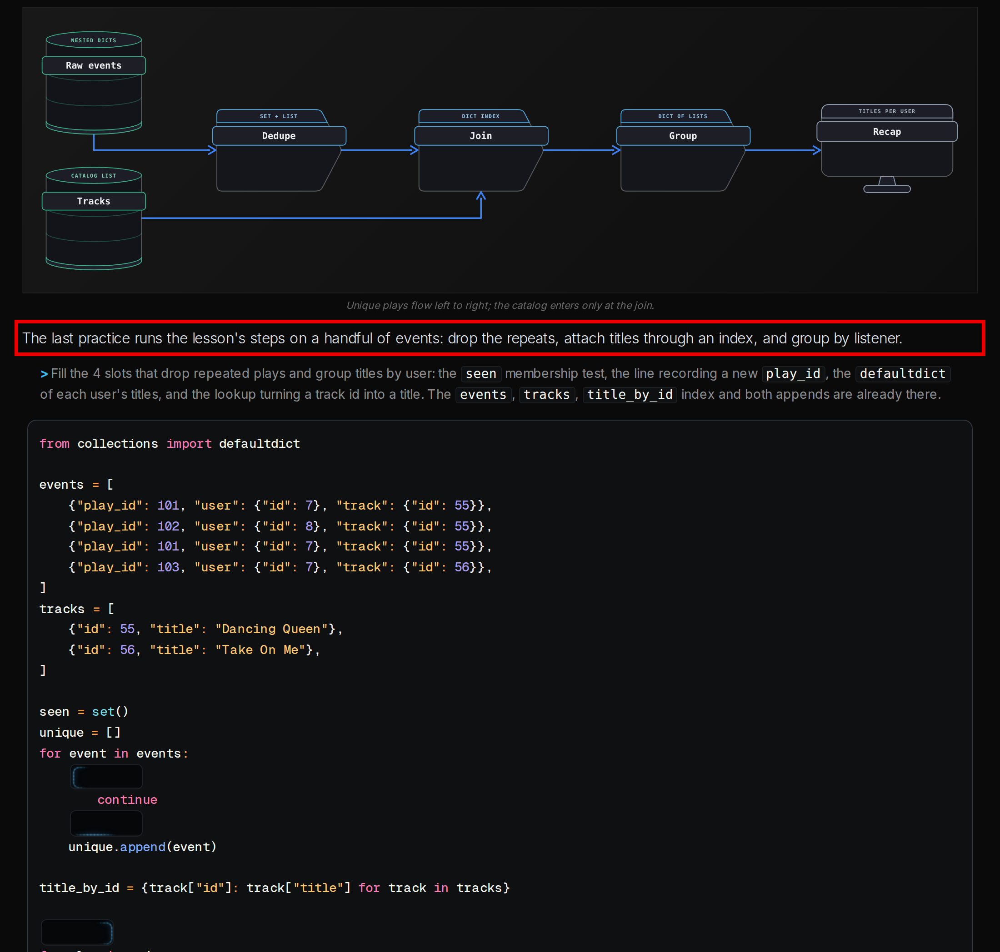

- Proposed default: **drop**. Describes the removed last practice only.

- Decision (owner): [ ] drop   [ ] keep   [ ] trim

## Place 38

- Lesson slug: `python_sets_intermediate` (https://datadriven.io/learn/python_sets_intermediate)
- Group: DEFINITE | Section: Subset and Superset | Sub-heading: Changing a set in place
- The sentence: `The last exercise uses each operator from this lesson.`
- Drop prefix (from the converted Markdown): `The last exercise uses each operator from this lesson.`

Converted Markdown (block before, target, block after):

> False
>
> **TARGET**
> The last exercise uses each operator from this lesson. Returning users are an intersection, new users a difference that also subtracts the banned list, users seen in only 1 week a symmetric difference, and the banned check a subset test against the union.
>
> ## Putting It All Together

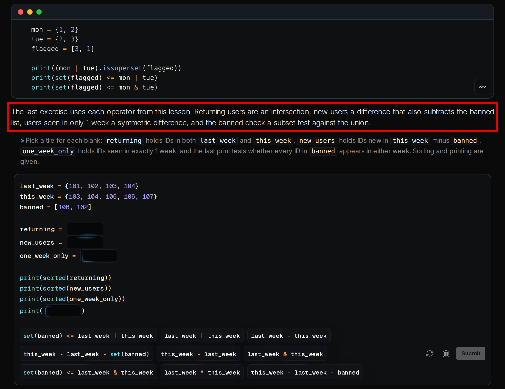

- Proposed default: **drop**. Answer walkthrough for the removed last exercise.

- Decision (owner): [ ] drop   [ ] keep   [ ] trim

## Place 39

- Lesson slug: `python_loops_beginner` (https://datadriven.io/learn/python_loops_beginner)
- Group: SKIM | Section: Iterating with for Loops | Sub-heading: Practice: counting letters
- The sentence: `A misplaced starting line fails without an error message.`
- Drop prefix (from the converted Markdown): `A misplaced starting line fails without an error message.`

Converted Markdown (block before, target, block after):

> Writing an accumulator from scratch means filling 3 slots in the right places: the starting value on the line above the `for`, the list's name after in on the for line, and the loop variable's name inside the body, spelled exactly as the for line spells it. A sum starts from 0, since adding 0 changes nothing.
>
> **TARGET**
> A misplaced starting line fails without an error message. Python runs it on every pass, so the accumulator restarts each time, and the value left at the end reflects only the final pass. When a count comes out smaller than the data says it should, check whether its starting assignment sits inside the body.
>
> ## range() Function

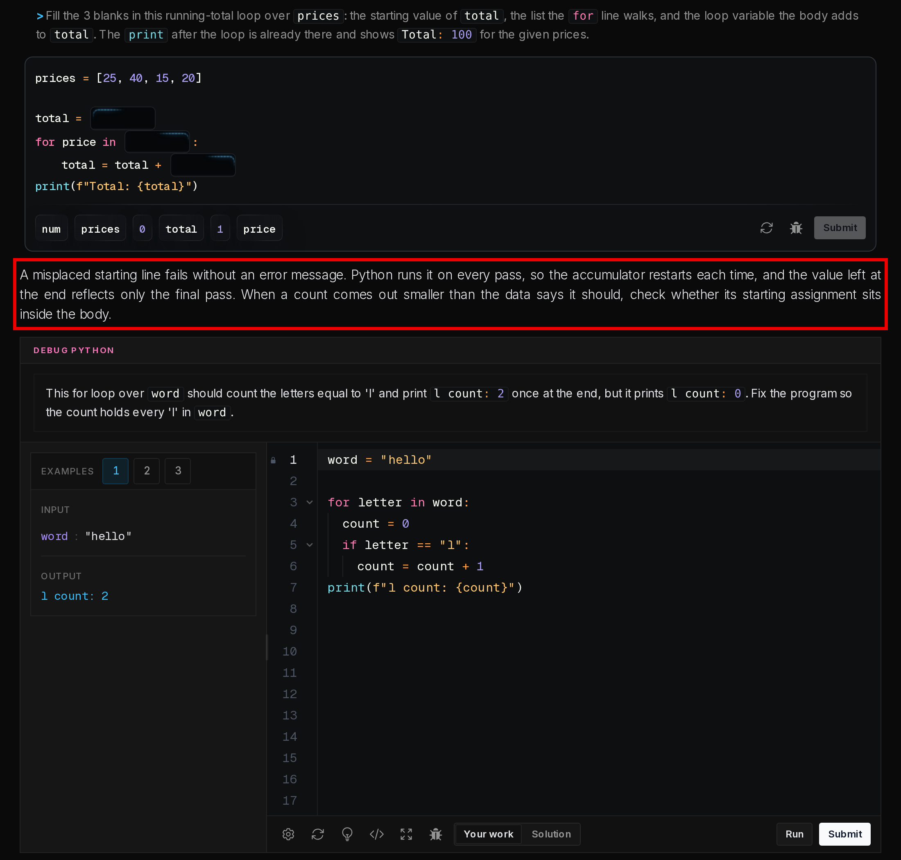

- Proposed default: **keep**. Self-contained debugging tip.

- Decision (owner): [ ] drop   [ ] keep   [ ] trim

## Place 40

- Lesson slug: `python_loops_beginner` (https://datadriven.io/learn/python_loops_beginner)
- Group: SKIM | Section: range() Function | Sub-heading: Getting the stop right
- The sentence: `A countdown reads the same way with a negative step.`
- Drop prefix (from the converted Markdown): `A countdown reads the same way with a negative step. The`

Converted Markdown (block before, target, block after):

> Working backwards from a wanted sequence to a range call takes 3 readings. The first value is the start. The gap between neighbours is the step. The stop is any number past the last value and at most 1 step beyond it, and last value + 1 is the safe choice. For 3, 6, 9 that gives range(3, 10, 3).
>
> **TARGET**
> A countdown reads the same way with a negative step. The start is the first number printed and the step is -1. The excluded stop now sits on the low side, so it goes 1 below the last number you want: to end on 3, stop at 2. range(9, 2, -1) produces 9 down to 3.
>
> ## Loops with while

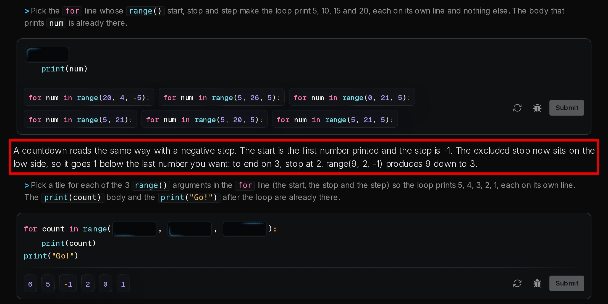

- Proposed default: **keep**. Self-contained, with its own range() example.

- Decision (owner): [ ] drop   [ ] keep   [ ] trim

## Place 41

- Lesson slug: `python_loops_beginner` (https://datadriven.io/learn/python_loops_beginner)
- Group: SKIM | Section: Loops with while | Sub-heading: Zero passes
- The sentence: `A target such as "the first value that is at least X" turns into a condition by asking when the loop should keep going:`
- Drop prefix (from the converted Markdown): `A target such as "the first value that is at least X" turns`

Converted Markdown (block before, target, block after):

> The comparison on the while line decides the last value the body sees. while n > 0 lets the body run for 1 and stops when n is 0. while n >= 0 also lets 0 through, so the body runs 1 extra time. When a loop prints 1 value too many or too few, test the boundary value against the condition by hand.
>
> **TARGET**
> A target such as "the first value that is at least X" turns into a condition by asking when the loop should keep going: while the value is still short of X. To find the first multiple of 3 that is at least 20, start from m = 0, loop while m < 20: with m = m + 3 as the progress line, and the loop stops on 21.
>
> ## Using break and continue

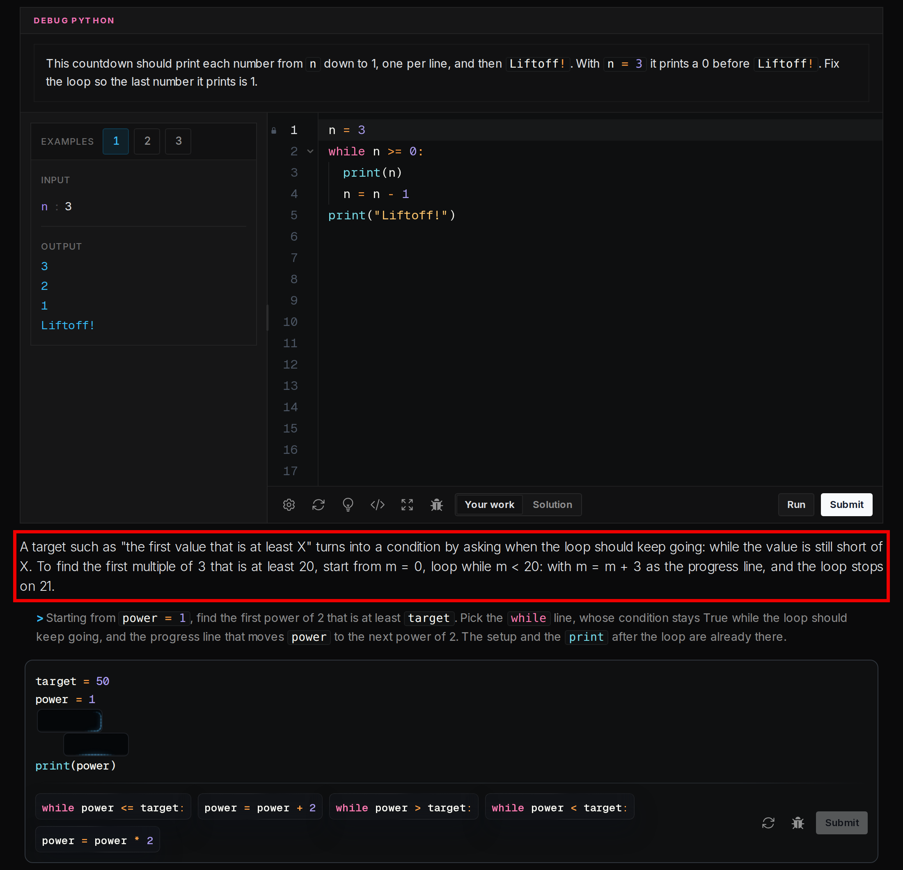

- Proposed default: **keep**. Self-contained, with its own worked example.

- Decision (owner): [ ] drop   [ ] keep   [ ] trim

## Place 42

- Lesson slug: `python_loops_beginner` (https://datadriven.io/learn/python_loops_beginner)
- Group: SKIM | Section: Using break and continue | Sub-heading: continue can skip the progress line in while
- The sentence: `Swapping continue for break turns a filter into a stop sign.`
- Drop prefix (from the converted Markdown): `Swapping continue for break turns a filter into a stop`

Converted Markdown (block before, target, block after):

> The order of lines inside the body decides whether the item that triggers `break` gets processed. When the if holding break comes before the print, the triggering item ends the loop without being printed. When the print comes first, that item is printed and then the loop ends. Either way, the line after the loop runs once.
>
> **TARGET**
> Swapping `continue` for `break` turns a filter into a stop sign. In a loop that sums only positives, continue drops each negative and keeps adding the rest. A break in that spot ends the sum at the first negative, so every positive after it is lost and the total comes out low with no error to warn you.
>
> ## Loop Variable Scope

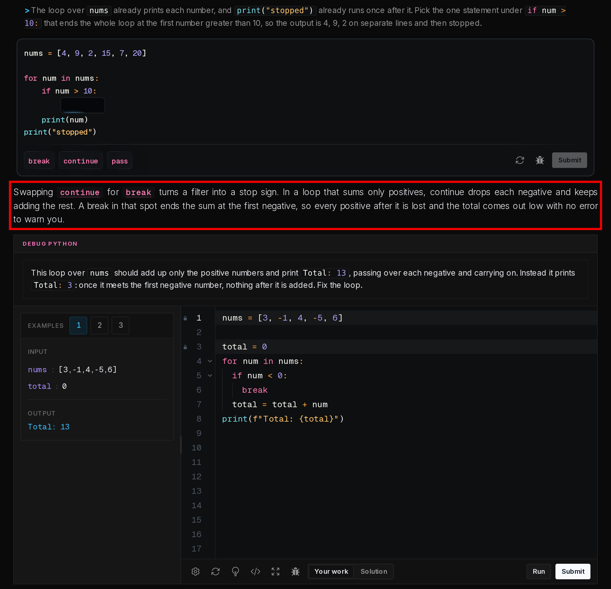

- Proposed default: **keep**. Self-contained, with its own worked example.

- Decision (owner): [ ] drop   [ ] keep   [ ] trim

## Place 43

- Lesson slug: `python_loops_beginner` (https://datadriven.io/learn/python_loops_beginner)
- Group: SKIM | Section: Loop Variable Scope | Sub-heading: Reusing a name
- The sentence: `When a printed value belongs to the wrong loop, look for a name that 2 loops share.`
- Drop prefix (from the converted Markdown): `When a printed value belongs to the wrong loop, look for a`

Converted Markdown (block before, target, block after):

> Predicting a for variable after a break means finding the first item, in list order, that passes the if, and stopping there. Later items are never assigned, even ones that would also pass. Over [2, 15, 30] with a break on n > 10, n ends at 15, and 30 never reaches the variable.
>
> **TARGET**
> When a printed value belongs to the wrong loop, look for a name that 2 loops share. The second loop's assignments land in the same variable, so once it ends, the first loop's value is gone. Giving each loop a variable named for its own data, such as name and score, keeps both values.
>
> ## Putting It All Together

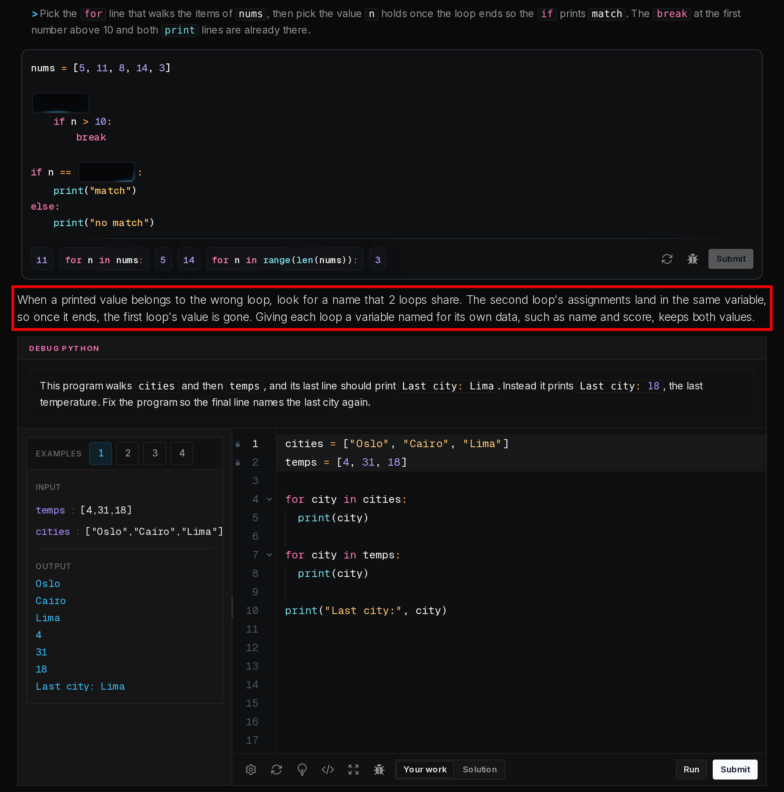

- Proposed default: **keep**. Self-contained advice about reusing a loop variable.

- Decision (owner): [ ] drop   [ ] keep   [ ] trim

## Place 44

- Lesson slug: `python_strings_advanced` (https://datadriven.io/learn/python_strings_advanced)
- Group: SKIM | Section: Splitting Strings | Sub-heading: When the piece count is wrong
- The sentence: `The 2 repairs differ when the separator is missing.`
- Drop prefix (from the converted Markdown): `The 2 repairs differ when the separator is missing. "debug"`

Converted Markdown (block before, target, block after):

> An address such as `cache:primary:6379` has a colon inside its name as well as before its port. The port is always the last field, so the cut belongs at the last colon: `rsplit(":", 1)` gives 2 pieces, while `split(":")` gives 3 and breaks a 2-name unpacking.
>
> **TARGET**
> The 2 repairs differ when the separator is missing. `"debug".split("=", 1)` still returns 1 piece and still fails a 2-name unpacking, which suits code that must reject a malformed setting. `partition` returns empty strings instead, which suits code that treats a bare key as a flag.
>
> ## Joining Strings

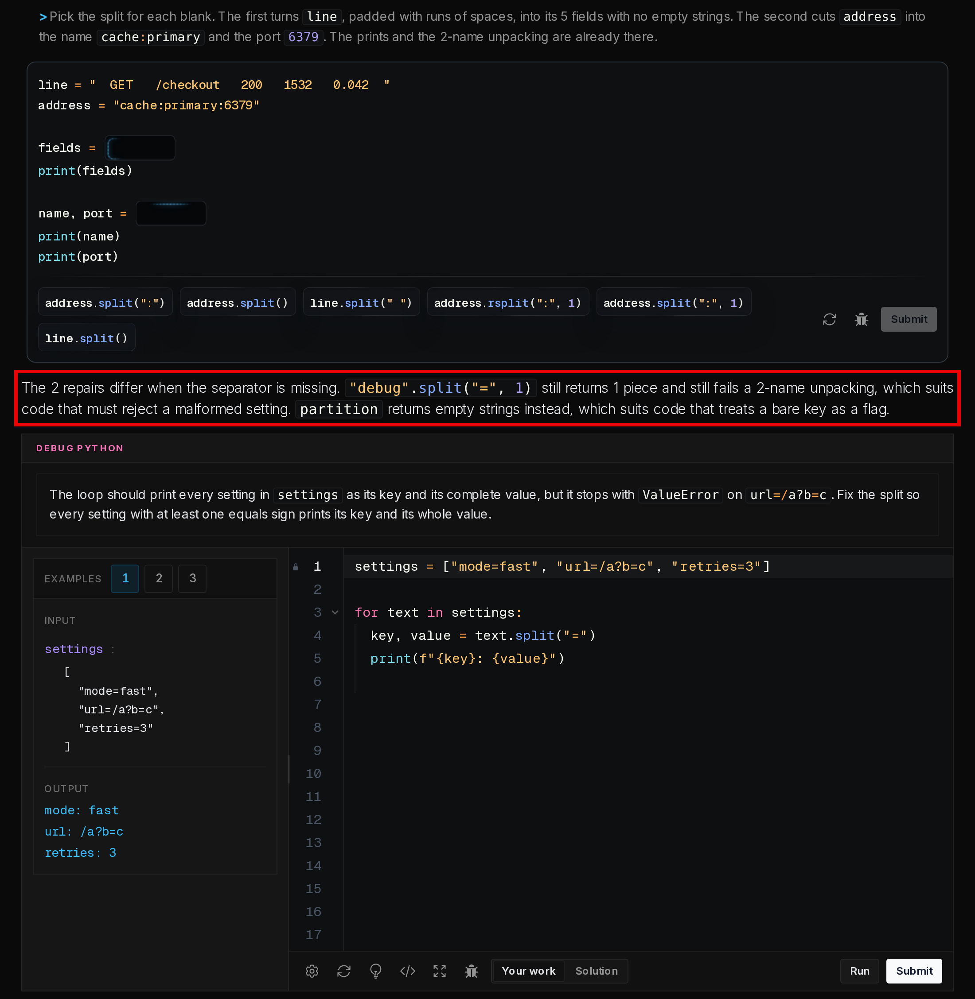

- Proposed default: **keep**. Self-contained comparison of split and partition.

- Decision (owner): [ ] drop   [ ] keep   [ ] trim

## Place 45

- Lesson slug: `python_strings_advanced` (https://datadriven.io/learn/python_strings_advanced)
- Group: SKIM | Section: Joining Strings | Sub-heading: Newlines at the seams
- The sentence: `When only one value is a number, converting it inside the brackets is the smallest repair:`
- Drop prefix (from the converted Markdown): `When only one value is a number, converting it inside the`

Converted Markdown (block before, target, block after):

> One split can feed several joins. Unpack the fields once, then hand `join` a short list written in brackets: with `method` and `path` unpacked from the `POST /login` line earlier, `" ".join([method, path])` builds `POST /login` from 2 of its 5 fields.
>
> **TARGET**
> When only one value is a number, converting it inside the brackets is the smallest repair: `",".join([method, path, str(status)])`. The position in the `TypeError` message says which piece to convert, so `sequence item 2` points at the third value.
>
> ## Regular Expression Matching

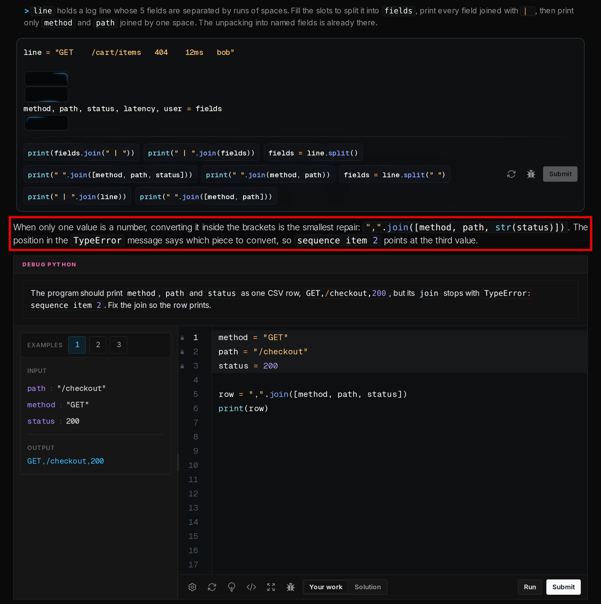

- Proposed default: **keep**. Mostly self-contained; the join example names its own values.

- Decision (owner): [ ] drop   [ ] keep   [ ] trim

## Place 46

- Lesson slug: `python_strings_advanced` (https://datadriven.io/learn/python_strings_advanced)
- Group: SKIM | Section: Regular Expression Matching | Sub-heading: Replacing matches
- The sentence: `A pattern that quietly finds nothing is the usual sign of the backslash bug, and len exposes it:`
- Drop prefix (from the converted Markdown): `A pattern that quietly finds nothing is the usual sign of`

Converted Markdown (block before, target, block after):

> Real log lines open with an address, so a pattern that starts at the method fails `re.match` on every one of them. `search` scans forward to the method wherever it sits, and a line with no request in it, such as a health check, returns `None` for an `if` test to catch.
>
> **TARGET**
> A pattern that quietly finds nothing is the usual sign of the backslash bug, and `len` exposes it: `len("\b")` is 1, a single backspace, while `len(r"\b")` is 2. Unrecognized escapes such as `\d` pass through an ordinary string unchanged, which lets a pattern without the `r` seem to work until a `\b` arrives.
>
> ## Advanced Formatting

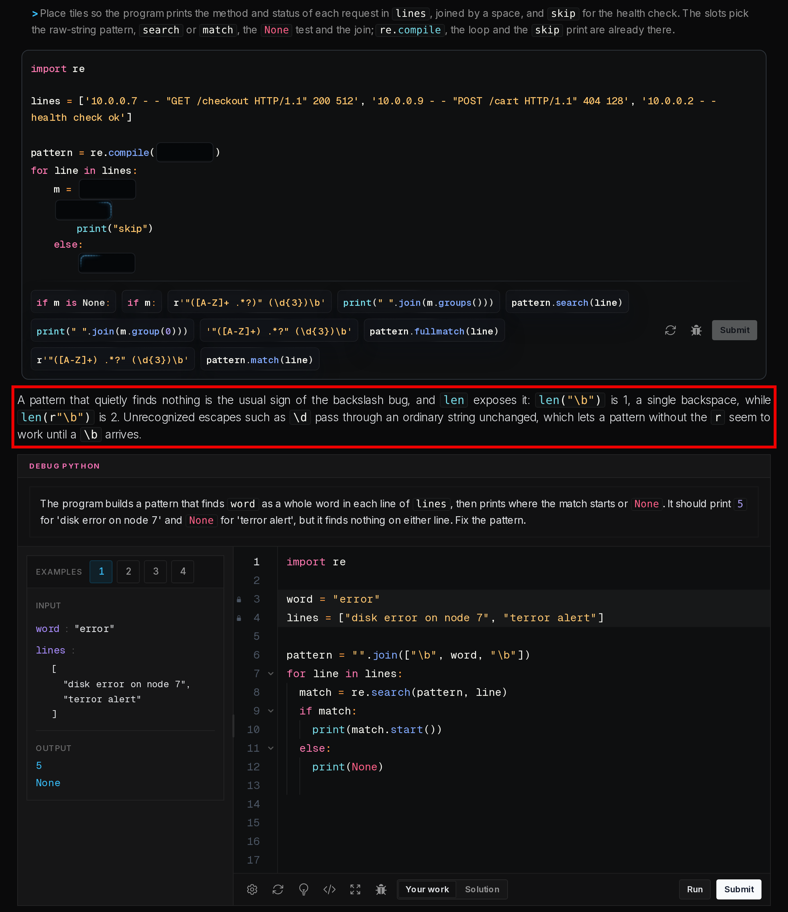

- Proposed default: **keep**. Self-contained, with its own len() demonstration.

- Decision (owner): [ ] drop   [ ] keep   [ ] trim

## Place 47

- Lesson slug: `python_strings_advanced` (https://datadriven.io/learn/python_strings_advanced)
- Group: SKIM | Section: Advanced Formatting | Sub-heading: Templates with str.format
- The sentence: `Centering splits the padding in 2, and when the padding is odd the extra character goes on the right:`
- Drop prefix (from the converted Markdown): `Centering splits the padding in 2, and when the padding is`

Converted Markdown (block before, target, block after):

> Inside one spec the parts keep their order even when most are missing: `>8,` puts alignment before width and grouping last, and `.1%` puts precision ahead of type. Swapping them changes the meaning without an error: in `f"{1532:,>8}"` the comma sits in the fill position, so it prints `,,,,1532`.
>
> **TARGET**
> Centering splits the padding in 2, and when the padding is odd the extra character goes on the right: `f"|{'GET':^6}|"` prints `| GET |`. In that same width of 6, `/a` starts 2 characters in, with 2 spaces after it.
>
> ## String Encoding

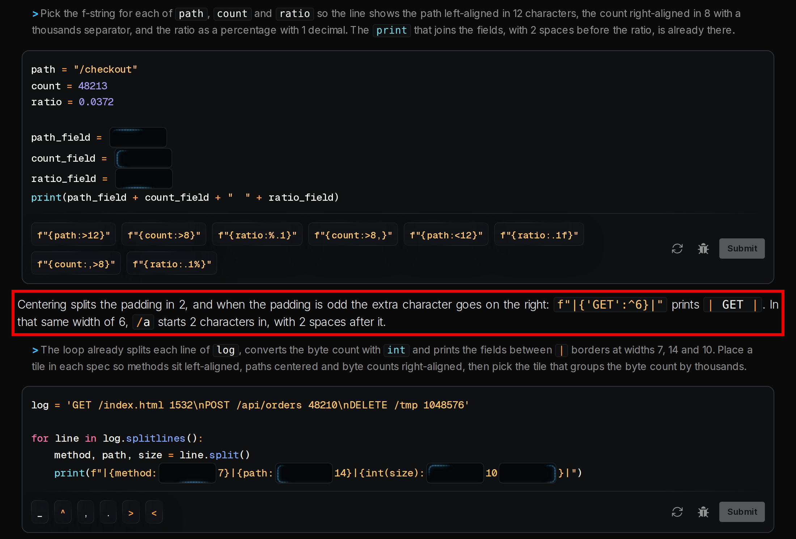

- Proposed default: **keep**. Self-contained, with its own format example.

- Decision (owner): [ ] drop   [ ] keep   [ ] trim

## Place 48

- Lesson slug: `python_strings_advanced` (https://datadriven.io/learn/python_strings_advanced)
- Group: SKIM | Section: String Encoding | Sub-heading: Same text, different code points
- The sentence: `len counts code points, which is not always what a reader sees as 1 symbol.`
- Drop prefix (from the converted Markdown): `len counts code points, which is not always what a reader`

Converted Markdown (block before, target, block after):

> `errors="ignore"` drops every byte that does not belong to a complete character, wherever it sits. On bytes you encoded and then sliced, only the cut character can break, so at most 3 bytes fall away. On input from outside, the same flag hides corruption that `errors="replace"` would show.
>
> **TARGET**
> `len` counts code points, which is not always what a reader sees as 1 symbol. The flag `����` is 2 code points, the regional indicator letters F and R, so `len` gives 2 and its UTF-8 form takes 8 bytes.
>
> ## Putting It All Together

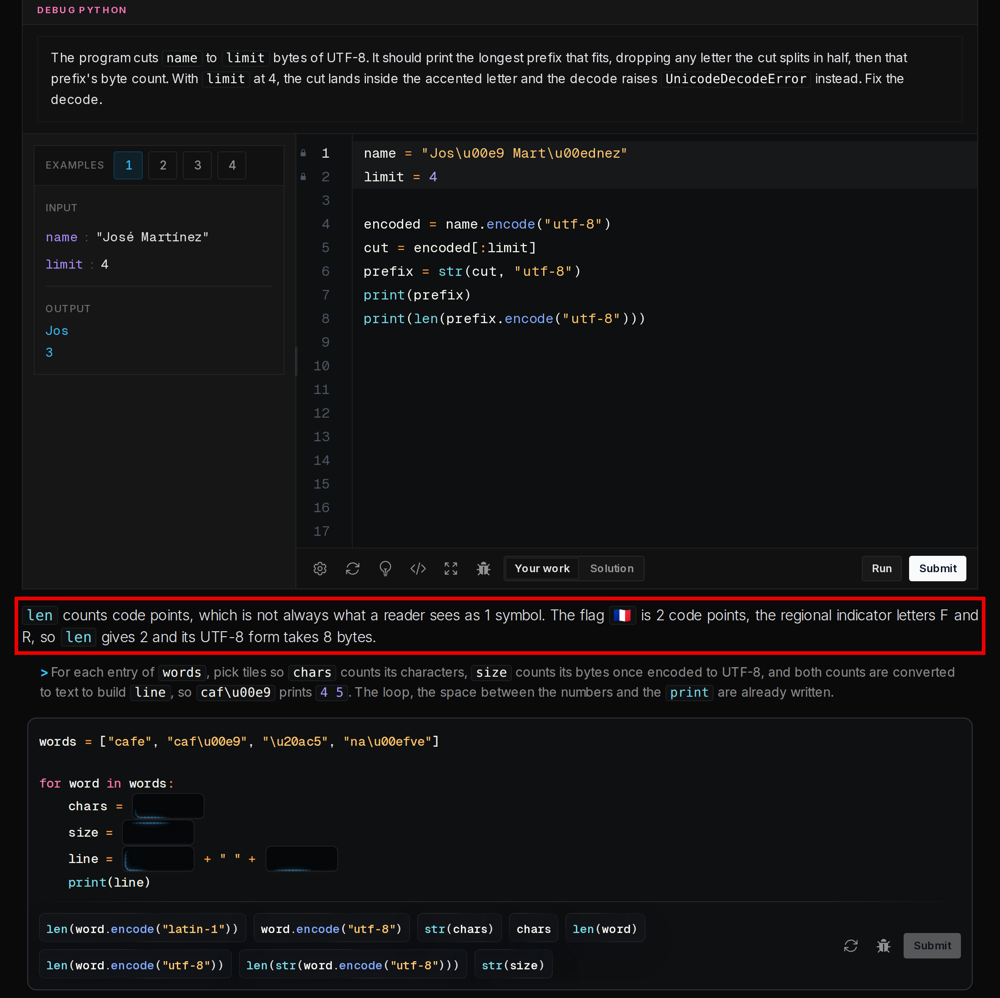

- Proposed default: **keep**. Self-contained, with its own flag example.

- Decision (owner): [ ] drop   [ ] keep   [ ] trim

## Place 49

- Lesson slug: `python_lists_advanced` (https://datadriven.io/learn/python_lists_advanced)
- Group: SKIM | Section: In-Place vs Return Value | Sub-heading: Capstone: a plan with undo
- The sentence: `Capstone: a plan with undo`
- Drop prefix (from the converted Markdown): `Capstone: a plan with undo`

Converted Markdown (block before, target, block after):

> 

>
> **TARGET**
> ### Capstone: a plan with undo
>
> The last problems use everything from the earlier sections. You'll see shallow and deep copies, including one made by a comprehension, next to a stack of saved states and calls that either change a list or return a new one. Trace each name to the object it points at before you answer.

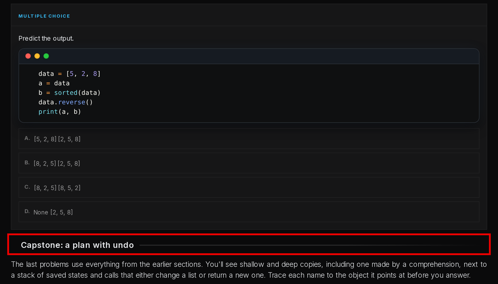

- Proposed default: **keep**. A multiple-choice question follows and is kept.

- Decision (owner): [ ] drop   [ ] keep   [ ] trim

## Place 50

- Lesson slug: `python_lists_advanced` (https://datadriven.io/learn/python_lists_advanced)
- Group: SKIM | Section: In-Place vs Return Value | Sub-heading: Capstone: a plan with undo
- The sentence: `The last problems use everything from the earlier sections.`
- Drop prefix (from the converted Markdown): `The last problems use everything from the earlier sections.`

Converted Markdown (block before, target, block after):

> ### Capstone: a plan with undo
>
> **TARGET**
> The last problems use everything from the earlier sections. You'll see shallow and deep copies, including one made by a comprehension, next to a stack of saved states and calls that either change a list or return a new one. Trace each name to the object it points at before you answer.
>
> **What does this program print?**

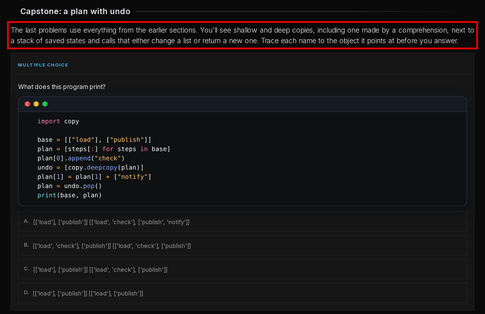

- Proposed default: **keep**. A multiple-choice question follows and is kept.

- Decision (owner): [ ] drop   [ ] keep   [ ] trim

## Place 51

- Lesson slug: `python_dictionaries_beginner` (https://datadriven.io/learn/python_dictionaries_beginner)
- Group: SKIM | Section: Creating Your First Dictionary | Sub-heading: (none; the h3 "Practice" of this section)
- The sentence: `Practice`
- Drop prefix (from the converted Markdown): `Practice`

Converted Markdown (block before, target, block after):

> > **TIP**
> >
> > Name a dictionary after what it maps, the way `prices` and `stock` are named; `user` follows the same pattern. Name each key for what its value means. `d["x"]` tells a reader nothing; `product["weight_kg"]` tells them everything they need.
>
> **TARGET**
> ### Practice
>
> **What does this program print?**

- Proposed default: **keep**. A kept multiple-choice question follows the heading.

- Decision (owner): [ ] drop   [ ] keep   [ ] trim

## Place 52

- Lesson slug: `python_dictionaries_beginner` (https://datadriven.io/learn/python_dictionaries_beginner)
- Group: SKIM | Section: Reading and Updating Values | Sub-heading: (none; the h3 "Practice" of this section)
- The sentence: `Practice`
- Drop prefix (from the converted Markdown): `Practice`

Converted Markdown (block before, target, block after):

> > 3 operations with the same brackets
> >
> > - user["age"] reads: KeyError if the key is missing
> > - user["age"] = 29 writes: adds or replaces, never a KeyError
> > - user.get("age", 0) reads with a fallback: never a KeyError, never adds
>
> **TARGET**
> ### Practice
>
> **What does the last line print?**

- Proposed default: **keep**. A kept multiple-choice question follows the heading.

- Decision (owner): [ ] drop   [ ] keep   [ ] trim

## Place 53

- Lesson slug: `python_dictionaries_beginner` (https://datadriven.io/learn/python_dictionaries_beginner)
- Group: SKIM | Section: Removing Items | Sub-heading: (none; the h3 "Practice" of this section)
- The sentence: `Practice`
- Drop prefix (from the converted Markdown): `Practice`

Converted Markdown (block before, target, block after):

> | ✓ Do | ✗ Don't |
> | --- | --- |
> | • Use pop with a default when a key may already be gone  • Use pop when you need the value you are removing  • Use del when the key must exist and a crash should flag the bug | • Don't call del twice on the same key without a check between  • Do not use pop(key) without a default for optional ...
>
> **TARGET**
> ### Practice
>
> Real programs mix the removal tools, and the order of the calls decides what each one finds. Trace this session cleanup line by line before you run it:

- Proposed default: **keep**. A kept multiple-choice question follows the heading (check the screenshot: the removed exercise sits in between).

- Decision (owner): [ ] drop   [ ] keep   [ ] trim

## Place 54

- Lesson slug: `python_dictionaries_beginner` (https://datadriven.io/learn/python_dictionaries_beginner)
- Group: SKIM | Section: Checking for Keys and Key Types | Sub-heading: (none; the h3 "Practice" of this section)
- The sentence: `Practice`
- Drop prefix (from the converted Markdown): `Practice`

Converted Markdown (block before, target, block after):

> The integer `1` and the string `"1"` are different keys, because they're different values: `1 == "1"` is `False`. A dictionary filled from typed input holds `"42"`, because everything typed arrives as text, so a lookup with the number `42` will miss. Mixing key types is allowed, as the `lookup` example showed, but when keys come from input, settle ...
>
> **TARGET**
> ### Practice
>
> **What does this program print?**

- Proposed default: **keep**. A kept multiple-choice question follows the heading.

- Decision (owner): [ ] drop   [ ] keep   [ ] trim

## Place 55

- Lesson slug: `python_problem_solving_advanced` (https://datadriven.io/learn/python_problem_solving_advanced)
- Group: SKIM | Section: Sort as Preprocessing | Sub-heading: Capstone: the fullest gap
- The sentence: `Capstone: the fullest gap`
- Drop prefix (from the converted Markdown): `Capstone: the fullest gap`

Converted Markdown (block before, target, block after):

> A missing sort sometimes leaves a visible trace. In the closest-pair loop run on arrival order, `b - a` goes negative whenever a later timestamp is smaller, as 140 - 905 = -765 is. A negative gap is smaller than every real gap, so it wins. Any gap below 0 means the order the loop relies on is missing.
>
> **TARGET**
> ### Capstone: the fullest gap
>
> This one combines 3 patterns: sort the input, walk 2 pointers inward, and keep the best total so far. A total that fits the gap is a candidate, and moving `left` up tries a larger one; a total that overflows moves `right` down to a shorter track.

- Proposed default: **drop**. Heading of a capstone whose problem is removed.

- Decision (owner): [ ] drop   [ ] keep   [ ] trim

## Place 56

- Lesson slug: `python_problem_solving_advanced` (https://datadriven.io/learn/python_problem_solving_advanced)
- Group: SKIM | Section: Sort as Preprocessing | Sub-heading: Capstone: the fullest gap
- The sentence: `This one combines 3 patterns:`
- Drop prefix (from the converted Markdown): `This one combines 3 patterns: sort the input, walk 2`

Converted Markdown (block before, target, block after):

> ### Capstone: the fullest gap
>
> **TARGET**
> This one combines 3 patterns: sort the input, walk 2 pointers inward, and keep the best total so far. A total that fits the gap is a candidate, and moving `left` up tries a larger one; a total that overflows moves `right` down to a shorter track.
>
> ## Putting It All Together

- Proposed default: **drop**. Explains the approach to the removed problem only.

- Decision (owner): [ ] drop   [ ] keep   [ ] trim
