# Learn SQL tabbed examples (#20): review page

**NEVER MERGE.** This PR exists only so the owner can look at the screenshots and pick an option. Parent spec: #10. Ticket: #20.

## What the tabs are

On the live site each one is a block with `data-note-block-type="sql_switcher"`. It has a tab bar (names such as `Named zone | Fixed offset`), one caption sentence for the active tab, one SQL code cell (macOS-style window, line numbers, 3 icon buttons), and a Result table (collapsed behind the table icon until clicked; present in the DOM). Clicking a tab swaps the caption, the SQL and the Result. Prose before the block says things like "Both tabs below read ...".

## What the converter saves today

The saved HTML contains only the active tab's panel (always the first tab, in all 58 blocks), plus the tab bar. The converter drops `<button>` elements, so the tab names disappear too, and there is no rule for `sql_switcher` (generic conversion). Result for `dates_advanced`: the caption of tab 1, a junk 2-column table holding the SQL, then `Result`, the result table and `1 row`. The second tab (`Fixed offset`) is lost entirely, while the prose still says "Both tabs below".

## Inventory

Counted from every one of the 30 Learn SQL lessons, live page, every tab clicked: **58 tabbed blocks, 152 tabs** (HANDOFF.md guessed about 70; 58 is what the pages actually contain). Tab counts: 2 tabs x 25, 3 tabs x 30, 4 tabs x 3. So 94 tab panels are lost today. Every tab's code, caption and result were captured as text (no two tabs of one block have the same code).

| Lesson | Blocks | Tabs per block |
|---|---|---|
| aggregating_advanced | 5 | 2, 2, 3, 2, 2 |
| aggregating_beginner | 1 | 3 |
| aggregating_intermediate | 3 | 3, 3, 4 |
| complex_data_advanced | 1 | 2 |
| complex_data_beginner | 0 | - |
| complex_data_intermediate | 2 | 2, 2 |
| data_types_advanced | 1 | 2 |
| data_types_beginner | 1 | 3 |
| data_types_intermediate | 1 | 2 |
| dates_advanced | 4 | 2, 2, 2, 2 |
| dates_beginner | 1 | 2 |
| dates_intermediate | 5 | 2, 3, 3, 2, 2 |
| filtering_advanced | 2 | 3, 3 |
| filtering_beginner | 1 | 3 |
| filtering_intermediate | 4 | 3, 3, 3, 2 |
| joins_advanced | 1 | 3 |
| joins_beginner | 1 | 3 |
| joins_intermediate | 4 | 2, 4, 2, 2 |
| null_values_advanced | 4 | 3, 2, 3, 4 |
| null_values_beginner | 2 | 3, 3 |
| null_values_intermediate | 1 | 2 |
| query_structure_advanced | 2 | 3, 3 |
| query_structure_beginner | 1 | 3 |
| query_structure_intermediate | 1 | 3 |
| string_functions_advanced | 2 | 3, 3 |
| string_functions_beginner | 1 | 3 |
| string_functions_intermediate | 2 | 3, 2 |
| window_functions_advanced | 1 | 3 |
| window_functions_beginner | 1 | 3 |
| window_functions_intermediate | 2 | 3, 2 |

## Sample: every tab, screenshot (2x) plus its code

The screenshots are the whole block at 1100px width, 2x. The Result table is collapsed by default on the live site, so it is not in the images; the result text is listed under each tab.

### aggregating_beginner, block 1 (3 tabs: COUNT(*) / COUNT(col) / DISTINCT)

https://datadriven.io/learn/aggregating_beginner

**Tab: COUNT(*)**

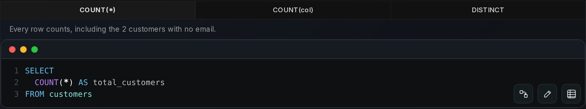

Caption: Every row counts, including the 2 customers with no email.

```sql
SELECT
  COUNT(*) AS total_customers
FROM customers
```

Result:

```
total_customers
5
```

**Tab: COUNT(col)**

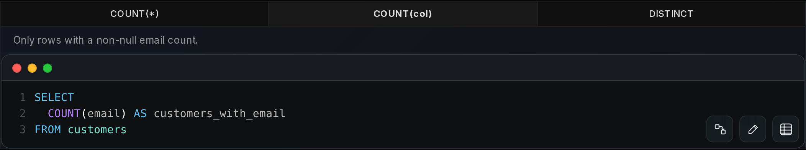

Caption: Only rows with a non-null email count.

```sql
SELECT
  COUNT(email) AS customers_with_email
FROM customers
```

Result:

```
customers_with_email
3
```

**Tab: DISTINCT**

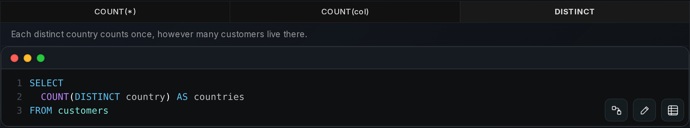

Caption: Each distinct country counts once, however many customers live there.

```sql
SELECT
  COUNT(DISTINCT country) AS countries
FROM customers
```

Result:

```
countries
2
```

### aggregating_intermediate, block 3 (4 tabs: Alias / Expression / Position / Unselected)

https://datadriven.io/learn/aggregating_intermediate

**Tab: Alias**

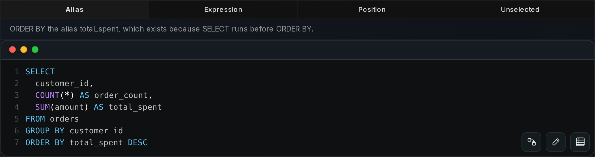

Caption: ORDER BY the alias total_spent, which exists because SELECT runs before ORDER BY.

```sql
SELECT
  customer_id,
  COUNT(*) AS order_count,
  SUM(amount) AS total_spent
FROM orders
GROUP BY customer_id
ORDER BY total_spent DESC
```

Result:

```
customer_id | order_count | total_spent
C3 | 1 | 300
C1 | 3 | 270
C2 | 2 | 120
```

**Tab: Expression**

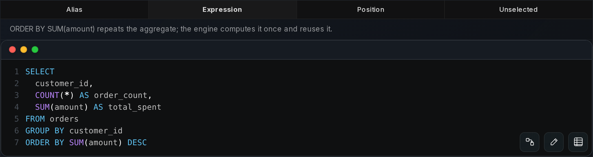

Caption: ORDER BY SUM(amount) repeats the aggregate; the engine computes it once and reuses it.

```sql
SELECT
  customer_id,
  COUNT(*) AS order_count,
  SUM(amount) AS total_spent
FROM orders
GROUP BY customer_id
ORDER BY SUM(amount) DESC
```

Result:

```
customer_id | order_count | total_spent
C3 | 1 | 300
C1 | 3 | 270
C2 | 2 | 120
```

**Tab: Position**

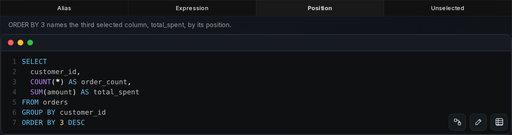

Caption: ORDER BY 3 names the third selected column, total_spent, by its position.

```sql
SELECT
  customer_id,
  COUNT(*) AS order_count,
  SUM(amount) AS total_spent
FROM orders
GROUP BY customer_id
ORDER BY 3 DESC
```

Result:

```
customer_id | order_count | total_spent
C3 | 1 | 300
C1 | 3 | 270
C2 | 2 | 120
```

**Tab: Unselected**

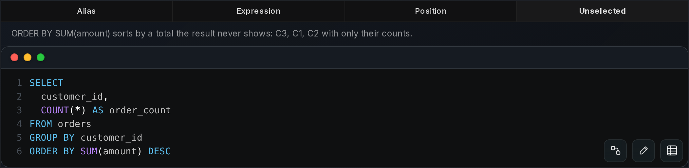

Caption: ORDER BY SUM(amount) sorts by a total the result never shows: C3, C1, C2 with only their counts.

```sql
SELECT
  customer_id,
  COUNT(*) AS order_count
FROM orders
GROUP BY customer_id
ORDER BY SUM(amount) DESC
```

Result:

```
customer_id | order_count
C3 | 1
C1 | 3
C2 | 2
```

### complex_data_intermediate, block 1 (2 tabs: NOT contains / COALESCE)

https://datadriven.io/learn/complex_data_intermediate

**Tab: NOT contains**

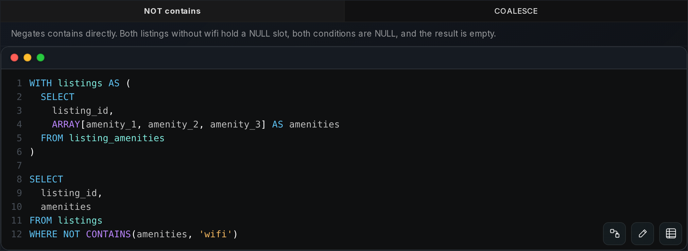

Caption: Negates contains directly. Both listings without wifi hold a NULL slot, both conditions are NULL, and the result is empty.

```sql
WITH listings AS (
  SELECT
    listing_id,
    ARRAY[amenity_1, amenity_2, amenity_3] AS amenities
  FROM listing_amenities
)

SELECT
  listing_id,
  amenities
FROM listings
WHERE NOT CONTAINS(amenities, 'wifi')
```

Result:

```
listing_id | amenities
```

**Tab: COALESCE**

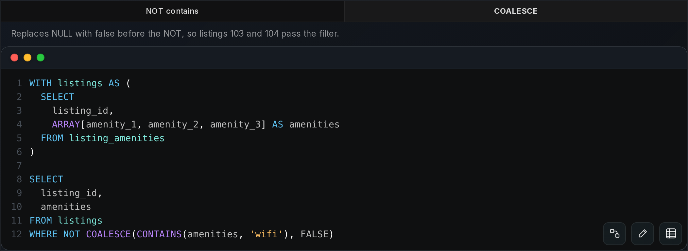

Caption: Replaces NULL with false before the NOT, so listings 103 and 104 pass the filter.

```sql
WITH listings AS (
  SELECT
    listing_id,
    ARRAY[amenity_1, amenity_2, amenity_3] AS amenities
  FROM listing_amenities
)

SELECT
  listing_id,
  amenities
FROM listings
WHERE NOT COALESCE(CONTAINS(amenities, 'wifi'), FALSE)
```

Result:

```
listing_id | amenities
103 | ["kitchen",null,"parking"]
104 | ["hot_tub","kitchen",null]
```

### data_types_beginner, block 1 (3 tabs: Text sort / Number sort / Text filter)

https://datadriven.io/learn/data_types_beginner

**Tab: Text sort**

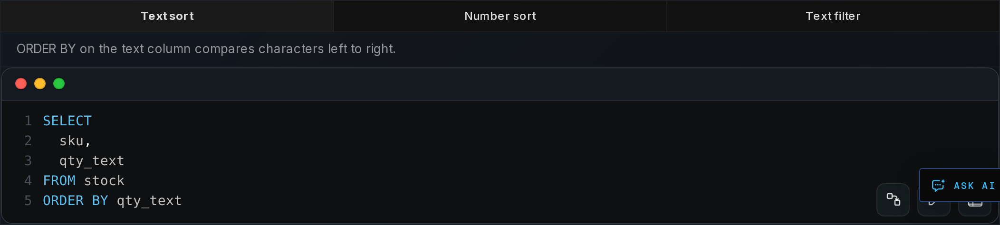

Caption: ORDER BY on the text column compares characters left to right.

```sql
SELECT
  sku,
  qty_text
FROM stock
ORDER BY qty_text
```

Result:

```
sku | qty_text
B-200 | 10
C-300 | 100
D-400 | 25
E-500 | 3
A-100 | 9
```

**Tab: Number sort**

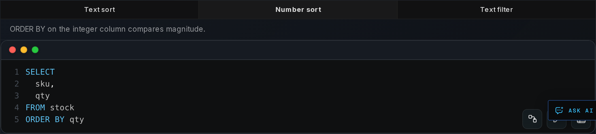

Caption: ORDER BY on the integer column compares magnitude.

```sql
SELECT
  sku,
  qty
FROM stock
ORDER BY qty
```

Result:

```
sku | qty
E-500 | 3
A-100 | 9
B-200 | 10
D-400 | 25
C-300 | 100
```

**Tab: Text filter**

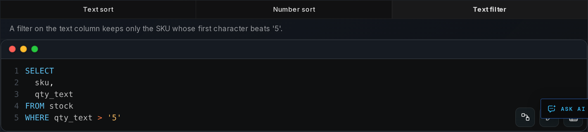

Caption: A filter on the text column keeps only the SKU whose first character beats '5'.

```sql
SELECT
  sku,
  qty_text
FROM stock
WHERE qty_text > '5'
```

Result:

```
sku | qty_text
A-100 | 9
```

### dates_advanced, block 1 (2 tabs: Named zone / Fixed offset)

https://datadriven.io/learn/dates_advanced

**Tab: Named zone**

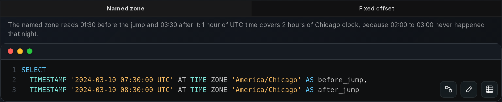

Caption: The named zone reads 01:30 before the jump and 03:30 after it: 1 hour of UTC time covers 2 hours of Chicago clock, because 02:00 to 03:00 never happened that night.

```sql
SELECT
  TIMESTAMP '2024-03-10 07:30:00 UTC' AT TIME ZONE 'America/Chicago' AS before_jump,
  TIMESTAMP '2024-03-10 08:30:00 UTC' AT TIME ZONE 'America/Chicago' AS after_jump
```

Result:

```
before_jump | after_jump
2024-03-10 01:30:00 America/Chicago | 2024-03-10 03:30:00 America/Chicago
```

**Tab: Fixed offset**

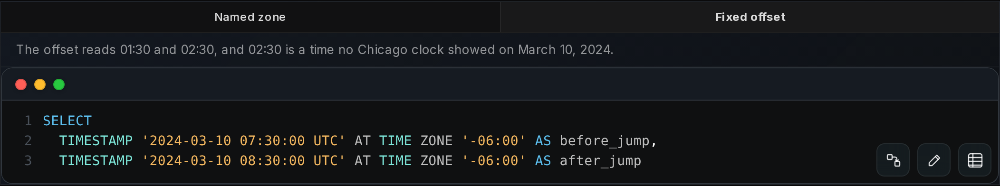

Caption: The offset reads 01:30 and 02:30, and 02:30 is a time no Chicago clock showed on March 10, 2024.

```sql
SELECT
  TIMESTAMP '2024-03-10 07:30:00 UTC' AT TIME ZONE '-06:00' AS before_jump,
  TIMESTAMP '2024-03-10 08:30:00 UTC' AT TIME ZONE '-06:00' AS after_jump
```

Result:

```
before_jump | after_jump
2024-03-10 01:30:00 -06:00 | 2024-03-10 02:30:00 -06:00
```

### filtering_intermediate, block 4 (2 tabs: BETWEEN / Half-open)

https://datadriven.io/learn/filtering_intermediate

**Tab: BETWEEN**

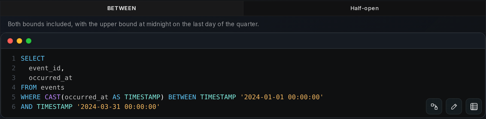

Caption: Both bounds included, with the upper bound at midnight on the last day of the quarter.

```sql
SELECT
  event_id,
  occurred_at
FROM events
WHERE CAST(occurred_at AS TIMESTAMP) BETWEEN TIMESTAMP '2024-01-01 00:00:00'
AND TIMESTAMP '2024-03-31 00:00:00'
```

Result:

```
event_id | occurred_at
1 | 2024-01-01 00:00:00
2 | 2024-02-14 09:15:00
3 | 2024-03-31 00:00:00
```

**Tab: Half-open**

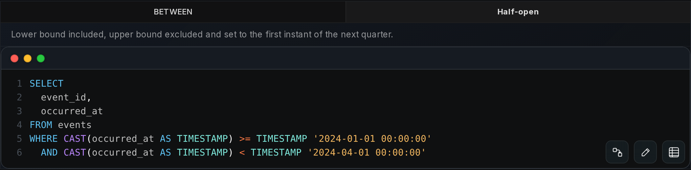

Caption: Lower bound included, upper bound excluded and set to the first instant of the next quarter.

```sql
SELECT
  event_id,
  occurred_at
FROM events
WHERE CAST(occurred_at AS TIMESTAMP) >= TIMESTAMP '2024-01-01 00:00:00'
  AND CAST(occurred_at AS TIMESTAMP) < TIMESTAMP '2024-04-01 00:00:00'
```

Result:

```
event_id | occurred_at
1 | 2024-01-01 00:00:00
2 | 2024-02-14 09:15:00
3 | 2024-03-31 00:00:00
4 | 2024-03-31 18:20:00
```

### joins_intermediate, block 2 (4 tabs: Right: ON / Right: WHERE / Left: ON / Left: WHERE)

https://datadriven.io/learn/joins_intermediate

**Tab: Right: ON**

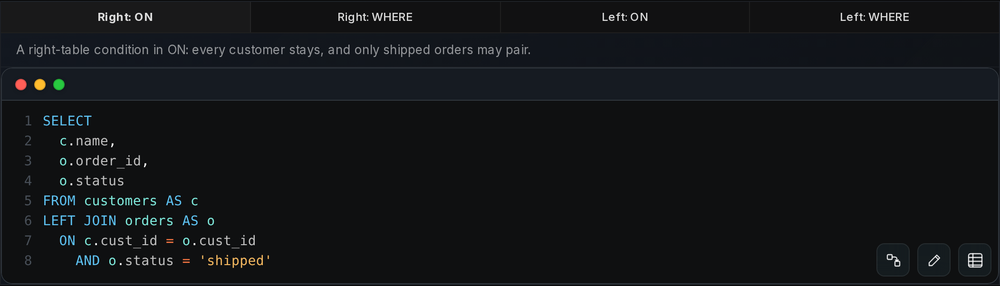

Caption: A right-table condition in ON: every customer stays, and only shipped orders may pair.

```sql
SELECT
  c.name,
  o.order_id,
  o.status
FROM customers AS c
LEFT JOIN orders AS o
  ON c.cust_id = o.cust_id
    AND o.status = 'shipped'
```

Result:

```
name | order_id | status
Alice | O1 | shipped
Bob | NULL | NULL
Carol | NULL | NULL
```

**Tab: Right: WHERE**

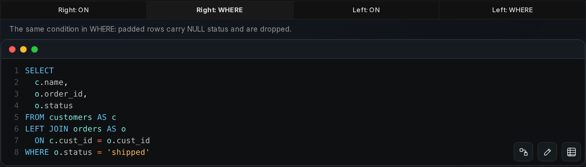

Caption: The same condition in WHERE: padded rows carry NULL status and are dropped.

```sql
SELECT
  c.name,
  o.order_id,
  o.status
FROM customers AS c
LEFT JOIN orders AS o
  ON c.cust_id = o.cust_id
WHERE o.status = 'shipped'
```

Result:

```
name | order_id | status
Alice | O1 | shipped
```

**Tab: Left: ON**

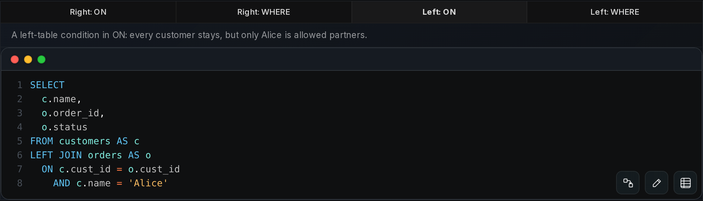

Caption: A left-table condition in ON: every customer stays, but only Alice is allowed partners.

```sql
SELECT
  c.name,
  o.order_id,
  o.status
FROM customers AS c
LEFT JOIN orders AS o
  ON c.cust_id = o.cust_id
    AND c.name = 'Alice'
```

Result:

```
name | order_id | status
Alice | O1 | shipped
Alice | O2 | cancelled
Bob | NULL | NULL
Carol | NULL | NULL
```

**Tab: Left: WHERE**

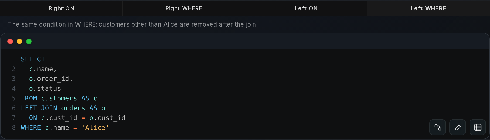

Caption: The same condition in WHERE: customers other than Alice are removed after the join.

```sql
SELECT
  c.name,
  o.order_id,
  o.status
FROM customers AS c
LEFT JOIN orders AS o
  ON c.cust_id = o.cust_id
WHERE c.name = 'Alice'
```

Result:

```
name | order_id | status
Alice | O1 | shipped
Alice | O2 | cancelled
```

### null_values_advanced, block 2 (2 tabs: Using <> / IS DISTINCT)

https://datadriven.io/learn/null_values_advanced

**Tab: Using <>**

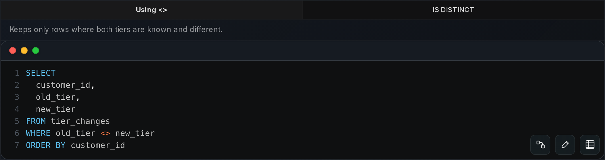

Caption: Keeps only rows where both tiers are known and different.

```sql
SELECT
  customer_id,
  old_tier,
  new_tier
FROM tier_changes
WHERE old_tier <> new_tier
ORDER BY customer_id
```

Result:

```
customer_id | old_tier | new_tier
2 | Silver | Gold
```

**Tab: IS DISTINCT**

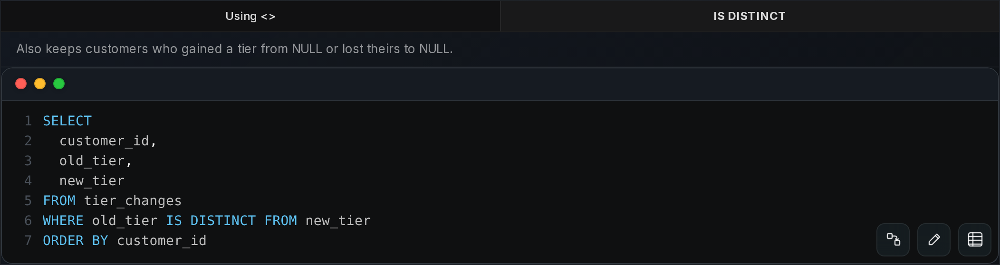

Caption: Also keeps customers who gained a tier from NULL or lost theirs to NULL.

```sql
SELECT
  customer_id,
  old_tier,
  new_tier
FROM tier_changes
WHERE old_tier IS DISTINCT FROM new_tier
ORDER BY customer_id
```

Result:

```
customer_id | old_tier | new_tier
2 | Silver | Gold
3 | NULL | Gold
4 | Gold | NULL
```

### null_values_advanced, block 4 (4 tabs: NOT IN / Filtered / NOT EXISTS / EXCEPT)

https://datadriven.io/learn/null_values_advanced

**Tab: NOT IN**

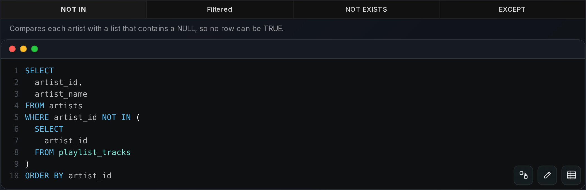

Caption: Compares each artist with a list that contains a NULL, so no row can be TRUE.

```sql
SELECT
  artist_id,
  artist_name
FROM artists
WHERE artist_id NOT IN (
  SELECT
    artist_id
  FROM playlist_tracks
)
ORDER BY artist_id
```

Result:

```
artist_id | artist_name
```

**Tab: Filtered**

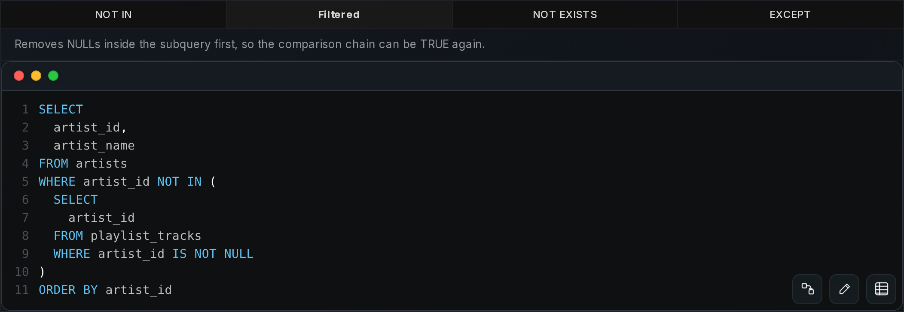

Caption: Removes NULLs inside the subquery first, so the comparison chain can be TRUE again.

```sql
SELECT
  artist_id,
  artist_name
FROM artists
WHERE artist_id NOT IN (
  SELECT
    artist_id
  FROM playlist_tracks
  WHERE artist_id IS NOT NULL
)
ORDER BY artist_id
```

Result:

```
artist_id | artist_name
2 | Kite
4 | Ravel
```

**Tab: NOT EXISTS**

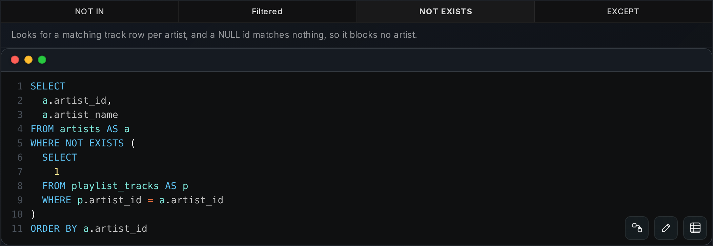

Caption: Looks for a matching track row per artist, and a NULL id matches nothing, so it blocks no artist.

```sql
SELECT
  a.artist_id,
  a.artist_name
FROM artists AS a
WHERE NOT EXISTS (
  SELECT
    1
  FROM playlist_tracks AS p
  WHERE p.artist_id = a.artist_id
)
ORDER BY a.artist_id
```

Result:

```
artist_id | artist_name
2 | Kite
4 | Ravel
```

**Tab: EXCEPT**

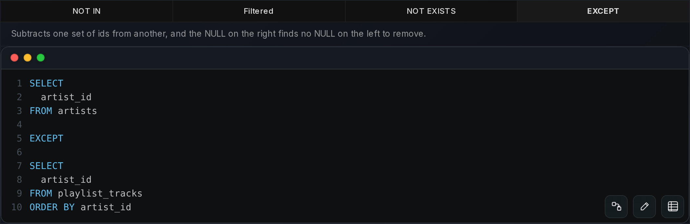

Caption: Subtracts one set of ids from another, and the NULL on the right finds no NULL on the left to remove.

```sql
SELECT
  artist_id
FROM artists

EXCEPT

SELECT
  artist_id
FROM playlist_tracks
ORDER BY artist_id
```

Result:

```
artist_id
2
4
```

### query_structure_advanced, block 2 (3 tabs: Registered / Paying / Counted)

https://datadriven.io/learn/query_structure_advanced

**Tab: Registered**

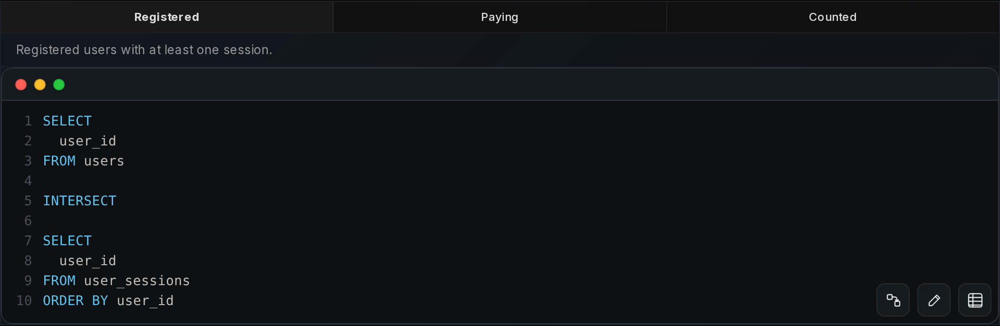

Caption: Registered users with at least one session.

```sql
SELECT
  user_id
FROM users

INTERSECT

SELECT
  user_id
FROM user_sessions
ORDER BY user_id
```

Result:

```
user_id
2
4
```

**Tab: Paying**

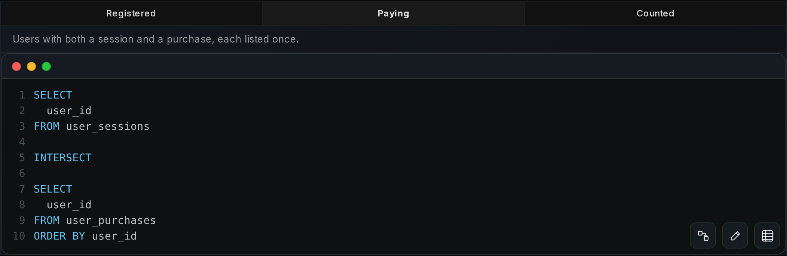

Caption: Users with both a session and a purchase, each listed once.

```sql
SELECT
  user_id
FROM user_sessions

INTERSECT

SELECT
  user_id
FROM user_purchases
ORDER BY user_id
```

Result:

```
user_id
2
4
```

**Tab: Counted**

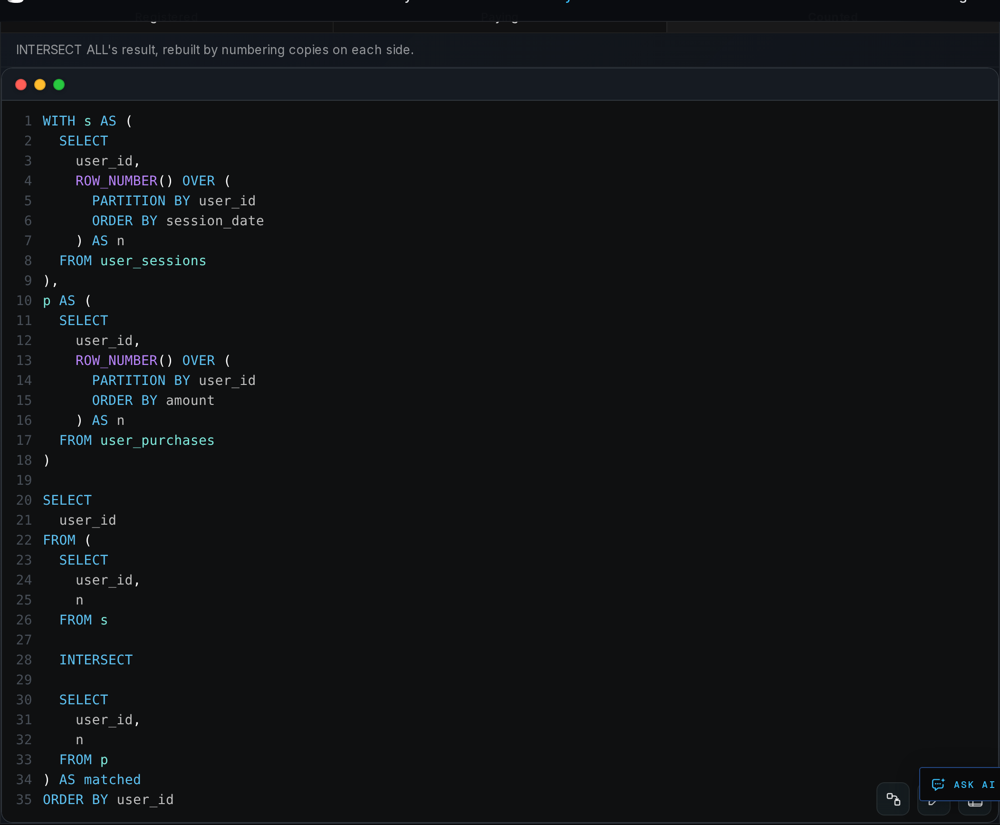

Caption: INTERSECT ALL's result, rebuilt by numbering copies on each side.

```sql
WITH s AS (
  SELECT
    user_id,
    ROW_NUMBER() OVER (
      PARTITION BY user_id
      ORDER BY session_date
    ) AS n
  FROM user_sessions
),
p AS (
  SELECT
    user_id,
    ROW_NUMBER() OVER (
      PARTITION BY user_id
      ORDER BY amount
    ) AS n
  FROM user_purchases
)

SELECT
  user_id
FROM (
  SELECT
    user_id,
    n
  FROM s

  INTERSECT

  SELECT
    user_id,
    n
  FROM p
) AS matched
ORDER BY user_id
```

Result:

```
user_id
2
2
4
```

### string_functions_intermediate, block 1 (3 tabs: Negative / LENGTH math / Off by one)

https://datadriven.io/learn/string_functions_intermediate

**Tab: Negative**

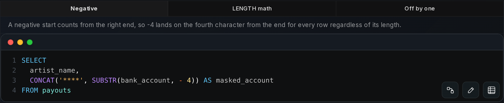

Caption: A negative start counts from the right end, so -4 lands on the fourth character from the end for every row regardless of its length.

```sql
SELECT
  artist_name,
  CONCAT('****', SUBSTR(bank_account, - 4)) AS masked_account
FROM payouts
```

Result:

```
artist_name | masked_account
Low Tide | ****3000
Paper Moons | ****6819
Static Bloom | ****4300
```

**Tab: LENGTH math**

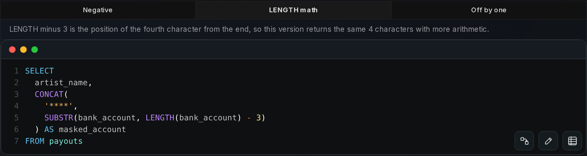

Caption: LENGTH minus 3 is the position of the fourth character from the end, so this version returns the same 4 characters with more arithmetic.

```sql
SELECT
  artist_name,
  CONCAT(
    '****',
    SUBSTR(bank_account, LENGTH(bank_account) - 3)
  ) AS masked_account
FROM payouts
```

Result:

```
artist_name | masked_account
Low Tide | ****3000
Paper Moons | ****6819
Static Bloom | ****4300
```

**Tab: Off by one**

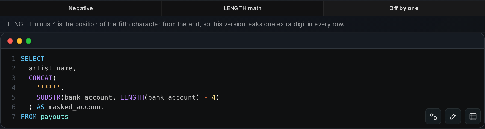

Caption: LENGTH minus 4 is the position of the fifth character from the end, so this version leaks one extra digit in every row.

```sql
SELECT
  artist_name,
  CONCAT(
    '****',
    SUBSTR(bank_account, LENGTH(bank_account) - 4)
  ) AS masked_account
FROM payouts
```

Result:

```
artist_name | masked_account
Low Tide | ****13000
Paper Moons | ****26819
Static Bloom | ****64300
```

### window_functions_advanced, block 1 (3 tabs: Two keys / One key / Filter first)

https://datadriven.io/learn/window_functions_advanced

**Tab: Two keys**

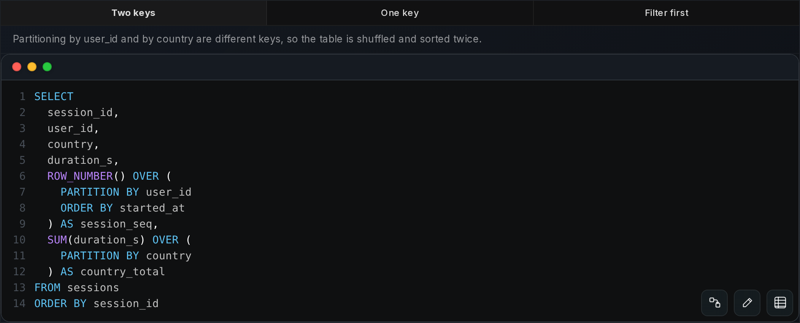

Caption: Partitioning by user_id and by country are different keys, so the table is shuffled and sorted twice.

```sql
SELECT
  session_id,
  user_id,
  country,
  duration_s,
  ROW_NUMBER() OVER (
    PARTITION BY user_id
    ORDER BY started_at
  ) AS session_seq,
  SUM(duration_s) OVER (
    PARTITION BY country
  ) AS country_total
FROM sessions
ORDER BY session_id
```

Result:

```
session_id | user_id | country | duration_s | session_seq | country_total
1 | u1 | US | 120 | 1 | 1065
2 | u1 | US | 300 | 2 | 1065
3 | u2 | US | 45 | 1 | 1065
4 | u2 | US | 600 | 2 | 1065
5 | u3 | DE | 90 | 1 | 470
6 | u3 | DE | 30 | 2 | 470
7 | u4 | DE | 200 | 1 | 470
8 | u4 | DE | 150 | 2 | 470
```

**Tab: One key**

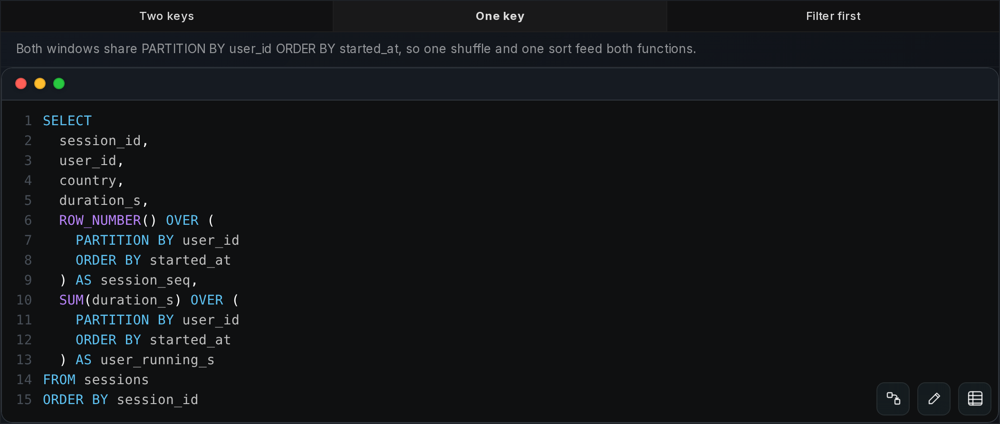

Caption: Both windows share PARTITION BY user_id ORDER BY started_at, so one shuffle and one sort feed both functions.

```sql
SELECT
  session_id,
  user_id,
  country,
  duration_s,
  ROW_NUMBER() OVER (
    PARTITION BY user_id
    ORDER BY started_at
  ) AS session_seq,
  SUM(duration_s) OVER (
    PARTITION BY user_id
    ORDER BY started_at
  ) AS user_running_s
FROM sessions
ORDER BY session_id
```

Result:

```
session_id | user_id | country | duration_s | session_seq | user_running_s
1 | u1 | US | 120 | 1 | 120
2 | u1 | US | 300 | 2 | 420
3 | u2 | US | 45 | 1 | 45
4 | u2 | US | 600 | 2 | 645
5 | u3 | DE | 90 | 1 | 90
6 | u3 | DE | 30 | 2 | 120
7 | u4 | DE | 200 | 1 | 200
8 | u4 | DE | 150 | 2 | 350
```

**Tab: Filter first**

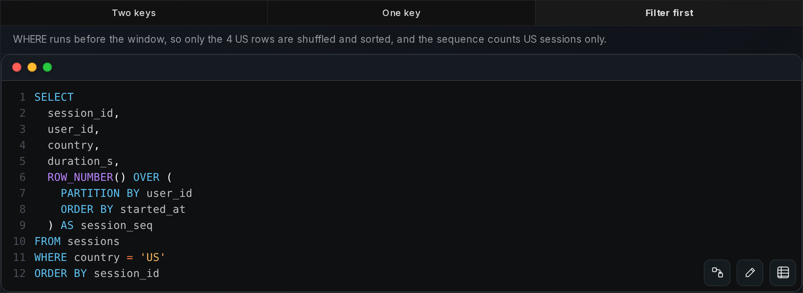

Caption: WHERE runs before the window, so only the 4 US rows are shuffled and sorted, and the sequence counts US sessions only.

```sql
SELECT
  session_id,
  user_id,
  country,
  duration_s,
  ROW_NUMBER() OVER (
    PARTITION BY user_id
    ORDER BY started_at
  ) AS session_seq
FROM sessions
WHERE country = 'US'
ORDER BY session_id
```

Result:

```
session_id | user_id | country | duration_s | session_seq
1 | u1 | US | 120 | 1
2 | u1 | US | 300 | 2
3 | u2 | US | 45 | 1
4 | u2 | US | 600 | 2
```

## Options

Size note: all 152 tabs hold about 20 KB of SQL, about 45 KB with captions and results; keeping only the first tab holds about 16 KB. Sample screenshots average about 110 KB each at 2x, so a screenshot per tab for all 152 tabs would be roughly 17 MB.

### A. Heading per tab, code fence per tab (text)
Each block becomes one section: the tab name as a bold label or h4, then caption, a ```sql fence and the result as a small Markdown table.
- Pros: nothing lost, searchable and greppable, fits the lesson-as-text goal and the MCP search; the converter can build it from live-page clicks; prose "the 3 tabs below" stays true.
- Cons: longer lessons (about 3x the block text, 94 extra panels); needs one browser click-through per lesson (about 20 s each); result tables add length.
- Size: about +28 KB of Markdown over 30 lessons (about +1 KB per lesson).

### B. Screenshot of each tab plus code fence per tab
Option A plus a 2x image per tab, like the executable cells.
- Pros: shows the real look.
- Cons: images add little the code does not already say (the SQL and result are text); about 17 MB of PNGs for 152 tabs; images are not searchable; the tab bar is not interactive in a Markdown viewer anyway.
- Size: about 17 MB.

### C. Keep only the first tab (today's behaviour, plus the tab name)
- Pros: no extra work, no browser.
- Cons: 94 panels lost; prose says "the 3 tabs below" but only one exists, so the lesson misleads and would need prose edits.
- Size: about 16 KB.

### D. Merge into one code block with comments
One fence with the variants stacked, each preceded by a `-- Tab: name` comment, caption as a comment.
- Pros: compact, one copyable block.
- Cons: stacked variants read as a single script, not alternatives; results get lost or must be pasted as comments.
- Size: about the same as A without the result tables.

## Recommendation (not a decision)
Option A. It keeps every tab as text and costs about 1 KB per lesson. Screenshots (B) add MBs without adding information.

## Owner decision
- [ ] A. Heading plus code fence (and result) per tab
- [ ] B. Screenshot of each tab plus code fence per tab
- [ ] C. Keep only the first tab
- [ ] D. Merge into one commented code block
- [ ] Other:
